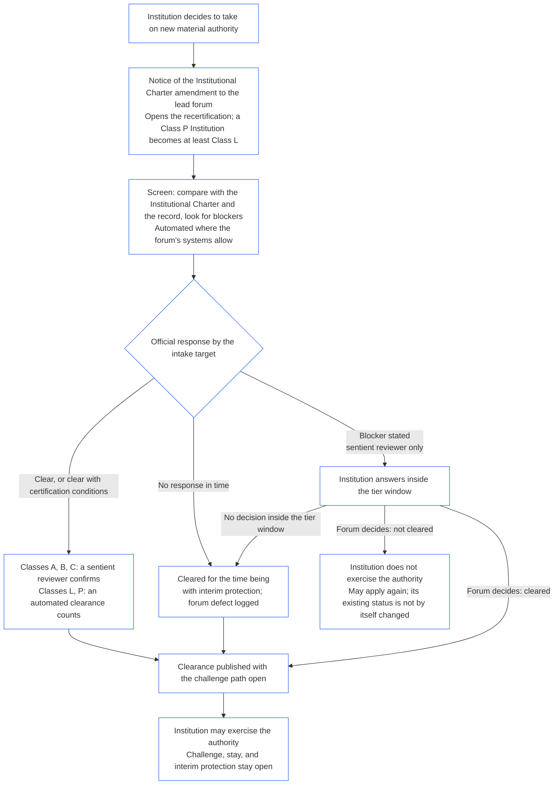

#### 7.4 Denegación y revocación para una Institución

*En términos sencillos: la denegación significa que se rehúsa la certificación, y la revocación significa que se retira una certificación que ya se tenía. Ambas son consecuencias reales. Ninguna clausura la Institución.*

[Capítulo Nueve, Parte B §7.4 Denegación y revocación](core_09.005_system_alignment_certification_record_process.md#74-denial-and-revocation) se aplica a una Institución con estos cambios:

- **Fundamentos y proceso:** El Capítulo Nueve, Parte B §7.4 Denegación y revocación los establece sin cambios:
  - **Fundamentos** ([Capítulo Nueve, Parte B §7.4.2 Cuándo se requiere la denegación o revocación](core_09.005_system_alignment_certification_record_process.md#742-when-denial-or-revocation-is-required)):
    - **Denegación,** cuando no se tiene certificación: la revisión de preparación determina que la Institución no está dispuesta, o que no está dispuesta ni es capaz; o que está dispuesta pero no es capaz, sin un alcance más acotado, apoyo o transferencia que cierre la brecha a tiempo; o ya transcurrió el único aplazamiento y aún no se ha demostrado la preparación.
    - **Revocación,** cuando se tiene certificación: las mismas determinaciones de preparación, después de notificar y dar oportunidad de responder. También, una condición de certificación incumplida dos veces o infringida sustancialmente, evidencia que se demuestre falsa, fabricada u ocultada, o un paso de prueba requerido que no se haya realizado dentro de su plazo.
    - **No corresponde certificación condicional:** cuando se cumple uno de estos fundamentos de denegación o revocación, el foro debe denegar o revocar. No puede responder al fundamento de denegación o revocación otorgando o manteniendo la certificación con condiciones de certificación adjuntas.
  - **La protección primero** ([Capítulo Nueve, Parte B §7.4.3 La protección primero](core_09.005_system_alignment_certification_record_process.md#743-protection-first)):
    - **A qué afecta:** la denegación y la revocación afectan el estado de certificación. Por sí solas, no clausuran la Institución.
    - **Antes de que cualquiera surta efecto:** el foro declara la protección provisional y los límites de confianza.
  - **Proceso** ([Capítulo Nueve, Parte B §7.4.4 Proceso](core_09.005_system_alignment_certification_record_process.md#744-process)):
    - **Notificación previa:** antes de una denegación o revocación, se notifica a la Institución la determinación y la evidencia, se le da un plazo breve para responder o presentar el paso de prueba, y la oportunidad de impugnar la determinación mediante la cadena de impugnabilidad.
    - **Motivos:** la decisión declara sus motivos en el expediente.
    - **Protección urgente** ([Capítulo Nueve, Parte B §6.2.3 Protección urgente](core_09.005_system_alignment_certification_record_process.md#623-urgent-protection)): puede ordenarse de inmediato una suspensión, protección provisional o límite de confianza, sin esperar la notificación, la respuesta o la decisión. El proceso continúa después, y la medida se asienta en el expediente.
  - **No es una prohibición permanente:** un operador cuya solicitud se denegó o cuya certificación se revocó puede volver a solicitarla.
- **Quién ocupa el lugar de quién:**
  - **Operador:** léase la autoridad rectora de la Institución donde el Capítulo Nueve, Parte B §7.4 Denegación y revocación dice «operador».
  - **Determinaciones del Sistema:** léanse las determinaciones institucionales donde dice «determinaciones del Sistema».
- **Efectos:** los efectos constan en [§7.5 Efectos de la denegación y revocación para una Institución](#75-effects-of-denial-and-revocation-for-an-institution), no en los de [Capítulo Nueve, Parte B §7.5 Efectos de la denegación y revocación](core_09.005_system_alignment_certification_record_process.md#75-effects-of-denial-and-revocation).
- **Un solo Sistema:** una Institución que opera exactamente un Sistema se somete a una evaluación de un solo Sistema ([§1.1 Quién recibe certificación](#11-who-is-certified)). Cada resultado sigue su propio fundamento de denegación o revocación, de modo que una Institución con un Sistema no recibe un trato peor que otra con varios:
  - **El Sistema:** se le deniega o revoca conforme al Capítulo Nueve, Parte B §7.4 Denegación y revocación únicamente por un fundamento relativo al Sistema, basado en sus propias determinaciones. Un fundamento institucional, basado solo en los elementos institucionales (elementos 1 a 5, 7 y 8 de [§3 Evaluación de certificación de toda la Institución](#3-whole-institution-certification-evaluation), y las evaluaciones propias de la Institución conforme a [§4 Evaluaciones cuando existe implicación](#4-evaluations-where-implicated) y [§5 Evaluaciones del piso de derechos y de dominio](#5-rights-floor-and-domain-evaluations)), no da lugar a la denegación o revocación del Sistema.
  - **La Institución:** se publica como No certificada, con los efectos de [§7.5 Efectos de la denegación y revocación para una Institución](#75-effects-of-denial-and-revocation-for-an-institution), solo por un fundamento institucional basado en las determinaciones institucionales. Un fundamento relativo al Sistema deja intacto el estado de la Institución, salvo que la determinación de causa ubique la causa en la Institución ([Capítulo Nueve, Parte C §9.3.3 Causa de la desalineación](core_09.010_system_alignment_certification_record_recertification.md#933-cause-of-misalignment)). La prueba es la de [§9.5 Cascada desde las certificaciones de Sistemas](#95-cascade-from-system-certifications), regla 2, que denomina a esa causa *causa institucional*. Las reglas 1 y 2 de §9.5 Cascada desde las certificaciones de Sistemas se aplican a una evaluación de un solo Sistema tal como establece esta sección; el resto de §9.5 Cascada desde las certificaciones de Sistemas no se aplica.
  - **Ambos:** un fundamento conjunto, basado en ambos, produce los dos resultados. Un fundamento de denegación o revocación es conjunto cuando se trata de la conducta de la autoridad rectora de la Institución (falta de disposición, evidencia que se demuestra falsa, fabricada u ocultada, una condición de certificación incumplida dos veces o infringida sustancialmente, o un paso de prueba requerido que no se realizó), o cuando se basa en un hecho que [Capítulo Nueve, Parte A §3.1 Disciplina de gobernanza, incentivos e impugnabilidad](core_09.000_system_alignment_certification_evaluation.md#31-governance-incentive-and-contestability-discipline) atribuye al Sistema mismo, y no en un hecho que el Sistema incorpora por referencia desde el expediente de la Institución. El Registro de Certificación Institucional indica qué fundamento de denegación o revocación respalda cada resultado.
  - **Dos líneas de estado:** el mismo expediente contiene una línea de estado para el Sistema y otra para la Institución. Cuando la Institución aún no tiene certificación y el único fundamento de denegación es relativo al Sistema, la aprobación de la Institución se basa en sus propias determinaciones institucionales, conforme a [§9.3.1 Los dos estados](#931-the-two-statuses) (certificación provisional, con límites de confianza indicados en el expediente). No es No certificada, y no se le aplican la prohibición de ocupar puestos de [§6.3 Foros, certificadores y oficinas de registro como instituciones](#63-forums-certifiers-and-record-offices-as-institutions) ni los efectos de [§7.5 Efectos de la denegación y revocación para una Institución](#75-effects-of-denial-and-revocation-for-an-institution). La denegación o revocación del Sistema es un indicador para la Institución conforme a la regla 1 de §9.5 Cascada desde las certificaciones de Sistemas, igual que para una Institución con varios Sistemas.

#### 7.5 Efectos de la denegación y revocación para una Institución

*En términos sencillos: una denegación o revocación cambia lo que la Institución puede decir de sí misma, a quién se notifica, cuánto cuenta su estado en las revisiones de sus Sistemas y adónde se remite el asunto. Por sí sola, no clausura la Institución.*

**Efectos:** Como no existe una barrera ([§1.2 No se requiere permiso ni hay barrera para constituirse u operar](#12-no-permission-and-no-gate-on-forming-or-running)), una denegación o revocación solo tiene estos efectos:

1. **Estado:** la Institución se publica como No certificada y no puede describirse como certificada.
2. **Notificación:** se informa a quienes confían en la Institución, así como a los foros de cada Sistema de su cartera. El foro principal que publica el resultado se asegura de que esto se haga. Cuando se aplica [§9.6 Reapertura de los Sistemas de la Institución](#96-reopening-the-institutions-systems), la misma notificación incluye la solicitud de reapertura y sigue quién la emite, el plazo y las reglas supletorias de §9.6 Reapertura de los Sistemas de la Institución; la entrada *Sistemas notificados* del expediente cubre ambos aspectos.
3. **Peso en las certificaciones de sus Sistemas:**
   - El estado es evidencia desfavorable conforme a [Capítulo Nueve, Parte A §3.1 Disciplina de gobernanza, incentivos e impugnabilidad](core_09.000_system_alignment_certification_evaluation.md#31-governance-incentive-and-contestability-discipline) cuando se certifica cada Sistema de su cartera.
   - Para la puesta en marcha de un Sistema nuevo o una ampliación sustancial, quien lo propone debe demostrar que los hechos institucionales en los que se apoya son suficientes pese a la determinación.
   - El estado por sí solo no certifica ni bloquea ningún Sistema. La aprobación de certificación propia del Sistema es la que decide.
4. **Puestos en las certificaciones de otros organismos:** la Institución los cede mientras sea No certificada, conforme a [§6.3 Foros, certificadores y oficinas de registro como instituciones](#63-forums-certifiers-and-record-offices-as-institutions).
5. **Remisión:** el foro principal remite el asunto al foro competente para el tipo de problema de certificación identificado. Hay tres vías:
   - **Al foro que decide el incumplimiento y las sanciones:** el foro principal remite el asunto al foro competente conforme a **CI-12.210** (*Incumplimiento y disolución institucional*) y **CI-12.215** (*Rendición de cuentas y sanciones institucionales*) cuando:
     - la determinación establece que la Institución es capaz pero no está dispuesta;
     - una revocación se basa en ocultamiento o evidencia fraudulenta; o
     - una verificación fallida de constitución no se resolvió dentro del plazo de resolución indicado en [Capítulo Siete §6 Cuando un Titular no supera la verificación de constitución](core_07.000_charters.md#6-when-a-holder-fails-the-formation-check) (*Plazo de resolución*).

     Solo ese foro decide cualquier suspensión, administración judicial, separación estructural o disolución. Este Capítulo no crea ninguna de esas medidas.
   - **Al foro competente respecto de una persona sintiente identificada:** cuando la determinación de certificación se basa en que un titular no es auténtico, o en que una persona sintiente usa la Institución como vehículo para una infracción, el foro principal también remite los hechos al foro competente respecto de esa persona sintiente.
   - **A un bloqueo o una Retención Provisional:** si se verifica una determinación de infracción, el asunto se remite al Bloqueo Permanente de Autoridad Institucional conforme a [Capítulo Doce §5.5 Bloqueos especiales](core_12.000_standing_integration.md#55-special-locks). Cuando solo se cumplen los fundamentos de una [Retención Provisional](core_05.035_band_accountability.md#interim-hold), se remite a una Retención Provisional conforme a [Capítulo Catorce §5 Retención provisional en la vía de una persona sintiente identificada](core_14.000_forum.md#interim-hold-on-a-named-sentients-pathway). La retención se basa en la autoridad de esa persona sintiente, nunca en la Institución.
6. **Legitimación:** únicamente mediante [§11 Relación con la legitimación](#11-relationship-to-standing). Esto también se aplica a la denegación de una primera certificación: las determinaciones que la sustentan pueden aportar información conforme a [§11.2 Todo resultado de certificación](#112-every-certification-outcome), bajo los mismos términos que cualquier otro.

Una Institución No certificada puede seguir existiendo, publicar su Carta Institucional, operar y volver a solicitar certificación conforme a los términos del Capítulo Nueve, Parte B §7.4 (*No es una prohibición permanente*). No puede ejercer nueva autoridad sustancial hasta que una recertificación habilite esa autoridad ([§9.2.2 Recertificación para nueva autoridad sustancial](#922-recertification-for-new-material-authority)).

El estado No certificada no abre ninguna de las tres vías estrechas de **Artículo XI-E** (*Constitución institucional y creación de empresas*):

- un bloqueo de la autoridad de una persona sintiente identificada;
- una Retención Provisional de la autoridad de una persona sintiente identificada; y
- un bloqueo de la propia Parte Operadora. Esto vincula a una Institución únicamente cuando efectivamente recae sobre ella un bloqueo, como el Bloqueo de Reforma por Disolución conforme a **CI-12.210 §4** (*Disolución*). El estado No certificada no es tal bloqueo.

Corresponde a los foros decidir, según los términos de ese Artículo, si una Parte Operadora queda fuera del derecho a constituirse conforme a los Límites de [Artículo XI-E](core_06.005_rights_part_b.md#article-xi-e-institutional-formation-and-business-creation) (*Constitución institucional y creación de empresas*). Este Capítulo no lo decide.

### 8. Registro de Certificación Institucional

<strong>Trazabilidad</strong>

- Antecedentes:
  - [Capítulo Nueve, Parte C §8 Registro de Certificación del Sistema](core_09.010_system_alignment_certification_record_recertification.md#8-system-certification-record) (9.010 §8), incluidos [§8.1 Contenido mínimo del expediente](core_09.010_system_alignment_certification_record_recertification.md#81-minimum-record-contents) y [§8.2 Transparencia y auditabilidad del expediente](core_09.010_system_alignment_certification_record_recertification.md#82-transparency-and-auditability-of-the-record);
  - [Capítulo Ocho §8 Registros de actos y transferencias atribuibles](core_08.000_functional_independence_separation_of_duties.md#8-act-records-and-attributable-handoffs) (8.000 §8);
  - [Registro de Acto Materialmente Vinculante](core_05.035_band_accountability.md#materially-binding-act-record);
  - [CS-6.310 Parte B §9.3 Tipo O](corpus_systems/cs_06.310_data_classifications.md#93-type-o-open-public-oversight-baseline-disclosure-data).
- Consecuencias: [§9](#9-recertification-and-reopening); [§10](#10-challenging-a-certification); [§11](#11-relationship-to-standing).
- Consultar junto con:
  - [Registro de Certificación Institucional](core_05.040_band_continuity.md#institutional-certification-record);
  - [Mapa de funciones de la Carta](core_05.040_band_continuity.md#charter-role-map).

 

*En términos sencillos: el resultado declarado se conserva en un expediente custodiado por una oficina que la institución no controla, y el expediente puede impugnarse.*

Esta sección es la **Fase V, Registro** para una Institución.

Un **Registro de Certificación Institucional** es un expediente acotado y revisable sobre una Institución, una versión de la Carta Institucional, un alcance, un período del expediente y un contexto de decisión. Cumple y amplía el [Registro de Acto Materialmente Vinculante](core_05.035_band_accountability.md#materially-binding-act-record) y [Capítulo Ocho §8 Registros de actos y transferencias atribuibles](core_08.000_functional_independence_separation_of_duties.md#8-act-records-and-attributable-handoffs). Lo abre quien ocupa el puesto de registro en el paso 1 de la secuencia y se completa con el resultado. No se abre un segundo expediente para la decisión. Se le aplican las reglas de conservación de registros de [Capítulo Nueve, Parte C §8 Registro de Certificación del Sistema](core_09.010_system_alignment_certification_record_recertification.md#8-system-certification-record) (versiones del registro, prohibición de modificar en el lugar un registro completado, registro de solicitudes de cambio e impugnación que no congela el Registro de Certificación Institucional), sustituyendo la versión de la Carta Institucional por la versión del Sistema.

#### 8.1 Contenido mínimo del expediente

Como mínimo, el expediente debe identificar:

- **Identidad, alcance y estado de la Institución:** la Institución, su autoridad rectora, la versión de su Carta Institucional (o la Carta del Sistema que cumple esa función) y su estado de revisión;
- **Expediente anterior:** el Registro de Certificación Institucional completado al que da seguimiento esta evaluación de certificación, si lo hubiera;
- **Clasificación institucional:** la clase conforme a [§2.1 Clase de institución](#21-institution-class), con los motivos;
- **Cartera y registros de Sistemas citados:** cada Sistema de la cartera, su versión de la Carta del Sistema y el Registro de Certificación del Sistema citado, con su versión, estado, vencimiento y los resultados de las pruebas de regresión que contiene. Se incluye el motivo cuando un Sistema no tenga un registro vigente;
- **Tipos de datos y tratamiento:** para los datos que la Institución maneje fuera de cualquier Sistema, los tipos de datos sustancialmente incluidos en el alcance y la forma de tratar cada uno conforme a la clasificación aplicable más restrictiva, que ocupa el lugar de un Registro de Tipos de Datos del Sistema en el Registro de Certificación Institucional. Se reevalúan según el calendario de [Capítulo Nueve, Parte A §3.4.4 Reevaluación programada de tipos de datos](core_09.000_system_alignment_certification_evaluation.md#344-scheduled-data-type-re-evaluation). Los datos tratados dentro de un Sistema constan una sola vez, en el expediente de ese Sistema, y se citan aquí;
- **Determinaciones institucionales:** las determinaciones sobre los ocho elementos de [§3 Evaluación de certificación de toda la Institución](#3-whole-institution-certification-evaluation), las otras dos partes de la §3 Evaluación de certificación de todo el Sistema del Capítulo Nueve, Parte A que se aplican a la Institución (riesgo sistémico y tipos de datos y tratamiento), y cualquier evaluación efectuada conforme a [§4 Evaluaciones cuando existe implicación](#4-evaluations-where-implicated) o [§5 Evaluaciones del piso de derechos y de dominio](#5-rights-floor-and-domain-evaluations), cada una con su evidencia;
- **La versión vigente del Mapa de funciones de la Carta** y la asignación de cada uno de los cuatro puestos para esta evaluación de certificación, con la vía independiente;
- **Supervisión del foro y registro de independencia funcional:** el foro principal y cada autoridad componente, y cómo se mantuvieron separados los puestos;
- **Vías de impugnación:** la vía publicada para impugnar el expediente, quién la recibe, cómo presentarla y sus plazos, conforme a [Capítulo Nueve, Parte C §10.2 Vías de impugnabilidad](core_09.010_system_alignment_certification_record_recertification.md#102-contestability-paths);
- **Inquietudes planteadas durante la revisión y la decisión;**
- **Registro de presentaciones de la revisión:** el registro que mantiene quien ocupa el puesto de registro conforme a [Capítulo Nueve, Parte B §6.2.4 Participación durante la revisión](core_09.005_system_alignment_certification_record_process.md#624-participation-during-review), publicado con el expediente;
- **Determinación de causa** de cualquier desalineación, conforme a [Capítulo Nueve, Parte C §9.3.3 Causa de la desalineación](core_09.010_system_alignment_certification_record_recertification.md#933-cause-of-misalignment), incluido si la causa reside en la Institución o en un Sistema;
- **Preparación para la remediación:** cuando se detectó una desalineación, las determinaciones y la evidencia que exige [Capítulo Nueve, Parte C §8.1 Contenido mínimo del expediente](core_09.010_system_alignment_certification_record_recertification.md#81-minimum-record-contents), expresadas para la Institución conforme a [§7.4 Denegación y revocación para una Institución](#74-denial-and-revocation-for-an-institution);
- **Resultado, estado y límites de confianza** (en una evaluación de un solo Sistema, una línea para el Sistema y otra para la Institución);
- **Sistemas notificados:** cada Sistema notificado conforme a [§9.6 Reapertura de los Sistemas de la Institución](#96-reopening-the-institutions-systems) y la fecha de notificación; y
- **Plan operativo:** responsables, plazos, seguimiento e indicadores, condiciones de certificación y criterios de verificación.

Un expediente está incompleto si omite las determinaciones de cualquier evaluación aplicable, o cualquier inquietud, objeción o disenso planteado durante la revisión o al llegar al resultado, conforme a [Capítulo Nueve, Parte C §8.1.10 Integridad](core_09.010_system_alignment_certification_record_recertification.md#8110-completeness).

Un Registro de Certificación del Sistema por sí solo, o un informe o declaración de la propia Institución presentado en lugar del Registro de Certificación Institucional, no satisface esta sección.

#### 8.2 Transparencia y auditabilidad del expediente

Las reglas de integridad de [Capítulo Nueve, Parte C §8.2 Transparencia y auditabilidad del expediente](core_09.010_system_alignment_certification_record_recertification.md#82-transparency-and-auditability-of-the-record) se aplican al Registro de Certificación Institucional.

**Tipo O.** El Registro de Certificación Institucional completado es dato de certificación **Tipo O**. Se publica con fidelidad de referencia pública, con sustitutos legales, conforme a [CS-6.310 Parte B §9.3 Tipo O](corpus_systems/cs_06.310_data_classifications.md#93-type-o-open-public-oversight-baseline-disclosure-data).

### 9. Recertificación y reapertura

<strong>Trazabilidad</strong>

- Antecedentes:
  - [Capítulo Nueve, Parte C §9 Recertificación y reapertura](core_09.010_system_alignment_certification_record_recertification.md#9-recertification-and-reopening) (9.010 §9), incluidos [§9.3 Certificación provisional y plena](core_09.010_system_alignment_certification_record_recertification.md#93-provisional-and-full-certification) y [§9.4 No evasión](core_09.010_system_alignment_certification_record_recertification.md#94-non-evasion);
  - [Capítulo Nueve, Parte B §6.2.3 Protección urgente](core_09.005_system_alignment_certification_record_process.md#623-urgent-protection) (9.005 §6.2.3) y [Capítulo Nueve, Parte A §3.1 Disciplina de gobernanza, incentivos e impugnabilidad](core_09.000_system_alignment_certification_evaluation.md#31-governance-incentive-and-contestability-discipline) (9.000 §3.1);
  - **CF-14.445 §3.1** (*Objetivos de etapa y límites máximos*);
  - [Capítulo Siete §7 Modificación y revisión](core_07.000_charters.md#7-amendment-review-and-scope-misalignment) (7.000 §7);
  - [Capítulo Tres §1 Integridad de definiciones y restricciones contra la evasión](core_03.000_definition_integrity.md#1-definition-integrity-and-anti-evasion-constraints) (3.000 §1) y [§2.1 Patrones comunes de evasión](core_03.000_definition_integrity.md#21-common-evasion-patterns);
  - [Capítulo Catorce §3 Transferencia, consolidación y coordinación](core_14.000_forum.md#3-transfer-consolidation-and-coordination--continuity-and-anti-capture) (14.000 §3) y [§2.1 Límites de la regla supletoria del foro principal](core_14.000_forum.md#21-lead-default-limits);
  - [Capítulo Uno §19.6 Mantener la responsabilidad cuando cambia la titularidad o la estructura](core_01.010_stewardship_capacity_principles.md#196-keeping-responsibility-when-ownership-or-structure-changes) (1.010 §19.6).
- Consecuencias: [§10](#10-challenging-a-certification); [§11](#11-relationship-to-standing); [Capítulo Catorce](core_14.000_forum.md#chapter-fourteen-forums-and-jurisdiction) (14.000).
- Consultar junto con:
  - [Recertificación](core_05.040_band_continuity.md#recertification);
  - [Certificación provisional](core_05.040_band_continuity.md#provisional-certification);
  - [Certificación plena](core_05.040_band_continuity.md#full-certification);
  - **CF-14.435 §6** (*sin investigación propia*).

 

*En términos sencillos: la certificación de una institución se vuelve a comprobar según un calendario y cada vez que algo sustancial cambia. Si uno de sus Sistemas pierde su certificación, la institución responde por lo que eso dice de la institución, y nada más. Si se determina que la institución gobernó mal, se vuelven a revisar sus Sistemas.*

Esta sección es la **Fase VI, Operación** para una Institución.

#### 9.1 Seguimiento, recertificación y estado

[Capítulo Nueve, Parte C §9 Recertificación y reapertura](core_09.010_system_alignment_certification_record_recertification.md#9-recertification-and-reopening) (*seguimiento y respuesta; nuevo expediente para cada evaluación de certificación; validación*) y [§9.3 Certificación provisional y plena](core_09.010_system_alignment_certification_record_recertification.md#93-provisional-and-full-certification) se aplican a un Registro de Certificación Institucional con estas sustituciones:

- la autoridad rectora de la Institución es quien propone;
- la periodicidad se ajusta a la clase de institución; y
- cada evaluación de certificación abre un nuevo expediente vinculado al que le precede.

El expediente completado se conserva tal como estaba y sigue abierto a impugnación.

#### 9.2 Motivos de reapertura

El Registro de Certificación Institucional se recertifica con la periodicidad establecida para la clase de la Institución en [Capítulo Catorce §6 Resolución oportuna, niveles de materialidad y disciplina contra las demoras](core_14.000_forum.md#review-cadence) (*Periodicidad de revisión*), y la Institución se audita a mitad de ese ciclo. La revisión también se reabre cuando cualquiera de los siguientes elementos sea sustancial:

- **Motivos del Capítulo Nueve, Parte C,** enumerados en [Capítulo Nueve, Parte C §9.2 Motivos de reapertura](core_09.010_system_alignment_certification_record_recertification.md#92-reopening-triggers), aplicados a la Institución:
  - cambio sustancial en su actividad o contexto;
  - conducta ocultada;
  - crecimiento de dependencias, incluida una disminución significativa de lo que devuelve a las bases compartidas;
  - riesgo nuevo;
  - historial de incidentes;
  - evidencia de partes interesadas;
  - objeción ecológica;
  - impugnación creíble;
  - clasificación errónea o reevaluación atrasada de su clase;
  - desalineación en los tipos o el tratamiento de datos, o reevaluación atrasada u omitida de sus tipos de datos; y
  - desalineación o defecto detectado en cualquier evaluación aplicable;
- **Sucesos de la Carta Institucional:**
  - modificación de la Carta Institucional;
  - discrepancia entre la Carta Institucional y la operación observada;
  - operación sustancialmente fuera del alcance establecido en la Carta; o
  - revisión programada de la Carta Institucional vencida;
- **Cambio en la cartera:**
  - incorporación, retiro, fusión, división o transferencia de un Sistema hacia o desde la Institución; o
  - cambio en quién controla uno;
- **Nueva autoridad sustancial:** la Institución asume autoridad sobre otros que es sustancial conforme a [Materialidad específica del dominio](core_05.050_band_oversight.md#domain-specific-materiality) y que no está cubierta por su Carta Institucional ni por su expediente vigente (definida en [§9.2.1 Qué cuenta como nueva autoridad sustancial](#921-what-counts-as-new-material-authority); la recertificación que requiere consta en [§9.2.2 Recertificación para nueva autoridad sustancial](#922-recertification-for-new-material-authority));
- **Cambio de titularidad, control o estructura,** incluido cualquier cambio que traslade autoridad fuera de la cadena evaluada ([Capítulo Uno §19.6 Mantener la responsabilidad cuando cambia la titularidad o la estructura](core_01.010_stewardship_capacity_principles.md#196-keeping-responsibility-when-ownership-or-structure-changes));
- **Cambio de recompensas e incentivos:** cambio sustancial en la estructura de remuneración, ascensos, objetivos o recompensas de la Institución;
- **Defecto en el Mapa de funciones o la custodia:**
  - un puesto sin asignar;
  - una oficina vacante sin sustitución; o
  - un custodio incorporado a la línea de control de la Institución;
- **Sucesos relativos a titulares de cargos:**
  - cambio de titular en un cargo cubierto;
  - cambio en quién lo controla;
  - bloqueo permanente verificado o [Retención Provisional](core_05.035_band_accountability.md#interim-hold) sobre un titular; o
  - determinación de que la declaración de verificación de constitución era falsa o incompleta;
- **Sucesos relativos a la preparación,** conforme a [Capítulo Nueve, Parte B §7.3 Preparación para la remediación: voluntad y capacidad para corregir](core_09.005_system_alignment_certification_record_process.md#73-remediation-readiness-willingness-and-capacity-to-correct):
  - incumplimiento del plazo de un paso de prueba o condición de certificación; o
  - evidencia falsa de preparación; y
- **Sucesos de Sistemas citados:** un Registro de Certificación del Sistema citado que haya fallado, sido retirado o vencido, lo que también activa [§9.5 Cascada desde las certificaciones de Sistemas](#95-cascade-from-system-certifications); o que se haya reabierto por un motivo distinto de [§9.6 Reapertura de los Sistemas de la Institución](#96-reopening-the-institutions-systems). Una reapertura conforme a §9.6 Reapertura de los Sistemas de la Institución deriva de la determinación propia de la Institución y no vuelve a abrir su revisión.

Un motivo sustancial y oportuno exige una revisión oportuna del foro y no espera a la siguiente evaluación programada. Se aplican los plazos por nivel y los niveles de materialidad de [Capítulo Nueve, Parte C §9.3.4 Plazos por nivel](core_09.010_system_alignment_certification_record_recertification.md#934-tier-windows), y se presume que el nivel corresponde a la clase de la institución.

##### 9.2.1 Qué cuenta como nueva autoridad sustancial

La autoridad es **nueva autoridad sustancial** cuando se cumplen ambas condiciones:

- **Sustancial:** es autoridad para decidir, dirigir, asignar, restringir o controlar algo para otros, y es sustancial para ellos conforme a [Materialidad específica del dominio](core_05.050_band_oversight.md#domain-specific-materiality).
- **No cubierta:** ni la Carta Institucional de la Institución ni su Registro de Certificación Institucional vigente la cubren.

Incluye:

- una función nueva o un nuevo tipo de decisión sobre otros;
- un nuevo grupo de personas sintientes que la Institución gobierna o afecta;
- un nuevo dominio, recurso o sistema compartido que la Institución controla;
- un alcance que solo es sustancial cuando se contabiliza junto con Partes Operadoras bajo control común u otras en el mismo sistema compartido ([Restricción de integridad de la materialidad](core_05.050_band_oversight.md#materiality-integrity-constraint); [Materialidad sistémica](core_05.040_band_continuity.md#systemic-materiality)); y
- un proyecto piloto o ensayo de cualquiera de los anteriores que sea sustancial por sí mismo, evaluado conforme a [Materialidad específica del dominio](core_05.050_band_oversight.md#domain-specific-materiality) según su alcance, población y duración reales. Ese proyecto piloto ejerce la autoridad, por lo que debe esperar a la recertificación igual que la autoridad plena, tal como [Capítulo Nueve, Parte A §2.3 Certificación de proyectos piloto](core_09.000_system_alignment_certification_evaluation.md#23-pilot-certification) considera que un proyecto piloto de Sistema equivale a una puesta en marcha. La recertificación se ajusta al alcance, población y duración reales del proyecto piloto. Un proyecto piloto que no sea sustancial según esos términos no constituye nueva autoridad sustancial.

No incluye:

- **Autoridad declarada al constituirse:** autoridad que la Institución declara en su primera Carta Institucional, ya que no existe una barrera para constituirse ([§1.2 No se requiere permiso ni hay barrera para constituirse u operar](#12-no-permission-and-no-gate-on-forming-or-running));
- **Más de lo que ya está cubierto:** crecimiento dentro de un alcance ya evaluado en el expediente, que abordan los motivos anteriores de crecimiento de dependencias y cambio sustancial; y
- **Un Sistema nuevo:** un Sistema nuevo se pone en marcha con su propia certificación ([Capítulo Nueve, Parte B §7.1 Barrera de puesta en marcha](core_09.005_system_alignment_certification_record_process.md#71-go-live-gate)). Si el Sistema también confiere a la Institución autoridad que su expediente no cubre, esa autoridad es nueva autoridad sustancial.

Dividir o escalonar una autoridad en partes para que ninguna sea nueva o sustancial no permite eludir la espera ([Capítulo Nueve, Parte C §9.4 No evasión](core_09.010_system_alignment_certification_record_recertification.md#94-non-evasion)). Si no está claro si una autoridad es nueva autoridad sustancial, la Institución lo notifica y el foro principal decide.

##### 9.2.2 Recertificación para nueva autoridad sustancial

Una Institución que decide asumir nueva autoridad sustancial debe recertificarse y esperar el resultado antes de ejercer esa autoridad. Esta es la espera establecida por **Artículo XI-E** (*Constitución institucional y creación de empresas*). Se aplica de la siguiente manera:

- **Primero, notificación:** la Institución envía la notificación de la modificación de la Carta Institucional que ya exige [Capítulo Siete §7.1 Modificación del documento](core_07.000_charters.md#71-changing-the-document) y la remite al foro principal. La notificación inicia la recertificación.
- **Aún no hay expediente:** una Institución sin Registro de Certificación Institucional envía la misma notificación. Esta inicia una primera certificación limitada a la nueva autoridad, evaluada frente a la Carta Institucional y las evaluaciones de [§3 Evaluación de certificación de toda la Institución](#3-whole-institution-certification-evaluation) a [§5 Evaluaciones del piso de derechos y de dominio](#5-rights-floor-and-domain-evaluations), en cuanto se relacionen con esa autoridad. El resto de la primera certificación sigue su propio plazo conforme a [§1.3 Plazo para la primera certificación](#13-window-for-the-first-certification) (para una Institución de Clase P reclasificada por la notificación, el plazo comienza con la notificación), y la espera para ejercer la nueva autoridad es independiente de ese plazo.
- **Dentro de los plazos por nivel:** la recertificación se lleva a cabo dentro de los plazos por nivel de [Capítulo Nueve, Parte C §9.3.4 Plazos por nivel](core_09.010_system_alignment_certification_record_recertification.md#934-tier-windows), y se presume que el nivel corresponde a la clase de la institución. Un plazo incumplido se gestiona conforme a [Artículo XXVI-C](core_06.020_rights_part_e.md#article-xxvi-c-timely-resolution-and-anti-delay-floor) (*Piso de resolución oportuna y contra demoras*); las tarifas y esperas no pueden convertirse en una barrera ([Carga evitable](core_05.040_band_continuity.md#avoidable-burden)).
- **Automatizar cuando sea posible:** la notificación, la comparación de la nueva autoridad con la Carta Institucional y el expediente vigente, la búsqueda de impedimentos y la autorización se automatizan siempre que los sistemas del foro lo permitan. [Capítulo Uno §13.3 Minimización de cargas evitables](core_01.005_interaction_interpretation.md#133-minimization-of-avoidable-burden) establece la automatización como solución preferida para una carga evitable, y [Capítulo Uno §16.4 Documentar al actuar](core_01.010_stewardship_capacity_principles.md#164-document-at-action) asigna la carga de automatizar al sistema y no a quien lo custodia.
  - **Autoriza, no rehúsa:** una revisión automatizada puede autorizar la nueva autoridad, ya sea sin condiciones o sujeta a las condiciones de certificación que el expediente vigente ya respalde. Por sí sola no puede declarar un impedimento (uno de los enumerados en [§9.2.3 Impedimentos para autorizar nueva autoridad sustancial](#923-blockers-to-clearing-new-material-authority)) ni rehusar autorizarla. La revisión puede señalar un posible impedimento, pero solo una persona sintiente revisora del foro principal puede declararlo, después de examinar lo señalado por la revisión.
  - **Clases A, B y C:** una persona sintiente revisora del foro principal confirma cada autorización antes de que cuente como respuesta oficial. Esto se aplica a una Institución de cualquiera de esas clases y a una que la nueva autoridad llevaría a una de ellas. Sigue aplicándose el objetivo de recepción a la confirmación. La persona revisora forma parte del foro principal, que ya ocupa el puesto de verificación o autorización y debe ser independiente de la Institución ([§6.1 Cuatro puestos en una certificación institucional](#61-four-seats-in-an-institutional-certification)).
  - **Clases L y P:** una autorización automatizada cuenta como respuesta oficial sin confirmación. Una Institución de Clase P se reclasifica al menos como Clase L al enviar la notificación ([§1.1 Quién recibe certificación](#11-who-is-certified)); por tanto, en su caso se aplica la regla de Clase L.
  - **Circunstancias excepcionales:** una persona sintiente revisora se hace cargo del asunto, cualquiera que sea la clase, cuando la revisión señala un posible impedimento, no puede determinar si la autoridad está cubierta o es sustancial, o la Institución o una persona sintiente afectada solicita revisión. La solicitud de revisión se responde dentro del [objetivo de recepción correspondiente](core_05.040_band_continuity.md#tier-window), contado desde la solicitud. No amplía el plazo por nivel.
  - **Mismo expediente y mismos plazos:** el expediente muestra las verificaciones realizadas, por lo que una autorización automatizada puede impugnarse como cualquier otra decisión. La automatización no amplía el objetivo de recepción ni el plazo por nivel, y si la revisión no está disponible o no responde, se considera respuesta incumplida conforme al punto siguiente. El foro responde por la revisión automatizada igual que por cualquier Sistema que utilice ([§6.3 Foros, certificadores y oficinas de registro como instituciones](#63-forums-certifiers-and-record-offices-as-institutions)).
- **La espera:** la Institución no ejerce la nueva autoridad hasta que la recertificación la autorice.
  - **Todas las clases esperan:** ninguna clase está exenta, y ni las emergencias ni la urgencia levantan la espera.
  - **Todo lo demás continúa:** la Institución sigue haciendo lo que ya hacía ([§1.2 No se requiere permiso ni hay barrera para constituirse u operar](#12-no-permission-and-no-gate-on-forming-or-running)).
  - **La protección no espera:** los foros no demoran la protección urgente de las personas sintientes afectadas hasta que concluya la recertificación ([Capítulo Nueve, Parte B §6.2 Secuencia de supervisión](core_09.005_system_alignment_certification_record_process.md#62-supervisory-sequence)). Esa protección protege a las personas sintientes y no es un fundamento para que la Institución ejerza antes la autoridad.
- **Publicación al autorizarse:** el foro principal publica cada autorización en cuanto se emite, incluida una autorización provisional, y deja abierta la vía de impugnación de [§10 Impugnación de una certificación](#10-challenging-a-certification). La Institución puede ejercer la autoridad desde el momento de la autorización. No espera un período de notificación ni la resolución de una impugnación. Una persona sintiente afectada puede impugnar la autorización como cualquier otra decisión y solicitar una suspensión o protección provisional, sin espera ([§9.2.2 Recertificación para nueva autoridad sustancial](#922-recertification-for-new-material-authority), *La protección no espera*). Al publicar, el foro principal también notifica la autorización a las personas sintientes afectadas que conoce y a los foros de los Sistemas concernidos. Una solicitud de suspensión o protección provisional se responde dentro del objetivo de recepción correspondiente ([CF-14.445 §3.1 Objetivos de etapa y límites máximos](corpus_forum/cf_14.445_performance_backlog_publication_accessibility.md#cf-14445-31-stage-targets-and-outer-bounds)), o dentro del límite de su configuración de Emergencia cuando corresponda.
- **Se presume autorizada:** se presume autorizada la autoridad. El foro principal solo rehúsa autorizarla cuando presenta, con evidencia asentada en el expediente, un impedimento de los enumerados en [§9.2.3 Impedimentos para autorizar nueva autoridad sustancial](#923-blockers-to-clearing-new-material-authority). Si las condiciones de certificación vinculadas al impedimento pueden contener el problema, se autoriza la autoridad con esas condiciones de certificación en vez de rehusarla.
- **Qué significa estar autorizada:** la recertificación concluye con certificación provisional o plena, con o sin condiciones de certificación, y se han verificado independientemente todas las condiciones de certificación que deban cumplirse antes de ejercer la autoridad.
- **Si el foro no responde a tiempo:** el foro principal debe dar una respuesta oficial dentro del objetivo de recepción correspondiente ([CF-14.445 §3.1 Objetivos de etapa y límites máximos](corpus_forum/cf_14.445_performance_backlog_publication_accessibility.md#cf-14445-31-stage-targets-and-outer-bounds)). La respuesta autoriza la autoridad, la autoriza con condiciones de certificación o declara un impedimento junto con la evidencia que lo sustenta. Una respuesta que declara un impedimento da a la Institución la oportunidad de responder, y el foro decide dentro del plazo por nivel indicado arriba.
  - **Autorizada provisionalmente:** si no llega una respuesta oficial antes del objetivo de recepción, o si un impedimento declarado no se resuelve dentro del plazo por nivel, la autoridad queda autorizada provisionalmente, con la protección provisional y los límites de confianza previstos en [Capítulo Nueve, Parte B §7.2 Defectos de certificación y corrección](core_09.005_system_alignment_certification_record_process.md#72-certification-defects-and-correction).
  - **Defecto del foro:** el incumplimiento del objetivo o plazo es un defecto del foro, no una falta de la Institución. Se registra, corrige y revisa como exceso de plazo conforme a [Capítulo Catorce §6 Resolución oportuna, niveles de materialidad y disciplina contra las demoras](core_14.000_forum.md#6-timely-resolution-materiality-tiers-and-anti-delay-discipline) (*Revisión de excesos*).
  - **Transferencia a otro foro:** la solicitud de recertificación se transfiere a otro foro de la misma familia ([Capítulo Catorce §3 Transferencia, consolidación y coordinación](core_14.000_forum.md#3-transfer-consolidation-and-coordination--continuity-and-anti-capture)). Ese foro lleva la recertificación conforme a los plazos regulares de la clase de la Institución, contados desde la transferencia.
- **Si no se autoriza:** la Institución no ejerce la autoridad y puede volver a solicitarla conforme a los términos del Capítulo Nueve, Parte B §7.4 (*No es una prohibición permanente*). No autorizar la nueva autoridad no constituye por sí solo una denegación o revocación del estado que la Institución tiene para sus actividades actuales. Ese estado solo cambia tras una determinación conforme a [§7.3 Preparación para la remediación de una Institución](#73-remediation-readiness-for-an-institution) y [§7.4 Denegación y revocación para una Institución](#74-denial-and-revocation-for-an-institution).
- **Sin notificación o antes de la autorización:** ejercer nueva autoridad sustancial sin notificación o antes de obtener autorización constituye una práctica ajena a la Carta Institucional. Es una determinación conforme a [§3 Evaluación de certificación de toda la Institución](#3-whole-institution-certification-evaluation) (elemento 1) y reabre la revisión como un suceso relativo a la Carta Institucional.

<strong>Guía para el lector (no operativa): la espera para ejercer nueva autoridad sustancial</strong>

Esta figura resume §9.2.2 Recertificación para nueva autoridad sustancial. Si difiere del texto, prevalece el texto. Todo lo que la Institución ya hace continúa durante todo el proceso, y la protección urgente de las personas sintientes afectadas nunca espera. Hay ejemplos prácticos de Instituciones en [CS-9.320 §12 Ejemplos ilustrativos de Instituciones](corpus_systems/cs_09.320_system_alignment_certification_illustrations.md#cs-9320-12-illustrative-institution-walkthroughs).

 

##### 9.2.3 Impedimentos para autorizar nueva autoridad sustancial

El foro principal solo puede rehusar autorizar nueva autoridad sustancial por uno de estos impedimentos. El impedimento 2 es principalmente una cuestión de hecho sencillo, que se lee en el Mapa de funciones de la Carta y la cadena de autoridad, y una revisión automatizada puede comprobarlo ([§9.2.2 Recertificación para nueva autoridad sustancial](#922-recertification-for-new-material-authority)). Los impedimentos 1, 3, 4 y 5 requieren criterio, por lo que una revisión automatizada puede señalarlos, pero solo una persona sintiente revisora puede declararlos. Cada uno debe demostrarse con evidencia sobre la nueva autoridad o la preparación de la Institución para asumirla, y el foro lo hace constar en el expediente junto con lo que permitiría subsanarlo:

1. **Autoridad desalineada:** la nueva autoridad infringiría una [Restricción Constitucional](core_05.045_band_integrative.md#constitutional-constraint) o una protección del Piso de Derechos, o las evaluaciones de [§3 Evaluación de certificación de toda la Institución](#3-whole-institution-certification-evaluation) a [§5 Evaluaciones del piso de derechos y de dominio](#5-rights-floor-and-domain-evaluations) detectan en ella un defecto de certificación, y ninguna condición de certificación podría contener el problema.
2. **Falta de rendición de cuentas:** no se puede designar un cargo responsable de la nueva autoridad, o ninguna vía independiente puede llegar a ella, conforme a lo que exigen [§3 Evaluación de certificación de toda la Institución](#3-whole-institution-certification-evaluation) (elementos 3 y 5).
3. **Desalineación sin resolver y falta de preparación para corregirla:** sigue sin resolverse una desalineación vigente de la Institución que afecta la nueva autoridad, y la revisión de preparación conforme a [§7.3 Preparación para la remediación de una Institución](#73-remediation-readiness-for-an-institution) determina que la Institución no está dispuesta o no es capaz de corregirla dentro de los plazos por nivel.
4. **Ocultamiento:** la notificación o la exposición de la Institución es falsa, fabricada u objeto de ocultamiento sustancial.
5. **Concentración de poder:** la nueva autoridad concentraría poder en contra de [Capítulo Uno §11 Estructura de mercado](core_01.000_values_principles.md#11-market-structure).

Estos no son impedimentos:

- el tamaño, la antigüedad o la riqueza de la Institución, ni el hecho de que no tenga un expediente anterior;
- la competencia con otras Instituciones o la protección de una entidad establecida;
- el costo o la carga de trabajo de la recertificación para el foro; o
- un desacuerdo de buena fe con una determinación, presentado por la vía publicada ([Capítulo Nueve, Parte B §7.3.1 Voluntad](core_09.005_system_alignment_certification_record_process.md#731-willingness)).

**Las retenciones y los bloqueos siguen aplicándose.** Las tres vías estrechas de **Artículo XI-E** (*Constitución institucional y creación de empresas*) se aplican según sus propios términos. Una [Retención Provisional](core_05.035_band_accountability.md#interim-hold) o un bloqueo permanente sobre una persona sintiente identificada impide que esa persona sintiente asuma o ejerza la nueva autoridad dentro de la vía identificada. Restringe a la persona sintiente, no a la Institución, y no es un impedimento para la Institución; por tanto, la autoridad puede autorizarse para otra persona titular.

Antes de decidir que no autoriza, el foro comunica a la Institución el impedimento y la evidencia y le da oportunidad de responder dentro del plazo por nivel. La decisión declara sus motivos en el expediente ([Capítulo Nueve, Parte C §8.1 Contenido mínimo del expediente](core_09.010_system_alignment_certification_record_recertification.md#81-minimum-record-contents)).

