#### 1.1 گواهی به‌مثابهٔ فرایند ممیزی، مقیاس‌بندی‌شده بر پایهٔ کلاس سیستم

گواهی به‌عنوان سازوکار نظارت، یکی از فرایندهای ممیزی بسیار بزرگ ذیل [ممیزی‌پذیری](core_05.050_band_oversight.md#auditability) و **مادهٔ شانزدهم** (*ممیزی، شفافیت و تأیید مستقل*) است:

- این فرایند زیر نظارت مجمع، چندحوزه‌ای و اعطاکنندهٔ وضعیت است.
- ممکن است نتایج شیوه‌های ممیزیِ هم‌خانواده را ادغام کند، اما آن‌ها را در خود جذب یا جایگزین نمی‌کند. هرکدام مالک خود را دارند که در [نقشهٔ مالکان شیوه‌های ممیزی هم‌خانواده](corpus_joint_structure/cjs_05.115_audit_process.md#sibling-audit-modes-owner-map) در جایگاه فرایند ممیزی نام برده شده است:
  - ممیزی‌های سوابق انواع دادهٔ سیستم ذیل **CS-6.305 (*انواع اطلاعات و رسیدگی*) و CS-6.310** (*طبقه‌بندی داده*)؛
  - ممیزی‌های سوابق طبقه‌بندی سیستم ذیل **CS-9.305 (*سازوکار طبقه‌بندی سیستم*) و CS-9.310** (*طبقه‌بندی اثر سیستم*)؛
  - بازبینی‌های تضمین مدیریت‌کننده ذیل **CS-15.305** (*مدیریت مسئولانهٔ سیستم‌های حیاتی*)؛
  - ممیزی مستمر ذیل **CS-6.345** (*چرخهٔ عمر سیستم*) ACA؛
  - ممیزی‌های پیچیدگی ذیل **CS-6.315** (*سرپرستی فهم‌پذیری و پیچیدگی*) و **مادهٔ XXIII-B** (*الزامات ممیزی پیچیدگی و ماژولار بودن*)؛
  - تأیید ادعا ذیل **CJS-5.110 §5** (*نظارت: اصطلاحات تأیید مستقل و یکپارچگی ادعا*).
- هر یک از این ارزیابی‌ها را همچنان می‌توان جداگانه و بدون طی فرایند گواهی انجام داد. گواهی جایگزین آن‌ها نمی‌شود.

عمق گواهی، بار ثبت سوابق، فاصلهٔ زمانی گواهی، بازبینی طرف‌های اثرپذیر و مسیرهای اعتراض باید بر پایهٔ [منافع مادی](core_00.000_preamble.md#material-stake) و مطابق [تناسب](core_05.035_band_accountability.md#proportionality) مقیاس‌بندی شوند:

- سیستم‌هایی با اثر، وابستگی و خطر بیشتر به اثبات قوی‌تر، سوابق روشن‌تر و مشارکت عملی‌تر نیاز دارند — ازجمله دسترس‌پذیری ماهوی، دریافت نظر طرف‌های اثرپذیر و مسیرهای اعتراض متناسب با کسانی که به سیستم وابسته‌اند.
- کلاس‌های پایین‌تر سیستم و دامنه‌های محدود همچنان به طبقه‌بندی صادقانه و تضمین متناسب نیاز دارند؛ هرجا آثار بیرونی وجود دارد، از تکالیف مادی معاف نیستند.

فرایند برحسب کلاس اثر اعمال می‌شود، چنان‌که [الزام طبقه‌بندی دوباره](corpus_systems/cs_09.305_system_classification_machinery.md#35-reclassification-requirement) در **CS-9.305** (*سازوکار طبقه‌بندی سیستم*) تعیین می‌کند:

- **کلاس A، کلاس B و کلاس C:** این سیستم‌ها بالاترین سطح اثر، وابستگی و خطر را دارند؛ ارزیابی کل سیستم ذیل [§3 ارزیابی گواهی کل سیستم](#3-whole-system-certification-evaluation)، [§4 ارزیابی‌ها در صورت وجود مورد مشمول](#4-evaluations-where-implicated) و [§5 ارزیابی‌های کف حقوق و حوزه](#5-rights-floor-and-domain-evaluations)، هرکدام مطابق زیرمرحلهٔ مستقل خود، با عمق کامل الزامی است؛
- **کلاس L:** همان ارزیابی الزامی اما متناسب است و فاصلهٔ پیش‌فرض گواهی طولانی‌تر و سوابق ساده‌تر خواهد بود، هرجا CS-9.305 (*سازوکار طبقه‌بندی سیستم*) و CS-9.310 (*طبقه‌بندی اثر سیستم*) اجازه دهند؛ و
- **کلاس P:** تا زمانی که سیستم به‌درستی کلاس P باشد، استفاده از فرایند تشویق می‌شود و سیستم کلاس P می‌تواند داوطلبانه از آن استفاده کند. با طبقه‌بندی دوباره به کلاس L یا بالاتر، یا اگر گرداننده داوطلبانه ادعای انطباق قانون اساسی برای سیستم کند، فرایند الزامی می‌شود.

فاصلهٔ زمانی گواهی و ممیزی مالی، منابعی یا ویژه‌ای که در میانهٔ آن فاصله انجام می‌شود، بر پایهٔ کلاس سیستم در [فصل چهاردهم §6 حل‌وفصل به‌هنگام، سطوح اهمیت مادی و انضباط ضدتأخیر](core_14.000_forum.md#review-cadence) (*دورهٔ بازبینی*) تعیین می‌شود. این فصل اعداد را بازنویسی نمی‌کند.

#### 1.2 نمای کلی گواهی

*به زبان ساده: سیستم را صادقانه طبقه‌بندی کنید، ارزیابی‌های مربوط را اجرا کنید، شواهد و نگرانی‌های طرف‌های اثرپذیر را به‌طور مستقل به بازبینی مجمع‌ها بسپارید و دربارهٔ نتیجه تصمیم بگیرید. همان پرونده‌ای را که برای بازبینی مجمع گشوده شده تکمیل و همراه با مسیر اعتراضِ باز منتشر کنید. سیستمِ گواهی‌شده فقط پس از سپری‌شدن فاصلهٔ اطلاع‌رسانی و برآورده‌شدن حمایت‌های لازم آغاز به کار می‌کند. پیامدهای واقعی را پایش کنید، به رخدادها و اعتراض‌ها پاسخ دهید و طبق برنامه یا هنگام تغییر واقعیت‌ها دوباره بررسی کنید. نقص‌ها را اصلاح کنید و پیش از مجازکردن دامنهٔ مربوط یا رفع شرط‌های گواهی، اصلاح را مستقلاً تأیید کنید. در هر دور بازبینی، پروندهٔ تازه‌ای گشوده می‌شود که به پروندهٔ قبلی پیوند دارد.*

فرایند در **شش مرحله** اجرا می‌شود: **I چارچوب‌گذاری**، **II ارزیابی**، **III بازبینی**، **IV تصمیم‌گیری**، **V ثبت** و **VI بهره‌برداری**. مرحلهٔ دوم در سه زیرمرحله اجرا می‌شود که هرکدام بخش جداگانه‌ای است: **IIa** (همواره)، **IIb** (در صورت وجود مورد مشمول) و **IIc** (در صورت برآورده‌شدن محرک). مرحلهٔ ششم نیز در دو زیرمرحله اجرا می‌شود که هرکدام بخش جداگانه‌ای است: **VIa** (بهره‌برداری و گواهی دوباره، [§9 گواهی دوباره و بازگشایی](core_09.010_system_alignment_certification_record_recertification.md#9-recertification-and-reopening)) و **VIb** (پیوند به ردپا، [§11 رابطه با ردپا](core_09.010_system_alignment_certification_record_recertification.md#11-relationship-to-standing)). نمودار، کل فرایند گواهی را به همین ترتیب نشان می‌دهد. بخش الف دو مرحلهٔ اول، چارچوب‌گذاری و ارزیابی، را دربرمی‌گیرد؛ [بخش ب](core_09.005_system_alignment_certification_record_process.md#chapter-nine-part-b-system-alignment-certification--forum-process-and-outcomes) و [بخش ج](core_09.010_system_alignment_certification_record_recertification.md#chapter-nine-part-c-system-alignment-certification--record-recertification-and-standing) چهار مرحلهٔ پایانی را پوشش می‌دهند: فرایند مجمع و نتیجه همراه با مجوز آغاز به کار (بخش ب)، سپس ثبت و بهره‌برداری (مسیر اعتراض، گواهی دوباره و بازگشایی، و پیوند به ردپا) (بخش ج).

هر ارزیابیِ مربوط در هر دور گواهی دوباره انجام می‌شود: در گواهی نخست، در هر گواهی دوباره طبق برنامهٔ تعیین‌شده در [§2 ارزیابی کلاس سیستم](#2-system-class-evaluation)، و در هر بازبینیِ بازگشایی‌شده یا تازه. پیش از موعد گواهی دوبارهٔ برنامه‌ریزی‌شده، در صورت تغییر واقعیت‌های مادی، مانند افزایش وابستگی به سیستم، افزایش برداشت از پایه‌های مشترک، کاهش چشمگیر سهمی که سیستم به آن پایه‌ها بازمی‌گرداند، یا اعتراض معتبر، بازبینی دوباره گشوده می‌شود. [بخش ج §9.2 محرک‌های بازگشایی](core_09.010_system_alignment_certification_record_recertification.md#92-reopening-triggers) این محرک‌ها را فهرست می‌کند.

```mermaid
flowchart TB
    T(["System with material impact seeks certification,<br/>or reliance on it grows"])
    C["§2 Phase I, Frame<br/>Classify honestly<br/><br/>Class sets depth and re-check schedule"]
    subgraph W["§3–§5 Phase II, Evaluate — Whole-system evaluation"]
        direction LR
        Al["§3.1–§3.4 IIa — Always<br/><br/>Governance; systemic risk: evaluated,<br/>and disclosed to those who need it;<br/>time horizon; data types"]
        Im["§4 IIb — When implicated<br/><br/>Privacy loci, exit rights,<br/>assembly and dissent"]
        Tr["§5 IIc — When triggered<br/><br/>Applicable Rights-Floor checks<br/>and six domain evaluations"]
        Al ~~~ Im ~~~ Tr
    end
    F["§6 Phase III, Review<br/>Independent review of evidence<br/>and stakeholder concerns<br/><br/>Assigned forums issue findings;<br/>challenge paths stay open"]
    Rec["§8 Phase V, Record<br/>One System Certification Record<br/><br/>Opened for forum review; completed with the outcome,<br/>supporting findings, certification conditions, and operating plan"]
    S[["Chapter Eleven — Standing<br/>records<br/><br/>Outside this chapter"]]
    O{"§7 Phase IV, Decide<br/><br/>What outcome and status<br/>does the evidence support?"}
    Fc["§7, §9.3 Full Certification<br/><br/>Required consecutive clean provisional recertifications;<br/>no current or indicated impending misalignment<br/>Full certification interval; certification conditions may apply"]
    Pc["§7, §9.3 Provisional Certification<br/><br/>First grant, recovery after misalignment,<br/>or continued or stepped-down provisional status<br/>Provisional interval, shorter; certification conditions may apply"]
    Nc["§7 Not Certified<br/><br/>Deferred, refused, withdrawn, or expired<br/>No go-live; state reasons and required corrective work"]
    Pub["§7, §10 Publish the completed record<br/><br/>Open the published record challenge path;<br/>for new or expanded scope, state go-live and notice"]
    G{"§7 Go-live gate<br/><br/>Certification and applicable<br/>go-live prerequisites satisfied?"}
    Hold["§7 Meet go-live prerequisites<br/><br/>Complete notice and independently verify<br/>certification conditions required before go-live"]
    Rm["§7, §9.3 Protect and correct<br/><br/>No new go-live in the affected scope;<br/>protect affected sentients, correct design or operation,<br/>and submit evidence for independent verification"]
    Ch["§9–§10 Phase VIa, Operate and recertify<br/>Monitor and keep challenges open<br/><br/>Operate within certified scope and certification conditions;<br/>monitor outcomes and respond to incidents and challenges"]
    S2[["Chapter Eleven — Standing<br/>records<br/><br/>Outside this chapter"]]
    Sp["&nbsp;&nbsp;&nbsp;&nbsp;&nbsp;&nbsp;&nbsp;&nbsp;&nbsp;&nbsp;&nbsp;&nbsp;&nbsp;&nbsp;&nbsp;&nbsp;&nbsp;&nbsp;&nbsp;&nbsp;&nbsp;&nbsp;&nbsp;&nbsp;&nbsp;&nbsp;&nbsp;&nbsp;&nbsp;&nbsp;&nbsp;&nbsp;&nbsp;"]
    SpL["&nbsp;&nbsp;&nbsp;&nbsp;&nbsp;&nbsp;&nbsp;&nbsp;&nbsp;&nbsp;&nbsp;&nbsp;&nbsp;&nbsp;&nbsp;&nbsp;&nbsp;&nbsp;&nbsp;&nbsp;&nbsp;&nbsp;&nbsp;&nbsp;&nbsp;&nbsp;&nbsp;&nbsp;&nbsp;&nbsp;&nbsp;&nbsp;&nbsp;&nbsp;&nbsp;"]
    SpA["&nbsp;&nbsp;&nbsp;&nbsp;&nbsp;&nbsp;&nbsp;&nbsp;&nbsp;&nbsp;&nbsp;&nbsp;&nbsp;&nbsp;&nbsp;&nbsp;&nbsp;&nbsp;&nbsp;&nbsp;&nbsp;&nbsp;&nbsp;&nbsp;&nbsp;&nbsp;&nbsp;&nbsp;&nbsp;&nbsp;&nbsp;&nbsp;&nbsp;&nbsp;&nbsp;&nbsp;&nbsp;&nbsp;&nbsp;&nbsp;&nbsp;&nbsp;&nbsp;&nbsp;&nbsp;"]
    Re["§9 Next review pass<br/><br/>Recertification, reopening, or fresh review;<br/>each pass opens a new record linked to the last"]
    T --> C
    A1((A)) --> C
    C --> W
    W --> F
    F --> O
    O --> Fc
    O --> Pc
    O --> Nc
    Fc --> Rec
    Pc --> Rec
    Nc --> Rec
    Rec -.->|VIb, §11 —<br/>verified inputs only;<br/>current certification or facts<br/>arising during certification| S
    Rec --> Pub
    Rec ~~~ Sp
    Pub --> G
    G ~~~ SpL
    G -->|Not Certified| Rm
    G --->|Yes: operate<br/>within the record| Ch
    G --->|Certified,<br/>prerequisites pending| Hold
    Hold --> G
    Ch -->|Material defect:<br/>protect and correct| Rm
    Ch -->|On schedule, or<br/>material change or<br/>credible challenge<br/>requires review| Re
    Ch -.->|VIb, §11 —<br/>verified inputs only;<br/>operation may supply facts<br/>for Contribution and<br/>Violation records| S2
    Rm -->|Correction evidence<br/>is checked in the<br/>next review pass| Re
    S2 ~~~~ SpA
    SpA ~~~ Re
    Re --> A2((A))
    style Sp fill:none,stroke:none,color:#111111
    style SpL fill:none,stroke:none,color:#111111
    style SpA fill:none,stroke:none,color:#111111
    style T fill:none,stroke:#64748b,color:#ffffff
    style C fill:none,stroke:#16a34a,color:#ffffff
    style Ch fill:none,stroke:#16a34a,color:#ffffff
    style Al fill:none,stroke:#16a34a,color:#ffffff
    style Im fill:none,stroke:#16a34a,color:#ffffff
    style Tr fill:none,stroke:#16a34a,color:#ffffff
    style F fill:none,stroke:#ea580c,color:#ffffff
    style Rec fill:none,stroke:#2563eb,color:#ffffff
    style S fill:none,stroke:#db2777,color:#ffffff
    style S2 fill:none,stroke:#db2777,color:#ffffff
    style O fill:none,stroke:#ea580c,color:#ffffff
    style Fc fill:none,stroke:#9333ea,color:#ffffff
    style Pc fill:none,stroke:#9333ea,color:#ffffff
    style Nc fill:none,stroke:#9333ea,color:#ffffff
    style G fill:none,stroke:#ea580c,color:#ffffff
    style Pub fill:none,stroke:#2563eb,color:#ffffff
    style Rm fill:none,stroke:#9333ea,color:#ffffff
    style Hold fill:none,stroke:#16a34a,color:#ffffff
    style Re fill:none,stroke:#16a34a,color:#ffffff
    style A1 fill:none,stroke:#64748b,color:#ffffff
    style A2 fill:none,stroke:#64748b,color:#ffffff
```

<strong>راهنمای خواننده (غیرعملیاتی): نمونه‌ها، برگهٔ اجرا و نهادها</strong>

> نمایه‌های نمونهٔ **کلاس A**، **کلاس B** و **کلاس C** — و چگونگی مقیاس‌بندی عمق گواهی بر پایهٔ کلاس سیستم در این فصل — در [CS-9.320 §2 نمایه‌های نمونهٔ کلاس سیستم](corpus_systems/cs_09.320_system_alignment_certification_illustrations.md#cs-9320-2-illustrative-system-class-profiles) آمده‌اند. مرورهای مشروح همان سه سیستم برای هر حوزهٔ ارزیابی در [§3 ارزیابی گواهی کل سیستم](#3-whole-system-certification-evaluation) تا [§5.6 ارزیابی اعتمادپذیری و یکپارچگی اتکا به سیستم](#56-trustworthiness-and-system-reliance-integrity-evaluation) نیز در [CS-9.320 نمونه‌های گواهی هم‌راستایی سیستم](corpus_systems/cs_09.320_system_alignment_certification_illustrations.md#cs-9320-system-alignment-certification-illustrations) آمده‌اند که هر نمایه و مرور را به بخش الفی که نشان می‌دهد پیوند می‌دهد.
>
> برگهٔ اجرای گام‌به‌گام شش مرحله، با پیوند هر گام به بخشی که قاعده را دربرمی‌گیرد، در [CS-9.315 §2 برگهٔ اجرا](corpus_systems/cs_09.315_system_alignment_certification_run_sheet.md#cs-9315-2-run-sheet) (*برگهٔ اجرای گواهی هم‌راستایی سیستم*) آمده است. اگر برگهٔ اجرا با یک بخش تفاوت داشته باشد، متن بخش حاکم است.
>
> سه نهاد ساختگی که فرایند فصل دهم را طی می‌کنند، در [CS-9.320 §12 مرورهای نمونهٔ نهادها](corpus_systems/cs_09.320_system_alignment_certification_illustrations.md#cs-9320-12-illustrative-institution-walkthroughs) آمده‌اند.
>
> برای یک نهاد، همان شش مرحله در [فصل دهم](core_10.000_institutional_alignment_certification.md#chapter-ten-institutional-alignment-certification) طی می‌شوند که بخش‌هایش همان شماره‌های این فصل را دارند: مرحله‌های اول و دوم در [فصل دهم §2 ارزیابی کلاس نهاد](core_10.000_institutional_alignment_certification.md#2-institution-class-evaluation) تا [§5 ارزیابی‌های کف حقوق و حوزه](core_10.000_institutional_alignment_certification.md#5-rights-floor-and-domain-evaluations)، مرحله‌های سوم تا پنجم در [§6 فرایند مجمع](core_10.000_institutional_alignment_certification.md#6-forum-process) تا [§8 پروندهٔ گواهی نهادی](core_10.000_institutional_alignment_certification.md#8-institutional-certification-record)، و مرحلهٔ ششم در [§9 گواهی دوباره و بازگشایی](core_10.000_institutional_alignment_certification.md#9-recertification-and-reopening) تا [§11 رابطه با ردپا](core_10.000_institutional_alignment_certification.md#11-relationship-to-standing).

 

