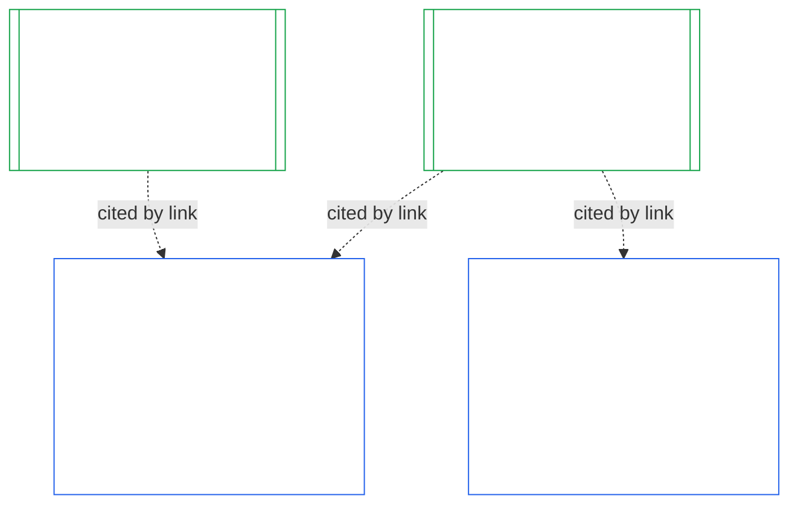

# فصل دهم: گواهی هم‌راستایی نهادی

<strong>جایگاه در پیکره (غیرعملیاتی): ساختار پرونده و قواعد خواندن</strong>

> این پرونده **بخشی از قانون اساسی حس‌مندان** است و فقط همراه با دیگر پرونده‌های شماره‌دار `core_*` که به‌صورت یک متن خوانده می‌شوند الزام‌آور است. این پرونده **فصل دهم** را دربرمی‌گیرد — **گواهی هم‌راستایی نهادی**: اینکه یک [نهاد](core_05.040_band_continuity.md#institution)، متمایز از هر سیستمی که اداره می‌کند، چگونه طبقه‌بندی، ارزیابی، بازبینی و درباره‌اش تصمیم‌گیری می‌شود، چگونه ثبت و به‌روز نگه داشته و دوباره گشوده می‌شود (**§1–§11**). فصل دهم همتای نهادی [فصل نهم](core_09.000_system_alignment_certification_evaluation.md#chapter-nine-system-alignment-certification) (*گواهی هم‌راستایی سیستم*) است و **شمارهٔ بخش‌هایش یکسان است**: §N اینجا به §N آنجا پاسخ می‌دهد. [CS-9.320](corpus_systems/cs_09.320_system_alignment_certification_illustrations.md#cs-9320-system-alignment-certification-illustrations) (*نمونه‌های گواهی هم‌راستایی سیستم*) نمونه‌های مشروح سیستم‌ها را دارد و در [§12 مرورهای نمونهٔ نهادها](corpus_systems/cs_09.320_system_alignment_certification_illustrations.md#cs-9320-12-illustrative-institution-walkthroughs) نیز سه مرور نهاد آمده است. این فصل آن‌ها را تکرار نمی‌کند.
>
> | § | فصل نهم (سیستم) | فصل دهم (نهاد) |
> |---|------------------------|----------------------------|
> | 1 | هدف و نقش | رابطه با گواهی سیستم، چه کسی گواهی می‌شود، نبود اجازه و مانع برای تشکیل یا اداره، انتظار برای اختیار مادی جدید، مهلت گواهی نخست |
> | 2 | ارزیابی کلاس سیستم | کلاس نهاد؛ مقیاس‌بندی برحسب کلاس |
> | 3 | ارزیابی گواهی کل سیستم | هشت مورد نهادی، همواره |
> | 4 | ارزیابی‌ها در صورت وجود مورد مشمول | ارجاع به فصل نهم §4 |
> | 5 | ارزیابی‌های کف حقوق و حوزه | ارجاع به فصل نهم §5 |
> | 6 | فرایند مجمع | چهار جایگاه؛ نقش‌ها و توالی مجمع؛ مجمع‌ها، گواهی‌دهندگان و دفاتر ثبت به‌عنوان نهاد |
> | 7 | نتایج گواهی | آغاز به کار برای یک نهاد و سیستم‌هایش، شرط‌های گواهی و دیگر آثار نتیجه؛ ارجاع برای نقص‌ها؛ آمادگی برای اصلاح؛ رد و لغو گواهی |
> | 8 | پروندهٔ گواهی سیستم | پروندهٔ گواهی نهادی |
> | 9 | گواهی دوباره و بازگشایی | پایش؛ محرک‌های بازگشایی؛ گواهی موقت و کامل؛ منع گریز؛ زنجیره از گواهی‌های سیستم؛ بازگشایی سیستم‌هایش هنگام تخلف حکمرانی |
> | 10 | اعتراض به گواهی | مسیر اعتراض |
> | 11 | رابطه با ردپا | پیوند به ردپا |
>
> - **دارندهٔ مسئولیت قانون اساسی (مشترک با فصل نهم):** گواهی هم‌راستایی زیر نظارت مجمع و سوابق مربوط. فصل دهم موضوع نهادی را اضافه می‌کند. خانوادهٔ مجمع، جایگاه یا واژهٔ نتیجهٔ تازه‌ای اضافه نمی‌کند.
> - **استفادهٔ دوباره، نه تکرار:** مرحله‌های سوم تا ششم همان‌طور اجرا می‌شوند که [فصل نهم، بخش ب §6](core_09.005_system_alignment_certification_record_process.md#6-forum-process) تا [فصل نهم، بخش ج §11](core_09.010_system_alignment_certification_record_recertification.md#11-relationship-to-standing) مقرر می‌کنند. فصل دهم فقط تغییرات مربوط به نهادی‌بودن موضوع را بیان می‌کند.
> - **قاعدهٔ ضدانتقال:** فصل دهم سازوکار ارزیابی سیستم در فصل نهم، فیلدهای منشور سیستم و منشور نهادی در فصل هفتم، الزام چهار جایگاه فصل هشتم، تکالیف نهادی در [corpus_institutions](corpus_institutions.md)، سنجش ردپا در فصل یازدهم یا آثار ردپا در فصل دوازدهم را بازنویسی نمی‌کند.
>
> **پیش‌نیازها:** [فصل هفتم](core_07.000_charters.md#chapter-seven-system-and-institutional-charters) منشورها؛ استقلال کارکردی [فصل هشتم](core_08.000_functional_independence_separation_of_duties.md#chapter-eight-functional-independence-and-separation-of-duties)؛ [فصل نهم](core_09.000_system_alignment_certification_evaluation.md#chapter-nine-system-alignment-certification) (بخش‌های [الف](core_09.000_system_alignment_certification_evaluation.md#chapter-nine-part-a-system-alignment-certification--evaluation)، [ب](core_09.005_system_alignment_certification_record_process.md#chapter-nine-part-b-system-alignment-certification--forum-process-and-outcomes) و [ج](core_09.010_system_alignment_certification_record_recertification.md#chapter-nine-part-c-system-alignment-certification--record-recertification-and-standing))؛ نظارت مجمع در فصل چهاردهم.
> **پیامدها:** سوابق ردپا و داده‌های تأییدشده در فصل یازدهم؛ آثار ردپا در فصل دوازدهم.

<strong>ردیابی</strong>

- پیش‌نیازها:
  - [فصل هفتم §1 موارد الزام‌آور بودن منشورهای سیستم و نهادی](core_07.000_charters.md#1-when-system-and-institutional-charters-are-required) (7.000 §1) (*کدام نهادها منشور سیستم یا منشور نهادی منتشر می‌کنند و کلاس یک نهاد*)؛
  - [فصل هفتم §7 اصلاح و بازبینی](core_07.000_charters.md#7-amendment-review-and-scope-misalignment) (7.000 §7) (*آزمون‌های بازبینی منشور نهادی*)؛
  - [فصل هفتم §4 نقشهٔ نقش‌های منشور و نگهداری سوابق ردپا](core_07.000_charters.md#4-the-charter-role-map-and-standing-record-custody) (7.000 §4) (*جایگاه‌ها کجا قرار می‌گیرند*)؛
  - [فصل هشتم §2 الزام قانون اساسیِ چهار جایگاه](core_08.000_functional_independence_separation_of_duties.md#2-four-seat-constitutional-requirement) (8.000 §2) و [§9 رابطه با فرایندهای بعدی](core_08.000_functional_independence_separation_of_duties.md#9-relationship-to-later-processes)؛
  - [فصل نهم](core_09.000_system_alignment_certification_evaluation.md#chapter-nine-system-alignment-certification) (9.000 تا 9.010) (*فرایند گواهی هم‌راستایی سیستم که این فصل دوباره به کار می‌گیرد*)؛
  - [دو پرسش بنیادین](core_00.000_preamble.md#two-fundamental-questions)؛
  - [چهارگانهٔ قانون اساسی](core_00.000_preamble.md#constitutional-tetrad)؛
  - [مادهٔ XI-E](core_06.005_rights_part_b.md#article-xi-e-institutional-formation-and-business-creation) (*تشکیل نهاد و ایجاد کسب‌وکار*).
- پیامدها: [§1](#1-purpose-and-role) تا [§11](#11-relationship-to-standing)؛ فصل یازدهم ([11.000](core_11.000_standing_assessment.md#chapter-eleven-contribution-violation-and-standing-model--measurement))؛ [فصل چهاردهم](core_14.000_forum.md#chapter-fourteen-forums-and-jurisdiction) (14.000).
- همراه با این موارد خوانده شود:
  - [گواهی هم‌راستایی نهادی](core_05.040_band_continuity.md#institutional-alignment-certification) و
  - [پروندهٔ گواهی نهادی](core_05.040_band_continuity.md#institutional-certification-record) (*معانی فصل پنجم*)؛
  - **CI-8.205 §6** (*محتوا، بازبینی و الگوی تشکیل منشورهای سیستم و نهادی*)؛
  - **CF-14.425** (*تضمین‌های یکپارچگی، عملیات ضدتصرف و پشتیبانی ضدداوری دربارهٔ خود*).

 

فصل دهم دارندهٔ مسئولیت قانون اساسی برای **گواهی هم‌راستایی نهادی** است. فرایند [فصل نهم](core_09.000_system_alignment_certification_evaluation.md#chapter-nine-system-alignment-certification) را از یک سیستم به یک نهاد گسترش می‌دهد:

- **مرحلهٔ اول، چارچوب‌گذاری:** کلاس نهاد و نحوهٔ مقیاس‌بندی ارزیابی برحسب آن ([§2 ارزیابی کلاس نهاد](#2-institution-class-evaluation))؛
- **مرحلهٔ دوم، ارزیابی:** ارزیابی نهادی، ازجمله ارزیابی‌هایی که در صورت وجود مورد مشمول و ارزیابی‌های کف حقوق و حوزه اعمال می‌شوند ([§3 ارزیابی گواهی کل نهاد](#3-whole-institution-certification-evaluation) تا [§5 ارزیابی‌های کف حقوق و حوزه](#5-rights-floor-and-domain-evaluations))؛
- **مرحلهٔ سوم، بازبینی:** نقش‌ها و توالی مجمع ([§6 فرایند مجمع](#6-forum-process))؛
- **مرحلهٔ چهارم، تصمیم‌گیری:** نتیجه، آمادگی برای اصلاح، و رد و لغو گواهی ([§7 نتایج گواهی](#7-certification-outcomes))؛
- **مرحلهٔ پنجم، ثبت:** پروندهٔ گواهی نهادی ([§8 پروندهٔ گواهی نهادی](#8-institutional-certification-record))؛ و
- **مرحلهٔ ششم، بهره‌برداری:** گواهی دوباره، بازگشایی، زنجیره از گواهی‌های سیستم، بازگشایی سیستم‌هایش، مسیر اعتراض و پیوند به ردپا ([§9 گواهی دوباره و بازگشایی](#9-recertification-and-reopening) تا [§11 رابطه با ردپا](#11-relationship-to-standing)).

*به زبان ساده: فصل نهم می‌پرسد آیا یک **سیستم** هم‌راستاست. فصل دهم همین پرسش را دربارهٔ **نهادی** می‌پرسد که سیستم‌هایی را اداره می‌کند یا بدون ادارهٔ سیستم، اختیار دارد. ممکن است نهادی هم‌راستا باشد درحالی‌که یکی از سیستم‌هایش نیست، و برعکس. پس نهاد از بابت آنچه فقط خودش کنترل می‌کند بررسی می‌شود: آیا مطابق منشور نهادی‌اش عمل می‌کند، چه کسی پاسخگوی اختیار آن است، در میان اعضایش به چه چیزی پاداش می‌دهد و آیا کنترل‌های مستقل واقعاً قابل استفاده‌اند. این فصل به گواهی هر سیستم اتکا می‌کند و آن را دوباره انجام نمی‌دهد. این گواهی مجوز نیست: برای آغاز یا ادارهٔ نهاد به اجازهٔ آن نیاز نیست.*

### 1. هدف و نقش

<strong>ردیابی</strong>

- پیش‌نیازها:
  - [فصل هفتم §1 موارد الزام‌آور بودن منشورهای سیستم و نهادی](core_07.000_charters.md#1-when-system-and-institutional-charters-are-required) (7.000 §1)؛
  - [فصل نهم، بخش الف §1 هدف و نقش](core_09.000_system_alignment_certification_evaluation.md#1-purpose-and-role) (9.000 §1)؛
  - [مادهٔ XI-E](core_06.005_rights_part_b.md#article-xi-e-institutional-formation-and-business-creation) (*تشکیل نهاد و ایجاد کسب‌وکار*)؛
  - [مادهٔ XXVIII-A](core_06.020_rights_part_e.md#xxviii-a-existing-instantiations-adoption-transition-window) (*پذیرش مرحله‌ای و تداوم کف حقوق*).
- پیامدها: [§2](#2-institution-class-evaluation)؛ [§6](#6-forum-process)؛ [§7](#7-certification-outcomes)؛ [§9](#9-recertification-and-reopening).
- همراه با این موارد خوانده شود:
  - [نهاد](core_05.040_band_continuity.md#institution)؛
  - [منشور نهادی](core_05.040_band_continuity.md#institutional-charter)؛
  - [منشور سیستم](core_05.040_band_continuity.md#system-charter)؛
  - [ایجاد کسب‌وکار](core_05.055_band_participation.md#business-creation).

 

*به زبان ساده: گواهی یک سیستم متعلق به خود سیستم است. گواهی نهاد به آن گواهی‌ها استناد می‌کند و مسئولیت‌هایی را اضافه می‌کند که فقط نهاد می‌تواند پاسخگوی آن‌ها باشد. یک سیستم ممکن است زیرمجموعهٔ چند نهاد یا هیچ نهادی باشد. هیچ‌چیز در اینجا اجازه نمی‌دهد گواهی مانع تشکیل نهاد شود.*

گواهی هم‌راستایی نهادی و گواهی هم‌راستایی سیستم دو گواهی‌اند که با پیوند به هم متصل می‌شوند. رابطهٔ آن‌ها **ترکیب از راه پیوند** است، نه دربرگیری. در شکل، پیکانی از پروندهٔ گواهی سیستم به هر پروندهٔ گواهی نهادی‌ای می‌رود که به آن استناد می‌کند. سیستمِ زیرمجموعهٔ هیچ نهادی پیکانی ندارد و نیازی هم ندارد؛ نهادی که هیچ سیستمی را اداره نمی‌کند نیز تنها یک پرونده دارد.

ترکیب از راه پیوند دو سویه دارد که نخست سوی نهاد را بیان می‌کنیم.

از سوی نهاد:

- **پروندهٔ گواهی نهادی به پروندهٔ سیستم استناد می‌کند و آن را دوباره انجام نمی‌دهد:** با پیوند به پروندهٔ گواهی سیستم استناد می‌کند و نسخهٔ آن را ذکر می‌کند. این فصل هیچ ارزیابی سیستمی را دوباره اجرا نمی‌کند، کلاس هیچ سیستمی را دوباره تعیین نمی‌کند و نتیجه، وضعیت یا شرط‌های گواهی هیچ سیستمی را تغییر نمی‌دهد.
- **گواهی نهاد نمی‌تواند گواهی سیستم را ارتقا دهد:** سیستمِ «گواهی‌نشده» با هر وضعیتی که نهاد داشته باشد همچنان گواهی‌نشده می‌ماند. سیستمی که گواهی دارد از یافتهٔ مربوط به نهاد مصون نمی‌شود.
- **واقعیت‌های نهادی یک‌بار تعیین می‌شوند:** هرگاه [فصل نهم، بخش الف §3.1 انضباط حکمرانی، انگیزه و قابلیت اعتراض](core_09.000_system_alignment_certification_evaluation.md#31-governance-incentive-and-contestability-discipline) دربارهٔ حکمرانی و انگیزه‌های گرداننده بپرسد، پروندهٔ جاری گواهی نهادیِ گرداننده می‌تواند آن واقعیت‌ها را از راه پیوند فراهم کند. بااین‌حال مجمع‌های سیستم همچنان تصمیم می‌گیرند آیا آن واقعیت‌ها برای آن سیستم کافی‌اند یا نه. بدون بیان دلیل در پروندهٔ گواهی سیستم نمی‌توانند دربارهٔ همان واقعیت نهادی یافته‌ای متفاوت داشته باشند.

از سوی سیستم:

- **پروندهٔ گواهی سیستم متعلق به خود سیستم است:** این پرونده طبق [فصل نهم](core_09.000_system_alignment_certification_evaluation.md#chapter-nine-system-alignment-certification) متعلق به خود سیستم است.
- **چند نهاد می‌توانند به یک پروندهٔ گواهی سیستم استناد کنند:** یک سیستم ممکن است طبق [فصل هفتم §1 موارد الزام‌آور بودن منشورهای سیستم و نهادی](core_07.000_charters.md#1-when-system-and-institutional-charters-are-required) به‌دست بیش از یک نهاد اداره یا سرپرستی شود یا از نظر مادی تحت کنترل آن‌ها باشد. هر نهاد به همان پرونده استناد می‌کند.
- **سیستم لازم نیست زیرمجموعهٔ نهادی باشد:** یک حس‌مند به‌تنهایی نهاد نیست، پس ممکن است سیستم هیچ نهادِ بالادستی نداشته باشد. سیستم بدون نهاد فقط طبق [فصل نهم](core_09.000_system_alignment_certification_evaluation.md#chapter-nine-system-alignment-certification) گواهی می‌شود و به چیزی از این فصل نیاز ندارد. سیستمی که زیرمجموعهٔ نهاد است نیز به همان شیوه گواهی می‌شود: این فصل پرونده‌ای جدا برای نهاد می‌افزاید و مرحله‌ای از گواهی خود سیستم نیست.

#### 1.1 چه کسی گواهی می‌شود

نهادِ کلاس L یا بالاتر در دامنهٔ این فصل است؛ کلاس آن طبق [§2.1 کلاس نهاد](#21-institution-class) تعیین می‌شود. این شامل نهادی است که اصلاً سیستمی را اداره نمی‌کند: پروندهٔ گواهی سیستمی برای استناد ندارد و کلاسش بر پایهٔ اثر خودش تعیین می‌شود. **سبد** نهاد مجموعهٔ سیستم‌هایی است که اداره، سرپرستی یا به‌طور مادی کنترل می‌کند ([سبد](core_05.040_band_continuity.md#portfolio)).

- **کلاس A، B، C و L:** فرایند متناسب با کلاس طبق [§2.2 مقیاس‌بندی برحسب کلاس](#22-scaling-by-class) اعمال می‌شود.
- **کلاس P:** استفاده از فرایند تشویق می‌شود و می‌توان داوطلبانه از آن استفاده کرد. با طبقه‌بندی دوباره به کلاس L یا بالاتر، یا اگر نهاد داوطلبانه ادعای انطباق قانون اساسی کند، فرایند الزامی می‌شود. نهادی در کلاس P که تصمیم بگیرد اختیار مادی جدیدی بگیرد، هنگام ارسال اطلاعیهٔ [§9.2.2 گواهی دوباره برای اختیار مادی جدید](#922-recertification-for-new-material-authority) دست‌کم به کلاس L طبقه‌بندی دوباره می‌شود، چون آن اختیار بنا بر تعریف مادی است ([§9.2.1 چه چیزی اختیار مادی جدید محسوب می‌شود](#921-what-counts-as-new-material-authority)) و نهادی که در هر حوزه‌ای مادی باشد دست‌کم کلاس L است ([§2.1 کلاس نهاد](#21-institution-class)، مورد 2). طبقه‌بندی دوباره از زمان اطلاعیه برقرار است تا اطلاعیه پیش از صدور مجوز پس گرفته شود یا اختیار مجاز نشود، به شرط آنکه هیچ‌کس آن را اعمال نکرده باشد. سپس نهاد به کلاس P بازمی‌گردد و گواهی نخستِ محدود پایان می‌یابد. اطلاعیهٔ تازه آن را دوباره آغاز می‌کند؛ و اعمال اختیار بدون مجوز همچنان طبق [§9.2.2 گواهی دوباره برای اختیار مادی جدید](#922-recertification-for-new-material-authority) یافته محسوب می‌شود (*بدون اطلاعیه یا پیش از صدور مجوز*). این قاعده با [فصل نهم، بخش الف §1 هدف و نقش](core_09.000_system_alignment_certification_evaluation.md#1-purpose-and-role) همسان است.
- **یک سیستم:** نهادی که دقیقاً یک سیستمِ نیازمند منشور سیستم را اداره می‌کند، یک دور گواهی و یک پرونده دارد که این فصل آن را **ارزیابی یک‌سیستمی** می‌نامد. پروندهٔ گواهی سیستم یک *بخش یافته‌های نهادی* با موارد [§8 پروندهٔ گواهی نهادی](#8-institutional-certification-record) دارد و همان پرونده، پروندهٔ گواهی نهادی نیز هست. مجمع‌ها، جایگاه‌ها و زمان‌بندی‌ها متعلق به دور گواهی خود سیستم‌اند و موارد نهادی به آن افزوده می‌شوند. نتایجشان بر پایهٔ دلایل مستقلِ رد یا لغو گواهی خودشان است، چنان‌که [§7.4 رد و لغو گواهی برای یک نهاد](#74-denial-and-revocation-for-an-institution) بیان می‌کند. زنجیرهٔ [§9.5 زنجیره از گواهی‌های سیستم](#95-cascade-from-system-certifications) به‌صورت زنجیره اعمال نمی‌شود، چون سیستم تمام سبد است؛ اما [§7.4 رد و لغو گواهی برای یک نهاد](#74-denial-and-revocation-for-an-institution) قواعد 1 و 2 آن (نشانگر و آزمون محل قرارگرفتن علت) اعمال می‌شوند.
- **چند سیستم:** یک پروندهٔ گواهی نهادی برای نهاد که با پیوند به پروندهٔ گواهی سیستمِ هر سیستم تحت ادارهٔ آن ارجاع می‌دهد. هر سیستم دور و پروندهٔ خود را حفظ می‌کند.
- **بدون سیستم:** یک پروندهٔ گواهی نهادی به‌تنهایی. چون نهاد سیستمی اداره نمی‌کند، پروندهٔ گواهی سیستمی برای پیوند وجود ندارد.

