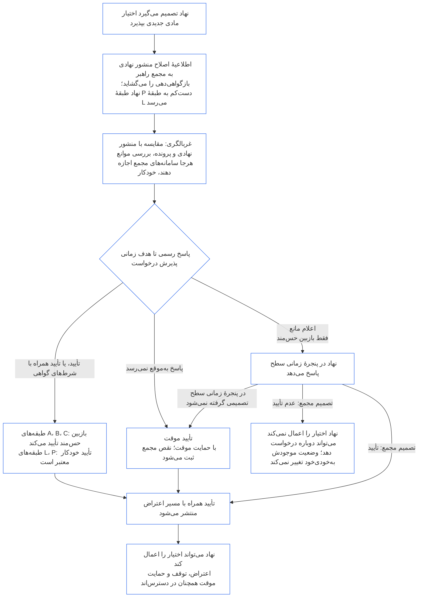

##### 9.2.2 بازگواهی‌دهی برای اختیار مادی جدید

نهادی که تصمیم می‌گیرد اختیار مادی جدیدی بپذیرد باید دوباره گواهی شود و پیش از اعمال آن اختیار باید منتظر نتیجه بماند. این همان انتظاری است که **مادهٔ XI-E** (*تشکیل نهاد و ایجاد کسب‌وکار*) بیان می‌کند. این فرایند چنین پیش می‌رود:

- **نخست اطلاع‌رسانی:** نهاد اطلاعیهٔ اصلاح منشور نهادی را که [فصل هفتم §7.1 تغییر سند](core_07.000_charters.md#71-changing-the-document) از پیش لازم می‌داند ارائه می‌کند و آن را به مجمع راهبر می‌فرستد. این اطلاعیه بازگواهی‌دهی را آغاز می‌کند.
- **هنوز پرونده‌ای وجود ندارد:** نهادی که پروندهٔ گواهی‌دهی نهادی ندارد، همان اطلاعیه را می‌دهد. اطلاعیه، گواهی‌دهی نخستینی را می‌گشاید که به اختیار جدید محدود است و آن اختیار را بر اساس منشور نهادی و ارزیابی‌های [§3 ارزیابی گواهی‌دهی کل نهاد](#3-whole-institution-certification-evaluation) تا [§5 ارزیابی‌های کف حقوق و حوزه](#5-rights-floor-and-domain-evaluations) که به آن اختیار مربوط‌اند می‌سنجد. باقی گواهی‌دهی نخست همچنان در پنجرهٔ [§1.3 پنجرهٔ زمانی گواهی‌دهی نخست](#13-window-for-the-first-certification) پیش می‌رود (برای نهاد طبقهٔ P که اطلاعیه آن را بازطبقه‌بندی می‌کند، پنجره از زمان اطلاعیه آغاز می‌شود) و انتظار برای اختیار جدید به آن وابسته نیست.
- **در پنجره‌های زمانی سطح‌بندی‌شده:** بازگواهی‌دهی بر اساس پنجره‌های زمانیِ [فصل نهم، بخش پ §9.3.4 پنجره‌های زمانی برحسب سطح](core_09.010_system_alignment_certification_record_recertification.md#934-tier-windows) پیش می‌رود و به‌طور پیش‌فرض سطح با طبقهٔ نهاد مطابقت دارد. مهلت ازدست‌رفته طبق [مادهٔ XXVI-C](core_06.020_rights_part_e.md#article-xxvi-c-timely-resolution-and-anti-delay-floor) (*کف حل‌وفصل به‌موقع و ضدتأخیر*) پیگیری می‌شود و هزینه‌ها و انتظار نباید به مانع تبدیل شوند ([بار اجتناب‌پذیر](core_05.040_band_continuity.md#avoidable-burden)).
- **هرجا بتوان، خودکارسازی می‌شود:** اطلاعیه، مقایسهٔ اختیار جدید با منشور نهادی و پروندهٔ جاری، غربالگری موانع و تأیید رفع مانع، هرجا سامانه‌های مجمع اجازه دهند خودکار می‌شوند. [فصل اول §13.3 به‌حداقل‌رساندن بار اجتناب‌پذیر](core_01.005_interaction_interpretation.md#133-minimization-of-avoidable-burden) خودکارسازی را راهکار ترجیحی برای بار اجتناب‌پذیر می‌داند و [فصل اول §16.4 مستندسازی هنگام اقدام](core_01.010_stewardship_capacity_principles.md#164-document-at-action) بار خودکارسازی را بر دوش سیستم می‌گذارد، نه متولی.
  - **رفع مانع می‌کند، نه اینکه رد کند:** غربالگری خودکار می‌تواند مانع اختیار جدید را برطرف کند، یا بی‌قید یا با شرط‌های گواهی‌ای که پروندهٔ جاری از آن‌ها پشتیبانی می‌کند. غربالگری به‌تنهایی نمی‌تواند وجود مانع را اعلام کند (از موانع [§9.2.3 موانع رفع مانع از اختیار مادی جدید](#923-blockers-to-clearing-new-material-authority)) یا از رفع مانع خودداری کند. غربالگری می‌تواند مانعی احتمالی را علامت‌گذاری کند، اما فقط بازبین حس‌مند در مجمع راهبر می‌تواند پس از بررسی مورد علامت‌گذاری‌شده مانعی را اعلام کند.
  - **طبقه‌های A، B و C:** بازبین حس‌مند در مجمع راهبر هر رفع مانع را پیش از آنکه پاسخ رسمی به شمار آید تأیید می‌کند. این قاعده برای نهادی در یکی از این طبقه‌ها و برای نهادی که اختیار جدید آن را وارد یکی از این طبقه‌ها می‌کند اعمال می‌شود. هدف زمانیِ پذیرش درخواست همچنان برای تأیید اعمال می‌شود. بازبین در مجمع راهبر حضور دارد که از پیش جایگاه راستی‌آزمایی یا مجوزدهی را دارد و باید مستقل از نهاد باشد ([§6.1 چهار جایگاه در گواهی‌دهی نهادی](#61-four-seats-in-an-institutional-certification)).
  - **طبقه‌های L و P:** رفع مانع خودکار بدون تأیید، پاسخ رسمی به شمار می‌آید. هنگام اطلاع‌رسانی، نهاد طبقهٔ P دست‌کم به طبقهٔ L بازطبقه‌بندی می‌شود ([§1.1 چه چیزی گواهی می‌شود](#11-who-is-certified))، بنابراین برای آن قاعدهٔ طبقهٔ L اعمال می‌شود.
  - **شرایط استثنایی:** در هر طبقه‌ای بازبین حس‌مند به‌جای آن رسیدگی می‌کند اگر غربالگری مانعی احتمالی را علامت‌گذاری کند، نتواند تشخیص دهد اختیار پوشش داده شده یا مادی است، یا نهاد یا حس‌مند اثرپذیری درخواست بررسی کند. به درخواست بررسی در [هدف زمانیِ پذیرش متناسب](core_05.040_band_continuity.md#tier-window) پاسخ داده می‌شود که از زمان درخواست محاسبه می‌شود. این درخواست پنجرهٔ زمانی سطح را تمدید نمی‌کند.
  - **همان پرونده و همان مهلت‌ها:** پرونده بررسی‌های اجراشده را نشان می‌دهد تا بتوان به رفع مانع خودکار مانند هر تصمیم دیگری اعتراض کرد. خودکارسازی نه هدف زمانی پذیرش درخواست را تمدید می‌کند و نه پنجرهٔ زمانی سطح را؛ اگر غربالگری از کار بیفتد یا پاسخی ندهد، بر اساس بند زیر پاسخ ازدست‌رفته به شمار می‌آید. مجمع همان‌طور که در برابر هر سیستمی که به کار می‌برد پاسخگوست، در برابر این غربالگری نیز پاسخگو است ([§6.3 مجمع‌ها، گواهی‌دهندگان و دفاتر ثبت به‌عنوان نهاد](#63-forums-certifiers-and-record-offices-as-institutions)).
- **انتظار:** نهاد پیش از آنکه بازگواهی‌دهی اختیار جدید را تأیید کند آن را اعمال نمی‌کند.
  - **انتظار در همهٔ طبقه‌ها:** هیچ طبقه‌ای معاف نیست و نه وضعیت اضطراری و نه فوریت این انتظار را برمی‌دارد.
  - **همهٔ کارهای دیگر ادامه دارند:** کارهایی که نهاد از پیش انجام می‌دهد ادامه می‌یابند ([§1.2 نه اجازه و نه دروازه‌ای برای تشکیل یا فعالیت](#12-no-permission-and-no-gate-on-forming-or-running)).
  - **حمایت منتظر نمی‌ماند:** حمایت فوری مجمع‌ها از حس‌مندان اثرپذیر منتظر بازگواهی‌دهی نمی‌ماند ([فصل نهم، بخش ب §6.2 توالی نظارت](core_09.005_system_alignment_certification_record_process.md#62-supervisory-sequence)). این اقدام از حس‌مندان حمایت می‌کند و مبنایی برای اعمال زودهنگام اختیار از سوی نهاد نیست.
- **پس از رفع مانع منتشر می‌شود:** مجمع راهبر هر رفع مانع را به‌محض ارائه منتشر می‌کند، ازجمله رفع مانع موقت، و مسیر اعتراض در [§10 اعتراض به گواهی‌دهی](#10-challenging-a-certification) را باز می‌گذارد. نهاد از زمان رفع مانع می‌تواند اختیار را اعمال کند. منتظر فاصلهٔ زمانی اعلام یا تصمیم‌گیری دربارهٔ اعتراض نمی‌ماند. حس‌مند اثرپذیر می‌تواند مانند هر تصمیم دیگری به رفع مانع اعتراض کند و درخواست توقف یا حمایت موقت دهد که آن هم منتظر نمی‌ماند ([§9.2.2 بازگواهی‌دهی برای اختیار مادی جدید](#922-recertification-for-new-material-authority)، *حمایت منتظر نمی‌ماند*). هنگام انتشار، مجمع راهبر حس‌مندان اثرپذیری را که از آن‌ها آگاه است و مجمع‌های سیستم‌های مربوط را نیز از رفع مانع مطلع می‌کند. به درخواست توقف یا حمایت موقت در محدودهٔ هدف زمانی پذیرش درخواست متناسب ([CF-14.445 §3.1 هدف‌های مرحله و مرزهای بیرونی](corpus_forum/cf_14.445_performance_backlog_publication_accessibility.md#cf-14445-31-stage-targets-and-outer-bounds)) یا در محدودهٔ وضعیت اضطراری آن، هرکدام که اعمال شود، پاسخ داده می‌شود.
- **رفع مانع فرض می‌شود:** فرض بر این است که مانع اختیار برطرف شده است. مجمع راهبر فقط هنگامی از رفع مانع خودداری می‌کند که با شواهد ثبت‌شده در پرونده نشان دهد یکی از موانع مندرج در [§9.2.3 موانع رفع مانع از اختیار مادی جدید](#923-blockers-to-clearing-new-material-authority) برقرار است. هرگاه شرط‌های گواهیِ پیوندخورده به مانع بتوانند آن را مهار کنند، اختیار با همان شرط‌های گواهی تأیید می‌شود، نه اینکه رد شود.
- **معنای رفع مانع:** بازگواهی‌دهی به گواهی موقت یا کامل می‌انجامد، با شرط‌های گواهی یا بدون آن‌ها، و هر شرط گواهی لازم پیش از اعمال اختیار باید مستقلانه راستی‌آزمایی شده باشد.
- **اگر مجمع به‌موقع پاسخ ندهد:** مجمع راهبر تا هدف زمانیِ پذیرش درخواست متناسب ([CF-14.445 §3.1 هدف‌های مرحله و مرزهای بیرونی](corpus_forum/cf_14.445_performance_backlog_publication_accessibility.md#cf-14445-31-stage-targets-and-outer-bounds)) مکلف به پاسخ رسمی است. پاسخ، اختیار را تأیید می‌کند، با شرط‌های گواهی تأییدش می‌کند یا مانعی را همراه شواهدی که مبنای آن است اعلام می‌کند. پاسخِ حاوی مانع به نهاد فرصت پاسخ می‌دهد و مجمع در پنجرهٔ زمانیِ سطحِ بالا تصمیم می‌گیرد.
  - **رفع مانع موقت:** اگر تا هدف زمانیِ پذیرش درخواست پاسخ رسمی نیاید، یا مانع اعلام‌شده در پنجرهٔ زمانیِ سطح تعیین تکلیف نشود، اختیار موقتاً با حمایت موقت و محدودیت‌های اتکایی که [فصل نهم، بخش ب §7.2 نقص‌های گواهی‌دهی و اصلاح](core_09.005_system_alignment_certification_record_process.md#72-certification-defects-and-correction) مقرر می‌کند، تأیید می‌شود.
  - **نقص مجمع:** از دست‌رفتن هدف زمانی یا پنجره، نقص مجمع است نه تقصیر نهاد. مطابق [فصل چهاردهم §6 حل‌وفصل به‌موقع، سطوح اهمیت مادی و انضباط ضدتأخیر](core_14.000_forum.md#6-timely-resolution-materiality-tiers-and-anti-delay-discipline) (*بررسی تجاوز از مهلت*) ثبت، اصلاح و به‌عنوان تجاوز از مهلت بررسی می‌شود.
  - **واگذاری به مجمعی دیگر:** درخواست بازگواهی‌دهی در همان خانواده به مجمع دیگری منتقل می‌شود ([فصل چهاردهم §3 انتقال، تجمیع و هماهنگی](core_14.000_forum.md#3-transfer-consolidation-and-coordination--continuity-and-anti-capture)). آن مجمع بازگواهی‌دهی را در پنجره‌های معمول طبقهٔ نهاد و با محاسبه از زمان انتقال ادامه می‌دهد.
- **اگر رفع مانع نشود:** نهاد اختیار را اعمال نمی‌کند و می‌تواند بر اساس شرایط فصل نهم، بخش ب §7.4 (*نه ممنوعیت دائمی*) دوباره درخواست دهد. رفع‌نکردن مانع اختیار جدید به‌خودی‌خود به معنی رد یا لغو وضعیت گواهی‌ای نیست که نهاد برای کارهای کنونی‌اش دارد. وضعیت فقط بر اساس یافته‌ای طبق [§7.3 آمادگی نهاد برای اصلاح](#73-remediation-readiness-for-an-institution) و [§7.4 رد و لغو برای یک نهاد](#74-denial-and-revocation-for-an-institution) تغییر می‌کند.
- **بدون اطلاعیه یا پیش از رفع مانع:** اعمال اختیار مادی جدید بدون اطلاعیه یا پیش از رفع مانع، رویه‌ای بیرون از منشور نهادی است. این مورد یافته‌ای بر اساس [§3 ارزیابی گواهی‌دهی کل نهاد](#3-whole-institution-certification-evaluation) (مورد 1) است و بررسی را به‌عنوان رویداد منشور نهادی باز می‌گشاید.

<strong>راهنمای خواننده (غیرعملیاتی): انتظار برای اختیار مادی جدید</strong>

این شکل خلاصهٔ §9.2.2 بازگواهی‌دهی برای اختیار مادی جدید است. اگر با متن تفاوتی داشته باشد، متن حاکم است. هر کاری که نهاد از پیش انجام می‌دهد در تمام مدت ادامه می‌یابد و حمایت فوری از حس‌مندان اثرپذیر هرگز منتظر نمی‌ماند. نمونه‌های توضیحی نهادها در [CS-9.320 §12 مرورهای گام‌به‌گام نمونهٔ نهادها](corpus_systems/cs_09.320_system_alignment_certification_illustrations.md#cs-9320-12-illustrative-institution-walkthroughs) آمده‌اند.

 

