#### 1.1 La certification comme processus d’audit mis à l’échelle selon la classe du système

En tant que mécanisme de supervision, la certification est un processus d’audit particulièrement vaste au titre de [l’Auditabilité](core_05.050_band_oversight.md#auditability) et de **l’article XVI** (*Audit, transparence et vérification indépendante*) :

- Elle est supervisée par des forums, couvre plusieurs domaines et confère un statut.
- Elle peut intégrer les résultats de modes d’audit connexes sans les absorber ni les remplacer. Chacun conserve son propre responsable, indiqué dans la [carte des modes d’audit connexes](corpus_joint_structure/cjs_05.115_audit_process.md#sibling-audit-modes-owner-map) de la référence du processus d’audit :
  - audits des dossiers des types de données système au titre de **CS-6.305 (*Types d’information et traitement*) et CS-6.310** (*Classifications des données*) ;
  - audits des dossiers de classification des systèmes au titre de **CS-9.305 (*Mécanisme de classification des systèmes*) et CS-9.310** (*Classifications de l’impact des systèmes*) ;
  - examens de l’assurance des responsables au titre de **CS-15.305** (*Administration responsable des systèmes critiques*) ;
  - audit continu au titre de **CS-6.345** (*Cycle de vie du système*) ACA ;
  - audits de complexité au titre de **CS-6.315** (*Compréhensibilité et administration responsable de la complexité*) et de **l’article XXIII-B** (*Exigences d’audit de la complexité et de modularité*) ;
  - vérification des déclarations au titre de **CJS-5.110 §5** (*Supervision : modalités de vérification indépendante et d’intégrité des déclarations*).
- Chacune de ces évaluations peut toujours être menée séparément, sans passer par la certification. La certification ne les remplace pas.

La profondeur de la certification, la charge documentaire, l’intervalle de certification, l’examen par les parties prenantes et les voies de contestation doivent être proportionnés à l’[enjeu matériel](core_00.000_preamble.md#material-stake) selon la [Proportionnalité](core_05.035_band_accountability.md#proportionality) :

- Les systèmes à impact, dépendances et risques plus élevés exigent des preuves plus solides, des dossiers plus clairs et une participation plus praticable — y compris une accessibilité substantielle, les contributions des parties prenantes et des voies de contestation adaptées aux personnes qui dépendent du système.
- Les classes de système et périmètres plus limités exigent tout de même une classification honnête et des garanties proportionnées ; ils ne sont pas dispensés des obligations matérielles lorsque des effets externes existent.

Comme le prévoit l’exigence de [reclassification](corpus_systems/cs_09.305_system_classification_machinery.md#35-reclassification-requirement) de **CS-9.305** (*Mécanisme de classification des systèmes*), le processus s’applique selon la classe d’impact :

- **Classes A, B et C :** ces systèmes ont les impacts, dépendances et risques les plus élevés ; l’évaluation globale selon [§3 Évaluation de la certification globale du système](#3-whole-system-certification-evaluation), [§4 Évaluations lorsque la situation le justifie](#4-evaluations-where-implicated) et [§5 Évaluations du Plancher des droits et du domaine](#5-rights-floor-and-domain-evaluations), chacune selon sa propre sous-phase applicable, est obligatoire et menée à pleine profondeur ;
- **Classe L :** la même évaluation est obligatoire mais proportionnée, avec un intervalle de certification par défaut plus long et des dossiers plus simples lorsque CS-9.305 (*Mécanisme de classification des systèmes*) et CS-9.310 (*Classifications de l’impact des systèmes*) le permettent ; et
- **Classe P :** tant que la classe P du système est valide, le processus est encouragé et un système de cette classe peut y recourir volontairement. Il devient obligatoire en cas de reclassification en classe L ou supérieure, ou si l’exploitant affirme volontairement que le système respecte la Constitution.

L’intervalle de certification, ainsi que l’audit financier, de ressources ou spécial réalisé à son point médian, sont déterminés selon la classe du système dans [Chapitre quatorze §6 Résolution en temps utile, niveaux de matérialité et discipline contre les retards](core_14.000_forum.md#review-cadence) (*Périodicité de l’examen*). Ce chapitre ne répète pas les chiffres.

#### 1.2 La certification en bref

*En termes simples : classer le système honnêtement, effectuer les évaluations applicables, faire examiner indépendamment les preuves et les préoccupations des parties prenantes par les forums, puis décider du résultat. Compléter le dossier unique ouvert pour l’examen du forum et le publier avec une voie de contestation ouverte. Un système certifié ne peut être mis en service qu’une fois son délai de notification écoulé et les protections requises satisfaites. Surveiller les résultats réels, répondre aux incidents et aux contestations, puis réexaminer selon le calendrier ou lorsque les faits changent. Corriger les défauts et faire vérifier la correction indépendamment avant d’autoriser le périmètre concerné ou de lever les conditions de certification. Chaque examen utilise un nouveau dossier lié au précédent.*

Le processus comporte **six phases** : **I Cadrer**, **II Évaluer**, **III Examiner**, **IV Décider**, **V Consigner** et **VI Exploiter**. La phase II comporte trois sous-phases, chacune dans sa propre section : **IIa** (toujours), **IIb** (lorsque la situation le justifie) et **IIc** (lorsque les déclencheurs se présentent). La phase VI comporte deux sous-phases, chacune dans sa propre section : **VIa** (exploitation et recertification, [§9 Recertification et réouverture](core_09.010_system_alignment_certification_record_recertification.md#9-recertification-and-reopening)) et **VIb** (passerelle vers le statut, [§11 Relation avec le statut](core_09.010_system_alignment_certification_record_recertification.md#11-relationship-to-standing)). Le schéma montre le processus complet de certification dans cet ordre. La partie A couvre les deux premières phases, le cadrage et l’évaluation ; la [partie B](core_09.005_system_alignment_certification_record_process.md#chapter-nine-part-b-system-alignment-certification--forum-process-and-outcomes) et la [partie C](core_09.010_system_alignment_certification_record_recertification.md#chapter-nine-part-c-system-alignment-certification--record-recertification-and-standing) couvrent les quatre dernières : la procédure des forums et le résultat avec la condition de mise en service (partie B), puis le dossier et l’exploitation (la voie de contestation, la recertification et la réouverture, ainsi que la passerelle vers le statut) (partie C).

Chaque évaluation applicable est répétée à chaque cycle de certification : lors de la première certification, à chaque recertification selon le calendrier défini à [§2 Évaluation de la classe du système](#2-system-class-evaluation), et lors de chaque examen rouvert ou nouveau. L’examen est rouvert avant la prochaine recertification prévue lorsque des faits matériels changent, par exemple si la dépendance au système augmente, si l’extraction des fondations partagées augmente, si la contribution que le système leur restitue diminue sensiblement ou si une contestation crédible est soulevée. [Partie C §9.2 Déclencheurs de réouverture](core_09.010_system_alignment_certification_record_recertification.md#92-reopening-triggers) les répertorie.

```mermaid
flowchart TB
    T(["Un système ayant un impact matériel demande une certification,<br/>ou la dépendance à son égard augmente"])
    C["§2 Phase I, Cadrer<br/>Classer honnêtement<br/><br/>La classe détermine la profondeur et le calendrier des réexamens"]
    subgraph W["§3–§5 Phase II, Évaluer — Évaluation globale du système"]
        direction LR
        Al["§3.1–§3.4 IIa — Toujours<br/><br/>Gouvernance ; risque systémique : évalué<br/>et divulgué aux personnes concernées ;<br/>horizon temporel ; types de données"]
        Im["§4 IIb — Lorsque la situation le justifie<br/><br/>Points de traitement de la vie privée, droits de sortie,<br/>assemblée et dissidence"]
        Tr["§5 IIc — Lorsque les déclencheurs se présentent<br/><br/>Vérifications applicables du Plancher des droits<br/>et six évaluations de domaine"]
        Al ~~~ Im ~~~ Tr
    end
    F["§6 Phase III, Examiner<br/>Examen indépendant des preuves<br/>et préoccupations des parties prenantes<br/><br/>Les forums désignés rendent leurs conclusions ;<br/>les voies de contestation restent ouvertes"]
    Rec["§8 Phase V, Consigner<br/>Un dossier de certification du système<br/><br/>Ouvert pour l’examen du forum ; complété avec le résultat,<br/>les conclusions à l’appui, les conditions de certification et le plan d’exploitation"]
    S[["Chapitre onze — Dossiers<br/>de statut<br/><br/>Hors de ce chapitre"]]
    O{"§7 Phase IV, Décider<br/><br/>Quel résultat et statut<br/>les preuves justifient-ils ?"}
    Fc["§7, §9.3 Certification complète<br/><br/>Nombre requis de recertifications provisoires consécutives sans défaut ;<br/>aucune désynchronisation actuelle ou indiquée comme imminente<br/>Intervalle de certification complet ; des conditions peuvent s’appliquer"]
    Pc["§7, §9.3 Certification provisoire<br/><br/>Première attribution, retour après une désynchronisation,<br/>ou maintien ou déclassement du statut provisoire<br/>Intervalle provisoire, plus court ; des conditions peuvent s’appliquer"]
    Nc["§7 Non certifié<br/><br/>Différé, refusé, retiré ou expiré<br/>Aucune mise en service ; indiquer les motifs et les travaux correctifs requis"]
    Pub["§7, §10 Publier le dossier complété<br/><br/>Ouvrir la voie de contestation du dossier publié ;<br/>pour un périmètre nouveau ou élargi, préciser la mise en service et la notification"]
    G{"§7 Condition de mise en service<br/><br/>Certification et conditions préalables<br/>applicables à la mise en service satisfaites ?"}
    Hold["§7 Satisfaire aux conditions préalables à la mise en service<br/><br/>Effectuer la notification et vérifier indépendamment<br/>les conditions de certification requises avant la mise en service"]
    Rm["§7, §9.3 Protéger et corriger<br/><br/>Aucune nouvelle mise en service dans le périmètre concerné ;<br/>protéger les êtres sentients affectés, corriger la conception ou l’exploitation,<br/>et soumettre les preuves à une vérification indépendante"]
    Ch["§9–§10 Phase VIa, Exploiter et recertifier<br/>Surveiller et maintenir les contestations ouvertes<br/><br/>Exploiter dans le périmètre certifié et respecter les conditions ;<br/>surveiller les résultats et répondre aux incidents et contestations"]
    S2[["Chapitre onze — Dossiers<br/>de statut<br/><br/>Hors de ce chapitre"]]
    Sp["&nbsp;&nbsp;&nbsp;&nbsp;&nbsp;&nbsp;&nbsp;&nbsp;&nbsp;&nbsp;&nbsp;&nbsp;&nbsp;&nbsp;&nbsp;&nbsp;&nbsp;&nbsp;&nbsp;&nbsp;&nbsp;&nbsp;&nbsp;&nbsp;&nbsp;&nbsp;&nbsp;&nbsp;&nbsp;&nbsp;&nbsp;&nbsp;&nbsp;"]
    SpL["&nbsp;&nbsp;&nbsp;&nbsp;&nbsp;&nbsp;&nbsp;&nbsp;&nbsp;&nbsp;&nbsp;&nbsp;&nbsp;&nbsp;&nbsp;&nbsp;&nbsp;&nbsp;&nbsp;&nbsp;&nbsp;&nbsp;&nbsp;&nbsp;&nbsp;&nbsp;&nbsp;&nbsp;&nbsp;&nbsp;&nbsp;&nbsp;&nbsp;&nbsp;&nbsp;"]
    SpA["&nbsp;&nbsp;&nbsp;&nbsp;&nbsp;&nbsp;&nbsp;&nbsp;&nbsp;&nbsp;&nbsp;&nbsp;&nbsp;&nbsp;&nbsp;&nbsp;&nbsp;&nbsp;&nbsp;&nbsp;&nbsp;&nbsp;&nbsp;&nbsp;&nbsp;&nbsp;&nbsp;&nbsp;&nbsp;&nbsp;&nbsp;&nbsp;&nbsp;&nbsp;&nbsp;&nbsp;&nbsp;&nbsp;&nbsp;&nbsp;&nbsp;&nbsp;&nbsp;&nbsp;&nbsp;"]
    Re["§9 Cycle d’examen suivant<br/><br/>Recertification, réouverture ou nouvel examen ;<br/>chaque cycle ouvre un dossier lié au précédent"]
    T --> C
    A1((A)) --> C
    C --> W
    W --> F
    F --> O
    O --> Fc
    O --> Pc
    O --> Nc
    Fc --> Rec
    Pc --> Rec
    Nc --> Rec
    Rec -.->|VIb, §11 —<br/>entrées vérifiées uniquement ;<br/>certification actuelle ou faits<br/>apparus pendant la certification| S
    Rec --> Pub
    Rec ~~~ Sp
    Pub --> G
    G ~~~ SpL
    G -->|Non certifié| Rm
    G --->|Oui : exploiter<br/>dans le périmètre du dossier| Ch
    G --->|Certifié,<br/>conditions préalables en attente| Hold
    Hold --> G
    Ch -->|Défaut matériel :<br/>protéger et corriger| Rm
    Ch -->|Selon le calendrier, ou<br/>si un changement matériel<br/>ou une contestation crédible<br/>impose un examen| Re
    Ch -.->|VIb, §11 —<br/>entrées vérifiées uniquement ;<br/>l’exploitation peut fournir des faits<br/>aux dossiers de contribution<br/>et de violation| S2
    Rm -->|Les preuves de correction<br/>sont vérifiées au cours du<br/>prochain cycle d’examen| Re
    S2 ~~~~ SpA
    SpA ~~~ Re
    Re --> A2((A))
    style Sp fill:none,stroke:none,color:#111111
    style SpL fill:none,stroke:none,color:#111111
    style SpA fill:none,stroke:none,color:#111111
    style T fill:none,stroke:#64748b,color:#ffffff
    style C fill:none,stroke:#16a34a,color:#ffffff
    style Ch fill:none,stroke:#16a34a,color:#ffffff
    style Al fill:none,stroke:#16a34a,color:#ffffff
    style Im fill:none,stroke:#16a34a,color:#ffffff
    style Tr fill:none,stroke:#16a34a,color:#ffffff
    style F fill:none,stroke:#ea580c,color:#ffffff
    style Rec fill:none,stroke:#2563eb,color:#ffffff
    style S fill:none,stroke:#db2777,color:#ffffff
    style S2 fill:none,stroke:#db2777,color:#ffffff
    style O fill:none,stroke:#ea580c,color:#ffffff
    style Fc fill:none,stroke:#9333ea,color:#ffffff
    style Pc fill:none,stroke:#9333ea,color:#ffffff
    style Nc fill:none,stroke:#9333ea,color:#ffffff
    style G fill:none,stroke:#ea580c,color:#ffffff
    style Pub fill:none,stroke:#2563eb,color:#ffffff
    style Rm fill:none,stroke:#9333ea,color:#ffffff
    style Hold fill:none,stroke:#16a34a,color:#ffffff
    style Re fill:none,stroke:#16a34a,color:#ffffff
    style A1 fill:none,stroke:#64748b,color:#ffffff
    style A2 fill:none,stroke:#64748b,color:#ffffff
```

<strong>Guide de lecture (non opératoire) : illustrations, feuille de route et institutions</strong>

> Les profils illustratifs des classes **A**, **B** et **C** — et la manière dont la classe du système met à l’échelle la profondeur de la certification dans ce chapitre — figurent dans [CS-9.320 §2 Profils illustratifs des classes de systèmes](corpus_systems/cs_09.320_system_alignment_certification_illustrations.md#cs-9320-2-illustrative-system-class-profiles). Les parcours pratiques de ces trois systèmes pour chaque domaine d’évaluation de [§3 Évaluation de la certification globale du système](#3-whole-system-certification-evaluation) à [§5.6 Évaluation de la fiabilité et de l’intégrité de la confiance dans le système](#56-trustworthiness-and-system-reliance-integrity-evaluation) y figurent également, dans [CS-9.320 Illustrations de la certification de l’alignement du système](corpus_systems/cs_09.320_system_alignment_certification_illustrations.md#cs-9320-system-alignment-certification-illustrations), qui renvoie chaque profil et parcours à la section de la partie A qu’il illustre.
>
> Une feuille de route détaillée des six phases, avec un lien pour chaque étape vers la section contenant la règle, figure dans [CS-9.315 §2 Feuille de route](corpus_systems/cs_09.315_system_alignment_certification_run_sheet.md#cs-9315-2-run-sheet) (*Feuille de route de la certification de l’alignement du système*). En cas de divergence entre la feuille de route et une section, la section prévaut.
>
> Trois institutions fictives dont le parcours suit la procédure du chapitre dix figurent dans [CS-9.320 §12 Parcours illustratifs d’institutions](corpus_systems/cs_09.320_system_alignment_certification_illustrations.md#cs-9320-12-illustrative-institution-walkthroughs).
>
> Pour une institution, les mêmes six phases se déroulent selon le [Chapitre dix](core_10.000_institutional_alignment_certification.md#chapter-ten-institutional-alignment-certification), dont les sections portent les mêmes numéros que celles de ce chapitre : phases I et II dans [Chapitre dix §2 Évaluation de la classe de l’institution](core_10.000_institutional_alignment_certification.md#2-institution-class-evaluation) à [§5 Évaluations du Plancher des droits et du domaine](core_10.000_institutional_alignment_certification.md#5-rights-floor-and-domain-evaluations), phases III à V dans [§6 Procédure des forums](core_10.000_institutional_alignment_certification.md#6-forum-process) à [§8 Dossier de certification institutionnelle](core_10.000_institutional_alignment_certification.md#8-institutional-certification-record), et phase VI dans [§9 Recertification et réouverture](core_10.000_institutional_alignment_certification.md#9-recertification-and-reopening) à [§11 Relation avec le statut](core_10.000_institutional_alignment_certification.md#11-relationship-to-standing).

 

