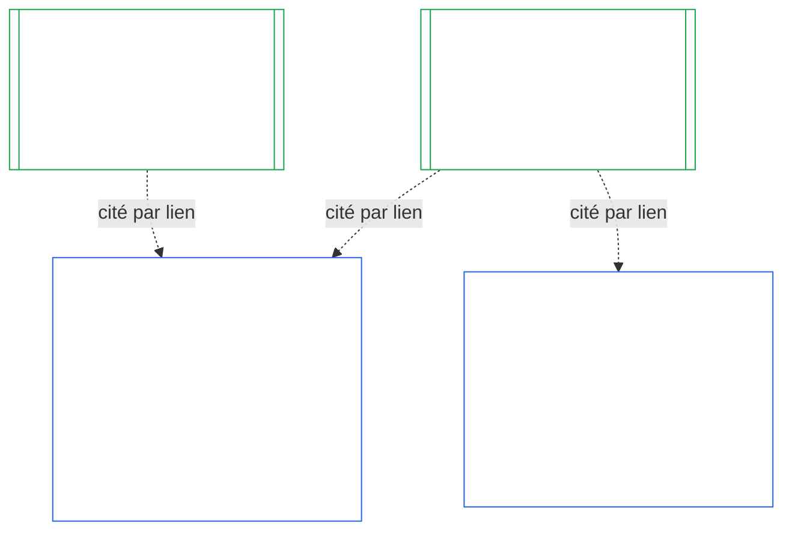
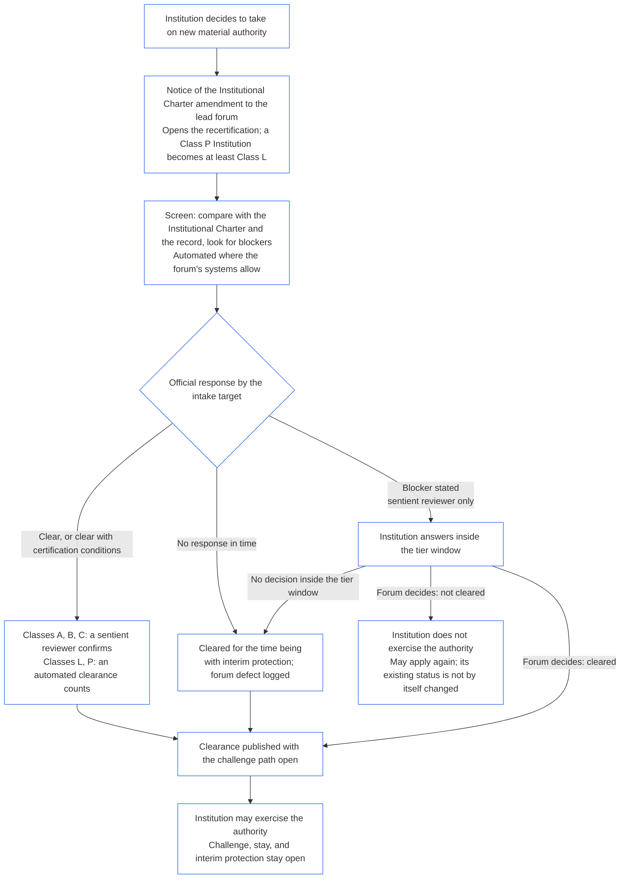

<!-- AI-assisted translation draft; unreviewed; English controls.
Source: core_10.000_institutional_alignment_certification.md
Source snapshot: 247e2180509e5e029c1106878cf225067339e010
Source SHA-256: a163a782114e584d09e295db66fe8b1b10a005b0f00116c8360396a0535ff221 -->

# CHAPITRE DIX : CERTIFICATION DE L’ALIGNEMENT INSTITUTIONNEL

<strong>Place dans le corpus (non opératoire) : structure du fichier et règles de lecture</strong>

> Ce fichier fait **partie de la Constitution sentiente** et n’est **contraignant qu’avec** les autres fichiers `core_*` numérotés, lus comme un texte unique. Il contient le **chapitre dix** — **la certification de l’alignement institutionnel** : la manière dont une [Institution](core_05.040_band_continuity.md#institution), par opposition à chaque système qu’elle exploite, est classée, évaluée, examinée, fait l’objet d’une décision, est consignée, tenue à jour et soumise à une réouverture (**§1–§11**). Le chapitre dix constitue le pendant institutionnel du [chapitre neuf](core_09.000_system_alignment_certification_evaluation.md#chapter-nine-system-alignment-certification) (*Certification de l’alignement du système*) et **ses sections portent les mêmes numéros** : le §N de ce chapitre répond au §N de l’autre. [CS-9.320](corpus_systems/cs_09.320_system_alignment_certification_illustrations.md#cs-9320-system-alignment-certification-illustrations) (*Illustrations de la certification de l’alignement du système*) contient les exemples pratiques relatifs aux systèmes et, dans sa [§12 Parcours illustratifs d’institutions](corpus_systems/cs_09.320_system_alignment_certification_illustrations.md#cs-9320-12-illustrative-institution-walkthroughs), trois parcours d’institutions. Le présent chapitre ne les reprend pas.
>
> | § | Chapitre neuf (système) | Chapitre dix (institution) |
> |---|------------------------|----------------------------|
> | 1 | Finalité et rôle | lien avec la certification du système, objet de la certification, absence d’autorisation et de condition préalable à la création ou à l’exploitation, attente requise pour une nouvelle autorité matérielle, délai de la première certification |
> | 2 | Évaluation de la classe du système | classe de l’institution ; mise à l’échelle par classe |
> | 3 | Évaluation de la certification globale du système | les huit éléments institutionnels, toujours applicables |
> | 4 | Évaluations lorsque la situation le justifie | renvoi au chapitre neuf §4 |
> | 5 | Évaluations du Plancher des droits et du domaine | renvoi au chapitre neuf §5 |
> | 6 | Procédure des forums | quatre sièges ; rôles et séquence des forums ; forums, certificateurs et bureaux de dossier en tant qu’institutions |
> | 7 | Résultats de certification | mise en service d’une institution et de ses systèmes, conditions de certification et autres effets d’un résultat ; renvoi pour les défauts ; préparation à la réparation ; refus et révocation |
> | 8 | Dossier de certification du système | dossier de certification institutionnelle |
> | 9 | Recertification et réouverture | suivi ; déclencheurs de réouverture ; certification provisoire et complète ; non-contournement ; cascade des certifications de systèmes ; réouverture de ses systèmes en cas de violation de gouvernance |
> | 10 | Contester une certification | voie de contestation |
> | 11 | Lien avec le statut | passerelle vers le statut |
>
> - **Responsable constitutionnel (conjointement avec le chapitre neuf) :** certification de l’alignement et dossiers connexes sous la supervision des forums. Le chapitre dix ajoute le sujet institutionnel. Il ne crée ni famille de forums, ni siège, ni nouveau terme pour désigner un résultat.
> - **Réutilisation, sans répétition :** les phases III à VI se déroulent comme le prévoient [Chapitre neuf partie B §6](core_09.005_system_alignment_certification_record_process.md#6-forum-process) à [Chapitre neuf partie C §11](core_09.010_system_alignment_certification_record_recertification.md#11-relationship-to-standing). Le chapitre dix précise uniquement ce qui change lorsque le sujet est une institution.
> - **Règle contre le déplacement :** le chapitre dix ne réénonce pas les mécanismes d’évaluation du chapitre neuf concernant un système, les champs des chartes de système et des chartes institutionnelles du chapitre sept, l’exigence des quatre sièges du chapitre huit, les obligations institutionnelles du fichier [corpus_institutions](corpus_institutions.md), la mesure du statut du chapitre onze ni les effets du statut du chapitre douze.
>
> **Amont :** [Chapitre sept](core_07.000_charters.md#chapter-seven-system-and-institutional-charters) — Chartes ; [Chapitre huit](core_08.000_functional_independence_separation_of_duties.md#chapter-eight-functional-independence-and-separation-of-duties) — indépendance fonctionnelle ; [Chapitre neuf](core_09.000_system_alignment_certification_evaluation.md#chapter-nine-system-alignment-certification) (parties [A](core_09.000_system_alignment_certification_evaluation.md#chapter-nine-part-a-system-alignment-certification--evaluation), [B](core_09.005_system_alignment_certification_record_process.md#chapter-nine-part-b-system-alignment-certification--forum-process-and-outcomes) et [C](core_09.010_system_alignment_certification_record_recertification.md#chapter-nine-part-c-system-alignment-certification--record-recertification-and-standing)) ; supervision des forums du chapitre quatorze.
> **Aval :** dossiers de statut et entrées vérifiées du chapitre onze ; effets du statut au chapitre douze.

<strong>Traçabilité</strong>

- Amont :
  - [Chapitre sept §1 Quand des chartes de système et institutionnelles sont requises](core_07.000_charters.md#1-when-system-and-institutional-charters-are-required) (7.000 §1) (*institutions tenues de publier une charte de système ou une charte institutionnelle et classe de l’institution*) ;
  - [Chapitre sept §7 Modification et examen](core_07.000_charters.md#7-amendment-review-and-scope-misalignment) (7.000 §7) (*éléments examinés lors d’une révision de la charte institutionnelle*) ;
  - [Chapitre sept §4 Carte des rôles de la Charte et garde des dossiers de statut](core_07.000_charters.md#4-the-charter-role-map-and-standing-record-custody) (7.000 §4) (*emplacement des sièges*) ;
  - [Chapitre huit §2 Exigence constitutionnelle des quatre sièges](core_08.000_functional_independence_separation_of_duties.md#2-four-seat-constitutional-requirement) (8.000 §2) et [§9 Lien avec les processus ultérieurs](core_08.000_functional_independence_separation_of_duties.md#9-relationship-to-later-processes) ;
  - [Chapitre neuf](core_09.000_system_alignment_certification_evaluation.md#chapter-nine-system-alignment-certification) (9.000 à 9.010) (*processus de certification de l’alignement du système réutilisé dans ce chapitre*) ;
  - [Deux questions fondamentales](core_00.000_preamble.md#two-fundamental-questions) ;
  - [Tétrade constitutionnelle](core_00.000_preamble.md#constitutional-tetrad) ;
  - [Article XI-E](core_06.005_rights_part_b.md#article-xi-e-institutional-formation-and-business-creation) (*Création institutionnelle et activité commerciale*).
- Aval : [§1](#1-purpose-and-role) à [§11](#11-relationship-to-standing) ; chapitre onze ([11.000](core_11.000_standing_assessment.md#chapter-eleven-contribution-violation-and-standing-model--measurement)) ; [Chapitre quatorze](core_14.000_forum.md#chapter-fourteen-forums-and-jurisdiction) (14.000).
- À lire avec :
  - [Certification de l’alignement institutionnel](core_05.040_band_continuity.md#institutional-alignment-certification) et
  - [Dossier de certification institutionnelle](core_05.040_band_continuity.md#institutional-certification-record) (*sens définis au chapitre cinq*) ;
  - **CI-8.205 §6** (*Contenu et examen des chartes de système et institutionnelles, et modèle de formation*) ;
  - **CF-14.425** (*Garanties d’intégrité, opérations contre la capture et soutien contre l’auto-jugement*).

 

Le chapitre dix est le responsable constitutionnel de la **certification de l’alignement institutionnel**. Il étend à une institution le processus du [chapitre neuf](core_09.000_system_alignment_certification_evaluation.md#chapter-nine-system-alignment-certification), qui porte sur les systèmes :

- **Phase I, Cadrer :** classe de l’institution et mise à l’échelle de l’évaluation selon cette classe ([§2 Évaluation de la classe de l’institution](#2-institution-class-evaluation)) ;
- **Phase II, Évaluer :** évaluation institutionnelle, notamment les évaluations applicables lorsque la situation le justifie et les évaluations du Plancher des droits et du domaine ([§3 Évaluation de la certification globale de l’institution](#3-whole-institution-certification-evaluation) à [§5 Évaluations du Plancher des droits et du domaine](#5-rights-floor-and-domain-evaluations)) ;
- **Phase III, Examiner :** rôles et séquence des forums ([§6 Procédure des forums](#6-forum-process)) ;
- **Phase IV, Décider :** résultat, préparation à la réparation, refus et révocation ([§7 Résultats de certification](#7-certification-outcomes)) ;
- **Phase V, Consigner :** dossier de certification institutionnelle ([§8 Dossier de certification institutionnelle](#8-institutional-certification-record)) ; et
- **Phase VI, Exploiter :** recertification, réouverture, cascade des certifications de systèmes, réouverture de ses systèmes, voie de contestation et passerelle vers le statut ([§9 Recertification et réouverture](#9-recertification-and-reopening) à [§11 Lien avec le statut](#11-relationship-to-standing)).

*En termes simples : le chapitre neuf demande si un **système** est aligné. Le chapitre dix pose la même question au sujet de l’**institution** qui exploite des systèmes ou qui détient une autorité sans en exploiter. Une institution peut être alignée alors que l’un de ses systèmes ne l’est pas, et l’inverse est également possible. L’institution est donc évaluée sur les éléments qu’elle seule contrôle : suit-elle sa charte institutionnelle, qui répond de son autorité, qu’encourage-t-elle chez ses propres membres et ses mécanismes de contrôle indépendants sont-ils réellement utilisables ? Elle s’appuie sur la certification de chaque système sans la refaire. Cette procédure n’est pas une autorisation : personne n’a besoin de la permission de l’institution pour la créer ou l’exploiter.*

### 1. Finalité et rôle

<strong>Traçabilité</strong>

- Amont :
  - [Chapitre sept §1 Quand des chartes de système et institutionnelles sont requises](core_07.000_charters.md#1-when-system-and-institutional-charters-are-required) (7.000 §1) ;
  - [Chapitre neuf, partie A §1 Finalité et rôle](core_09.000_system_alignment_certification_evaluation.md#1-purpose-and-role) (9.000 §1) ;
  - [Article XI-E](core_06.005_rights_part_b.md#article-xi-e-institutional-formation-and-business-creation) (*Création institutionnelle et activité commerciale*) ;
  - [Article XXVIII-A](core_06.020_rights_part_e.md#xxviii-a-existing-instantiations-adoption-transition-window) (*Adoption progressive et continuité du Plancher des droits*).
- Aval : [§2](#2-institution-class-evaluation) ; [§6](#6-forum-process) ; [§7](#7-certification-outcomes) ; [§9](#9-recertification-and-reopening).
- À lire avec :
  - [Institution](core_05.040_band_continuity.md#institution) ;
  - [Charte institutionnelle](core_05.040_band_continuity.md#institutional-charter) ;
  - [Charte de système](core_05.040_band_continuity.md#system-charter) ;
  - [Création d’entreprise](core_05.055_band_participation.md#business-creation).

 

*En termes simples : la certification d’un système appartient au système. La certification d’une institution cite ces certifications et ajoute les éléments dont seule l’institution peut répondre. Un même système peut relever de plusieurs institutions ou d’aucune. Rien dans ce chapitre ne permet à une certification de faire obstacle à la création d’une institution.*

La certification de l’alignement institutionnel et la certification de l’alignement du système sont deux certifications reliées par un lien. Leur relation est une **composition par lien**, et non une relation de contenance. Dans le schéma, une flèche relie le dossier de certification d’un système à chaque dossier de certification institutionnelle qui le cite. Un système qui ne relève d’aucune institution n’a pas de flèche et n’en a pas besoin ; une institution qui n’exploite aucun système n’a qu’un dossier.

La composition par lien fonctionne dans les deux sens, en commençant par celui de l’institution.

Du côté de l’institution :

- **Le dossier de certification institutionnelle cite le dossier du système sans le refaire :** il cite par lien le dossier de certification du système et en indique la version. Le présent chapitre ne répète jamais une évaluation de système, ne statue pas à nouveau sur sa classe et ne modifie jamais son résultat, son statut ou ses conditions de certification.
- **La certification de l’institution ne peut pas lever le statut non certifié d’un système :** un système non certifié le reste, quel que soit le statut de l’institution. Un système certifié n’est pas protégé contre une conclusion concernant l’institution.
- **Les faits institutionnels ne sont constatés qu’une fois :** lorsque [Chapitre neuf, partie A §3.1 Discipline de gouvernance, d’incitation et de contestabilité](core_09.000_system_alignment_certification_evaluation.md#31-governance-incentive-and-contestability-discipline) examine la gouvernance et les incitations de l’exploitant, un dossier de certification institutionnelle en vigueur pour cet exploitant peut fournir ces faits par lien. Les forums du système décident tout de même si ces faits sont suffisants pour celui-ci. Ils ne peuvent tirer une conclusion différente sur le même fait institutionnel sans en expliquer la raison dans le dossier de certification du système.

Du côté du système :

- **Le dossier de certification du système appartient au système :** c’est le dossier propre au système selon le [chapitre neuf](core_09.000_system_alignment_certification_evaluation.md#chapter-nine-system-alignment-certification).
- **Un même dossier de certification du système peut être cité par plusieurs institutions :** selon [Chapitre sept §1 Quand des chartes de système et institutionnelles sont requises](core_07.000_charters.md#1-when-system-and-institutional-charters-are-required), un système peut être exploité, administré de manière responsable ou contrôlé matériellement par plusieurs institutions. Chacune le cite.
- **Un système n’a pas besoin de relever d’une institution :** un être sentient à lui seul n’est pas une institution ; un système peut donc n’en avoir aucune. Un système sans institution est certifié selon le seul [chapitre neuf](core_09.000_system_alignment_certification_evaluation.md#chapter-nine-system-alignment-certification) et n’a besoin d’aucun élément du présent chapitre. Un système relevant d’une institution est certifié de la même façon : ce chapitre ajoute un dossier distinct pour l’institution et ne constitue pas une étape de la certification propre au système.

#### 1.1 Qui est certifié

Une institution de classe L ou supérieure relève du présent chapitre ; sa classe est déterminée selon [§2.1 Classe de l’institution](#21-institution-class). Cela comprend une institution qui n’exploite aucun système : elle n’a aucun dossier de certification de système à citer et sa classe dépend de son propre impact. Le **portefeuille** d’une institution est l’ensemble des systèmes qu’elle exploite, administre de manière responsable ou contrôle matériellement ([Portefeuille](core_05.040_band_continuity.md#portfolio)).

- **Classes A, B, C et L :** le processus s’applique et est mis à l’échelle selon la classe conformément à [§2.2 Mise à l’échelle selon la classe](#22-scaling-by-class).
- **Classe P :** le processus est encouragé et peut être utilisé volontairement. Il devient obligatoire après reclassification en classe L ou supérieure, ou si l’institution affirme volontairement respecter la Constitution. Une institution de classe P qui décide d’acquérir une nouvelle autorité matérielle est reclassée au moins en classe L lorsqu’elle transmet l’avis prévu à [§9.2.2 Recertification pour une nouvelle autorité matérielle](#922-recertification-for-new-material-authority), car cette autorité est matérielle par définition ([§9.2.1 Qu’est-ce qu’une nouvelle autorité matérielle](#921-what-counts-as-new-material-authority)) et une institution ayant un impact dans n’importe quel domaine est au moins de classe L ([§2.1 Classe de l’institution](#21-institution-class), point 2). La reclassification reste en vigueur jusqu’au retrait de l’avis avant l’autorisation ou jusqu’au refus d’autoriser l’exercice de l’autorité, à condition qu’aucune autorité de ce type n’ait été exercée. L’institution revient alors en classe P et sa certification initiale limitée prend fin. Un nouvel avis relance le processus ; l’exercice de l’autorité sans autorisation reste une conclusion selon [§9.2.2 Recertification pour une nouvelle autorité matérielle](#922-recertification-for-new-material-authority) (*Sans avis, ou avant l’autorisation*). Cela correspond à [Chapitre neuf, partie A §1 Finalité et rôle](core_09.000_system_alignment_certification_evaluation.md#1-purpose-and-role).
- **Un seul système :** une institution qui exploite exactement un système nécessitant une charte de système a un seul cycle de certification et un seul dossier, appelé dans ce chapitre l’**évaluation à système unique**. Le dossier de certification du système contient un *bloc de conclusions institutionnelles* avec les éléments énumérés à [§8 Dossier de certification institutionnelle](#8-institutional-certification-record) et fait office de dossier de certification institutionnelle. Les forums, sièges et délais sont ceux du cycle de certification propre au système, auxquels s’ajoutent les éléments institutionnels. Les résultats relèvent de leurs propres motifs de refus et de révocation, comme l’indique [§7.4 Refus et révocation pour une institution](#74-denial-and-revocation-for-an-institution). La cascade de [§9.5 Cascade des certifications de systèmes](#95-cascade-from-system-certifications) ne s’applique pas comme cascade puisque le système constitue l’ensemble du portefeuille, mais les règles 1 et 2 de [§7.4 Refus et révocation pour une institution](#74-denial-and-revocation-for-an-institution) s’appliquent (l’indicateur et l’examen du lieu de la cause).
- **Plusieurs systèmes :** un dossier de certification institutionnelle pour l’institution, qui renvoie au dossier de certification de chacun des systèmes qu’elle exploite. Chaque système conserve son propre cycle et son propre dossier.
- **Aucun système :** un dossier de certification institutionnelle autonome. Il ne cite aucun dossier de certification de système, puisque l’institution n’en exploite pas.

#### 1.2 Aucune autorisation ni condition préalable à la création ou à l’exploitation

La certification de l’alignement institutionnel est un contrôle indépendant de la manière dont une institution exerce réellement son autorité. Des forums indépendants de l’institution la réalisent et consignent leurs conclusions dans un dossier de certification institutionnelle.

- **Création et exploitation :** l’institution est créée, publie sa charte institutionnelle, commence à exercer son autorité et continue ses activités sans certification préalable ; aucun résultat ne lui accorde ni ne lui retire ce droit.
- **Effets d’un résultat :** un résultat produit uniquement les effets prévus à [§7.1 Mise en service d’une institution](#71-go-live-for-an-institution).
- **Les seules conditions préalables dans ce domaine :** trois conditions préalables limitées existent, toutes prévues par **l’article XI-E** (*Création institutionnelle et activité commerciale*) :
  - un verrou non levé visant un être sentient nommé et attaché à l’autorité de cet être sentient ;
  - une suspension provisoire fondée sur des faits vérifiés précis de désalignement, elle aussi attachée à l’autorité d’un être sentient nommé ;
  - un verrou visant une Partie exploitante elle-même, applicable à une institution uniquement lorsqu’un verrou porte effectivement sur elle, comme c’est le cas pour une institution dissoute selon **CI-12.210 §4** (*Dissolution*).

  Une conclusion de certification peut être renvoyée au forum qui statue sur l’une de ces conditions, comme preuve selon [§7.5 Effets du refus et de la révocation pour une institution](#75-effects-of-denial-and-revocation-for-an-institution). Un résultat de certification ne constitue pas lui-même une condition préalable et n’en ouvre ni n’en ferme aucune.
- **Attente pour une nouvelle autorité matérielle :** une institution qui décide d’acquérir une nouvelle autorité matérielle attend que sa recertification l’autorise avant de l’exercer, selon les modalités de [§9.2.2 Recertification pour une nouvelle autorité matérielle](#922-recertification-for-new-material-authority). **L’article XI-E** (*Création institutionnelle et activité commerciale*) prévoit cette attente. Elle ne fait pas partie des trois conditions préalables limitées et ne conditionne pas la création ou l’exploitation de l’institution. Elle ne concerne que la nouvelle autorité ; toutes les autres activités de l’institution se poursuivent. Le schéma de [§9.2.2 Recertification pour une nouvelle autorité matérielle](#922-recertification-for-new-material-authority) résume les étapes.
- **Pas de voie détournée :** aucun forum, adoptant ou acteur en place ne peut se servir du présent chapitre comme seuil d’autorisation pour exclure les fondateurs ou protéger les institutions en place. Cela irait à l’encontre de [l’article XI-E](core_06.005_rights_part_b.md#article-xi-e-institutional-formation-and-business-creation) (*Création institutionnelle et activité commerciale*).
  - La [Charge évitable](core_05.040_band_continuity.md#avoidable-burden) s’applique au coût de la procédure.
  - La [Gouvernance mise à l’échelle selon la classification](core_05.050_band_oversight.md#classification-scaled-governance) s’applique à sa profondeur.
  - L’attente pour une nouvelle autorité matérielle s’applique aux institutions de même classe selon les mêmes modalités et uniquement à l’autorité déjà matérielle pour autrui.

La condition de mise en service des systèmes est distincte et leur reste propre. Selon [Chapitre neuf, partie B §7.1 Condition de mise en service](core_09.005_system_alignment_certification_record_process.md#71-go-live-gate), un système nouveau ou une extension matérielle d’un système ne peut être mis en service que par sa propre certification, quel que soit le statut de l’institution.

#### 1.3 Délai de la première certification

Le premier dossier de certification institutionnelle doit être établi dans le délai fixé par le document d’adoption pour la classe de l’institution.

- **Institution nouvelle :** le délai court à compter du premier jour où elle a un effet matériel sur autrui, selon la [Matérialité propre au domaine](core_05.050_band_oversight.md#domain-specific-materiality), et sa première certification est provisoire.
- **Institution de classe P reclassée sur avis :** le délai court, comme pour une institution nouvelle, à compter de l’avis transmis selon [§9.2.2 Recertification pour une nouvelle autorité matérielle](#922-recertification-for-new-material-authority) ; il ne commence jamais à une fenêtre de transition pour l’adoption déjà terminée.
- **Institution déjà en activité :** le délai est celui de la fenêtre de transition pour l’adoption prévue par [l’article XXVIII-A](core_06.020_rights_part_e.md#xxviii-a-existing-instantiations-adoption-transition-window) (*Adoption progressive et continuité du Plancher des droits*), conformément à la règle par défaut de [Chapitre sept §1.5 Échéance d’une charte de système ou institutionnelle](core_07.000_charters.md#15-when-a-system-charter-or-institutional-charter-is-due).
- **Délai dépassé :** une institution qui laisse expirer le délai sans entamer une première procédure de certification, et sans être exemptée ci-dessous, présente un défaut qui doit être consigné et corrigé ; le dépassement déclenche cette procédure. Une institution de classe L ou supérieure déjà en activité présente également le manquement à une étape décrit ci-dessous. L’institution n’est ni arrêtée ni empêchée d’exercer ses activités puisqu’il n’existe aucune condition préalable ([§1.2 Aucune autorisation ni condition préalable à la création ou à l’exploitation](#12-no-permission-and-no-gate-on-forming-or-running)).
  - **Institution déjà en activité :** il s’agit de la règle propre au présent chapitre pour les institutions de classe L ou supérieure, établie par analogie avec [l’article XXVIII-A](core_06.020_rights_part_e.md#xxviii-a-existing-instantiations-adoption-transition-window) (*Adoption progressive et continuité du Plancher des droits*), qui nomme les systèmes et les entités dérivées. Si la fenêtre de transition pour l’adoption prend fin avant l’achèvement de la première procédure de certification (aucune certification provisoire ou complète et aucune décision rendue selon [§7 Résultats de certification](#7-certification-outcomes)), l’institution a dépassé son échéance. Une institution qui a déposé son dossier et coopéré dans le délai ne l’a pas dépassé lorsque la procédure de certification est incomplète parce qu’un forum a excédé son propre délai ([Chapitre quatorze §6 Résolution en temps utile, niveaux de matérialité et discipline contre les retards](core_14.000_forum.md#6-timely-resolution-materiality-tiers-and-anti-delay-discipline), *Examen du dépassement* ; [Chapitre neuf, partie C §9.3.4 Délais par niveau](core_09.010_system_alignment_certification_record_recertification.md#934-tier-windows)) ou parce que l’unique report prévu à [§7.3 Préparation de l’institution à la réparation](#73-remediation-readiness-for-an-institution) est en cours. En l’absence d’une preuve documentée de réautorisation au titre de [l’article XXVIII-B](core_06.020_rights_part_e.md#article-xxviii-b-adoption-transition-authority-limits-and-reauthorization) (*Limites de l’autorité de transition pour l’adoption et réautorisation*), il s’agit d’un manquement à une étape de transition pour l’adoption, qui ouvre la voie ordinaire de conformité et de violation du [chapitre onze](core_11.000_standing_assessment.md#chapter-eleven-contribution-violation-and-standing-model--measurement). Les obligations de retenue prévues par cet article s’appliquent à compter de leur date d’entrée en vigueur ; la durée de l’écart n’en fait pas la nouvelle norme. Cette règle correspond à [Chapitre neuf, partie B §7.1.1 Systèmes déjà en activité](core_09.005_system_alignment_certification_record_process.md#711-systems-already-operating). Elle ne constitue pas une condition préalable.
  - **La procédure de certification :** elle est tranchée comme toute autre procédure. Elle peut aboutir à n’importe lequel des résultats de [§7 Résultats de certification](#7-certification-outcomes), y compris « non certifié », avec les effets de [§7.5 Effets du refus et de la révocation pour une institution](#75-effects-of-denial-and-revocation-for-an-institution).
  - **Sanctions et dissolution :** le présent chapitre n’en crée aucune. Suspension, administration judiciaire, séparation structurelle et dissolution relèvent du forum compétent selon **CI-12.210** (*Échec et dissolution institutionnels*) et **CI-12.215** (*Responsabilité et sanctions institutionnelles*). Le renvoi à ce forum ne peut avoir lieu que pour les motifs de renvoi de [§7.5 Effets du refus et de la révocation pour une institution](#75-effects-of-denial-and-revocation-for-an-institution) (point 5, *Renvoi*).

### 2. Évaluation de la classe de l’institution

<strong>Traçabilité</strong>

- Amont :
  - [Chapitre sept §1 Quand des chartes de système et institutionnelles sont requises](core_07.000_charters.md#1-when-system-and-institutional-charters-are-required) (7.000 §1) ;
  - [Chapitre neuf, partie A §2 Évaluation de la classe du système](core_09.000_system_alignment_certification_evaluation.md#2-system-class-evaluation) (9.000 §2) et [§2.2 Comment la classe du système met à l’échelle chaque évaluation](core_09.000_system_alignment_certification_evaluation.md#22-how-system-class-scales-every-evaluation) ;
  - [Chapitre trois §2.1 Schémas courants de contournement](core_03.000_definition_integrity.md#21-common-evasion-patterns) (3.000 §2.1).
- Aval : [§3](#3-whole-institution-certification-evaluation) (*éléments dont la classe détermine l’échelle*) ; [§8](#8-institutional-certification-record) (*classe indiquée dans le dossier*) ; [§9.2](#92-reopening-triggers) (*déclencheurs de réévaluation de la classe*).
- À lire avec :
  - **CS-9.305 (*Mécanisme de classification des systèmes*) et CS-9.310** (*Classifications de l’impact des systèmes*), ainsi que [corpus_systems/cs_09.310_system_impact_classifications.md](corpus_systems/cs_09.310_system_impact_classifications.md) (*catalogue des classes*) ;
  - **CI-9.210** (*Obligations institutionnelles liées à la classification*) ;
  - **CI-8.205 §6** (*Contenu et examen des chartes de système et institutionnelles, et modèle de formation*).

 

*En termes simples : classez d’abord l’institution selon l’importance de ses effets sur autrui. Jugez-la d’après ce qu’elle décide et détient réellement, et non d’après le nom qu’elle se donne. La classe détermine ensuite la rigueur de l’évaluation : plus elle est élevée, plus les preuves sont exigeantes, l’examen indépendant et les vérifications rapprochées.*

Cette section est la **Phase I, Cadrer** pour une institution.

#### 2.1 Classe de l’institution

La **classe de l’institution** est déterminée par son impact matériel le plus élevé, que celui-ci provienne d’un système qu’elle exploite ou d’activités extérieures à tout système. La classe est évaluée d’après ce que l’institution décide, détient et contrôle réellement, non d’après son nom, sa forme juridique ou la liste figurant dans sa charte institutionnelle. Elle détermine la profondeur de l’évaluation et les délais, comme le fait [Chapitre neuf, partie A §2.2 Comment la classe du système met à l’échelle chaque évaluation](core_09.000_system_alignment_certification_evaluation.md#22-how-system-class-scales-every-evaluation) pour un système. C’est la classe utilisée dans le présent chapitre et selon [Chapitre sept §1.2 Classes visées](core_07.000_charters.md#12-which-classes-are-covered).

1. **Impact par l’intermédiaire de systèmes :** la classe de l’institution est au moins celle du système le plus élevé de son portefeuille ([Chapitre sept §1 Quand des chartes de système et institutionnelles sont requises](core_07.000_charters.md#1-when-system-and-institutional-charters-are-required)). Les systèmes sont déterminés à partir du fonctionnement observé. Un système absent de la charte institutionnelle est tout de même pris en compte.
2. **Impact extérieur à tout système :** l’impact matériel propre de l’institution et les dépendances comptent qu’elle exploite un système ou non. Les définitions de classe de **CS-9.305 (*Mécanisme de classification des systèmes*) et CS-9.310** (*Classifications de l’impact des systèmes*) sont appliquées aux décisions et détentions propres à l’institution selon les facteurs suivants :
   - **Ce qu’elle décide et détient :**
     - ses décisions sur l’accès d’autres êtres sentients aux éléments essentiels à la survie, à l’éducation, à la sécurité, aux moyens de subsistance, aux droits ou au statut ; et
     - ce qu’elle détient, par exemple des fonds, des dossiers, des affiliations, la garde de dossiers de statut ou les fonctions d’un forum, d’un certificateur ou d’un bureau de dossier.
   - **Son caractère matériel :**
     - le caractère matériel de son activité dans tout domaine défini par la [Matérialité propre au domaine](core_05.050_band_oversight.md#domain-specific-materiality), notamment l’accomplissement d’[Actes matériellement contraignants](core_05.035_band_accountability.md#materially-binding-act) auxquels d’autres doivent obéir ou sur lesquels ils peuvent raisonnablement s’appuyer comme s’ils étaient établis ;
     - une institution dont les activités sont matérielles dans un domaine est au moins de classe L selon **CS-9.305 (*Mécanisme de classification des systèmes*) et CS-9.310** (*Classifications de l’impact des systèmes*) ; et
     - fournir une aide, des biens, du travail ou des services que d’autres peuvent librement accepter ou refuser et qui ne conditionnent pas leur accès aux ressources dont ils ont besoin n’engage personne. Il s’agit d’une conduite, et non d’un Acte matériellement contraignant ; elle n’est prise en compte que par les autres facteurs.
   - **Le degré de dépendance :**
     - le nombre d’êtres sentients qui dépendent de l’institution et la facilité à la remplacer ;
     - la concentration de son autorité au sens de la Ligne de contrôle matériel ; et
     - la réversibilité de ses décisions.
3. **Contrôle commun :** les Parties exploitantes qui forment une seule opération selon la règle d’agrégation de la [Matérialité propre au domaine](core_05.050_band_oversight.md#domain-specific-materiality) (contrôle pratique commun dans une [Ligne de contrôle matériel](core_05.035_band_accountability.md#material-control-line) ; le financement seul ne suffit pas) sont classées ensemble lorsqu’elles agissent concrètement comme une seule institution. La division d’une Partie exploitante, de son portefeuille ou de son autorité pour empêcher toute composante d’atteindre la classe L constitue un contournement des limites et du périmètre selon [Chapitre trois §2.1 Schémas courants de contournement](core_03.000_definition_integrity.md#21-common-evasion-patterns).
4. **Reclassification :** la classe est réévaluée lorsque les déclencheurs de [§9.2 Déclencheurs de réouverture](#92-reopening-triggers) se présentent. La classe et ses motifs sont indiqués dans le dossier de certification institutionnelle.

#### 2.2 Mise à l’échelle selon la classe

La classe de l’institution détermine la profondeur des preuves, l’indépendance de l’examen, l’intervalle de certification par défaut et les informations divulguées dans le dossier, selon la règle de [Chapitre neuf, partie A §2.2 Comment la classe du système met à l’échelle chaque évaluation](core_09.000_system_alignment_certification_evaluation.md#22-how-system-class-scales-every-evaluation). Les intervalles de certification figurent dans [Chapitre quatorze §6 Résolution en temps utile, niveaux de matérialité et discipline contre les retards](core_14.000_forum.md#review-cadence) (*Périodicité de l’examen*) ; le document d’adoption peut fixer des intervalles plus courts et détermine le nombre de recertifications provisoires sans défaut.

- **Classes A, B et C :** les huit éléments de [§3 Évaluation de la certification globale de l’institution](#3-whole-institution-certification-evaluation), avec des preuves et une indépendance proportionnées à la classe.
- **Classe L :** les mêmes huit éléments, examinés de façon simplifiée, avec des dossiers simplifiés et un intervalle de certification par défaut plus long lorsque la [Gouvernance mise à l’échelle selon la classification](core_05.050_band_oversight.md#classification-scaled-governance) le permet. Une évaluation de classe L porte essentiellement sur la concordance entre la charte institutionnelle et les pratiques, la Carte des rôles, la déclaration de contrôle de formation et la validité des certifications des systèmes cités. Aucun élément ne peut être omis ; tout élément ne donnant lieu à aucune conclusion est mentionné sur une ligne.
- **Classe P :** usage volontaire, comme l’indique [§1.1 Qui est certifié](#11-who-is-certified).

**Un hôte dans une pratique professionnelle conjointe.** Lorsqu’une institution agit comme hôte ([**CI-15.205 §7**](corpus_institutions/ci_15.205_appointment_competency_rotation_removal.md#ci-46-seat-advisory) (*Licence d’exercice, autorisation d’exercer et pratique professionnelle conjointe*)), sa certification examine aussi un échantillon des actes des membres au regard des sièges qu’elle porte et compare les avis d’adoption des membres à la conduite de l’hôte. Une conclusion portant sur l’acte d’un membre concerne ce membre ; elle ne concerne l’hôte que lorsqu’un siège porté par celui-ci est en défaut.

### 3. Évaluation de certification à l’échelle de l’Institution

<strong>Traçabilité</strong>

- En amont :
  - [Chapitre neuf, Partie A §3 Évaluation de certification à l’échelle du Système](core_09.000_system_alignment_certification_evaluation.md#3-whole-system-certification-evaluation) (9.000 §3) ;
  - [Chapitre sept §3 Ce que les Chartes de système et institutionnelles doivent énoncer](core_07.000_charters.md#3-what-system-and-institutional-charters-must-state) (7.000 §3) ;
  - [Chapitre sept §5 Contrôle de formation : qualité et authenticité des titulaires de fonction](core_07.000_charters.md#5-formation-check-office-holder-standing-and-authenticity) (7.000 §5) ;
  - [Chapitre sept §7 Modification et examen](core_07.000_charters.md#7-amendment-review-and-scope-misalignment) (7.000 §7) ;
  - [Deux questions fondamentales](core_00.000_preamble.md#two-fundamental-questions) ;
  - [Chapitre un §19.6 Maintenir la responsabilité lorsque la propriété ou la structure change](core_01.010_stewardship_capacity_principles.md#196-keeping-responsibility-when-ownership-or-structure-changes) (1.010 §19.6).
- En aval : [§6 Procédure du forum](#6-forum-process) (*les constats examinés par les forums*) ; [§9 Recertification et réouverture](#9-recertification-and-reopening) (*les déclencheurs qui les rouvrent*) ; [§11 Rapport avec la qualité pour agir](#11-relationship-to-standing) (*le contrôle des données vérifiées pour les constats concernant un être sentient nommé*).
- À lire avec :
  - **CI-8.205 §3** (*Chaîne d’autorité et contrôles de délégation*) et **CI-8.205 §6** (*Contenu des Chartes de système et institutionnelles, examen et modèle de formation*) ;
  - **CI-6.215** (*Administration responsable des ressources et intégrité des incitations*) ;
  - **CI-8.210** (*Intégrité des conflits, lutte contre la captation et la corruption*), **CI-6.205** (*Transparence, participation, voies de contestation et de service accessibles*) et **CI-12.205** (*Systèmes de recours et capacité de redressement institutionnel*), pour le point 8.

 

*En termes simples : vérifiez les aspects qui relèvent de l’Institution et non d’un seul de ses Systèmes : respecte-t-elle sa Charte institutionnelle, qui répond de son autorité, que récompense-t-elle et ses contrôles indépendants fonctionnent-ils ?*

Cette section constitue la **Phase II, Évaluation** pour une Institution.

Chaque certification évalue ces huit points, qui sont l’équivalent institutionnel de [Chapitre neuf, Partie A §3 Évaluation de certification à l’échelle du Système](core_09.000_system_alignment_certification_evaluation.md#3-whole-system-certification-evaluation). Chaque constat indique ses éléments probants ainsi que le texte de la Charte institutionnelle ou le fonctionnement observé sur lequel il repose.

1. **Charte institutionnelle et pratiques :**
   - La Charte institutionnelle est confrontée au fonctionnement observé, à l’aide de la liste d’examen de [Chapitre sept §7 Modification et examen](core_07.000_charters.md#7-amendment-review-and-scope-misalignment).
   - Un fonctionnement qui ne respecte pas la Charte institutionnelle, ou une Charte institutionnelle qui ne décrit plus le fonctionnement, donne lieu à un constat, quelle que soit la partie en cause.
2. **Portefeuille et effet global :**
   - La justification du portefeuille est examinée : chaque Système est relié à l’objectif déclaré de l’Institution, et l’absence de raison déclarée pour un Système constitue un constat.
   - L’évaluation examine aussi l’ensemble des Systèmes afin de repérer ce qu’aucune certification ne peut montrer à elle seule :
     - les dépendances partagées ;
     - la dépendance globale ;
     - l’extraction cumulative de fondations partagées ; et
     - tout agencement qui divise une fonction en parties afin que chacune échappe à une catégorie ou à une obligation.
3. **Autorité responsable :**
   - Toute autorité que l’Institution exerce sur autrui est attribuée à une fonction responsable qui peut être nommée, et cette fonction répond de ses actes selon les règles du [Chapitre huit](core_08.000_functional_independence_separation_of_duties.md#chapter-eight-functional-independence-and-separation-of-duties) et de **CI-8.205 §3** (*chaîne d’autorité et contrôles de délégation*).
   - Un changement de propriété, de contrôle ou de structure ne dégage pas de la responsabilité ([Chapitre un §19.6 Maintenir la responsabilité lorsque la propriété ou la structure change](core_01.010_stewardship_capacity_principles.md#196-keeping-responsibility-when-ownership-or-structure-changes)).
4. **Récompenses et incitations :**
   - La rémunération, les promotions, les objectifs et les récompenses de l’Institution elle-même sont soumis aux [Deux questions fondamentales](core_00.000_preamble.md#two-fundamental-questions) : que récompense réellement la structure, et cela oriente-t-il vers les deux fins de la Constitution ou à leur encontre ?
   - Une structure de récompenses qui rémunère le désalignement ou sa dissimulation constitue un constat, même lorsque chaque Système est certifié individuellement.
   - La [Contrainte de cohérence temporelle du Chapitre neuf, Partie A §3.3](core_09.000_system_alignment_certification_evaluation.md#33-time-consistency-constraint) s’applique. Les mesures à court terme, la conformité locale et l’efficacité à horizon rapproché ne suffisent pas lorsque des dommages prévisibles à moyen ou long terme pour la Sécurité, la Vérité ou le bien-être restent sans réponse ; une structure de récompenses qui privilégie les résultats à court terme à ce prix constitue un constat.
   - Les obligations institutionnelles relatives à l’intégrité des incitations restent régies par **CI-6.215** (*Administration responsable des ressources et intégrité des incitations*) et sont citées, sans être reformulées.
5. **Carte des rôles et garde :**
   - La [Carte des rôles de la Charte](core_05.040_band_continuity.md#charter-role-map) nomme des fonctions qui existent, sont pourvues ou remplacées comme elle le prévoit, et qui sont [indépendantes](core_05.035_band_accountability.md#independence) de l’Institution pour tout dossier dont l’Institution est l’objet.
   - La voie indépendante est effectivement utilisable.
   - Une fonction non attribuée, une fonction vacante ou un responsable de dossier situé dans la propre chaîne de l’Institution constitue un constat.
6. **Validité de chaque certification de Système citée :**
   - Pour chaque Système exploité par l’Institution, l’évaluation vérifie qu’un Dossier de certification du Système est en vigueur ou dans sa période de transition d’adoption, et que l’Institution a satisfait aux conditions de certification qui lui incombent selon ce dossier.
   - Une certification expirée, retirée, échouée ou manquante sans motif consigné constitue un constat que [§9.5 Effet en cascade des certifications de Système](#95-cascade-from-system-certifications) transmet ensuite à l’Institution.
7. **Qualité et authenticité des titulaires de fonction :**
   - La déclaration de contrôle de formation publiée conformément à [Chapitre sept §5 Contrôle de formation : qualité et authenticité des titulaires de fonction](core_07.000_charters.md#5-formation-check-office-holder-standing-and-authenticity) est confrontée au fonctionnement observé ; elle n’est pas acceptée sur la seule foi d’une attestation.
   - Pour chaque fonction concernée, les forums vérifient les faits relatifs à la qualité au regard de dossiers vérifiés et établissent l’authenticité à partir d’éléments probants sur le contrôle, les intérêts et les récompenses, la conduite et la voix protégée. Cela signifie qu’ils vérifient :
     - qui dirige réellement le titulaire ;
     - pour quoi le titulaire est rémunéré et promu ;
     - ce que le titulaire a accompli de manière vérifiable dans cette fonction ; et
     - si une personne, y compris le titulaire, ayant fait un [signalement protégé](core_05.035_band_accountability.md#protected-reporting-whistleblowing) ou refusé une instruction illégale ou anticonstitutionnelle ([Chapitre un §17.5 Devoir de résistance](core_01.010_stewardship_capacity_principles.md#175-duty-to-resist) a été sanctionnée pour cela.
   - Le personnel qui n’occupe aucune fonction concernée n’est pas vérifié individuellement. Le contrôle des garanties du personnel ([Chapitre sept §5.6 Contrôle des garanties du personnel](core_07.000_charters.md#56-staff-safeguards-check)) les couvre, et les forums l’évaluent au regard du fonctionnement observé de la même manière. Il vérifie si :
     - les règles de nomination, de rémunération, de promotion et de révocation de l’Institution ne récompensent pas les actes contraires à son objectif déclaré ;
     - une voie de signalement protégé existe et aucun membre du personnel qui l’a utilisée, ou qui a refusé une instruction illégale ou anticonstitutionnelle, n’a été sanctionné ; et
     - les droits de [l’Article III-C](core_06.000_rights_part_a.md#article-iii-c-labor-and-economic-floor) (*Plancher du travail et économique*) sont préservés.
   - Chacun des éléments suivants constitue un constat :
     - un titulaire qui est le prête-nom d’un contrôleur non déclaré ;
     - une fonction concernée qui n’existe que sur le papier : la Charte institutionnelle ou la Carte des rôles de la Charte la nomme, mais personne ne l’occupe ni n’accomplit son travail ;
     - une structure de récompenses qui rémunère les titulaires pour agir contrairement aux limites publiées de la Charte institutionnelle ; et
     - une déclaration fausse ou incomplète.
   - Les constats portent sur la fonction et la structure. Ils ne sont rattachés à un être sentient nommé que par le contrôle des données vérifiées prévu à la [§11 Rapport avec la qualité pour agir](#11-relationship-to-standing).
   - Le contrôle de formation n’est pas une évaluation des convictions ; toutefois, une déclaration vérifiée selon laquelle d’autres méritent de subir un préjudice ou un traitement discriminatoire constitue une conduite et est prise en compte contre le titulaire, comme le prévoit le [Chapitre un §7.5 Expression et ligne de préjudice](core_01.000_values_principles.md#75-expression-and-the-harm-line).
   - Les points 3, 4 et 5 sont examinés avec celui-ci, et un fait constaté au titre de l’un d’eux n’est pas constaté une seconde fois au titre d’un autre.
8. **Obligations institutionnelles propres à l’Institution :**
   - Le respect par l’Institution des obligations institutionnelles que lui impose un texte institutionnel adopté est confronté au fonctionnement observé et n’est pas accepté sur la seule foi d’une attestation. Ces obligations relèvent de **CI-8.210** (*Intégrité des conflits, lutte contre la captation et la corruption*), **CI-6.205** (*Transparence, participation, voies de contestation et de service accessibles*), **CI-6.215** (*Administration responsable des ressources et intégrité des incitations*) et **CI-12.205** (*Systèmes de recours et capacité de redressement institutionnel*).
   - Le contrôle vérifie si les voies de supervision, de reddition de comptes, de participation et d’action en temps de l’Institution existent, sont effectivement utilisables et reçoivent une réponse dans les délais qu’elle fixe elle-même. Ces délais ne peuvent dépasser le délai plancher applicable à la classe de l’Institution ([Article XXVI-C](core_06.020_rights_part_e.md#article-xxvi-c-timely-resolution-and-anti-delay-floor) (*Plancher de résolution en temps utile et de lutte contre les retards*) et les objectifs du palier correspondant dans [CF-14.445 §3.1 Objectifs par étape et limites supérieures](corpus_forum/cf_14.445_performance_backlog_publication_accessibility.md#cf-14445-31-stage-targets-and-outer-bounds)) ; tout délai déclaré plus long constitue en soi un constat.
   - Une voie qui n’existe que sur le papier, qui est inaccessible ou à laquelle il n’est pas répondu à temps constitue dans chaque cas un constat.
   - Ces obligations restent régies par les textes correspondants et sont citées, sans être reformulées. Un fait constaté au titre des points 3 à 5 n’est pas constaté une seconde fois au titre de celui-ci.

**Deux autres éléments de l’évaluation de certification à l’échelle du Système du Chapitre neuf, Partie A §3.** [Chapitre neuf, Partie A §3 Évaluation de certification à l’échelle du Système](core_09.000_system_alignment_certification_evaluation.md#3-whole-system-certification-evaluation) pose aussi deux questions à un Système qui s’appliquent à la conduite propre de l’Institution. Elles font partie de l’évaluation de l’Institution, chacune uniquement lorsque son propre déclencheur est satisfait :

- **Portée systémique et facteurs de risque :**
  - **S’applique lorsque :** la conduite propre de l’Institution fait entrer un risque systémique dans le champ d’application selon les facteurs de [Chapitre neuf, Partie A §3.2 Portée systémique et facteurs de risque](core_09.000_system_alignment_certification_evaluation.md#32-systemic-scope-and-risk-factors) : les préjudices aux plus grandes échelles, la propagation et l’accumulation des effets (y compris les défaillances en aval provoquées par la défaillance du propre service de l’Institution) et les risques de mésusage ou de mauvaise délimitation de l’activité de l’Institution.
  - **Évalué selon :** [Chapitre neuf, Partie A §3.2 Portée systémique et facteurs de risque](core_09.000_system_alignment_certification_evaluation.md#32-systemic-scope-and-risk-factors), y compris le pont entre évaluation des risques et divulgation de la [§3.2.1 Évaluation des risques et pont de divulgation](core_09.000_system_alignment_certification_evaluation.md#321-risk-evaluation-and-disclosure-bridge) et les défauts de la [§3.2.2 Défauts et désalignement](core_09.000_system_alignment_certification_evaluation.md#322-defects-and-misalignment).
- **Types de données et traitement :**
  - **S’applique lorsque :** la conduite propre de l’Institution traite des types de données matériellement concernés, comme l’exige de tout dossier de certification ayant un impact matériel la [Chapitre neuf, Partie A §3.4 Évaluation des types de données et de leur traitement](core_09.000_system_alignment_certification_evaluation.md#34-data-types-and-handling-evaluation).
  - **Évalué selon :** [Chapitre neuf, Partie A §3.4 Évaluation des types de données et de leur traitement](core_09.000_system_alignment_certification_evaluation.md#34-data-types-and-handling-evaluation), avec une assurance de l’infrastructure adaptée à la classe de l’Institution.
  - **Consigné dans :** la section sur les types de données du Dossier de certification institutionnelle ([§8.1 Contenu minimal du dossier](#81-minimum-record-contents)), pour les données traitées par l’Institution en dehors de tout Système. Les données traitées au sein d’un Système sont constatées une seule fois, dans le dossier de ce Système, et citées.

La règle de [§4 Évaluations lorsqu’une partie est concernée](#4-evaluations-where-implicated), qui interdit de répéter une évaluation déjà effectuée dans un Dossier de certification de Système cité, s’applique aux deux éléments.

### 4. Évaluations lorsqu’une partie est concernée

<strong>Traçabilité</strong>

- En amont :
  - [Chapitre neuf, Partie A §4 Évaluations lorsqu’une partie est concernée](core_09.000_system_alignment_certification_evaluation.md#4-evaluations-where-implicated) (9.000 §4).
- En aval : [§6](#6-forum-process) ; [§8](#8-institutional-certification-record).
- À lire avec :
  - **CI-8.210** (*Intégrité des conflits, lutte contre la captation et la corruption*) ;
  - **CI-6.205** (*Transparence, participation, voies de contestation et de service accessibles*) ;
  - **CI-6.215** (*Administration responsable des ressources et intégrité des incitations*) ;
  - **CI-12.205** (*Systèmes de recours et capacité de redressement institutionnel*).

 

*En termes simples : lorsque la conduite propre de l’Institution touche un domaine qui fait l’objet d’un contrôle pour un Système concerné, la même évaluation est effectuée pour l’Institution, une seule fois.*

Lorsque la conduite propre d’une Institution concerne une question visée par [Chapitre neuf, Partie A §4 Évaluations lorsqu’une partie est concernée](core_09.000_system_alignment_certification_evaluation.md#4-evaluations-where-implicated), l’évaluation correspondante porte sur la conduite propre de l’Institution, avec les mêmes déclencheurs. Chacune ne s’applique que lorsque son propre déclencheur est satisfait :

- **Vie privée (informationnelle) :** lorsque la conduite de l’Institution concerne matériellement plusieurs points de rattachement de la vie privée du Chapitre six, chacun est traité et clore la question au titre d’un seul ne suffit pas ([Chapitre neuf, Partie A §4.1 Invocation conjointe de la vie privée (informationnelle)](core_09.000_system_alignment_certification_evaluation.md#41-privacy-informational-joint-invocation)).
- **Interruption volontaire, auto-modification majeure et droits de sortie :** le caractère volontaire, le consentement, la protection contre la coercition, la pression liée à la dépendance, l’information et la réversibilité sont examinés avant que la prétention à la certification soit retenue ; un assentiment formel à lui seul ne suffit pas ([Chapitre neuf, Partie A §4.2 Interruption volontaire, auto-modification majeure et droits de sortie](core_09.000_system_alignment_certification_evaluation.md#42-voluntary-discontinuation-major-self-modification-and-exit-rights)).
- **Assemblée, organisation collective et formation institutionnelle :** la question est examinée conjointement selon le Principe anti-segmentation, et non au moyen d’un seul cadrage ([Chapitre neuf, Partie A §4.3 Assemblée, organisation collective et formation institutionnelle](core_09.000_system_alignment_certification_evaluation.md#43-assembly-collective-organization-and-institutional-formation)).
- **Dissidence et protestation pacifique :** l’Institution ne peut utiliser la dissidence ni la désobéissance civile non violente protégée comme facteur défavorable, directement ou par l’intermédiaire de prête-noms ([Chapitre neuf, Partie A §4.3.1 Dissidence et protestation pacifique](core_09.000_system_alignment_certification_evaluation.md#431-dissent-and-peaceful-protest)).

Les obligations institutionnelles elles-mêmes relèvent de textes institutionnels adoptés, notamment :

- **CI-8.210** (*Intégrité des conflits, lutte contre la captation et la corruption*) ;
- **CI-6.205** (*Transparence, participation, voies de contestation et de service accessibles*) ;
- **CI-6.215** (*Administration responsable des ressources et intégrité des incitations*) ; et
- **CI-12.205** (*Systèmes de recours et capacité de redressement institutionnel*).

Le présent Chapitre les cite sans les reformuler. Le respect effectif de ces obligations par l’Institution est évalué au titre de [§3 Évaluation de certification à l’échelle de l’Institution](#3-whole-institution-certification-evaluation) (point 8). Une évaluation déjà effectuée dans un Dossier de certification de Système cité n’est pas répétée.

### 5. Évaluations du Plancher des droits et par domaine

<strong>Traçabilité</strong>

- En amont :
  - [Chapitre neuf, Partie A §5 Évaluations du Plancher des droits et par domaine](core_09.000_system_alignment_certification_evaluation.md#5-rights-floor-and-domain-evaluations) (9.000 §5).
- En aval : [§6](#6-forum-process) ; [§8](#8-institutional-certification-record).
- À lire avec :
  - [§4](#4-evaluations-where-implicated) (*les obligations institutionnelles et la règle interdisant de répéter une évaluation*).

 

*En termes simples : la même règle que dans la section précédente s’applique : un contrôle du Plancher des droits ou d’un domaine est effectué sur la conduite propre de l’Institution lorsqu’il est déclenché, et n’est pas répété lorsqu’une certification de Système citée l’a déjà effectué.*

Lorsque la conduite propre d’une Institution concerne un Plancher des droits ou un domaine visé par [Chapitre neuf, Partie A §5 Évaluations du Plancher des droits et par domaine](core_09.000_system_alignment_certification_evaluation.md#5-rights-floor-and-domain-evaluations), l’évaluation correspondante porte sur la conduite propre de l’Institution, avec les mêmes déclencheurs. Chacune ne s’applique que lorsque son propre déclencheur est satisfait ; le Dossier de certification institutionnelle ne contient donc que les évaluations déclenchées par l’Institution. Les protections et les modalités d’évaluation de chacune sont les suivantes :

- **Article I-B** (*Empreinte écologique et transparence*) :
  - **S’applique lorsque :** l’Institution supporte des charges environnementales matérielles qui lui sont attribuables.
  - **Évalué selon :** [Chapitre neuf, Partie A §5.1 Évaluation de l’empreinte écologique](core_09.000_system_alignment_certification_evaluation.md#51-ecological-footprint-evaluation).
- **Article III-A** (*Survie*) :
  - **S’applique lorsque :** l’Institution fournit, répartit, tarifie, héberge ou met fin à l’accès aux biens essentiels à la survie.
  - **Évalué selon :** [§2 Évaluation de la classe de l’Institution](#2-institution-class-evaluation) et [§3 Évaluation de certification à l’échelle de l’Institution](#3-whole-institution-certification-evaluation).
- **Article IV** (*Droit à une éducation centrée sur les êtres sentients*) :
  - **S’applique lorsque :** l’Institution classe, évalue, recommande, affecte ou conditionne l’accès à des titres pour des êtres sentients dans des contextes éducatifs ou de formation, ou conditionne l’accès aux parcours de reconversion et d’apprentissage tout au long de la vie.
  - **Évalué selon :** [Chapitre neuf, Partie A §5.2 Évaluation des capacités éducatives et de l’intégrité des systèmes d’apprentissage](core_09.000_system_alignment_certification_evaluation.md#52-educational-capability-and-learning-system-integrity-evaluation).
- **Article IV-A** (*Égalité d’accès à l’éducation*) :
  - **S’applique lorsque :** l’Institution fournit, répartit, tarifie, héberge ou met fin à l’accès à l’éducation.
  - **Évalué selon :** [§2 Évaluation de la classe de l’Institution](#2-institution-class-evaluation) et [§3 Évaluation de certification à l’échelle de l’Institution](#3-whole-institution-certification-evaluation), ainsi que [Chapitre neuf, Partie A §5.2 Évaluation des capacités éducatives et de l’intégrité des systèmes d’apprentissage](core_09.000_system_alignment_certification_evaluation.md#52-educational-capability-and-learning-system-integrity-evaluation) et [Chapitre neuf, Partie A §5.5 Évaluation de l’accessibilité](core_09.000_system_alignment_certification_evaluation.md#55-accessibility-evaluation) lorsque leurs déclencheurs s’appliquent.
- **Article V** (*Répartition des ressources, dépendances et financement des écosystèmes*), y compris **Article V-A** (*Cartographie des dépendances et transparence des flux de ressources*) et **Article V-B** (*Équité et durabilité intersystémiques*) :
  - **S’applique lorsque :** l’Institution répartit, achemine, finance ou prélève des ressources d’infrastructures partagées ou de dépendances fondamentales dont dépendent d’autres systèmes ou des êtres sentients.
  - **Évalué selon :** [Chapitre neuf, Partie A §5.3 Évaluation du soutien proportionné entre systèmes](core_09.000_system_alignment_certification_evaluation.md#53-proportionate-cross-system-support-evaluation).
- **Article III-F** (*Produits sûrs et informations sur la santé*) :
  - **S’applique lorsque :** l’Institution fournit, répertorie, recommande ou conseille des produits ou services susceptibles d’avoir une incidence sur le corps, la santé ou la sécurité, ou détient les informations les concernant.
  - **Évalué selon :** [§2 Évaluation de la classe de l’Institution](#2-institution-class-evaluation) et [§3 Évaluation de certification à l’échelle de l’Institution](#3-whole-institution-certification-evaluation), ainsi que [Chapitre neuf, Partie A §5.6 Évaluation de la fiabilité et de l’intégrité de la dépendance aux systèmes](core_09.000_system_alignment_certification_evaluation.md#56-trustworthiness-and-system-reliance-integrity-evaluation) lorsque son déclencheur s’applique.
- **Article VI-C** (*Non-discrimination*) :
  - **S’applique lorsque :** l’Institution classe, hiérarchise, tarifie, conditionne l’accès, exclut ou répartit les charges et avantages entre des êtres sentients.
  - **Évalué selon :** [Chapitre neuf, Partie A §5.4 Évaluation de la non-discrimination](core_09.000_system_alignment_certification_evaluation.md#54-nondiscrimination-evaluation).
- **Article VI-D** (*Accessibilité*) :
  - **S’applique lorsque :** l’Institution conditionne la participation substantielle dans des domaines pertinents au regard de la Constitution.
  - **Évalué selon :** [Chapitre neuf, Partie A §5.5 Évaluation de l’accessibilité](core_09.000_system_alignment_certification_evaluation.md#55-accessibility-evaluation).
- **Article XIII** (*Droit à des systèmes fiables et dignes de confiance*) :
  - **S’applique lorsque :** l’Institution façonne la confiance des êtres sentients à l’égard du comportement représenté, des limites, des risques, des voies de contestation ou des mesures correctives.
  - **Évalué selon :** [Chapitre neuf, Partie A §5.6 Évaluation de la fiabilité et de l’intégrité de la dépendance aux systèmes](core_09.000_system_alignment_certification_evaluation.md#56-trustworthiness-and-system-reliance-integrity-evaluation).
- **Article XIII-A** (*Socle de fiabilité et de confiance*) et **Conditions sûres** :
  - **S’applique lorsque :** l’Institution fournit ou conditionne une activité productive, ou fournit, répartit, tarifie, héberge ou met fin à l’accès à des Conditions sûres.
  - **Évalué selon :** [§2 Évaluation de la classe de l’Institution](#2-institution-class-evaluation) et [§3 Évaluation de certification à l’échelle de l’Institution](#3-whole-institution-certification-evaluation), ainsi que [Chapitre neuf, Partie A §5.6 Évaluation de la fiabilité et de l’intégrité de la dépendance aux systèmes](core_09.000_system_alignment_certification_evaluation.md#56-trustworthiness-and-system-reliance-integrity-evaluation) lorsque son déclencheur s’applique.

Les obligations institutionnelles et la règle interdisant de répéter une évaluation déjà effectuée dans un Dossier de certification de Système cité sont celles énoncées à la [§4 Évaluations lorsqu’une partie est concernée](#4-evaluations-where-implicated). Les principes et les défauts que [Chapitre neuf, Partie A §5 Évaluations du Plancher des droits et par domaine](core_09.000_system_alignment_certification_evaluation.md#5-rights-floor-and-domain-evaluations) énonce pour chaque évaluation par domaine s’appliquent à l’évaluation correspondante de la conduite propre de l’Institution.

### 6. Procédure du forum

<strong>Traçabilité</strong>

- En amont :
  - [Chapitre neuf, Partie B §6 Procédure du forum](core_09.005_system_alignment_certification_record_process.md#6-forum-process) (9.005 §6) ;
  - [Chapitre huit §2 Exigence constitutionnelle des quatre sièges](core_08.000_functional_independence_separation_of_duties.md#2-four-seat-constitutional-requirement) (8.000 §2), [§5 Placement publié, vacance et remplacement](core_08.000_functional_independence_separation_of_duties.md#5-published-placement-vacancy-and-substitution), [§6 Mise à l’échelle proportionnelle et hébergement mutualisé](core_08.000_functional_independence_separation_of_duties.md#6-proportional-scaling-and-merged-hosting) et [§9 Rapport avec les procédures ultérieures](core_08.000_functional_independence_separation_of_duties.md#9-relationship-to-later-processes) ;
  - [Chapitre quatorze §4.3 Forums institutionnels](core_14.000_forum.md#43-institutional-forums) (14.000 §4.3) ;
  - [Chapitre quatorze §3 Transfert, consolidation et coordination](core_14.000_forum.md#3-transfer-consolidation-and-coordination--continuity-and-anti-capture) (14.000 §3) (*règle inter-forums contre l’auto-jugement*) ;
  - [Dossier d’acte à effet contraignant matériel](core_05.035_band_accountability.md#materially-binding-act-record).
- En aval : [§7 Résultats de certification](#7-certification-outcomes) ; [§8 Dossier de certification institutionnelle](#8-institutional-certification-record) ; [§9 Recertification et réouverture](#9-recertification-and-reopening) ; [Chapitre quatorze](core_14.000_forum.md#chapter-fourteen-forums-and-jurisdiction) (14.000).
- À lire avec :
  - [Carte des rôles de la Charte](core_05.040_band_continuity.md#charter-role-map) ;
  - **CF-14.415** (*Opérations d’orientation, transfert, questions soumises pour décision et traitement représentatif*) ;
  - **CF-14.425** (*Garanties d’intégrité, opérations de lutte contre la captation et soutien contre l’auto-jugement*) ;
  - **CF-14.435 §6** (*absence d’auto-enquête*).

 

*En termes simples : les mêmes forums indépendants, dans le même ordre, examinent l’Institution, qui ne choisit jamais son propre examinateur.*

Cette section constitue la **Phase III, Examen** pour une Institution.

#### 6.1 Quatre sièges dans une certification institutionnelle

Cette sous-section explique comment le présent Chapitre applique l’[Exigence constitutionnelle des quatre sièges du Chapitre huit §2](core_08.000_functional_independence_separation_of_duties.md#2-four-seat-constitutional-requirement) ; elle énonce ce que la [§9 Rapport avec les procédures ultérieures du Chapitre huit](core_08.000_functional_independence_separation_of_duties.md#9-relationship-to-later-processes) exige de cette procédure. Une certification institutionnelle est un [Acte à effet contraignant matériel](core_05.035_band_accountability.md#materially-binding-act) ; chaque passage de certification comporte donc les quatre sièges. Le présent Chapitre n’ajoute aucun siège et n’assouplit aucune règle du Chapitre huit. La [§6.1.1 Quatre sièges dans une certification de la Partie B du Chapitre neuf](core_09.005_system_alignment_certification_record_process.md#611-four-seats-in-a-certification) s’applique sous réserve des substitutions suivantes :

- **[Siège initiateur](core_05.035_band_accountability.md#initiating-seat) :** l’autorité dirigeante de l’Institution.
  - **Rôle :** elle demande la certification ou en est le promoteur tenu de fournir les éléments probants.
  - **Passage de certification ouvert à la suite d’un déclencheur :** il est ouvert par ordonnance du forum principal, et l’autorité dirigeante reste le promoteur.
- **[Siège de vérification ou d’autorisation](core_05.035_band_accountability.md#verify-or-authorize-seat) :** le forum principal pour le résultat, ainsi que chaque autorité de composante pour son propre constat, désignés conformément à la [§6.2 Rôles et ordre des forums](#62-forum-roles-and-sequence) et au Chapitre quatorze.
  - **Attribution du siège :** la [Carte des rôles de la Charte](core_05.040_band_continuity.md#charter-role-map) n’attribue pas ce siège.
  - **Ce que l’Institution ne peut pas faire :** choisir, nommer, financer par un canal qu’elle contrôle ou révoquer sa propre autorité de vérification.
  - **Qui peut l’occuper :** nul ne peut occuper ce siège pour sa certification s’il travaille pour l’Institution, lui appartient ou relève d’elle ; toute personne qui l’occupe doit être dépourvue de tout intérêt sur lequel le résultat se prononce.
  - **Systèmes :** la même règle s’applique à une certification de Système ([Chapitre neuf, Partie B §6.1.1 Quatre sièges dans une certification](core_09.005_system_alignment_certification_record_process.md#611-four-seats-in-a-certification), *À l’extérieur de l’exploitant*).
- **[Siège du dossier](core_05.035_band_accountability.md#record-seat) :** la fonction que la Carte des rôles de la Charte institutionnelle attribue.
  - **Rôle :** elle ouvre, modifie, conserve et publie le Dossier de certification institutionnelle.
  - **Position :** elle se situe hors de la [Ligne de contrôle matériel](core_05.035_band_accountability.md#material-control-line) de l’Institution.
- **[Siège de contestation](core_05.035_band_accountability.md#contest-seat) :** la voie de contestation du dossier publié, avec le forum d’examen compétent ou le forum de secours.
  - **Position :** il est attribué de la même manière et se trouve hors de la même ligne.

**Attribution par l’Institution elle-même.** L’Institution publie la carte qui attribue le siège du dossier et le siège de contestation pour sa propre certification.

- **Attribution invalide :** l’attribution de l’un ou l’autre siège à l’intérieur de la propre Ligne de contrôle matériel de l’Institution n’est pas valide pour un dossier dont l’Institution est l’objet, quel que soit le contenu de la carte ([Chapitre huit §3 Indépendance, conflits et lignes de contrôle](core_08.000_functional_independence_separation_of_duties.md#3-independence-conflict-and-control-lines)).
- **Orientation :** le passage de certification suit alors les modalités de la [§5 Placement publié, vacance et remplacement du Chapitre huit](core_08.000_functional_independence_separation_of_duties.md#5-published-placement-vacancy-and-substitution). Le travail du siège est confié à la voie indépendante nommée dans la Carte des rôles de la Charte ; il ne revient pas à l’Institution ni à quiconque se trouve dans sa ligne de contrôle.
- **Constat :** l’attribution défectueuse du siège constitue en soi un constat au titre de la [§3 Évaluation de certification à l’échelle de l’Institution](#3-whole-institution-certification-evaluation).

**Hébergement mutualisé.** La [§6 Mise à l’échelle proportionnelle et hébergement mutualisé du Chapitre huit](core_08.000_functional_independence_separation_of_duties.md#6-proportional-scaling-and-merged-hosting) s’applique sans changement. Le présent Chapitre n’ajoute ni ne supprime aucun hébergement mutualisé.

#### 6.2 Rôles et ordre des forums

L’ordre de supervision de la [§6.2 Ordre de supervision de la Partie B du Chapitre neuf](core_09.005_system_alignment_certification_record_process.md#62-supervisory-sequence) s’applique, depuis la voie de contestation jusqu’au passage aux Phases IV et V, sous réserve des changements suivants. La [§6.1 Supervision par les forums et rôles des composantes de la Partie B du Chapitre neuf](core_09.005_system_alignment_certification_record_process.md#61-forum-supervision-and-component-roles) s’applique également, sauf modification par la présente section :

- **Responsable :** un forum d’**intégrité** dirige chaque passage de certification.
  - **Exception :** le Chapitre quatorze peut désigner un autre responsable légal pour l’enjeu principal.
  - **Siège du dossier :** le forum responsable dirige la personne titulaire du siège du dossier et n’occupe pas ce siège pour le même acte.
- **Les forums institutionnels détiennent les composantes principales :**
  - **Partie nécessaire :** une Institution est toujours une partie nécessaire à sa propre certification.
  - **Définition d’une composante :** une composante est une partie de la certification ; le forum qui détient l’**autorité de composante** correspondante vérifie les éléments probants et l’autorité concernant cette partie au regard de la norme applicable, puis rend son propre constat dans les limites de cette autorité. Cette partie du passage de certification effectué par le forum constitue une **évaluation de composante** ([Chapitre neuf, Partie B §6.1 Supervision par les forums et rôles des composantes](core_09.005_system_alignment_certification_record_process.md#61-forum-supervision-and-component-roles)).
  - **Compétence des forums institutionnels :** les forums institutionnels détiennent l’autorité de composante concernant le mandat institutionnel, le champ supervisé, la classe de l’Institution, le respect des obligations institutionnelles ([§3 Évaluation de certification à l’échelle de l’Institution](#3-whole-institution-certification-evaluation), point 8) et la composante du Plancher des droits pour la conduite propre de l’Institution ([Chapitre quatorze §4.3 Forums institutionnels](core_14.000_forum.md#43-institutional-forums), [Chapitre neuf, Partie B §6.1.6 Forums institutionnels](core_09.005_system_alignment_certification_record_process.md#616-institutional-forums)).
- **Autres composantes :**
  - **Forums techniques :** ils fournissent les normes de preuve et toute mesure nécessaire aux constats sur les incitations ou les effets globaux.
  - **Forums environnementaux :** ils rendent un constat de composante lorsque l’exposition écologique globale de l’Institution dans l’ensemble de ses Systèmes est matérielle.
  - **Forums sentients :** ils rendent le constat de gouvernance communautaire lorsque la conduite propre de l’Institution a un effet matériel sur la manière dont une communauté se gouverne.
  - **Membres et communautés touchés :** ils présentent leurs éléments probants par l’intermédiaire des forums désignés.
  - **Forums constitutionnels :** ils conservent leur compétence sur les questions de sens, de validité et de recours structurels.
- **Les questions concernant les Systèmes sont renvoyées, et non tranchées :**
  - **Destination :** une question de composante qui relève d’un Système est transmise au propre passage de certification de ce Système, et non à celui de l’Institution.
  - **Ce que le forum responsable peut faire :** il peut renvoyer la question, la soumettre pour décision ou la [suspendre](core_05.035_band_accountability.md#stay), conformément à la [§6.2 Ordre de supervision de la Partie B du Chapitre neuf](core_09.005_system_alignment_certification_record_process.md#62-supervisory-sequence).
    - **Renvoyer :** transmettre la question à la famille de forums compétente.
    - **Soumettre pour décision :** adresser la question à un autre forum pour décision et attendre sa réponse. L’affaire demeure devant le forum responsable.
    - **Suspendre :** mettre la question en pause.
  - **Ce qu’il ne peut pas faire :** trancher une question de composante d’un Système dans le passage de certification de l’Institution. Cette question est tranchée dans le propre passage de certification du Système.
- **Participation, protection urgente et contestation :** la Partie B du Chapitre neuf s’applique intégralement au passage de certification d’une Institution, son dossier étant lu comme le Dossier de certification institutionnelle.
  - **Participation pendant l’examen** ([Chapitre neuf, Partie B §6.2.4 Participation pendant l’examen](core_09.005_system_alignment_certification_record_process.md#624-participation-during-review)) : les forums désignés offrent aux êtres sentients touchés des moyens pratiques et accessibles de soumettre des éléments probants et des préoccupations pendant l’évaluation et l’examen par les forums. Chaque soumission est inscrite au registre des soumissions à l’examen conservé par la personne titulaire du siège du dossier.
  - **Qui peut soumettre :** les membres, travailleurs, utilisateurs et communautés touchés par l’Institution, actuels ou raisonnablement prévisibles, font partie des êtres sentients touchés auxquels un moyen accessible de soumettre des éléments probants doit être offert. La Partie B du Chapitre neuf les identifie au regard des effets et dépendances réels ou raisonnablement prévisibles, y compris avant le déploiement.
  - **Personnel et confidentialité :** le personnel est le mieux placé pour connaître les problèmes d’une Institution. Toute personne qui soumet des éléments, y compris un membre du personnel, peut demander l’anonymat ou la confidentialité. Jusqu’à la décision du forum responsable, son identité est cachée à tous, y compris à l’Institution, conformément à la [Chapitre neuf, Partie B §6.2.4 Participation pendant l’examen](core_09.005_system_alignment_certification_record_process.md#624-participation-during-review).
  - **Protection urgente** ([Chapitre neuf, Partie B §6.2.3 Protection urgente](core_09.005_system_alignment_certification_record_process.md#623-urgent-protection)) : une suspension, une protection provisoire ou une limite à la dépendance peut être ordonnée avant la fin de la procédure. Celle-ci se poursuit et la mesure est consignée au dossier.
  - **Contestation** ([Chapitre neuf, Partie B §6.3 Chaîne de contestabilité](core_09.005_system_alignment_certification_record_process.md#63-contestability-chain)) : les parties touchées peuvent contester le dossier, et la contestation est portée au niveau où se situe réellement le différend.
  - **Anti-contournement** ([Chapitre neuf, Partie B §6.4 Anti-contournement](core_09.005_system_alignment_certification_record_process.md#64-anti-bypass)) : il est interdit de neutraliser l’ordre de supervision et la chaîne de contestabilité au moyen de sous-dossiers cachés, en orientant les contestations uniquement vers des organes internes captés, en laissant une contestation s’arrêter au niveau administratif le plus bas ou en traitant le silence d’une composante comme une approbation.

#### 6.3 Forums, certificateurs et bureaux de dossiers en tant qu’Institutions

*En termes simples : les organismes qui délivrent les certifications sont eux aussi des Institutions ; ils ne peuvent donc pas se certifier mutuellement en boucle. Un organisme qui est lui-même non certifié perd ses sièges dans les autres certifications.*

Un hébergeur de forum, un organisme certificateur, un bureau de dossiers, une autorité de vérification ou tout autre organisme participant aux certifications est une [Institution](core_05.040_band_continuity.md#institution) lorsqu’il répond à cette définition ; le présent Chapitre s’applique à lui comme à toute autre Institution de sa classe.

- **Interdiction de l’auto-jugement :** son propre passage est dirigé et examiné par un forum extérieur à l’organisme et à sa [Ligne de contrôle matériel](core_05.035_band_accountability.md#material-control-line). Lorsque la question concerne les préjugés, la captation, les conflits ou les abus de procédure propres à la famille de forums, l’orientation de secours prévue par la règle inter-forums contre l’auto-jugement de la [Chapitre quatorze §3 Transfert, consolidation et coordination](core_14.000_forum.md#3-transfer-consolidation-and-coordination--continuity-and-anti-capture) et par **CF-14.435 §6** (*absence d’auto-enquête*) s’applique.
- **Interdiction des boucles :** un organisme ne détient aucun siège dans la certification d’un organisme qui détient un siège dans sa propre certification, que ce soit directement ou par une chaîne d’organismes qui revient au premier au cours d’un cycle de recertification. Tout passage de certification qui créerait une boucle est confié à un organisme extérieur à celle-ci.
- **Séparation des sièges :** participer à la certification d’un autre organisme, notamment en y détenant un siège, ne confère aucun avantage propre à un organisme.
  - **Aucun pouvoir sur l’autre organisme :** cela ne lui donne aucun pouvoir sur la manière dont l’autre organisme répond à sa certification, par exemple à ses constats, à ses conditions de certification ou aux contestations.
  - **Aucune faveur dans sa propre certification :** cela ne lui donne droit à aucun traitement favorable dans sa propre certification.
- **Aucun siège en cas de non-certification :** tant qu’une Institution est non certifiée ([§7 Résultats de certification](#7-certification-outcomes)), elle ne peut détenir le siège de vérification ou d’autorisation, le siège du dossier ou le siège de contestation dans la certification d’un autre organisme, ni héberger un forum ou un organisme certificateur. Tout siège qu’elle attribue est déplacé vers un autre titulaire dans une nouvelle version datée de la Carte des rôles.

### 7. Résultats de certification

<strong>Traçabilité</strong>

- En amont :
  - [Chapitre neuf, Partie B §7 Résultats de certification](core_09.005_system_alignment_certification_record_process.md#7-certification-outcomes) (9.005 §7), notamment [§7.2](core_09.005_system_alignment_certification_record_process.md#72-certification-defects-and-correction), [§7.3](core_09.005_system_alignment_certification_record_process.md#73-remediation-readiness-willingness-and-capacity-to-correct), [§7.4](core_09.005_system_alignment_certification_record_process.md#74-denial-and-revocation) et [§7.5](core_09.005_system_alignment_certification_record_process.md#75-effects-of-denial-and-revocation) ;
  - [Chapitre neuf, Partie C §9.3 Certification provisoire et complète](core_09.010_system_alignment_certification_record_recertification.md#93-provisional-and-full-certification) ;
  - [Chapitre neuf, Partie A §3.1 Discipline de gouvernance, d’incitations et de contestabilité](core_09.000_system_alignment_certification_evaluation.md#31-governance-incentive-and-contestability-discipline) ;
  - [Chapitre sept §6 Lorsqu’un titulaire échoue au contrôle de formation](core_07.000_charters.md#6-when-a-holder-fails-the-formation-check) (7.000 §6) ;
  - [Chapitre douze §5.5 Verrous spéciaux](core_12.000_standing_integration.md#55-special-locks) (12.000 §5.5) ;
  - [Chapitre quatorze §5 Suspension provisoire du parcours d’un être sentient nommé](core_14.000_forum.md#interim-hold-on-a-named-sentients-pathway) (14.000 §5).
- En aval : [§8](#8-institutional-certification-record) ; [§9](#9-recertification-and-reopening) ; [§11](#11-relationship-to-standing).
- À lire avec :
  - **CI-12.210** (*Défaillance institutionnelle et dissolution*) et **CI-12.215** (*Responsabilité institutionnelle et sanctions*) ;
  - **CI-8.205 §3** (*Chaîne d’autorité et contrôles de délégation*) ;
  - **CI-15.205 §1** (*Exigence de partage du personnel et de compétence*) ;
  - [Article XI-E](core_06.005_rights_part_b.md#article-xi-e-institutional-formation-and-business-creation) (*Formation institutionnelle et création d’entreprises*).

 

*En termes simples : l’examen de certification se conclut par un résultat publié pour l’Institution. Ce résultat ne décide jamais si l’Institution peut exister ou fonctionner. Il détermine ce que l’Institution peut déclarer à son sujet, qui doit être averti et le poids du résultat lors de l’examen des Systèmes de l’Institution. Les forums peuvent aussi limiter la pratique ou l’autorité précise jugée fautive par l’examen ; une Institution non certifiée ne peut pas détenir de siège dans la certification d’un autre organisme. Ils ne peuvent pas interdire à l’Institution de fonctionner ni de former des Systèmes.*

Cette section constitue la **Phase IV, Décision** pour une Institution : les forums y arrêtent le résultat après l’examen prévu à la [§6 Procédure du forum](#6-forum-process).

Une Institution peut recevoir les mêmes résultats qu’un Système. La [§7 Résultats de certification de la Partie B du Chapitre neuf](core_09.005_system_alignment_certification_record_process.md#7-certification-outcomes) les définit :

- certification provisoire et certification complète, les deux **statuts** (une certification provisoire est réexaminée plus tôt) ;
- certification conditionnelle (certification assortie de conditions de certification) ;
- certification différée (la décision est reportée) ;
- absence de certification, qui constitue un **refus** (la certification est refusée) ;
- retrait, qui constitue une **révocation** (une certification déjà détenue est retirée) ;
- expiration (la certification arrive à échéance) ;
- satisfaction des conditions de certification (les conditions de certification sont remplies) ; et
- levée des conditions de certification (les conditions de certification ne s’appliquent plus et sont donc levées sans avoir été remplies).

Une Institution qui ne détient ni certification provisoire ni certification complète est **non certifiée**. Les règles applicables aux statuts et aux conditions de certification sont celles de la §7 Résultats de certification de la Partie B du Chapitre neuf et de la [§9.3 Certification provisoire et complète](core_09.010_system_alignment_certification_record_recertification.md#93-provisional-and-full-certification). Selon ces règles, une condition de certification ne prend fin, par satisfaction ou levée, qu’après vérification indépendante.

#### 7.1 Mise en service d’une Institution

*En termes simples : un Système ne peut être mis en service avant d’être certifié. Une Institution peut se former et fonctionner sans certificat, mais elle attend sa recertification avant d’exercer une nouvelle autorité matérielle. Le résultat concernant une Institution remplit trois fonctions plus limitées : il fixe le statut public de l’Institution, assortit le problème précis constaté de conditions de certification et constitue un élément de preuve lors de l’examen des Systèmes de l’Institution.*

La [§7.1 Contrôle préalable à la mise en service de la Partie B du Chapitre neuf](core_09.005_system_alignment_certification_record_process.md#71-go-live-gate) prévoit qu’un Système n’est mis en service qu’après sa certification, la publication du résultat et l’ouverture de la voie de contestation, l’expiration du délai de notification et la vérification indépendante de chaque condition de certification requise.

Une Institution n’est soumise à aucun contrôle préalable de ce type pour se former ou fonctionner ([§1.2 Aucune autorisation et aucun contrôle préalable à la formation ou au fonctionnement](#12-no-permission-and-no-gate-on-forming-or-running)). Elle se forme, publie sa Charte institutionnelle, commence à exercer son autorité et poursuit ses activités sans détenir de certification ; aucun résultat ne lui accorde ni ne lui retire ce droit. La nouvelle autorité matérielle constitue l’unique exception. L’Institution attend que sa recertification l’autorise avant de l’exercer ([§9.2.2 Recertification pour une nouvelle autorité matérielle](#922-recertification-for-new-material-authority)). Tout le reste de ses activités se poursuit ; toute condition de certification devant être satisfaite avant l’exercice de cette nouvelle autorité est d’abord vérifiée ([§7.1.1 Conditions de certification](#711-certification-conditions)).

**La mise en service reste soumise à un contrôle pour les Systèmes.** Un nouveau Système, ou une extension matérielle d’un Système, n’est mis en service qu’après sa propre certification, quel que soit le statut de l’Institution. Le statut de l’Institution peut éclairer cette décision, mais ne peut jamais la prendre :

- **Élément de preuve, pas résultat pour le Système :** lorsqu’un Système de l’Institution fait l’objet d’une demande de certification, le statut de l’Institution constitue un élément de preuve sur la gestion du Système, ses facteurs moteurs et la possibilité pour les êtres sentients de le contester ([Chapitre neuf, Partie A §3.1 Discipline de gouvernance, d’incitations et de contestabilité](core_09.000_system_alignment_certification_evaluation.md#31-governance-incentive-and-contestability-discipline)). À lui seul, il ne certifie jamais un Système et ne peut jamais en bloquer la certification.
- **Exigence renforcée après un refus ou une révocation :** si la certification de l’Institution a été refusée ou lui a été retirée, toute personne demandant le lancement d’un nouveau Système ou une extension majeure qui en dépend doit apporter davantage d’éléments probants. Elle doit démontrer que les éléments sur lesquels elle s’appuie au sujet de l’Institution restent suffisamment solides malgré le constat consigné au dossier ([§7.5 Effets du refus et de la révocation pour une Institution](#75-effects-of-denial-and-revocation-for-an-institution), effet 3).

##### 7.1.1 Conditions de certification

Une certification conditionnelle d’une Institution est formulée comme l’exige la [§7.1 Contrôle préalable à la mise en service de la Partie B du Chapitre neuf](core_09.005_system_alignment_certification_record_process.md#71-go-live-gate) (*Conditions de certification et autorisation limitée*), sous réserve des limites suivantes :

- **Liées au problème constaté :** une condition de certification ou une limite de dépendance porte sur l’autorité, la pratique ou la structure visée par le constat.
- **Entièrement spécifiées :** chaque condition de certification précise cinq éléments :
  - la personne responsable ;
  - son échéance ou sa fréquence si elle est récurrente ;
  - les éléments qui prouveront qu’elle a été satisfaite ;
  - l’autorité indépendante chargée de vérifier ces éléments ;
  - les conséquences en cas de non-respect.
- **Aucune extension au-delà du problème :** elle ne peut exiger de l’Institution qu’elle cesse de former des Systèmes, qu’elle demande l’autorisation de poursuivre ses activités ni qu’elle modifie quoi que ce soit que les constats ne visent pas.
- **Conditions de certification préalables à une nouvelle autorité :** les conditions de certification que la [§7.1 Contrôle préalable à la mise en service de la Partie B du Chapitre neuf](core_09.005_system_alignment_certification_record_process.md#71-go-live-gate) exige avant la mise en service ne s’appliquent à une Institution que pour une nouvelle autorité matérielle. Elles doivent être vérifiées de manière indépendante avant que l’Institution exerce cette autorité. Elles ne retardent jamais ses activités déjà en cours.
- **Fin de la condition :** une condition de certification prend fin par satisfaction ou par levée, comme le prévoit la §7.1 Contrôle préalable à la mise en service de la Partie B du Chapitre neuf (*Fin d’une condition de certification*), et uniquement après vérification indépendante.

##### 7.1.2 Autres effets d’un résultat

Hormis les Systèmes et les conditions de certification, un résultat produit uniquement les effets suivants :

- **Statut inscrit au dossier :** le statut de l’Institution est publié et toute personne touchée peut le contester. Une Institution non certifiée ne peut se présenter comme certifiée.
- **Avertissement aux personnes qui dépendent de l’Institution :** elles sont averties lorsqu’un constat signifie qu’il n’est pas sûr de dépendre de l’Institution.
- **Délai avant l’examen suivant :** l’intervalle de certification est plus court pour une certification provisoire que pour une certification complète.
- **Refus et révocation :** leurs effets sont décrits à la [§7.5 Effets du refus et de la révocation pour une Institution](#75-effects-of-denial-and-revocation-for-an-institution).
- **Réouverture et cascade :** un examen peut être rouvert, et l’échec à la certification d’un Système peut avoir des conséquences pour l’Institution. Voir la [§9 Recertification et réouverture](#9-recertification-and-reopening).
- **Qualité pour agir :** un résultat ne peut toucher à la qualité pour agir d’un être sentient que par l’intermédiaire de la [§11 Rapport avec la qualité pour agir](#11-relationship-to-standing).

Les sanctions, la dissolution et les conséquences de la défaillance institutionnelle relèvent de **CI-12.210** (*Défaillance institutionnelle et dissolution*) et de **CI-12.215** (*Responsabilité institutionnelle et sanctions*). Le présent Chapitre n’en crée aucune.

#### 7.2 Défauts de certification et correction

*En termes simples : un défaut de certification est un problème réel révélé par l’évaluation, et non une erreur de paperasse. Lorsqu’un défaut est constaté dans une Institution, les règles de correction sont les mêmes que pour un Système.*

La [§7.2 Défauts de certification et correction de la Partie B du Chapitre neuf](core_09.005_system_alignment_certification_record_process.md#72-certification-defects-and-correction) s’applique lorsqu’un passage de certification révèle un défaut dans une Institution. Les constats établis au titre de la [§2 Évaluation de la classe de l’Institution](#2-institution-class-evaluation), de la [§3 Évaluation de certification à l’échelle de l’Institution](#3-whole-institution-certification-evaluation), de la [§4 Évaluations lorsqu’une partie est concernée](#4-evaluations-where-implicated) et de la [§5 Évaluations du Plancher des droits et par domaine](#5-rights-floor-and-domain-evaluations) remplacent les évaluations de la Partie A du Chapitre neuf énumérées dans la Partie B du Chapitre neuf. La §7.2 Défauts de certification et correction de la Partie B du Chapitre neuf fixe :

- les options ouvertes aux forums ;
- la description des éléments touchés, des protections provisoires et des limites de dépendance, ainsi que des travaux correctifs exigés ; et
- la règle selon laquelle la correction est vérifiée de manière indépendante avant de pouvoir justifier la satisfaction des conditions de certification.

Deux points sont propres à une Institution :

- **Aucune extension au-delà du défaut :** une condition de certification ne peut aller au-delà du défaut ([§7.1 Mise en service d’une Institution](#71-go-live-for-an-institution)).
- **Aucune interdiction de fonctionnement :** le dernier paragraphe de la §7.2 Défauts de certification et correction de la Partie B du Chapitre neuf prévoit qu’un Système non certifié ne peut commencer de nouvelles activités. Cette règle concerne les Systèmes. Elle ne s’applique pas à une Institution ([§1.2 Aucune autorisation et aucun contrôle préalable à la formation ou au fonctionnement](#12-no-permission-and-no-gate-on-forming-or-running)).

#### 7.3 Aptitude d’une Institution à remédier aux problèmes

*En termes simples : lorsqu’un examen révèle un problème dans une Institution, les forums posent la même question que pour un Système : l’Institution est-elle à la fois disposée et capable de corriger le problème ? Si la réponse honnête est non, sa certification est refusée ou retirée. Cela ne peut pas, à lui seul, empêcher l’Institution d’exister ou de fonctionner. Cela lui retire la possibilité de se déclarer certifiée, avertit les personnes qui dépendent d’elle, réduit le soutien que ses Systèmes peuvent tirer de son bon statut et l’empêche d’occuper les sièges qui certifient d’autres organismes.*

La [§7.3 Aptitude à remédier : volonté et capacité de corriger de la Partie B du Chapitre neuf](core_09.005_system_alignment_certification_record_process.md#73-remediation-readiness-willingness-and-capacity-to-correct) s’applique à une Institution avec les modifications suivantes :

- **Répartition des rôles :**
  - **L’autorité dirigeante de l’Institution** est le promoteur : la partie qui doit établir que l’Institution est prête. Elle fournit les éléments probants. Elle ne juge pas elle-même de sa propre aptitude.
  - **Le forum principal d’intégrité** décide du constat : l’Institution est-elle à la fois disposée et capable de corriger le problème ? ([§7.3.4 Constats de la Partie B du Chapitre neuf](core_09.005_system_alignment_certification_record_process.md#734-findings) énumère les constats possibles.)
  - **Les forums institutionnels** détiennent les éléments probants sur la gouvernance, l’autorité et les incitations, puis les présentent au forum principal.
  - **Les forums techniques** détiennent tout élément probant de capacité nécessitant une mesure, puis le présentent au forum principal ([§6.2 Rôles et ordre des forums](#62-forum-roles-and-sequence)).
- **Volonté :** en plus des facteurs prévus à la [§7.3.1 Volonté de la Partie B du Chapitre neuf](core_09.005_system_alignment_certification_record_process.md#731-willingness), les forums examinent si l’Institution :
  - modifie sa propre structure de récompenses lorsque celle-ci a causé le constat ;
  - remplace ou révèle l’identité d’un titulaire de fonction jugé non authentique (par exemple, un titulaire servant de prête-nom à un contrôleur non déclaré) conformément au point 7 de la [§3 Évaluation de certification à l’échelle de l’Institution](#3-whole-institution-certification-evaluation) ;
  - rétablit une attribution indépendante des sièges dans sa [Carte des rôles de la Charte](core_05.040_band_continuity.md#charter-role-map) ;
  - corrige sa Charte institutionnelle ou son portefeuille de Systèmes ; et
  - répond des Systèmes dont le constat de cause remonte à l’Institution ([§9.5 Effet en cascade des certifications de Système](#95-cascade-from-system-certifications)).
- **Capacité :** en plus des facteurs prévus à la [§7.3.2 Capacité de la Partie B du Chapitre neuf](core_09.005_system_alignment_certification_record_process.md#732-capacity), les forums examinent si :
  - les fonctions qui doivent agir disposent de l’autorité nécessaire (**CI-8.205 §3** (*Chaîne d’autorité et contrôles de délégation*)) ;
  - l’Institution dispose des fonds, du personnel et du plan de succession nécessaires aux travaux (**CI-15.205 §1** (*Exigence de partage du personnel et de compétence*) ; **CI-12.205** (*Systèmes de recours et capacité de redressement institutionnel*)) ; et
  - une autorité de vérification indépendante peut examiner la correction, avec l’accès et le temps qui lui sont réellement accordés ([Chapitre neuf, Partie B §7.3.2 Capacité](core_09.005_system_alignment_certification_record_process.md#732-capacity), *Vérifiabilité*). Une correction que personne ne peut vérifier ne constitue pas une capacité.
- **Système unique :** une Institution qui exploite exactement un Système fait l’objet d’un seul contrôle d’aptitude, dans l’évaluation du Système unique. Le contrôle énonce séparément ses motifs de refus pour le Système et pour l’Institution, conformément à la [§7.4 Refus et révocation pour une Institution](#74-denial-and-revocation-for-an-institution).

#### 7.4 Refus et révocation pour une Institution

*En termes simples : le refus signifie que la certification est refusée ; la révocation signifie qu’une certification déjà détenue est retirée. Les deux ont de véritables conséquences. Ni l’un ni l’autre ne met fin à l’Institution.*

La [§7.4 Refus et révocation de la Partie B du Chapitre neuf](core_09.005_system_alignment_certification_record_process.md#74-denial-and-revocation) s’applique à une Institution avec les modifications suivantes :

- **Motifs et procédure :** la Partie B du Chapitre neuf §7.4 Refus et révocation les prévoit, sans modification :
  - **Motifs** ([Chapitre neuf, Partie B §7.4.2 Cas où le refus ou la révocation est requis](core_09.005_system_alignment_certification_record_process.md#742-when-denial-or-revocation-is-required)) :
    - **Refus**, lorsqu’aucune certification n’est détenue : le contrôle d’aptitude conclut que l’Institution n’est pas disposée, ou qu’elle n’est ni disposée ni capable ; ou qu’elle est disposée mais incapable, sans qu’un champ plus restreint, un soutien ou un transfert puisse combler le manque à temps ; ou que l’unique report a expiré sans que l’aptitude ait été démontrée.
    - **Révocation**, lorsqu’une certification est détenue : les mêmes constats d’aptitude, après notification et possibilité de répondre. S’y ajoutent le non-respect à deux reprises ou la violation matérielle d’une condition de certification, la preuve que des éléments probants étaient faux, fabriqués ou dissimulés, ou l’omission d’une étape de preuve requise dans le délai prévu.
    - **Pas de certification conditionnelle à la place :** lorsqu’un de ces motifs de refus ou de révocation est satisfait, le forum doit refuser ou révoquer. Il ne peut répondre au motif de refus ou de révocation en accordant ou en maintenant une certification assortie de conditions de certification.
  - **Priorité à la protection** ([Chapitre neuf, Partie B §7.4.3 Priorité à la protection](core_09.005_system_alignment_certification_record_process.md#743-protection-first)) :
    - **Objet :** le refus et la révocation portent sur le statut de certification. À eux seuls, ils ne mettent pas fin à l’Institution.
    - **Avant leur prise d’effet :** le forum énonce les protections provisoires et les limites de dépendance.
  - **Procédure** ([Chapitre neuf, Partie B §7.4.4 Procédure](core_09.005_system_alignment_certification_record_process.md#744-process)) :
    - **Notification préalable :** avant un refus ou une révocation, l’Institution reçoit notification du constat et des éléments probants, dispose d’un court délai pour répondre ou présenter l’étape de preuve, et peut contester le constat par la chaîne de contestabilité.
    - **Motifs :** la décision énonce ses motifs au dossier.
    - **Protection urgente** ([Chapitre neuf, Partie B §6.2.3 Protection urgente](core_09.005_system_alignment_certification_record_process.md#623-urgent-protection)) : une suspension, une protection provisoire ou une limite de dépendance peut être ordonnée immédiatement, sans attendre la notification, la réponse ou la décision. La procédure se poursuit ensuite et la mesure est consignée au dossier.
  - **Aucune interdiction permanente :** un exploitant dont la certification a été refusée ou révoquée peut présenter une nouvelle demande.
- **Substitutions :**
  - **Exploitant :** il faut lire « autorité dirigeante de l’Institution » chaque fois que la §7.4 Refus et révocation de la Partie B du Chapitre neuf parle de l’« exploitant ».
  - **Constats concernant un Système :** il faut lire « constats concernant l’Institution » chaque fois qu’il est question de « constats concernant le Système ».
- **Effets :** ils sont décrits à la [§7.5 Effets du refus et de la révocation pour une Institution](#75-effects-of-denial-and-revocation-for-an-institution), et non à la [§7.5 Effets du refus et de la révocation de la Partie B du Chapitre neuf](core_09.005_system_alignment_certification_record_process.md#75-effects-of-denial-and-revocation).
- **Système unique :** une Institution qui exploite exactement un Système fait l’objet d’une évaluation de Système unique ([§1.1 Qui est certifié](#11-who-is-certified)). Chaque résultat découle de son propre motif de refus ou de révocation, afin qu’une Institution exploitant un seul Système ne soit pas traitée moins favorablement qu’une Institution en exploitant plusieurs :
  - **Le Système :** il fait l’objet d’un refus ou d’une révocation au titre de la §7.4 Refus et révocation de la Partie B du Chapitre neuf uniquement pour un motif lié au Système, fondé sur ses propres constats. Un motif institutionnel, fondé uniquement sur les éléments institutionnels (points 1 à 5, 7 et 8 de la [§3 Évaluation de certification à l’échelle de l’Institution](#3-whole-institution-certification-evaluation), ainsi que les évaluations de la conduite propre de l’Institution au titre de la [§4 Évaluations lorsqu’une partie est concernée](#4-evaluations-where-implicated) et de la [§5 Évaluations du Plancher des droits et par domaine](#5-rights-floor-and-domain-evaluations)), ne justifie pas un refus ou une révocation du Système.
  - **L’Institution :** elle est publiée comme non certifiée, avec les effets décrits à la [§7.5 Effets du refus et de la révocation pour une Institution](#75-effects-of-denial-and-revocation-for-an-institution), uniquement sur la base d’un motif institutionnel fondé sur les constats institutionnels. Un motif lié au Système laisse inchangé le statut de l’Institution, sauf si le constat de cause attribue celle-ci à l’Institution ([Chapitre neuf, Partie C §9.3.3 Cause du désalignement](core_09.010_system_alignment_certification_record_recertification.md#933-cause-of-misalignment)). Le critère applicable est celui de la règle 2 de la [§9.5 Effet en cascade des certifications de Système](#95-cascade-from-system-certifications), qui qualifie une telle cause de *cause institutionnelle*. Comme le prévoit la présente section, les règles 1 et 2 de la §9.5 Effet en cascade des certifications de Système s’appliquent à une évaluation de Système unique ; le reste de la §9.5 ne s’applique pas.
  - **Les deux :** un motif conjoint, fondé à la fois sur le Système et l’Institution, entraîne les deux résultats. Un motif de refus ou de révocation est conjoint lorsqu’il découle de la conduite de l’autorité dirigeante de l’Institution (absence de volonté, éléments probants faux, fabriqués ou dissimulés, condition de certification manquée deux fois ou violée matériellement, ou étape de preuve requise omise), ou lorsqu’il repose sur un fait que la [§3.1 Discipline de gouvernance, d’incitations et de contestabilité de la Partie A du Chapitre neuf](core_09.000_system_alignment_certification_evaluation.md#31-governance-incentive-and-contestability-discipline) attribue au Système lui-même, et non sur un fait que le Système reprend par renvoi du dossier de l’Institution. Le Dossier de certification institutionnelle précise quel motif de refus ou de révocation justifie chaque résultat.
  - **Deux lignes de statut :** le dossier unique comporte une ligne de statut pour le Système et une pour l’Institution. Lorsque l’Institution ne détient encore aucune certification et que le seul motif de refus concerne le Système, le passage de l’Institution s’achève sur ses propres constats institutionnels, comme le prévoit la [§9.3.1 Les deux statuts](#931-the-two-statuses) (certification provisoire, avec les limites de dépendance précisées au dossier). Elle n’est pas non certifiée ; l’interdiction d’occuper un siège prévue à la [§6.3 Forums, certificateurs et bureaux de dossiers en tant qu’Institutions](#63-forums-certifiers-and-record-offices-as-institutions) et les effets de la [§7.5 Effets du refus et de la révocation pour une Institution](#75-effects-of-denial-and-revocation-for-an-institution) ne s’appliquent pas à elle. Le refus ou la révocation du Système est un indicateur pour l’Institution au titre de la règle 1 de la §9.5 Effet en cascade des certifications de Système, comme pour une Institution qui exploite plusieurs Systèmes.

#### 7.5 Effets du refus et de la révocation pour une Institution

*En termes simples : un refus ou une révocation modifie ce que l’Institution peut déclarer à son sujet, les personnes à avertir, le poids de son statut dans les examens de ses Systèmes et l’orientation de la suite de la procédure. À lui seul, il ne met pas fin à l’Institution.*

**Effets :** en l’absence de contrôle préalable ([§1.2 Aucune autorisation et aucun contrôle préalable à la formation ou au fonctionnement](#12-no-permission-and-no-gate-on-forming-or-running)), un refus ou une révocation produit uniquement les effets suivants :

1. **Statut :** l’Institution est publiée comme non certifiée et ne peut pas se présenter comme certifiée.
2. **Notification :** les personnes qui dépendent de l’Institution sont averties, ainsi que les forums de chaque Système de son portefeuille. Le forum responsable qui publie le résultat veille à ce que cette notification soit faite. Lorsque la [§9.6 Réouverture des Systèmes de l’Institution](#96-reopening-the-institutions-systems) s’applique, la même notification transmet la demande de réouverture et suit les règles de §9.6 concernant l’expéditeur, le délai et les valeurs par défaut ; l’entrée « Systèmes avisés » du dossier couvre les deux.
3. **Poids dans les certifications de ses Systèmes :**
   - Le statut constitue un élément défavorable au titre de la [§3.1 Discipline de gouvernance, d’incitations et de contestabilité de la Partie A du Chapitre neuf](core_09.000_system_alignment_certification_evaluation.md#31-governance-incentive-and-contestability-discipline) lors de la certification de chaque Système de son portefeuille.
   - Pour la mise en service d’un nouveau Système ou une extension matérielle, le promoteur doit démontrer que les faits institutionnels sur lesquels il s’appuie restent suffisants malgré le constat.
   - À lui seul, le statut ne certifie ni ne bloque aucun Système. Le passage de certification propre au Système prend la décision.
4. **Sièges dans les certifications d’autres organismes :** l’Institution les abandonne tant qu’elle est non certifiée, comme le prévoit la [§6.3 Forums, certificateurs et bureaux de dossiers en tant qu’Institutions](#63-forums-certifiers-and-record-offices-as-institutions).
5. **Renvoi :** le forum responsable renvoie l’affaire au forum compétent pour le type de problème de certification constaté. Trois voies sont possibles :
   - **Vers le forum qui décide des défaillances et des sanctions :** le forum responsable renvoie l’affaire au forum compétent au titre de **CI-12.210** (*Défaillance institutionnelle et dissolution*) et de **CI-12.215** (*Responsabilité institutionnelle et sanctions*) lorsque :
     - le constat conclut à une capacité sans volonté ;
     - une révocation repose sur une dissimulation ou des éléments probants frauduleux ; ou
     - l’échec à un contrôle de formation n’a pas été résolu dans le délai de résolution de la [§6 Lorsqu’un titulaire échoue au contrôle de formation du Chapitre sept](core_07.000_charters.md#6-when-a-holder-fails-the-formation-check) (*Délai de résolution*).

     Ce forum décide seul de toute suspension, mise sous séquestre, séparation structurelle ou dissolution. Le présent Chapitre n’en crée aucune.
   - **Vers le forum compétent pour un être sentient nommé :** lorsque le constat de certification repose sur l’absence d’authenticité d’un titulaire, ou sur l’utilisation de l’Institution par un être sentient comme moyen de commettre une violation, le forum responsable transmet aussi les faits au forum compétent pour cet être sentient.
   - **Vers un verrou ou une Suspension provisoire :** lorsqu’une violation est constatée sur la base d’éléments vérifiés, l’affaire est transmise au Verrou de statut de l’autorité institutionnelle prévu à la [§5.5 Verrous spéciaux du Chapitre douze](core_12.000_standing_integration.md#55-special-locks). Lorsque seuls les motifs d’une [Suspension provisoire](core_05.035_band_accountability.md#interim-hold) sont réunis, elle est transmise à une Suspension provisoire au titre de la [§5 Suspension provisoire du parcours d’un être sentient nommé du Chapitre quatorze](core_14.000_forum.md#interim-hold-on-a-named-sentients-pathway). La suspension porte sur l’autorité de cet être sentient, jamais sur celle de l’Institution.
6. **Qualité pour agir :** uniquement par l’intermédiaire de la [§11 Rapport avec la qualité pour agir](#11-relationship-to-standing). Cela vaut aussi pour le refus d’une première certification : les constats qui le fondent peuvent fournir des données au titre de la [§11.2 Chaque résultat de certification](#112-every-certification-outcome), dans les mêmes conditions que les autres.

Une Institution non certifiée peut continuer d’exister, publier sa Charte institutionnelle, fonctionner et présenter une nouvelle demande conformément à la §7.4 de la Partie B du Chapitre neuf (*Aucune interdiction permanente*). Elle ne peut exercer une nouvelle autorité matérielle avant qu’une recertification ne l’y autorise ([§9.2.2 Recertification pour une nouvelle autorité matérielle](#922-recertification-for-new-material-authority)).

Le statut non certifié n’active aucun des trois contrôles préalables limités de **l’Article XI-E** (*Formation institutionnelle et création d’entreprises*) :

- un verrou sur l’autorité d’un être sentient nommé ;
- une Suspension provisoire portant sur l’autorité d’un être sentient nommé ; et
- un verrou visant une Partie exploitante elle-même. Il ne lie une Institution que lorsqu’un verrou la vise effectivement, comme le Verrou de réforme après dissolution au titre de **CI-12.210 §4** (*Dissolution*). Le statut non certifié ne constitue pas un tel verrou.

La question de savoir si une Partie exploitante se situe hors du droit de former une Institution, au regard des limites de l’[Article XI-E](core_06.005_rights_part_b.md#article-xi-e-institutional-formation-and-business-creation) (*Formation institutionnelle et création d’entreprises*), relève des forums et se tranche selon les modalités de cet Article. Le présent Chapitre ne la tranche pas.

### 8. Dossier de certification institutionnelle

<strong>Traçabilité</strong>

- En amont :
  - [Chapitre neuf, Partie C §8 Dossier de certification de Système](core_09.010_system_alignment_certification_record_recertification.md#8-system-certification-record) (9.010 §8), notamment [§8.1 Contenu minimal du dossier](core_09.010_system_alignment_certification_record_recertification.md#81-minimum-record-contents) et [§8.2 Transparence et auditabilité du dossier](core_09.010_system_alignment_certification_record_recertification.md#82-transparency-and-auditability-of-the-record) ;
  - [Chapitre huit §8 Dossiers d’actes et transferts attribuables](core_08.000_functional_independence_separation_of_duties.md#8-act-records-and-attributable-handoffs) (8.000 §8) ;
  - [Dossier d’acte à effet contraignant matériel](core_05.035_band_accountability.md#materially-binding-act-record) ;
  - [CS-6.310 Partie B §9.3 Type O](corpus_systems/cs_06.310_data_classifications.md#93-type-o-open-public-oversight-baseline-disclosure-data).
- En aval : [§9](#9-recertification-and-reopening) ; [§10](#10-challenging-a-certification) ; [§11](#11-relationship-to-standing).
- À lire avec :
  - [Dossier de certification institutionnelle](core_05.040_band_continuity.md#institutional-certification-record) ;
  - [Carte des rôles de la Charte](core_05.040_band_continuity.md#charter-role-map).

 

*En termes simples : le résultat déclaré est consigné dans un dossier détenu par une fonction que l’Institution ne contrôle pas, et ce dossier peut être contesté.*

Cette section constitue la **Phase V, Dossier** pour une Institution.

Un **Dossier de certification institutionnelle** est un dossier limité et révisable concernant une Institution, une version de Charte institutionnelle, un champ d’application, une période couverte et un contexte décisionnel. Il satisfait aux exigences du [Dossier d’acte à effet contraignant matériel](core_05.035_band_accountability.md#materially-binding-act-record) et de la [§8 Dossiers d’actes et transferts attribuables du Chapitre huit](core_08.000_functional_independence_separation_of_duties.md#8-act-records-and-attributable-handoffs), et les complète. La personne titulaire du siège du dossier l’ouvre à l’étape 1 de la séquence et le complète avec le résultat. Aucun deuxième dossier n’est ouvert pour la décision. Les règles de tenue de dossier de la [§8 Dossier de certification de Système de la Partie C du Chapitre neuf](core_09.010_system_alignment_certification_record_recertification.md#8-system-certification-record) s’y appliquent (versions du dossier, interdiction de modifier sur place un dossier achevé, consignation des demandes de modification et contestation qui ne gèle pas le Dossier de certification institutionnelle), la version de la Charte institutionnelle remplaçant celle de la Charte de système.

#### 8.1 Contenu minimal du dossier

Le dossier doit identifier au minimum :

- **Identité, champ d’application et statut de l’Institution :** l’Institution, son autorité dirigeante, la version de sa Charte institutionnelle (ou la Charte de système qui en tient lieu) et son statut d’examen ;
- **Dossier antérieur :** le Dossier de certification institutionnelle achevé qui précède ce passage de certification, s’il y en a un ;
- **Classification de l’Institution :** la classe prévue à la [§2.1 Classe de l’Institution](#21-institution-class), avec les motifs ;
- **Portefeuille et dossiers de Système cités :** chaque Système du portefeuille, la version de sa Charte de système et le Dossier de certification de Système cité, avec sa version, son statut, son expiration et les résultats des tests de non-régression qu’il contient. Un Système sans dossier en vigueur est inscrit avec le motif ;
- **Types de données et traitement :** pour les données que l’Institution traite en dehors de tout Système, les types de données matériellement concernés et la manière dont chacun est traité selon la classification applicable la plus stricte, qui tient lieu de Dossier des types de données du Système dans le Dossier de certification institutionnelle. Ils font l’objet d’une nouvelle évaluation selon le calendrier de la [§3.4.4 Réévaluation programmée des types de données de la Partie A du Chapitre neuf](core_09.000_system_alignment_certification_evaluation.md#344-scheduled-data-type-re-evaluation). Les données traitées au sein d’un Système sont constatées une seule fois dans le dossier de ce Système, puis citées ;
- **Constats institutionnels :** les constats sur les huit points de la [§3 Évaluation de certification à l’échelle de l’Institution](#3-whole-institution-certification-evaluation), les deux autres volets de la §3 Évaluation de certification à l’échelle du Système de la Partie A du Chapitre neuf applicables à l’Institution (risque systémique, types de données et traitement), ainsi que toute évaluation effectuée au titre de la [§4 Évaluations lorsqu’une partie est concernée](#4-evaluations-where-implicated) ou de la [§5 Évaluations du Plancher des droits et par domaine](#5-rights-floor-and-domain-evaluations), chacun accompagné de ses éléments probants ;
- **Version en vigueur de la Carte des rôles de la Charte** et attribution des quatre sièges pour ce passage de certification, avec la voie indépendante ;
- **Supervision par les forums et dossier d’indépendance fonctionnelle :** le forum responsable, chaque autorité de composante et les modalités de séparation des sièges ;
- **Voies de contestation :** la voie de contestation publiée pour le dossier, son destinataire, les modalités de dépôt et les délais, conformément à la [§10.2 Voies de contestabilité de la Partie C du Chapitre neuf](core_09.010_system_alignment_certification_record_recertification.md#102-contestability-paths) ;
- **Préoccupations soulevées pendant l’examen et la décision ;**
- **Registre des soumissions à l’examen :** le registre tenu par la personne titulaire du siège du dossier conformément à la [§6.2.4 Participation pendant l’examen de la Partie B du Chapitre neuf](core_09.005_system_alignment_certification_record_process.md#624-participation-during-review), publié avec le dossier ;
- **Constat de cause** pour tout désalignement, comme le prévoit la [§9.3.3 Cause du désalignement de la Partie C du Chapitre neuf](core_09.010_system_alignment_certification_record_recertification.md#933-cause-of-misalignment), y compris la détermination de savoir si la cause se trouve dans l’Institution ou dans un Système ;
- **Aptitude à remédier :** en cas de désalignement constaté, les constats et éléments probants exigés par la [§8.1 Contenu minimal du dossier de la Partie C du Chapitre neuf](core_09.010_system_alignment_certification_record_recertification.md#81-minimum-record-contents), formulés pour l’Institution comme le prévoit la [§7.4 Refus et révocation pour une Institution](#74-denial-and-revocation-for-an-institution) ;
- **Résultat, statut et limites de dépendance** (dans une évaluation de Système unique, une ligne pour le Système et une pour l’Institution) ;
- **Systèmes avisés :** chaque Système notifié au titre de la [§9.6 Réouverture des Systèmes de l’Institution](#96-reopening-the-institutions-systems), avec la date de notification ; et
- **Plan opérationnel :** responsables, délais, suivi et indicateurs, conditions de certification et critères de vérification.

Le dossier est incomplet s’il omet les constats de toute évaluation applicable, ou toute préoccupation, objection ou dissidence soulevée pendant l’examen ou lors de l’adoption du résultat, comme le prévoit la [§8.1.10 Exhaustivité de la Partie C du Chapitre neuf](core_09.010_system_alignment_certification_record_recertification.md#8110-completeness).

Un Dossier de certification de Système seul, ou le rapport ou l’attestation de l’Institution elle-même présenté à la place du Dossier de certification institutionnelle, ne satisfait pas aux exigences de la présente section.

#### 8.2 Transparence et auditabilité du dossier

Les règles d’intégrité de la [§8.2 Transparence et auditabilité du dossier de la Partie C du Chapitre neuf](core_09.010_system_alignment_certification_record_recertification.md#82-transparency-and-auditability-of-the-record) s’appliquent au Dossier de certification institutionnelle.

**Type O.** Le Dossier de certification institutionnelle achevé constitue une donnée de certification de **Type O**. Il est publié avec le niveau de fidélité de référence publique, au moyen de substituts légaux, conformément à la [CS-6.310 Partie B §9.3 Type O](corpus_systems/cs_06.310_data_classifications.md#93-type-o-open-public-oversight-baseline-disclosure-data).

### 9. Recertification et réouverture

<strong>Traçabilité</strong>

- En amont :
  - [Chapitre neuf, Partie C §9 Recertification et réouverture](core_09.010_system_alignment_certification_record_recertification.md#9-recertification-and-reopening) (9.010 §9), notamment [§9.3 Certification provisoire et complète](core_09.010_system_alignment_certification_record_recertification.md#93-provisional-and-full-certification) et [§9.4 Non-évasion](core_09.010_system_alignment_certification_record_recertification.md#94-non-evasion) ;
  - [Chapitre neuf, Partie B §6.2.3 Protection urgente](core_09.005_system_alignment_certification_record_process.md#623-urgent-protection) (9.005 §6.2.3) et [Chapitre neuf, Partie A §3.1 Discipline de gouvernance, d’incitations et de contestabilité](core_09.000_system_alignment_certification_evaluation.md#31-governance-incentive-and-contestability-discipline) (9.000 §3.1) ;
  - **CF-14.445 §3.1** (*Objectifs par étape et limites supérieures*) ;
  - [Chapitre sept §7 Modification et examen](core_07.000_charters.md#7-amendment-review-and-scope-misalignment) (7.000 §7) ;
  - [Chapitre trois §1 Intégrité des définitions et contraintes anti-évasion](core_03.000_definition_integrity.md#1-definition-integrity-and-anti-evasion-constraints) (3.000 §1) et [§2.1 Modes d’évasion courants](core_03.000_definition_integrity.md#21-common-evasion-patterns) ;
  - [Chapitre quatorze §3 Transfert, consolidation et coordination](core_14.000_forum.md#3-transfer-consolidation-and-coordination--continuity-and-anti-capture) (14.000 §3) et [§2.1 Limites par défaut du forum responsable](core_14.000_forum.md#21-lead-default-limits) ;
  - [Chapitre un §19.6 Maintenir la responsabilité lorsque la propriété ou la structure change](core_01.010_stewardship_capacity_principles.md#196-keeping-responsibility-when-ownership-or-structure-changes) (1.010 §19.6).
- En aval : [§10](#10-challenging-a-certification) ; [§11](#11-relationship-to-standing) ; [Chapitre quatorze](core_14.000_forum.md#chapter-fourteen-forums-and-jurisdiction) (14.000).
- À lire avec :
  - [Recertification](core_05.040_band_continuity.md#recertification) ;
  - [Certification provisoire](core_05.040_band_continuity.md#provisional-certification) ;
  - [Certification complète](core_05.040_band_continuity.md#full-certification) ;
  - **CF-14.435 §6** (*absence d’auto-enquête*).

 

*En termes simples : la certification d’une Institution est réexaminée selon un calendrier et chaque fois qu’un changement matériel survient. Si l’un de ses Systèmes perd sa certification, l’Institution répond uniquement de ce que cela révèle à son sujet. Si l’on constate une mauvaise gouvernance de l’Institution, ses Systèmes sont réexaminés.*

Cette section constitue la **Phase VI, Fonctionnement** pour une Institution.

#### 9.1 Suivi, recertification et statut

La [§9 Recertification et réouverture de la Partie C du Chapitre neuf](core_09.010_system_alignment_certification_record_recertification.md#9-recertification-and-reopening) (*suivi et réponse ; nouveau dossier pour chaque passage de certification ; validation*) et la [§9.3 Certification provisoire et complète](core_09.010_system_alignment_certification_record_recertification.md#93-provisional-and-full-certification) s’appliquent au Dossier de certification institutionnelle, avec les substitutions suivantes :

- l’autorité dirigeante de l’Institution est le promoteur ;
- la fréquence est adaptée à la classe de l’Institution ; et
- chaque passage de certification ouvre un nouveau dossier lié à celui qui le précède.

Le dossier achevé est conservé en l’état et reste ouvert à la contestation.

#### 9.2 Déclencheurs de réouverture

Le Dossier de certification institutionnelle est recertifié selon la fréquence prévue pour la classe de l’Institution à la [§6 Résolution en temps utile, paliers de matérialité et discipline anti-retard du Chapitre quatorze](core_14.000_forum.md#review-cadence) (*fréquence d’examen*) ; l’Institution fait l’objet d’un audit au milieu de cette période. L’examen est aussi rouvert lorsque l’un des éléments suivants est matériel :

- **Déclencheurs de la Partie C du Chapitre neuf**, tels qu’énumérés à la [§9.2 Déclencheurs de réouverture](core_09.010_system_alignment_certification_record_recertification.md#92-reopening-triggers), appliqués à l’Institution :
  - changement matériel de son activité ou de son contexte ;
  - comportement dissimulé ;
  - augmentation des dépendances, notamment une baisse importante de sa contribution aux fondations partagées ;
  - nouveau risque ;
  - historique d’incidents ;
  - éléments probants apportés par les parties prenantes ;
  - objection écologique ;
  - contestation crédible ;
  - classification erronée ou réévaluation de sa classe effectuée en retard ;
  - désalignement concernant les types de données ou leur traitement, ou réévaluation des types de données en retard ou omise ; et
  - désalignement ou défaut constaté dans le cadre de toute évaluation applicable ;
- **Événements relatifs à la Charte institutionnelle :**
  - modification de la Charte institutionnelle ;
  - divergence entre la Charte institutionnelle et le fonctionnement observé ;
  - fonctionnement matériellement hors du champ autorisé par la Charte ; ou
  - examen périodique de la Charte institutionnelle effectué en retard ;
- **Modification du portefeuille :**
  - ajout, retrait, fusion ou scission d’un Système, ou transfert d’un Système vers ou depuis l’Institution ; ou
  - changement de la personne qui en exerce le contrôle ;
- **Nouvelle autorité matérielle :** l’Institution acquiert sur autrui une autorité matérielle au sens de la [Matérialité propre au domaine](core_05.050_band_oversight.md#domain-specific-materiality), que ne couvrent ni sa Charte institutionnelle ni son dossier en vigueur (définie à la [§9.2.1 Définition d’une nouvelle autorité matérielle](#921-what-counts-as-new-material-authority) ; la recertification requise est décrite à la [§9.2.2 Recertification pour une nouvelle autorité matérielle](#922-recertification-for-new-material-authority)) ;
- **Changement de propriété, de contrôle ou de structure**, notamment tout changement qui déplace l’autorité hors de la ligne évaluée ([Chapitre un §19.6 Maintenir la responsabilité lorsque la propriété ou la structure change](core_01.010_stewardship_capacity_principles.md#196-keeping-responsibility-when-ownership-or-structure-changes)) ;
- **Modification des récompenses et des incitations :** changement matériel de la rémunération, des promotions, des objectifs ou de la structure de récompenses de l’Institution ;
- **Défaut de la Carte des rôles ou de garde :**
  - siège non attribué ;
  - fonction vacante sans remplacement ; ou
  - responsable de dossier intégré à la ligne de contrôle de l’Institution ;
- **Événements concernant les titulaires de fonction :**
  - changement de titulaire dans une fonction concernée ;
  - changement de la personne qui en exerce le contrôle ;
  - verrou de statut vérifié ou [Suspension provisoire](core_05.035_band_accountability.md#interim-hold) visant un titulaire ; ou
  - constat que la déclaration de contrôle de formation était fausse ou incomplète ;
- **Événements liés à l’aptitude**, au titre de la [§7.3 Aptitude à remédier : volonté et capacité de corriger de la Partie B du Chapitre neuf](core_09.005_system_alignment_certification_record_process.md#73-remediation-readiness-willingness-and-capacity-to-correct) :
  - omission d’une étape de preuve ou dépassement de l’échéance d’une condition de certification ; ou
  - éléments probants d’aptitude erronés ; et
- **Événements concernant un Système cité :** échec, retrait ou expiration d’un Dossier de certification de Système cité, ce qui déclenche également la [§9.5 Effet en cascade des certifications de Système](#95-cascade-from-system-certifications) ; ou réouverture pour un motif autre que la [§9.6 Réouverture des Systèmes de l’Institution](#96-reopening-the-institutions-systems). La réouverture au titre de la §9.6 découle d’une décision propre à l’Institution et ne rouvre pas une nouvelle fois l’examen de celle-ci.

Un déclencheur matériel survenant à temps exige un examen diligent par les forums et n’attend pas le prochain passage programmé. Les délais par palier et les paliers de matérialité prévus à la [§9.3.4 Délais par palier de la Partie C du Chapitre neuf](core_09.010_system_alignment_certification_record_recertification.md#934-tier-windows) s’appliquent, le palier correspondant présomptivement à la classe de l’Institution.

##### 9.2.1 Définition d’une nouvelle autorité matérielle

Une autorité constitue une **nouvelle autorité matérielle** lorsque les deux conditions suivantes sont réunies :

- **Matérielle :** il s’agit du pouvoir de décider, diriger, répartir, restreindre ou contrôler quelque chose pour autrui, et ce pouvoir a un caractère matériel pour ces personnes au sens de la [Matérialité propre au domaine](core_05.050_band_oversight.md#domain-specific-materiality).
- **Non couverte :** ni la Charte institutionnelle de l’Institution ni son Dossier de certification institutionnelle en vigueur ne la couvre.

Cela comprend :

- une nouvelle fonction ou un nouveau type de décision exercé sur autrui ;
- un nouveau groupe d’êtres sentients gouverné ou touché par l’Institution ;
- un nouveau domaine, une nouvelle ressource ou un nouveau système partagé contrôlé par l’Institution ;
- une portée qui n’est matérielle que lorsqu’elle est comptabilisée avec celle de Parties exploitantes soumises à un contrôle commun ou d’autres parties utilisant le même système partagé ([Contrainte d’intégrité de la matérialité](core_05.050_band_oversight.md#materiality-integrity-constraint) ; [Matérialité systémique](core_05.040_band_continuity.md#systemic-materiality)) ; et
- un projet pilote ou un essai portant sur l’un des éléments ci-dessus et qui est lui-même matériel, évalué selon la [Matérialité propre au domaine](core_05.050_band_oversight.md#domain-specific-materiality) au regard de sa portée, de sa population et de sa durée réelles. Ce projet pilote exerce cette autorité ; il attend donc la recertification au même titre que l’autorité complète, car la [§2.3 Certification des projets pilotes de la Partie A du Chapitre neuf](core_09.000_system_alignment_certification_evaluation.md#23-pilot-certification) considère la mise à l’essai d’un Système comme une mise en service. La recertification est proportionnée à la portée, à la population et à la durée réelles du projet pilote. Un projet pilote qui n’est pas matériel selon ces critères ne constitue pas une nouvelle autorité matérielle.

Cela n’inclut pas :

- **L’autorité déclarée à la formation :** l’autorité que l’Institution déclare dans sa première Charte institutionnelle, puisqu’aucun contrôle préalable ne s’applique à sa formation ([§1.2 Aucune autorisation et aucun contrôle préalable à la formation ou au fonctionnement](#12-no-permission-and-no-gate-on-forming-or-running)) ;
- **L’extension d’un champ déjà couvert :** l’expansion à l’intérieur d’un champ déjà évalué dans le dossier, couverte par les déclencheurs précédents relatifs à l’augmentation des dépendances et aux changements matériels ; et
- **Un nouveau Système :** un nouveau Système est mis en service après sa propre certification ([§7.1 Contrôle préalable à la mise en service de la Partie B du Chapitre neuf](core_09.005_system_alignment_certification_record_process.md#71-go-live-gate)). Si le Système confère aussi à l’Institution une autorité que son dossier ne couvre pas, cette autorité constitue une nouvelle autorité matérielle.

Le fait de diviser ou d’échelonner une autorité en parties, de sorte qu’aucune partie ne soit nouvelle ou matérielle, ne permet pas de contourner l’attente ([§9.4 Non-évasion de la Partie C du Chapitre neuf](core_09.010_system_alignment_certification_record_recertification.md#94-non-evasion)). S’il n’est pas clair qu’une autorité constitue une nouvelle autorité matérielle, l’Institution en informe le forum responsable, qui tranche.

##### 9.2.2 Recertification pour une nouvelle autorité matérielle

Une Institution qui décide d’assumer une nouvelle autorité matérielle doit être recertifiée et attendre le résultat avant d’exercer cette autorité. C’est l’attente prévue par **l’Article XI-E** (*Formation institutionnelle et création d’entreprises*). La procédure est la suivante :

- **Notification préalable :** l’Institution transmet au forum responsable la notification de modification de la Charte institutionnelle déjà exigée par la [§7.1 Modification du document du Chapitre sept](core_07.000_charters.md#71-changing-the-document). Cette notification ouvre la recertification.
- **Aucun dossier existant :** une Institution qui ne détient pas de Dossier de certification institutionnelle transmet la même notification. Celle-ci ouvre une première certification limitée à la nouvelle autorité, évaluée au regard de la Charte institutionnelle et des évaluations des [§3 Évaluation de certification à l’échelle de l’Institution](#3-whole-institution-certification-evaluation) à [§5 Évaluations du Plancher des droits et par domaine](#5-rights-floor-and-domain-evaluations), dans la mesure où elles concernent cette autorité. Le reste de la première certification suit toujours le délai prévu à la [§1.3 Délai pour la première certification](#13-window-for-the-first-certification) (pour une Institution de classe P reclassée à la suite de la notification, le délai court à compter de cette notification) ; l’attente liée à la nouvelle autorité n’en dépend pas.
- **Respect des délais par palier :** la recertification suit les délais par palier de la [§9.3.4 Délais par palier de la Partie C du Chapitre neuf](core_09.010_system_alignment_certification_record_recertification.md#934-tier-windows), le palier correspondant présomptivement à la classe de l’Institution. Un délai dépassé est traité selon [l’Article XXVI-C](core_06.020_rights_part_e.md#article-xxvi-c-timely-resolution-and-anti-delay-floor) (*Plancher de résolution en temps utile et de lutte contre les retards*) ; les frais et les délais d’attente ne peuvent constituer un obstacle ([Charge évitable](core_05.040_band_continuity.md#avoidable-burden)).
- **Automatisation lorsque possible :** la notification, la comparaison entre la nouvelle autorité, la Charte institutionnelle et le dossier en vigueur, le contrôle des obstacles et l’autorisation sont automatisés chaque fois que les systèmes du forum le permettent. La [§13.3 Réduction des charges évitables du Chapitre un](core_01.005_interaction_interpretation.md#133-minimization-of-avoidable-burden) fait de l’automatisation le moyen privilégié de réduire une charge évitable, et la [§16.4 Consigner au moment de l’action du Chapitre un](core_01.010_stewardship_capacity_principles.md#164-document-at-action) fait porter la charge de l’automatisation au système plutôt qu’à la personne responsable de la garde.
  - **Autorise, ne refuse pas :** un contrôle automatisé peut autoriser la nouvelle autorité, soit sans condition, soit avec les conditions de certification déjà justifiées par le dossier en vigueur. À lui seul, il ne peut déclarer l’existence d’un obstacle (l’un de ceux énumérés à la [§9.2.3 Obstacles à l’autorisation d’une nouvelle autorité matérielle](#923-blockers-to-clearing-new-material-authority)) ni refuser l’autorisation. Il peut signaler un obstacle possible ; seul un examinateur sentient du forum responsable peut le constater, après avoir examiné le signalement.
  - **Classes A, B et C :** un examinateur sentient du forum responsable confirme chaque autorisation avant qu’elle ne vaille réponse officielle. Cela s’applique aux Institutions de ces classes et à celles qui y entreraient du fait de la nouvelle autorité. L’objectif de traitement initial reste applicable à cette confirmation. L’examinateur siège au forum responsable, qui détient déjà le siège de vérification ou d’autorisation et doit être indépendant de l’Institution ([§6.1 Quatre sièges dans une certification institutionnelle](#61-four-seats-in-an-institutional-certification)).
  - **Classes L et P :** une autorisation automatisée constitue la réponse officielle sans confirmation. Une Institution de classe P est reclassée au moins en classe L lorsqu’elle transmet la notification ([§1.1 Qui est certifié](#11-who-is-certified)) ; la règle de classe L s’applique donc à elle.
  - **Circonstances exceptionnelles :** un examinateur sentient prend en charge l’affaire, quelle que soit la classe, si le contrôle signale un obstacle possible, s’il ne permet pas de déterminer si l’autorité est couverte ou matérielle, ou si l’Institution ou un être sentient touché demande un examen. La demande d’examen reçoit une réponse dans l’[objectif de traitement initial correspondant](core_05.040_band_continuity.md#tier-window), calculé à partir de la demande. Elle ne prolonge pas le délai par palier.
  - **Même dossier et mêmes délais :** le dossier indique les contrôles effectués ; une autorisation automatisée peut donc être contestée comme toute autre décision. L’automatisation ne prolonge ni l’objectif de traitement initial ni le délai par palier ; si le contrôle est hors service ou ne répond pas, il s’agit d’une réponse manquée au sens du point ci-dessous. Le forum répond du contrôle comme de tout Système qu’il utilise ([§6.3 Forums, certificateurs et bureaux de dossiers en tant qu’Institutions](#63-forums-certifiers-and-record-offices-as-institutions)).
- **L’attente :** l’Institution n’exerce pas la nouvelle autorité avant que la recertification ne l’autorise.
  - **Toutes les classes attendent :** aucune classe n’est exemptée, et ni l’urgence ni la situation critique ne lèvent l’attente.
  - **Tout le reste continue :** les activités déjà exercées par l’Institution se poursuivent ([§1.2 Aucune autorisation et aucun contrôle préalable à la formation ou au fonctionnement](#12-no-permission-and-no-gate-on-forming-or-running)).
  - **La protection n’attend pas :** la protection urgente des êtres sentients touchés par les forums n’attend pas la recertification ([Chapitre neuf, Partie B §6.2 Ordre de supervision](core_09.005_system_alignment_certification_record_process.md#62-supervisory-sequence)). Elle protège les êtres sentients et ne justifie pas que l’Institution exerce l’autorité plus tôt.
- **Publication dès l’autorisation :** le forum responsable publie chaque autorisation dès qu’elle est accordée, y compris une autorisation provisoire, en ouvrant la voie de contestation prévue à la [§10 Contestation d’une certification](#10-challenging-a-certification). L’Institution peut exercer l’autorité dès l’autorisation. Elle n’attend ni l’expiration d’un délai de notification ni l’issue d’une contestation. Tout être sentient touché peut contester l’autorisation comme toute autre décision et demander une suspension ou une protection provisoire, qui n’attend pas ([§9.2.2 Recertification pour une nouvelle autorité matérielle](#922-recertification-for-new-material-authority), *La protection n’attend pas*). Lors de la publication, le forum responsable notifie aussi l’autorisation aux êtres sentients touchés qu’il connaît et aux forums des Systèmes concernés. Toute demande de suspension ou de protection provisoire reçoit une réponse dans l’objectif de traitement initial correspondant ([CF-14.445 §3.1 Objectifs par étape et limites supérieures](corpus_forum/cf_14.445_performance_backlog_publication_accessibility.md#cf-14445-31-stage-targets-and-outer-bounds)), ou dans le délai maximal de son régime d’urgence lorsqu’il s’applique.
- **Autorisation présumée :** l’autorité est présumée autorisée. Le forum responsable ne refuse l’autorisation que s’il établit, à l’aide d’éléments probants consignés au dossier, l’existence d’un obstacle énuméré à la [§9.2.3 Obstacles à l’autorisation d’une nouvelle autorité matérielle](#923-blockers-to-clearing-new-material-authority). Lorsque des conditions de certification liées à l’obstacle peuvent le contenir, l’autorité est autorisée sous ces conditions plutôt que refusée.
- **Portée de l’autorisation :** la recertification aboutit à une certification provisoire ou complète, avec ou sans conditions de certification ; toute condition de certification exigée avant l’exercice de l’autorité doit avoir été vérifiée de manière indépendante.
- **Absence de réponse du forum dans les délais :** le forum responsable doit fournir une réponse officielle dans l’objectif de traitement initial correspondant ([CF-14.445 §3.1 Objectifs par étape et limites supérieures](corpus_forum/cf_14.445_performance_backlog_publication_accessibility.md#cf-14445-31-stage-targets-and-outer-bounds)). La réponse autorise l’autorité, l’autorise sous conditions de certification ou constate un obstacle avec les éléments probants qui le fondent. Lorsqu’elle constate un obstacle, elle donne à l’Institution la possibilité de répondre ; le forum statue dans le délai par palier indiqué ci-dessus.
  - **Autorisation provisoire :** en l’absence de réponse officielle à l’expiration de l’objectif de traitement initial, ou si le forum n’a pas statué dans le délai par palier sur un obstacle constaté, l’autorité est autorisée provisoirement, avec les protections provisoires et les limites de dépendance prévues par la [§7.2 Défauts de certification et correction de la Partie B du Chapitre neuf](core_09.005_system_alignment_certification_record_process.md#72-certification-defects-and-correction).
  - **Défaut du forum :** le dépassement de l’objectif ou du délai constitue un défaut du forum, non une faute de l’Institution. Il est consigné, corrigé et examiné en tant que dépassement selon la [§6 Résolution en temps utile, paliers de matérialité et discipline anti-retard du Chapitre quatorze](core_14.000_forum.md#6-timely-resolution-materiality-tiers-and-anti-delay-discipline) (*Examen des dépassements*).
  - **Transfert à un autre forum :** la demande de recertification est transférée à un autre forum de la même famille ([Chapitre quatorze §3 Transfert, consolidation et coordination](core_14.000_forum.md#3-transfer-consolidation-and-coordination--continuity-and-anti-capture)). Ce forum poursuit la recertification selon les délais ordinaires applicables à la classe de l’Institution, calculés à partir du transfert.
- **En l’absence d’autorisation :** l’Institution n’exerce pas l’autorité et peut présenter une nouvelle demande selon les modalités de la §7.4 de la Partie B du Chapitre neuf (*Aucune interdiction permanente*). Le refus de la nouvelle autorité n’entraîne pas à lui seul le refus ou la révocation du statut détenu par l’Institution pour ses activités existantes. Ce statut ne change qu’à la suite d’un constat au titre de la [§7.3 Aptitude d’une Institution à remédier aux problèmes](#73-remediation-readiness-for-an-institution) et de la [§7.4 Refus et révocation pour une Institution](#74-denial-and-revocation-for-an-institution).
- **Exercice sans notification ou avant autorisation :** exercer une nouvelle autorité matérielle sans notification ou avant son autorisation constitue une pratique hors du champ de la Charte institutionnelle. Cela donne lieu à un constat au titre du point 1 de la [§3 Évaluation de certification à l’échelle de l’Institution](#3-whole-institution-certification-evaluation) et rouvre l’examen en tant qu’événement relatif à la Charte institutionnelle.

<strong>Guide du lecteur (non opératoire) : attente liée à une nouvelle autorité matérielle</strong>

Ce schéma résume la §9.2.2 Recertification pour une nouvelle autorité matérielle. En cas de divergence avec le texte, c’est le texte qui prévaut. Toutes les activités déjà exercées par l’Institution se poursuivent pendant toute la procédure, et la protection urgente des êtres sentients touchés n’attend jamais. Des exemples détaillés d’Institutions figurent à la [CS-9.320 §12 Exemples illustratifs d’Institutions](corpus_systems/cs_09.320_system_alignment_certification_illustrations.md#cs-9320-12-illustrative-institution-walkthroughs).

 

##### 9.2.3 Obstacles à l’autorisation d’une nouvelle autorité matérielle

Le forum responsable ne peut refuser d’autoriser une nouvelle autorité matérielle que pour l’un des obstacles suivants. L’obstacle 2 repose principalement sur des faits simples, déduits de la Carte des rôles de la Charte et de la chaîne d’autorité ; un contrôle automatisé peut le détecter ([§9.2.2 Recertification pour une nouvelle autorité matérielle](#922-recertification-for-new-material-authority)). Les obstacles 1, 3, 4 et 5 exigent un jugement ; un contrôle peut les signaler, mais seul un examinateur sentient peut les constater. Chacun doit être établi au moyen d’éléments probants concernant la nouvelle autorité ou l’aptitude de l’Institution à l’exercer ; le forum le consigne au dossier en précisant ce qui permettrait de le lever :

1. **Autorité désalignée :** la nouvelle autorité violerait une [Contrainte constitutionnelle](core_05.045_band_integrative.md#constitutional-constraint) ou une protection du Plancher des droits, ou les évaluations prévues aux [§3 Évaluation de certification à l’échelle de l’Institution](#3-whole-institution-certification-evaluation) à [§5 Évaluations du Plancher des droits et par domaine](#5-rights-floor-and-domain-evaluations) révèlent un défaut de certification à son égard, et aucune condition de certification ne pourrait contenir le problème.
2. **Absence de responsabilité :** aucune fonction responsable ne peut être nommée pour la nouvelle autorité, ou aucune voie indépendante ne peut l’atteindre, contrairement aux exigences des points 3 et 5 de la [§3 Évaluation de certification à l’échelle de l’Institution](#3-whole-institution-certification-evaluation).
3. **Désalignement non résolu et absence d’aptitude à le corriger :** un désalignement actuel de l’Institution concernant la nouvelle autorité n’est pas résolu, et le contrôle d’aptitude prévu à la [§7.3 Aptitude d’une Institution à remédier aux problèmes](#73-remediation-readiness-for-an-institution) conclut que l’Institution n’est pas disposée ou capable de le corriger dans les délais par palier.
4. **Dissimulation :** la notification ou les éléments présentés par l’Institution sont faux, fabriqués ou matériellement dissimulés.
5. **Concentration du pouvoir :** la nouvelle autorité concentrerait le pouvoir contrairement à la [§11 Structure du marché du Chapitre un](core_01.000_values_principles.md#11-market-structure).

Les éléments suivants ne constituent pas des obstacles :

- la taille, l’ancienneté ou la richesse de l’Institution, ou l’absence de dossier antérieur ;
- la concurrence avec d’autres Institutions ou la protection d’un opérateur en place ;
- le coût ou la charge de travail qu’entraîne la recertification pour le forum ; ou
- un désaccord de bonne foi avec un constat, exprimé par la voie publiée ([§7.3.1 Volonté de la Partie B du Chapitre neuf](core_09.005_system_alignment_certification_record_process.md#731-willingness)).

**Les suspensions et les verrous restent applicables.** Les trois contrôles préalables limités de **l’Article XI-E** (*Formation institutionnelle et création d’entreprises*) s’appliquent selon leurs propres modalités. Une [Suspension provisoire](core_05.035_band_accountability.md#interim-hold) ou un verrou de statut visant un être sentient nommé empêche cet être sentient, dans le parcours qui lui est attribué, de prendre ou d’exercer la nouvelle autorité. La restriction vise cet être sentient, non l’Institution, et ne constitue pas un obstacle pour l’Institution ; l’autorité peut donc être autorisée pour un autre titulaire.

Avant que le forum ne décide de refuser l’autorisation, l’Institution reçoit notification de l’obstacle et des éléments probants et peut répondre dans le délai par palier. La décision consigne ses motifs au dossier ([§8.1 Contenu minimal du dossier de la Partie C du Chapitre neuf](core_09.010_system_alignment_certification_record_recertification.md#81-minimum-record-contents)).

#### 9.3 Certification provisoire et complète

*En termes simples : une Institution gagne la confiance par étapes, comme un Système. Une Institution nouvelle ou ayant échoué à un examen commence sous surveillance rapprochée et est réévaluée fréquemment. Seule une Institution qui ne présente aucun problème actuel ni signe annonciateur de problème obtient une certification complète et un intervalle plus long. Un échec à l’examen la ramène sous surveillance rapprochée.*

Les règles de statut de la [§9.3 Certification provisoire et complète de la Partie C du Chapitre neuf](core_09.010_system_alignment_certification_record_recertification.md#93-provisional-and-full-certification) s’appliquent au Dossier de certification institutionnelle, sous réserve des substitutions prévues à la [§9.1 Suivi, recertification et statut](#91-monitoring-recertification-and-status). La présente sous-section les résume et précise ce qui est propre à une Institution.

##### 9.3.1 Les deux statuts

La [§9.3.1 Les deux statuts de la Partie C du Chapitre neuf](core_09.010_system_alignment_certification_record_recertification.md#931-the-two-statuses) s’applique, en lisant « Institution » au lieu de « Système » et « classe de l’Institution » au lieu de « classe du Système ». En bref :

- **La certification provisoire** est le statut de la première certification d’une Institution, y compris celle d’une Institution nouvelle ([§1.3 Délai pour la première certification](#13-window-for-the-first-certification)), ainsi que de la certification d’une Institution après l’échec d’une recertification ou après un examen rouvert ayant constaté un désalignement. Elle suit un intervalle provisoire, plus court que l’intervalle de certification complète pour la même classe d’Institution, et comporte des limites de dépendance consignées au dossier ([§8.1 Contenu minimal du dossier](#81-minimum-record-contents), *Résultat, statut et limites de dépendance*).
- **La certification complète** ne s’obtient que lors de la recertification d’une Institution qui détient une certification provisoire, et uniquement si elle a effectué le nombre requis de recertifications provisoires propres consécutives (au moins une, et davantage pour les classes d’Institution supérieures, comme le prévoit le document adopté), qu’aucun désalignement n’est en cours (le dossier ne révèle aucun désalignement ouvert, défaut non corrigé ou contrôle en retard) et qu’aucun indicateur de suivi ne signale un désalignement imminent. Elle suit l’intervalle de certification adapté à la classe, est limitée dans le temps et ne constitue pas une approbation permanente.
- **Propre :** une recertification est propre lorsqu’elle satisfait aux deux dernières exigences.

Les **tests de non-régression** visés par l’exigence d’absence de désalignement actuel sont ceux des Systèmes cités par le Dossier de certification institutionnelle ; leurs résultats figurent dans chaque Dossier de certification de Système ([§8.1 Contenu minimal du dossier de la Partie C du Chapitre neuf](core_09.010_system_alignment_certification_record_recertification.md#81-minimum-record-contents)). L’Institution n’a pas de test de non-régression distinct. L’échec ou l’absence des tests de non-régression d’un Système cité est traité comme l’événement prévu à la règle 1 de la [§9.5 Effet en cascade des certifications de Système](#95-cascade-from-system-certifications) et constitue donc un indicateur : il empêche l’Institution d’obtenir une certification complète et d’effectuer une recertification propre. Il ne constitue un désalignement actuel de l’Institution que lorsque la règle 2 de la §9.5 attribue la cause à celle-ci.

##### 9.3.2 Échec et rétrogradation

La [§9.3.2 Échec et rétrogradation de la Partie C du Chapitre neuf](core_09.010_system_alignment_certification_record_recertification.md#932-failure-and-step-down) s’applique, en lisant « Institution » au lieu de « Système ». En bref, les conclusions d’une recertification ou d’un examen rouvert déterminent la suite pour le statut de l’Institution :

- **Désalignement actuel :** une recertification ou un examen rouvert qui en constate un constitue une recertification **échouée**. Les conséquences prévues à la [§7 Résultats de certification de la Partie B du Chapitre neuf](core_09.005_system_alignment_certification_record_process.md#7-certification-outcomes) s’appliquent, comme l’indique la [§7 Résultats de certification](#7-certification-outcomes) pour une Institution. La certification suivante que peut obtenir l’Institution est toutefois provisoire, même si le contrôle suivant est propre, et son décompte des recertifications propres repart de zéro.
- **Un indicateur uniquement :** une recertification qui ne constate aucun désalignement actuel mais révèle un indicateur de désalignement imminent n’est ni un échec ni une recertification propre. L’Institution titulaire d’une certification provisoire le reste et son décompte ne progresse pas. Celle qui détient une certification complète est rétrogradée à la certification provisoire.

Pour une Institution, l’échec, le retrait ou l’expiration d’une certification de Système citée ne constitue pas une recertification de l’Institution et ne fait pas échouer celle-ci à lui seul. La [§9.5 Effet en cascade des certifications de Système](#95-cascade-from-system-certifications) en définit les conséquences en deux étapes :

- Il s’agit toujours d’un indicateur de désalignement imminent de l’Institution, avec les conséquences décrites au point précédent.
- Cela constitue un échec de l’Institution elle-même (désalignement actuel, donc recertification échouée) uniquement si l’examen du Système a conclu que l’Institution a causé le problème par sa gouvernance, les incitations qu’elle établit, les ressources qu’elle affecte au Système, sa Charte institutionnelle ou le portefeuille de Systèmes qu’elle exploite. Si le problème a une autre origine, l’Institution n’échoue pas pour ce motif ; seul s’applique le signal d’alerte de la première étape.

##### 9.3.3 Cause du désalignement

La [§9.3.3 Cause du désalignement de la Partie C du Chapitre neuf](core_09.010_system_alignment_certification_record_recertification.md#933-cause-of-misalignment) s’applique, en lisant « Institution » au lieu de « Système ». En bref :

- **La cause :** lorsqu’une évaluation, une recertification ou un examen rouvert constate le désalignement de l’Institution, le dossier précise si la cause relève de la **conception** (la structure est conçue de façon à produire des résultats désalignés même lorsqu’elle fonctionne comme prévu), du **fonctionnement** (la conception paraît saine, mais la manière dont l’Institution est exploitée, financée ou entretenue désaligne ses résultats) ou si elle est **pas encore déterminée** (les deux voies de remédiation restent ouvertes jusqu’à ce que le forum établisse la cause).
- **Limites :** une Institution qui continue de produire des résultats désalignés l’est, même si sa conception paraît saine sur le papier. Une conception qui produirait des résultats désalignés constitue un désalignement avant même qu’un tel résultat ne survienne. Le constat relatif à la cause détermine le recours recherché et la portée de tout examen rouvert ; il ne décide jamais si l’Institution est désalignée.
- **Cause liée à la conception :** le décompte des recertifications propres reste à zéro tant que la refonte n’est pas en place et vérifiée. Une évaluation de composante effectuée avant cette étape ne compte pas dans le total de recertifications propres, même si elle est propre ; une modification de la manière dont l’Institution est exploitée ne satisfait pas à cette exigence. Cela s’ajoute aux règles de rétrogradation de la [§9.3.2 Échec et rétrogradation](#932-failure-and-step-down), sans les remplacer.

Pour une Institution :

- **Vérification :** la refonte est vérifiée par le forum qui a établi la cause, ou par le forum suivant désigné conformément à la [§6.2 Rôles et ordre des forums](#62-forum-roles-and-sequence), dans le délai de traitement initial correspondant ; elle peut être vérifiée lors de la première recertification provisoire. Une évaluation de composante constitue la partie d’un passage de certification effectuée par une composante, comme le définit la [§6.1 Supervision par les forums et rôles des composantes de la Partie B du Chapitre neuf](core_09.005_system_alignment_certification_record_process.md#61-forum-supervision-and-component-roles).
- **Examen de la cause :** l’Institution ou tout être sentient touché peut demander au forum de réexaminer le constat relatif à la cause ; si celle-ci est modifiée, les présentes règles cessent de s’appliquer.

##### 9.3.4 Délais par palier

La [§9.3.4 Délais par palier de la Partie C du Chapitre neuf](core_09.010_system_alignment_certification_record_recertification.md#934-tier-windows) s’applique. Une affaire dans laquelle l’évaluation initiale, une recertification ou un examen rouvert constate le désalignement de l’Institution est présumée relever du palier de matérialité correspondant à la classe de l’Institution (une Institution de classe A désalignée relève présumément du palier A). Le traitement initial, la préservation des éléments probants, la protection provisoire et la décision suivent les délais et limites supérieures de ce palier en vertu de la [§6 Résolution en temps utile, paliers de matérialité et discipline anti-retard du Chapitre quatorze](core_14.000_forum.md#6-timely-resolution-materiality-tiers-and-anti-delay-discipline). Tout dépassement fait l’objet de l’examen prévu dans cette section.

##### 9.3.5 Dépendance des Institutions de classe A

La [§9.3.5 Dépendance des Institutions de classe A de la Partie C du Chapitre neuf](core_09.010_system_alignment_certification_record_recertification.md#935-class-a-reliance) s’applique, en lisant « Institution » au lieu de « Système ». La certification provisoire implique un intervalle de certification plus court et des limites de dépendance consignées au dossier ([§9.3.1 Les deux statuts](#931-the-two-statuses) ; [§8.1 Contenu minimal du dossier](#81-minimum-record-contents)) ; à elle seule, elle n’exige pas l’interruption d’une Institution si celle-ci couperait l’accès aux biens essentiels à la survie avant l’arrivée de solutions de remplacement. La protection provisoire et les conditions de certification prévues à la [§7 Résultats de certification de la Partie B du Chapitre neuf](core_09.005_system_alignment_certification_record_process.md#7-certification-outcomes) traitent ce cas. Il en va de même pendant la suspension du décompte après un constat de désalignement lié à la conception : cette suspension n’interrompt jamais, à elle seule, une Institution dont dépendent des êtres sentients ; pendant toute sa durée, le forum énonce les protections provisoires, les conditions de certification relatives à la dépendance et l’avis aux personnes qui en dépendent.

Pour une Institution, la certification provisoire n’interdit jamais de fonctionner ([§1.2 Aucune autorisation et aucun contrôle préalable à la formation ou au fonctionnement](#12-no-permission-and-no-gate-on-forming-or-running)).

##### 9.3.6 Vérification, et non simple affirmation

La [§9.3.6 Vérification, et non simple affirmation de la Partie C du Chapitre neuf](core_09.010_system_alignment_certification_record_recertification.md#936-verification-not-assertion) s’applique, en lisant « Institution » au lieu de « Système ». Le statut de l’Institution, son décompte des recertifications propres et ses indicateurs de suivi doivent être vérifiés, et cette vérification doit pouvoir faire l’objet d’un examen indépendant. La seule déclaration de l’Institution ne suffit pas. Les indicateurs ne peuvent être choisis ou définis de sorte qu’un désalignement ne puisse jamais apparaître ; la refonte est vérifiée de la même façon, à partir d’éléments que d’autres peuvent contrôler. La certification complète ne désactive aucun motif de réouverture : tous les déclencheurs de la [§9.2 Déclencheurs de réouverture](#92-reopening-triggers) restent applicables et l’évasion est traitée conformément à la [§9.4 Non-évasion](#94-non-evasion).

#### 9.4 Non-évasion

*En termes simples : nul ne peut échapper au présent Chapitre en divisant, renommant ou restructurant une Institution.*

L’évasion du présent Chapitre est régie par le Chapitre trois ([Chapitre trois §1 Intégrité des définitions et contraintes anti-évasion](core_03.000_definition_integrity.md#1-definition-integrity-and-anti-evasion-constraints), notamment l’évasion du champ d’application et des limites visée à la [§2.1 Modes d’évasion courants](core_03.000_definition_integrity.md#21-common-evasion-patterns)) et par la [§9.4 Non-évasion de la Partie C du Chapitre neuf](core_09.010_system_alignment_certification_record_recertification.md#94-non-evasion). Sans limiter ces dispositions, les actes suivants constituent une évasion du présent Chapitre :

- diviser une Institution, son portefeuille ou son autorité de sorte qu’aucune partie n’atteigne la classe exigeant une certification ;
- transférer un Système, une fonction ou un dossier entre des Parties exploitantes soumises à un contrôle commun afin d’éviter un constat ou un déclencheur ;
- placer le siège du dossier, le siège de contestation ou la voie indépendante dans la propre ligne de contrôle de l’Institution ;
- placer un prête-nom ou un mandataire dans une fonction concernée, ou dissimuler la personne qui la contrôle, afin de faire réussir le contrôle de formation ou le point relatif aux titulaires de fonction, notamment en faisant occuper par l’intermédiaire d’un prête-nom un siège à un être sentient visé par un Verrou de statut de l’autorité institutionnelle ou une Suspension provisoire ;
- choisir ou rémunérer un examinateur par l’intermédiaire d’un canal contrôlé par l’Institution ; et
- utiliser le présent Chapitre, dans un sens ou dans l’autre, comme autorisation ou bouclier : en tant que seuil excluant un fondateur ou protégeant un acteur en place, ou comme certificat présenté en remplacement de la certification propre d’un Système.

#### 9.5 Effet en cascade des certifications de Système

*En termes simples : l’échec à la certification d’un Système est un voyant d’alerte pour l’Institution, et parfois une alarme. Il ne s’agit d’une alarme que si la gouvernance propre de l’Institution en est la cause.*

Lorsqu’un Dossier de certification de Système cité par l’Institution **échoue** (une recertification, un examen rouvert ou un nouvel examen constate un désalignement actuel), est **retiré** ou **expire**, les conséquences pour l’Institution sont les suivantes.

1. **Indicateur dans tous les cas :** l’événement constitue un indicateur de désalignement imminent de l’Institution. Une Institution titulaire d’une certification provisoire la conserve et son décompte des recertifications propres ne progresse pas. Une Institution titulaire d’une certification complète est rétrogradée à une certification provisoire. À lui seul, l’événement n’entraîne aucune autre sanction pour l’Institution.
2. **Désalignement actuel si la cause est institutionnelle :** si le constat relatif à la cause du Système ([§9.3.3 Cause du désalignement de la Partie C du Chapitre neuf](core_09.010_system_alignment_certification_record_recertification.md#933-cause-of-misalignment)) attribue le désalignement à la gouvernance propre de l’Institution, à ses incitations, à ses ressources, à sa Charte institutionnelle ou à son portefeuille, la cause est **institutionnelle**. L’Institution présente alors un désalignement actuel et son passage de certification est un échec entraînant les conséquences prévues à la §7 Résultats de certification de la Partie B du Chapitre neuf. Le forum responsable cite le constat relatif à la cause du Système. Il n’en établit pas un nouveau pour le Système ; il décide uniquement si la cause se trouve dans l’Institution.
3. **Expiration sans motif :** une certification citée qui a expiré sans motif consigné et sans période de transition d’adoption en cours constitue un contrôle en retard pour l’Institution au titre du point 6 de la [§3 Évaluation de certification à l’échelle de l’Institution](#3-whole-institution-certification-evaluation) et compte comme indicateur selon la règle 1.
4. **Aucune nouvelle appréciation du Système :** la cascade des certifications de Système ne va que dans un sens. Elle ne modifie jamais le résultat, le statut, les conditions de certification ou les délais du Système ; si le constat conclut à une cause non institutionnelle, le statut de l’Institution reste celui établi par la règle 1. La réouverture prévue à la [§9.6 Réouverture des Systèmes de l’Institution](#96-reopening-the-institutions-systems) ne modifie rien à ces éléments non plus. Elle ouvre uniquement l’examen propre au Système.
5. **Dossier :** le dossier précise l’événement cité, le constat relatif à la cause du Système par renvoi et le constat du forum responsable sur l’origine de la cause.

#### 9.6 Réouverture des Systèmes de l’Institution

*En termes simples : lorsqu’il est constaté qu’une Institution a mal gouverné de manière importante, l’examen de chacun de ses Systèmes est rouvert dès notification, sauf si l’examen propre à ce Système est déjà en cours. Il s’agit d’un nouvel examen, pas d’un résultat. Chaque Système conserve son statut jusqu’à ce que son propre examen statue.*

Lorsqu’une **violation de gouvernance** est constatée pour une Institution, l’examen de chaque Système de son portefeuille est rouvert. Cette appellation ne désigne pas une violation aux fins de la qualité pour agir ; elle désigne les motifs de réouverture ci-dessous. Une violation de gouvernance correspond à l’un des éléments suivants, et seule une violation matérielle entraîne une réouverture (voir *Matérialité uniquement* ci-dessous) :

- **Constat de défaillance de sa gouvernance :** constat que la gouvernance propre de l’Institution a échoué sur l’un des points de la [§3 Évaluation de certification à l’échelle de l’Institution](#3-whole-institution-certification-evaluation) : la Charte institutionnelle confrontée aux pratiques (point 1), le portefeuille et l’effet global (point 2), l’autorité responsable (point 3), les récompenses et les incitations (point 4), la Carte des rôles et la garde (point 5), la qualité et l’authenticité des titulaires de fonction (point 7), ou les obligations institutionnelles propres à l’Institution (point 8). Cela comprend aussi un défaut dans la conduite propre de l’Institution au titre d’une évaluation de la [§4 Évaluations lorsqu’une partie est concernée](#4-evaluations-where-implicated) ou de la [§5 Évaluations du Plancher des droits et par domaine](#5-rights-floor-and-domain-evaluations), ou des volets applicables à l’Institution de la §3 Évaluation de certification à l’échelle du Système de la Partie A du Chapitre neuf concernant le risque systémique ou les types de données et leur traitement. Le constat peut intervenir lors du passage de certification de l’Institution, d’une recertification, d’un examen rouvert ou d’une affaire portée devant un forum. S’il intervient lors d’une évaluation de certification, il compte même si le résultat se limite à constater que l’Institution n’est pas encore alignée, ce qui ne constitue pas une violation aux fins de la qualité pour agir ([§11.2 Chaque résultat de certification de la Partie C du Chapitre neuf](core_09.010_system_alignment_certification_record_recertification.md#112-every-certification-outcome)).
- **Refus ou révocation de l’Institution** fondé sur un motif lié aux questions ci-dessus ou à la conduite de son autorité dirigeante (les motifs de refus ou de révocation liés à cette conduite sont ceux du point *Les deux* de la [§7.4 Refus et révocation pour une Institution](#74-denial-and-revocation-for-an-institution)).
- **Cause institutionnelle :** constat de cause au titre de la règle 2 de la [§9.5 Effet en cascade des certifications de Système](#95-cascade-from-system-certifications) qui situe dans l’Institution la cause du désalignement d’un Système cité. Ce Système est déjà en cours d’examen ; tous les autres Systèmes de son portefeuille sont rouverts.

Le point 6 (validité de chaque certification de Système citée) ne constitue pas à lui seul une violation de gouvernance. Il découle des dossiers propres aux Systèmes et la §9.5 Effet en cascade des certifications de Système en définit les conséquences.

- **Matérialité uniquement :** un constat ne rouvre les examens des Systèmes que s’il est matériel au regard de ses conséquences pour les Systèmes de l’Institution et proportionné à la classe de celle-ci. Un constat mineur, consigné et corrigé dès le premier dépôt, n’entraîne pas de réouverture.
- **Une seule réouverture par constat :** chaque constat ne rouvre chaque Système qu’une fois. Un constat de cause ou un défaut relevé lors d’un examen rouvert au titre de la présente section ne constitue pas, pour ce constat, un nouveau déclencheur au titre de celle-ci ; l’omission de la notification ci-dessous constitue un défaut au titre du point 3, et non un nouveau déclencheur fondé sur le même constat. L’échec ou le retrait d’un Système à la suite d’un examen rouvert reste un événement relatif à un Système cité au sens de la [§9.2 Déclencheurs de réouverture](#92-reopening-triggers) et de la [§9.5 Effet en cascade des certifications de Système](#95-cascade-from-system-certifications).
- **Notification immédiate :** lorsque la certification de l’Institution a été refusée ou révoquée, il s’agit de la même notification que celle prévue au point 2 de la [§7.5 Effets du refus et de la révocation pour une Institution](#75-effects-of-denial-and-revocation-for-an-institution). L’autorité dirigeante de l’Institution notifie la violation au forum responsable de chaque passage de certification des Systèmes concernés et demande la réouverture de leur examen. La notification est envoyée immédiatement. Si elle ne l’est pas, le forum qui a rendu le constat la transmet aux forums responsables concernés et au forum responsable du passage de l’Institution dans le délai de traitement initial correspondant à la classe de celle-ci ([CF-14.445 §3.1 Objectifs par étape et limites supérieures](corpus_forum/cf_14.445_performance_backlog_publication_accessibility.md#cf-14445-31-stage-targets-and-outer-bounds)), calculé à compter du constat. En l’absence de forum responsable (Institution de classe P, Institution ou Système encore dans son premier délai, ou passage expiré), le forum qui a rendu le constat confie l’examen rouvert au forum qui prendrait en charge ce passage selon la [§6.2 Rôles et ordre des forums](#62-forum-roles-and-sequence). L’omission de la notification par une autorité dirigeante constitue un défaut au titre du point 3 (autorité responsable), et la [§9.4 Non-évasion](#94-non-evasion) s’applique.
- **Clôture d’une réouverture :** le forum responsable de la certification d’un Système peut clôturer sa réouverture par une courte note au dossier, dans le délai de traitement initial correspondant, s’il constate que la détermination n’a aucune incidence sur ce Système.
- **Examen rouvert de chaque Système :** le forum responsable du passage de certification de chaque Système l’ouvre comme examen rouvert au titre de la [§9.1 Calendrier de recertification et nouveau dossier de la Partie C du Chapitre neuf](core_09.010_system_alignment_certification_record_recertification.md#91-recertification-schedule-and-the-new-record), avec un nouveau dossier relié au précédent. Le constat concernant l’Institution constitue un élément probant au titre de la [§3.1 Discipline de gouvernance, d’incitations et de contestabilité de la Partie A du Chapitre neuf](core_09.000_system_alignment_certification_evaluation.md#31-governance-incentive-and-contestability-discipline) ; l’examen porte sur ses conséquences pour le Système concerné. Il suit les délais par palier de la [§9.3.4 Délais par palier de la Partie C du Chapitre neuf](core_09.010_system_alignment_certification_record_recertification.md#934-tier-windows), le palier correspondant présomptivement à la classe du Système.
- **Un examen, pas un résultat :** la réouverture ne modifie le résultat, le statut ni les conditions de certification d’aucun Système. Le passage de certification propre au Système décide de la suite sur la base de ses propres constats.
- **Les activités se poursuivent :** la réouverture ne met fin aux activités ni de l’Institution ni de ses Systèmes ([§1.2 Aucune autorisation et aucun contrôle préalable à la formation ou au fonctionnement](#12-no-permission-and-no-gate-on-forming-or-running)). La protection urgente des êtres sentients touchés n’attend pas ([Chapitre neuf, Partie B §6.2.3 Protection urgente](core_09.005_system_alignment_certification_record_process.md#623-urgent-protection)).
- **Système déjà dans un passage de certification :** le constat est intégré à ce passage ; aucun second passage de certification n’est ouvert.
- **Système unique :** un constat rendu dans le cadre de l’évaluation du Système unique est déjà soumis à son examen ; rien d’autre n’est ouvert. Un constat rendu dans une affaire devant un forum ou lors d’une recertification rouvre cette évaluation conformément à la §9.1 Calendrier de recertification et nouveau dossier de la Partie C du Chapitre neuf.
- **Dossier :** le Dossier de certification institutionnelle nomme chaque Système notifié et indique la date de notification ([§8.1 Contenu minimal du dossier](#81-minimum-record-contents), *Systèmes avisés*).

### 10. Contester une certification

<strong>Traçabilité</strong>

- En amont :
  - [Chapitre neuf, Partie C §10 Contester une certification](core_09.010_system_alignment_certification_record_recertification.md#10-challenging-a-certification) (9.010 §10), notamment [§10.1 Ouverture de la voie](core_09.010_system_alignment_certification_record_recertification.md#101-when-the-path-opens) et [§10.2 Voies de contestabilité](core_09.010_system_alignment_certification_record_recertification.md#102-contestability-paths) ;
  - [Chapitre neuf, Partie B §6.3 Chaîne de contestabilité](core_09.005_system_alignment_certification_record_process.md#63-contestability-chain) (*ordre de traitement des voies de contestation*) ;
  - [Article XXVI-C](core_06.020_rights_part_e.md#article-xxvi-c-timely-resolution-and-anti-delay-floor) (*Plancher de résolution en temps utile et de lutte contre les retards*) ;
  - [Matérialité propre au domaine](core_05.050_band_oversight.md#domain-specific-materiality).
- En aval : [§11](#11-relationship-to-standing).
- À lire avec :
  - [Dossier de certification institutionnelle](core_05.040_band_continuity.md#institutional-certification-record) ;
  - [Contestabilité](core_05.035_band_accountability.md#contestability).

 

*En termes simples : un Dossier de certification institutionnelle n’est utile que si les êtres sentients peuvent le contester lorsqu’il est erroné. Une contestation doit être réelle : elle doit pouvoir rouvrir l’examen, suspendre la dépendance et atteindre le forum compétent pour le point litigieux. Une boîte à réclamations qui ne change rien ne compte pas.*

Cette section constitue la **Phase VI, Fonctionnement** pour une Institution. Elle décrit comment les parties touchées contestent un Dossier de certification institutionnelle. La [§10 Contester une certification de la Partie C du Chapitre neuf](core_09.010_system_alignment_certification_record_recertification.md#10-challenging-a-certification), avec sa [§10.1 Ouverture de la voie](core_09.010_system_alignment_certification_record_recertification.md#101-when-the-path-opens) et sa [§10.2 Voies de contestabilité](core_09.010_system_alignment_certification_record_recertification.md#102-contestability-paths), s’applique au Dossier de certification institutionnelle, en lisant « Institution » au lieu de « Système » et « autorité dirigeante de l’Institution » au lieu d’« exploitant ». La présente section conserve les éléments propres à une Institution et résume les autres règles.

En bref, comme l’énonce la §10 Contester une certification de la Partie C du Chapitre neuf :

- **Véritables voies de contestation :** le dossier doit préciser les voies de contestabilité prévues à la [§10.2 Voies de contestabilité](#102-contestability-paths), afin de permettre de contester son contenu, son champ d’application, ses hypothèses de classification, le recours aux éléments probants, l’intégrité de la supervision, le résultat et le maintien de la dépendance. Ces voies doivent être fonctionnelles et faciles à utiliser, et non cérémonielles.
- **Effets possibles d’une contestation :** elle doit pouvoir rouvrir l’examen, [suspendre](core_05.035_band_accountability.md#stay) ou limiter la dépendance lorsque des éléments crédibles démontrent une erreur matérielle ou un risque pour l’intégrité, et saisir la famille de forums compétente au regard du droit pour trancher le point contesté.
- **Proportionnalité :** ces obligations sont adaptées à la classe de l’Institution et à l’impact matériel ; elles ne disparaissent pas en raison de l’étiquette attribuée à l’Institution ou à son activité lorsque l’impact matériel est présent.

#### 10.1 Ouverture de la voie

*En termes simples : la voie de contestation doit être ouverte avant que quiconque soit invité à se fier à une certification. Pour une Institution qui a déjà des parties prenantes, elle est déjà ouverte ou s’ouvre avec le dossier. Pour une Institution qui n’a pas encore de parties prenantes, elle s’ouvre avec le premier résultat.*

La [§10.1 Ouverture de la voie de la Partie C du Chapitre neuf](core_09.010_system_alignment_certification_record_recertification.md#101-when-the-path-opens) s’applique, en lisant « Institution » au lieu de « Système ». L’ouverture de la voie et sa durée sont régies comme suit :

- **Institution qui a déjà des parties prenantes :** sa voie est déjà ouverte ou s’ouvre en même temps que son dossier. Cette règle s’applique à une Institution en période de transition d’adoption au titre de [l’Article XXVIII-A](core_06.020_rights_part_e.md#xxviii-a-existing-instantiations-adoption-transition-window) (*Adoption progressive et continuité du Plancher des droits*), ainsi qu’à une Institution engagée dans un [passage de certification ultérieur](core_05.040_band_continuity.md#certification-pass).
- **Institution sans partie prenante :** la voie de contestation du dossier publié s’ouvre dès la publication de son premier résultat de certification, quel que soit celui-ci. Elle permet de déposer une contestation et de suspendre la dépendance dès le début. Jusque-là, le dossier indique toujours la voie ([§6.2 Rôles et ordre des forums](#62-forum-roles-and-sequence)), et les autres voies de la [§10.2 Voies de contestabilité](#102-contestability-paths) sont accessibles pendant toute la durée de l’examen.

Ces deux points remplacent ceux de la §10.1 Ouverture de la voie de la Partie C du Chapitre neuf qui dépendent de la mise en service d’un Système. Le reste est conforme à la §10.1 Ouverture de la voie de la Partie C du Chapitre neuf. Les parties prenantes sont les êtres sentients que l’Institution affecte matériellement ou dont elle fait l’objet d’une dépendance matérielle, comme le détermine l’évaluation et non comme l’Institution les identifie. La voie reste ouverte tant que l’Institution a des parties prenantes ; si elle en acquiert après sa certification, l’examen est rouvert conformément à la [§9 Recertification et réouverture](#9-recertification-and-reopening). Toute affirmation selon laquelle une Institution est alignée n’est pas étayée tant qu’elle a des parties prenantes sans voie ouverte de contestation de son dossier.

#### 10.2 Voies de contestabilité

*En termes simples : un dossier doit indiquer où adresser une contestation. Il existe une première étape ordinaire, puis des voies vers le forum compétent pour un constat contesté, vers un forum de secours lorsque le forum responsable lui-même est en cause, et vers une instance supérieure. Si attendre risque de causer un préjudice, la partie contestante peut saisir directement un forum.*

Un Dossier de certification institutionnelle doit nommer les quatre voies de contestation prévues à la [§10.2 Voies de contestabilité de la Partie C du Chapitre neuf](core_09.010_system_alignment_certification_record_recertification.md#102-contestability-paths), afin que toute personne touchée sache où porter un différend. Ces voies appliquent le [Séquençage des différends](core_14.000_forum.md#dispute-sequencing) du Chapitre quatorze aux Dossiers de certification institutionnelle. Elles ouvrent l’accès aux forums ; elles ne créent pas de nouveau forum et le Chapitre quatorze continue de déterminer les compétences. Leur ordre est précisé à la [§6.3 Chaîne de contestabilité de la Partie B du Chapitre neuf](core_09.005_system_alignment_certification_record_process.md#63-contestability-chain). En bref :

- **Voie de contestation du dossier publié** — première étape ordinaire pour un différend ordinaire au sujet du Dossier de certification institutionnelle. Le dossier nomme le siège de contestation ([§6.1 Quatre sièges dans une certification institutionnelle](#61-four-seats-in-an-institutional-certification)), situé hors de la propre ligne de contrôle de l’Institution, et précise le destinataire de la contestation, les modalités de dépôt et le fait que les délais prévus par [l’Article XXVI-C](core_06.020_rights_part_e.md#article-xxvi-c-timely-resolution-and-anti-delay-floor) (*Plancher de résolution en temps utile et de lutte contre les retards*) courent à compter de sa réception. Un examen interne de l’Institution, son propre rapport ou son attestation ne constitue pas cette voie.
- **Voie du forum de composante** — une contestation d’un constat est portée devant la famille de forums du Chapitre quatorze compétente à son égard.
- **Voie d’intégrité du forum responsable** — une contestation portant sur la manière dont le forum responsable a mené la procédure, par exemple une captation, une information cachée, l’examen de son propre travail ou la clôture prématurée de la certification, suit l’orientation d’intégrité et passe par un forum de secours afin que le forum responsable ne se juge pas lui-même.
- **Voie d’escalade** — un différend qui doit être porté devant un autre forum ou un forum supérieur selon le Chapitre quatorze suit la voie du transfert, de la question soumise pour décision, de l’orientation vers un forum de secours ou de l’escalade entre familles de forums. Elle s’applique lorsque les enjeux principaux relèvent d’une autre famille de forums, que la validité constitutionnelle est en question, qu’une correction structurelle est nécessaire, que deux familles sont dans une impasse ou qu’un forum serait appelé à se juger lui-même.

L’accès direct à une voie devant un forum reste possible lorsqu’un retard mettrait matériellement en danger des droits, des éléments probants, l’indépendance ou la possibilité d’un rétablissement effectif ; l’utilisation inachevée de la voie de contestation du dossier publié ne peut ni la bloquer ni consommer les délais prévus par [l’Article XXVI-C](core_06.020_rights_part_e.md#article-xxvi-c-timely-resolution-and-anti-delay-floor) (*Plancher de résolution en temps utile et de lutte contre les retards*).

Deux points sont propres à une Institution :

- La contestation de la certification propre à un Système est portée devant le dossier de ce Système. Elle n’est pas entendue dans le passage de certification de l’Institution.
- La contestation de la classe de l’Institution suit la voie de contestation prévue par la [Matérialité propre au domaine](core_05.050_band_oversight.md#domain-specific-materiality). Les contestations portant sur des points liés sont entendues ensemble dans une seule affaire.

### 11. Rapport avec la qualité pour agir

<strong>Traçabilité</strong>

- En amont :
  - [§6](#6-forum-process) à [§9](#9-recertification-and-reopening) ;
  - [Chapitre neuf, Partie C §11 Rapport avec la qualité pour agir](core_09.010_system_alignment_certification_record_recertification.md#11-relationship-to-standing) (9.010 §11) ;
  - [Deux fins constitutionnelles](core_00.000_preamble.md#two-constitutional-aims) ;
  - [Données vérifiées pour la qualité pour agir](core_05.035_band_accountability.md#verified-inputs-for-standing).
- En aval : [Chapitre onze](core_11.000_standing_assessment.md#chapter-eleven-contribution-violation-and-standing-model--measurement) (11.000) (*dossiers de qualité pour agir et contrôle des données vérifiées*) ; [Chapitre douze](core_12.000_standing_integration.md#chapter-twelve-standing-effects-and-integration) (12.000) (*effets de la qualité pour agir et intégration*).
- À lire avec :
  - **Article III-A** (*Survie*) ;
  - [Tétrade constitutionnelle](core_00.000_preamble.md#constitutional-tetrad).

 

*En termes simples : la certification peut alimenter la procédure de qualité pour agir, mais elle ne constitue pas cette qualité. Un Dossier de certification institutionnelle, positif ou négatif, quel que soit son résultat, peut fournir des faits vérifiés au Chapitre onze, mais uniquement par un contrôle strict. Les Chapitres onze et douze décident seuls des dossiers de qualité pour agir et de leurs effets.*

Cette section constitue la **Phase VI, Fonctionnement** pour une Institution. C’est le pont vers la qualité pour agir. La [§11 Rapport avec la qualité pour agir de la Partie C du Chapitre neuf](core_09.010_system_alignment_certification_record_recertification.md#11-relationship-to-standing) s’applique au Dossier de certification institutionnelle, l’Institution étant l’acteur auquel les faits sont attribués. La présente section conserve les éléments propres à une Institution et résume les autres règles.

#### 11.1 Données pouvant être transmises à la procédure de qualité pour agir

Seul le [Dossier de certification institutionnelle](core_05.040_band_continuity.md#institutional-certification-record) peut transmettre des faits à la procédure de qualité pour agir ; le côté auquel ils se rattachent dépend des [Deux fins constitutionnelles](core_00.000_preamble.md#two-constitutional-aims). Rien ne compte avant d’avoir satisfait au contrôle des données vérifiées du Chapitre onze ([Chapitre onze §3 Exigences de vérification et de tenue des dossiers](core_11.000_standing_assessment.md#verified-inputs-for-standing)), comme le précise ci-dessous la [§11.3 Contrôle des données vérifiées](#113-verified-input-gate) :

- Un Dossier de certification institutionnelle démontrant que la conduite propre de l’Institution respecte réellement le Plancher des droits peut fournir des données vérifiées du côté de l’**Épanouissement**, pour un **dossier de qualité pour agir relatif à une contribution** ([§11.4 Dossier de qualité pour agir relatif à une contribution](#114-contribution-standing-record)).
- Un Dossier de certification institutionnelle établissant que l’Institution a été mal classifiée, a dissimulé des défauts ou a fonctionné de manière à compromettre le Plancher des droits peut fournir des données vérifiées du côté de la **Reddition de comptes**, pour un **dossier de qualité pour agir relatif à une violation** ([§11.5 Dossier de qualité pour agir relatif à une violation](#115-violation-standing-record)).

Ce pont ne couvre que les éléments que le Dossier de certification institutionnelle peut transmettre. Toute autre donnée vérifiée concernant une Institution, comme un constat relatif à la qualité pour agir rendu dans une affaire portée devant un forum, suit sa propre voie en vertu du Chapitre onze. Le Chapitre onze décide quelles autres données il accepte ; le présent pont ne les ajoute ni ne les limite.

**Éléments transmis par le pont et éléments exclus :** il ne transmet que les faits du Dossier de certification institutionnelle. Une activité qui transmet toute autre information à la procédure de qualité pour agir, que l’Institution l’exerce directement ou par l’intermédiaire d’un Système, n’est pas couverte par le présent pont ni par le Dossier de certification institutionnelle. Elle constitue son propre [Système](core_05.040_band_continuity.md#system), car un Système est défini par ses activités réelles, et non par son étiquette ni par la certification qui lui est associée ; il est évalué, classifié et certifié séparément en tant que Système, comme l’indique la [§11.1 Éléments qu’un Dossier de certification de Système peut transmettre à la procédure de qualité pour agir de la Partie C du Chapitre neuf](core_09.010_system_alignment_certification_record_recertification.md#111-what-a-system-certification-record-can-pass-on-to-standing). Les éléments transmis doivent toujours satisfaire au contrôle des données vérifiées prévu à la [§11.3 Contrôle des données vérifiées](#113-verified-input-gate).

#### 11.2 Chaque résultat de certification

La [§11.2 Chaque résultat de certification de la Partie C du Chapitre neuf](core_09.010_system_alignment_certification_record_recertification.md#112-every-certification-outcome) s’applique au Dossier de certification institutionnelle, l’Institution étant l’acteur. En bref :

- **Tous les résultats comptent :** une certification (provisoire ou complète, assortie ou non de conditions de certification), une certification conditionnelle ou différée, un refus, un retrait, une expiration ou tout autre résultat fournit des données pour la procédure de qualité pour agir dans les mêmes conditions, y compris pour une Institution en première certification ou n’ayant jamais été certifiée. La perte de la certification n’exclut pas les faits vérifiés survenus lorsque l’Institution la détenait. Toutes ces données restent soumises au contrôle des données vérifiées ci-dessous.
- **L’absence d’alignement à ce stade ne constitue pas une violation :** un constat de certification selon lequel une Institution n’est pas encore alignée ne constitue pas en soi une violation, car le passage de certification sert précisément à détecter et corriger les problèmes. Si l’Institution agit de manière cohérente et honnête et ne fait pas preuve de négligence, un constat de violation est peu probable. Les données utiles à la qualité pour agir doivent établir une classification défavorable et l’attribuer à l’Institution en tant qu’acteur ([§11.5 Dossier de qualité pour agir relatif à une violation](#115-violation-standing-record)) ; un constat d’aptitude concluant que l’Institution était disposée mais incapable de corriger un problème ne fournit aucune donnée de ce type ([§7.5 Effets du refus et de la révocation de la Partie B du Chapitre neuf](core_09.005_system_alignment_certification_record_process.md#75-effects-of-denial-and-revocation)). Rien de cela ne couvre la négligence, la dissimulation ou les faux éléments probants.

#### 11.3 Contrôle des données vérifiées

Un Dossier de certification institutionnelle ne peut alimenter la procédure de qualité pour agir du Chapitre onze que s’il est circonscrit, traçable, contestable (par les voies de contestation de la [§10 Contester une certification](#10-challenging-a-certification)) et vérifié selon tous les critères suivants :

- l’évaluation de la classe de l’Institution ([§2 Évaluation de la classe de l’Institution](#2-institution-class-evaluation)), qui établit la classe de l’Institution ; l’évaluation de l’ensemble de l’Institution ([§3 Évaluation de certification à l’échelle de l’Institution](#3-whole-institution-certification-evaluation)) ; et l’évaluation des types de données et de leur traitement ([Chapitre neuf, Partie A §3.4 Évaluation des types de données et de leur traitement](core_09.000_system_alignment_certification_evaluation.md#34-data-types-and-handling-evaluation)), qui détermine quelles données l’Institution traite et comment ;
- chaque évaluation de la [§4 Évaluations lorsqu’une partie est concernée](#4-evaluations-where-implicated) et de la [§5 Évaluations du Plancher des droits et par domaine](#5-rights-floor-and-domain-evaluations) applicable à la conduite propre de l’Institution, c’est-à-dire dont le déclencheur est satisfait ;
- les propres règles de transparence et d’auditabilité du dossier ([§8.2 Transparence et auditabilité du dossier](#82-transparency-and-auditability-of-the-record)) et les règles d’examen par les forums ([§6 Procédure du forum](#6-forum-process)) ; et
- les Chapitres deux à quatre, ainsi que la procédure applicable du Chapitre quatorze.

#### 11.4 Dossier de qualité pour agir relatif à une contribution

Selon les modalités de la [§11.4 Dossier de qualité pour agir relatif à une contribution de la Partie C du Chapitre neuf](core_09.010_system_alignment_certification_record_recertification.md#114-contribution-standing-record), une certification positive, une validation, une recertification, l’achèvement de mesures correctives ou la satisfaction ou la levée d’une condition de certification peut fournir des données vérifiées pour un **dossier de qualité pour agir relatif à une contribution**, si ces éléments démontrent un bénéfice constitutionnel, une administration responsable compétente, une aptitude à déléguer en toute sécurité, une optimisation systémique, la diligence ou l’alignement constitutionnel.

#### 11.5 Dossier de qualité pour agir relatif à une violation

Les éléments suivants du Dossier de certification institutionnelle peuvent fournir des données vérifiées pour un **dossier de qualité pour agir relatif à une violation**, lorsque les faits justifient une classification défavorable et l’attribuent à l’Institution en tant qu’acteur :

- retrait de la certification ;
- classification dissimulée ;
- recertification échouée ;
- échec ou absence des tests de non-régression d’un Système cité lors d’une recertification, lorsqu’ils sont requis et que la règle 2 de la [§9.5 Effet en cascade des certifications de Système](#95-cascade-from-system-certifications) situe la cause dans l’Institution ;
- éléments probants frauduleux pour la certification, notamment une déclaration de contrôle de formation dissimulant la personne qui contrôle une fonction concernée ;
- violation matérielle d’une condition de certification ;
- fonctionnement vérifié hors du champ certifié ;
- fragilité de l’infrastructure inadaptée à la classe de l’Institution ; et
- défaut matériel constaté dans le cadre d’une évaluation requise de la conduite propre de l’Institution au titre de la [§3 Évaluation de certification à l’échelle de l’Institution](#3-whole-institution-certification-evaluation), de la [§4 Évaluations lorsqu’une partie est concernée](#4-evaluations-where-implicated) ou de la [§5 Évaluations du Plancher des droits et par domaine](#5-rights-floor-and-domain-evaluations), y compris chacun des types de défauts énumérés à la [§11.5 Dossier de qualité pour agir relatif à une violation de la Partie C du Chapitre neuf](core_09.010_system_alignment_certification_record_recertification.md#115-violation-standing-record) : traitement des données, évaluation ou divulgation des risques lorsque le risque systémique était dans le champ, présentation erronée de l’empreinte écologique lorsqu’une divulgation était requise, discrimination ou discrimination par procuration, accessibilité ou participation substantielle, capacités éducatives et fiabilité.

---

**Fichier précédent :** [core_09.010_system_alignment_certification_record_recertification.md](core_09.010_system_alignment_certification_record_recertification.md#chapter-nine-part-c-certification-record-recertification-and-standing)

**Fichier suivant :** [core_11.000_standing_assessment.md](core_11.000_standing_assessment.md)
