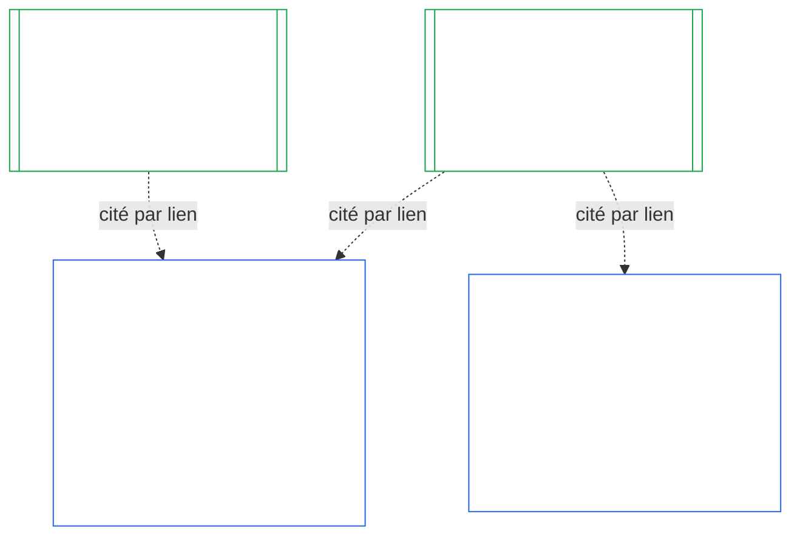

# CHAPITRE DIX : CERTIFICATION DE L’ALIGNEMENT INSTITUTIONNEL

<strong>Place dans le corpus (non opératoire) : structure du fichier et règles de lecture</strong>

> Ce fichier fait **partie de la Constitution sentiente** et n’est **contraignant qu’avec** les autres fichiers `core_*` numérotés, lus comme un texte unique. Il contient le **chapitre dix** — **la certification de l’alignement institutionnel** : la manière dont une [Institution](core_05.040_band_continuity.md#institution), par opposition à chaque système qu’elle exploite, est classée, évaluée, examinée, fait l’objet d’une décision, est consignée, tenue à jour et soumise à une réouverture (**§1–§11**). Le chapitre dix constitue le pendant institutionnel du [chapitre neuf](core_09.000_system_alignment_certification_evaluation.md#chapter-nine-system-alignment-certification) (*Certification de l’alignement du système*) et **ses sections portent les mêmes numéros** : le §N de ce chapitre répond au §N de l’autre. [CS-9.320](corpus_systems/cs_09.320_system_alignment_certification_illustrations.md#cs-9320-system-alignment-certification-illustrations) (*Illustrations de la certification de l’alignement du système*) contient les exemples pratiques relatifs aux systèmes et, dans sa [§12 Parcours illustratifs d’institutions](corpus_systems/cs_09.320_system_alignment_certification_illustrations.md#cs-9320-12-illustrative-institution-walkthroughs), trois parcours d’institutions. Le présent chapitre ne les reprend pas.
>
> | § | Chapitre neuf (système) | Chapitre dix (institution) |
> |---|------------------------|----------------------------|
> | 1 | Finalité et rôle | lien avec la certification du système, objet de la certification, absence d’autorisation et de condition préalable à la création ou à l’exploitation, attente requise pour une nouvelle autorité matérielle, délai de la première certification |
> | 2 | Évaluation de la classe du système | classe de l’institution ; mise à l’échelle par classe |
> | 3 | Évaluation de la certification globale du système | les huit éléments institutionnels, toujours applicables |
> | 4 | Évaluations lorsque la situation le justifie | renvoi au chapitre neuf §4 |
> | 5 | Évaluations du Plancher des droits et du domaine | renvoi au chapitre neuf §5 |
> | 6 | Procédure des forums | quatre sièges ; rôles et séquence des forums ; forums, certificateurs et bureaux de dossier en tant qu’institutions |
> | 7 | Résultats de certification | mise en service d’une institution et de ses systèmes, conditions de certification et autres effets d’un résultat ; renvoi pour les défauts ; préparation à la réparation ; refus et révocation |
> | 8 | Dossier de certification du système | dossier de certification institutionnelle |
> | 9 | Recertification et réouverture | suivi ; déclencheurs de réouverture ; certification provisoire et complète ; non-contournement ; cascade des certifications de systèmes ; réouverture de ses systèmes en cas de violation de gouvernance |
> | 10 | Contester une certification | voie de contestation |
> | 11 | Lien avec le statut | passerelle vers le statut |
>
> - **Responsable constitutionnel (conjointement avec le chapitre neuf) :** certification de l’alignement et dossiers connexes sous la supervision des forums. Le chapitre dix ajoute le sujet institutionnel. Il ne crée ni famille de forums, ni siège, ni nouveau terme pour désigner un résultat.
> - **Réutilisation, sans répétition :** les phases III à VI se déroulent comme le prévoient [Chapitre neuf partie B §6](core_09.005_system_alignment_certification_record_process.md#6-forum-process) à [Chapitre neuf partie C §11](core_09.010_system_alignment_certification_record_recertification.md#11-relationship-to-standing). Le chapitre dix précise uniquement ce qui change lorsque le sujet est une institution.
> - **Règle contre le déplacement :** le chapitre dix ne réénonce pas les mécanismes d’évaluation du chapitre neuf concernant un système, les champs des chartes de système et des chartes institutionnelles du chapitre sept, l’exigence des quatre sièges du chapitre huit, les obligations institutionnelles du fichier [corpus_institutions](corpus_institutions.md), la mesure du statut du chapitre onze ni les effets du statut du chapitre douze.
>
> **Amont :** [Chapitre sept](core_07.000_charters.md#chapter-seven-system-and-institutional-charters) — Chartes ; [Chapitre huit](core_08.000_functional_independence_separation_of_duties.md#chapter-eight-functional-independence-and-separation-of-duties) — indépendance fonctionnelle ; [Chapitre neuf](core_09.000_system_alignment_certification_evaluation.md#chapter-nine-system-alignment-certification) (parties [A](core_09.000_system_alignment_certification_evaluation.md#chapter-nine-part-a-system-alignment-certification--evaluation), [B](core_09.005_system_alignment_certification_record_process.md#chapter-nine-part-b-system-alignment-certification--forum-process-and-outcomes) et [C](core_09.010_system_alignment_certification_record_recertification.md#chapter-nine-part-c-system-alignment-certification--record-recertification-and-standing)) ; supervision des forums du chapitre quatorze.
> **Aval :** dossiers de statut et entrées vérifiées du chapitre onze ; effets du statut au chapitre douze.

<strong>Traçabilité</strong>

- Amont :
  - [Chapitre sept §1 Quand des chartes de système et institutionnelles sont requises](core_07.000_charters.md#1-when-system-and-institutional-charters-are-required) (7.000 §1) (*institutions tenues de publier une charte de système ou une charte institutionnelle et classe de l’institution*) ;
  - [Chapitre sept §7 Modification et examen](core_07.000_charters.md#7-amendment-review-and-scope-misalignment) (7.000 §7) (*éléments examinés lors d’une révision de la charte institutionnelle*) ;
  - [Chapitre sept §4 Carte des rôles de la Charte et garde des dossiers de statut](core_07.000_charters.md#4-the-charter-role-map-and-standing-record-custody) (7.000 §4) (*emplacement des sièges*) ;
  - [Chapitre huit §2 Exigence constitutionnelle des quatre sièges](core_08.000_functional_independence_separation_of_duties.md#2-four-seat-constitutional-requirement) (8.000 §2) et [§9 Lien avec les processus ultérieurs](core_08.000_functional_independence_separation_of_duties.md#9-relationship-to-later-processes) ;
  - [Chapitre neuf](core_09.000_system_alignment_certification_evaluation.md#chapter-nine-system-alignment-certification) (9.000 à 9.010) (*processus de certification de l’alignement du système réutilisé dans ce chapitre*) ;
  - [Deux questions fondamentales](core_00.000_preamble.md#two-fundamental-questions) ;
  - [Tétrade constitutionnelle](core_00.000_preamble.md#constitutional-tetrad) ;
  - [Article XI-E](core_06.005_rights_part_b.md#article-xi-e-institutional-formation-and-business-creation) (*Création institutionnelle et activité commerciale*).
- Aval : [§1](#1-purpose-and-role) à [§11](#11-relationship-to-standing) ; chapitre onze ([11.000](core_11.000_standing_assessment.md#chapter-eleven-contribution-violation-and-standing-model--measurement)) ; [Chapitre quatorze](core_14.000_forum.md#chapter-fourteen-forums-and-jurisdiction) (14.000).
- À lire avec :
  - [Certification de l’alignement institutionnel](core_05.040_band_continuity.md#institutional-alignment-certification) et
  - [Dossier de certification institutionnelle](core_05.040_band_continuity.md#institutional-certification-record) (*sens définis au chapitre cinq*) ;
  - **CI-8.205 §6** (*Contenu et examen des chartes de système et institutionnelles, et modèle de formation*) ;
  - **CF-14.425** (*Garanties d’intégrité, opérations contre la capture et soutien contre l’auto-jugement*).

 

Le chapitre dix est le responsable constitutionnel de la **certification de l’alignement institutionnel**. Il étend à une institution le processus du [chapitre neuf](core_09.000_system_alignment_certification_evaluation.md#chapter-nine-system-alignment-certification), qui porte sur les systèmes :

- **Phase I, Cadrer :** classe de l’institution et mise à l’échelle de l’évaluation selon cette classe ([§2 Évaluation de la classe de l’institution](#2-institution-class-evaluation)) ;
- **Phase II, Évaluer :** évaluation institutionnelle, notamment les évaluations applicables lorsque la situation le justifie et les évaluations du Plancher des droits et du domaine ([§3 Évaluation de la certification globale de l’institution](#3-whole-institution-certification-evaluation) à [§5 Évaluations du Plancher des droits et du domaine](#5-rights-floor-and-domain-evaluations)) ;
- **Phase III, Examiner :** rôles et séquence des forums ([§6 Procédure des forums](#6-forum-process)) ;
- **Phase IV, Décider :** résultat, préparation à la réparation, refus et révocation ([§7 Résultats de certification](#7-certification-outcomes)) ;
- **Phase V, Consigner :** dossier de certification institutionnelle ([§8 Dossier de certification institutionnelle](#8-institutional-certification-record)) ; et
- **Phase VI, Exploiter :** recertification, réouverture, cascade des certifications de systèmes, réouverture de ses systèmes, voie de contestation et passerelle vers le statut ([§9 Recertification et réouverture](#9-recertification-and-reopening) à [§11 Lien avec le statut](#11-relationship-to-standing)).

*En termes simples : le chapitre neuf demande si un **système** est aligné. Le chapitre dix pose la même question au sujet de l’**institution** qui exploite des systèmes ou qui détient une autorité sans en exploiter. Une institution peut être alignée alors que l’un de ses systèmes ne l’est pas, et l’inverse est également possible. L’institution est donc évaluée sur les éléments qu’elle seule contrôle : suit-elle sa charte institutionnelle, qui répond de son autorité, qu’encourage-t-elle chez ses propres membres et ses mécanismes de contrôle indépendants sont-ils réellement utilisables ? Elle s’appuie sur la certification de chaque système sans la refaire. Cette procédure n’est pas une autorisation : personne n’a besoin de la permission de l’institution pour la créer ou l’exploiter.*

### 1. Finalité et rôle

<strong>Traçabilité</strong>

- Amont :
  - [Chapitre sept §1 Quand des chartes de système et institutionnelles sont requises](core_07.000_charters.md#1-when-system-and-institutional-charters-are-required) (7.000 §1) ;
  - [Chapitre neuf, partie A §1 Finalité et rôle](core_09.000_system_alignment_certification_evaluation.md#1-purpose-and-role) (9.000 §1) ;
  - [Article XI-E](core_06.005_rights_part_b.md#article-xi-e-institutional-formation-and-business-creation) (*Création institutionnelle et activité commerciale*) ;
  - [Article XXVIII-A](core_06.020_rights_part_e.md#xxviii-a-existing-instantiations-adoption-transition-window) (*Adoption progressive et continuité du Plancher des droits*).
- Aval : [§2](#2-institution-class-evaluation) ; [§6](#6-forum-process) ; [§7](#7-certification-outcomes) ; [§9](#9-recertification-and-reopening).
- À lire avec :
  - [Institution](core_05.040_band_continuity.md#institution) ;
  - [Charte institutionnelle](core_05.040_band_continuity.md#institutional-charter) ;
  - [Charte de système](core_05.040_band_continuity.md#system-charter) ;
  - [Création d’entreprise](core_05.055_band_participation.md#business-creation).

 

*En termes simples : la certification d’un système appartient au système. La certification d’une institution cite ces certifications et ajoute les éléments dont seule l’institution peut répondre. Un même système peut relever de plusieurs institutions ou d’aucune. Rien dans ce chapitre ne permet à une certification de faire obstacle à la création d’une institution.*

La certification de l’alignement institutionnel et la certification de l’alignement du système sont deux certifications reliées par un lien. Leur relation est une **composition par lien**, et non une relation de contenance. Dans le schéma, une flèche relie le dossier de certification d’un système à chaque dossier de certification institutionnelle qui le cite. Un système qui ne relève d’aucune institution n’a pas de flèche et n’en a pas besoin ; une institution qui n’exploite aucun système n’a qu’un dossier.

La composition par lien fonctionne dans les deux sens, en commençant par celui de l’institution.

Du côté de l’institution :

- **Le dossier de certification institutionnelle cite le dossier du système sans le refaire :** il cite par lien le dossier de certification du système et en indique la version. Le présent chapitre ne répète jamais une évaluation de système, ne statue pas à nouveau sur sa classe et ne modifie jamais son résultat, son statut ou ses conditions de certification.
- **La certification de l’institution ne peut pas lever le statut non certifié d’un système :** un système non certifié le reste, quel que soit le statut de l’institution. Un système certifié n’est pas protégé contre une conclusion concernant l’institution.
- **Les faits institutionnels ne sont constatés qu’une fois :** lorsque [Chapitre neuf, partie A §3.1 Discipline de gouvernance, d’incitation et de contestabilité](core_09.000_system_alignment_certification_evaluation.md#31-governance-incentive-and-contestability-discipline) examine la gouvernance et les incitations de l’exploitant, un dossier de certification institutionnelle en vigueur pour cet exploitant peut fournir ces faits par lien. Les forums du système décident tout de même si ces faits sont suffisants pour celui-ci. Ils ne peuvent tirer une conclusion différente sur le même fait institutionnel sans en expliquer la raison dans le dossier de certification du système.

Du côté du système :

- **Le dossier de certification du système appartient au système :** c’est le dossier propre au système selon le [chapitre neuf](core_09.000_system_alignment_certification_evaluation.md#chapter-nine-system-alignment-certification).
- **Un même dossier de certification du système peut être cité par plusieurs institutions :** selon [Chapitre sept §1 Quand des chartes de système et institutionnelles sont requises](core_07.000_charters.md#1-when-system-and-institutional-charters-are-required), un système peut être exploité, administré de manière responsable ou contrôlé matériellement par plusieurs institutions. Chacune le cite.
- **Un système n’a pas besoin de relever d’une institution :** un être sentient à lui seul n’est pas une institution ; un système peut donc n’en avoir aucune. Un système sans institution est certifié selon le seul [chapitre neuf](core_09.000_system_alignment_certification_evaluation.md#chapter-nine-system-alignment-certification) et n’a besoin d’aucun élément du présent chapitre. Un système relevant d’une institution est certifié de la même façon : ce chapitre ajoute un dossier distinct pour l’institution et ne constitue pas une étape de la certification propre au système.

#### 1.1 Qui est certifié

Une institution de classe L ou supérieure relève du présent chapitre ; sa classe est déterminée selon [§2.1 Classe de l’institution](#21-institution-class). Cela comprend une institution qui n’exploite aucun système : elle n’a aucun dossier de certification de système à citer et sa classe dépend de son propre impact. Le **portefeuille** d’une institution est l’ensemble des systèmes qu’elle exploite, administre de manière responsable ou contrôle matériellement ([Portefeuille](core_05.040_band_continuity.md#portfolio)).

- **Classes A, B, C et L :** le processus s’applique et est mis à l’échelle selon la classe conformément à [§2.2 Mise à l’échelle selon la classe](#22-scaling-by-class).
- **Classe P :** le processus est encouragé et peut être utilisé volontairement. Il devient obligatoire après reclassification en classe L ou supérieure, ou si l’institution affirme volontairement respecter la Constitution. Une institution de classe P qui décide d’acquérir une nouvelle autorité matérielle est reclassée au moins en classe L lorsqu’elle transmet l’avis prévu à [§9.2.2 Recertification pour une nouvelle autorité matérielle](#922-recertification-for-new-material-authority), car cette autorité est matérielle par définition ([§9.2.1 Qu’est-ce qu’une nouvelle autorité matérielle](#921-what-counts-as-new-material-authority)) et une institution ayant un impact dans n’importe quel domaine est au moins de classe L ([§2.1 Classe de l’institution](#21-institution-class), point 2). La reclassification reste en vigueur jusqu’au retrait de l’avis avant l’autorisation ou jusqu’au refus d’autoriser l’exercice de l’autorité, à condition qu’aucune autorité de ce type n’ait été exercée. L’institution revient alors en classe P et sa certification initiale limitée prend fin. Un nouvel avis relance le processus ; l’exercice de l’autorité sans autorisation reste une conclusion selon [§9.2.2 Recertification pour une nouvelle autorité matérielle](#922-recertification-for-new-material-authority) (*Sans avis, ou avant l’autorisation*). Cela correspond à [Chapitre neuf, partie A §1 Finalité et rôle](core_09.000_system_alignment_certification_evaluation.md#1-purpose-and-role).
- **Un seul système :** une institution qui exploite exactement un système nécessitant une charte de système a un seul cycle de certification et un seul dossier, appelé dans ce chapitre l’**évaluation à système unique**. Le dossier de certification du système contient un *bloc de conclusions institutionnelles* avec les éléments énumérés à [§8 Dossier de certification institutionnelle](#8-institutional-certification-record) et fait office de dossier de certification institutionnelle. Les forums, sièges et délais sont ceux du cycle de certification propre au système, auxquels s’ajoutent les éléments institutionnels. Les résultats relèvent de leurs propres motifs de refus et de révocation, comme l’indique [§7.4 Refus et révocation pour une institution](#74-denial-and-revocation-for-an-institution). La cascade de [§9.5 Cascade des certifications de systèmes](#95-cascade-from-system-certifications) ne s’applique pas comme cascade puisque le système constitue l’ensemble du portefeuille, mais les règles 1 et 2 de [§7.4 Refus et révocation pour une institution](#74-denial-and-revocation-for-an-institution) s’appliquent (l’indicateur et l’examen du lieu de la cause).
- **Plusieurs systèmes :** un dossier de certification institutionnelle pour l’institution, qui renvoie au dossier de certification de chacun des systèmes qu’elle exploite. Chaque système conserve son propre cycle et son propre dossier.
- **Aucun système :** un dossier de certification institutionnelle autonome. Il ne cite aucun dossier de certification de système, puisque l’institution n’en exploite pas.

