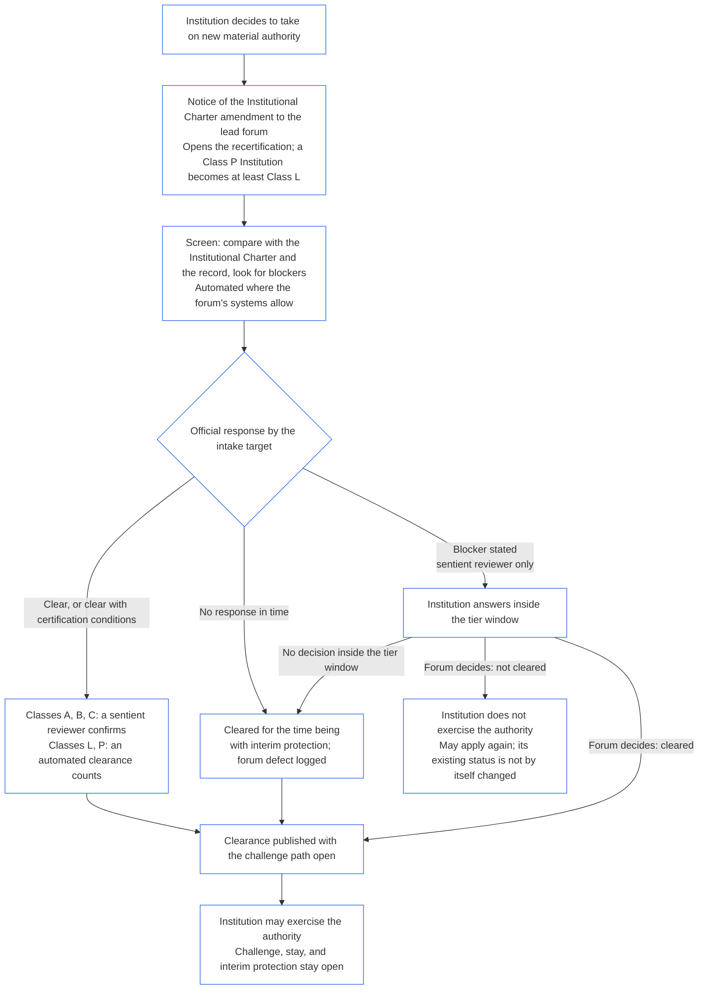

##### 9.2.2 Recertification pour une nouvelle autorité matérielle

Une Institution qui décide d’assumer une nouvelle autorité matérielle doit être recertifiée et attendre le résultat avant d’exercer cette autorité. C’est l’attente prévue par **l’Article XI-E** (*Formation institutionnelle et création d’entreprises*). La procédure est la suivante :

- **Notification préalable :** l’Institution transmet au forum responsable la notification de modification de la Charte institutionnelle déjà exigée par la [§7.1 Modification du document du Chapitre sept](core_07.000_charters.md#71-changing-the-document). Cette notification ouvre la recertification.
- **Aucun dossier existant :** une Institution qui ne détient pas de Dossier de certification institutionnelle transmet la même notification. Celle-ci ouvre une première certification limitée à la nouvelle autorité, évaluée au regard de la Charte institutionnelle et des évaluations des [§3 Évaluation de certification à l’échelle de l’Institution](#3-whole-institution-certification-evaluation) à [§5 Évaluations du Plancher des droits et par domaine](#5-rights-floor-and-domain-evaluations), dans la mesure où elles concernent cette autorité. Le reste de la première certification suit toujours le délai prévu à la [§1.3 Délai pour la première certification](#13-window-for-the-first-certification) (pour une Institution de classe P reclassée à la suite de la notification, le délai court à compter de cette notification) ; l’attente liée à la nouvelle autorité n’en dépend pas.
- **Respect des délais par palier :** la recertification suit les délais par palier de la [§9.3.4 Délais par palier de la Partie C du Chapitre neuf](core_09.010_system_alignment_certification_record_recertification.md#934-tier-windows), le palier correspondant présomptivement à la classe de l’Institution. Un délai dépassé est traité selon [l’Article XXVI-C](core_06.020_rights_part_e.md#article-xxvi-c-timely-resolution-and-anti-delay-floor) (*Plancher de résolution en temps utile et de lutte contre les retards*) ; les frais et les délais d’attente ne peuvent constituer un obstacle ([Charge évitable](core_05.040_band_continuity.md#avoidable-burden)).
- **Automatisation lorsque possible :** la notification, la comparaison entre la nouvelle autorité, la Charte institutionnelle et le dossier en vigueur, le contrôle des obstacles et l’autorisation sont automatisés chaque fois que les systèmes du forum le permettent. La [§13.3 Réduction des charges évitables du Chapitre un](core_01.005_interaction_interpretation.md#133-minimization-of-avoidable-burden) fait de l’automatisation le moyen privilégié de réduire une charge évitable, et la [§16.4 Consigner au moment de l’action du Chapitre un](core_01.010_stewardship_capacity_principles.md#164-document-at-action) fait porter la charge de l’automatisation au système plutôt qu’à la personne responsable de la garde.
  - **Autorise, ne refuse pas :** un contrôle automatisé peut autoriser la nouvelle autorité, soit sans condition, soit avec les conditions de certification déjà justifiées par le dossier en vigueur. À lui seul, il ne peut déclarer l’existence d’un obstacle (l’un de ceux énumérés à la [§9.2.3 Obstacles à l’autorisation d’une nouvelle autorité matérielle](#923-blockers-to-clearing-new-material-authority)) ni refuser l’autorisation. Il peut signaler un obstacle possible ; seul un examinateur sentient du forum responsable peut le constater, après avoir examiné le signalement.
  - **Classes A, B et C :** un examinateur sentient du forum responsable confirme chaque autorisation avant qu’elle ne vaille réponse officielle. Cela s’applique aux Institutions de ces classes et à celles qui y entreraient du fait de la nouvelle autorité. L’objectif de traitement initial reste applicable à cette confirmation. L’examinateur siège au forum responsable, qui détient déjà le siège de vérification ou d’autorisation et doit être indépendant de l’Institution ([§6.1 Quatre sièges dans une certification institutionnelle](#61-four-seats-in-an-institutional-certification)).
  - **Classes L et P :** une autorisation automatisée constitue la réponse officielle sans confirmation. Une Institution de classe P est reclassée au moins en classe L lorsqu’elle transmet la notification ([§1.1 Qui est certifié](#11-who-is-certified)) ; la règle de classe L s’applique donc à elle.
  - **Circonstances exceptionnelles :** un examinateur sentient prend en charge l’affaire, quelle que soit la classe, si le contrôle signale un obstacle possible, s’il ne permet pas de déterminer si l’autorité est couverte ou matérielle, ou si l’Institution ou un être sentient touché demande un examen. La demande d’examen reçoit une réponse dans l’[objectif de traitement initial correspondant](core_05.040_band_continuity.md#tier-window), calculé à partir de la demande. Elle ne prolonge pas le délai par palier.
  - **Même dossier et mêmes délais :** le dossier indique les contrôles effectués ; une autorisation automatisée peut donc être contestée comme toute autre décision. L’automatisation ne prolonge ni l’objectif de traitement initial ni le délai par palier ; si le contrôle est hors service ou ne répond pas, il s’agit d’une réponse manquée au sens du point ci-dessous. Le forum répond du contrôle comme de tout Système qu’il utilise ([§6.3 Forums, certificateurs et bureaux de dossiers en tant qu’Institutions](#63-forums-certifiers-and-record-offices-as-institutions)).
- **L’attente :** l’Institution n’exerce pas la nouvelle autorité avant que la recertification ne l’autorise.
  - **Toutes les classes attendent :** aucune classe n’est exemptée, et ni l’urgence ni la situation critique ne lèvent l’attente.
  - **Tout le reste continue :** les activités déjà exercées par l’Institution se poursuivent ([§1.2 Aucune autorisation et aucun contrôle préalable à la formation ou au fonctionnement](#12-no-permission-and-no-gate-on-forming-or-running)).
  - **La protection n’attend pas :** la protection urgente des êtres sentients touchés par les forums n’attend pas la recertification ([Chapitre neuf, Partie B §6.2 Ordre de supervision](core_09.005_system_alignment_certification_record_process.md#62-supervisory-sequence)). Elle protège les êtres sentients et ne justifie pas que l’Institution exerce l’autorité plus tôt.
- **Publication dès l’autorisation :** le forum responsable publie chaque autorisation dès qu’elle est accordée, y compris une autorisation provisoire, en ouvrant la voie de contestation prévue à la [§10 Contestation d’une certification](#10-challenging-a-certification). L’Institution peut exercer l’autorité dès l’autorisation. Elle n’attend ni l’expiration d’un délai de notification ni l’issue d’une contestation. Tout être sentient touché peut contester l’autorisation comme toute autre décision et demander une suspension ou une protection provisoire, qui n’attend pas ([§9.2.2 Recertification pour une nouvelle autorité matérielle](#922-recertification-for-new-material-authority), *La protection n’attend pas*). Lors de la publication, le forum responsable notifie aussi l’autorisation aux êtres sentients touchés qu’il connaît et aux forums des Systèmes concernés. Toute demande de suspension ou de protection provisoire reçoit une réponse dans l’objectif de traitement initial correspondant ([CF-14.445 §3.1 Objectifs par étape et limites supérieures](corpus_forum/cf_14.445_performance_backlog_publication_accessibility.md#cf-14445-31-stage-targets-and-outer-bounds)), ou dans le délai maximal de son régime d’urgence lorsqu’il s’applique.
- **Autorisation présumée :** l’autorité est présumée autorisée. Le forum responsable ne refuse l’autorisation que s’il établit, à l’aide d’éléments probants consignés au dossier, l’existence d’un obstacle énuméré à la [§9.2.3 Obstacles à l’autorisation d’une nouvelle autorité matérielle](#923-blockers-to-clearing-new-material-authority). Lorsque des conditions de certification liées à l’obstacle peuvent le contenir, l’autorité est autorisée sous ces conditions plutôt que refusée.
- **Portée de l’autorisation :** la recertification aboutit à une certification provisoire ou complète, avec ou sans conditions de certification ; toute condition de certification exigée avant l’exercice de l’autorité doit avoir été vérifiée de manière indépendante.
- **Absence de réponse du forum dans les délais :** le forum responsable doit fournir une réponse officielle dans l’objectif de traitement initial correspondant ([CF-14.445 §3.1 Objectifs par étape et limites supérieures](corpus_forum/cf_14.445_performance_backlog_publication_accessibility.md#cf-14445-31-stage-targets-and-outer-bounds)). La réponse autorise l’autorité, l’autorise sous conditions de certification ou constate un obstacle avec les éléments probants qui le fondent. Lorsqu’elle constate un obstacle, elle donne à l’Institution la possibilité de répondre ; le forum statue dans le délai par palier indiqué ci-dessus.
  - **Autorisation provisoire :** en l’absence de réponse officielle à l’expiration de l’objectif de traitement initial, ou si le forum n’a pas statué dans le délai par palier sur un obstacle constaté, l’autorité est autorisée provisoirement, avec les protections provisoires et les limites de dépendance prévues par la [§7.2 Défauts de certification et correction de la Partie B du Chapitre neuf](core_09.005_system_alignment_certification_record_process.md#72-certification-defects-and-correction).
  - **Défaut du forum :** le dépassement de l’objectif ou du délai constitue un défaut du forum, non une faute de l’Institution. Il est consigné, corrigé et examiné en tant que dépassement selon la [§6 Résolution en temps utile, paliers de matérialité et discipline anti-retard du Chapitre quatorze](core_14.000_forum.md#6-timely-resolution-materiality-tiers-and-anti-delay-discipline) (*Examen des dépassements*).
  - **Transfert à un autre forum :** la demande de recertification est transférée à un autre forum de la même famille ([Chapitre quatorze §3 Transfert, consolidation et coordination](core_14.000_forum.md#3-transfer-consolidation-and-coordination--continuity-and-anti-capture)). Ce forum poursuit la recertification selon les délais ordinaires applicables à la classe de l’Institution, calculés à partir du transfert.
- **En l’absence d’autorisation :** l’Institution n’exerce pas l’autorité et peut présenter une nouvelle demande selon les modalités de la §7.4 de la Partie B du Chapitre neuf (*Aucune interdiction permanente*). Le refus de la nouvelle autorité n’entraîne pas à lui seul le refus ou la révocation du statut détenu par l’Institution pour ses activités existantes. Ce statut ne change qu’à la suite d’un constat au titre de la [§7.3 Aptitude d’une Institution à remédier aux problèmes](#73-remediation-readiness-for-an-institution) et de la [§7.4 Refus et révocation pour une Institution](#74-denial-and-revocation-for-an-institution).
- **Exercice sans notification ou avant autorisation :** exercer une nouvelle autorité matérielle sans notification ou avant son autorisation constitue une pratique hors du champ de la Charte institutionnelle. Cela donne lieu à un constat au titre du point 1 de la [§3 Évaluation de certification à l’échelle de l’Institution](#3-whole-institution-certification-evaluation) et rouvre l’examen en tant qu’événement relatif à la Charte institutionnelle.

<strong>Guide du lecteur (non opératoire) : attente liée à une nouvelle autorité matérielle</strong>

Ce schéma résume la §9.2.2 Recertification pour une nouvelle autorité matérielle. En cas de divergence avec le texte, c’est le texte qui prévaut. Toutes les activités déjà exercées par l’Institution se poursuivent pendant toute la procédure, et la protection urgente des êtres sentients touchés n’attend jamais. Des exemples détaillés d’Institutions figurent à la [CS-9.320 §12 Exemples illustratifs d’Institutions](corpus_systems/cs_09.320_system_alignment_certification_illustrations.md#cs-9320-12-illustrative-institution-walkthroughs).

 

