# अध्याय नौ, भाग A: प्रणाली-संरेखण प्रमाणन — मूल्यांकन

<strong>संग्रह में स्थान (गैर-संक्रियात्मक): फ़ाइल संरचना और पढ़ने के नियम</strong>

> यह फ़ाइल **संज्ञ संविधान** का हिस्सा है और केवल अन्य क्रमांकित `core_*` फ़ाइलों के साथ एक पाठ के रूप में पढ़े जाने पर बाध्यकारी है। इसमें **अध्याय नौ, भाग A** — प्रमाणन का उद्देश्य, प्रक्रिया का अवलोकन, और प्रक्रिया के पहले दो चरण — **Frame** (प्रणाली वर्ग) और **Evaluate** (तीन उपचरणों में संपूर्ण-प्रणाली मूल्यांकन: §3 में हमेशा लागू मूल्यांकन, जिसमें डेटा प्रकार और प्रबंधन भी शामिल हैं; §4 में जहाँ संदर्भित हों वहाँ लागू मूल्यांकन; और §5 में जहाँ सक्रिय हों वहाँ लागू अधिकार-तल तथा क्षेत्र मूल्यांकन) — **§1–§5** हैं। तैयार **वर्ग A / B / C उदाहरण** (प्रणाली वर्ग प्रोफ़ाइल और §3.4, §5.1, §5.2, §5.3, §5.4, §5.5 तथा §5.6 के उदाहरण सहित), जिनमें प्रत्येक का **प्रणाली वर्गों के पार पठन** अनुच्छेद भी है, सिस्टम परिवार की [CS-9.320](corpus_systems/cs_09.320_system_alignment_certification_illustrations.md#cs-9320-system-alignment-certification-illustrations) (*प्रणाली-संरेखण प्रमाणन उदाहरण*) में हैं, इस अध्याय में नहीं; हर उदाहरण संबंधित भाग A खंड बताता है। उन अनुच्छेदों में समझाए गए बाध्यकारी प्रणाली-वर्ग-आधारित माप और उन्नयन नियम इसी फ़ाइल में हैं: §2.2 में प्रणाली वर्ग का माप, जिसमें सहभागिता और आनुपातिकता शामिल हैं; §3.4 में डेटा-प्रबंधन का माप; और §5.1–§5.6 में प्रत्येक का **प्रणाली वर्ग माप और उन्नयन** अनुच्छेद। पूरे अध्याय की फ़ाइलें नीचे तालिका में हैं।
>
> **अध्याय नौ की फ़ाइलें।** अध्याय नौ तीन बाध्यकारी फ़ाइलों में विभाजित है जिन्हें एक पाठ के रूप में पढ़ा जाता है। भाग A, यह फ़ाइल, अध्याय खोलती है; अलग सूचकांक फ़ाइल नहीं है। तैयार उदाहरण अध्याय का हिस्सा नहीं हैं; वे [CS-9.320](corpus_systems/cs_09.320_system_alignment_certification_illustrations.md#cs-9320-system-alignment-certification-illustrations) (*प्रणाली-संरेखण प्रमाणन उदाहरण*) में हैं।
>
> | भाग | फ़ाइल | विषय |
> |------|------|------|
> | **भाग A — मूल्यांकन** | [`core_09.000_system_alignment_certification_evaluation.md`](core_09.000_system_alignment_certification_evaluation.md) | §1–§5: उद्देश्य और प्रक्रिया अवलोकन (छह चरणों वाली पूरी प्रमाणन प्रक्रिया के चार्ट सहित), **चरण I Frame** (प्रणाली वर्ग, प्रणाली वर्ग प्रत्येक मूल्यांकन का माप कैसे तय करता है, और पायलट प्रमाणन) तथा **चरण II Evaluate** (तीन उपचरणों में संपूर्ण-प्रणाली मूल्यांकन: **IIa** §3 में हमेशा लागू, जिसमें चार्टर-निर्धारित दायरे बनाम कार्यात्मक सीमाएँ और डेटा प्रकार व प्रबंधन शामिल हैं; **IIb** §4 में जहाँ संदर्भित हो; और **IIc** §5 में जहाँ सक्रिय हों, अधिकार-तल और क्षेत्र मूल्यांकन) |
> | **भाग B — मंच प्रक्रिया और परिणाम** | [`core_09.005_system_alignment_certification_record_process.md`](core_09.005_system_alignment_certification_record_process.md) | §6–§7: **चरण III Review** (मंच की भूमिकाएँ, पर्यवेक्षण क्रम और चुनौती-योग्यता शृंखला) तथा **चरण IV Decide** (प्रमाणन परिणाम, go-live द्वार सहित) — भाग A §5 से अध्याय क्रमांक जारी |
> | **भाग C — अभिलेख, पुनःप्रमाणन और प्रस्थिति** | [`core_09.010_system_alignment_certification_record_recertification.md`](core_09.010_system_alignment_certification_record_recertification.md) | §8–§11: **चरण V Record** (System Certification Record और उसकी अखंडता, नियंत्रक [System Charter](core_05.040_band_continuity.md#system-charter) फ़ील्ड सहित) तथा **चरण VI Operate** (पुनःप्रमाणन और पुनःखोलना; चुनौती मार्ग; प्रस्थिति सेतु) — भाग B §7 से अध्याय क्रमांक जारी |
>
> **दोनों प्रमाणनों का संबंध।** System Alignment Certification (यह अध्याय) किसी System का प्रमाणन है। संस्थागत संरेखण प्रमाणन ([अध्याय दस](core_10.000_institutional_alignment_certification.md#chapter-ten-institutional-alignment-certification)) किसी Institution का प्रमाणन है, जो Systems चला सकता है या नहीं भी। अध्याय दस हर System के System Certification Record का लिंक देता है, उसका दोहराव नहीं करता; [अध्याय दस §1](core_10.000_institutional_alignment_certification.md#1-purpose-and-role) संबंध बताता है और [अध्याय दस §1.2](core_10.000_institutional_alignment_certification.md#12-no-permission-and-no-gate-on-forming-or-running) कहता है कि यह लाइसेंस नहीं है। समानांतर शीर्षकों के अंतर्गत इसके खंडों के क्रमांक इस अध्याय जैसे हैं।
>
> अन्य फ़ाइलों के सामान्य **अध्याय नौ** लिंक खंड संख्या के अनुसार उचित भाग तक पहुँचाते हैं।
>
> - **संवैधानिक स्वामी (भाग B और C के साथ संयुक्त):** मंच-पर्यवेक्षित **प्रणाली-संरेखण प्रमाणन और संबंधित अभिलेख** — मूल्यांकन क्षेत्र (भाग A); go-live द्वार सहित मंच प्रक्रिया, पर्यवेक्षण क्रम और प्रमाणन परिणाम (भाग B); System Certification Record के कर्तव्य, चुनौती मार्ग, पुनःप्रमाणन और पुनःखोलना, तथा अध्याय ग्यारह तक सत्यापित-इनपुट सेतु (सभी भाग C में)। चतुष्क के **निगरानी** पक्ष के अंतर्गत SAC अन्य बड़े और उच्च-दाँव वाले लेखापरीक्षा प्रक्रियाओं में से एक है; लेखापरीक्षा के न्यूनतम मान **Article XVI** (*लेखापरीक्षा, पारदर्शिता और स्वतंत्र सत्यापन*) और अध्याय पाँच की [Auditability](core_05.050_band_oversight.md#auditability) में बने रहते हैं।
> - **सत्यापन आधार का स्वामी:** [अध्याय चार — प्रमाण-भार, अनुरेखणीयता और सत्यापन](core_04.000_burden_traceability_verification.md#chapter-four-burden-of-proof-traceability-and-verification) (अध्याय दो से चार के भीतर) प्रमाण-भार आवंटन, अनुपालन प्रमाण, परिभाषा-अनुरेखणीयता, अवलोकनीयता और सुरक्षा-बाधित सत्यापन का स्वामी है। अध्याय नौ इस अनुशासन को System Certification Records पर **लागू** करता है; यह अध्याय चार के §1–§5 को दोहराता **नहीं** है।
> - **लेखापरीक्षा का मूल स्थान (यहाँ स्थानांतरित नहीं):** **Article XVI** (*लेखापरीक्षा, पारदर्शिता और स्वतंत्र सत्यापन*), **Def.O1** (*पारदर्शिता, लेखापरीक्षण-योग्यता और सत्यापन*) और **CJS-5.110 §3 तथा CJS-5.115 §3** (*लेखापरीक्षा प्रक्रिया का मूल स्थान*)–**CJS-5.110 §5** लेखापरीक्षा के न्यूनतम मान और परिचालन शर्तों के स्वामी हैं। अध्याय नौ एक बड़ी SAC लेखापरीक्षा प्रक्रिया चलाता है जिसे उन मानों का पालन करना होगा; यह सभी लेखापरीक्षाओं का स्वामी नहीं है।
> - **कार्यान्वयन स्वामी:** प्रणाली-वर्ग प्रबंधन, CS-6.345 (*System lifecycle*) और नियत कार्यान्वयन फ़ाइलों में मंच-प्रक्रिया का विवरण अध्याय नौ के अनुरूप रहना चाहिए और जहाँ संग्रह में पहले से [Fullest Protective Effect](core_05.045_band_integrative.md#fullest-protective-effect) नियम है वहाँ अधिक कठोर हो सकता है।
> - **स्थानांतरण-विरोधी नियम:** भाग A अध्याय पाँच की प्रामाणिक परिभाषाएँ, अध्याय तीन का बचाव-विरोधी अनुशासन (देखें [भाग C §9.4](core_09.010_system_alignment_certification_record_recertification.md#94-non-evasion)), अध्याय ग्यारह का योगदान या प्रस्थिति मापन, अथवा अध्याय बारह के प्रस्थिति प्रभावों को दोहराता नहीं। **[भाग C §11](core_09.010_system_alignment_certification_record_recertification.md#11-relationship-to-standing)** प्रस्थिति सेतु बताता है।
>
> **पूर्ववर्ती:** अध्याय पाँच की परिभाषाएँ; अध्याय दो से चार के अभिलेख, सत्यापन, प्रमाण-भार और परिभाषाओं से परिणाम तक अनुरेखण; तथा [अध्याय आठ](core_08.000_functional_independence_separation_of_duties.md#chapter-eight-functional-independence-and-separation-of-duties), जिसकी कर्तव्य-पृथक्करण आवश्यकता हर भौतिक रूप से बाध्यकारी प्रमाणन कार्रवाई पर लागू होती है।
> **अनुवर्ती:** [भाग B](core_09.005_system_alignment_certification_record_process.md#chapter-nine-part-b-system-alignment-certification--forum-process-and-outcomes) (*मंच प्रक्रिया और परिणाम*) और [भाग C](core_09.010_system_alignment_certification_record_recertification.md#chapter-nine-part-c-system-alignment-certification--record-recertification-and-standing) (*अभिलेख, पुनःप्रमाणन और प्रस्थिति सेतु*); अध्याय ग्यारह के प्रस्थिति अभिलेख और सत्यापित इनपुट; अध्याय बारह के प्रस्थिति प्रभाव; अध्याय चौदह का मंच पर्यवेक्षण और प्रणाली-संरेखण प्रमाणन मार्ग।

 

अध्याय नौ का **भाग A**, **प्रणाली-संरेखण प्रमाणन मूल्यांकन** का संवैधानिक स्वामी है।

- मंच पर्यवेक्षण और प्रमाणन परिणाम **[भाग B](core_09.005_system_alignment_certification_record_process.md#chapter-nine-part-b-system-alignment-certification--forum-process-and-outcomes)** में हैं।
- अभिलेख, पुनःप्रमाणन और पुनःखोलना, तथा प्रस्थिति सेतु **[भाग C](core_09.010_system_alignment_certification_record_recertification.md#chapter-nine-part-c-system-alignment-certification--record-recertification-and-standing)** में हैं।
- इन मूल्यांकन खंडों के तैयार उदाहरण **[CS-9.320 System alignment certification illustrations](corpus_systems/cs_09.320_system_alignment_certification_illustrations.md#cs-9320-system-alignment-certification-illustrations)** में हैं।
- समान खंड क्रमांकों वाला संस्थागत संरेखण प्रमाणन **[अध्याय दस](core_10.000_institutional_alignment_certification.md#chapter-ten-institutional-alignment-certification)** में है।

### 1. उद्देश्य और भूमिका

<strong>Trace</strong>

- पूर्ववर्ती:
  - [प्रस्तावना — संवैधानिक स्वामी पंजी](core_00.000_preamble.md#4-principles-definitions-and-rights) और
  - [Authority Stack and Internal Hierarchy](core_05.045_band_integrative.md#authority-stack-and-internal-hierarchy);
  - [Constitutional Tetrad](core_00.000_preamble.md#constitutional-tetrad);
  - [Two Constitutional Aims](core_00.000_preamble.md#two-constitutional-aims);
  - [भौतिक दाँव](core_00.000_preamble.md#material-stake);
  - [Proportionality](core_05.035_band_accountability.md#proportionality) और
  - [Substantive Fairness](core_05.055_band_participation.md#substantive-fairness) (अध्याय पाँच); सहभागिता मापन परिवार (*आवाज़, पहुँच और चुनौती मार्ग*);
  - [अध्याय एक §16 Stewardship In Depth](core_01.010_stewardship_capacity_principles.md#16-stewardship-in-depth) (1.010 §16);
  - [अध्याय एक §12 Systemic Evaluation Requirement](core_01.000_values_principles.md#12-systemic-evaluation-requirement) (1.000 §12) (*सिद्धांत-स्तर पर संपूर्ण-प्रणाली मूल्यांकन दृष्टि — केवल एक कोने की नहीं*); अध्याय दो से चार;
  - [अध्याय पाँच](core_05.000_definitions_home.md#chapter-five-foundational-definitions) (5.000) (*प्रामाणिक परिभाषाएँ*);
  - [अध्याय आठ §2 Four-Seat Constitutional Requirement](core_08.000_functional_independence_separation_of_duties.md#2-four-seat-constitutional-requirement) (8.000 §2);
  - [System Alignment Certification](core_05.040_band_continuity.md#system-alignment-certification) (अध्याय पाँच का प्रामाणिक पद; गैर-संक्रियात्मक संक्षेप **SAC**);
  - [System Certification Record](core_05.040_band_continuity.md#system-certification-record) (अध्याय पाँच का अर्थ)।
- अनुवर्ती:
  - [§2](#2-system-class-evaluation) (*प्रणाली वर्ग मूल्यांकन*);
  - [भाग C §10](core_09.010_system_alignment_certification_record_recertification.md#10-challenging-a-certification) (9.010 §10) (*प्रमाणन को चुनौती देना*); और
  - [CS-9.320 §2](corpus_systems/cs_09.320_system_alignment_certification_illustrations.md#cs-9320-2-illustrative-system-class-profiles) (*उदाहरणात्मक प्रणाली वर्ग प्रोफ़ाइल*);
  - [CS-9.320 §4](corpus_systems/cs_09.320_system_alignment_certification_illustrations.md#cs-9320-4-illustrative-whole-system-application-by-system-class) (*प्रणाली वर्ग के अनुसार संपूर्ण-प्रणाली अनुप्रयोग के उदाहरण*);
  - [CS-9.320 §5](corpus_systems/cs_09.320_system_alignment_certification_illustrations.md#cs-9320-5-illustrative-data-handling-application-by-system-class) (*प्रणाली वर्ग के अनुसार डेटा-प्रबंधन अनुप्रयोग के उदाहरण*);
  - [CS-9.320 §6](corpus_systems/cs_09.320_system_alignment_certification_illustrations.md#cs-9320-6-illustrative-ecological-footprint-application-by-system-class) (*प्रणाली वर्ग के अनुसार पारिस्थितिक पदचिह्न अनुप्रयोग के उदाहरण*);
  - [CS-9.320 §7](corpus_systems/cs_09.320_system_alignment_certification_illustrations.md#cs-9320-7-illustrative-educational-capability-application-by-system-class) (*प्रणाली वर्ग के अनुसार शैक्षिक क्षमता अनुप्रयोग के उदाहरण*);
  - [CS-9.320 §8](corpus_systems/cs_09.320_system_alignment_certification_illustrations.md#cs-9320-8-illustrative-cross-system-support-application-by-system-class) (*प्रणाली वर्ग के अनुसार अंतर-प्रणाली समर्थन अनुप्रयोग के उदाहरण*);
  - [CS-9.320 §9](corpus_systems/cs_09.320_system_alignment_certification_illustrations.md#cs-9320-9-illustrative-nondiscrimination-application-by-system-class) (*प्रणाली वर्ग के अनुसार भेदभाव-निषेध अनुप्रयोग के उदाहरण*);
  - [CS-9.320 §10](corpus_systems/cs_09.320_system_alignment_certification_illustrations.md#cs-9320-10-illustrative-accessibility-application-by-system-class) (*प्रणाली वर्ग के अनुसार सुगम्यता अनुप्रयोग के उदाहरण*);
  - [CS-9.320 §11](corpus_systems/cs_09.320_system_alignment_certification_illustrations.md#cs-9320-11-illustrative-trustworthiness-application-by-system-class) (*प्रणाली वर्ग के अनुसार विश्वसनीयता अनुप्रयोग के उदाहरण*);
  - [§3](#3-whole-system-certification-evaluation) (*संपूर्ण-प्रणाली प्रमाणन मूल्यांकन कारक*);
  - [§3.4](#34-data-types-and-handling-evaluation) से
  - [§5.6](#56-trustworthiness-and-system-reliance-integrity-evaluation) तक (*क्षेत्र मूल्यांकन*);
  - [भाग B §6](core_09.005_system_alignment_certification_record_process.md#6-forum-process) (9.005 §6) (*पर्यवेक्षण क्रम और चुनौती-योग्यता शृंखला*);
  - [भाग B §6.1](core_09.005_system_alignment_certification_record_process.md#61-forum-supervision-and-component-roles) (9.005 §6.1) (*मंच के घटक की भूमिकाएँ*);
  - [भाग C §8](core_09.010_system_alignment_certification_record_recertification.md#8-system-certification-record) (9.010 §8) (*System Certification Record की सामग्री*);
  - [भाग C §8.2](core_09.010_system_alignment_certification_record_recertification.md#82-transparency-and-auditability-of-the-record) (9.010 §8.2) (*अभिलेख अखंडता आवश्यकताएँ*);
  - [भाग B §7](core_09.005_system_alignment_certification_record_process.md#7-certification-outcomes) (9.005 §7) (*प्रमाणन परिणाम*);
  - [भाग C §11](core_09.010_system_alignment_certification_record_recertification.md#11-relationship-to-standing) (9.010 §11) (*प्रस्थिति-अभिलेख सेतु*);
  - [अध्याय ग्यारह](core_11.000_standing_assessment.md#chapter-eleven-contribution-violation-and-standing-model--measurement) (11.000) (*प्रस्थिति अभिलेख और सत्यापित-इनपुट द्वार*);
  - [अध्याय बारह](core_12.000_standing_integration.md#chapter-twelve-standing-effects-and-integration) (12.000) (*प्रस्थिति प्रभाव और एकीकरण*);
  - [अध्याय चौदह](core_14.000_forum.md#chapter-fourteen-forums-and-jurisdiction) (14.000) (*मंच पर्यवेक्षण, प्रमाणन, संरेखण प्रमाणन और समीक्षा*)।
- साथ पढ़ें:
  - **[CS-9.305](corpus_systems/cs_09.305_system_classification_machinery.md#cs-9305-part-a-system-classification-machinery) (*System classification machinery*) और [CS-9.310 — System impact classifications](corpus_systems/cs_09.310_system_impact_classifications.md#cs-9310-part-b-system-impact-classifications)**, **[CS-6.305](corpus_systems/cs_06.305_information_types_and_handling.md#cs-6305-part-a-information-types-and-handling) (*Information types and handling*) और [CS-6.310 — Data classifications](corpus_systems/cs_06.310_data_classifications.md#cs-6310-part-b-data-classifications)**, और
  - **CS-6.345** (*System lifecycle*);
  - **CF-14.415** (*Routing operations, transfer, questions for ruling, and representative treatment*) और
  - **CF-14.425** (*Integrity safeguards, anti-capture operations, and anti-self-judging support*); **Article XVI** (*Audit, Transparency, and Independent Verification*) और
  - [Auditability](core_05.050_band_oversight.md#auditability) (*लेखापरीक्षा के न्यूनतम मान — SAC निगरानी के अंतर्गत एक विशेष रूप से बड़ी लेखापरीक्षा प्रक्रिया है, अकेला लेखापरीक्षा स्थान नहीं*); **CJS-5.110 §3 (*Oversight: auditability and reconstructability terms (annex)*) और CJS-5.115 §3** (*Audit process home*)–
  - **CJS-5.110 §5** (*Oversight: independent verification and claim-integrity terms*)।

 

*साधारण शब्दों में: जब कोई प्रणाली संज्ञ प्राणियों के जीवन के लिए सचमुच महत्त्वपूर्ण हो, तो प्रमाणन **आनुपातिक** होना चाहिए — प्रणाली के वास्तविक प्रभाव, निर्भरता और जोखिम के अनुरूप माँग वाला, न कि सबके लिए एक जैसी जाँच-सूची या औपचारिक मुहर। इसे **सहभागितापूर्ण** भी होना चाहिए — प्रभावित संज्ञ प्राणी और समुदाय देख सकें कि क्या समीक्षा हुई, समझ सकें कि क्या निर्णय हुआ और गलती होने पर चुनौती दे सकें। मंच प्रमाणों की समीक्षा करते हैं, उन्हें System Certification Record में लिखते हैं और प्रणाली के जोखिम के अनुरूप समय-सारणी पर पुनःप्रमाणन की माँग करते हैं। वर्ग A, B और C पर पूरी प्रक्रिया लागू होती है और वर्ग L पर हल्की प्रक्रिया। वर्ग P को इसे अपनाने के लिए प्रोत्साहित किया जाता है; वर्ग L या उससे ऊपर पुनर्वर्गीकृत होने पर (अर्थात प्रभाव निजी इकाई से आगे पहुँचें), या उसका operator संवैधानिक अनुपालन का दावा करे, तो यह अनिवार्य है।*

**System alignment certification** एक घोषित दायरे और समीक्षा समय-सारणी के लिए इस प्रश्न का उत्तर देने हेतु है: क्या प्रणाली ने प्रमाणन, शर्ताधीन प्रमाणन, validation, पुनःप्रमाणन, निरंतर निर्भरता, deployment, या प्रमाणन-शर्तों की भौतिक पूर्ति अथवा उनसे मुक्ति के लिए पर्याप्त संवैधानिक संरेखण दिखाया है?

- प्रमाणन लोकप्रियता अंक, हमेशा के लिए अनुमति-पत्र, या अधिकार समीक्षा छोड़ने का तरीका नहीं है।
- यह इस समय प्रणाली के संरेखण के बारे में ज्ञात बातों का समय-सीमित और चुनौती-योग्य कथन है।
- चतुष्क के **निगरानी** पक्ष के तहत निगरानी के लिए लेखापरीक्षा आवश्यक है; प्रणाली-संरेखण प्रमाणन अन्य बड़ी और उच्च-दाँव वाली लेखापरीक्षा प्रक्रियाओं में से एक है — लेखापरीक्षा का एकमात्र स्थान नहीं (**Article XVI** (*लेखापरीक्षा, पारदर्शिता और स्वतंत्र सत्यापन*), [Auditability](core_05.050_band_oversight.md#auditability))।

प्रमाणन [Constitutional Tetrad](core_00.000_preamble.md#constitutional-tetrad) के माध्यम से [Two Constitutional Aims](core_00.000_preamble.md#two-constitutional-aims) लागू करता है:

- **[Flourishing](core_00.000_preamble.md#flourishing)** — प्रमाणन सत्यापित करता है कि प्रमाणन या निरंतर निर्भरता अधिकार-तल को चुपचाप विफल नहीं करेगी या संवैधानिक रूप से प्रासंगिक जीवन में निष्पक्ष सहभागिता नहीं रोकेगी;
- **[Continuity](core_00.000_preamble.md#continuity)** — प्रमाणन टिकाऊ, प्रतिगमन-रहित आपूर्ति सत्यापित करता है जो स्वस्थ प्राकृतिक प्रणालियों को क्षीण करने के बजाय बनाए रखे ([Ecological Integrity](core_05.040_band_continuity.md#ecological-integrity), जिसमें [Ecological Recovery Capacity](core_05.040_band_continuity.md#ecological-recovery-capacity) शामिल है), तथा जहाँ साझा प्रणालियाँ निर्भरता-आधारित पहुँच रोकती या बनाए रखती हैं वहाँ प्रणाली-वर्ग-आधारित पुनःप्रमाणन;
- **सहभागिता** — प्रभावित संज्ञ प्राणी और समुदाय अपने लिए महत्त्वपूर्ण समीक्षा मार्ग समझ, चुनौती और उपयोग कर सकते हैं;
- **निगरानी** — अभिलेख, प्रमाण और मान्यताएँ स्वतंत्र जाँच के लिए पर्याप्त रूप से दृश्यमान और लेखापरीक्षण-योग्य हैं; प्रमाणन स्वयं निगरानी कर्तव्य के अंतर्गत एक बड़ी लेखापरीक्षा प्रक्रिया है, अकेली नहीं;
- **जवाबदेही** — जहाँ तथ्य समर्थन करें वहाँ त्रुटि, गलत वर्गीकरण और अधिकार-तल-विफलकारी संचालन को उपचार, प्रमाणन-शर्तों, प्रत्याहरण या प्रस्थिति-इनपुट की ओर भेजा जाता है;
- **समयबद्धता** — समीक्षा और चुनौती की समय-सीमाएँ प्रमाणन को तब बासी होने से रोकती हैं जब हानि को अभी रोका या पलटा जा सकता हो।

#### 1.1 प्रणाली वर्ग के अनुसार मापी गई लेखापरीक्षा प्रक्रिया के रूप में प्रमाणन

निगरानी तंत्र के रूप में प्रमाणन [Auditability](core_05.050_band_oversight.md#auditability) और **Article XVI** (*लेखापरीक्षा, पारदर्शिता और स्वतंत्र सत्यापन*) के अंतर्गत एक विशेष रूप से बड़ी लेखापरीक्षा प्रक्रिया है:

- यह मंच-पर्यवेक्षित, बहु-क्षेत्रीय और status प्रदान करने वाली प्रक्रिया है।
- यह सहोदर लेखापरीक्षा विधियों के परिणामों को जोड़ सकती है, पर उन्हें अपने में समाहित या प्रतिस्थापित नहीं करती। लेखापरीक्षा प्रक्रिया के मूल स्थान के [सहोदर लेखापरीक्षा विधि मानचित्र](corpus_joint_structure/cjs_05.115_audit_process.md#sibling-audit-modes-owner-map) में नामित हर विधि का अपना स्वामी रहता है:
  - **CS-6.305 (*Information types and handling*) और CS-6.310** (*Data classifications*) के अंतर्गत System Data Types Record लेखापरीक्षा;
  - **CS-9.305 (*System classification machinery*) और CS-9.310** (*System impact classifications*) के अंतर्गत System Classification Record लेखापरीक्षा;
  - **CS-15.305** (*Critical system stewardship*) के अंतर्गत steward assurance reviews;
  - **CS-6.345** (*System lifecycle*) के अंतर्गत निरंतर लेखापरीक्षा ACA;
  - **CS-6.315** (*Comprehensibility and complexity stewardship*) और **Article XXIII-B** (*जटिलता लेखापरीक्षा और मॉड्यूलरिटी आवश्यकताएँ*) के अंतर्गत जटिलता लेखापरीक्षा;
  - **CJS-5.110 §5** (*Oversight: independent verification and claim-integrity terms*) के अंतर्गत दावे का सत्यापन।
- इनमें से कोई भी मूल्यांकन प्रमाणन प्रक्रिया में जाए बिना अलग से किया जा सकता है। प्रमाणन उनका स्थान नहीं लेता।

प्रमाणन की गहराई, अभिलेख-भार, प्रमाणन-अंतराल, stakeholder समीक्षा और चुनौती मार्ग [Proportionality](core_05.035_band_accountability.md#proportionality) के तहत [भौतिक दाँव](core_00.000_preamble.md#material-stake) के अनुसार मापे जाने चाहिए:

- अधिक प्रभाव, अधिक निर्भरता और अधिक जोखिम वाली प्रणालियों को अधिक मजबूत प्रमाण, अधिक स्पष्ट अभिलेख और अधिक व्यावहारिक सहभागिता चाहिए — इसमें प्रणाली पर निर्भर लोगों के अनुरूप सार्थक सुगम्यता, stakeholder input और चुनौती मार्ग शामिल हैं।
- कम प्रणाली वर्ग और सीमित दायरे में भी ईमानदार वर्गीकरण और आनुपातिक आश्वासन आवश्यक हैं; जहाँ बाहरी प्रभाव हों, वहाँ वे भौतिक दायित्वों से छूट नहीं पाते।

**CS-9.305** (*System classification machinery*) की [पुनर्वर्गीकरण आवश्यकता](corpus_systems/cs_09.305_system_classification_machinery.md#35-reclassification-requirement) के अनुसार प्रक्रिया प्रभाव वर्ग पर लागू होती है:

- **वर्ग A, वर्ग B और वर्ग C:** इन प्रणालियों का प्रभाव, निर्भरता और जोखिम सबसे ऊँचा है; [§3 Whole-System Certification Evaluation](#3-whole-system-certification-evaluation), [§4 Evaluations Where Implicated](#4-evaluations-where-implicated), और [§5 Rights-Floor and Domain Evaluations](#5-rights-floor-and-domain-evaluations) के तहत संपूर्ण-प्रणाली मूल्यांकन, प्रत्येक अपने लागू उपचरण में, पूरी गहराई से अनिवार्य है;
- **वर्ग L:** वही मूल्यांकन अनिवार्य है, लेकिन आनुपातिक रूप से; **CS-9.305** (*System classification machinery*) और **CS-9.310** (*System impact classifications*) अनुमति दें तो सामान्य प्रमाणन-अंतराल लंबा और अभिलेख सरल हो सकता है; और
- **वर्ग P:** प्रणाली के विधिसम्मत रूप से वर्ग P रहने तक प्रक्रिया प्रोत्साहित है और वह स्वेच्छा से अपना सकती है। वर्ग L या उससे ऊपर पुनर्वर्गीकृत होने पर, या operator द्वारा प्रणाली के संवैधानिक अनुपालन का स्वैच्छिक दावा करने पर, यह अनिवार्य हो जाती है।

प्रमाणन-अंतराल और उसके मध्य में होने वाली वित्तीय, संसाधन-संबंधी या विशेष लेखापरीक्षा, [अध्याय चौदह §6 Timely resolution, materiality tiers, and anti-delay discipline](core_14.000_forum.md#review-cadence) (*समीक्षा आवृत्ति*) में प्रणाली वर्ग के अनुसार तय होते हैं। यह अध्याय संख्याएँ दोहराता नहीं है।

#### 1.2 प्रमाणन एक नज़र में

*साधारण शब्दों में: प्रणाली का ईमानदार वर्गीकरण करें, लागू मूल्यांकन चलाएँ, मंचों से प्रमाण और stakeholder की चिंताओं की स्वतंत्र समीक्षा करवाएँ और परिणाम तय करें। मंच समीक्षा के लिए खोले गए एक अभिलेख को पूरा करें और खुले चुनौती मार्ग के साथ प्रकाशित करें। प्रमाणित प्रणाली notice अवधि और आवश्यक सुरक्षा उपाय पूरे होने के बाद ही go-live होती है। वास्तविक परिणामों पर निगरानी रखें, घटनाओं और चुनौतियों का जवाब दें और समय-सारणी पर या तथ्य बदलने पर फिर जाँचें। त्रुटियाँ सुधारें और प्रभावित दायरे को अधिकृत करने या उसकी प्रमाणन-शर्तें हटाने से पहले सुधार का स्वतंत्र सत्यापन करवाएँ। हर समीक्षा चरण नया अभिलेख खोलता है जो पिछले से जुड़ा होता है।*

प्रक्रिया **छह चरणों** में चलती है: **I Frame**, **II Evaluate**, **III Review**, **IV Decide**, **V Record**, और **VI Operate**। चरण II तीन उपचरणों में चलता है, हर एक अपना खंड: **IIa** (हमेशा), **IIb** (जब संदर्भित हो), और **IIc** (जब सक्रिय हो)। चरण VI दो उपचरणों में चलता है, हर एक अपना खंड: **VIa** (संचालन और पुनःप्रमाणन, [§9 Recertification and Reopening](core_09.010_system_alignment_certification_record_recertification.md#9-recertification-and-reopening)) और **VIb** (प्रस्थिति सेतु, [§11 Relationship to Standing](core_09.010_system_alignment_certification_record_recertification.md#11-relationship-to-standing))। चार्ट पूरी प्रमाणन प्रक्रिया इसी क्रम में दिखाता है। भाग A पहले दो चरण, रूपरेखा और मूल्यांकन, कवर करता है; [भाग B](core_09.005_system_alignment_certification_record_process.md#chapter-nine-part-b-system-alignment-certification--forum-process-and-outcomes) और [भाग C](core_09.010_system_alignment_certification_record_recertification.md#chapter-nine-part-c-system-alignment-certification--record-recertification-and-standing) अंतिम चार कवर करते हैं: मंच प्रक्रिया और go-live द्वार वाला परिणाम (भाग B), फिर अभिलेख और संचालन (चुनौती मार्ग, पुनःप्रमाणन और पुनःखोलना तथा प्रस्थिति सेतु) (भाग C)।

हर लागू मूल्यांकन प्रत्येक प्रमाणन चरण में फिर से किया जाता है: पहले प्रमाणन पर, [§2 System Class Evaluation](#2-system-class-evaluation) की समय-सारणी के अनुसार हर पुनःप्रमाणन पर, और हर पुनःखोली या नई समीक्षा में। भौतिक तथ्य बदलने पर अगली नियत पुनःप्रमाणन से पहले समीक्षा फिर खुलती है, जैसे प्रणाली पर बढ़ती निर्भरता, साझा आधारों से बढ़ता निष्कर्षण, उनमें प्रणाली का योगदान उल्लेखनीय रूप से घटना, या विश्वसनीय चुनौती। [भाग C §9.2 Reopening triggers](core_09.010_system_alignment_certification_record_recertification.md#92-reopening-triggers) trigger सूचीबद्ध करता है।

```mermaid
flowchart TB
    T(["भौतिक प्रभाव वाली प्रणाली प्रमाणन चाहती है,<br/>या उस पर निर्भरता बढ़ती है"])
    C["§2 चरण I, Frame<br/>ईमानदारी से वर्गीकृत करें<br/><br/>वर्ग गहराई और पुनःजाँच समय-सारणी तय करता है"]
    subgraph W["§3–§5 चरण II, Evaluate — संपूर्ण-प्रणाली मूल्यांकन"]
        direction LR
        Al["§3.1–§3.4 IIa — हमेशा<br/><br/>शासन; प्रणालीगत जोखिम: मूल्यांकित,<br/>और जिन्हें ज़रूरत हो उन्हें प्रकट;<br/>समय-क्षितिज; डेटा प्रकार"]
        Im["§4 IIb — संदर्भित होने पर<br/><br/>निजता के केंद्र, बाहर निकलने के अधिकार,<br/>सभा और असहमति"]
        Tr["§5 IIc — सक्रिय होने पर<br/><br/>लागू अधिकार-तल जाँच<br/>और छह क्षेत्र मूल्यांकन"]
        Al ~~~ Im ~~~ Tr
    end
    F["§6 चरण III, Review<br/>प्रमाण और stakeholder चिंताओं की<br/>स्वतंत्र समीक्षा<br/><br/>नियत मंच finding देते हैं;<br/>चुनौती मार्ग खुले रहते हैं"]
    Rec["§8 चरण V, Record<br/>एक System Certification Record<br/><br/>मंच समीक्षा के लिए खोला; परिणाम,<br/>समर्थक findings, प्रमाणन-शर्तें और संचालन योजना से पूरा"]
    S[["अध्याय ग्यारह — प्रस्थिति<br/>अभिलेख<br/><br/>इस अध्याय से बाहर"]]
    O{"§7 चरण IV, Decide<br/><br/>प्रमाण किस परिणाम और status<br/>का समर्थन करता है?"}
    Fc["§7, §9.3 पूर्ण प्रमाणन<br/><br/>लगातार आवश्यक संख्या में स्वच्छ<br/>अस्थायी पुनःप्रमाणन; वर्तमान या आसन्न<br/>संरेखणहीनता का कोई संकेत नहीं<br/>पूर्ण प्रमाणन-अंतराल; शर्तें लागू हो सकती हैं"]
    Pc["§7, §9.3 अस्थायी प्रमाणन<br/><br/>पहली मंज़ूरी, संरेखणहीनता के बाद सुधार,<br/>या अस्थायी status जारी अथवा निम्न होना<br/>छोटा अस्थायी अंतराल; शर्तें लागू हो सकती हैं"]
    Nc["§7 प्रमाणित नहीं<br/><br/>स्थगित, अस्वीकृत, वापस लिया या समाप्त<br/>Go-live नहीं; कारण और सुधार कार्य बताएं"]
    Pub["§7, §10 पूरा अभिलेख प्रकाशित करें<br/><br/>प्रकाशित अभिलेख चुनौती मार्ग खोलें;<br/>नए या विस्तारित दायरे के लिए go-live और notice बताएँ"]
    G{"§7 Go-live द्वार<br/><br/>प्रमाणन और लागू go-live<br/>पूर्वशर्तें पूरी हैं?"}
    Hold["§7 go-live पूर्वशर्तें पूरी करें<br/><br/>Notice पूरा करें और go-live से पहले आवश्यक<br/>प्रमाणन-शर्तों का स्वतंत्र सत्यापन करें"]
    Rm["§7, §9.3 सुरक्षा दें और सुधारें<br/><br/>प्रभावित दायरे में नया go-live नहीं;<br/>प्रभावित संज्ञों की सुरक्षा, डिज़ाइन या संचालन सुधारें,<br/>और स्वतंत्र सत्यापन हेतु प्रमाण दें"]
    Ch["§9–§10 चरण VIa, Operate और पुनःप्रमाणित करें<br/>निगरानी रखें और चुनौतियाँ खुली रखें<br/><br/>प्रमाणित दायरे और शर्तों के भीतर संचालन;<br/>परिणामों की निगरानी और घटनाओं व चुनौतियों का जवाब"]
    S2[["अध्याय ग्यारह — प्रस्थिति<br/>अभिलेख<br/><br/>इस अध्याय से बाहर"]]
    Sp["&nbsp;&nbsp;&nbsp;&nbsp;&nbsp;&nbsp;&nbsp;&nbsp;&nbsp;&nbsp;&nbsp;&nbsp;&nbsp;&nbsp;&nbsp;&nbsp;&nbsp;&nbsp;&nbsp;&nbsp;&nbsp;&nbsp;&nbsp;&nbsp;&nbsp;&nbsp;&nbsp;&nbsp;&nbsp;&nbsp;&nbsp;&nbsp;&nbsp; "]
    SpL["&nbsp;&nbsp;&nbsp;&nbsp;&nbsp;&nbsp;&nbsp;&nbsp;&nbsp;&nbsp;&nbsp;&nbsp;&nbsp;&nbsp;&nbsp;&nbsp;&nbsp;&nbsp;&nbsp;&nbsp;&nbsp;&nbsp;&nbsp;&nbsp;&nbsp;&nbsp;&nbsp;&nbsp;&nbsp;&nbsp;&nbsp;&nbsp;&nbsp;&nbsp;&nbsp; "]
    SpA["&nbsp;&nbsp;&nbsp;&nbsp;&nbsp;&nbsp;&nbsp;&nbsp;&nbsp;&nbsp;&nbsp;&nbsp;&nbsp;&nbsp;&nbsp;&nbsp;&nbsp;&nbsp;&nbsp;&nbsp;&nbsp;&nbsp;&nbsp;&nbsp;&nbsp;&nbsp;&nbsp;&nbsp;&nbsp;&nbsp;&nbsp;&nbsp;&nbsp;&nbsp;&nbsp;&nbsp;&nbsp;&nbsp;&nbsp;&nbsp;&nbsp;&nbsp;&nbsp;&nbsp;&nbsp; "]
    Re["§9 अगला समीक्षा चरण<br/><br/>पुनःप्रमाणन, पुनःखोलना या नई समीक्षा;<br/>हर चरण पिछले से जुड़ा नया अभिलेख खोलता है"]
    T --> C
    A1((A)) --> C
    C --> W
    W --> F
    F --> O
    O --> Fc
    O --> Pc
    O --> Nc
    Fc --> Rec
    Pc --> Rec
    Nc --> Rec
    Rec -.->|VIb, §11 —<br/>केवल सत्यापित इनपुट;<br/>वर्तमान प्रमाणन या प्रमाणन के<br/>दौरान उत्पन्न तथ्य| S
    Rec --> Pub
    Rec ~~~ Sp
    Pub --> G
    G ~~~ SpL
    G -->|प्रमाणित नहीं| Rm
    G --->|हाँ: अभिलेख के<br/>भीतर संचालन| Ch
    G --->|प्रमाणित,<br/>पूर्वशर्तें लंबित| Hold
    Hold --> G
    Ch -->|भौतिक त्रुटि:<br/>सुरक्षा और सुधार| Rm
    Ch -->|समय-सारणी पर, या<br/>भौतिक बदलाव या<br/>विश्वसनीय चुनौती से<br/>समीक्षा आवश्यक| Re
    Ch -.->|VIb, §11 —<br/>केवल सत्यापित इनपुट;<br/>संचालन योगदान और उल्लंघन<br/>अभिलेख के लिए तथ्य दे सकता है| S2
    Rm -->|सुधार प्रमाण की जाँच<br/>अगले समीक्षा चरण में| Re
    S2 ~~~~ SpA
    SpA ~~~ Re
    Re --> A2((A))
    style Sp fill:none,stroke:none,color:#111111
    style SpL fill:none,stroke:none,color:#111111
    style SpA fill:none,stroke:none,color:#111111
    style T fill:none,stroke:#64748b,color:#ffffff
    style C fill:none,stroke:#16a34a,color:#ffffff
    style Ch fill:none,stroke:#16a34a,color:#ffffff
    style Al fill:none,stroke:#16a34a,color:#ffffff
    style Im fill:none,stroke:#16a34a,color:#ffffff
    style Tr fill:none,stroke:#16a34a,color:#ffffff
    style F fill:none,stroke:#ea580c,color:#ffffff
    style Rec fill:none,stroke:#2563eb,color:#ffffff
    style S fill:none,stroke:#db2777,color:#ffffff
    style S2 fill:none,stroke:#db2777,color:#ffffff
    style O fill:none,stroke:#ea580c,color:#ffffff
    style Fc fill:none,stroke:#9333ea,color:#ffffff
    style Pc fill:none,stroke:#9333ea,color:#ffffff
    style Nc fill:none,stroke:#9333ea,color:#ffffff
    style G fill:none,stroke:#ea580c,color:#ffffff
    style Pub fill:none,stroke:#2563eb,color:#ffffff
    style Rm fill:none,stroke:#9333ea,color:#ffffff
    style Hold fill:none,stroke:#16a34a,color:#ffffff
    style Re fill:none,stroke:#16a34a,color:#ffffff
    style A1 fill:none,stroke:#64748b,color:#ffffff
    style A2 fill:none,stroke:#64748b,color:#ffffff
```

<strong>पाठक मार्गदर्शिका (गैर-संक्रियात्मक): उदाहरण, रन शीट और Institutions</strong>

> उदाहरणात्मक **वर्ग A**, **वर्ग B** और **वर्ग C** प्रोफ़ाइल — और इस अध्याय में प्रणाली वर्ग प्रमाणन की गहराई कैसे तय करता है — [CS-9.320 §2 Illustrative system class profiles](corpus_systems/cs_09.320_system_alignment_certification_illustrations.md#cs-9320-2-illustrative-system-class-profiles) में हैं। [§3 Whole-System Certification Evaluation](#3-whole-system-certification-evaluation) से [§5.6 Trustworthiness and System-Reliance Integrity Evaluation](#56-trustworthiness-and-system-reliance-integrity-evaluation) तक प्रत्येक मूल्यांकन क्षेत्र के लिए उन्हीं तीन प्रणालियों के काम किए हुए उदाहरण वहाँ [CS-9.320 System alignment certification illustrations](corpus_systems/cs_09.320_system_alignment_certification_illustrations.md#cs-9320-system-alignment-certification-illustrations) में हैं; यह प्रत्येक प्रोफ़ाइल और उदाहरण को भाग A के उसके दर्शाए खंड से जोड़ता है।
>
> छह चरणों की क्रमवार रन शीट, प्रत्येक चरण से नियम वाले खंड तक लिंक सहित, [CS-9.315 §2 Run sheet](corpus_systems/cs_09.315_system_alignment_certification_run_sheet.md#cs-9315-2-run-sheet) (*System alignment certification run sheet*) में है। जहाँ रन शीट और खंड में अंतर हो, खंड लागू होगा।
>
> अध्याय दस की प्रक्रिया से गुज़रते तीन काल्पनिक Institutions [CS-9.320 §12 Illustrative Institution walkthroughs](corpus_systems/cs_09.320_system_alignment_certification_illustrations.md#cs-9320-12-illustrative-institution-walkthroughs) में हैं।
>
> Institution के लिए वही छह चरण [अध्याय दस](core_10.000_institutional_alignment_certification.md#chapter-ten-institutional-alignment-certification) में चलते हैं, जिसके खंडों के क्रमांक इस अध्याय जैसे हैं: चरण I और II [अध्याय दस §2 Institution Class Evaluation](core_10.000_institutional_alignment_certification.md#2-institution-class-evaluation) से [§5 Rights-Floor and Domain Evaluations](core_10.000_institutional_alignment_certification.md#5-rights-floor-and-domain-evaluations) तक; चरण III से V [§6 Forum Process](core_10.000_institutional_alignment_certification.md#6-forum-process) से [§8 Institutional Certification Record](core_10.000_institutional_alignment_certification.md#8-institutional-certification-record) तक; और चरण VI [§9 Recertification and Reopening](core_10.000_institutional_alignment_certification.md#9-recertification-and-reopening) से [§11 Relationship to Standing](core_10.000_institutional_alignment_certification.md#11-relationship-to-standing) तक।

 

### 2. प्रणाली वर्ग मूल्यांकन

<strong>Trace</strong>

- पूर्ववर्ती:
  - [§1](#1-purpose-and-role) (*उद्देश्य और भूमिका*); Integrative Materiality (
  - [Materiality](core_05.050_band_oversight.md#materiality)) (*Materiality*);
  - [Constitutional Tetrad](core_00.000_preamble.md#constitutional-tetrad);
  - [Two Constitutional Aims](core_00.000_preamble.md#two-constitutional-aims);
  - [Material Impact](core_05.050_band_oversight.md#material-impact),
  - [Dependency](core_05.040_band_continuity.md#dependency),
  - [Risk](core_05.040_band_continuity.md#risk),
  - [System Boundaries](core_05.040_band_continuity.md#system-boundaries), तथा
  - [System Charter](core_05.040_band_continuity.md#system-charter) (अध्याय पाँच);
  - [अध्याय एक §12 Systemic Evaluation Requirement](core_01.000_values_principles.md#12-systemic-evaluation-requirement) (1.000 §12); **Article III-A** (*जीवन-रक्षा*) और **Article IV-A** (*जहाँ वर्गीकरण पहुँच नियंत्रित करे वहाँ अधिकार-तल की आपूर्ति*); **Article V-A** (*निर्भरता मानचित्रण और संसाधन-प्रवाह पारदर्शिता*) और **Article V-B** (*जहाँ प्रमाणन साझा अवसंरचना पर निर्भरता नियंत्रित करे वहाँ संसाधन आवंटन और निर्भरता प्रबंधन*)।
- अनुवर्ती:
  - [§2.1](#21-certification-recertification-and-defects) (*प्रमाणन status, पुनःप्रमाणन और त्रुटियाँ*);
  - [§2.2](#22-how-system-class-scales-every-evaluation) (*प्रणाली-वर्ग-आधारित सहभागिता और आनुपातिकता*);
  - [§2.3](#23-pilot-certification) (*पायलट प्रमाणन*);
  - [CS-9.320 §2](corpus_systems/cs_09.320_system_alignment_certification_illustrations.md#cs-9320-2-illustrative-system-class-profiles) (*उदाहरणात्मक प्रणाली वर्ग प्रोफ़ाइल*) और [CS-9.320 §3](corpus_systems/cs_09.320_system_alignment_certification_illustrations.md#cs-9320-3-reclassification) (*पुनर्वर्गीकरण*);
  - [CS-9.320 §4](corpus_systems/cs_09.320_system_alignment_certification_illustrations.md#cs-9320-4-illustrative-whole-system-application-by-system-class) (*प्रणाली वर्ग के अनुसार संपूर्ण-प्रणाली अनुप्रयोग के उदाहरण*);
  - [CS-9.320 §5](corpus_systems/cs_09.320_system_alignment_certification_illustrations.md#cs-9320-5-illustrative-data-handling-application-by-system-class) (*प्रणाली वर्ग के अनुसार डेटा-प्रबंधन अनुप्रयोग के उदाहरण*);
  - [CS-9.320 §6](corpus_systems/cs_09.320_system_alignment_certification_illustrations.md#cs-9320-6-illustrative-ecological-footprint-application-by-system-class) (*प्रणाली वर्ग के अनुसार पारिस्थितिक पदचिह्न अनुप्रयोग के उदाहरण*);
  - [CS-9.320 §7](corpus_systems/cs_09.320_system_alignment_certification_illustrations.md#cs-9320-7-illustrative-educational-capability-application-by-system-class) (*प्रणाली वर्ग के अनुसार शैक्षिक क्षमता अनुप्रयोग के उदाहरण*);
  - [CS-9.320 §8](corpus_systems/cs_09.320_system_alignment_certification_illustrations.md#cs-9320-8-illustrative-cross-system-support-application-by-system-class) (*प्रणाली वर्ग के अनुसार अंतर-प्रणाली समर्थन अनुप्रयोग के उदाहरण*);
  - [CS-9.320 §9](corpus_systems/cs_09.320_system_alignment_certification_illustrations.md#cs-9320-9-illustrative-nondiscrimination-application-by-system-class) (*प्रणाली वर्ग के अनुसार भेदभाव-निषेध अनुप्रयोग के उदाहरण*);
  - [CS-9.320 §10](corpus_systems/cs_09.320_system_alignment_certification_illustrations.md#cs-9320-10-illustrative-accessibility-application-by-system-class) (*प्रणाली वर्ग के अनुसार सुगम्यता अनुप्रयोग के उदाहरण*);
  - [CS-9.320 §11](corpus_systems/cs_09.320_system_alignment_certification_illustrations.md#cs-9320-11-illustrative-trustworthiness-application-by-system-class) (*प्रणाली वर्ग के अनुसार विश्वसनीयता अनुप्रयोग के उदाहरण*);
  - [§3.4](#34-data-types-and-handling-evaluation) (*संयुक्त डेटा-प्रबंधन मूल्यांकन*);
  - [§5.1](#51-ecological-footprint-evaluation) (*पारिस्थितिक पदचिह्न मूल्यांकन*);
  - [§5.3](#53-proportionate-cross-system-support-evaluation) (*अंतर-प्रणाली समर्थन मूल्यांकन*);
  - [भाग C §8.2](core_09.010_system_alignment_certification_record_recertification.md#82-transparency-and-auditability-of-the-record) (9.010 §8.2) (*अभिलेख अखंडता*);
  - [भाग C §11.3](core_09.010_system_alignment_certification_record_recertification.md#113-verified-input-gate) (9.010 §11.3) (*सत्यापित-इनपुट द्वार*);
  - [भाग B §7](core_09.005_system_alignment_certification_record_process.md#7-certification-outcomes) (9.005 §7) (*वर्गीकरण बदलाव और पुनर्वर्गीकरण trigger*)।
- साथ पढ़ें:
  - [System Classification Record](core_05.040_band_continuity.md#system-classification-record);
  - **[CS-9.305](corpus_systems/cs_09.305_system_classification_machinery.md#cs-9305-part-a-system-classification-machinery) (*System classification machinery*) और [CS-9.310 — System impact classifications](corpus_systems/cs_09.310_system_impact_classifications.md#cs-9310-part-b-system-impact-classifications)**, जिनमें **
  - [CS-9.305 §3.5 reclassification requirement](corpus_systems/cs_09.305_system_classification_machinery.md#35-reclassification-requirement)** (*पुनर्वर्गीकरण आवश्यकता* — trigger, प्रणाली-वर्ग-आधारित मूल्यांकन गहराई और SAC सत्यापन सेतु) और **
  - [CS-9.305 §7](corpus_systems/cs_09.305_system_classification_machinery.md#cs-9305-7-classification-governance-disclosure-and-challenge)** (*वर्गीकरण शासन, प्रकटीकरण और चुनौती*) — System Classification Record शासन कर्तव्य और SAC सेतु;
  - [CS-6.345 — System lifecycle](corpus_systems/cs_06.345_design_testing_verification_deployment.md#cs-6345-system-lifecycle);
  - [CJS-5.130 §21 — Adversarial robustness and abuse-resistance terms](corpus_joint_structure/cjs_05.130_continuity_operations.md#cjs-5130-20-continuity-reversibility-and-containment-terms) (*प्रतिगमन और सुदृढ़ीकरण चक्र दायित्व*);
  - **CF-14.425 §2** (*संरेखण प्रमाणन और समीक्षा*)।

 

*साधारण शब्दों में: प्रमाणन को जाँचना होगा कि प्रणाली का वर्गीकरण ईमानदार है — operator उसे क्या कहता है उससे नहीं, बल्कि वह वास्तव में क्या करती है, उस पर कौन निर्भर है और क्या गलत हो सकता है, इससे। उच्च प्रणाली वर्गों के लिए अधिक कठोर प्रमाण, छोटे पुनःप्रमाणन अंतराल और अधिक मजबूत लचीलापन अपेक्षाएँ होती हैं। हर प्रणाली वर्ग के एक उदाहरण और उन पर लागू मूल्यांकन के लिए [CS-9.320 System alignment certification illustrations](corpus_systems/cs_09.320_system_alignment_certification_illustrations.md#cs-9320-system-alignment-certification-illustrations) देखें।*

भौतिक प्रभाव वाली प्रणाली के हर System Certification Record में प्रणाली के **system class** का मूल्यांकन शामिल होना चाहिए।

विस्तृत नियम [CS-9.305 — System classification machinery](corpus_systems/cs_09.305_system_classification_machinery.md#cs-9305-part-a-system-classification-machinery) और [CS-6.345 — System lifecycle](corpus_systems/cs_06.345_design_testing_verification_deployment.md#cs-6345-system-lifecycle) में हैं। वे बताते हैं:

- प्रणाली वर्ग क्या हैं, प्रणाली वर्ग कैसे दिया जाता है और प्रणाली वर्ग प्रोफ़ाइल क्या हैं;
- वर्गीकरण का शासन कैसे होता है;
- प्रत्येक प्रणाली वर्ग को कितने आश्वासन की ज़रूरत है;
- अवसंरचना कितनी मजबूत होनी चाहिए;
- कौन-सी जाँच और अभिलेख किस प्रणाली-वर्ग-आधारित समय-सारणी पर पुनःप्रमाणित होते हैं और अस्थायी तथा पूर्ण प्रमाणन उस समय-सारणी को कैसे बदलते हैं।

यह खंड बताता है कि प्रमाणन को क्या सत्यापित करना होगा:

- **मूल्यांकन आवश्यकता:**
  - क्या दिया गया प्रणाली वर्ग **प्रभाव**, **निर्भरता** और **जोखिम** के देखे गए तथा यथोचित रूप से पूर्वानुमेय स्तर को CS-9.305 (*System classification machinery*) और CS-9.310 (*System impact classifications*) के अंतर्गत दर्शाता है, जिनमें शामिल हैं:
    - समेकित प्रभाव;
    - अंतःक्रिया प्रभाव;
    - विरोधी प्रभाव;
    - सीमा-स्तर प्रभाव;
  - वर्गीकरण प्रणाली के वास्तविक व्यवहार और प्रभावों से तय हुआ है, न कि:
    - घोषित मंशा;
    - नाममात्र दायरा;
    - केवल [System Charter](core_05.040_band_continuity.md#system-charter) का पाठ; या
    - केवल स्व-विवरण से;
  - महत्त्वपूर्ण बदलाव माँग करे तो प्रणाली का वर्ग **[CS-9.305 §3.5 reclassification requirement](corpus_systems/cs_09.305_system_classification_machinery.md#35-reclassification-requirement)** के तहत फिर जाँचा गया; और
  - [System Classification Record](core_05.040_band_continuity.md#system-classification-record) वर्तमान स्थितियों में लागू **उच्चतम प्रणाली वर्ग** दिखाता है।
- **आश्वासन और प्रतिगमन परीक्षण:**
  - प्रणाली-वर्ग-आधारित आश्वासन, अवसंरचना मजबूती और प्रतिगमन कवरेज निर्धारित प्रणाली वर्ग से मेल खाते हैं, इसके तहत:
    - CS-9.305 (*System classification machinery*) और CS-9.310 (*System impact classifications*); और
    - CS-6.345 (*System lifecycle*), जहाँ भौतिक रूप से लागू हों वहाँ इन साझा परिचालन शर्तों के साथ पढ़ा जाए:
      - [**CJS-5.130 §19**](corpus_joint_structure/cjs_05.130_continuity_operations.md#right-to-exit-pathway-integrity-c) (*Continuity: graceful degradation and failure-mode integrity terms*);
      - [**CJS-5.130 §20**](corpus_joint_structure/cjs_05.130_continuity_operations.md#transparency-disclosures-and-stakeholder-legibility-c) (*Continuity: reversibility and containment terms*);
      - [**CJS-5.130 §21**](corpus_joint_structure/cjs_05.130_continuity_operations.md#signaling-integrity-and-anti-silent-failure-controls-c) (*Continuity: adversarial robustness and abuse-resistance terms*);
      - [**CJS-5.135 §22**](corpus_joint_structure/cjs_05.135_integrative_operations.md#cjs-5135-22-integrative-constrained-secrecy-and-protected-investigation-terms) (*Integrative: constrained-secrecy and protected-investigation terms*), जहाँ प्रणाली का वर्ग या कार्य इसे भौतिक रूप से लागू करता है; और
      - [**CJS-5.135 §23**](corpus_joint_structure/cjs_05.135_integrative_operations.md#cjs-5135-23-integrative-intervention-and-override-integrity-terms) (*Integrative: intervention and override integrity terms*), जहाँ प्रणाली का वर्ग या कार्य इसे भौतिक रूप से लागू करता है; और
  - हर पुनःप्रमाणन के लिए प्रतिगमन परीक्षण किया गया, जैसा CS-6.345 (*System lifecycle*) आवश्यक करता है; परिणाम [§8.1 Minimum record contents](core_09.010_system_alignment_certification_record_recertification.md#81-minimum-record-contents) के तहत अभिलेख में हैं।

#### 2.1 प्रमाणन, पुनःप्रमाणन और त्रुटियाँ

यह उपखंड प्रमाणन status, पुनःप्रमाणन और त्रुटियों के बारे में प्रमाणन द्वारा सत्यापित किए जाने वाले विषय बताता है:

- **प्रमाणन और पुनःप्रमाणन:**
  - प्रमाणन चक्र के लिए प्रमाणन-समीक्षा प्रमाण पैकेज मौजूद है, जैसा CS-6.345 (*System lifecycle*) का *Forum certification and lifecycle review* आवश्यक करता है;
  - अभिलेख का प्रमाणन status [भाग C §9.3 Provisional and full certification](core_09.010_system_alignment_certification_record_recertification.md#93-provisional-and-full-certification) के तहत समर्थित है:
    - पूर्ण प्रमाणन तभी मिलता है जब पुनःजाँच के समय प्रणाली के पास पहले से अस्थायी प्रमाणन हो और वह ये तीनों जाँचें पूरी करे:
      - उसने लगातार पर्याप्त स्वच्छ अस्थायी पुनःप्रमाणन पार किए हों (कम से कम एक, और उच्च प्रणाली वर्गों के लिए अधिक);
      - उसमें वर्तमान संरेखणहीनता न हो; और
      - निगरानी में कोई बात आती हुई संरेखणहीनता न दिखाए;
    - अस्थायी प्रमाणन पहली बार प्रमाणित प्रणाली पर लागू होता है, जिसमें नई तैनात प्रणाली भी शामिल है; और असफल पुनःप्रमाणन या संरेखणहीनता मिलने वाली पुनःखोली समीक्षा के बाद फिर प्रमाणित प्रणाली पर भी; और
  - मूल अधिकार-तल सुरक्षा देने वाली या उन पर निर्भर प्रणालियों के लिए:
    - प्रणाली इतनी बार फिर जाँची और इतनी गहराई से दोबारा परखी जाए कि [Two Constitutional Aims](core_00.000_preamble.md#two-constitutional-aims) के **Continuity** उद्देश्य की पूर्ति हो और समय के साथ आवश्यक सेवाएँ संज्ञ प्राणियों तक पहुँचती रहें; और
    - बासी हो चुके या बहुत जल्दी जारी प्रमाणन को इस बात का प्रमाण कभी न माना जाए कि आज संज्ञ प्राणियों को भोजन, पानी, आश्रय, शिक्षा या सुरक्षा मिल रही है।
- **गलत वर्गीकरण और त्रुटियाँ:**
  - CS-9.305 (*System classification machinery*), CS-9.310 (*System impact classifications*) और [भाग B §7](core_09.005_system_alignment_certification_record_process.md#7-certification-outcomes) के तहत प्रमाणन त्रुटियाँ — मामूली कागजी भूलें नहीं — इनमें शामिल हैं:
    - प्रणाली के योग्य जोखिम वर्ग से कम वर्ग का दावा;
    - कठोर नियमों से बचने के लिए प्रणाली को टुकड़ों में बाँटना; या
    - स्थितियाँ बदल जाने के बाद पुराना प्रणाली वर्ग बनाए रखना, जिसमें **[CS-9.305 §3.5 पुनर्वर्गीकरण आवश्यकता](corpus_systems/cs_09.305_system_classification_machinery.md#35-reclassification-requirement)** के अनुसार पुनर्मूल्यांकन न करना भी शामिल है;
  - CS-6.345 (*System lifecycle*) के तहत प्रमाणन त्रुटियों में शामिल हैं:
    - प्रतिगमन परीक्षण छोड़ देना;
    - पुराने परिणामों पर निर्भर रहना;
    - ज्ञात टूट-फूट को बिना सुधारे छोड़ देना; या
    - जहाँ दोबारा परीक्षण संभव था वहाँ बड़ी मरम्मत को पुनःपरीक्षण बिना स्वीकार करना; और
  - जहाँ प्रणाली प्रमाणित हो और तथ्य समर्थन करें, वही वर्गीकरण समस्याएँ [अध्याय ग्यारह](core_11.000_standing_assessment.md#chapter-eleven-contribution-violation-and-standing-model--measurement) के प्रतिकूल प्रस्थिति निष्कर्षों में भी गिनी जा सकती हैं।

इन त्रुटियों के परिणाम [§7 Certification Outcomes](core_09.005_system_alignment_certification_record_process.md#7-certification-outcomes) में हैं।

