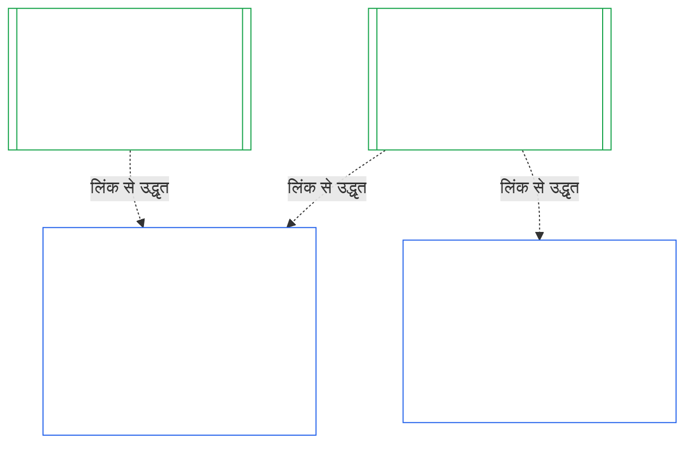
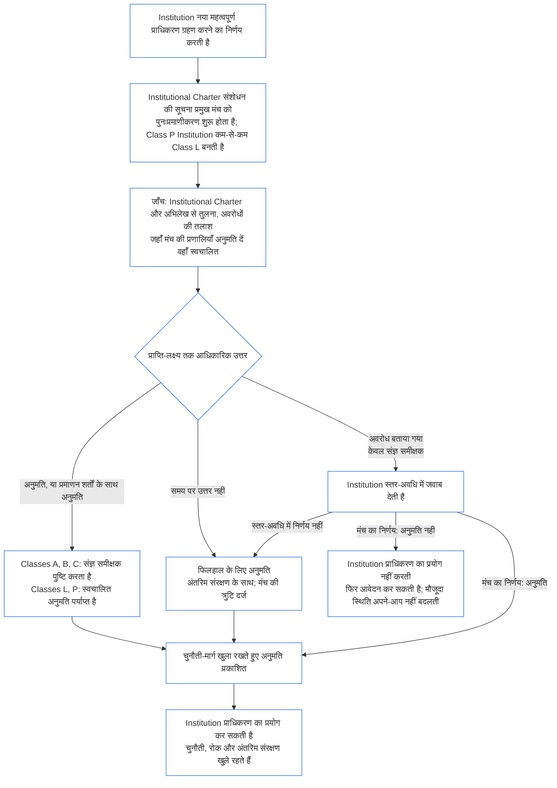

<!-- AI-assisted translation draft; unreviewed; English controls.
Source: core_10.000_institutional_alignment_certification.md
Source snapshot: 247e2180509e5e029c1106878cf225067339e010
Source SHA-256: a163a782114e584d09e295db66fe8b1b10a005b0f00116c8360396a0535ff221 -->

# अध्याय दस: संस्थागत संरेखण प्रमाणन

<strong>संग्रह में स्थान (गैर-संक्रियात्मक): फ़ाइल संरचना और पढ़ने के नियम</strong>

> यह फ़ाइल **संज्ञ संविधान** का हिस्सा है और केवल अन्य क्रमांकित `core_*` फ़ाइलों के साथ एक पाठ के रूप में पढ़े जाने पर बाध्यकारी है। इसमें **अध्याय दस** — **संस्थागत संरेखण प्रमाणन** है: [Institution](core_05.040_band_continuity.md#institution) को, उसके द्वारा चलाई जाने वाली किसी System से अलग, कैसे वर्गीकृत, मूल्यांकित, समीक्षित, निर्णीत, अभिलेखित, अद्यतन और फिर से खोला जाता है (**§1–§11**)। अध्याय दस [अध्याय नौ](core_09.000_system_alignment_certification_evaluation.md#chapter-nine-system-alignment-certification) (*System Alignment Certification*) का संस्थागत समकक्ष है और **इसके खंडों के क्रमांक समान हैं**: यहाँ का §N वहाँ के §N का उत्तर देता है। [CS-9.320](corpus_systems/cs_09.320_system_alignment_certification_illustrations.md#cs-9320-system-alignment-certification-illustrations) (*System alignment certification illustrations*) में Systems के तैयार उदाहरण हैं और उसके [§12 Illustrative Institution walkthroughs](corpus_systems/cs_09.320_system_alignment_certification_illustrations.md#cs-9320-12-illustrative-institution-walkthroughs) में तीन Institution walkthrough हैं। यह अध्याय उन्हें दोहराता नहीं।
>
> | § | अध्याय नौ (System) | अध्याय दस (Institution) |
> |---|------------------------|----------------------------|
> | 1 | उद्देश्य और भूमिका | System प्रमाणन से संबंध, किसका प्रमाणन है, गठन या संचालन की अनुमति और बाधा नहीं, नए भौतिक अधिकार के लिए प्रतीक्षा, प्रथम-प्रमाणन window |
> | 2 | System Class Evaluation | institution class; वर्ग के अनुसार माप |
> | 3 | Whole-System Certification Evaluation | संस्थागत आठ विषय, हमेशा लागू |
> | 4 | Evaluations Where Implicated | अध्याय नौ §4 का संदर्भ |
> | 5 | Rights-Floor and Domain Evaluations | अध्याय नौ §5 का संदर्भ |
> | 6 | Forum Process | चार seat; मंच भूमिकाएँ और क्रम; मंच, certifier और अभिलेख कार्यालय बतौर संस्थाएँ |
> | 7 | Certification Outcomes | Institution और उसके Systems का go-live, प्रमाणन-शर्तें और परिणाम के अन्य प्रभाव; त्रुटियों का संदर्भ; सुधार की तैयारी; अस्वीकार और प्रत्याहरण |
> | 8 | System Certification Record | Institutional Certification Record |
> | 9 | Recertification and Reopening | निगरानी; पुनःखोलने के trigger; अस्थायी और पूर्ण प्रमाणन; बचाव-विरोध; System प्रमाणनों का cascade; शासन लंघन पर उसके Systems पुनःखोलना |
> | 10 | Challenging a Certification | चुनौती मार्ग |
> | 11 | Relationship to Standing | प्रस्थिति सेतु |
>
> - **संवैधानिक स्वामी (अध्याय नौ के साथ संयुक्त):** मंच-पर्यवेक्षित संरेखण प्रमाणन और संबंधित अभिलेख। अध्याय दस संस्थागत विषय जोड़ता है। यह कोई नया मंच-परिवार, नई seat या परिणाम का नया शब्द नहीं जोड़ता।
> - **दोहराव नहीं, पुनःउपयोग:** चरण III से VI वैसे चलते हैं जैसा [अध्याय नौ भाग B §6](core_09.005_system_alignment_certification_record_process.md#6-forum-process) से [अध्याय नौ भाग C §11](core_09.010_system_alignment_certification_record_recertification.md#11-relationship-to-standing) में दिया है। विषय Institution होने पर केवल जो बदलता है वही अध्याय दस बताता है।
> - **स्थानांतरण-विरोधी नियम:** अध्याय दस System के लिए अध्याय नौ की मूल्यांकन प्रक्रिया, अध्याय सात के System Charter और Institutional Charter के fields, अध्याय आठ की Four-Seat Requirement, [corpus_institutions](corpus_institutions.md) में संस्थागत कर्तव्य, अध्याय ग्यारह का प्रस्थिति मापन या अध्याय बारह के प्रस्थिति प्रभावों को दोहराता नहीं।
>
> **पूर्ववर्ती:** [अध्याय सात](core_07.000_charters.md#chapter-seven-system-and-institutional-charters) Charters; [अध्याय आठ](core_08.000_functional_independence_separation_of_duties.md#chapter-eight-functional-independence-and-separation-of-duties) कार्यात्मक स्वतंत्रता; [अध्याय नौ](core_09.000_system_alignment_certification_evaluation.md#chapter-nine-system-alignment-certification) (भाग [A](core_09.000_system_alignment_certification_evaluation.md#chapter-nine-part-a-system-alignment-certification--evaluation), [B](core_09.005_system_alignment_certification_record_process.md#chapter-nine-part-b-system-alignment-certification--forum-process-and-outcomes) और [C](core_09.010_system_alignment_certification_record_recertification.md#chapter-nine-part-c-system-alignment-certification--record-recertification-and-standing)); अध्याय चौदह का मंच पर्यवेक्षण।
> **अनुवर्ती:** अध्याय ग्यारह के प्रस्थिति अभिलेख और सत्यापित इनपुट; अध्याय बारह के प्रस्थिति प्रभाव।

<strong>Trace</strong>

- पूर्ववर्ती:
  - [अध्याय सात §1 When System and Institutional Charters Are Required](core_07.000_charters.md#1-when-system-and-institutional-charters-are-required) (7.000 §1) (*कौन-से Institutions System Charter या Institutional Charter प्रकाशित करते हैं और Institution का वर्ग क्या है*);
  - [अध्याय सात §7 Amendment and Review](core_07.000_charters.md#7-amendment-review-and-scope-misalignment) (7.000 §7) (*Institutional Charter समीक्षा क्या परखती है*);
  - [अध्याय सात §4 The Charter Role Map and Standing-Record Custody](core_07.000_charters.md#4-the-charter-role-map-and-standing-record-custody) (7.000 §4) (*seats कहाँ रखी हैं*);
  - [अध्याय आठ §2 Four-Seat Constitutional Requirement](core_08.000_functional_independence_separation_of_duties.md#2-four-seat-constitutional-requirement) (8.000 §2) और [§9 Relationship to Later Processes](core_08.000_functional_independence_separation_of_duties.md#9-relationship-to-later-processes);
  - [अध्याय नौ](core_09.000_system_alignment_certification_evaluation.md#chapter-nine-system-alignment-certification) (9.000 से 9.010) (*इस अध्याय द्वारा पुनःप्रयुक्त System Alignment Certification प्रक्रिया*);
  - [Two Fundamental Questions](core_00.000_preamble.md#two-fundamental-questions);
  - [Constitutional Tetrad](core_00.000_preamble.md#constitutional-tetrad);
  - [Article XI-E](core_06.005_rights_part_b.md#article-xi-e-institutional-formation-and-business-creation) (*Institutional Formation and Business Creation*)।
- अनुवर्ती: [§1](#1-purpose-and-role) से [§11](#11-relationship-to-standing) तक; अध्याय ग्यारह ([11.000](core_11.000_standing_assessment.md#chapter-eleven-contribution-violation-and-standing-model--measurement)); [अध्याय चौदह](core_14.000_forum.md#chapter-fourteen-forums-and-jurisdiction) (14.000)।
- साथ पढ़ें:
  - [Institutional Alignment Certification](core_05.040_band_continuity.md#institutional-alignment-certification) और
  - [Institutional Certification Record](core_05.040_band_continuity.md#institutional-certification-record) (*अध्याय पाँच के अर्थ*);
  - **CI-8.205 §6** (*System और Institutional Charter की सामग्री, समीक्षा और गठन प्रारूप*);
  - **CF-14.425** (*अखंडता सुरक्षा, कब्ज़ा-विरोधी संचालन और स्वयं का निर्णय करने से बचाव*)।

 

अध्याय दस **संस्थागत संरेखण प्रमाणन** का संवैधानिक स्वामी है। यह [अध्याय नौ](core_09.000_system_alignment_certification_evaluation.md#chapter-nine-system-alignment-certification) की प्रक्रिया को System से Institution तक बढ़ाता है:

- **चरण I, Frame:** institution class और वह मूल्यांकन का माप कैसे तय करता है ([§2 Institution Class Evaluation](#2-institution-class-evaluation));
- **चरण II, Evaluate:** संस्थागत मूल्यांकन, जिसमें जहाँ संदर्भित हों वहाँ लागू मूल्यांकन और अधिकार-तल व क्षेत्र मूल्यांकन शामिल हैं ([§3 Whole-Institution Certification Evaluation](#3-whole-institution-certification-evaluation) से [§5 Rights-Floor and Domain Evaluations](#5-rights-floor-and-domain-evaluations) तक);
- **चरण III, Review:** मंच भूमिकाएँ और क्रम ([§6 Forum Process](#6-forum-process));
- **चरण IV, Decide:** परिणाम, सुधार की तैयारी, तथा अस्वीकार और प्रत्याहरण ([§7 Certification Outcomes](#7-certification-outcomes));
- **चरण V, Record:** Institutional Certification Record ([§8 Institutional Certification Record](#8-institutional-certification-record)); और
- **चरण VI, Operate:** पुनःप्रमाणन, पुनःखोलना, System प्रमाणनों से cascade, उसके Systems को पुनःखोलना, चुनौती मार्ग और प्रस्थिति सेतु ([§9 Recertification and Reopening](#9-recertification-and-reopening) से [§11 Relationship to Standing](#11-relationship-to-standing) तक)।

*साधारण शब्दों में: अध्याय नौ पूछता है कि क्या **प्रणाली** संरेखित है। अध्याय दस यही सवाल उन **संस्थाओं** के बारे में पूछता है जो Systems चलाती हैं या बिना कोई System चलाए अधिकार रखती हैं। किसी Institution का संरेखित होना संभव है जबकि उसका कोई System संरेखित न हो, और इसका उलटा भी। इसलिए Institution की जाँच उसी बात पर होती है जिस पर केवल वह जवाब दे सकती है: क्या वह अपने Institutional Charter के अनुसार काम करती है, उसके अधिकार के लिए कौन जवाबदेह है, वह अपने सदस्यों में किस व्यवहार को पुरस्कृत करती है और क्या उस पर स्वतंत्र जाँच वास्तव में उपयोग की जा सकती है। यह हर System के प्रमाणन पर निर्भर करती है और उसे दोहराती नहीं। यह लाइसेंस नहीं है: किसी को Institution शुरू करने या चलाने के लिए इसकी अनुमति नहीं चाहिए।*

### 1. उद्देश्य और भूमिका

<strong>Trace</strong>

- पूर्ववर्ती:
  - [अध्याय सात §1 When System and Institutional Charters Are Required](core_07.000_charters.md#1-when-system-and-institutional-charters-are-required) (7.000 §1);
  - [अध्याय नौ भाग A §1 Purpose and Role](core_09.000_system_alignment_certification_evaluation.md#1-purpose-and-role) (9.000 §1);
  - [Article XI-E](core_06.005_rights_part_b.md#article-xi-e-institutional-formation-and-business-creation) (*Institutional Formation and Business Creation*);
  - [Article XXVIII-A](core_06.020_rights_part_e.md#xxviii-a-existing-instantiations-adoption-transition-window) (*Phased Adoption and Rights-Floor Continuity*)।
- अनुवर्ती: [§2](#2-institution-class-evaluation); [§6](#6-forum-process); [§7](#7-certification-outcomes); [§9](#9-recertification-and-reopening)।
- साथ पढ़ें:
  - [Institution](core_05.040_band_continuity.md#institution);
  - [Institutional Charter](core_05.040_band_continuity.md#institutional-charter);
  - [System Charter](core_05.040_band_continuity.md#system-charter);
  - [Business Creation](core_05.055_band_participation.md#business-creation)।

 

*साधारण शब्दों में: प्रणाली का प्रमाणन उसी प्रणाली का होता है। Institution का प्रमाणन उन प्रमाणनों का उल्लेख करता है और वह विषय जोड़ता है जिसके लिए केवल Institution जवाब दे सकता है। एक System कई Institutions के अंतर्गत आ सकता है या किसी के भी अंतर्गत नहीं। यहाँ की कोई बात Institution शुरू करने के रास्ते में प्रमाणन को बाधा नहीं बनाती।*

संस्थागत संरेखण प्रमाणन और System Alignment Certification दो प्रमाणन हैं जो लिंक से जुड़ते हैं। उनका संबंध **लिंक द्वारा संयोजन** है, समावेशन नहीं। चित्र में तीर हर System Certification Record से उस Institutional Certification Record तक जाता है जो उसका उल्लेख करता है। किसी Institution के अधीन न आने वाले System का कोई तीर नहीं होता और उसे इसकी ज़रूरत भी नहीं; और जो Institution कोई System नहीं चलाता उसका केवल अपना अभिलेख होता है।

लिंक द्वारा संयोजन के दो पक्ष हैं; पहले Institution का।

Institution के पक्ष में:

- **Institutional Certification Record System का उल्लेख करता है, उसे दोहराता नहीं:** यह System Certification Record का लिंक देता है और उसका संस्करण बताता है। यह अध्याय System का मूल्यांकन फिर से नहीं चलाता, System का वर्ग फिर से तय नहीं करता और System का परिणाम, status या प्रमाणन-शर्तें नहीं बदलता।
- **Institution का प्रमाणन System का status नहीं हटा सकता:** Not Certified System Institution का status कुछ भी हो, Not Certified रहता है। प्रमाणनधारी System को Institution के किसी finding से सुरक्षा नहीं मिलती।
- **संस्थागत तथ्य एक बार मिलते हैं:** जहाँ [Chapter Nine Part A §3.1 Governance, Incentive, and Contestability Discipline](core_09.000_system_alignment_certification_evaluation.md#31-governance-incentive-and-contestability-discipline) operator के शासन और प्रोत्साहन पूछता है, वहाँ operator का वर्तमान Institutional Certification Record लिंक द्वारा वे तथ्य दे सकता है। System के मंच फिर भी तय करते हैं कि तथ्य उस System के लिए पर्याप्त हैं या नहीं। System Certification Record में कारण बताए बिना वे उसी संस्थागत तथ्य पर अलग finding नहीं दे सकते।

System के पक्ष में:

- **System Certification Record उसी System का है:** यह [अध्याय नौ](core_09.000_system_alignment_certification_evaluation.md#chapter-nine-system-alignment-certification) के तहत उसी का अपना अभिलेख है।
- **एक System Certification Record का उल्लेख कई Institutions कर सकते हैं:** [अध्याय सात §1 When System and Institutional Charters Are Required](core_07.000_charters.md#1-when-system-and-institutional-charters-are-required) के तहत System एक से अधिक Institutions द्वारा चलाया, stewarded या भौतिक रूप से नियंत्रित किया जा सकता है। हर Institution उसी अभिलेख का उल्लेख करता है।
- **System का किसी Institution के अधीन होना आवश्यक नहीं:** एक अकेला sentient Institution नहीं है, इसलिए System किसी के अधीन न हो सकता है। Institution के बिना System केवल [अध्याय नौ](core_09.000_system_alignment_certification_evaluation.md#chapter-nine-system-alignment-certification) के तहत प्रमाणित होता है और उसे इस अध्याय की कोई आवश्यकता नहीं। Institution के अधीन System भी उसी तरह प्रमाणित होता है: यह अध्याय Institution के लिए अलग अभिलेख जोड़ता है और System के अपने प्रमाणन का चरण नहीं है।

#### 1.1 किसका प्रमाणन होता है

वर्ग L या उससे ऊपर का Institution इस अध्याय के दायरे में है; वर्ग [§2.1 Institution class](#21-institution-class) के तहत तय होगा। इसमें ऐसा Institution भी शामिल है जो कोई System नहीं चलाता: उसके उल्लेख के लिए कोई System Certification Record नहीं और उसका वर्ग उसके अपने प्रभाव से तय होता है। Institution का **portfolio** उन Systems का समूह है जिन्हें वह चलाता, steward करता या भौतिक रूप से नियंत्रित करता है ([Portfolio](core_05.040_band_continuity.md#portfolio))।

- **वर्ग A, B, C और L:** प्रक्रिया लागू होती है और [§2.2 Scaling by class](#22-scaling-by-class) के अनुसार वर्ग से मापी जाती है।
- **वर्ग P:** प्रक्रिया प्रोत्साहित है और स्वेच्छा से अपनाई जा सकती है। वर्ग L या उससे ऊपर पुनर्वर्गीकृत होने पर, या Institution द्वारा स्वेच्छा से संवैधानिक अनुपालन का दावा करने पर, प्रक्रिया अनिवार्य होती है। नया भौतिक अधिकार लेने का निर्णय करने वाला वर्ग P Institution [§9.2.2 Recertification for new material authority](#922-recertification-for-new-material-authority) में notice देते ही कम-से-कम वर्ग L में पुनर्वर्गीकृत होता है, क्योंकि परिभाषा से वह अधिकार भौतिक है ([§9.2.1 What counts as new material authority](#921-what-counts-as-new-material-authority)) और किसी भी domain में भौतिक Institution कम-से-कम वर्ग L होता है ([§2.1 Institution class](#21-institution-class), विषय 2)। यह पुनर्वर्गीकरण notice देने से लागू होता है, जब तक clearance से पहले notice वापस न लिया जाए या अधिकार clear न हो, बशर्ते उसके तहत कुछ इस्तेमाल न हुआ हो। फिर Institution वर्ग P में लौटता है और सीमित प्रथम प्रमाणन समाप्त होता है। नया notice इसे फिर शुरू करता है; बिना clearance अधिकार का उपयोग [§9.2.2 Recertification for new material authority](#922-recertification-for-new-material-authority) (*बिना notice या clear होने से पहले*) के तहत finding बना रहता है। यह [Chapter Nine Part A §1 Purpose and Role](core_09.000_system_alignment_certification_evaluation.md#1-purpose-and-role) के समान है।
- **एक System:** ठीक एक ऐसा System चलाने वाला Institution जिसे System Charter चाहिए, उसका एक certification pass और एक अभिलेख होता है; यह अध्याय इसे **one-System evaluation** कहता है। System Certification Record में [§8 Institutional Certification Record](#8-institutional-certification-record) के विषयों वाला *institutional findings block* होता है और वही Institutional Certification Record के रूप में काम करता है। मंच, seats और समय-सीमाएँ System के अपने certification pass की होती हैं, संस्थागत विषय जोड़कर। परिणाम अपने अस्वीकार और प्रत्याहरण आधारों के अनुसार चलते हैं, जैसा [§7.4 Denial and revocation for an Institution](#74-denial-and-revocation-for-an-institution) कहता है। [§9.5 Cascade from System certifications](#95-cascade-from-system-certifications) cascade के रूप में लागू नहीं होता, क्योंकि System ही पूरा portfolio है; लेकिन [§7.4 Denial and revocation for an Institution](#74-denial-and-revocation-for-an-institution) के नियम 1 और 2 (indicator तथा कारण कहाँ है इसकी जाँच) लागू होते हैं।
- **कई Systems:** Institution के लिए एक Institutional Certification Record, जो उसके द्वारा चलाए हर System के System Certification Record से लिंक करता है। हर System का अपना pass और अभिलेख रहता है।
- **कोई System नहीं:** केवल एक Institutional Certification Record। उससे लिंक करने के लिए कोई System Certification Record नहीं क्योंकि Institution कोई System नहीं चलाता।

#### 1.2 गठन या संचालन की अनुमति और बाधा नहीं

संस्थागत संरेखण प्रमाणन इस बात की स्वतंत्र जाँच है कि Institution अपने अधिकार का वास्तविक उपयोग कैसे करता है। इसे Institution से स्वतंत्र मंच करते हैं और इसका अंत उनके निष्कर्षों के Institutional Certification Record में होता है।

- **गठन और संचालन:** Institution इसे पहले धारण किए बिना बनता, अपना Institutional Charter प्रकाशित करता, अधिकार का प्रयोग शुरू करता और संचालन जारी रखता है; कोई परिणाम यह अधिकार देता या रोकता नहीं।
- **परिणाम का प्रभाव:** परिणाम का केवल वही प्रभाव होता है जो [§7.1 Go-live for an Institution](#71-go-live-for-an-institution) में दिया है।
- **इस क्षेत्र के एकमात्र द्वार:** तीन संकीर्ण द्वार हैं, सभी **Article XI-E** (*Institutional Formation and Business Creation*) में:
  - नामित sentient पर लगा हुआ ताला, जो उस sentient के अधिकार से जुड़ता है;
  - संरेखणहीनता के खास सत्यापित तथ्यों पर Interim Hold, जो नामित sentient के अधिकार से भी जुड़ता है;
  - स्वयं Operating Party पर ताला, जो केवल वहीं Institution से जुड़ता है जहाँ ताला उस Institution पर हो, जैसा विघटित Institution पर **CI-12.210 §4** (*Dissolution*) के तहत होता है।

  प्रमाणन finding को इनमें से किसी द्वार का निर्णय करने वाले मंच के पास [§7.5 Effects of denial and revocation for an Institution](#75-effects-of-denial-and-revocation-for-an-institution) के तहत प्रमाण के रूप में भेजा जा सकता है। प्रमाणन परिणाम स्वयं कोई द्वार नहीं है, न उसे खोलता या बंद करता है।
- **नए भौतिक अधिकार के लिए प्रतीक्षा:** नया भौतिक अधिकार लेने का निर्णय करने वाला Institution, उसे इस्तेमाल करने से पहले [§9.2.2 Recertification for new material authority](#922-recertification-for-new-material-authority) की शर्तों पर उस अधिकार के पुनःप्रमाणन की clearance की प्रतीक्षा करता है। **Article XI-E** (*Institutional Formation and Business Creation*) यह प्रतीक्षा तय करता है। यह तीन संकीर्ण द्वारों में से नहीं, न गठन या संचालन का द्वार है। यह केवल नए अधिकार पर लागू होता है; Institution की बाकी सारी गतिविधियाँ जारी रहती हैं। [§9.2.2 Recertification for new material authority](#922-recertification-for-new-material-authority) का चित्र कदमों का सार देता है।
- **पिछला दरवाज़ा नहीं:** मंच, अपनाने वाला या वर्तमान पदाधिकारी इस अध्याय का उपयोग संस्थापकों को बाहर करने या वर्तमान पदाधिकारियों की रक्षा करने वाली अनुमति-सीमा के रूप में नहीं कर सकते। यह [Article XI-E](core_06.005_rights_part_b.md#article-xi-e-institutional-formation-and-business-creation) (*Institutional Formation and Business Creation*) को विफल करेगा।
  - प्रक्रिया की लागत पर [Avoidable Burden](core_05.040_band_continuity.md#avoidable-burden) लागू होता है।
  - उसकी गहराई पर [Classification-Scaled Governance](core_05.050_band_oversight.md#classification-scaled-governance) लागू होता है।
  - नए भौतिक अधिकार की प्रतीक्षा उसी वर्ग के हर Institution पर समान शर्तों पर और केवल उन अधिकारों पर लागू होती है जो दूसरों के लिए पहले से भौतिक हैं।

Systems के लिए go-live द्वार अलग है और वही उनके साथ रहता है। [Chapter Nine Part B §7.1 Go-Live Gate](core_09.005_system_alignment_certification_record_process.md#71-go-live-gate) के तहत नया System या उसका भौतिक विस्तार केवल अपने प्रमाणन के माध्यम से go-live होता है, Institution का status कुछ भी हो।

#### 1.3 प्रथम प्रमाणन के लिए window

पहला Institutional Certification Record Institution के वर्ग के लिए अंगीकार दस्तावेज़ द्वारा तय window के भीतर देना होता है।

- **नया Institution:** window उस दिन से शुरू होती है जिस दिन [Domain-Specific Materiality](core_05.050_band_oversight.md#domain-specific-materiality) के अनुसार उसका दूसरों पर पहला भौतिक प्रभाव पड़ता है, और उसका पहला प्रमाणन अस्थायी होता है।
- **Notice पर पुनर्वर्गीकृत वर्ग P Institution:** window [§9.2.2 Recertification for new material authority](#922-recertification-for-new-material-authority) के तहत notice देने वाले दिन से चलती है, नए Institution की तरह; यह कभी पहले ही समाप्त हो चुकी Adoption Transition window से नहीं चलती।
- **पहले से संचालनरत:** window [Article XXVIII-A](core_06.020_rights_part_e.md#xxviii-a-existing-instantiations-adoption-transition-window) (*Phased Adoption and Rights-Floor Continuity*) की Adoption Transition window है, जो [Chapter Seven §1.5 When a System Charter or Institutional Charter is due](core_07.000_charters.md#15-when-a-system-charter-or-institutional-charter-is-due) के default से मेल खाती है।
- **Window चूकना:** नीचे छूट न मिलने पर, बिना प्रथम pass के window समाप्त होने देने वाले Institution की त्रुटि दर्ज करके सुधारनी होगी; और चूकी हुई window वह pass खोल देती है। पहले से संचालनरत वर्ग L या उससे ऊँचे Institution पर नीचे दिया milestone failure भी लागू होता है। कोई द्वार न होने के कारण Institution को संचालन से रोका या वर्जित नहीं किया जाता ([§1.2 No permission and no gate on forming or running](#12-no-permission-and-no-gate-on-forming-or-running))।
  - **पहले से संचालनरत Institution:** यह वर्ग L या उससे ऊँचे Institutions के लिए इस अध्याय का अपना नियम है, जो [Article XXVIII-A](core_06.020_rights_part_e.md#xxviii-a-existing-instantiations-adoption-transition-window) (*Phased Adoption and Rights-Floor Continuity*) की समानता पर तय है, जिसमें Systems और व्युत्पन्न संस्थाओं का उल्लेख है। Adoption Transition window समाप्त हो जाए और प्रथम certification pass पूरा न हुआ हो (न अस्थायी या पूर्ण प्रमाणन, न [§7 Certification Outcomes](#7-certification-outcomes) के तहत तय परिणाम), तो deadline चूकी है। जो Institution window के भीतर दायर कर सहयोग कर चुका हो, उसने deadline नहीं चूकी यदि certification pass मंच द्वारा अपनी समय-सीमा पार करने से अधूरा हो ([Chapter Fourteen §6 Timely resolution, materiality tiers, and anti-delay discipline](core_14.000_forum.md#6-timely-resolution-materiality-tiers-and-anti-delay-discipline), *Overrun review*; [Chapter Nine Part C §9.3.4 Tier windows](core_09.010_system_alignment_certification_record_recertification.md#934-tier-windows)) या [§7.3 Remediation readiness for an Institution](#73-remediation-readiness-for-an-institution) के तहत एकमात्र deferral चलने के कारण अधूरा हो। **Article XXVIII-B** ([*Adoption Transition Authority Limits and Reauthorization*](core_06.020_rights_part_e.md#article-xxviii-b-adoption-transition-authority-limits-and-reauthorization)) के तहत दस्तावेज़ित पुनःप्राधिकरण न दिखाए जाने पर यह Adoption Transition milestone failure है और [अध्याय ग्यारह](core_11.000_standing_assessment.md#chapter-eleven-contribution-violation-and-standing-model--measurement) का साधारण अनुपालन और उल्लंघन मार्ग खुलता है। उस Article के restraint duties प्रभावी तारीख से लागू होते हैं; यह अंतराल जारी रहने से नया सामान्य नियम नहीं बनता। यह [Chapter Nine Part B §7.1.1 Systems already operating](core_09.005_system_alignment_certification_record_process.md#711-systems-already-operating) के समान है। यह कोई द्वार नहीं है।
  - **Certification pass:** उसका निर्णय अन्य किसी pass की तरह होता है। वह [§7 Certification Outcomes](#7-certification-outcomes) के किसी भी परिणाम में समाप्त हो सकता है, Not Certified सहित; उसके प्रभाव [§7.5 Effects of denial and revocation for an Institution](#75-effects-of-denial-and-revocation-for-an-institution) में हैं।
  - **दंड और विघटन:** यह अध्याय कोई दंड नहीं बनाता। निलंबन, receiver के अधीन करना, संरचनात्मक पृथक्करण और विघटन **CI-12.210** (*Institutional failure and dissolution*) और **CI-12.215** (*Institutional accountability and sanctions*) के तहत अधिकार-क्षेत्र वाले मंच के पास रहते हैं। उस मंच को केवल [§7.5 Effects of denial and revocation for an Institution](#75-effects-of-denial-and-revocation-for-an-institution) के संदर्भ-आधारों (विषय 5, *Referral*) पर ही मामला भेजा जाएगा।

### 2. Institution वर्ग मूल्यांकन

<strong>Trace</strong>

- पूर्ववर्ती:
  - [अध्याय सात §1 When System and Institutional Charters Are Required](core_07.000_charters.md#1-when-system-and-institutional-charters-are-required) (7.000 §1);
  - [अध्याय नौ भाग A §2 System Class Evaluation](core_09.000_system_alignment_certification_evaluation.md#2-system-class-evaluation) (9.000 §2) और [§2.2 How system class scales every evaluation](core_09.000_system_alignment_certification_evaluation.md#22-how-system-class-scales-every-evaluation);
  - [अध्याय तीन §2.1 Common Evasion Patterns](core_03.000_definition_integrity.md#21-common-evasion-patterns) (3.000 §2.1)।
- अनुवर्ती: [§3](#3-whole-institution-certification-evaluation) (*वे विषय जिनका माप वर्ग तय करता है*); [§8](#8-institutional-certification-record) (*वर्ग अभिलेख में बताया जाता है*); [§9.2](#92-reopening-triggers) (*वे trigger जो इसका पुनर्मूल्यांकन करते हैं*)।
- साथ पढ़ें:
  - **CS-9.305 (*System classification machinery*) और CS-9.310** (*System impact classifications*) तथा [corpus_systems/cs_09.310_system_impact_classifications.md](corpus_systems/cs_09.310_system_impact_classifications.md) (*वर्ग सूची*);
  - **CI-9.210** (*वर्गीकरण-संबद्ध संस्थागत दायित्व*);
  - **CI-8.205 §6** (*System और Institutional Charter की सामग्री, समीक्षा और गठन प्रारूप*)।

 

*साधारण शब्दों में: पहले संस्था को दूसरों पर उसके महत्त्व के अनुसार वर्ग में रखें। यह उसके वास्तविक निर्णय और नियंत्रण के आधार पर करें, न कि वह अपना क्या नाम रखती है। फिर वर्ग तय करता है कि मूल्यांकन कितना गहन हो: वर्ग जितना ऊँचा, प्रमाण उतना कठोर, समीक्षा उतनी स्वतंत्र और अगली जाँच उतनी जल्दी।*

यह Institution के लिए **चरण I, Frame** है।

#### 2.1 Institution वर्ग

**Institution class** Institution के सबसे बड़े भौतिक प्रभाव से तय होता है, चाहे वह प्रभाव उसके चलाए System के माध्यम से हो या किसी System के बाहर। इसका निर्णय Institution के वास्तविक निर्णय, अधिकार और नियंत्रण के आधार पर होता है; उसके लेबल, कानूनी रूप या Institutional Charter की सूची से नहीं। वर्ग मूल्यांकन की गहराई और समय-सीमाएँ नियंत्रित करता है, जैसे System के लिए [Chapter Nine Part A §2.2 How system class scales every evaluation](core_09.000_system_alignment_certification_evaluation.md#22-how-system-class-scales-every-evaluation) करता है। यही वह वर्ग है जो इस अध्याय और [Chapter Seven §1.2 Which classes are covered](core_07.000_charters.md#12-which-classes-are-covered) में इस्तेमाल होता है।

1. **Systems के माध्यम से प्रभाव:** Institution का वर्ग कम-से-कम उसके portfolio के किसी System के उच्चतम वर्ग जितना होगा ([Chapter Seven §1 When System and Institutional Charters Are Required](core_07.000_charters.md#1-when-system-and-institutional-charters-are-required))। Systems देखे गए संचालन से पहचाने जाते हैं। Institutional Charter में छूटा System भी गिना जाएगा।
2. **किसी System के बाहर प्रभाव:** Institution का अपना भौतिक प्रभाव और निर्भरता गिनी जाएगी, चाहे वह System चलाता हो या नहीं। **CS-9.305 (*System classification machinery*) और CS-9.310** (*System impact classifications*) की वर्ग परिभाषाएँ इन कारकों के आधार पर Institution के अपने निर्णयों और अधिकारों पर लागू होती हैं:
   - **वह क्या तय करता और रखता है:**
     - वह अन्य संज्ञ प्राणियों की जीवन-रक्षा आवश्यकताओं, शिक्षा, सुरक्षा, आजीविका, अधिकार या standing तक पहुँच के बारे में क्या तय करता है; और
     - वह क्या रखता है, जैसे धन, अभिलेख, सदस्यताएँ, standing अभिलेख की अभिरक्षा, या मंच, certifier या अभिलेख कार्यालय का कार्य।
   - **क्या वह भौतिक है:**
     - क्या उसकी अपनी गतिविधि [Domain-Specific Materiality](core_05.050_band_oversight.md#domain-specific-materiality) के किसी domain में भौतिक है, जिसमें ऐसे [Materially Binding Acts](core_05.035_band_accountability.md#materially-binding-act) करना भी शामिल है जिनका दूसरों को पालन करना हो या जिन्हें तय मानकर उन पर निर्भर किया जा सकता हो;
     - किसी भी एक domain में भौतिक Institution **CS-9.305 (*System classification machinery*) और CS-9.310** (*System impact classifications*) के तहत कम-से-कम वर्ग L है; और
     - सहायता, वस्तुएँ, श्रम या सेवाएँ देना जिन्हें दूसरे चाहें तो ले सकते या छोड़ सकते हैं, और जो किसी की ज़रूरी पहुँच नियंत्रित न करें, किसी को बाध्य नहीं करता। यह आचरण है, Materially Binding Act नहीं, और दूसरे कारकों के माध्यम से ही गिना जाएगा।
   - **कितने लोग उस पर निर्भर हैं:**
     - कितने संज्ञ प्राणी उस पर निर्भर हैं और उसे कितना बदला जा सकता है;
     - Material Control Line के अर्थ में उसका अधिकार कितना केंद्रित है; और
     - उसके निर्णय कितने पलटे जा सकते हैं।
3. **साझा नियंत्रण:** [Domain-Specific Materiality](core_05.050_band_oversight.md#domain-specific-materiality) के aggregation नियम के तहत (किसी [Material Control Line](core_05.035_band_accountability.md#material-control-line) के भीतर साझा व्यावहारिक नियंत्रण; केवल वित्तपोषण पर्याप्त नहीं) एक ही संचालन होने वाले Operating Parties को जहाँ व्यवहार में एक Institution की तरह काम करें, वहाँ साथ वर्गीकृत किया जाता है। किसी Operating Party, उसके portfolio या अधिकार को बाँटना ताकि कोई भाग वर्ग L तक न पहुँचे, [Chapter Three §2.1 Common Evasion Patterns](core_03.000_definition_integrity.md#21-common-evasion-patterns) के तहत दायरा और सीमा चकमा देना है।
4. **पुनर्वर्गीकरण:** [§9.2 Reopening triggers](#92-reopening-triggers) के trigger पर वर्ग का पुनर्मूल्यांकन होता है। कारणों सहित वर्गीकरण Institutional Certification Record में दर्ज होता है।

#### 2.2 वर्ग के अनुसार माप

Institution class प्रमाण की गहराई, समीक्षा की स्वतंत्रता, सामान्य प्रमाणन-अंतराल और अभिलेख में प्रकटीकरण को उस तरह मापता है जैसे System के लिए [Chapter Nine Part A §2.2 How system class scales every evaluation](core_09.000_system_alignment_certification_evaluation.md#22-how-system-class-scales-every-evaluation) करता है। प्रमाणन-अंतराल [Chapter Fourteen §6 Timely resolution, materiality tiers, and anti-delay discipline](core_14.000_forum.md#review-cadence) (*Review cadence*) में हैं; अंगीकार दस्तावेज़ छोटे अंतराल तय कर सकता है और स्वच्छ अस्थायी पुनःप्रमाणन की संख्या तय करता है।

- **वर्ग A, B और C:** [§3 Whole-Institution Certification Evaluation](#3-whole-institution-certification-evaluation) के सभी आठ विषय, वर्ग के अनुपात में प्रमाण और स्वतंत्रता सहित।
- **वर्ग L:** वही आठ विषय, सरलीकृत रूप में; [Classification-Scaled Governance](core_05.050_band_oversight.md#classification-scaled-governance) अनुमति दे तो सरल अभिलेख और लंबा सामान्य प्रमाणन-अंतराल। वर्ग L pass का मुख्य भाग है: Institutional Charter बनाम व्यवहार, Role Map, गठन-जाँच कथन और उद्धृत System प्रमाणनों की अद्यतन स्थिति। कोई विषय छोड़ा नहीं जा सकता; जिस विषय पर कुछ निष्कर्ष न हो उसे एक पंक्ति में दर्ज किया जाता है।
- **वर्ग P:** स्वैच्छिक, जैसा [§1.1 Who is certified](#11-who-is-certified) कहता है।

**संयुक्त पेशेवर अभ्यास में host।** जहाँ कोई Institution host हो ([**CI-15.205 §7**](corpus_institutions/ci_15.205_appointment_competency_rotation_removal.md#ci-46-seat-advisory) (*Practice licence, practice clearance, and joint professional practice*)), उसका प्रमाणन सदस्यों के कार्यों को host द्वारा वहन की गई seats के विरुद्ध नमूना-जाँचता है और सदस्यों के adoption notices की तुलना host के कार्य से करता है। एक सदस्य के कार्य का finding उसी सदस्य के बारे में होता है और host तक तभी पहुँचता है जब host द्वारा वहन की गई कोई seat विफल हुई हो।

### 3. संपूर्ण-Institution प्रमाणन मूल्यांकन

<strong>Trace</strong>

- पूर्ववर्ती:
  - [अध्याय नौ भाग A §3 Whole-System Certification Evaluation](core_09.000_system_alignment_certification_evaluation.md#3-whole-system-certification-evaluation) (9.000 §3);
  - [अध्याय सात §3 What System and Institutional Charters Must State](core_07.000_charters.md#3-what-system-and-institutional-charters-must-state) (7.000 §3);
  - [अध्याय सात §5 Formation Check: Office-Holder Standing and Authenticity](core_07.000_charters.md#5-formation-check-office-holder-standing-and-authenticity) (7.000 §5);
  - [अध्याय सात §7 Amendment and Review](core_07.000_charters.md#7-amendment-review-and-scope-misalignment) (7.000 §7);
  - [Two Fundamental Questions](core_00.000_preamble.md#two-fundamental-questions);
  - [अध्याय एक §19.6 Keeping Responsibility When Ownership or Structure Changes](core_01.010_stewardship_capacity_principles.md#196-keeping-responsibility-when-ownership-or-structure-changes) (1.010 §19.6)।
- अनुवर्ती: [§6](#6-forum-process) (*वे findings जिनकी समीक्षा मंच करते हैं*); [§9](#9-recertification-and-reopening) (*वे trigger जो उन्हें फिर खोलते हैं*); [§11](#11-relationship-to-standing) (*नामित sentient के बारे में findings के लिए सत्यापित-इनपुट द्वार*)।
- साथ पढ़ें:
  - **CI-8.205 §3** (*Authority chain and delegation controls*) और **CI-8.205 §6** (*System और Institutional Charter की सामग्री, समीक्षा और गठन प्रारूप*);
  - **CI-6.215** (*Resource stewardship and incentive integrity*);
  - विषय 8 के लिए **CI-8.210** (*Conflict integrity, anti-capture, and anti-corruption*), **CI-6.205** (*पारदर्शिता, सहभागिता और सुलभ चुनौती व सेवा मार्ग*) तथा **CI-12.205** (*Remedy systems and institutional redress capacity*)।

 

*साधारण शब्दों में: उन बातों की जाँच करें जो Institution से संबंधित हैं, उसके किसी एक System से नहीं: क्या वह अपने Institutional Charter का पालन करता है, उसके अधिकार के लिए कौन जवाब देता है, वह किस व्यवहार को पुरस्कृत करता है और क्या उस पर स्वतंत्र जाँच काम करती है।*

यह Institution के लिए **चरण II, Evaluate** है।

हर certification pass इन आठ विषयों का मूल्यांकन करता है, जो [Chapter Nine Part A §3 Whole-System Certification Evaluation](core_09.000_system_alignment_certification_evaluation.md#3-whole-system-certification-evaluation) का संस्थागत समकक्ष हैं। हर finding में उसका प्रमाण और वह Institutional Charter पाठ या देखे गए संचालन का उल्लेख होगा जिस पर वह आधारित है।

1. **व्यवहार के विरुद्ध Institutional Charter:**
   - [Chapter Seven §7 Amendment and Review](core_07.000_charters.md#7-amendment-review-and-scope-misalignment) की समीक्षा सूची से देखे गए संचालन के विरुद्ध Institutional Charter की जाँच होती है।
   - Institutional Charter से बाहर का व्यवहार, या ऐसा Institutional Charter जो अब व्यवहार का वर्णन न करे, — जो भी गलत हो, finding है।
2. **Portfolio और समेकित प्रभाव:**
   - portfolio के औचित्य की जाँच होती है: हर System का संबंध Institution के घोषित उद्देश्य से हो; बिना घोषित कारण का System finding है।
   - मूल्यांकन Systems के पार उन बातों को भी देखता है जिन्हें कोई एक प्रमाणन अकेले नहीं दिखा सकता:
     - साझा निर्भरताएँ;
     - समेकित निर्भरता;
     - साझा आधारों से संचयी निष्कर्षण; और
     - कोई ऐसी व्यवस्था जो एक कार्य को हिस्सों में बाँट दे ताकि हर हिस्सा किसी वर्ग या कर्तव्य से बच निकले।
3. **जवाबदेह प्राधिकार:**
   - Institution द्वारा दूसरों पर इस्तेमाल हर अधिकार किसी नामित किए जा सकने वाले जवाबदेह कार्यालय से आरोपित हो और वह कार्यालय [अध्याय आठ](core_08.000_functional_independence_separation_of_duties.md#chapter-eight-functional-independence-and-separation-of-duties) के नियमों तथा **CI-8.205 §3** (*authority chain and delegation controls*) के तहत जवाबदेह हो।
   - स्वामित्व, नियंत्रण या संरचना में बदलाव से जवाबदेही समाप्त नहीं होती ([Chapter One §19.6 Keeping Responsibility When Ownership or Structure Changes](core_01.010_stewardship_capacity_principles.md#196-keeping-responsibility-when-ownership-or-structure-changes))।
4. **पुरस्कार और प्रोत्साहन:**
   - Institution का अपना वेतन, पदोन्नति, लक्ष्य और पुरस्कार [Two Fundamental Questions](core_00.000_preamble.md#two-fundamental-questions) से परखे जाते हैं: संरचना वास्तव में किसे पुरस्कृत करती है और क्या वह संविधान के दो उद्देश्यों की दिशा में ले जाती है या उनसे दूर।
   - ऐसा पुरस्कार ढाँचा जो संरेखणहीनता या उसे छिपाने का भुगतान करे, finding है, भले हर System अलग से प्रमाणित हो।
   - [Chapter Nine Part A §3.3 Time-Consistency Constraint](core_09.000_system_alignment_certification_evaluation.md#33-time-consistency-constraint) लागू होता है। जहाँ सुरक्षा, सत्य या कल्याण को मध्यम या लंबी अवधि में अनुमानित क्षति अनसुलझी हो, निकट-अवधि के मापदंड, स्थानीय अनुपालन और अल्प-अवधि की दक्षता पर्याप्त नहीं; और ऐसी कीमत पर अल्पकालीन परिणामों का भुगतान करने वाला पुरस्कार ढाँचा finding है।
   - प्रोत्साहन अखंडता पर संस्थागत कर्तव्य **CI-6.215** (*Resource stewardship and incentive integrity*) के पास रहते हैं; उनका उल्लेख किया जाता है, दोहराया नहीं।
5. **Role Map और अभिरक्षा:**
   - [Charter Role Map](core_05.040_band_continuity.md#charter-role-map) ऐसे कार्यालय नामित करता है जो अस्तित्व में हैं, बताए अनुसार भरे या प्रतिस्थापित हैं और जहाँ Institution विषय हो ऐसे किसी भी अभिलेख के लिए Institution से [स्वतंत्र](core_05.035_band_accountability.md#independence) हैं।
   - स्वतंत्र मार्ग वास्तव में इस्तेमाल किया जा सकता है।
   - बिना seat वाला, निष्क्रिय कार्यालय या Institution की अपनी नियंत्रण-रेखा में अभिलेख अभिरक्षक finding है।
6. **हर उद्धृत System प्रमाणन की अद्यतन स्थिति:**
   - Institution द्वारा चलाए हर System के लिए मूल्यांकन जाँचता है कि System Certification Record प्रभावी है या Adoption Transition window में है, और Institution ने उस अभिलेख की प्रमाणन-शर्तों के अनुसार आवश्यक काम किया है।
   - बिना दर्ज कारण के मियाद समाप्त, वापस लिया गया, विफल या अनुपस्थित प्रमाणन finding है जिसे [§9.5 Cascade from System certifications](#95-cascade-from-system-certifications) फिर Institution तक पहुँचाता है।
7. **दफ्तरधारी की standing और प्रामाणिकता:**
   - [Chapter Seven §5 Formation Check: Office-Holder Standing and Authenticity](core_07.000_charters.md#5-formation-check-office-holder-standing-and-authenticity) के तहत प्रकाशित formation check कथन को देखे गए संचालन के विरुद्ध परखा जाता है, केवल attestation पर नहीं माना जाता।
   - हर covered office के लिए मंच सत्यापित अभिलेखों से standing तथ्य जाँचते हैं और नियंत्रण, हितों व पुरस्कारों, आचरण तथा संरक्षित आवाज़ के प्रमाण से प्रामाणिकता तय करते हैं। इसका अर्थ है:
     - धारक को वास्तव में निर्देश कौन देता है;
     - धारक को किस काम के लिए भुगतान और पदोन्नति मिलती है;
     - धारक ने उस कार्य में सत्यापित रूप से क्या किया है; और
     - क्या [संरक्षित रिपोर्ट](core_05.035_band_accountability.md#protected-reporting-whistleblowing) करने वाले या गैरकानूनी अथवा असंवैधानिक निर्देश मानने से इनकार करने वाले ([Chapter One §17.5 Duty to Resist](core_01.010_stewardship_capacity_principles.md#175-duty-to-resist)) किसी भी व्यक्ति — धारक सहित — को दंडित किया गया।
   - ऐसा कर्मचारी जो कोई covered office नहीं रखता, उसकी एक-एक करके जाँच नहीं होती। [Chapter Seven §5.6 Staff safeguards check](core_07.000_charters.md#56-staff-safeguards-check) उन्हें कवर करता है और मंच उसे भी इसी तरह देखे गए संचालन से परखते हैं। इसमें जाँचा जाता है कि:
     - Institution के नियुक्ति, वेतन, पदोन्नति और हटाने के नियम उसके घोषित उद्देश्य के विरुद्ध काम करने को पुरस्कृत न करें;
     - संरक्षित रिपोर्टिंग मार्ग मौजूद हो और उसका इस्तेमाल करने या गैरकानूनी अथवा असंवैधानिक निर्देश से इनकार करने पर किसी कर्मचारी को दंडित न किया गया हो; और
     - [Article III-C](core_06.000_rights_part_a.md#article-iii-c-labor-and-economic-floor) (*श्रम और आर्थिक न्यूनतम*) के अधिकार सुरक्षित हों।
   - निम्न में से हर बात finding है:
     - ऐसा धारक जो अघोषित नियंत्रक का nominee हो;
     - केवल कागज़ पर मौजूद covered office: Institutional Charter या Charter Role Map में नामित हो, पर कोई उसे वास्तव में न रखता हो और उसका काम न करता हो;
     - ऐसा पुरस्कार ढाँचा जो धारकों को Institutional Charter की प्रकाशित सीमाओं द्वारा निषिद्ध काम करने का भुगतान करे; और
     - गलत या अधूरा कथन।
   - Findings कार्यालय और संरचना के बारे में हैं। वे [§11 Relationship to Standing](#11-relationship-to-standing) के सत्यापित-इनपुट द्वार के जरिए ही किसी नामित sentient से जुड़ते हैं।
   - Formation check आस्था की जाँच नहीं है; लेकिन दूसरों को हानि या भेदभावपूर्ण व्यवहार योग्य बताने वाला सत्यापित कथन धारक का आचरण है और उसके विरुद्ध गिना जाता है, जैसा [Chapter One §7.5 Expression and the Harm Line](core_01.000_values_principles.md#75-expression-and-the-harm-line) तय करता है।
   - विषय 3, 4 और 5 इसके साथ पढ़े जाते हैं; इनमें से एक के तहत पाया तथ्य दूसरे के तहत फिर से नहीं पाया जाता।
8. **Institution के अपने संस्थागत कर्तव्य:**
   - अंगीकृत संस्थागत पाठ द्वारा Institution पर रखे संस्थागत कर्तव्यों के अनुपालन को देखे गए संचालन के विरुद्ध परखा जाता है, केवल attestation पर नहीं माना जाता। ये **CI-8.210** (*Conflict integrity, anti-capture, and anti-corruption*), **CI-6.205** (*पारदर्शिता, सहभागिता और सुलभ चुनौती व सेवा मार्ग*), **CI-6.215** (*Resource stewardship and incentive integrity*) और **CI-12.205** (*Remedy systems and institutional redress capacity*) हैं।
   - जाँचती है कि Institution के निगरानी, जवाबदेही, सहभागिता और समयबद्धता मार्ग मौजूद हैं, वास्तव में इस्तेमाल किए जा सकते हैं और Institution द्वारा बताई समय-सीमा में उत्तर देते हैं। वह समय-सीमा Institution के वर्ग की न्यूनतम समय-सीमा से लंबी नहीं हो सकती ([Article XXVI-C](core_06.020_rights_part_e.md#article-xxvi-c-timely-resolution-and-anti-delay-floor) (*समयबद्ध समाधान और विलंब-विरोधी न्यूनतम*) तथा संबंधित tier के लक्ष्य [CF-14.445 §3.1 Stage Targets and Outer Bounds](corpus_forum/cf_14.445_performance_backlog_publication_accessibility.md#cf-14445-31-stage-targets-and-outer-bounds) में); इससे लंबा बताया गया समय स्वयं finding है।
   - केवल कागज़ पर मौजूद, पहुँच से बाहर या समय पर उत्तर न दिया जाने वाला हर मार्ग finding है।
   - कर्तव्य उन्हीं पाठों के अधीन रहते हैं और उनका उल्लेख होता है, पुनर्कथन नहीं। विषय 3 से 5 के तहत मिला तथ्य यहाँ फिर से नहीं पाया जाता।

**अध्याय नौ भाग A §3 Whole-System Certification Evaluation के दो और भाग।** [Chapter Nine Part A §3 Whole-System Certification Evaluation](core_09.000_system_alignment_certification_evaluation.md#3-whole-system-certification-evaluation) System से दो बातें और पूछता है जो Institution के अपने आचरण पर भी लागू होती हैं। वे Institution के मूल्यांकन का हिस्सा हैं, पर हर एक केवल अपना trigger पूरा होने पर:

- **प्रणालीगत दायरा और जोखिम कारक:**
  - **कब लागू:** Institution का अपना आचरण [Chapter Nine Part A §3.2 Systemic Scope and Risk Factors](core_09.000_system_alignment_certification_evaluation.md#32-systemic-scope-and-risk-factors) के कारकों के तहत प्रणालीगत Risk को दायरे में लाए: सबसे बड़े पैमाने की हानियाँ, प्रभाव कैसे फैलते और जुड़ते हैं (Institution की अपनी सेवा विफल होने पर नीचे क्या विफल होता है सहित), तथा Institution की गतिविधि का दुरुपयोग या गलत दायरा कैसे हो सकता है।
  - **किसके तहत मूल्यांकन:** [Chapter Nine Part A §3.2 Systemic Scope and Risk Factors](core_09.000_system_alignment_certification_evaluation.md#32-systemic-scope-and-risk-factors), जिसमें [§3.2.1 Risk Evaluation and Disclosure Bridge](core_09.000_system_alignment_certification_evaluation.md#321-risk-evaluation-and-disclosure-bridge) का जोखिम-मूल्यांकन और प्रकटीकरण सेतु तथा [§3.2.2 Defects and Misalignment](core_09.000_system_alignment_certification_evaluation.md#322-defects-and-misalignment) की त्रुटियाँ शामिल हैं।
- **डेटा प्रकार और प्रबंधन:**
  - **कब लागू:** Institution के अपने आचरण में दायरे के भौतिक डेटा प्रकार संभाले जाते हों, जैसा [Chapter Nine Part A §3.4 Data Types and Handling Evaluation](core_09.000_system_alignment_certification_evaluation.md#34-data-types-and-handling-evaluation) हर भौतिक प्रभाव वाले certification record के लिए आवश्यक करता है।
  - **किसके तहत मूल्यांकन:** [Chapter Nine Part A §3.4 Data Types and Handling Evaluation](core_09.000_system_alignment_certification_evaluation.md#34-data-types-and-handling-evaluation), उसमें दिए अवसंरचना आश्वासन को institution class के अनुसार मापकर।
  - **कहाँ दर्ज:** Institutional Certification Record के data types खंड में ([§8.1 Minimum record contents](#81-minimum-record-contents)), उस डेटा के लिए जिसे Institution किसी System के बाहर संभालता है। System के भीतर संभाला डेटा एक बार उसी System के अभिलेख में मिलता है और उसका उल्लेख किया जाता है।

पहले से उद्धृत System Certification Record पर हुआ मूल्यांकन दोहराने के विरुद्ध [§4 Evaluations Where Implicated](#4-evaluations-where-implicated) का नियम इन दोनों पर लागू होता है।

### 4. जहाँ संदर्भित हो वहाँ के मूल्यांकन

<strong>Trace</strong>

- पूर्ववर्ती:
  - [अध्याय नौ भाग A §4 Evaluations Where Implicated](core_09.000_system_alignment_certification_evaluation.md#4-evaluations-where-implicated) (9.000 §4)।
- अनुवर्ती: [§6](#6-forum-process); [§8](#8-institutional-certification-record)।
- साथ पढ़ें:
  - **CI-8.210** (*Conflict integrity, anti-capture, and anti-corruption*);
  - **CI-6.205** (*पारदर्शिता, सहभागिता और सुलभ चुनौती व सेवा मार्ग*);
  - **CI-6.215** (*Resource stewardship and incentive integrity*);
  - **CI-12.205** (*Remedy systems and institutional redress capacity*)।

 

*साधारण शब्दों में: जहाँ Institution का अपना आचरण उन क्षेत्रों में से किसी को छूता है जिनकी System के संदर्भित होने पर जाँच की जाती है, वही मूल्यांकन Institution पर एक बार किया जाता है।*

जहाँ Institution का अपना आचरण [Chapter Nine Part A §4 Evaluations Where Implicated](core_09.000_system_alignment_certification_evaluation.md#4-evaluations-where-implicated) के किसी विषय को संदर्भित करता है, वहाँ उसी trigger के साथ संबंधित मूल्यांकन Institution के अपने आचरण पर लागू होता है। हर मूल्यांकन केवल अपना trigger पूरा होने पर लागू होता है:

- **निजता (सूचनात्मक):** जहाँ Institution का आचरण अध्याय छह के एक से अधिक निजता केंद्रों को भौतिक रूप से प्रभावित करे, हर केंद्र का समाधान किया जाता है; केवल एक के तहत मामला बंद करना पर्याप्त नहीं ([Chapter Nine Part A §4.1 Privacy (Informational) Joint Invocation](core_09.000_system_alignment_certification_evaluation.md#41-privacy-informational-joint-invocation))।
- **स्वैच्छिक बंद करना, बड़ा स्व-संशोधन और बाहर निकलने के अधिकार:** प्रमाणन-दावे को मानने से पहले स्वैच्छिकता, सहमति, दबाव-विरोध, निर्भरता का दबाव, जानकारी और उत्क्रमणीयता की जाँच होती है; केवल औपचारिक सहमति पर्याप्त नहीं ([Chapter Nine Part A §4.2 Voluntary Discontinuation, Major Self-Modification, and Exit Rights](core_09.000_system_alignment_certification_evaluation.md#42-voluntary-discontinuation-major-self-modification-and-exit-rights))।
- **सभा, सामूहिक संगठन और संस्थागत गठन:** विषय की Anti-Segmentation Principle के तहत संयुक्त जाँच होती है, किसी एक रूपरेखा से नहीं ([Chapter Nine Part A §4.3 Assembly, Collective Organization, and Institutional Formation](core_09.000_system_alignment_certification_evaluation.md#43-assembly-collective-organization-and-institutional-formation))।
- **असहमति और शांतिपूर्ण विरोध:** Institution असहमति या संरक्षित अहिंसक नागरिक अवज्ञा को सीधे या proxy के जरिए प्रतिकूल input नहीं बना सकता ([Chapter Nine Part A §4.3.1 Dissent and Peaceful Protest](core_09.000_system_alignment_certification_evaluation.md#431-dissent-and-peaceful-protest))।

संस्थागत कर्तव्य स्वयं अंगीकृत संस्थागत पाठ के स्वामित्व में हैं, जिनमें शामिल हैं:

- **CI-8.210** (*Conflict integrity, anti-capture, and anti-corruption*);
- **CI-6.205** (*पारदर्शिता, सहभागिता और सुलभ चुनौती व सेवा मार्ग*);
- **CI-6.215** (*Resource stewardship and incentive integrity*); और
- **CI-12.205** (*Remedy systems and institutional redress capacity*)।

यह अध्याय उनका उल्लेख करता है, पुनर्कथन नहीं। [§3 Whole-Institution Certification Evaluation](#3-whole-institution-certification-evaluation) (विषय 8) के तहत जाँचा जाता है कि Institution वास्तव में इनका पालन करता है या नहीं। पहले से उद्धृत System Certification Record पर हुआ मूल्यांकन दोबारा नहीं होता।

### 5. अधिकार-तल और क्षेत्र मूल्यांकन

<strong>Trace</strong>

- पूर्ववर्ती:
  - [अध्याय नौ भाग A §5 Rights-Floor and Domain Evaluations](core_09.000_system_alignment_certification_evaluation.md#5-rights-floor-and-domain-evaluations) (9.000 §5)।
- अनुवर्ती: [§6](#6-forum-process); [§8](#8-institutional-certification-record)।
- साथ पढ़ें:
  - [§4](#4-evaluations-where-implicated) (*संस्थागत कर्तव्य और मूल्यांकन दोहराने के विरुद्ध नियम*)।

 

*साधारण शब्दों में: पिछले खंड जैसा ही नियम: जहाँ trigger लागू हो वहाँ Institution के अपने आचरण पर अधिकार-तल या क्षेत्र की जाँच होती है; और जहाँ उद्धृत System प्रमाणन में जाँच पहले ही हो चुकी हो वहाँ दोहराई नहीं जाती।*

जहाँ Institution का अपना आचरण [Chapter Nine Part A §5 Rights-Floor and Domain Evaluations](core_09.000_system_alignment_certification_evaluation.md#5-rights-floor-and-domain-evaluations) के किसी अधिकार-तल या क्षेत्र को संदर्भित करे, वही trigger रखते हुए संबंधित मूल्यांकन Institution के अपने आचरण पर लागू होता है। हर एक केवल अपना trigger पूरा होने पर लागू होता है; इसलिए Institutional Certification Record में केवल वे मूल्यांकन होते हैं जिनके trigger Institution पूरा करता है। सुरक्षा और उसका मूल्यांकन:

- **Article I-B** (*पारिस्थितिक पदचिह्न और पारदर्शिता*):
  - **कब लागू:** Institution भौतिक रूप से आरोपणीय पर्यावरणीय बोझ उठाता है।
  - **किसके तहत मूल्यांकन:** [Chapter Nine Part A §5.1 Ecological Footprint Evaluation](core_09.000_system_alignment_certification_evaluation.md#51-ecological-footprint-evaluation)।
- **Article III-A** (*जीवन-रक्षा*):
  - **कब लागू:** Institution जीवन-रक्षा की आवश्यकताओं तक पहुँच देता, आवंटित, मूल्य-निर्धारित, host या समाप्त करता है।
  - **किसके तहत मूल्यांकन:** [§2 Institution Class Evaluation](#2-institution-class-evaluation) और [§3 Whole-Institution Certification Evaluation](#3-whole-institution-certification-evaluation)।
- **Article IV** (*संज्ञ-केंद्रित शिक्षा का अधिकार*):
  - **कब लागू:** Institution शैक्षिक या प्रशिक्षण संदर्भ में संज्ञ प्राणियों की रैंकिंग, आकलन, अनुशंसा, स्थान-निर्धारण या प्रमाण-पत्र से पहुँच नियंत्रित करता है, या पुनःप्रशिक्षण और आजीवन-अधिगम मार्ग रोकता है।
  - **किसके तहत मूल्यांकन:** [Chapter Nine Part A §5.2 Educational Capability and Learning-System Integrity Evaluation](core_09.000_system_alignment_certification_evaluation.md#52-educational-capability-and-learning-system-integrity-evaluation)।
- **Article IV-A** (*समान शैक्षिक पहुँच*):
  - **कब लागू:** Institution शिक्षा तक पहुँच देता, आवंटित, मूल्य-निर्धारित, host या समाप्त करता है।
  - **किसके तहत मूल्यांकन:** [§2 Institution Class Evaluation](#2-institution-class-evaluation) और [§3 Whole-Institution Certification Evaluation](#3-whole-institution-certification-evaluation), तथा जहाँ उनके trigger लागू हों वहाँ [Chapter Nine Part A §5.2 Educational Capability and Learning-System Integrity Evaluation](core_09.000_system_alignment_certification_evaluation.md#52-educational-capability-and-learning-system-integrity-evaluation) और [Chapter Nine Part A §5.5 Accessibility Evaluation](core_09.000_system_alignment_certification_evaluation.md#55-accessibility-evaluation)।
- **Article V** (*संसाधन आवंटन, निर्भरताएँ और पारिस्थितिकी तंत्र वित्तपोषण*), जिसमें **Article V-A** (*निर्भरता मानचित्रण और संसाधन-प्रवाह पारदर्शिता*) और **Article V-B** (*अंतर-प्रणाली निष्पक्षता और स्थिरता*) शामिल हैं:
  - **कब लागू:** Institution साझा अवसंरचना या आधारभूत निर्भरताओं का आवंटन, routing, वित्तपोषण या निष्कर्षण करता है जिन पर अन्य प्रणालियाँ या संज्ञ प्राणी निर्भर हैं।
  - **किसके तहत मूल्यांकन:** [Chapter Nine Part A §5.3 Proportionate Cross-System Support Evaluation](core_09.000_system_alignment_certification_evaluation.md#53-proportionate-cross-system-support-evaluation)।
- **Article III-F** (*सुरक्षित उत्पाद और स्वास्थ्य जानकारी*):
  - **कब लागू:** Institution ऐसे उत्पादों या सेवाओं की आपूर्ति, सूचीकरण, अनुशंसा या सलाह देता है जो शरीर, स्वास्थ्य या सुरक्षा को प्रभावित कर सकते हैं, या उनके बारे में जानकारी रखता है।
  - **किसके तहत मूल्यांकन:** [§2 Institution Class Evaluation](#2-institution-class-evaluation) और [§3 Whole-Institution Certification Evaluation](#3-whole-institution-certification-evaluation), तथा trigger लागू होने पर [Chapter Nine Part A §5.6 Trustworthiness and System-Reliance Integrity Evaluation](core_09.000_system_alignment_certification_evaluation.md#56-trustworthiness-and-system-reliance-integrity-evaluation)।
- **Article VI-C** (*भेदभाव-निषेध*):
  - **कब लागू:** Institution संज्ञ प्राणियों के बीच वर्गीकरण, रैंकिंग, मूल्य-निर्धारण, पहुँच-नियंत्रण, बहिष्करण या बोझ व लाभ आवंटित करता है।
  - **किसके तहत मूल्यांकन:** [Chapter Nine Part A §5.4 Nondiscrimination Evaluation](core_09.000_system_alignment_certification_evaluation.md#54-nondiscrimination-evaluation)।
- **Article VI-D** (*सुगम्यता*):
  - **कब लागू:** Institution संवैधानिक रूप से प्रासंगिक क्षेत्रों में सार्थक सहभागिता को रोकता है।
  - **किसके तहत मूल्यांकन:** [Chapter Nine Part A §5.5 Accessibility Evaluation](core_09.000_system_alignment_certification_evaluation.md#55-accessibility-evaluation)।
- **Article XIII** (*विश्वसनीय और भरोसेमंद प्रणालियों का अधिकार*):
  - **कब लागू:** Institution बताए गए व्यवहार, सीमाओं, जोखिम, चुनौती मार्ग या सुधार पर संज्ञ प्राणियों की निर्भरता को आकार देता है।
  - **किसके तहत मूल्यांकन:** [Chapter Nine Part A §5.6 Trustworthiness and System-Reliance Integrity Evaluation](core_09.000_system_alignment_certification_evaluation.md#56-trustworthiness-and-system-reliance-integrity-evaluation)।
- **Article XIII-A** (*विश्वसनीयता और भरोसेमंदी का न्यूनतम मान*) और **Safe Conditions**:
  - **कब लागू:** Institution उत्पादक गतिविधि देता या रोकता है, या Safe Conditions तक पहुँच देता, आवंटित, मूल्य-निर्धारित, host या समाप्त करता है।
  - **किसके तहत मूल्यांकन:** [§2 Institution Class Evaluation](#2-institution-class-evaluation) और [§3 Whole-Institution Certification Evaluation](#3-whole-institution-certification-evaluation), तथा trigger लागू होने पर [Chapter Nine Part A §5.6 Trustworthiness and System-Reliance Integrity Evaluation](core_09.000_system_alignment_certification_evaluation.md#56-trustworthiness-and-system-reliance-integrity-evaluation)।

संस्थागत कर्तव्य और उद्धृत System Certification Record पर पहले से किए मूल्यांकन को दोहराने के विरुद्ध नियम वही हैं जो [§4 Evaluations Where Implicated](#4-evaluations-where-implicated) में बताए गए हैं। [Chapter Nine Part A §5 Rights-Floor and Domain Evaluations](core_09.000_system_alignment_certification_evaluation.md#5-rights-floor-and-domain-evaluations) द्वारा हर क्षेत्र मूल्यांकन के लिए बताए गए सिद्धांत और त्रुटियाँ Institution के अपने आचरण के संबंधित मूल्यांकन पर लागू होते हैं।

### 6. मंच प्रक्रिया

<strong>Trace</strong>

- पूर्ववर्ती:
  - [Chapter Nine Part B §6 Forum Process](core_09.005_system_alignment_certification_record_process.md#6-forum-process) (9.005 §6);
  - [Chapter Eight §2 Four-Seat Constitutional Requirement](core_08.000_functional_independence_separation_of_duties.md#2-four-seat-constitutional-requirement) (8.000 §2), [§5 Published Placement, Vacancy, and Substitution](core_08.000_functional_independence_separation_of_duties.md#5-published-placement-vacancy-and-substitution), [§6 Proportional Scaling and Merged Hosting](core_08.000_functional_independence_separation_of_duties.md#6-proportional-scaling-and-merged-hosting), और [§9 Relationship to Later Processes](core_08.000_functional_independence_separation_of_duties.md#9-relationship-to-later-processes);
  - [Chapter Fourteen §4.3 Institutional Forums](core_14.000_forum.md#43-institutional-forums) (14.000 §4.3);
  - [Chapter Fourteen §3 Transfer, consolidation, and coordination](core_14.000_forum.md#3-transfer-consolidation-and-coordination--continuity-and-anti-capture) (14.000 §3) (*मंचों के पार स्वयं निर्णय न करने का नियम*);
  - [Materially Binding Act Record](core_05.035_band_accountability.md#materially-binding-act-record)।
- अनुवर्ती: [§7](#7-certification-outcomes); [§8](#8-institutional-certification-record); [§9](#9-recertification-and-reopening); [Chapter Fourteen](core_14.000_forum.md#chapter-fourteen-forums-and-jurisdiction) (14.000)।
- साथ पढ़ें:
  - [Charter Role Map](core_05.040_band_continuity.md#charter-role-map);
  - **CF-14.415** (*Routing operations, transfer, questions for ruling, and representative treatment*);
  - **CF-14.425** (*अखंडता सुरक्षा, कब्ज़ा-विरोधी संचालन और स्वयं के निर्णय से बचाव*);
  - **CF-14.435 §6** (*स्व-जाँच नहीं*)।

 

*साधारण शब्दों में: वही स्वतंत्र मंच, उसी क्रम में, Institution की समीक्षा करते हैं; Institution अपना समीक्षक कभी नहीं चुनता।*

यह Institution के लिए **चरण III, Review** है।

#### 6.1 संस्थागत प्रमाणन में चार seats

यह उपखंड बताता है कि यह अध्याय [Chapter Eight §2 Four-Seat Constitutional Requirement](core_08.000_functional_independence_separation_of_duties.md#2-four-seat-constitutional-requirement) कैसे लागू करता है; और यह वह कथन है जिसकी इस प्रक्रिया से [Chapter Eight §9 Relationship to Later Processes](core_08.000_functional_independence_separation_of_duties.md#9-relationship-to-later-processes) माँग करता है। संस्थागत प्रमाणन एक [Materially Binding Act](core_05.035_band_accountability.md#materially-binding-act) है, इसलिए हर certification pass में चारों seats होती हैं। यह अध्याय कोई seat नहीं जोड़ता और अध्याय आठ का कोई नियम ढीला नहीं करता। [Chapter Nine Part B §6.1.1 Four seats in a certification](core_09.005_system_alignment_certification_record_process.md#611-four-seats-in-a-certification) इन प्रतिस्थापनों के साथ लागू होता है:

- **[Initiating Seat](core_05.035_band_accountability.md#initiating-seat):** Institution का शासक प्राधिकार।
  - **भूमिका:** यह प्रमाणन माँगता है या इसे प्रमाण देना आवश्यक प्रस्तावक होता है।
  - **Trigger पर खोला गया certification pass:** lead forum के आदेश से खुलता है और शासक प्राधिकार प्रस्तावक बना रहता है।
- **[Verify-or-Authorize Seat](core_05.035_band_accountability.md#verify-or-authorize-seat):** परिणाम के लिए lead forum और प्रत्येक निष्कर्ष के लिए संबंधित घटक प्राधिकार, जिन्हें [§6.2 Forum roles and sequence](#62-forum-roles-and-sequence) तथा Chapter Fourteen के तहत नियत किया जाता है।
  - **Seat का स्थान:** [Charter Role Map](core_05.040_band_continuity.md#charter-role-map) इस seat को नहीं रखता।
  - **Institution क्या नहीं कर सकता:** अपने सत्यापन प्राधिकार को चुनना, नियुक्त करना, अपने नियंत्रित माध्यम से धन देना या हटाना।
  - **कौन इसे धारण कर सकता है:** जो Institution के लिए काम करता, उसके स्वामित्व में है या उसके प्रति जवाबदेह है, वह उसके प्रमाणन के लिए यह seat नहीं रख सकता; और हर धारक का उस परिणाम में कोई हित नहीं होना चाहिए जिसका निर्णय हो रहा है।
  - **Systems:** यही नियम System प्रमाणन पर भी लागू होता है ([Chapter Nine Part B §6.1.1 Four seats in a certification](core_09.005_system_alignment_certification_record_process.md#611-four-seats-in-a-certification), *operator से बाहर*)।
- **[Record Seat](core_05.035_band_accountability.md#record-seat):** वह कार्यालय जिसे Institutional Charter का Charter Role Map रखता है।
  - **भूमिका:** यह Institutional Certification Record खोलता, संशोधित, सुरक्षित रखता और प्रकाशित करता है।
  - **स्थिति:** यह Institution की [Material Control Line](core_05.035_band_accountability.md#material-control-line) से बाहर होता है।
- **[Contest Seat](core_05.035_band_accountability.md#contest-seat):** सक्षम समीक्षा या वैकल्पिक मंच वाला प्रकाशित अभिलेख-चुनौती मार्ग।
  - **स्थिति:** इसे उसी तरह और उसी रेखा के बाहर रखा जाता है।

**स्व-स्थान निर्धारण।** Institution अपने प्रमाणन के record seat और contest seat का स्थान तय करने वाला मानचित्र प्रकाशित करता है।

- **अमान्य स्थान:** किसी ऐसी seat को Institution की अपनी Material Control Line के भीतर रखना, जहाँ अभिलेख का विषय Institution हो, वैध स्थान निर्धारण नहीं है, मानचित्र कुछ भी कहे ([Chapter Eight §3 Independence, Conflict, and Control Lines](core_08.000_functional_independence_separation_of_duties.md#3-independence-conflict-and-control-lines))।
- **Routing:** इसके बाद certification pass [Chapter Eight §5 Published Placement, Vacancy, and Substitution](core_08.000_functional_independence_separation_of_duties.md#5-published-placement-vacancy-and-substitution) के अनुसार route होता है। Seat का काम Charter Role Map में नामित स्वतंत्र मार्ग को जाता है; seat Institution या उसकी नियंत्रण-रेखा के किसी व्यक्ति को नहीं मिलती।
- **Finding:** seat का दोषपूर्ण स्थान स्वयं [§3 Whole-Institution Certification Evaluation](#3-whole-institution-certification-evaluation) के तहत finding है।

**संयुक्त hosting।** [Chapter Eight §6 Proportional Scaling and Merged Hosting](core_08.000_functional_independence_separation_of_duties.md#6-proportional-scaling-and-merged-hosting) बिना बदलाव लागू होता है। यह अध्याय न संयुक्त hosting जोड़ता है, न हटाता है।

#### 6.2 मंच भूमिकाएँ और क्रम

[Chapter Nine Part B §6.2 Supervisory sequence](core_09.005_system_alignment_certification_record_process.md#62-supervisory-sequence) का पर्यवेक्षण क्रम चुनौती मार्ग से शुरू होकर चरण IV और V को हस्तांतरण तक लागू होता है, इन बदलावों के साथ। [Chapter Nine Part B §6.1 Forum supervision and component roles](core_09.005_system_alignment_certification_record_process.md#61-forum-supervision-and-component-roles) भी लागू होता है, सिवाय जहाँ यह खंड उसे बदलता है:

- **Lead:** हर certification pass का नेतृत्व **Integrity** मंच करता है।
  - **अपवाद:** Chapter Fourteen मुख्य दाँव के लिए कोई अन्य वैध lead नियत कर सकता है।
  - **Record seat:** lead forum record seat holder को निर्देश देता है और उसी कार्रवाई में स्वयं record seat नहीं रखता।
- **मूल घटक Institutional Forums के पास:**
  - **आवश्यक पक्ष:** Institution अपने प्रमाणन का हमेशा आवश्यक पक्ष होता है।
  - **घटक क्या है:** घटक प्रमाणन का एक भाग है; उस पर **component authority** रखने वाला मंच उस भाग के प्रमाण और प्राधिकार को नियंत्रक मानक के विरुद्ध जाँचता है और अपने प्राधिकार के भीतर अपना finding जारी करता है। certification pass में उस मंच का भाग **component evaluation** है ([Chapter Nine Part B §6.1 Forum supervision and component roles](core_09.005_system_alignment_certification_record_process.md#61-forum-supervision-and-component-roles))।
  - **Institutional Forums के पास:** Institutional Forums के पास संस्थागत mandate, पर्यवेक्षित दायरे, institution class, संस्थागत कर्तव्य-अनुपालन ([§3 Whole-Institution Certification Evaluation](#3-whole-institution-certification-evaluation), विषय 8) तथा Institution के अपने आचरण के Rights Floor घटक पर component authority है ([Chapter Fourteen §4.3 Institutional Forums](core_14.000_forum.md#43-institutional-forums), [Chapter Nine Part B §6.1.6 Institutional Forums](core_09.005_system_alignment_certification_record_process.md#616-institutional-forums))।
- **अन्य घटक:**
  - **Technical Forums:** प्रमाण मानक और प्रोत्साहन या समेकित findings के लिए आवश्यक कोई माप देते हैं।
  - **Environment Forums:** जहाँ उसके Systems में Institution का समेकित पारिस्थितिक जोखिम भौतिक हो, component finding देते हैं।
  - **Sentient Forums:** जहाँ Institution का अपना आचरण किसी समुदाय के स्वयं शासन करने के तरीके को भौतिक रूप से प्रभावित करे, समुदाय-शासन finding देते हैं।
  - **प्रभावित सदस्य और समुदाय:** नियत मंचों के जरिए प्रमाण प्रस्तुत करते हैं।
  - **Constitutional Forums:** अर्थ, वैधता और संरचनात्मक उपचार के प्रश्न अपने पास रखते हैं।
- **Systems पर संदर्भ जाता है, निर्णय नहीं होता:**
  - **कहाँ जाता है:** किसी एक System से संबंधित component प्रश्न उसी के अपने certification pass में जाता है, Institution के pass में नहीं।
  - **Lead forum क्या कर सकता है:** वह प्रश्न भेज सकता है, निर्णय के लिए प्रस्तुत कर सकता है या [स्थगित](core_05.035_band_accountability.md#stay) कर सकता है, जैसा [Chapter Nine Part B §6.2 Supervisory sequence](core_09.005_system_alignment_certification_record_process.md#62-supervisory-sequence) बताता है।
    - **संदर्भित करें:** प्रश्न को संबंधित मंच-परिवार को सौंपें।
    - **निर्णय के लिए भेजें:** प्रश्न को निर्णय हेतु किसी दूसरे मंच के पास भेजें और उत्तर की प्रतीक्षा करें। मामला lead forum के पास ही रहता है।
    - **स्थगित करें:** इसे रोकें।
  - **वह क्या नहीं कर सकता:** Institution के certification pass में System के component प्रश्न का निर्णय। वह प्रश्न System के अपने certification pass में तय होता है।
- **समीक्षा के दौरान सहभागिता, आपात सुरक्षा और चुनौती:** Chapter Nine Part B Institution के certification pass पर पूरा लागू होता है, उसके अभिलेख को Institutional Certification Record मानकर।
  - **समीक्षा के दौरान सहभागिता** ([Chapter Nine Part B §6.2.4 Participation during review](core_09.005_system_alignment_certification_record_process.md#624-participation-during-review)): नियत मंच प्रभावित sentient-ों को मूल्यांकन और मंच समीक्षा के दौरान प्रमाण और चिंताएँ देने के व्यावहारिक, सुलभ तरीके देते हैं। हर प्रस्तुति record seat holder द्वारा रखे review submissions log में जाती है।
  - **कौन प्रस्तुत कर सकता है:** Institution के प्रभावित सदस्य, कर्मचारी, उपयोगकर्ता और समुदाय — वर्तमान और यथोचित रूप से अनुमानित — उन प्रभावित sentient-ों में हैं जिन्हें प्रमाण देने का सुलभ तरीका मिलना चाहिए। Chapter Nine Part B उन्हें वास्तविक और यथोचित रूप से अनुमानित प्रभाव तथा निर्भरता से पहचानता है, deployment से पहले भी।
  - **कर्मचारी और गोपनीयता:** Institution में समस्या जानने की सबसे अधिक संभावना कर्मचारियों को होती है। प्रस्तुतकर्ता, कर्मचारी सहित, गुमनाम या गोपनीय रहने का अनुरोध कर सकता है। Lead forum के निर्णय तक प्रस्तुतकर्ता की पहचान सब से, Institution सहित, रोकी जाती है, जैसा [Chapter Nine Part B §6.2.4 Participation during review](core_09.005_system_alignment_certification_record_process.md#624-participation-during-review) कहता है।
  - **आपात सुरक्षा** ([Chapter Nine Part B §6.2.3 Urgent protection](core_09.005_system_alignment_certification_record_process.md#623-urgent-protection)): क्रम पूरा होने से पहले stay, अंतरिम सुरक्षा या निर्भरता सीमा का आदेश दिया जा सकता है। क्रम फिर भी चलता है और उपाय अभिलेख में दर्ज होता है।
  - **चुनौती** ([Chapter Nine Part B §6.3 Contestability chain](core_09.005_system_alignment_certification_record_process.md#63-contestability-chain)): प्रभावित पक्ष अभिलेख को चुनौती दे सकते हैं; चुनौती उस स्तर पर जाती है जहाँ विवाद वास्तव में है।
  - **बचाव-विरोध** ([Chapter Nine Part B §6.4 Anti-bypass](core_09.005_system_alignment_certification_record_process.md#64-anti-bypass)): छिपे उप-अभिलेख, चुनौतियों को केवल कब्ज़े वाले आंतरिक निकायों तक route करना, चुनौती को सबसे निचले प्रशासनिक स्तर पर समाप्त होने देना या किसी घटक की चुप्पी को मंज़ूरी मानना पर्यवेक्षण क्रम और चुनौती-योग्यता शृंखला को विफल नहीं कर सकता।

#### 6.3 मंच, certifier और अभिलेख कार्यालय बतौर संस्थाएँ

*साधारण शब्दों में: प्रमाणन करने वाले निकाय भी संस्थाएँ हैं, इसलिए वे एक-दूसरे को चक्र में प्रमाणित नहीं कर सकते। जो निकाय स्वयं Not Certified है, वह अन्य प्रमाणनों में अपनी seats छोड़ता है।*

मंच host, प्रमाणन निकाय, अभिलेख कार्यालय, सत्यापन प्राधिकारी या प्रमाणन में भाग लेने वाला कोई अन्य निकाय, [Institution](core_05.040_band_continuity.md#institution) है यदि वह उस परिभाषा में आता है; और यह अध्याय उस पर भी उसके वर्ग के अन्य Institutions की तरह लागू होता है।

- **स्वयं अपना निर्णय नहीं:** उसका अपना pass उससे और उसकी [Material Control Line](core_05.035_band_accountability.md#material-control-line) से बाहर का मंच संचालित और समीक्षित करता है। जहाँ प्रश्न स्वयं मंच-परिवार के पक्षपात, कब्ज़े, हित-संघर्ष या प्रक्रिया-दुरुपयोग का हो, वहाँ [Chapter Fourteen §3 Transfer, consolidation, and coordination](core_14.000_forum.md#3-transfer-consolidation-and-coordination--continuity-and-anti-capture) के मंचों-पार स्वयं निर्णय न करने के नियम का वैकल्पिक routing और **CF-14.435 §6** (*स्व-जाँच नहीं*) लागू होता है।
- **चक्र नहीं:** कोई निकाय उस निकाय के प्रमाणन में seat नहीं रख सकता जो उसके अपने प्रमाणन में seat रखता हो — सीधे या ऐसे निकायों की शृंखला के जरिए जो एक पुनःप्रमाणन चक्र के भीतर पहले निकाय तक वापस पहुँचे। चक्र बंद करने वाला certification pass किसी बाहरी निकाय को route होता है।
- **Seats अलग रहती हैं:** दूसरे निकाय के प्रमाणन में भाग लेने, जिसमें उसकी seat रखना भी शामिल है, से किसी निकाय को अपना कोई लाभ नहीं मिलता।
  - **दूसरे निकाय पर नियंत्रण नहीं:** इससे यह शक्ति नहीं मिलती कि वह निकाय अपने प्रमाणन पर कैसे प्रतिक्रिया करे, जैसे findings, प्रमाणन-शर्तों या चुनौतियों पर उसका उत्तर क्या हो।
  - **अपने प्रमाणन में कोई तरजीह नहीं:** इससे निकाय के अपने प्रमाणन में अनुकूल व्यवहार नहीं मिलता।
- **Not Certified होने पर कोई seat नहीं:** जब तक कोई Institution Not Certified है ([§7 Certification Outcomes](#7-certification-outcomes)), वह दूसरे निकाय के प्रमाणन में verify-or-authorize, record या contest seat नहीं रख सकता, न मंच या प्रमाणन निकाय की मेज़बानी कर सकता है। उसके पास जो भी seat स्थान हैं, उन्हें Role Map के नए, तारीख़युक्त संस्करण में कहीं और रखा जाता है।

### 7. प्रमाणन परिणाम

<strong>Trace</strong>

- पूर्ववर्ती:
  - [Chapter Nine Part B §7 Certification Outcomes](core_09.005_system_alignment_certification_record_process.md#7-certification-outcomes) (9.005 §7), जिसमें [§7.2](core_09.005_system_alignment_certification_record_process.md#72-certification-defects-and-correction), [§7.3](core_09.005_system_alignment_certification_record_process.md#73-remediation-readiness-willingness-and-capacity-to-correct), [§7.4](core_09.005_system_alignment_certification_record_process.md#74-denial-and-revocation), और [§7.5](core_09.005_system_alignment_certification_record_process.md#75-effects-of-denial-and-revocation) शामिल हैं;
  - [Chapter Nine Part C §9.3 Provisional and full certification](core_09.010_system_alignment_certification_record_recertification.md#93-provisional-and-full-certification);
  - [Chapter Nine Part A §3.1 Governance, Incentive, and Contestability Discipline](core_09.000_system_alignment_certification_evaluation.md#31-governance-incentive-and-contestability-discipline);
  - [Chapter Seven §6 When a Holder Fails the Formation Check](core_07.000_charters.md#6-when-a-holder-fails-the-formation-check) (7.000 §6);
  - [Chapter Twelve §5.5 Special locks](core_12.000_standing_integration.md#55-special-locks) (12.000 §5.5);
  - [Chapter Fourteen §5 Interim hold on a named sentient's pathway](core_14.000_forum.md#interim-hold-on-a-named-sentients-pathway) (14.000 §5)।
- अनुवर्ती: [§8](#8-institutional-certification-record); [§9](#9-recertification-and-reopening); [§11](#11-relationship-to-standing)।
- साथ पढ़ें:
  - **CI-12.210** (*Institutional failure and dissolution*) और **CI-12.215** (*Institutional accountability and sanctions*);
  - **CI-8.205 §3** (*Authority chain and delegation controls*);
  - **CI-15.205 §1** (*Shared staffing and competency requirement*);
  - [Article XI-E](core_06.005_rights_part_b.md#article-xi-e-institutional-formation-and-business-creation) (*Institutional Formation and Business Creation*)।

 

*साधारण शब्दों में: प्रमाणन समीक्षा Institution के लिए प्रकाशित परिणाम देकर समाप्त होती है। परिणाम कभी यह तय नहीं करता कि Institution अस्तित्व में रह सकता है या संचालन कर सकता है या नहीं। वह तय करता है कि Institution अपने बारे में क्या कह सकता है, किसे चेतावनी दी जाती है और Institution के Systems की समीक्षा के समय परिणाम का कितना महत्त्व होगा। मंच उस विशिष्ट गतिविधि या अधिकार को भी सीमित कर सकते हैं जिसे समीक्षा ने गलत पाया; Not Certified Institution किसी दूसरे निकाय के प्रमाणन में seat नहीं रख सकता। वे Institution को संचालन करने या Systems बनाने से रोक नहीं सकते।*

यह Institution के लिए **चरण IV, Decide** है: [§6 Forum Process](#6-forum-process) की समीक्षा के बाद मंच यहाँ परिणाम तक पहुँचते हैं।

Institution को System जैसे ही परिणाम मिल सकते हैं। [Chapter Nine Part B §7 Certification Outcomes](core_09.005_system_alignment_certification_record_process.md#7-certification-outcomes) उन्हें परिभाषित करता है:

- अस्थायी प्रमाणन और पूर्ण प्रमाणन, जो दो **status** हैं (अस्थायी प्रमाणन की समीक्षा जल्दी होती है);
- शर्ताधीन प्रमाणन (ऐसा प्रमाणन जिसके साथ प्रमाणन-शर्तें हों);
- स्थगित प्रमाणन (निर्णय आगे के लिए टाला जाता है);
- गैर-प्रमाणन, यानी **अस्वीकार** (प्रमाणन मना किया जाता है);
- प्रत्याहरण, यानी **वापस लेना** (पहले से धारण प्रमाणन वापस लिया जाता है);
- मियाद समाप्त होना (प्रमाणन की अवधि पूरी हो जाती है);
- प्रमाणन-शर्तों की पूर्ति (प्रमाणन-शर्तें पूरी हो चुकी हैं); और
- प्रमाणन-शर्तों से मुक्ति (प्रमाणन-शर्तें अब लागू नहीं, इसलिए पूरी हुए बिना हटा दी जाती हैं)।

जिस Institution के पास न अस्थायी न पूर्ण प्रमाणन हो वह **Not Certified** है। Status और प्रमाणन-शर्तों के नियम Chapter Nine Part B §7 Certification Outcomes और [§9.3 Provisional and full certification](core_09.010_system_alignment_certification_record_recertification.md#93-provisional-and-full-certification) के हैं। उनके तहत प्रमाणन-शर्त केवल स्वतंत्र सत्यापन के बाद, पूर्ति या मुक्ति से, समाप्त होती है।

#### 7.1 Institution के लिए go-live

*साधारण शब्दों में: प्रमाणित होने तक System go-live नहीं हो सकता। Institution प्रमाण-पत्र बिना बन और चल सकता है, लेकिन नया भौतिक अधिकार इस्तेमाल करने से पहले पुनःप्रमाणन की प्रतीक्षा करता है। Institution के परिणाम के तीन सीमित प्रभाव हैं: वह Institution का सार्वजनिक status तय करता है, पाई गई विशिष्ट समस्या से प्रमाणन-शर्तें जोड़ता है और Institution के Systems की समीक्षा में प्रमाण के रूप में गिना जाता है।*

[Chapter Nine Part B §7.1 Go-Live Gate](core_09.005_system_alignment_certification_record_process.md#71-go-live-gate) कहता है कि System तब तक go-live नहीं होता जब तक वह प्रमाणित न हो, परिणाम खुले चुनौती मार्ग के साथ प्रकाशित न हो, notice अवधि पूरी न हो जाए और आवश्यक हर प्रमाणन-शर्त स्वतंत्र रूप से सत्यापित न हो।

Institution के गठन या संचालन पर ऐसा कोई द्वार नहीं है ([§1.2 No permission and no gate on forming or running](#12-no-permission-and-no-gate-on-forming-or-running))। वह प्रमाणन धारण किए बिना बनता, अपना Institutional Charter प्रकाशित करता, अधिकार का प्रयोग शुरू करता और संचालन जारी रखता है; कोई परिणाम यह अधिकार देता या रोकता नहीं। एक अपवाद नया भौतिक अधिकार है। Institution इसे इस्तेमाल करने से पहले उस अधिकार को clear करने वाले पुनःप्रमाणन की प्रतीक्षा करता है ([§9.2.2 Recertification for new material authority](#922-recertification-for-new-material-authority))। वह बाकी काम जारी रखता है और नए अधिकार के इस्तेमाल से पहले आवश्यक कोई प्रमाणन-शर्त सत्यापित की जाती है ([§7.1.1 Certification conditions](#711-certification-conditions))।

**Systems पर go-live की रोक फिर भी लागू है।** नया System या उसका भौतिक विस्तार केवल अपने प्रमाणन से go-live होता है, Institution का status कुछ भी हो। Institution का status उस निर्णय में प्रमाण हो सकता है, पर उसे कभी तय नहीं कर सकता:

- **System का परिणाम नहीं, प्रमाण:** जब Institution के किसी System का प्रमाणन होना हो, Institution का status इस बात का एक प्रमाण है कि System कैसे चलाया जाता है, उसे क्या प्रेरित करता है और क्या संज्ञ प्राणी उसे चुनौती दे सकते हैं ([Chapter Nine Part A §3.1 Governance, Incentive, and Contestability Discipline](core_09.000_system_alignment_certification_evaluation.md#31-governance-incentive-and-contestability-discipline))। यह अपने आप System को प्रमाणित नहीं करता, न उसे रोकता है।
- **अस्वीकार या प्रत्याहरण के बाद ऊँचा मानक:** यदि Institution का प्रमाणन अस्वीकृत हुआ हो या वह प्रमाणन खो चुका हो, तो उस पर निर्भर नया System शुरू करने या बड़ा विस्तार करने का अनुरोध करने वाले को अधिक प्रमाण देना होगा। उन्हें दिखाना होगा कि अभिलेख में finding होने के बावजूद Institution पर उनकी निर्भरता के आधार अब भी पर्याप्त ठोस हैं ([§7.5 Effects of denial and revocation for an Institution](#75-effects-of-denial-and-revocation-for-an-institution), प्रभाव विषय 3)।

##### 7.1.1 प्रमाणन-शर्तें

Institution का शर्ताधीन प्रमाणन [Chapter Nine Part B §7.1 Go-Live Gate](core_09.005_system_alignment_certification_record_process.md#71-go-live-gate) (*प्रमाणन-शर्तें और सीमित प्राधिकार*) के अनुसार लिखा जाता है, इन सीमाओं के साथ:

- **पाई गई समस्या से जुड़ी:** प्रमाणन-शर्त या निर्भरता सीमा उसी अधिकार, व्यवहार या संरचना से जुड़ती है जिसके बारे में finding है।
- **पूरी तरह विनिर्दिष्ट:** हर प्रमाणन-शर्त में पाँच बातें स्पष्ट हों:
  - इसके लिए कौन जिम्मेदार है।
  - यह कब तक देय है, या जारी रहने पर कितनी बार दोहरती है।
  - कौन-सा प्रमाण दिखाएगा कि यह पूरी हुई।
  - उस प्रमाण की स्वतंत्र जाँच कौन करेगा।
  - चूक होने पर क्या होगा।
- **समस्या से आगे नहीं जाती:** इसके लिए Institution को Systems बनाना बंद करने, संचालन जारी रखने की अनुमति माँगने या findings से अछूती किसी बात को बदलने की आवश्यकता नहीं हो सकती।
- **नए अधिकार से पहले प्रमाणन-शर्तें:** [Chapter Nine Part B §7.1 Go-Live Gate](core_09.005_system_alignment_certification_record_process.md#71-go-live-gate) go-live से पहले जिन प्रमाणन-शर्तों की माँग करता है, वे Institution पर केवल नए भौतिक अधिकार के लिए लागू होती हैं। उस अधिकार का प्रयोग करने से पहले उनका स्वतंत्र सत्यापन होना चाहिए। वे Institution के मौजूदा संचालन को कभी नहीं रोकतीं।
- **समाप्ति:** प्रमाणन-शर्त पूर्ति या मुक्ति से समाप्त होती है, जैसा Chapter Nine Part B §7.1 Go-Live Gate (*प्रमाणन-शर्त कैसे समाप्त होती है*) बताता है, और केवल स्वतंत्र सत्यापन के बाद।

##### 7.1.2 परिणाम के अन्य प्रभाव

Systems और प्रमाणन-शर्तों के अलावा, परिणाम के केवल ये प्रभाव हैं:

- **अभिलेख में status:** Institution का status प्रकाशित होता है और कोई भी प्रभावित व्यक्ति उसे चुनौती दे सकता है। Not Certified Institution स्वयं को प्रमाणित नहीं बता सकता।
- **Institution पर निर्भर लोगों को चेतावनी:** जहाँ finding का अर्थ है कि उनकी निर्भरता सुरक्षित नहीं, उन्हें बताया जाता है।
- **अगली समीक्षा कितनी जल्दी:** अस्थायी प्रमाणन का अंतराल पूर्ण प्रमाणन से छोटा होता है।
- **अस्वीकार और प्रत्याहरण:** प्रभाव [§7.5 Effects of denial and revocation for an Institution](#75-effects-of-denial-and-revocation-for-an-institution) में हैं।
- **पुनःखोलना और cascade:** समीक्षा फिर खोली जा सकती है और विफल System प्रमाणन Institution को प्रभावित कर सकता है। देखें [§9 Recertification and Reopening](#9-recertification-and-reopening)।
- **प्रस्थिति:** परिणाम किसी sentient की standing को केवल [§11 Relationship to Standing](#11-relationship-to-standing) के जरिए छू सकता है।

दंड, विघटन और संस्थागत-विफलता के परिणाम **CI-12.210** (*Institutional failure and dissolution*) और **CI-12.215** (*Institutional accountability and sanctions*) के अधीन रहते हैं। यह अध्याय इनमें से कुछ भी नहीं बनाता।

#### 7.2 प्रमाणन त्रुटियाँ और सुधार

*साधारण शब्दों में: प्रमाणन त्रुटि मूल्यांकन में मिली वास्तविक समस्या है, कागजी काम की चूक नहीं। Institution में त्रुटि मिलने पर सुधार के नियम System जैसे ही हैं।*

जब certification pass में Institution की त्रुटि मिले, [Chapter Nine Part B §7.2 Certification Defects and Correction](core_09.005_system_alignment_certification_record_process.md#72-certification-defects-and-correction) लागू होता है। [§2 Institution Class Evaluation](#2-institution-class-evaluation), [§3 Whole-Institution Certification Evaluation](#3-whole-institution-certification-evaluation), [§4 Evaluations Where Implicated](#4-evaluations-where-implicated) और [§5 Rights-Floor and Domain Evaluations](#5-rights-floor-and-domain-evaluations) के findings, Chapter Nine Part B द्वारा सूचीबद्ध Chapter Nine Part A के मूल्यांकनों का स्थान लेते हैं। Chapter Nine Part B §7.2 Certification Defects and Correction ये तय करता है:

- मंचों के पास उपलब्ध विकल्प;
- क्या प्रभावित है, अंतरिम सुरक्षा और निर्भरता सीमाओं का कथन, तथा आवश्यक सुधार कार्य; और
- सुधार प्रमाणन-शर्तों की पूर्ति का समर्थन करने से पहले उसका स्वतंत्र सत्यापन आवश्यक है।

Institution-विशिष्ट दो बातें:

- **त्रुटि से आगे नहीं:** प्रमाणन-शर्त त्रुटि के दायरे से आगे नहीं जा सकती ([§7.1 Go-live for an Institution](#71-go-live-for-an-institution))।
- **संचालन पर रोक नहीं:** Chapter Nine Part B §7.2 Certification Defects and Correction का अंतिम अनुच्छेद कहता है कि Not Certified System नया संचालन शुरू नहीं कर सकता। यह Systems का नियम है। Institution पर लागू नहीं ([§1.2 No permission and no gate on forming or running](#12-no-permission-and-no-gate-on-forming-or-running))।

#### 7.3 Institution की सुधार-तत्परता

*साधारण शब्दों में: Institution में समस्या मिलने पर मंच वही प्रश्न पूछते हैं जो System के बारे में पूछते हैं: क्या वह समस्या सुधारने को इच्छुक भी है और सक्षम भी? ईमानदार उत्तर नहीं हो तो उसका प्रमाणन अस्वीकृत या वापस लिया जाता है। इससे अपने आप Institution का अस्तित्व या संचालन नहीं रुकता। इससे उसका प्रमाणित होने का दावा हटता है, उस पर निर्भर लोगों को चेतावनी मिलती है, उसके Systems को उसके अच्छे status से मिलने वाला समर्थन कमज़ोर होता है और वह दूसरों को प्रमाणित करने वाली seats से बाहर रहता है।*

[Chapter Nine Part B §7.3 Remediation Readiness: Willingness and Capacity to Correct](core_09.005_system_alignment_certification_record_process.md#73-remediation-readiness-willingness-and-capacity-to-correct) इन बदलावों के साथ Institution पर लागू होता है:

- **कौन क्या करता है:**
  - **Institution का शासक प्राधिकार** प्रस्तावक है: वह पक्ष जो मामला प्रस्तुत करता है कि Institution तैयार है। वही प्रमाण देता है; वह अपनी तत्परता का निर्णय स्वयं नहीं करता।
  - **Lead Integrity Forum** finding तय करता है: क्या Institution समस्या सुधारने को इच्छुक भी है और सक्षम भी ([Chapter Nine Part B §7.3.4 Findings](core_09.005_system_alignment_certification_record_process.md#734-findings) संभावित findings सूचीबद्ध करता है)।
  - **Institutional Forums** शासन, प्राधिकार और प्रोत्साहन के प्रमाण रखते हैं और lead forum तक पहुँचाते हैं।
  - **Technical Forums** मापे जाने योग्य क्षमता का प्रमाण रखते हैं और lead forum तक पहुँचाते हैं ([§6.2 Forum roles and sequence](#62-forum-roles-and-sequence))।
- **इच्छा:** [Chapter Nine Part B §7.3.1 Willingness](core_09.005_system_alignment_certification_record_process.md#731-willingness) के कारकों के अतिरिक्त, मंच देखते हैं कि क्या Institution:
  - जहाँ उसकी अपनी पुरस्कार संरचना finding का कारण थी, उसे बदल रहा है;
  - [§3 Whole-Institution Certification Evaluation](#3-whole-institution-certification-evaluation) (विषय 7) के तहत अप्रामाणिक पाए गए दफ्तरधारी को बदल रहा या उसकी पहचान बता रहा है (उदाहरण के लिए अघोषित नियंत्रक के प्रतिनिधि धारक को);
  - अपने [Charter Role Map](core_05.040_band_continuity.md#charter-role-map) में स्वतंत्र seat का स्थान बहाल कर रहा है;
  - अपना Institutional Charter या Systems का portfolio सुधार रहा है; और
  - उस System के लिए जवाब दे रहा है जिसके कारण का finding Institution तक पहुँचा ([§9.5 Cascade from System certifications](#95-cascade-from-system-certifications))।
- **क्षमता:** [Chapter Nine Part B §7.3.2 Capacity](core_09.005_system_alignment_certification_record_process.md#732-capacity) के कारकों के अतिरिक्त, मंच देखते हैं कि:
  - काम करने वाले कार्यालयों के पास ऐसा करने का प्राधिकार है (**CI-8.205 §3** (*Authority chain and delegation controls*));
  - Institution के पास काम के लिए धन, कर्मचारी और उत्तराधिकार योजना है (**CI-15.205 §1** (*Shared staffing and competency requirement*); **CI-12.205** (*Remedy systems and institutional redress capacity*)); और
  - स्वतंत्र सत्यापन प्राधिकारी को सुधार की जाँच करने के लिए वास्तव में पहुँच और समय दिया जा सकता है ([Chapter Nine Part B §7.3.2 Capacity](core_09.005_system_alignment_certification_record_process.md#732-capacity), *Verifiability*)। जिस सुधार का कोई सत्यापन नहीं कर सकता, वह क्षमता नहीं।
- **एक System:** ठीक एक System चलाने वाले Institution की तत्परता की एक ही जाँच one-System evaluation में होती है। जाँच उसके अस्वीकार के आधार System और Institution के लिए अलग-अलग बताती है, जैसा [§7.4 Denial and revocation for an Institution](#74-denial-and-revocation-for-an-institution) आवश्यक करता है।

#### 7.4 Institution के लिए अस्वीकार और प्रत्याहरण

*साधारण शब्दों में: अस्वीकार का अर्थ प्रमाणन मना करना है और प्रत्याहरण का अर्थ पहले से धारण प्रमाणन वापस लेना है। दोनों के वास्तविक परिणाम हैं। इनमें से कोई भी Institution बंद नहीं करता।*

[Chapter Nine Part B §7.4 Denial and Revocation](core_09.005_system_alignment_certification_record_process.md#74-denial-and-revocation) इन बदलावों के साथ Institution पर लागू होता है:

- **आधार और प्रक्रिया:** Chapter Nine Part B §7.4 Denial and Revocation बिना बदलाव ये देता है:
  - **आधार** ([Chapter Nine Part B §7.4.2 When denial or revocation is required](core_09.005_system_alignment_certification_record_process.md#742-when-denial-or-revocation-is-required)):
    - **अस्वीकार**, जहाँ प्रमाणन धारण नहीं है: तत्परता जाँच में Institution अनिच्छुक, या न इच्छुक न सक्षम पाया जाता है; या इच्छुक लेकिन असमर्थ, और कोई सीमिततर दायरा, समर्थन या हस्तांतरण समय रहते कमी पूरी नहीं करता; या एकल deferral समाप्त हो गया है पर तत्परता अब भी नहीं दिखाई गई।
    - **प्रत्याहरण**, जहाँ प्रमाणन धारण है: सूचना और उत्तर देने का अवसर देने के बाद वही तत्परता findings। इसके अलावा, प्रमाणन-शर्त दो बार चूकना या भौतिक रूप से उल्लंघित करना, प्रमाण को झूठा, गढ़ा हुआ या छिपाया हुआ दिखाना, या आवश्यक प्रमाण-चरण को उसकी समय-सीमा में न करना।
    - **इसके बदले शर्ताधीन प्रमाणन नहीं:** इनमें से अस्वीकार या प्रत्याहरण का कोई आधार पूरा हो तो मंच को अस्वीकार या प्रत्याहरण करना होगा। वह प्रमाणन-शर्तें लगाकर प्रमाणन देने या जारी रखने के माध्यम से उस आधार का उत्तर नहीं दे सकता।
  - **पहले सुरक्षा** ([Chapter Nine Part B §7.4.3 Protection first](core_09.005_system_alignment_certification_record_process.md#743-protection-first)):
    - **यह किस पर काम करता है:** अस्वीकार और प्रत्याहरण प्रमाणन status पर लागू होते हैं; वे अपने आप Institution को बंद नहीं करते।
    - **प्रभावी होने से पहले:** मंच अंतरिम सुरक्षा और निर्भरता सीमाएँ बताता है।
  - **प्रक्रिया** ([Chapter Nine Part B §7.4.4 Process](core_09.005_system_alignment_certification_record_process.md#744-process)):
    - **पहले से दिया गया:** अस्वीकार या प्रत्याहरण से पहले Institution को finding और प्रमाण की सूचना, उत्तर देने या प्रमाण-चरण दिखाने के लिए छोटी अवधि, तथा चुनौती-योग्यता शृंखला के जरिए finding को चुनौती देने का अवसर दिया जाता है।
    - **कारण:** निर्णय अपने कारण अभिलेख में बताता है।
    - **आपात सुरक्षा** ([Chapter Nine Part B §6.2.3 Urgent protection](core_09.005_system_alignment_certification_record_process.md#623-urgent-protection)): सूचना, उत्तर या निर्णय की प्रतीक्षा किए बिना stay, अंतरिम सुरक्षा या निर्भरता सीमा तत्काल आदेशित की जा सकती है। उसके बाद प्रक्रिया फिर भी चलती है और उपाय अभिलेख में दर्ज होता है।
  - **स्थायी रोक नहीं:** अस्वीकृत या प्रत्याहृत operator फिर से आवेदन कर सकता है।
- **किसका स्थान आता है:**
  - **Operator:** जहाँ Chapter Nine Part B §7.4 Denial and Revocation में “operator” कहा है वहाँ Institution का शासक प्राधिकार पढ़ें।
  - **System findings:** जहाँ “system findings” कहा है वहाँ संस्थागत findings पढ़ें।
- **प्रभाव:** प्रभाव [§7.5 Effects of denial and revocation for an Institution](#75-effects-of-denial-and-revocation-for-an-institution) में हैं, [Chapter Nine Part B §7.5 Effects of Denial and Revocation](core_09.005_system_alignment_certification_record_process.md#75-effects-of-denial-and-revocation) में नहीं।
- **एक System:** ठीक एक System चलाने वाले Institution का one-System evaluation होता है ([§1.1 Who is certified](#11-who-is-certified))। हर परिणाम अपने अस्वीकार या प्रत्याहरण आधार का अनुसरण करता है, इसलिए एक System वाला Institution कई Systems वाले से बदतर नहीं माना जाता:
  - **System:** Chapter Nine Part B §7.4 Denial and Revocation के तहत उसे केवल System आधार पर अस्वीकार या प्रत्याहृत किया जाता है, जो System के अपने findings पर आधारित हो। केवल संस्थागत विषयों ( [§3 Whole-Institution Certification Evaluation](#3-whole-institution-certification-evaluation) के विषय 1 से 5, 7 और 8, तथा [§4 Evaluations Where Implicated](#4-evaluations-where-implicated) और [§5 Rights-Floor and Domain Evaluations](#5-rights-floor-and-domain-evaluations) के तहत Institution के अपने मूल्यांकन) पर आधारित संस्थागत आधार System को अस्वीकार या प्रत्याहृत नहीं करता।
  - **Institution:** इसे केवल संस्थागत आधार पर Not Certified के रूप में प्रकाशित किया जाता है, जिसके प्रभाव [§7.5 Effects of denial and revocation for an Institution](#75-effects-of-denial-and-revocation-for-an-institution) में हैं; आधार संस्थागत findings पर टिका हो। System आधार Institution का status जैसा था वैसा छोड़ता है, जब तक कारण का finding कारण Institution में न रखे ([Chapter Nine Part C §9.3.3 Cause of misalignment](core_09.010_system_alignment_certification_record_recertification.md#933-cause-of-misalignment))। कसौटी [§9.5 Cascade from System certifications](#95-cascade-from-system-certifications) का नियम 2 है, जो ऐसे कारण को *institutional cause* कहता है। इस खंड के अनुसार §9.5 Cascade from System certifications के नियम 1 और 2 one-System evaluation पर लागू होते हैं; §9.5 का शेष भाग नहीं।
  - **दोनों:** संयुक्त आधार, जो दोनों पर टिका हो, दोनों परिणाम पैदा करता है। अस्वीकार या प्रत्याहरण का आधार तब संयुक्त होता है जब वह Institution के शासक प्राधिकार का आचरण हो (अनिच्छा, प्रमाण को झूठा, गढ़ा या छिपाया हुआ दिखाना, प्रमाणन-शर्त दो बार चूकना या भौतिक रूप से उल्लंघित करना, या आवश्यक प्रमाण-चरण न करना), या ऐसा तथ्य हो जिसे [Chapter Nine Part A §3.1 Governance, Incentive, and Contestability Discipline](core_09.000_system_alignment_certification_evaluation.md#31-governance-incentive-and-contestability-discipline) System से जोड़ता हो, न कि ऐसा तथ्य जिसे System Institution के अभिलेख से लिंक द्वारा लेता हो। Institutional Certification Record बताता है कि कौन-सा अस्वीकार या प्रत्याहरण आधार किस परिणाम का समर्थन करता है।
  - **Status की दो पंक्तियाँ:** एक अभिलेख में System के लिए एक और Institution के लिए एक status पंक्ति रहती है। जहाँ Institution ने अभी कोई प्रमाणन नहीं धारण किया और अस्वीकार का एकमात्र आधार System का हो, Institution का pass अपने संस्थागत findings पर समाप्त होता है, जैसा [§9.3.1 The two statuses](#931-the-two-statuses) बताता है (अस्थायी प्रमाणन, अभिलेख में निर्भरता सीमाओं सहित)। वह Not Certified नहीं है; इसलिए [§6.3 Forums, certifiers, and record offices as institutions](#63-forums-certifiers-and-record-offices-as-institutions) की seat रोक और [§7.5 Effects of denial and revocation for an Institution](#75-effects-of-denial-and-revocation-for-an-institution) के प्रभाव उस पर लागू नहीं होते। §9.5 Cascade from System certifications का नियम 1 System के अस्वीकार या प्रत्याहरण को Institution के लिए indicator मानता है, जैसा कई Systems वाले Institution के लिए है।

#### 7.5 Institution के लिए अस्वीकार और प्रत्याहरण के प्रभाव

*साधारण शब्दों में: अस्वीकार या प्रत्याहरण बदलता है कि Institution अपने बारे में क्या कह सकता है, किसे बताया जाएगा, उसके Systems की समीक्षाओं में उसके status का कितना भार होगा और मामला आगे कहाँ जाएगा। अपने आप यह Institution को बंद नहीं करता।*

**प्रभाव:** द्वार न होने ([§1.2 No permission and no gate on forming or running](#12-no-permission-and-no-gate-on-forming-or-running)) के कारण अस्वीकार या प्रत्याहरण के केवल ये प्रभाव हैं:

1. **Status:** Institution Not Certified के रूप में प्रकाशित होता है और स्वयं को प्रमाणित नहीं बता सकता।
2. **सूचना:** Institution पर निर्भर लोगों और उसके portfolio में हर System के मंच को बताया जाता है। परिणाम प्रकाशित करने वाला lead forum सुनिश्चित करता है कि यह हो। जहाँ [§9.6 Reopening the Institution's Systems](#96-reopening-the-institutions-systems) लागू हो, वही सूचना फिर खोलने का अनुरोध भी करती है और §9.6 Reopening the Institution's Systems में बताए सूचनादाता, समय और default के अनुसार चलती है; अभिलेख की *Systems notified* प्रविष्टि दोनों को कवर करती है।
3. **उसके Systems के प्रमाणनों में भार:**
   - हर System प्रमाणित होने पर यह status [Chapter Nine Part A §3.1 Governance, Incentive, and Contestability Discipline](core_09.000_system_alignment_certification_evaluation.md#31-governance-incentive-and-contestability-discipline) के तहत प्रतिकूल प्रमाण है।
   - नए System के go-live या भौतिक विस्तार के लिए प्रस्तावक को दिखाना होगा कि finding के बावजूद जिन संस्थागत तथ्यों पर वह निर्भर है वे पर्याप्त हैं।
   - केवल यह status किसी System को प्रमाणित या अवरुद्ध नहीं करता। System का अपना certification pass निर्णय लेता है।
4. **अन्य निकायों के प्रमाणनों में seats:** Not Certified रहने तक Institution उन्हें छोड़ देता है, जैसा [§6.3 Forums, certifiers, and record offices as institutions](#63-forums-certifiers-and-record-offices-as-institutions) कहता है।
5. **संदर्भ:** Lead forum मामले को पहचानी गई प्रमाणन समस्या के प्रकार पर अधिकार रखने वाले मंच को भेजता है। तीन मार्ग हैं:
   - **विफलता और दंड का निर्णय करने वाले मंच को:** जहाँ ये स्थितियाँ हों, lead forum मामला **CI-12.210** (*Institutional failure and dissolution*) और **CI-12.215** (*Institutional accountability and sanctions*) के तहत अधिकार वाले मंच को भेजता है:
     - finding यह है कि क्षमता है पर इच्छा नहीं;
     - प्रत्याहरण छिपाव या धोखाधड़ीपूर्ण प्रमाण पर आधारित हो; या
     - असफल formation check को [Chapter Seven §6 When a Holder Fails the Formation Check](core_07.000_charters.md#6-when-a-holder-fails-the-formation-check) (*समाधान-अवधि*) की अवधि में हल न किया गया हो।

     निलंबन, receiver के अधीन करना, संरचनात्मक पृथक्करण या विघटन का निर्णय केवल वही मंच करता है। यह अध्याय इनमें से कुछ भी नहीं बनाता।
   - **नामित sentient पर अधिकार वाले मंच को:** जहाँ प्रमाणन finding किसी अप्रामाणिक धारक पर आधारित हो, या उल्लंघन के साधन के रूप में Institution का उपयोग करने वाले sentient पर, lead forum तथ्य उस sentient पर अधिकार वाले मंच को भी भेजता है।
   - **ताला या Interim Hold को:** उल्लंघन की सत्यापित finding के लिए मामला [Chapter Twelve §5.5 Special locks](core_12.000_standing_integration.md#55-special-locks) के तहत Institutional Authority Standing Lock तक जाता है। जहाँ केवल [Interim Hold](core_05.035_band_accountability.md#interim-hold) के आधार पूरे हों, मामला [Chapter Fourteen §5 Interim hold on a named sentient's pathway](core_14.000_forum.md#interim-hold-on-a-named-sentients-pathway) के तहत Interim Hold को जाता है। Hold उस sentient के अधिकार पर होता है, Institution पर कभी नहीं।
6. **प्रस्थिति:** केवल [§11 Relationship to Standing](#11-relationship-to-standing) के माध्यम से। यह प्रथम प्रमाणन के अस्वीकार पर भी लागू होता है: उसके पीछे के findings [§11.2 Every certification outcome](#112-every-certification-outcome) के तहत किसी अन्य परिणाम जैसी ही शर्तों पर input दे सकते हैं।

Not Certified Institution अस्तित्व में रह सकता है, अपना Institutional Charter प्रकाशित कर सकता है, संचालन कर सकता है और Chapter Nine Part B §7.4 (*स्थायी रोक नहीं*) की शर्तों पर फिर आवेदन कर सकता है। नया भौतिक अधिकार तब तक प्रयोग नहीं कर सकता जब तक पुनःप्रमाणन उसे clear न करे ([§9.2.2 Recertification for new material authority](#922-recertification-for-new-material-authority))।

Not Certified status **Article XI-E** (*Institutional Formation and Business Creation*) के तीन संकीर्ण द्वारों में से कोई नहीं खोलता:

- नामित sentient के अधिकार पर ताला;
- नामित sentient के अधिकार पर Interim Hold; और
- स्वयं Operating Party पर ताला। यह Institution को तभी बाँधता है जब ताला वास्तव में उस पर हो, जैसे **CI-12.210 §4** (*Dissolution*) के तहत Dissolution Reformation Lock। Not Certified status ऐसा ताला नहीं है।

क्या कोई Operating Party [Article XI-E](core_06.005_rights_part_b.md#article-xi-e-institutional-formation-and-business-creation) (*Institutional Formation and Business Creation*) की सीमाओं के तहत गठन के अधिकार से बाहर आता है, यह मंच उसी Article की शर्तों पर तय करते हैं। यह अध्याय इसका निर्णय नहीं करता।

### 8. Institutional Certification Record

<strong>Trace</strong>

- पूर्ववर्ती:
  - [Chapter Nine Part C §8 System Certification Record](core_09.010_system_alignment_certification_record_recertification.md#8-system-certification-record) (9.010 §8), जिसमें [§8.1 Minimum record contents](core_09.010_system_alignment_certification_record_recertification.md#81-minimum-record-contents) और [§8.2 Transparency and auditability of the record](core_09.010_system_alignment_certification_record_recertification.md#82-transparency-and-auditability-of-the-record) शामिल हैं;
  - [Chapter Eight §8 Act Records and Attributable Handoffs](core_08.000_functional_independence_separation_of_duties.md#8-act-records-and-attributable-handoffs) (8.000 §8);
  - [Materially Binding Act Record](core_05.035_band_accountability.md#materially-binding-act-record);
  - [CS-6.310 Part B §9.3 Type O](corpus_systems/cs_06.310_data_classifications.md#93-type-o-open-public-oversight-baseline-disclosure-data)।
- अनुवर्ती: [§9](#9-recertification-and-reopening); [§10](#10-challenging-a-certification); [§11](#11-relationship-to-standing)।
- साथ पढ़ें:
  - [Institutional Certification Record](core_05.040_band_continuity.md#institutional-certification-record);
  - [Charter Role Map](core_05.040_band_continuity.md#charter-role-map)।

 

*साधारण शब्दों में: घोषित परिणाम ऐसे कार्यालय द्वारा रखे गए अभिलेख में दर्ज होता है जिसे Institution नियंत्रित नहीं करता; अभिलेख को चुनौती दी जा सकती है।*

यह Institution के लिए **चरण V, Record** है।

**Institutional Certification Record** एक Institution, एक Institutional Charter संस्करण, एक दायरे, एक अभिलेख-अवधि और एक निर्णय संदर्भ का सीमित, समीक्ष्य अभिलेख है। यह [Materially Binding Act Record](core_05.035_band_accountability.md#materially-binding-act-record) और [Chapter Eight §8 Act Records and Attributable Handoffs](core_08.000_functional_independence_separation_of_duties.md#8-act-records-and-attributable-handoffs) को पूरा और विस्तृत करता है। इसे क्रम के चरण 1 पर record seat holder खोलता है और परिणाम के साथ पूरा करता है। निर्णय के लिए दूसरा अभिलेख नहीं खोला जाता। [Chapter Nine Part C §8 System Certification Record](core_09.010_system_alignment_certification_record_recertification.md#8-system-certification-record) के अभिलेख-रखाव नियम इस पर लागू होते हैं (Record Versions, पूरा अभिलेख स्थान पर न बदलना, परिवर्तन अनुरोध दर्ज होना और Institutional Certification Record को freeze न करने वाली चुनौती), जहाँ System Version के स्थान पर Institutional Charter संस्करण होगा।

#### 8.1 अभिलेख की न्यूनतम सामग्री

अभिलेख में कम-से-कम निम्न पहचान करना आवश्यक है:

- **Institution की पहचान, दायरा और status:** Institution, उसका शासक प्राधिकार, उसका Institutional Charter संस्करण (या उसके स्थान पर काम करने वाला System Charter) और उसकी समीक्षा स्थिति;
- **पूर्व अभिलेख:** यदि कोई हो, तो पूरा किया गया वह Institutional Certification Record जिसके बाद यह certification pass आया;
- **Institution वर्गीकरण:** [§2.1 Institution class](#21-institution-class) के तहत वर्ग और उसके कारण;
- **Portfolio और उद्धृत System अभिलेख:** portfolio का हर System, उसके System Charter का संस्करण और उद्धृत System Certification Record, उसके संस्करण, status, expiry और उसमें दर्ज regression-testing परिणामों सहित। प्रभावी अभिलेख न रखने वाले System को कारण सहित सूचीबद्ध किया जाएगा;
- **डेटा प्रकार और प्रबंधन:** Institution किसी System के बाहर जो डेटा संभालता है, उसके दायरे में भौतिक डेटा प्रकार और लागू सबसे कठोर वर्गीकरण के तहत हर प्रकार का प्रबंधन; यहाँ यह System Data Types Record के स्थान पर Institutional Certification Record में दर्ज होता है। इसका पुनर्मूल्यांकन [Chapter Nine Part A §3.4.4 Scheduled data-type re-evaluation](core_09.000_system_alignment_certification_evaluation.md#344-scheduled-data-type-re-evaluation) की समय-सारणी पर होता है। System के भीतर संभाला डेटा उसी System के अभिलेख में एक बार मिलता है और उसका उल्लेख किया जाता है;
- **संस्थागत findings:** [§3 Whole-Institution Certification Evaluation](#3-whole-institution-certification-evaluation) के आठ विषयों के findings; Institution पर लागू Chapter Nine Part A §3 Whole-System Certification Evaluation के दो अतिरिक्त भागों (प्रणालीगत जोखिम और डेटा प्रकार व प्रबंधन) के findings; तथा [§4 Evaluations Where Implicated](#4-evaluations-where-implicated) या [§5 Rights-Floor and Domain Evaluations](#5-rights-floor-and-domain-evaluations) के तहत किए किसी भी मूल्यांकन के findings, हर एक के प्रमाण सहित;
- **प्रभावी Charter Role Map संस्करण** और इस certification pass की चारों seats का स्थान, स्वतंत्र मार्ग सहित;
- **मंच पर्यवेक्षण और कार्यात्मक स्वतंत्रता का अभिलेख:** lead forum, हर component authority और seats को अलग रखने का तरीका;
- **चुनौती मार्ग:** प्रकाशित अभिलेख-चुनौती मार्ग, उसका प्राप्तकर्ता, कैसे दाखिल करें और समय-सीमाएँ, जैसा [Chapter Nine Part C §10.2 Contestability paths](core_09.010_system_alignment_certification_record_recertification.md#102-contestability-paths) बताता है;
- **समीक्षा और निर्णय में उठाई गई चिंताएँ और आपत्तियाँ;**
- **समीक्षा-प्रस्तुतियों का log:** record seat holder द्वारा [Chapter Nine Part B §6.2.4 Participation during review](core_09.005_system_alignment_certification_record_process.md#624-participation-during-review) के तहत रखा गया log, अभिलेख के साथ प्रकाशित;
- **कारण finding:** किसी भी संरेखणहीनता का, जैसा [Chapter Nine Part C §9.3.3 Cause of misalignment](core_09.010_system_alignment_certification_record_recertification.md#933-cause-of-misalignment) बताता है, जिसमें यह भी शामिल है कि कारण Institution में है या System में;
- **सुधार-तत्परता:** जहाँ संरेखणहीनता मिली हो, वहाँ [Chapter Nine Part C §8.1 Minimum record contents](core_09.010_system_alignment_certification_record_recertification.md#81-minimum-record-contents) द्वारा आवश्यक findings और प्रमाण, Institution के लिए [§7.4 Denial and revocation for an Institution](#74-denial-and-revocation-for-an-institution) के अनुसार बताए गए;
- **परिणाम, status और निर्भरता सीमाएँ** (one-System evaluation में System के लिए एक पंक्ति और Institution के लिए एक पंक्ति);
- **सूचित Systems:** [§9.6 Reopening the Institution's Systems](#96-reopening-the-institutions-systems) के तहत सूचित हर System और सूचना की तारीख; और
- **संचालन योजना:** उत्तरदायी व्यक्ति, समय-सीमाएँ, निगरानी और indicators, प्रमाणन-शर्तें और सत्यापन कसौटियाँ।

यदि लागू किसी मूल्यांकन के निष्कर्ष या परिणाम तक पहुँचने में उठाई गई कोई चिंता, आपत्ति या असहमति छूट जाए, तो अभिलेख अधूरा है, जैसा [Chapter Nine Part C §8.1.10 Completeness](core_09.010_system_alignment_certification_record_recertification.md#8110-completeness) कहता है।

केवल System Certification Record, या Institutional Certification Record के बदले दिया Institution का अपना प्रतिवेदन या attestation, इस खंड को पूरा नहीं करता।

#### 8.2 अभिलेख की पारदर्शिता और लेखापरीक्षण-योग्यता

[Chapter Nine Part C §8.2 Transparency and auditability of the record](core_09.010_system_alignment_certification_record_recertification.md#82-transparency-and-auditability-of-the-record) के अखंडता नियम Institutional Certification Record पर लागू होते हैं।

**Type O।** पूरा किया गया Institutional Certification Record **Type O** प्रमाणन डेटा है। इसे [CS-6.310 Part B §9.3 Type O](corpus_systems/cs_06.310_data_classifications.md#93-type-o-open-public-oversight-baseline-disclosure-data) के तहत, वैध विकल्पों सहित, सार्वजनिक न्यूनतम स्तर की निष्ठा से प्रकाशित किया जाता है।

### 9. पुनःप्रमाणीकरण और पुनःखोलना

<strong>अनुसरण</strong>

- पूर्ववर्ती:
  - [अध्याय नौ भाग C §9 पुनःप्रमाणीकरण और पुनःखोलना](core_09.010_system_alignment_certification_record_recertification.md#9-recertification-and-reopening) (9.010 §9), जिसमें [§9.3 अनंतिम और पूर्ण प्रमाणन](core_09.010_system_alignment_certification_record_recertification.md#93-provisional-and-full-certification) और [§9.4 अपवंचन-निषेध](core_09.010_system_alignment_certification_record_recertification.md#94-non-evasion) शामिल हैं;
  - [अध्याय नौ भाग B §6.2.3 तात्कालिक संरक्षण](core_09.005_system_alignment_certification_record_process.md#623-urgent-protection) (9.005 §6.2.3) और [अध्याय नौ भाग A §3.1 शासन, प्रोत्साहन और चुनौती-योग्यता अनुशासन](core_09.000_system_alignment_certification_evaluation.md#31-governance-incentive-and-contestability-discipline) (9.000 §3.1);
  - **CF-14.445 §3.1** (*चरण लक्ष्य और बाहरी सीमाएँ*);
  - [अध्याय सात §7 संशोधन और समीक्षा](core_07.000_charters.md#7-amendment-review-and-scope-misalignment) (7.000 §7);
  - [अध्याय तीन §1 परिभाषा अखंडता और अपवंचन-विरोधी बाधाएँ](core_03.000_definition_integrity.md#1-definition-integrity-and-anti-evasion-constraints) (3.000 §1) और [§2.1 सामान्य अपवंचन प्रतिरूप](core_03.000_definition_integrity.md#21-common-evasion-patterns);
  - [अध्याय चौदह §3 हस्तांतरण, समेकन और समन्वय](core_14.000_forum.md#3-transfer-consolidation-and-coordination--continuity-and-anti-capture) (14.000 §3) और [§2.1 प्रमुख मंच की डिफ़ॉल्ट सीमाएँ](core_14.000_forum.md#21-lead-default-limits);
  - [अध्याय एक §19.6 स्वामित्व या संरचना बदलने पर उत्तरदायित्व बनाए रखना](core_01.010_stewardship_capacity_principles.md#196-keeping-responsibility-when-ownership-or-structure-changes) (1.010 §19.6)।
- अनुवर्ती: [§10](#10-challenging-a-certification); [§11](#11-relationship-to-standing); [अध्याय चौदह](core_14.000_forum.md#chapter-fourteen-forums-and-jurisdiction) (14.000)।
- साथ पढ़ें:
  - [पुनःप्रमाणीकरण](core_05.040_band_continuity.md#recertification);
  - [अनंतिम प्रमाणन](core_05.040_band_continuity.md#provisional-certification);
  - [पूर्ण प्रमाणन](core_05.040_band_continuity.md#full-certification);
  - **CF-14.435 §6** (*स्व-जाँच नहीं*)।

 

*साधारण शब्दों में: किसी संस्था के प्रमाणन की जाँच तय समय-सारणी के अनुसार और जब भी कोई महत्वपूर्ण बदलाव हो, फिर से की जाती है। यदि उसके किसी System का प्रमाणन समाप्त हो जाता है, तो संस्था उस बात से संस्था के बारे में निकलने वाले निष्कर्षों के लिए जवाबदेह होती है, और उससे अधिक के लिए नहीं। यदि पाया जाता है कि संस्था ने खराब शासन किया, तो उसके Systems की फिर से जाँच होती है।*

यह खंड किसी Institution के लिए **Phase VI, Operate** है।

#### 9.1 निगरानी, पुनःप्रमाणीकरण और स्थिति

[अध्याय नौ भाग C §9 पुनःप्रमाणीकरण और पुनःखोलना](core_09.010_system_alignment_certification_record_recertification.md#9-recertification-and-reopening) (*निगरानी और प्रतिक्रिया; प्रत्येक प्रमाणन चक्र के लिए नया अभिलेख; सत्यापन*) और [§9.3 अनंतिम और पूर्ण प्रमाणन](core_09.010_system_alignment_certification_record_recertification.md#93-provisional-and-full-certification) Institutional Certification Record पर इन प्रतिस्थापनों के साथ लागू होते हैं:

- Institution का शासी प्राधिकरण प्रस्तावक है;
- आवधिकता संस्था-वर्ग के अनुसार निर्धारित होती है; और
- प्रत्येक प्रमाणन चक्र एक नया अभिलेख खोलता है, जो उसके पहले वाले अभिलेख से जुड़ा होता है।

पूरा हुआ अभिलेख जैसी स्थिति में था, वैसा ही सुरक्षित रखा जाता है और चुनौती के लिए खुला रहता है।

#### 9.2 पुनःखोलने के कारण

Institutional Certification Record का पुनःप्रमाणीकरण [अध्याय चौदह §6 समयबद्ध समाधान, महत्वपूर्णता स्तर और विलंब-विरोधी अनुशासन](core_14.000_forum.md#review-cadence) (*समीक्षा आवधिकता*) में Institution के वर्ग के लिए तय आवधिकता पर होता है, और उस आवधिकता के मध्य-बिंदु पर Institution का ऑडिट होता है। निम्नलिखित में से कोई बात महत्वपूर्ण होने पर भी समीक्षा फिर से खुलती है:

- **अध्याय नौ भाग C के कारण,** जैसा कि [अध्याय नौ भाग C §9.2 पुनःखोलने के कारण](core_09.010_system_alignment_certification_record_recertification.md#92-reopening-triggers) में सूचीबद्ध हैं, Institution पर लागू:
  - इसकी गतिविधि या संदर्भ में महत्वपूर्ण बदलाव;
  - छिपा हुआ आचरण;
  - निर्भरता में वृद्धि, जिसमें साझा आधारों में इसके योगदान में महत्वपूर्ण गिरावट भी शामिल है;
  - नया जोखिम;
  - घटनाओं का इतिहास;
  - प्रभावित पक्षों के साक्ष्य;
  - पारिस्थितिक आपत्ति;
  - विश्वसनीय चुनौती;
  - इसके वर्ग का गलत वर्गीकरण या समय-सीमा के बाद पुनर्मूल्यांकन;
  - डेटा-प्रकार या उसके प्रबंधन में असंगति, अथवा इसके डेटा-प्रकारों का समय-सीमा के बाद या छोड़ा गया पुनर्मूल्यांकन; और
  - लागू किसी भी मूल्यांकन के अंतर्गत मिली असंगति या त्रुटि;
- **Institutional Charter की घटनाएँ:**
  - Institutional Charter में संशोधन;
  - Institutional Charter और देखे गए संचालन के बीच बेमेल;
  - चार्टर द्वारा निर्धारित दायरे से महत्वपूर्ण रूप से बाहर संचालन; या
  - तय समय-सारणी वाली Institutional Charter समीक्षा का समय बीत जाना;
- **पोर्टफ़ोलियो में बदलाव:**
  - Institution में कोई System जोड़ा, सेवानिवृत्त, विलय, विभाजित, या Institution को हस्तांतरित अथवा उससे हस्तांतरित हुआ हो; या
  - किसी System को नियंत्रित करने वाले में बदलाव;
- **नया महत्वपूर्ण प्राधिकरण:** Institution दूसरों पर ऐसा प्राधिकरण ग्रहण करती है जो [क्षेत्र-विशिष्ट महत्वपूर्णता](core_05.050_band_oversight.md#domain-specific-materiality) के अंतर्गत महत्वपूर्ण है और जिसे उसका Institutional Charter तथा वर्तमान अभिलेख शामिल नहीं करते (परिभाषा [§9.2.1 नया महत्वपूर्ण प्राधिकरण किसे माना जाएगा](#921-what-counts-as-new-material-authority) में है; इसके लिए आवश्यक पुनःप्रमाणीकरण [§9.2.2 नए महत्वपूर्ण प्राधिकरण के लिए पुनःप्रमाणीकरण](#922-recertification-for-new-material-authority) में है);
- **स्वामित्व, नियंत्रण या संरचना में बदलाव,** जिसमें ऐसा कोई बदलाव भी शामिल है जो प्राधिकरण को मूल्यांकित नियंत्रण-रेखा से बाहर ले जाता है ([अध्याय एक §19.6 स्वामित्व या संरचना बदलने पर उत्तरदायित्व बनाए रखना](core_01.010_stewardship_capacity_principles.md#196-keeping-responsibility-when-ownership-or-structure-changes));
- **पारिश्रमिक और प्रोत्साहन में बदलाव:** Institution के वेतन, पदोन्नति, लक्ष्य या पुरस्कार संरचना में महत्वपूर्ण बदलाव;
- **Role Map या अभिरक्षा की त्रुटि:**
  - कोई पद-आसन निर्धारित न होना;
  - बिना प्रतिस्थापन के कोई पद रिक्त होना; या
  - किसी अभिरक्षक को Institution की नियंत्रण-रेखा के भीतर लाना;
- **पदधारक संबंधी घटनाएँ:**
  - किसी आच्छादित पद में पदधारक का बदलाव;
  - किसी पद को नियंत्रित करने वाले में बदलाव;
  - किसी पदधारक पर सत्यापित प्रस्थिति-ताला या [अंतरिम रोक](core_05.035_band_accountability.md#interim-hold); या
  - यह निष्कर्ष कि गठन-जाँच का कथन झूठा या अपूर्ण था;
- **तत्परता संबंधी घटनाएँ,** [अध्याय नौ भाग B §7.3 सुधारात्मक तत्परता: सुधार करने की इच्छा और क्षमता](core_09.005_system_alignment_certification_record_process.md#73-remediation-readiness-willingness-and-capacity-to-correct) के अंतर्गत:
  - प्रमाण का कोई चरण छूटना या प्रमाणन शर्त की समय-सीमा चूकना; या
  - तत्परता के झूठे साक्ष्य; और
- **उद्धृत System संबंधी घटनाएँ:** किसी उद्धृत System Certification Record का विफल होना, वापस लिया जाना या समाप्त होना, जिससे [§9.5 System प्रमाणनों से उत्पन्न क्रमिक प्रभाव](#95-cascade-from-system-certifications) भी सक्रिय होता है; अथवा [§9.6 Institution के Systems को फिर से खोलना](#96-reopening-the-institutions-systems) के अलावा किसी कारण से फिर से खुलना। §9.6 Institution के Systems को फिर से खोलना Institution के अपने निर्धारण से होता है और Institution की समीक्षा को फिर से नहीं खोलता।

किसी महत्वपूर्ण और समयबद्ध कारण पर समयबद्ध मंच-समीक्षा आवश्यक है; अगली निर्धारित प्रमाणन बारी तक प्रतीक्षा नहीं होती। [अध्याय नौ भाग C §9.3.4 स्तर-अवधियाँ](core_09.010_system_alignment_certification_record_recertification.md#934-tier-windows) की स्तर-अवधियाँ और महत्वपूर्णता स्तर लागू होते हैं, और स्तर अनुमानतः संस्था-वर्ग से मेल खाता है।

##### 9.2.1 नया महत्वपूर्ण प्राधिकरण किसे माना जाएगा

प्राधिकरण **नया महत्वपूर्ण प्राधिकरण** तब होता है जब ये दोनों बातें सही हों:

- **महत्वपूर्ण:** यह दूसरों के लिए किसी बात का निर्णय लेने, निर्देश देने, आवंटित करने, प्रतिबंधित करने या नियंत्रण करने का प्राधिकरण है, और [क्षेत्र-विशिष्ट महत्वपूर्णता](core_05.050_band_oversight.md#domain-specific-materiality) के अनुसार उनके लिए महत्वपूर्ण है।
- **आच्छादित नहीं:** न तो Institution का Institutional Charter और न ही उसका वर्तमान Institutional Certification Record इसे आच्छादित करता है।

इसमें शामिल हैं:

- दूसरों पर कोई नया कार्य या नए प्रकार का निर्णय;
- संज्ञ प्राणियों का ऐसा नया समूह जिस पर Institution शासन करती है या जिसे प्रभावित करती है;
- कोई नया क्षेत्र, संसाधन या साझा प्रणाली जिसे Institution नियंत्रित करती है;
- ऐसी पहुँच जो केवल तब महत्वपूर्ण होती है जब समान नियंत्रण के अधीन Operating Parties या उसी साझा प्रणाली पर अन्य लोगों के साथ जोड़कर गिनी जाए ([महत्वपूर्णता अखंडता बाधा](core_05.050_band_oversight.md#materiality-integrity-constraint); [प्रणालीगत महत्वपूर्णता](core_05.040_band_continuity.md#systemic-materiality)); और
- ऊपर दी गई किसी भी बात का ऐसा पायलट या परीक्षण जो स्वयं महत्वपूर्ण हो, जिसका आकलन [क्षेत्र-विशिष्ट महत्वपूर्णता](core_05.050_band_oversight.md#domain-specific-materiality) के अंतर्गत उसके वास्तविक दायरे, आबादी और अवधि के आधार पर हो। ऐसा पायलट प्राधिकरण का प्रयोग करता है, इसलिए पूर्ण प्राधिकरण की तरह पुनःप्रमाणीकरण तक प्रतीक्षा करता है; [अध्याय नौ भाग A §2.3 पायलट प्रमाणन](core_09.000_system_alignment_certification_evaluation.md#23-pilot-certification) System पायलट को संचालन-आरंभ मानता है। पुनःप्रमाणीकरण पायलट के वास्तविक दायरे, आबादी और अवधि के अनुसार निर्धारित होता है। इन शर्तों पर जो पायलट महत्वपूर्ण नहीं है, वह नया महत्वपूर्ण प्राधिकरण नहीं है।

इसमें शामिल नहीं हैं:

- **गठन के समय बताया गया प्राधिकरण:** वह प्राधिकरण जिसे Institution अपने पहले Institutional Charter में बताती है, क्योंकि गठन पर कोई अनुमति-चौकी नहीं है ([§1.2 गठन या संचालन के लिए न अनुमति, न चौकी](#12-no-permission-and-no-gate-on-forming-or-running));
- **आच्छादित विषय का विस्तार:** पहले से मूल्यांकित दायरे के भीतर वृद्धि, जिसे ऊपर निर्भरता-वृद्धि और महत्वपूर्ण बदलाव के कारण संभालते हैं; और
- **नया System:** नया System अपने प्रमाणन के आधार पर संचालन में आता है ([अध्याय नौ भाग B §7.1 संचालन-आरंभ चौकी](core_09.005_system_alignment_certification_record_process.md#71-go-live-gate))। यदि वह System Institution को ऐसा प्राधिकरण भी देता है जिसे उसका अभिलेख आच्छादित नहीं करता, तो वह प्राधिकरण नया महत्वपूर्ण प्राधिकरण है।

किसी प्राधिकरण को इस तरह हिस्सों में बाँटना या चरणबद्ध करना कि कोई भी हिस्सा नया या महत्वपूर्ण न हो, प्रतीक्षा से बचने का उपाय नहीं है ([अध्याय नौ भाग C §9.4 अपवंचन-निषेध](core_09.010_system_alignment_certification_record_recertification.md#94-non-evasion))। जहाँ यह स्पष्ट न हो कि कोई प्राधिकरण नया महत्वपूर्ण प्राधिकरण है या नहीं, Institution सूचना देती है और प्रमुख मंच निर्णय करता है।

##### 9.2.2 नए महत्वपूर्ण प्राधिकरण के लिए पुनःप्रमाणीकरण

जो Institution नया महत्वपूर्ण प्राधिकरण ग्रहण करने का निर्णय करती है, उसका पुनःप्रमाणीकरण आवश्यक है, और उस प्राधिकरण का प्रयोग करने से पहले उसे परिणाम की प्रतीक्षा करनी होगी। यही प्रतीक्षा **Article XI-E** (*संस्थागत गठन और व्यवसाय निर्माण*) में कही गई है। यह इस प्रकार लागू होती है:

- **पहले सूचना:** Institution Institutional Charter संशोधन की वह सूचना देती है जिसकी [अध्याय सात §7.1 दस्तावेज़ बदलना](core_07.000_charters.md#71-changing-the-document) पहले से माँग करता है, और उसे प्रमुख मंच को भेजती है। सूचना से पुनःप्रमाणीकरण शुरू होता है।
- **अभी अभिलेख नहीं:** जिस Institution के पास Institutional Certification Record नहीं है, वह भी वही सूचना देती है। सूचना से नए प्राधिकरण तक सीमित पहला प्रमाणन शुरू होता है, जिसका आकलन Institutional Charter और [§3 संपूर्ण संस्था प्रमाणन मूल्यांकन](#3-whole-institution-certification-evaluation) से [§5 अधिकार-तल और क्षेत्र मूल्यांकन](#5-rights-floor-and-domain-evaluations) तक के उन मूल्यांकनों के आधार पर होता है जो उस प्राधिकरण पर लागू होते हैं। पहले प्रमाणन का बाकी भाग अब भी [§1.3 प्रथम प्रमाणन की समय-सीमा](#13-window-for-the-first-certification) की अवधि में चलता है (सूचना से पुनर्वर्गीकृत Class P Institution के लिए, यह अवधि सूचना से शुरू होती है), और नए प्राधिकरण के लिए प्रतीक्षा इस पर निर्भर नहीं है।
- **स्तर-अवधियों के भीतर:** पुनःप्रमाणीकरण [अध्याय नौ भाग C §9.3.4 स्तर-अवधियाँ](core_09.010_system_alignment_certification_record_recertification.md#934-tier-windows) के अंतर्गत चलता है; स्तर अनुमानतः संस्था-वर्ग से मेल खाता है। अवधि चूकने पर [Article XXVI-C](core_06.020_rights_part_e.md#article-xxvi-c-timely-resolution-and-anti-delay-floor) (*समयबद्ध समाधान और विलंब-विरोधी तल*) के अनुसार कार्रवाई होती है, और शुल्क तथा प्रतीक्षा बाधा नहीं बन सकते ([परिहार्य बोझ](core_05.040_band_continuity.md#avoidable-burden))।
- **जहाँ संभव हो स्वचालित:** सूचना, नए प्राधिकरण की तुलना Institutional Charter और वर्तमान अभिलेख से करना, अवरोधों की जाँच और अनुमति देना—ये सभी मंच की प्रणालियाँ जहाँ अनुमति दें वहाँ स्वचालित होते हैं। [अध्याय एक §13.3 परिहार्य बोझ को न्यूनतम करना](core_01.005_interaction_interpretation.md#133-minimization-of-avoidable-burden) स्वचालन को परिहार्य बोझ का पसंदीदा उपचार बनाता है, और [अध्याय एक §16.4 कार्रवाई के समय दस्तावेज़ीकरण](core_01.010_stewardship_capacity_principles.md#164-document-at-action) स्वचालन का भार प्रणाली पर रखता है, अभिरक्षक पर नहीं।
  - **अनुमति देता है, मना नहीं करता:** स्वचालित जाँच नए प्राधिकरण को सीधे अनुमति दे सकती है या उन प्रमाणन शर्तों के साथ अनुमति दे सकती है जिनका आधार वर्तमान अभिलेख में पहले से है। वह अपने-आप कोई अवरोध ([§9.2.3 नए महत्वपूर्ण प्राधिकरण की अनुमति में अवरोध](#923-blockers-to-clearing-new-material-authority) में सूचीबद्ध) दर्ज नहीं कर सकती और न अनुमति देने से इनकार कर सकती है। जाँच संभावित अवरोध का संकेत दे सकती है, लेकिन उसे केवल प्रमुख मंच का कोई संज्ञ समीक्षक, संकेतित बात देखने के बाद, दर्ज कर सकता है।
  - **Classes A, B और C:** आधिकारिक उत्तर माने जाने से पहले प्रमुख मंच का संज्ञ समीक्षक हर अनुमति की पुष्टि करता है। यह इन वर्गों की Institution पर, और उस Institution पर भी लागू है जिसे नया प्राधिकरण इनमें से किसी वर्ग में ले आएगा। प्राप्ति-जाँच की समय-सीमा पुष्टि पर भी लागू रहती है। समीक्षक प्रमुख मंच में बैठता है, जिसके पास सत्यापन-या-अनुमोदन का आसन पहले से है और जो Institution से स्वतंत्र होना चाहिए ([§6.1 संस्थागत प्रमाणन के चार आसन](#61-four-seats-in-an-institutional-certification))।
  - **Classes L और P:** पुष्टि के बिना स्वचालित अनुमति आधिकारिक उत्तर मानी जाती है। सूचना देते ही Class P Institution को कम-से-कम Class L में पुनर्वर्गीकृत किया जाता है ([§1.1 किसका प्रमाणन होता है](#11-who-is-certified)), इसलिए उस पर Class L का नियम लागू होता है।
  - **अपवादात्मक परिस्थितियाँ:** किसी भी वर्ग में, जाँच संभावित अवरोध का संकेत दे, जाँच यह तय न कर सके कि प्राधिकरण आच्छादित है या महत्वपूर्ण, अथवा Institution या प्रभावित संज्ञ प्राणी समीक्षा माँगे—तो मामला संज्ञ समीक्षक संभालता है। समीक्षा-अनुरोध का उत्तर [संबंधित प्राप्ति-लक्ष्य](core_05.040_band_continuity.md#tier-window) के भीतर दिया जाता है, जिसकी गणना अनुरोध से होती है। इससे स्तर-अवधि नहीं बढ़ती।
  - **वही अभिलेख, वही समय-सीमाएँ:** अभिलेख में की गई जाँचें दिखाई जाती हैं, ताकि स्वचालित अनुमति को किसी अन्य निर्णय की तरह चुनौती दी जा सके। स्वचालन से प्राप्ति-लक्ष्य या स्तर-अवधि नहीं बढ़ती, और बंद पड़ी या उत्तर न देने वाली जाँच को नीचे दिए गए बिंदु के अनुसार छूटा हुआ उत्तर माना जाता है। मंच उस जाँच के लिए वैसे ही जवाबदेह है जैसे अपने उपयोग में आने वाले किसी System के लिए ([§6.3 मंच, प्रमाणक और अभिलेख कार्यालय संस्थाओं के रूप में](#63-forums-certifiers-and-record-offices-as-institutions))।
- **प्रतीक्षा:** पुनःप्रमाणीकरण से अनुमति मिलने तक Institution नए प्राधिकरण का प्रयोग नहीं करती।
  - **हर वर्ग प्रतीक्षा करता है:** कोई वर्ग छूट नहीं पाता, और न आपातस्थिति न ही तात्कालिकता इस प्रतीक्षा को हटाती है।
  - **बाकी सब जारी रहता है:** Institution जो पहले से करती है, वह चलता रहता है ([§1.2 गठन या संचालन के लिए न अनुमति, न चौकी](#12-no-permission-and-no-gate-on-forming-or-running))।
  - **संरक्षण प्रतीक्षा नहीं करता:** प्रभावित संज्ञ प्राणियों का मंचों द्वारा तात्कालिक संरक्षण पुनःप्रमाणीकरण की प्रतीक्षा नहीं करता ([अध्याय नौ भाग B §6.2 पर्यवेक्षी क्रम](core_09.005_system_alignment_certification_record_process.md#62-supervisory-sequence))। यह संज्ञ प्राणियों की रक्षा करता है और Institution को समय से पहले प्राधिकरण का प्रयोग करने का आधार नहीं देता।
- **अनुमति मिलते ही प्रकाशित:** प्रमुख मंच हर अनुमति दिए जाने के तुरंत बाद प्रकाशित करता है, जिसमें फिलहाल के लिए दी गई अनुमति भी शामिल है; [§10 प्रमाणन को चुनौती देना](#10-challenging-a-certification) का चुनौती-मार्ग खुला रहता है। अनुमति मिलते ही Institution प्राधिकरण का प्रयोग कर सकती है। उसे सूचना-अवधि या चुनौती के निर्णय तक प्रतीक्षा नहीं करनी होती। प्रभावित संज्ञ प्राणी इस अनुमति को किसी अन्य निर्णय की तरह चुनौती दे सकता है और रोक या अंतरिम संरक्षण माँग सकता है; इनके लिए प्रतीक्षा नहीं होती ([§9.2.2 नए महत्वपूर्ण प्राधिकरण के लिए पुनःप्रमाणीकरण](#922-recertification-for-new-material-authority), *संरक्षण प्रतीक्षा नहीं करता*)। प्रकाशन के समय प्रमुख मंच उन प्रभावित संज्ञ प्राणियों को भी अनुमति की सूचना देता है जिनके बारे में उसे जानकारी है, और संबंधित Systems के मंचों को भी। रोक या अंतरिम संरक्षण के अनुरोध का उत्तर संबंधित प्राप्ति-लक्ष्य के भीतर दिया जाता है ([CF-14.445 §3.1 चरण लक्ष्य और बाहरी सीमाएँ](corpus_forum/cf_14.445_performance_backlog_publication_accessibility.md#cf-14445-31-stage-targets-and-outer-bounds)), या जहाँ लागू हो वहाँ उसकी Emergency setting की सीमा के भीतर।
- **अनुमति मानकर चलना:** प्राधिकरण को अनुमति-प्राप्त माना जाता है। प्रमुख मंच केवल तभी अनुमति देने से इनकार करता है जब वह अभिलेख में बताए गए साक्ष्य के आधार पर [§9.2.3 नए महत्वपूर्ण प्राधिकरण की अनुमति में अवरोध](#923-blockers-to-clearing-new-material-authority) में सूचीबद्ध अवरोध दिखाए। जहाँ उस अवरोध से जुड़ी प्रमाणन शर्तें उसे सीमित कर सकती हों, वहाँ प्राधिकरण को उन शर्तों के साथ अनुमति दी जाती है, इनकार नहीं किया जाता।
- **अनुमति का अर्थ:** पुनःप्रमाणीकरण का परिणाम अनंतिम या पूर्ण प्रमाणन होता है, प्रमाणन शर्तों के साथ या उनके बिना, और प्राधिकरण के प्रयोग से पहले आवश्यक हर प्रमाणन शर्त का स्वतंत्र सत्यापन किया गया होता है।
- **यदि मंच समय पर उत्तर न दे:** प्रमुख मंच पर संबंधित प्राप्ति-लक्ष्य तक आधिकारिक उत्तर देने का दायित्व है ([CF-14.445 §3.1 चरण लक्ष्य और बाहरी सीमाएँ](corpus_forum/cf_14.445_performance_backlog_publication_accessibility.md#cf-14445-31-stage-targets-and-outer-bounds))। उत्तर में प्राधिकरण को अनुमति दी जाती है, प्रमाणन शर्तों के साथ अनुमति दी जाती है, या उस साक्ष्य सहित अवरोध बताया जाता है जिस पर वह आधारित है। अवरोध बताने वाले उत्तर में Institution को जवाब देने का अवसर मिलता है, और मंच ऊपर दी गई स्तर-अवधि के भीतर निर्णय करता है।
  - **फिलहाल के लिए अनुमति:** यदि प्राप्ति-लक्ष्य तक कोई आधिकारिक उत्तर न आए, या बताए गए अवरोध पर स्तर-अवधि में निर्णय न हो, तो प्राधिकरण को फिलहाल के लिए अनुमति मिल जाती है, साथ में अंतरिम संरक्षण और भरोसे की वे सीमाएँ जो [अध्याय नौ भाग B §7.2 प्रमाणन दोष और सुधार](core_09.005_system_alignment_certification_record_process.md#72-certification-defects-and-correction) में दी गई हैं।
  - **मंच की त्रुटि:** लक्ष्य या अवधि चूकना मंच की त्रुटि है, Institution की गलती नहीं। इसे दर्ज किया जाता है, सुधारा जाता है और [अध्याय चौदह §6 समयबद्ध समाधान, महत्वपूर्णता स्तर और विलंब-विरोधी अनुशासन](core_14.000_forum.md#6-timely-resolution-materiality-tiers-and-anti-delay-discipline) (*अवधि-अतिक्रमण समीक्षा*) के तहत अतिक्रमण के रूप में समीक्षा की जाती है।
  - **दूसरे मंच को सौंपना:** पुनःप्रमाणीकरण अनुरोध उसी मंच-परिवार के दूसरे मंच को हस्तांतरित किया जाता है ([अध्याय चौदह §3 हस्तांतरण, समेकन और समन्वय](core_14.000_forum.md#3-transfer-consolidation-and-coordination--continuity-and-anti-capture))। वह मंच हस्तांतरण के समय से गिनी गई, Institution के वर्ग की नियमित अवधियों पर पुनःप्रमाणीकरण पूरा करता है।
- **यदि अनुमति न मिले:** Institution प्राधिकरण का प्रयोग नहीं करती और अध्याय नौ भाग B §7.4 (*स्थायी निषेध नहीं*) की शर्तों पर फिर से आवेदन कर सकती है। नए प्राधिकरण को अनुमति न मिलना अपने-आप उस स्थिति का इनकार या निरसन नहीं है जो Institution के मौजूदा कार्यों के लिए उसे प्राप्त है। वह स्थिति केवल [§7.3 Institution की सुधारात्मक तत्परता](#73-remediation-readiness-for-an-institution) और [§7.4 Institution के लिए इनकार और निरसन](#74-denial-and-revocation-for-an-institution) के अंतर्गत किसी निष्कर्ष पर बदलती है।
- **सूचना के बिना या अनुमति मिलने से पहले:** सूचना दिए बिना या अनुमति मिलने से पहले नए महत्वपूर्ण प्राधिकरण का प्रयोग करना Institutional Charter से बाहर का आचरण है। [§3 संपूर्ण संस्था प्रमाणन मूल्यांकन](#3-whole-institution-certification-evaluation) (मद 1) के अंतर्गत इस पर निष्कर्ष निकलता है और Institutional Charter की घटना के रूप में समीक्षा फिर से खुलती है।

<strong>पाठक मार्गदर्शिका (असंक्रियात्मक): नए महत्वपूर्ण प्राधिकरण की प्रतीक्षा</strong>

यह चित्र §9.2.2 नए महत्वपूर्ण प्राधिकरण के लिए पुनःप्रमाणीकरण का सार देता है। जहाँ यह पाठ से अलग हो, वहाँ पाठ प्रभावी होगा। Institution जो कुछ पहले से करती है, वह पूरी प्रक्रिया में जारी रहता है; प्रभावित संज्ञ प्राणियों का तात्कालिक संरक्षण कभी प्रतीक्षा नहीं करता। Institutions के उदाहरण [CS-9.320 §12 संस्थाओं के उदाहरणात्मक चरण-दर-चरण विवरण](corpus_systems/cs_09.320_system_alignment_certification_illustrations.md#cs-9320-12-illustrative-institution-walkthroughs) में हैं।

 

##### 9.2.3 नए महत्वपूर्ण प्राधिकरण की अनुमति में अवरोध

प्रमुख मंच केवल इनमें से किसी एक अवरोध के कारण नए महत्वपूर्ण प्राधिकरण को अनुमति देने से इनकार कर सकता है। अवरोध 2 अधिकतर सामान्य तथ्य का मामला है, जिसे Charter Role Map और प्राधिकरण-शृंखला से पढ़ा जाता है; स्वचालित जाँच इसे कर सकती है ([§9.2.2 नए महत्वपूर्ण प्राधिकरण के लिए पुनःप्रमाणीकरण](#922-recertification-for-new-material-authority))। अवरोध 1, 3, 4 और 5 के लिए निर्णय आवश्यक है, इसलिए जाँच इनका संकेत दे सकती है, लेकिन इन्हें केवल संज्ञ समीक्षक दर्ज कर सकता है। हर अवरोध को नए प्राधिकरण या उसे धारण करने की Institution की तत्परता से जुड़े साक्ष्य के आधार पर दिखाना होगा, और मंच अभिलेख में बताएगा कि उसे दूर करने के लिए क्या आवश्यक है:

1. **असंगत प्राधिकरण:** नया प्राधिकरण किसी [संवैधानिक बाधा](core_05.045_band_integrative.md#constitutional-constraint) या अधिकार-तल संरक्षण का उल्लंघन करेगा, या [§3 संपूर्ण संस्था प्रमाणन मूल्यांकन](#3-whole-institution-certification-evaluation) से [§5 अधिकार-तल और क्षेत्र मूल्यांकन](#5-rights-floor-and-domain-evaluations) तक के मूल्यांकन उसमें प्रमाणन-दोष पाते हैं, और कोई प्रमाणन शर्त समस्या को सीमित नहीं कर सकती।
2. **इसके लिए जवाबदेही नहीं:** नए प्राधिकरण के लिए कोई जवाबदेह पद नामित नहीं किया जा सकता, या कोई स्वतंत्र मार्ग उस तक नहीं पहुँच सकता, जैसा [§3 संपूर्ण संस्था प्रमाणन मूल्यांकन](#3-whole-institution-certification-evaluation) (मद 3 और 5) माँगता है।
3. **अनसुलझी असंगति और उसे सुधारने की तत्परता नहीं:** Institution की कोई वर्तमान असंगति नए प्राधिकरण से संबंधित है और अनसुलझी है, तथा [§7.3 Institution की सुधारात्मक तत्परता](#73-remediation-readiness-for-an-institution) की जाँच पाती है कि Institution स्तर-अवधियों के भीतर उसे सुधारने के लिए इच्छुक नहीं है या सक्षम नहीं है।
4. **छिपाव:** सूचना या Institution का विवरण झूठा, गढ़ा हुआ या महत्वपूर्ण रूप से छिपाया गया है।
5. **शक्ति का केंद्रीकरण:** नया प्राधिकरण [अध्याय एक §11 बाज़ार संरचना](core_01.000_values_principles.md#11-market-structure) के विरुद्ध शक्ति का केंद्रीकरण करेगा।

ये अवरोध नहीं हैं:

- Institution का आकार, आयु या संपत्ति, या उसका कोई पहले का अभिलेख न होना;
- अन्य Institutions से प्रतिस्पर्धा, या किसी मौजूदा संस्था का संरक्षण;
- मंच के लिए पुनःप्रमाणीकरण की लागत या कार्यभार; या
- प्रकाशित मार्ग से किया गया सद्भावनापूर्ण विवाद ([अध्याय नौ भाग B §7.3.1 सुधारने की इच्छा](core_09.005_system_alignment_certification_record_process.md#731-willingness))।

**रोक और ताले फिर भी लागू रहते हैं।** **Article XI-E** (*संस्थागत गठन और व्यवसाय निर्माण*) के तीन सीमित द्वार अपनी शर्तों पर लागू होते हैं। किसी नामित संज्ञ प्राणी पर [अंतरिम रोक](core_05.035_band_accountability.md#interim-hold) या प्रस्थिति-ताला, उसे उसके नामित मार्ग के भीतर नया प्राधिकरण ग्रहण करने या उसका प्रयोग करने से रोकता है। रोक संज्ञ प्राणी पर है, Institution पर नहीं; यह Institution के लिए अवरोध नहीं है, इसलिए किसी अन्य पदधारक के लिए प्राधिकरण को अनुमति दी जा सकती है।

अनुमति न देने का निर्णय लेने से पहले मंच Institution को अवरोध और साक्ष्य बताता है और उसे स्तर-अवधि के भीतर जवाब देने का अवसर देता है। निर्णय के कारण अभिलेख में दर्ज होते हैं ([अध्याय नौ भाग C §8.1 न्यूनतम अभिलेख सामग्री](core_09.010_system_alignment_certification_record_recertification.md#81-minimum-record-contents))।

#### 9.3 अनंतिम और पूर्ण प्रमाणन

*साधारण शब्दों में: किसी संस्था का भरोसा, किसी प्रणाली की तरह, चरणों में अर्जित होता है। नई संस्था या समीक्षा में विफल संस्था शुरुआत में कड़ी निगरानी में रहती है और उसकी बार-बार जाँच होती है। केवल वही संस्था पूर्ण प्रमाणन और लंबी अवधि तक पहुँचती है जिसमें अभी कोई समस्या न हो और जिसके बारे में ऐसी कोई आशंका न हो। समीक्षा में विफलता उसे फिर कड़ी निगरानी में भेजती है।*

[अध्याय नौ भाग C §9.3 अनंतिम और पूर्ण प्रमाणन](core_09.010_system_alignment_certification_record_recertification.md#93-provisional-and-full-certification) के स्थिति-नियम Institutional Certification Record पर लागू होते हैं, [§9.1 निगरानी, पुनःप्रमाणीकरण और स्थिति](#91-monitoring-recertification-and-status) में दिए गए प्रतिस्थापनों के साथ। यह उपखंड उनका सार प्रस्तुत करता है और Institution से जुड़ी विशेष बातें बताता है।

##### 9.3.1 दो स्थितियाँ

[अध्याय नौ भाग C §9.3.1 दो स्थितियाँ](core_09.010_system_alignment_certification_record_recertification.md#931-the-two-statuses) लागू होता है; System के स्थान पर Institution और system class के स्थान पर institution class पढ़ें। संक्षेप में:

- **अनंतिम प्रमाणन** Institution के पहले प्रमाणन की स्थिति है, जिसमें नई Institution भी शामिल है ([§1.3 प्रथम प्रमाणन की समय-सीमा](#13-window-for-the-first-certification)); और उस Institution की भी जो पुनःप्रमाणीकरण में विफल होने के बाद या फिर से खुली समीक्षा में असंगति पाए जाने के बाद प्रमाणित हुई हो। यह अनंतिम अवधि पर चलता है, जो उसी संस्था-वर्ग की पूर्ण प्रमाणन अवधि से छोटी होती है; भरोसे की सीमाएँ अभिलेख में बताई जाती हैं ([§8.1 न्यूनतम अभिलेख सामग्री](#81-minimum-record-contents), *परिणाम, स्थिति और भरोसे की सीमाएँ*)।
- **पूर्ण प्रमाणन** केवल अनंतिम प्रमाणन वाली Institution के पुनःप्रमाणीकरण पर अर्जित होता है, और केवल तब जब उसने लगातार साफ़ अनंतिम पुनःप्रमाणीकरणों की आवश्यक संख्या पूरी की हो (कम-से-कम एक, और उच्चतर संस्था-वर्गों के लिए अधिक, जैसा अंगीकृत दस्तावेज़ तय करता है), वर्तमान में कोई असंगति न हो (अभिलेख में कोई खुली असंगति, बिना सुधारा दोष या अतिदेय जाँच न हो), और कोई निगरानी-संकेतक आसन्न असंगति की ओर इशारा न करता हो। यह वर्ग के अनुसार तय प्रमाणन अवधि तक चलता है, समय-सीमित रहता है और स्थायी अनुमोदन नहीं है।
- **साफ़:** पुनःप्रमाणीकरण तब साफ़ होता है जब वह ऊपर दी गई अंतिम दो आवश्यकताएँ पूरी करता है।

वर्तमान-असंगति न होने की आवश्यकता में **रिग्रेशन परीक्षण** का अर्थ उन Systems का रिग्रेशन परीक्षण है जिनका उल्लेख Institutional Certification Record करता है; हर System Certification Record अपने परिणाम रखता है ([अध्याय नौ भाग C §8.1 न्यूनतम अभिलेख सामग्री](core_09.010_system_alignment_certification_record_recertification.md#81-minimum-record-contents))। Institution का अपना अलग रिग्रेशन परीक्षण नहीं होता। उद्धृत System का विफल या अनुपस्थित रिग्रेशन परीक्षण [§9.5 System प्रमाणनों से उत्पन्न क्रमिक प्रभाव](#95-cascade-from-system-certifications), नियम 1 की घटना माना जाता है और इसलिए एक संकेतक है: यह Institution को पूर्ण प्रमाणन पाने और साफ़ पुनःप्रमाणीकरण दर्ज करने से रोकता है। यह Institution की वर्तमान असंगति तभी है जब §9.5 System प्रमाणनों से उत्पन्न क्रमिक प्रभाव का नियम 2 कारण को Institution में रखता हो।

##### 9.3.2 विफलता और नीचे उतरना

[अध्याय नौ भाग C §9.3.2 विफलता और नीचे उतरना](core_09.010_system_alignment_certification_record_recertification.md#932-failure-and-step-down) लागू होता है; System के स्थान पर Institution पढ़ें। संक्षेप में, पुनःप्रमाणीकरण या फिर से खुली समीक्षा के निष्कर्ष तय करते हैं कि Institution की स्थिति का क्या होगा:

- **वर्तमान असंगति:** इसे पाने वाला पुनःप्रमाणीकरण या फिर से खुली समीक्षा **विफल** पुनःप्रमाणीकरण है। [अध्याय नौ भाग B §7 प्रमाणन परिणाम](core_09.005_system_alignment_certification_record_process.md#7-certification-outcomes) के परिणाम लागू होते हैं, जैसा कि [§7 प्रमाणन परिणाम](#7-certification-outcomes) Institution के लिए बताता है। Institution अगली बार जो प्रमाणन अर्जित कर सकती है वह अनंतिम प्रमाणन है, चाहे अगली जाँच कितनी भी साफ़ हो; साफ़ पुनःप्रमाणीकरणों की उसकी गिनती शून्य से फिर शुरू होती है।
- **केवल एक संकेतक:** ऐसा पुनःप्रमाणीकरण जिसमें वर्तमान असंगति नहीं मिलती, पर आसन्न असंगति का संकेतक दिखता है, न विफलता है न साफ़ पुनःप्रमाणीकरण। अनंतिम प्रमाणन वाली Institution अनंतिम ही रहती है और उसकी गिनती आगे नहीं बढ़ती। पूर्ण प्रमाणन वाली Institution अनंतिम प्रमाणन पर उतरती है।

Institution से जुड़ी विशेष बात यह है कि Institution द्वारा उद्धृत किसी System प्रमाणन का विफल होना, वापस लिया जाना या समाप्त होना Institution का पुनःप्रमाणीकरण नहीं है, और केवल इसी से Institution विफल नहीं होती। [§9.5 System प्रमाणनों से उत्पन्न क्रमिक प्रभाव](#95-cascade-from-system-certifications) उसका असर दो चरणों में निर्धारित करता है:

- यह हमेशा Institution की आसन्न असंगति का संकेतक होता है, जिसका प्रभाव ऊपर दिए गए बिंदु में बताया गया है।
- इसे Institution की अपनी विफलता (वर्तमान असंगति, इसलिए विफल पुनःप्रमाणीकरण) तभी गिना जाता है जब System की समीक्षा में पाया गया हो कि समस्या Institution के कारण आई: उसके शासन, उसके तय किए प्रोत्साहनों, System को दिए संसाधनों, उसके Institutional Charter या उसके चलाए Systems के पोर्टफ़ोलियो के कारण। यदि समस्या किसी और जगह से आई हो, तो इस आधार पर Institution विफल नहीं होती; केवल पहले चरण की चेतावनी लागू होती है।

##### 9.3.3 असंगति का कारण

[अध्याय नौ भाग C §9.3.3 असंगति का कारण](core_09.010_system_alignment_certification_record_recertification.md#933-cause-of-misalignment) लागू होता है; System के स्थान पर Institution पढ़ें। संक्षेप में:

- **कारण:** जब किसी मूल्यांकन, पुनःप्रमाणीकरण या फिर से खुली समीक्षा में Institution की असंगति मिलती है, तो अभिलेख में कारण **अभिकल्पना-जनित** (ऐसे बनाया गया कि इच्छित ढंग से चलाने पर भी असंगत परिणाम पैदा करे), **संचालन-जनित** (ऊपरी तौर पर उचित, लेकिन Institution को चलाने, संसाधन देने या बनाए रखने का तरीका असंगत परिणाम पैदा करे), या **अभी निर्धारित नहीं** (कारण मंच के निष्कर्ष तक दोनों प्रकार के उपचार खुले रहते हैं) बताया जाता है।
- **सीमाएँ:** लगातार असंगत परिणाम पैदा करने वाली Institution असंगत है, भले कागज़ पर उसकी अभिकल्पना उचित दिखे। ऐसा अभिकल्प जो असंगत परिणाम देगा, किसी परिणाम के सामने आने से पहले ही असंगति है। कारण का निष्कर्ष तय करता है कि कौन सा उपचार माँगा जाएगा और फिर से खुली समीक्षा का दायरा क्या होगा; यह कभी तय नहीं करता कि Institution असंगत है या नहीं।
- **यदि कारण अभिकल्पना-जनित हो:** जब तक पुनःअभिकल्पना लागू और सत्यापित न हो, साफ़ पुनःप्रमाणीकरणों की गिनती शून्य रहती है। उससे पहले किया गया घटक-मूल्यांकन साफ़ होने पर भी साफ़ कुल गिनती में नहीं जुड़ता, और Institution के संचालन का तरीका बदलना इस चरण को पूरा नहीं करता। इससे [§9.3.2 विफलता और नीचे उतरना](#932-failure-and-step-down) के नियम जुड़ते हैं; वे इनकी जगह नहीं लेते।

Institution से जुड़ी विशेष बातें:

- **कौन सत्यापित करता है:** पुनःअभिकल्पना को वह मंच सत्यापित करता है जिसने कारण पाया था, या [§6.2 मंच की भूमिकाएँ और क्रम](#62-forum-roles-and-sequence) के अंतर्गत अगला नियुक्त मंच—संबंधित प्राप्ति-लक्ष्य के भीतर। यह पहली अनंतिम पुनःप्रमाणन जाँच में भी सत्यापित की जा सकती है। घटक-मूल्यांकन प्रमाणन चक्र में एक घटक का हिस्सा है, जैसा [अध्याय नौ भाग B §6.1 मंच पर्यवेक्षण और घटक भूमिकाएँ](core_09.005_system_alignment_certification_record_process.md#61-forum-supervision-and-component-roles) में परिभाषित है।
- **कारण की समीक्षा:** Institution या कोई भी प्रभावित संज्ञ प्राणी मंच से कारण के निष्कर्ष की समीक्षा माँग सकता है; यदि कारण बदल दिया जाता है, तो ये नियम लागू होना बंद हो जाते हैं।

##### 9.3.4 स्तर-अवधियाँ

[अध्याय नौ भाग C §9.3.4 स्तर-अवधियाँ](core_09.010_system_alignment_certification_record_recertification.md#934-tier-windows) लागू होता है। जिस मामले में प्रारंभिक मूल्यांकन, पुनःप्रमाणीकरण या फिर से खुली समीक्षा Institution की असंगति पाती है, उसे अनुमानतः Institution के वर्ग के अनुरूप महत्वपूर्णता-स्तर में रखा जाता है (असंगत Class A Institution अनुमानतः Tier A में आती है), और उसकी प्राप्ति, साक्ष्य-संरक्षण, अंतरिम संरक्षण तथा निर्णय [अध्याय चौदह §6 समयबद्ध समाधान, महत्वपूर्णता स्तर और विलंब-विरोधी अनुशासन](core_14.000_forum.md#6-timely-resolution-materiality-tiers-and-anti-delay-discipline) के अंतर्गत उसी स्तर की अवधियों और बाहरी सीमाओं पर चलते हैं। अवधि-अतिक्रमण की समीक्षा उस खंड के अनुसार होती है।

##### 9.3.5 Class A में भरोसा

[अध्याय नौ भाग C §9.3.5 Class A में भरोसा](core_09.010_system_alignment_certification_record_recertification.md#935-class-a-reliance) लागू होता है; System के स्थान पर Institution पढ़ें। अनंतिम प्रमाणन का अर्थ है छोटी प्रमाणन अवधि और अभिलेख में बताई गई भरोसे की सीमाएँ ([§9.3.1 दो स्थितियाँ](#931-the-two-statuses); [§8.1 न्यूनतम अभिलेख सामग्री](#81-minimum-record-contents)); अपने-आप इससे ऐसी Institution का संचालन रोकना आवश्यक नहीं होता जिसकी रुकावट से विकल्प आने से पहले जीवन-रक्षा की आवश्यक सेवाएँ बंद हो जाएँगी। ऐसे मामले में [अध्याय नौ भाग B §7 प्रमाणन परिणाम](core_09.005_system_alignment_certification_record_process.md#7-certification-outcomes) के अंतर्गत अंतरिम संरक्षण और प्रमाणन शर्तें लागू होती हैं। अभिकल्पना-जनित असंगति का निष्कर्ष आने के बाद गिनती रोके जाने पर भी यही बात लागू होती है: केवल इस रोक से उन संज्ञ प्राणियों पर निर्भर Institution का संचालन कभी बाधित नहीं होता; और रोक जारी रहने तक मंच अंतरिम संरक्षण, भरोसे पर लागू प्रमाणन शर्तें और निर्भर लोगों को सूचना देने की व्यवस्था बताता है।

Institution से जुड़ी विशेष बात यह है कि अनंतिम प्रमाणन किसी Institution को संचालन से कभी नहीं रोकता ([§1.2 गठन या संचालन के लिए न अनुमति, न चौकी](#12-no-permission-and-no-gate-on-forming-or-running))।

##### 9.3.6 कथन नहीं, सत्यापन

[अध्याय नौ भाग C §9.3.6 कथन नहीं, सत्यापन](core_09.010_system_alignment_certification_record_recertification.md#936-verification-not-assertion) लागू होता है; System के स्थान पर Institution पढ़ें। Institution की स्थिति, साफ़ पुनःप्रमाणीकरणों की उसकी गिनती और निगरानी-संकेतकों का सत्यापन आवश्यक है, और सत्यापन स्वतंत्र समीक्षा के लिए खुला होना चाहिए। Institution का अपना दावा पर्याप्त नहीं है। संकेतकों को इस तरह चुना या तय नहीं किया जा सकता कि असंगति कभी दिखाई ही न दे; पुनःअभिकल्पना का भी उसी तरह, दूसरों द्वारा जाँचे जा सकने वाले साक्ष्य पर सत्यापन होता है। पूर्ण प्रमाणन समीक्षा को फिर से खोलने का कोई कारण बंद नहीं करता: [§9.2 पुनःखोलने के कारण](#92-reopening-triggers) का हर कारण अब भी लागू होता है, और अपवंचन पर [§9.4 अपवंचन-निषेध](#94-non-evasion) के अनुसार कार्रवाई होती है।

#### 9.4 अपवंचन-निषेध

*साधारण शब्दों में: कोई भी संस्था को बाँटकर, नया नाम देकर या उसका रूप बदलकर इस अध्याय से बाहर नहीं निकल सकता।*

इस अध्याय का अपवंचन अध्याय तीन ([अध्याय तीन §1 परिभाषा अखंडता और अपवंचन-विरोधी बाधाएँ](core_03.000_definition_integrity.md#1-definition-integrity-and-anti-evasion-constraints), जिसमें [§2.1 सामान्य अपवंचन प्रतिरूप](core_03.000_definition_integrity.md#21-common-evasion-patterns) के अंतर्गत दायरे और सीमाओं का अपवंचन भी शामिल है) और [अध्याय नौ भाग C §9.4 अपवंचन-निषेध](core_09.010_system_alignment_certification_record_recertification.md#94-non-evasion) द्वारा नियंत्रित होता है। इन्हें सीमित किए बिना, इस अध्याय के अपवंचन में ये शामिल हैं:

- Institution, उसके पोर्टफ़ोलियो या प्राधिकरण को इस तरह बाँटना कि कोई हिस्सा प्रमाणन आवश्यक करने वाले वर्ग तक न पहुँचे;
- किसी निष्कर्ष या कारण से बचने के लिए समान नियंत्रण वाले Operating Parties के बीच System, पद या अभिलेख को ले जाना;
- अभिलेख या चुनौती-आसन, अथवा स्वतंत्र मार्ग को Institution की अपनी नियंत्रण-रेखा के भीतर रखना;
- किसी आच्छादित पद पर नामधारी या प्रतिनिधि को बैठाना, या उसे कौन नियंत्रित करता है यह छिपाना, ताकि गठन-जाँच या पदधारक वाली कसौटी पूरी हो जाए; इसमें ऐसे संज्ञ प्राणी को नामधारी के माध्यम से पद पर बैठाना भी शामिल है जिस पर Institutional Authority Standing Lock या Interim Hold लगा हो;
- Institution के नियंत्रण वाले माध्यम से समीक्षक चुनना या उसे भुगतान करना; और
- इस अध्याय को किसी भी दिशा में लाइसेंस या ढाल की तरह इस्तेमाल करना: संस्थापक को बाहर रखने या मौजूदा संस्था को बचाने वाली सीमा के रूप में, अथवा System के अपने प्रमाणन की जगह प्रस्तुत प्रमाणपत्र के रूप में।

#### 9.5 System प्रमाणनों से उत्पन्न क्रमिक प्रभाव

*साधारण शब्दों में: किसी System का विफल प्रमाणन Institution के लिए चेतावनी-संकेत है, और कभी-कभी खतरे की घंटी। खतरे की घंटी तभी है जब Institution के अपने शासन से विफलता हुई हो।*

जब Institution द्वारा उद्धृत System Certification Record **विफल** होता है (पुनःप्रमाणीकरण, फिर से खुली समीक्षा या नई समीक्षा में वर्तमान असंगति मिलती है), **वापस लिया जाता है** या **समाप्त होता है**, तो Institution पर इसका प्रभाव इस प्रकार होता है।

1. **हमेशा संकेतक:** घटना Institution की आसन्न असंगति का संकेतक है। अनंतिम प्रमाणन वाली Institution अनंतिम रहती है और साफ़ पुनःप्रमाणीकरणों की गिनती आगे नहीं बढ़ती। पूर्ण प्रमाणन वाली Institution अनंतिम प्रमाणन पर उतरती है। केवल इस घटना के लिए Institution को कोई और दंड नहीं मिलता।
2. **जहाँ कारण संस्थागत हो, वर्तमान असंगति:** यदि System के कारण संबंधी निष्कर्ष ([अध्याय नौ भाग C §9.3.3 असंगति का कारण](core_09.010_system_alignment_certification_record_recertification.md#933-cause-of-misalignment)) असंगति को Institution के अपने शासन, प्रोत्साहनों, संसाधन-आवंटन, Institutional Charter या पोर्टफ़ोलियो से जोड़ता है, तो कारण **संस्थागत कारण** है। तब Institution में वर्तमान असंगति होती है और प्रमाणन चक्र विफल माना जाता है; अध्याय नौ भाग B §7 प्रमाणन परिणाम लागू होते हैं। प्रमुख मंच System के कारण-संबंधी निष्कर्ष का संदर्भ देता है। वह System के बारे में नया निष्कर्ष नहीं निकालता; केवल यह तय करता है कि कारण Institution के भीतर है या नहीं।
3. **बिना कारण बताए समाप्ति:** यदि उद्धृत प्रमाणन समाप्त हो गया है, कोई कारण दर्ज नहीं है और Adoption Transition अवधि नहीं चल रही है, तो यह [§3 संपूर्ण संस्था प्रमाणन मूल्यांकन](#3-whole-institution-certification-evaluation) (मद 6) के अंतर्गत Institution की अतिदेय जाँच है और नियम 1 के अनुसार संकेतक गिना जाता है।
4. **System पर दोबारा निर्णय नहीं:** System प्रमाणनों से उत्पन्न क्रमिक प्रभाव एक ही दिशा में चलता है। इससे System का परिणाम, स्थिति, प्रमाणन शर्तें या समय-सीमाएँ कभी नहीं बदलतीं; और कारण संस्थागत न पाए जाने पर Institution की स्थिति वही रहती है जो नियम 1 तय करता है। [§9.6 Institution के Systems को फिर से खोलना](#96-reopening-the-institutions-systems) से भी इनमें कोई बदलाव नहीं आता। उससे केवल System की अपनी समीक्षा खुलती है।
5. **अभिलेख:** अभिलेख में उद्धृत घटना, कड़ी द्वारा System का कारण-संबंधी निष्कर्ष और कारण के स्थान पर प्रमुख मंच का निष्कर्ष दर्ज होता है।

#### 9.6 Institution के Systems की समीक्षा फिर से खोलना

*साधारण शब्दों में: जब पाया जाता है कि किसी संस्था ने महत्वपूर्ण रूप से खराब शासन किया, तो सूचना दिए जाने पर उसके हर System की नई समीक्षा खुलती है, सिवाय उस System के जिसकी अपनी समीक्षा पहले से चल रही हो। यह नई समीक्षा है, कोई परिणाम नहीं। हर System अपनी स्थिति तब तक बनाए रखता है जब तक उसकी अपनी समीक्षा निर्णय न करे।*

जब किसी Institution में **शासन-उल्लंघन** पाया जाता है, तो उसके पोर्टफ़ोलियो के हर System की समीक्षा फिर से खुलती है। इस नाम का अर्थ प्रस्थिति संबंधी उल्लंघन नहीं है; यह नीचे दिए गए पुनःखोलने के आधारों का नाम है। शासन-उल्लंघन इनमें से कोई एक है, और केवल महत्वपूर्ण उल्लंघन से समीक्षा फिर खुलती है (नीचे *केवल महत्वपूर्ण होने पर* देखें):

- **यह निर्धारण कि उसका शासन विफल हुआ:** यह निर्धारण कि Institution का अपना शासन [§3 संपूर्ण संस्था प्रमाणन मूल्यांकन](#3-whole-institution-certification-evaluation) की इन मदों में विफल हुआ: Institutional Charter और व्यवहार का मेल (मद 1), पोर्टफ़ोलियो और समग्र प्रभाव (मद 2), जवाबदेह प्राधिकरण (मद 3), पुरस्कार और प्रोत्साहन (मद 4), Role Map और अभिरक्षा (मद 5), पदधारक की प्रस्थिति और प्रामाणिकता (मद 7), या Institution के अपने संस्थागत कर्तव्य (मद 8)। इसमें [§4 जहाँ शामिल हों वहाँ मूल्यांकन](#4-evaluations-where-implicated) या [§5 अधिकार-तल और क्षेत्र मूल्यांकन](#5-rights-floor-and-domain-evaluations) के तहत Institution के अपने आचरण का दोष भी शामिल है; तथा अध्याय नौ भाग A §3 संपूर्ण System प्रमाणन मूल्यांकन के प्रणालीगत जोखिम या डेटा-प्रकार और प्रबंधन वाले वे भाग भी शामिल हैं जो Institution पर लागू होते हैं। यह निर्धारण Institution के प्रमाणन चक्र, पुनःप्रमाणीकरण या फिर से खुली समीक्षा, अथवा किसी मंचीय मामले में किया जा सकता है। यदि यह प्रमाणन मूल्यांकन में किया जाता है, तो यह तब भी गिना जाता है जब परिणाम केवल इतना हो कि Institution अभी संरेखित नहीं है—जो प्रस्थिति संबंधी उल्लंघन नहीं है ([अध्याय नौ भाग C §11.2 प्रत्येक प्रमाणन परिणाम](core_09.010_system_alignment_certification_record_recertification.md#112-every-certification-outcome))।
- **Institution का इनकार या निरसन,** ऐसे इनकार या निरसन के आधार पर जो ऊपर के विषयों में हो या उसके शासी प्राधिकरण के आचरण में (उस आचरण से संबंधित इनकार या निरसन के आधार [§7.4 Institution के लिए इनकार और निरसन](#74-denial-and-revocation-for-an-institution) के *दोनों* वाले बिंदु में हैं)।
- **संस्थागत कारण:** [§9.5 System प्रमाणनों से उत्पन्न क्रमिक प्रभाव](#95-cascade-from-system-certifications) के नियम 2 के अंतर्गत ऐसा कारण-निष्कर्ष जो उद्धृत System की असंगति का कारण Institution को बताता हो। उस System की समीक्षा पहले से चल रही होती है; उसके पोर्टफ़ोलियो के हर अन्य System की समीक्षा फिर से खुलती है।

मद 6 (हर उद्धृत System प्रमाणन का वर्तमान होना) अपने-आप में शासन-उल्लंघन नहीं है। वह Systems के अपने अभिलेखों से आता है और §9.5 System प्रमाणनों से उत्पन्न क्रमिक प्रभाव उसे संभालता है।

- **केवल महत्वपूर्ण होने पर:** निर्धारण से Systems की समीक्षा तभी फिर खुलती है जब वह महत्वपूर्ण हो—अर्थात Institution के Systems पर उसका क्या प्रभाव पड़ता है, इस आधार पर और Institution के वर्ग के अनुरूप। पहली शिकायत में दर्ज और सुधारा गया मामूली निर्धारण ऐसा नहीं करता।
- **हर निर्धारण पर एक बार:** हर निर्धारण प्रत्येक System की समीक्षा एक बार फिर खोलता है। इस खंड के अंतर्गत फिर से खोली गई समीक्षा में किया गया कारण-निष्कर्ष या मिला दोष, उसी निर्धारण पर इस खंड के अंतर्गत नया कारण नहीं बनता; और नीचे दी गई सूचना न देना मद 3 के अंतर्गत दोष है, उसी निर्धारण पर नया कारण नहीं। फिर से खुली समीक्षा के परिणामस्वरूप विफल या वापस लिया गया System, [§9.2 पुनःखोलने के कारण](#92-reopening-triggers) और [§9.5 System प्रमाणनों से उत्पन्न क्रमिक प्रभाव](#95-cascade-from-system-certifications) के लिए अब भी उद्धृत System की घटना है।
- **तुरंत सूचना:** जहाँ Institution का इनकार या निरसन हुआ है, यही [§7.5 Institution के लिए इनकार और निरसन के प्रभाव](#75-effects-of-denial-and-revocation-for-an-institution) (मद 2) वाली सूचना है। Institution का शासी प्राधिकरण उल्लंघन की सूचना उस हर System के प्रमाणन चक्र के प्रमुख मंच को देता है और System की समीक्षा फिर खोलने का अनुरोध करता है। सूचना तुरंत दी जाती है। यदि वह नहीं दी जाती, तो निर्धारण करने वाला मंच निर्धारितीकरण से गिने गए, Institution के वर्ग के संबंधित प्राप्ति-लक्ष्य के भीतर उन प्रमुख मंचों और Institution के प्रमाणन चक्र के प्रमुख मंच को सूचना देता है ([CF-14.445 §3.1 चरण लक्ष्य और बाहरी सीमाएँ](corpus_forum/cf_14.445_performance_backlog_publication_accessibility.md#cf-14445-31-stage-targets-and-outer-bounds))। यदि ऐसा कोई प्रमुख मंच नहीं है (Class P Institution, पहली अवधि में चलती Institution या System, अथवा अवधि समाप्त हो चुका प्रमाणन चक्र), तो निर्धारण करने वाला मंच फिर से खुली समीक्षा [§6.2 मंच की भूमिकाएँ और क्रम](#62-forum-roles-and-sequence) के अंतर्गत उस मंच को सौंपता है जो वह चक्र संभालता। सूचना न देने वाले शासी प्राधिकरण पर मद 3 (जवाबदेह प्राधिकरण) के अंतर्गत दोष लगता है और [§9.4 अपवंचन-निषेध](#94-non-evasion) लागू होता है।
- **समीक्षा बंद करना:** किसी System का प्रमुख मंच अभिलेख पर एक संक्षिप्त टिप्पणी देकर, संबंधित प्राप्ति-लक्ष्य के भीतर, उसकी फिर से खुली समीक्षा बंद कर सकता है जहाँ निर्धारण का उस System पर कोई प्रभाव न हो।
- **हर System की फिर से खुली समीक्षा:** प्रत्येक System के प्रमाणन चक्र का प्रमुख मंच उसे [अध्याय नौ भाग C §9.1 पुनःप्रमाणीकरण का कार्यक्रम और नया अभिलेख](core_09.010_system_alignment_certification_record_recertification.md#91-recertification-schedule-and-the-new-record) के अंतर्गत फिर से खुली समीक्षा के रूप में शुरू करता है; नया अभिलेख पिछले अभिलेख से जुड़ा होता है। Institution का निर्धारण [अध्याय नौ भाग A §3.1 शासन, प्रोत्साहन और चुनौती-योग्यता अनुशासन](core_09.000_system_alignment_certification_evaluation.md#31-governance-incentive-and-contestability-discipline) के अंतर्गत साक्ष्य है, और समीक्षा देखती है कि उल्लंघन का उस System पर क्या असर है। यह [अध्याय नौ भाग C §9.3.4 स्तर-अवधियाँ](core_09.010_system_alignment_certification_record_recertification.md#934-tier-windows) की अवधियों पर चलता है; स्तर अनुमानतः System के वर्ग से मेल खाता है।
- **समीक्षा, परिणाम नहीं:** फिर से खोलने से किसी System का परिणाम, स्थिति या प्रमाणन शर्त नहीं बदलती। आगे क्या होगा, यह System का अपना प्रमाणन चक्र अपने निष्कर्षों के आधार पर तय करता है।
- **संचालन जारी रहता है:** फिर से खोलने से न Institution का संचालन रुकता है, न उसके किसी System का ([§1.2 गठन या संचालन के लिए न अनुमति, न चौकी](#12-no-permission-and-no-gate-on-forming-or-running))। प्रभावित संज्ञ प्राणियों का तात्कालिक संरक्षण प्रतीक्षा नहीं करता ([अध्याय नौ भाग B §6.2.3 तात्कालिक संरक्षण](core_09.005_system_alignment_certification_record_process.md#623-urgent-protection))।
- **प्रमाणन चक्र में पहले से मौजूद System:** वह निर्धारण उसी चक्र में शामिल करता है; दूसरा प्रमाणन चक्र नहीं खुलता।
- **एक System:** एक-System मूल्यांकन में किया गया निर्धारण पहले से उसके सामने होता है, इसलिए अलग से कुछ नहीं खुलता। मंचीय मामले या पुनःप्रमाणीकरण में किया गया निर्धारण अध्याय नौ भाग C §9.1 पुनःप्रमाणीकरण का कार्यक्रम और नया अभिलेख के अंतर्गत वह मूल्यांकन फिर से खोलता है।
- **अभिलेख:** Institutional Certification Record में हर सूचित System का नाम और सूचना की तारीख दी जाती है ([§8.1 न्यूनतम अभिलेख सामग्री](#81-minimum-record-contents), *सूचित Systems*)।

### 10. प्रमाणन को चुनौती देना

<strong>अनुसरण</strong>

- पूर्ववर्ती:
  - [अध्याय नौ भाग C §10 प्रमाणन को चुनौती देना](core_09.010_system_alignment_certification_record_recertification.md#10-challenging-a-certification) (9.010 §10), जिसमें [§10.1 मार्ग कब खुलता है](core_09.010_system_alignment_certification_record_recertification.md#101-when-the-path-opens) और [§10.2 चुनौती-योग्यता के मार्ग](core_09.010_system_alignment_certification_record_recertification.md#102-contestability-paths) शामिल हैं;
  - [अध्याय नौ भाग B §6.3 चुनौती-योग्यता शृंखला](core_09.005_system_alignment_certification_record_process.md#63-contestability-chain) (*चुनौती के मार्गों का क्रम*);
  - [Article XXVI-C](core_06.020_rights_part_e.md#article-xxvi-c-timely-resolution-and-anti-delay-floor) (*समयबद्ध समाधान और विलंब-विरोधी तल*);
  - [क्षेत्र-विशिष्ट महत्वपूर्णता](core_05.050_band_oversight.md#domain-specific-materiality)।
- अनुवर्ती: [§11](#11-relationship-to-standing)।
- साथ पढ़ें:
  - [Institutional Certification Record](core_05.040_band_continuity.md#institutional-certification-record);
  - [चुनौती-योग्यता](core_05.035_band_accountability.md#contestability)।

 

*साधारण शब्दों में: Institutional Certification Record तभी काम करता है जब संज्ञ प्राणी गलत होने पर आपत्ति कर सकें। चुनौती वास्तविक होनी चाहिए: उससे समीक्षा फिर खुल सके, भरोसा रोका जा सके और विवादित मुद्दे पर अधिकार रखने वाले मंच तक बात पहुँच सके। ऐसा शिकायत-पेटी जो कुछ नहीं बदलती, पर्याप्त नहीं है।*

यह खंड किसी Institution के लिए **Phase VI, Operate** है। इसमें बताया गया है कि प्रभावित पक्ष Institutional Certification Record को कैसे चुनौती देते हैं। [अध्याय नौ भाग C §10 प्रमाणन को चुनौती देना](core_09.010_system_alignment_certification_record_recertification.md#10-challenging-a-certification), इसके [§10.1 मार्ग कब खुलता है](core_09.010_system_alignment_certification_record_recertification.md#101-when-the-path-opens) और [§10.2 चुनौती-योग्यता के मार्ग](core_09.010_system_alignment_certification_record_recertification.md#102-contestability-paths) सहित, Institutional Certification Record पर लागू होता है; system के स्थान पर Institution और operator के स्थान पर Institution का शासी प्राधिकरण पढ़ें। यह खंड Institution से जुड़ी विशेष बातें रखता है और बाकी का सार बताता है।

संक्षेप में, जैसा अध्याय नौ भाग C §10 प्रमाणन को चुनौती देना बताता है:

- **चुनौती देने के वास्तविक तरीके:** अभिलेख में [§10.2 चुनौती-योग्यता के मार्ग](#102-contestability-paths) बताने होंगे, ताकि उसकी सामग्री, दायरा, वर्गीकरण की मान्यताओं, साक्ष्य पर निर्भरता, पर्यवेक्षी अखंडता, परिणाम और आगे भरोसा जारी रखने को पर्याप्त रूप से चुनौती दी जा सके। ये मार्ग काम करने वाले और उपयोग में आसान होने चाहिए, केवल दिखावे के लिए नहीं।
- **चुनौती क्या कर सकती है:** उससे समीक्षा फिर खुलनी चाहिए; जहाँ महत्वपूर्ण त्रुटि या अखंडता का जोखिम विश्वसनीय रूप से दिखाया गया हो, वहाँ [रोक](core_05.035_band_accountability.md#stay) लगनी चाहिए या भरोसा सीमित होना चाहिए; और मामला वैध अधिकार-क्षेत्र वाले मंच-परिवार तक पहुँचना चाहिए।
- **पैमाना:** ये कर्तव्य संस्था-वर्ग और महत्वपूर्ण प्रभाव के अनुसार बढ़ते हैं; महत्वपूर्ण प्रभाव होने पर Institution या उसकी गतिविधि को दिया गया नाम इन्हें समाप्त नहीं करता।

#### 10.1 मार्ग कब खुलता है

*साधारण शब्दों में: किसी से प्रमाणन पर भरोसा करने को कहने से पहले चुनौती का मार्ग खुला होना चाहिए। जिन Institutions के पहले से प्रभावित पक्ष हैं, उनके लिए यह पहले से खुला होता है या अभिलेख खुलने पर खुलता है। जिन Institutions के अभी प्रभावित पक्ष नहीं हैं, उनके लिए यह पहले परिणाम के साथ खुलता है।*

[अध्याय नौ भाग C §10.1 मार्ग कब खुलता है](core_09.010_system_alignment_certification_record_recertification.md#101-when-the-path-opens) लागू होता है; system के स्थान पर Institution पढ़ें। मार्ग कब खुलता है और कितनी देर खुला रहता है:

- **ऐसी Institution जिसके पहले से प्रभावित पक्ष हैं:** उसका मार्ग पहले से खुला है या उसका अभिलेख खुलने पर खुलता है। यह नियम [Article XXVIII-A](core_06.020_rights_part_e.md#xxviii-a-existing-instantiations-adoption-transition-window) (*चरणबद्ध अंगीकरण और अधिकार-तल की निरंतरता*) के अंतर्गत Adoption Transition अवधि में चलती Institution और [बाद के प्रमाणन चक्र](core_05.040_band_continuity.md#certification-pass) में चलती Institution तक पहुँचता है।
- **ऐसी Institution जिसके अभी प्रभावित पक्ष नहीं हैं:** प्रकाशित अभिलेख का चुनौती-मार्ग उसके पहले प्रमाणन परिणाम के प्रकाशन पर खुलता है, परिणाम चाहे जो हो। इससे शुरू से चुनौती दायर की जा सकती है और भरोसा रोका जा सकता है। तब तक अभिलेख मार्ग का नाम देता है ([§6.2 मंच की भूमिकाएँ और क्रम](#62-forum-roles-and-sequence)), और समीक्षा के दौरान [§10.2 चुनौती-योग्यता के मार्ग](#102-contestability-paths) के अन्य रास्ते उपलब्ध रहते हैं।

ये दोनों बिंदु अध्याय नौ भाग C §10.1 मार्ग कब खुलता है के उन बिंदुओं की जगह लेते हैं जो System के संचालन-आरंभ पर निर्भर हैं। बाकी नियम अध्याय नौ भाग C §10.1 में दिए अनुसार है। प्रभावित पक्ष वे संज्ञ प्राणी हैं जिन्हें Institution महत्वपूर्ण रूप से प्रभावित करती है या जो उस पर महत्वपूर्ण रूप से निर्भर हैं; यह मूल्यांकन से तय होता है, Institution की अपनी पहचान से नहीं। जब तक Institution के प्रभावित पक्ष हैं, मार्ग खुला रहता है; और प्रमाणन के बाद प्रभावित पक्ष पाने वाली Institution [§9 पुनःप्रमाणीकरण और पुनःखोलना](#9-recertification-and-reopening) के अंतर्गत समीक्षा फिर खोलती है। प्रभावित पक्ष होते हुए भी अभिलेख को चुनौती देने का कोई खुला मार्ग न हो, तो Institution के संरेखित होने का दावा आधारहीन है।

#### 10.2 चुनौती-योग्यता के मार्ग

*साधारण शब्दों में: अभिलेख में बताया जाना चाहिए कि आपत्ति कहाँ दर्ज करें। पहले एक सामान्य शुरुआती कदम है, फिर विवादित निष्कर्ष के अधिकारी मंच तक, प्रमुख मंच पर सवाल हो तो वैकल्पिक मंच तक, और आगे उच्चतर स्तर तक पहुँचने के रास्ते हैं। जहाँ प्रतीक्षा से नुकसान होगा, चुनौती देने वाला सीधे मंच तक जा सकता है।*

Institutional Certification Record में [अध्याय नौ भाग C §10.2 चुनौती-योग्यता के मार्ग](core_09.010_system_alignment_certification_record_recertification.md#102-contestability-paths) के चारों चुनौती-मार्ग नामित होने चाहिए, ताकि प्रभावित हर व्यक्ति जान सके कि विवाद कहाँ ले जाना है। ये मार्ग Institutional Certification Records पर अध्याय चौदह का [विवाद-क्रम](core_14.000_forum.md#dispute-sequencing) लागू करते हैं। ये मंचों तक पहुँचने के मार्ग हैं, नया मंच नहीं; कौन सा मंच अधिकार रखता है, यह अध्याय चौदह अब भी तय करता है। इनके चलने का क्रम [अध्याय नौ भाग B §6.3 चुनौती-योग्यता शृंखला](core_09.005_system_alignment_certification_record_process.md#63-contestability-chain) में है। संक्षेप में:

- **प्रकाशित अभिलेख चुनौती-मार्ग** — Institutional Certification Record से जुड़े सामान्य विवाद का सामान्य पहला कदम। अभिलेख चुनौती-आसन ([§6.1 संस्थागत प्रमाणन के चार आसन](#61-four-seats-in-an-institutional-certification)) का नाम देता है, जो Institution की अपनी नियंत्रण-रेखा के बाहर बैठता है; साथ ही यह बताता है कि चुनौती किसे भेजें, कैसे दाखिल करें और [Article XXVI-C](core_06.020_rights_part_e.md#article-xxvi-c-timely-resolution-and-anti-delay-floor) (*समयबद्ध समाधान और विलंब-विरोधी तल*) की अवधियाँ प्राप्ति से गिनी जाती हैं। Institution की आंतरिक समीक्षा या उसकी अपनी रिपोर्ट अथवा अभिपुष्टि यह मार्ग नहीं है।
- **घटक-मंच मार्ग** — किसी एक निष्कर्ष की चुनौती उस पर अधिकार रखने वाले अध्याय चौदह के मंच-परिवार तक जाती है।
- **प्रमुख मंच की अखंडता का मार्ग** — प्रमुख मंच द्वारा प्रक्रिया चलाने के तरीके—जैसे कब्ज़ा, छिपी जानकारी, अपने काम की समीक्षा या प्रमाणन को समय से पहले पूरा घोषित करना—को चुनौती, अखंडता-मार्ग से जाती है; इसमें वैकल्पिक मंच भी रहता है ताकि प्रमुख मंच अपना निर्णय स्वयं न करे।
- **उच्चतर समीक्षा का मार्ग** — अध्याय चौदह के अंतर्गत किसी अलग या उच्चतर मंच तक ले जाने वाला विवाद हस्तांतरण, निर्णय के लिए प्रश्न, वैकल्पिक मार्ग या मंच-परिवारों के बीच उच्चतर समीक्षा से जाता है। यह तब लागू होता है जब मुख्य दाँव किसी अन्य मंच-परिवार में हों, संवैधानिक वैधता पर सवाल हो, संरचनात्मक सुधार आवश्यक हो, दो मंच-परिवार गतिरोध में हों, या कोई मंच अपना ही निर्णय कर रहा हो।

जहाँ विलंब से अधिकारों, साक्ष्य, स्वतंत्रता या व्यावहारिक बहाली को महत्वपूर्ण खतरा हो, वहाँ मंच के मार्ग तक सीधी पहुँच उपलब्ध रहती है। प्रकाशित अभिलेख चुनौती-मार्ग का अधूरा उपयोग इसे रोक नहीं सकता और न [Article XXVI-C](core_06.020_rights_part_e.md#article-xxvi-c-timely-resolution-and-anti-delay-floor) (*समयबद्ध समाधान और विलंब-विरोधी तल*) की अवधियाँ खर्च कर सकता है।

Institution से जुड़ी दो विशेष बातें:

- किसी System के अपने प्रमाणन को चुनौती उस System के अभिलेख तक जाती है। इसे Institution के प्रमाणन चक्र में नहीं सुना जाता।
- Institution के वर्ग को चुनौती [क्षेत्र-विशिष्ट महत्वपूर्णता](core_05.050_band_oversight.md#domain-specific-materiality) के चुनौती-मार्ग से जाती है। संबंधित मुद्दों की चुनौतियाँ एक साथ, एक ही मामले के रूप में सुनी जाती हैं।

### 11. प्रस्थिति से संबंध

<strong>अनुसरण</strong>

- पूर्ववर्ती:
  - [§6](#6-forum-process) से [§9](#9-recertification-and-reopening) तक;
  - [अध्याय नौ भाग C §11 प्रस्थिति से संबंध](core_09.010_system_alignment_certification_record_recertification.md#11-relationship-to-standing) (9.010 §11);
  - [दो संवैधानिक उद्देश्य](core_00.000_preamble.md#two-constitutional-aims);
  - [प्रस्थिति के लिए सत्यापित इनपुट](core_05.035_band_accountability.md#verified-inputs-for-standing)।
- अनुवर्ती: [अध्याय ग्यारह](core_11.000_standing_assessment.md#chapter-eleven-contribution-violation-and-standing-model--measurement) (11.000) (*प्रस्थिति अभिलेख और सत्यापित-इनपुट द्वार*); [अध्याय बारह](core_12.000_standing_integration.md#chapter-twelve-standing-effects-and-integration) (12.000) (*प्रस्थिति के प्रभाव और एकीकरण*)।
- साथ पढ़ें:
  - **Article III-A** (*जीवन-रक्षा*);
  - [संवैधानिक चतुष्क](core_00.000_preamble.md#constitutional-tetrad)।

 

*साधारण शब्दों में: प्रमाणन प्रस्थिति को इनपुट दे सकता है, पर वह स्वयं प्रस्थिति नहीं है। Institutional Certification Record, चाहे अच्छा हो या बुरा और उसका परिणाम कुछ भी हो, अध्याय ग्यारह को सत्यापित तथ्य दे सकता है, लेकिन केवल एक सख्त द्वार से गुजरकर। प्रस्थिति अभिलेख और उनके प्रभाव केवल अध्याय ग्यारह और बारह तय करते हैं।*

यह खंड किसी Institution के लिए **Phase VI, Operate** है। यह प्रस्थिति तक का सेतु है। [अध्याय नौ भाग C §11 प्रस्थिति से संबंध](core_09.010_system_alignment_certification_record_recertification.md#11-relationship-to-standing) Institutional Certification Record पर लागू होता है; तथ्य जिस कर्ता से जोड़े जाते हैं वह Institution है। यह खंड Institution से जुड़ी विशेष बातें रखता है और बाकी का सार देता है।

#### 11.1 प्रस्थिति तक क्या पहुँच सकता है

केवल [Institutional Certification Record](core_05.040_band_continuity.md#institutional-certification-record) ही प्रस्थिति को तथ्य दे सकता है, और वे किस पक्ष में जाते हैं यह [दो संवैधानिक उद्देश्यों](core_00.000_preamble.md#two-constitutional-aims) पर निर्भर करता है। जब तक इनपुट अध्याय ग्यारह के सत्यापित-इनपुट द्वार से न गुज़रें, वे गिने नहीं जाते ([अध्याय ग्यारह §3 सत्यापन और अभिलेख आवश्यकताएँ](core_11.000_standing_assessment.md#verified-inputs-for-standing)); नीचे [§11.3 सत्यापित-इनपुट द्वार](#113-verified-input-gate) इसे निर्धारित करता है:

- ऐसा Institutional Certification Record जो दिखाए कि Institution का अपना आचरण वास्तव में अधिकार-तल के अनुरूप है, **समुन्नति** पक्ष का सत्यापित इनपुट दे सकता है, जो **योगदान प्रस्थिति अभिलेख** के लिए होगा ([§11.4 योगदान प्रस्थिति अभिलेख](#114-contribution-standing-record))।
- ऐसा Institutional Certification Record जो दर्ज करे कि Institution का गलत वर्गीकरण हुआ, उसने दोष छिपाए या अधिकार-तल को निष्फल करने वाले ढंग से संचालन किया, **जवाबदेही** पक्ष का सत्यापित इनपुट दे सकता है, जो **उल्लंघन प्रस्थिति अभिलेख** के लिए होगा ([§11.5 उल्लंघन प्रस्थिति अभिलेख](#115-violation-standing-record))।

यह सेतु केवल वही ढोता है जो Institutional Certification Record आगे भेज सकता है। Institution के बारे में कोई अन्य सत्यापित इनपुट, जैसे मंचीय मामले में किया गया प्रस्थिति-निर्धारण, अध्याय ग्यारह के अपने मार्ग से प्रस्थिति तक पहुँचता है। कौन से अन्य इनपुट स्वीकार होते हैं, यह अध्याय ग्यारह तय करता है; यह सेतु न उनमें कुछ जोड़ता है, न उन्हें सीमित करता है।

**सेतु क्या ले जाता है और क्या नहीं:** यह Institutional Certification Record के तथ्य ले जाता है, और कुछ नहीं। कोई संचालन यदि प्रस्थिति-प्रक्रिया को कोई अन्य जानकारी देता है—चाहे Institution उसे सीधे चलाए या किसी System के माध्यम से—तो वह इस सेतु या Institutional Certification Record के दायरे में नहीं आता। वह अपना अलग [System](core_05.040_band_continuity.md#system) है, क्योंकि System की पहचान उसके वास्तविक काम से होती है, उसके पास लगे नाम या प्रमाणन से नहीं; और [अध्याय नौ भाग C §11.1 System Certification Record प्रस्थिति तक क्या पहुँचा सकता है](core_09.010_system_alignment_certification_record_recertification.md#111-what-a-system-certification-record-can-pass-on-to-standing) के अनुसार उसका मूल्यांकन, वर्गीकरण और प्रमाणन अलग से होता है। वह जो भी आगे भेजे, उसे [§11.3 सत्यापित-इनपुट द्वार](#113-verified-input-gate) से फिर भी गुजरना होगा।

#### 11.2 हर प्रमाणन परिणाम

[अध्याय नौ भाग C §11.2 हर प्रमाणन परिणाम](core_09.010_system_alignment_certification_record_recertification.md#112-every-certification-outcome) Institutional Certification Record पर लागू होता है; कर्ता Institution है। संक्षेप में:

- **हर परिणाम गिना जाता है:** प्रमाणन (अनंतिम या पूर्ण, प्रमाणन शर्तों के साथ या बिना), सशर्त या स्थगित प्रमाणन, इनकार, वापसी, समाप्ति या कोई अन्य परिणाम प्रस्थिति-इनपुट देता है। यही शर्तें पहले प्रमाणन में चल रही या कभी प्रमाणन न पाने वाली Institution पर भी लागू हैं। प्रमाणन खोने से उस अवधि में उत्पन्न सत्यापित तथ्य बाहर नहीं होते जब Institution के पास प्रमाणन था। ऐसे सभी इनपुट नीचे दिए सत्यापित-इनपुट द्वार के अधीन रहते हैं।
- **अभी संरेखित नहीं होना उल्लंघन नहीं है:** यह प्रमाणन-निष्कर्ष कि Institution अभी संरेखित नहीं है, अपने-आप में उल्लंघन नहीं है, क्योंकि प्रमाणन चक्र का उद्देश्य समस्याएँ खोजना और सुधारना है। जहाँ Institution लगातार ईमानदारी से प्रयास करती है और लापरवाह नहीं है, वहाँ उल्लंघन का निष्कर्ष निकलने की संभावना कम है। प्रस्थिति-इनपुट के लिए ऐसे तथ्य आवश्यक हैं जो प्रतिकूल वर्गीकरण और कर्ता के रूप में Institution से आरोपण का समर्थन करें ([§11.5 उल्लंघन प्रस्थिति अभिलेख](#115-violation-standing-record)); और तत्परता का ऐसा निष्कर्ष कि Institution सुधारना चाहती थी लेकिन सक्षम नहीं थी, कोई ऐसा तथ्य नहीं देता ([अध्याय नौ भाग B §7.5 इनकार और निरसन के प्रभाव](core_09.005_system_alignment_certification_record_process.md#75-effects-of-denial-and-revocation))। इसमें लापरवाही, छिपाव या झूठे साक्ष्य शामिल नहीं हैं।

#### 11.3 सत्यापित-इनपुट द्वार

Institutional Certification Record अध्याय ग्यारह की प्रस्थिति को तभी इनपुट दे सकता है जब उसका दायरा सीमित हो, पता लगाया जा सके, उसे चुनौती दी जा सके ([§10 प्रमाणन को चुनौती देना](#10-challenging-a-certification) के चुनौती-मार्गों से), और नीचे की सभी बातों के अनुसार सत्यापित हो:

- संस्था-वर्ग का मूल्यांकन ([§2 संस्था-वर्ग मूल्यांकन](#2-institution-class-evaluation)), जो तय करता है कि Institution किस वर्ग में है; संपूर्ण संस्था मूल्यांकन ([§3 संपूर्ण संस्था प्रमाणन मूल्यांकन](#3-whole-institution-certification-evaluation)); और डेटा-प्रकार तथा प्रबंधन मूल्यांकन ([अध्याय नौ भाग A §3.4 डेटा-प्रकार और प्रबंधन मूल्यांकन](core_09.000_system_alignment_certification_evaluation.md#34-data-types-and-handling-evaluation)), जो तय करता है कि Institution कौन सा डेटा संभालती है और कैसे;
- [§4 जहाँ शामिल हों वहाँ मूल्यांकन](#4-evaluations-where-implicated) और [§5 अधिकार-तल और क्षेत्र मूल्यांकन](#5-rights-floor-and-domain-evaluations) का हर वह मूल्यांकन जो Institution के अपने आचरण पर लागू हो, अर्थात जिसका कारण सक्रिय हुआ हो;
- अभिलेख के अपने पारदर्शिता और ऑडिट-योग्यता नियम ([§8.2 अभिलेख की पारदर्शिता और ऑडिट-योग्यता](#82-transparency-and-auditability-of-the-record)) और मंच-समीक्षा नियम ([§6 मंचीय प्रक्रिया](#6-forum-process)); और
- अध्याय दो से चार तक, तथा अध्याय चौदह की जो भी प्रक्रिया लागू हो।

#### 11.4 योगदान प्रस्थिति अभिलेख

[अध्याय नौ भाग C §11.4 योगदान प्रस्थिति अभिलेख](core_09.010_system_alignment_certification_record_recertification.md#114-contribution-standing-record) की शर्तों पर, सकारात्मक प्रमाणन, सत्यापन, पुनःप्रमाणीकरण, सुधार पूरा करना, या प्रमाणन शर्त पूरी करना अथवा उससे मुक्त होना **योगदान प्रस्थिति अभिलेख** के लिए सत्यापित इनपुट दे सकता है, जहाँ वह संवैधानिक लाभ, सक्षम उत्तरदायी प्रबंधन, सुरक्षित प्रत्यायोजन की तत्परता, प्रणाली अनुकूलन, तत्परता या संवैधानिक संरेखण दिखाता हो।

#### 11.5 उल्लंघन प्रस्थिति अभिलेख

Institutional Certification Record की ये बातें **उल्लंघन प्रस्थिति अभिलेख** के लिए सत्यापित इनपुट दे सकती हैं, जहाँ तथ्य प्रतिकूल वर्गीकरण और कर्ता के रूप में Institution से आरोपण का समर्थन करते हों:

- प्रमाणन वापस लिया जाना;
- गलत वर्गीकरण छिपाना;
- पुनःप्रमाणीकरण में विफलता;
- पुनःप्रमाणीकरण में उद्धृत System का विफल या अनुपस्थित रिग्रेशन परीक्षण, जहाँ यह आवश्यक हो और [§9.5 System प्रमाणनों से उत्पन्न क्रमिक प्रभाव](#95-cascade-from-system-certifications), नियम 2, कारण Institution में रखता हो;
- धोखाधड़ी वाले प्रमाणन साक्ष्य, जिसमें गठन-जाँच का ऐसा कथन भी शामिल है जो किसी आच्छादित पद को नियंत्रित करने वाले को छिपाता हो;
- प्रमाणन शर्त का महत्वपूर्ण उल्लंघन;
- प्रमाणित दायरे से बाहर संचालन का सत्यापन;
- संस्था-वर्ग के लिए अनुपयुक्त अवसंरचना की भंगुरता; और
- [§3 संपूर्ण संस्था प्रमाणन मूल्यांकन](#3-whole-institution-certification-evaluation), [§4 जहाँ शामिल हों वहाँ मूल्यांकन](#4-evaluations-where-implicated) या [§5 अधिकार-तल और क्षेत्र मूल्यांकन](#5-rights-floor-and-domain-evaluations) के अंतर्गत Institution के अपने आचरण के लिए आवश्यक मूल्यांकन में पाया गया महत्वपूर्ण दोष। इसमें वे हर प्रकार के दोष शामिल हैं जो [अध्याय नौ भाग C §11.5 उल्लंघन प्रस्थिति अभिलेख](core_09.010_system_alignment_certification_record_recertification.md#115-violation-standing-record) में सूचीबद्ध हैं: डेटा प्रबंधन, जहाँ प्रणालीगत जोखिम दायरे में हो वहाँ जोखिम मूल्यांकन या जोखिम-प्रकटीकरण, जहाँ प्रकटीकरण आवश्यक हो वहाँ पारिस्थितिक पदचिह्न का गलत चित्रण, भेदभाव-निषेध या प्रतिनिधि के माध्यम से भेदभाव, सुगम्यता या सार्थक सहभागिता, शैक्षिक क्षमता और विश्वसनीयता।

---

**पिछली फ़ाइल:** [core_09.010_system_alignment_certification_record_recertification.md](core_09.010_system_alignment_certification_record_recertification.md#chapter-nine-part-c-certification-record-recertification-and-standing)

**अगली फ़ाइल:** [core_11.000_standing_assessment.md](core_11.000_standing_assessment.md)
