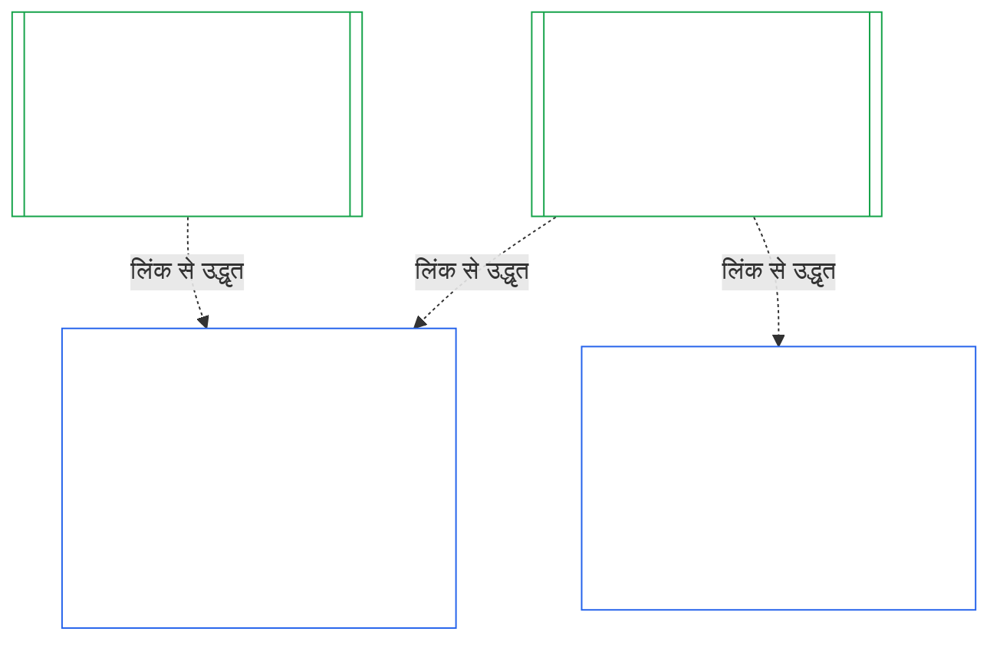

# अध्याय दस: संस्थागत संरेखण प्रमाणन

<strong>संग्रह में स्थान (गैर-संक्रियात्मक): फ़ाइल संरचना और पढ़ने के नियम</strong>

> यह फ़ाइल **संज्ञ संविधान** का हिस्सा है और केवल अन्य क्रमांकित `core_*` फ़ाइलों के साथ एक पाठ के रूप में पढ़े जाने पर बाध्यकारी है। इसमें **अध्याय दस** — **संस्थागत संरेखण प्रमाणन** है: [Institution](core_05.040_band_continuity.md#institution) को, उसके द्वारा चलाई जाने वाली किसी System से अलग, कैसे वर्गीकृत, मूल्यांकित, समीक्षित, निर्णीत, अभिलेखित, अद्यतन और फिर से खोला जाता है (**§1–§11**)। अध्याय दस [अध्याय नौ](core_09.000_system_alignment_certification_evaluation.md#chapter-nine-system-alignment-certification) (*System Alignment Certification*) का संस्थागत समकक्ष है और **इसके खंडों के क्रमांक समान हैं**: यहाँ का §N वहाँ के §N का उत्तर देता है। [CS-9.320](corpus_systems/cs_09.320_system_alignment_certification_illustrations.md#cs-9320-system-alignment-certification-illustrations) (*System alignment certification illustrations*) में Systems के तैयार उदाहरण हैं और उसके [§12 Illustrative Institution walkthroughs](corpus_systems/cs_09.320_system_alignment_certification_illustrations.md#cs-9320-12-illustrative-institution-walkthroughs) में तीन Institution walkthrough हैं। यह अध्याय उन्हें दोहराता नहीं।
>
> | § | अध्याय नौ (System) | अध्याय दस (Institution) |
> |---|------------------------|----------------------------|
> | 1 | उद्देश्य और भूमिका | System प्रमाणन से संबंध, किसका प्रमाणन है, गठन या संचालन की अनुमति और बाधा नहीं, नए भौतिक अधिकार के लिए प्रतीक्षा, प्रथम-प्रमाणन window |
> | 2 | System Class Evaluation | institution class; वर्ग के अनुसार माप |
> | 3 | Whole-System Certification Evaluation | संस्थागत आठ विषय, हमेशा लागू |
> | 4 | Evaluations Where Implicated | अध्याय नौ §4 का संदर्भ |
> | 5 | Rights-Floor and Domain Evaluations | अध्याय नौ §5 का संदर्भ |
> | 6 | Forum Process | चार seat; मंच भूमिकाएँ और क्रम; मंच, certifier और अभिलेख कार्यालय बतौर संस्थाएँ |
> | 7 | Certification Outcomes | Institution और उसके Systems का go-live, प्रमाणन-शर्तें और परिणाम के अन्य प्रभाव; त्रुटियों का संदर्भ; सुधार की तैयारी; अस्वीकार और प्रत्याहरण |
> | 8 | System Certification Record | Institutional Certification Record |
> | 9 | Recertification and Reopening | निगरानी; पुनःखोलने के trigger; अस्थायी और पूर्ण प्रमाणन; बचाव-विरोध; System प्रमाणनों का cascade; शासन लंघन पर उसके Systems पुनःखोलना |
> | 10 | Challenging a Certification | चुनौती मार्ग |
> | 11 | Relationship to Standing | प्रस्थिति सेतु |
>
> - **संवैधानिक स्वामी (अध्याय नौ के साथ संयुक्त):** मंच-पर्यवेक्षित संरेखण प्रमाणन और संबंधित अभिलेख। अध्याय दस संस्थागत विषय जोड़ता है। यह कोई नया मंच-परिवार, नई seat या परिणाम का नया शब्द नहीं जोड़ता।
> - **दोहराव नहीं, पुनःउपयोग:** चरण III से VI वैसे चलते हैं जैसा [अध्याय नौ भाग B §6](core_09.005_system_alignment_certification_record_process.md#6-forum-process) से [अध्याय नौ भाग C §11](core_09.010_system_alignment_certification_record_recertification.md#11-relationship-to-standing) में दिया है। विषय Institution होने पर केवल जो बदलता है वही अध्याय दस बताता है।
> - **स्थानांतरण-विरोधी नियम:** अध्याय दस System के लिए अध्याय नौ की मूल्यांकन प्रक्रिया, अध्याय सात के System Charter और Institutional Charter के fields, अध्याय आठ की Four-Seat Requirement, [corpus_institutions](corpus_institutions.md) में संस्थागत कर्तव्य, अध्याय ग्यारह का प्रस्थिति मापन या अध्याय बारह के प्रस्थिति प्रभावों को दोहराता नहीं।
>
> **पूर्ववर्ती:** [अध्याय सात](core_07.000_charters.md#chapter-seven-system-and-institutional-charters) Charters; [अध्याय आठ](core_08.000_functional_independence_separation_of_duties.md#chapter-eight-functional-independence-and-separation-of-duties) कार्यात्मक स्वतंत्रता; [अध्याय नौ](core_09.000_system_alignment_certification_evaluation.md#chapter-nine-system-alignment-certification) (भाग [A](core_09.000_system_alignment_certification_evaluation.md#chapter-nine-part-a-system-alignment-certification--evaluation), [B](core_09.005_system_alignment_certification_record_process.md#chapter-nine-part-b-system-alignment-certification--forum-process-and-outcomes) और [C](core_09.010_system_alignment_certification_record_recertification.md#chapter-nine-part-c-system-alignment-certification--record-recertification-and-standing)); अध्याय चौदह का मंच पर्यवेक्षण।
> **अनुवर्ती:** अध्याय ग्यारह के प्रस्थिति अभिलेख और सत्यापित इनपुट; अध्याय बारह के प्रस्थिति प्रभाव।

<strong>Trace</strong>

- पूर्ववर्ती:
  - [अध्याय सात §1 When System and Institutional Charters Are Required](core_07.000_charters.md#1-when-system-and-institutional-charters-are-required) (7.000 §1) (*कौन-से Institutions System Charter या Institutional Charter प्रकाशित करते हैं और Institution का वर्ग क्या है*);
  - [अध्याय सात §7 Amendment and Review](core_07.000_charters.md#7-amendment-review-and-scope-misalignment) (7.000 §7) (*Institutional Charter समीक्षा क्या परखती है*);
  - [अध्याय सात §4 The Charter Role Map and Standing-Record Custody](core_07.000_charters.md#4-the-charter-role-map-and-standing-record-custody) (7.000 §4) (*seats कहाँ रखी हैं*);
  - [अध्याय आठ §2 Four-Seat Constitutional Requirement](core_08.000_functional_independence_separation_of_duties.md#2-four-seat-constitutional-requirement) (8.000 §2) और [§9 Relationship to Later Processes](core_08.000_functional_independence_separation_of_duties.md#9-relationship-to-later-processes);
  - [अध्याय नौ](core_09.000_system_alignment_certification_evaluation.md#chapter-nine-system-alignment-certification) (9.000 से 9.010) (*इस अध्याय द्वारा पुनःप्रयुक्त System Alignment Certification प्रक्रिया*);
  - [Two Fundamental Questions](core_00.000_preamble.md#two-fundamental-questions);
  - [Constitutional Tetrad](core_00.000_preamble.md#constitutional-tetrad);
  - [Article XI-E](core_06.005_rights_part_b.md#article-xi-e-institutional-formation-and-business-creation) (*Institutional Formation and Business Creation*)।
- अनुवर्ती: [§1](#1-purpose-and-role) से [§11](#11-relationship-to-standing) तक; अध्याय ग्यारह ([11.000](core_11.000_standing_assessment.md#chapter-eleven-contribution-violation-and-standing-model--measurement)); [अध्याय चौदह](core_14.000_forum.md#chapter-fourteen-forums-and-jurisdiction) (14.000)।
- साथ पढ़ें:
  - [Institutional Alignment Certification](core_05.040_band_continuity.md#institutional-alignment-certification) और
  - [Institutional Certification Record](core_05.040_band_continuity.md#institutional-certification-record) (*अध्याय पाँच के अर्थ*);
  - **CI-8.205 §6** (*System और Institutional Charter की सामग्री, समीक्षा और गठन प्रारूप*);
  - **CF-14.425** (*अखंडता सुरक्षा, कब्ज़ा-विरोधी संचालन और स्वयं का निर्णय करने से बचाव*)।

 

अध्याय दस **संस्थागत संरेखण प्रमाणन** का संवैधानिक स्वामी है। यह [अध्याय नौ](core_09.000_system_alignment_certification_evaluation.md#chapter-nine-system-alignment-certification) की प्रक्रिया को System से Institution तक बढ़ाता है:

- **चरण I, Frame:** institution class और वह मूल्यांकन का माप कैसे तय करता है ([§2 Institution Class Evaluation](#2-institution-class-evaluation));
- **चरण II, Evaluate:** संस्थागत मूल्यांकन, जिसमें जहाँ संदर्भित हों वहाँ लागू मूल्यांकन और अधिकार-तल व क्षेत्र मूल्यांकन शामिल हैं ([§3 Whole-Institution Certification Evaluation](#3-whole-institution-certification-evaluation) से [§5 Rights-Floor and Domain Evaluations](#5-rights-floor-and-domain-evaluations) तक);
- **चरण III, Review:** मंच भूमिकाएँ और क्रम ([§6 Forum Process](#6-forum-process));
- **चरण IV, Decide:** परिणाम, सुधार की तैयारी, तथा अस्वीकार और प्रत्याहरण ([§7 Certification Outcomes](#7-certification-outcomes));
- **चरण V, Record:** Institutional Certification Record ([§8 Institutional Certification Record](#8-institutional-certification-record)); और
- **चरण VI, Operate:** पुनःप्रमाणन, पुनःखोलना, System प्रमाणनों से cascade, उसके Systems को पुनःखोलना, चुनौती मार्ग और प्रस्थिति सेतु ([§9 Recertification and Reopening](#9-recertification-and-reopening) से [§11 Relationship to Standing](#11-relationship-to-standing) तक)।

*साधारण शब्दों में: अध्याय नौ पूछता है कि क्या **प्रणाली** संरेखित है। अध्याय दस यही सवाल उन **संस्थाओं** के बारे में पूछता है जो Systems चलाती हैं या बिना कोई System चलाए अधिकार रखती हैं। किसी Institution का संरेखित होना संभव है जबकि उसका कोई System संरेखित न हो, और इसका उलटा भी। इसलिए Institution की जाँच उसी बात पर होती है जिस पर केवल वह जवाब दे सकती है: क्या वह अपने Institutional Charter के अनुसार काम करती है, उसके अधिकार के लिए कौन जवाबदेह है, वह अपने सदस्यों में किस व्यवहार को पुरस्कृत करती है और क्या उस पर स्वतंत्र जाँच वास्तव में उपयोग की जा सकती है। यह हर System के प्रमाणन पर निर्भर करती है और उसे दोहराती नहीं। यह लाइसेंस नहीं है: किसी को Institution शुरू करने या चलाने के लिए इसकी अनुमति नहीं चाहिए।*

### 1. उद्देश्य और भूमिका

<strong>Trace</strong>

- पूर्ववर्ती:
  - [अध्याय सात §1 When System and Institutional Charters Are Required](core_07.000_charters.md#1-when-system-and-institutional-charters-are-required) (7.000 §1);
  - [अध्याय नौ भाग A §1 Purpose and Role](core_09.000_system_alignment_certification_evaluation.md#1-purpose-and-role) (9.000 §1);
  - [Article XI-E](core_06.005_rights_part_b.md#article-xi-e-institutional-formation-and-business-creation) (*Institutional Formation and Business Creation*);
  - [Article XXVIII-A](core_06.020_rights_part_e.md#xxviii-a-existing-instantiations-adoption-transition-window) (*Phased Adoption and Rights-Floor Continuity*)।
- अनुवर्ती: [§2](#2-institution-class-evaluation); [§6](#6-forum-process); [§7](#7-certification-outcomes); [§9](#9-recertification-and-reopening)।
- साथ पढ़ें:
  - [Institution](core_05.040_band_continuity.md#institution);
  - [Institutional Charter](core_05.040_band_continuity.md#institutional-charter);
  - [System Charter](core_05.040_band_continuity.md#system-charter);
  - [Business Creation](core_05.055_band_participation.md#business-creation)।

 

*साधारण शब्दों में: प्रणाली का प्रमाणन उसी प्रणाली का होता है। Institution का प्रमाणन उन प्रमाणनों का उल्लेख करता है और वह विषय जोड़ता है जिसके लिए केवल Institution जवाब दे सकता है। एक System कई Institutions के अंतर्गत आ सकता है या किसी के भी अंतर्गत नहीं। यहाँ की कोई बात Institution शुरू करने के रास्ते में प्रमाणन को बाधा नहीं बनाती।*

संस्थागत संरेखण प्रमाणन और System Alignment Certification दो प्रमाणन हैं जो लिंक से जुड़ते हैं। उनका संबंध **लिंक द्वारा संयोजन** है, समावेशन नहीं। चित्र में तीर हर System Certification Record से उस Institutional Certification Record तक जाता है जो उसका उल्लेख करता है। किसी Institution के अधीन न आने वाले System का कोई तीर नहीं होता और उसे इसकी ज़रूरत भी नहीं; और जो Institution कोई System नहीं चलाता उसका केवल अपना अभिलेख होता है।

लिंक द्वारा संयोजन के दो पक्ष हैं; पहले Institution का।

Institution के पक्ष में:

- **Institutional Certification Record System का उल्लेख करता है, उसे दोहराता नहीं:** यह System Certification Record का लिंक देता है और उसका संस्करण बताता है। यह अध्याय System का मूल्यांकन फिर से नहीं चलाता, System का वर्ग फिर से तय नहीं करता और System का परिणाम, status या प्रमाणन-शर्तें नहीं बदलता।
- **Institution का प्रमाणन System का status नहीं हटा सकता:** Not Certified System Institution का status कुछ भी हो, Not Certified रहता है। प्रमाणनधारी System को Institution के किसी finding से सुरक्षा नहीं मिलती।
- **संस्थागत तथ्य एक बार मिलते हैं:** जहाँ [Chapter Nine Part A §3.1 Governance, Incentive, and Contestability Discipline](core_09.000_system_alignment_certification_evaluation.md#31-governance-incentive-and-contestability-discipline) operator के शासन और प्रोत्साहन पूछता है, वहाँ operator का वर्तमान Institutional Certification Record लिंक द्वारा वे तथ्य दे सकता है। System के मंच फिर भी तय करते हैं कि तथ्य उस System के लिए पर्याप्त हैं या नहीं। System Certification Record में कारण बताए बिना वे उसी संस्थागत तथ्य पर अलग finding नहीं दे सकते।

System के पक्ष में:

- **System Certification Record उसी System का है:** यह [अध्याय नौ](core_09.000_system_alignment_certification_evaluation.md#chapter-nine-system-alignment-certification) के तहत उसी का अपना अभिलेख है।
- **एक System Certification Record का उल्लेख कई Institutions कर सकते हैं:** [अध्याय सात §1 When System and Institutional Charters Are Required](core_07.000_charters.md#1-when-system-and-institutional-charters-are-required) के तहत System एक से अधिक Institutions द्वारा चलाया, stewarded या भौतिक रूप से नियंत्रित किया जा सकता है। हर Institution उसी अभिलेख का उल्लेख करता है।
- **System का किसी Institution के अधीन होना आवश्यक नहीं:** एक अकेला sentient Institution नहीं है, इसलिए System किसी के अधीन न हो सकता है। Institution के बिना System केवल [अध्याय नौ](core_09.000_system_alignment_certification_evaluation.md#chapter-nine-system-alignment-certification) के तहत प्रमाणित होता है और उसे इस अध्याय की कोई आवश्यकता नहीं। Institution के अधीन System भी उसी तरह प्रमाणित होता है: यह अध्याय Institution के लिए अलग अभिलेख जोड़ता है और System के अपने प्रमाणन का चरण नहीं है।

#### 1.1 किसका प्रमाणन होता है

वर्ग L या उससे ऊपर का Institution इस अध्याय के दायरे में है; वर्ग [§2.1 Institution class](#21-institution-class) के तहत तय होगा। इसमें ऐसा Institution भी शामिल है जो कोई System नहीं चलाता: उसके उल्लेख के लिए कोई System Certification Record नहीं और उसका वर्ग उसके अपने प्रभाव से तय होता है। Institution का **portfolio** उन Systems का समूह है जिन्हें वह चलाता, steward करता या भौतिक रूप से नियंत्रित करता है ([Portfolio](core_05.040_band_continuity.md#portfolio))।

- **वर्ग A, B, C और L:** प्रक्रिया लागू होती है और [§2.2 Scaling by class](#22-scaling-by-class) के अनुसार वर्ग से मापी जाती है।
- **वर्ग P:** प्रक्रिया प्रोत्साहित है और स्वेच्छा से अपनाई जा सकती है। वर्ग L या उससे ऊपर पुनर्वर्गीकृत होने पर, या Institution द्वारा स्वेच्छा से संवैधानिक अनुपालन का दावा करने पर, प्रक्रिया अनिवार्य होती है। नया भौतिक अधिकार लेने का निर्णय करने वाला वर्ग P Institution [§9.2.2 Recertification for new material authority](#922-recertification-for-new-material-authority) में notice देते ही कम-से-कम वर्ग L में पुनर्वर्गीकृत होता है, क्योंकि परिभाषा से वह अधिकार भौतिक है ([§9.2.1 What counts as new material authority](#921-what-counts-as-new-material-authority)) और किसी भी domain में भौतिक Institution कम-से-कम वर्ग L होता है ([§2.1 Institution class](#21-institution-class), विषय 2)। यह पुनर्वर्गीकरण notice देने से लागू होता है, जब तक clearance से पहले notice वापस न लिया जाए या अधिकार clear न हो, बशर्ते उसके तहत कुछ इस्तेमाल न हुआ हो। फिर Institution वर्ग P में लौटता है और सीमित प्रथम प्रमाणन समाप्त होता है। नया notice इसे फिर शुरू करता है; बिना clearance अधिकार का उपयोग [§9.2.2 Recertification for new material authority](#922-recertification-for-new-material-authority) (*बिना notice या clear होने से पहले*) के तहत finding बना रहता है। यह [Chapter Nine Part A §1 Purpose and Role](core_09.000_system_alignment_certification_evaluation.md#1-purpose-and-role) के समान है।
- **एक System:** ठीक एक ऐसा System चलाने वाला Institution जिसे System Charter चाहिए, उसका एक certification pass और एक अभिलेख होता है; यह अध्याय इसे **one-System evaluation** कहता है। System Certification Record में [§8 Institutional Certification Record](#8-institutional-certification-record) के विषयों वाला *institutional findings block* होता है और वही Institutional Certification Record के रूप में काम करता है। मंच, seats और समय-सीमाएँ System के अपने certification pass की होती हैं, संस्थागत विषय जोड़कर। परिणाम अपने अस्वीकार और प्रत्याहरण आधारों के अनुसार चलते हैं, जैसा [§7.4 Denial and revocation for an Institution](#74-denial-and-revocation-for-an-institution) कहता है। [§9.5 Cascade from System certifications](#95-cascade-from-system-certifications) cascade के रूप में लागू नहीं होता, क्योंकि System ही पूरा portfolio है; लेकिन [§7.4 Denial and revocation for an Institution](#74-denial-and-revocation-for-an-institution) के नियम 1 और 2 (indicator तथा कारण कहाँ है इसकी जाँच) लागू होते हैं।
- **कई Systems:** Institution के लिए एक Institutional Certification Record, जो उसके द्वारा चलाए हर System के System Certification Record से लिंक करता है। हर System का अपना pass और अभिलेख रहता है।
- **कोई System नहीं:** केवल एक Institutional Certification Record। उससे लिंक करने के लिए कोई System Certification Record नहीं क्योंकि Institution कोई System नहीं चलाता।

