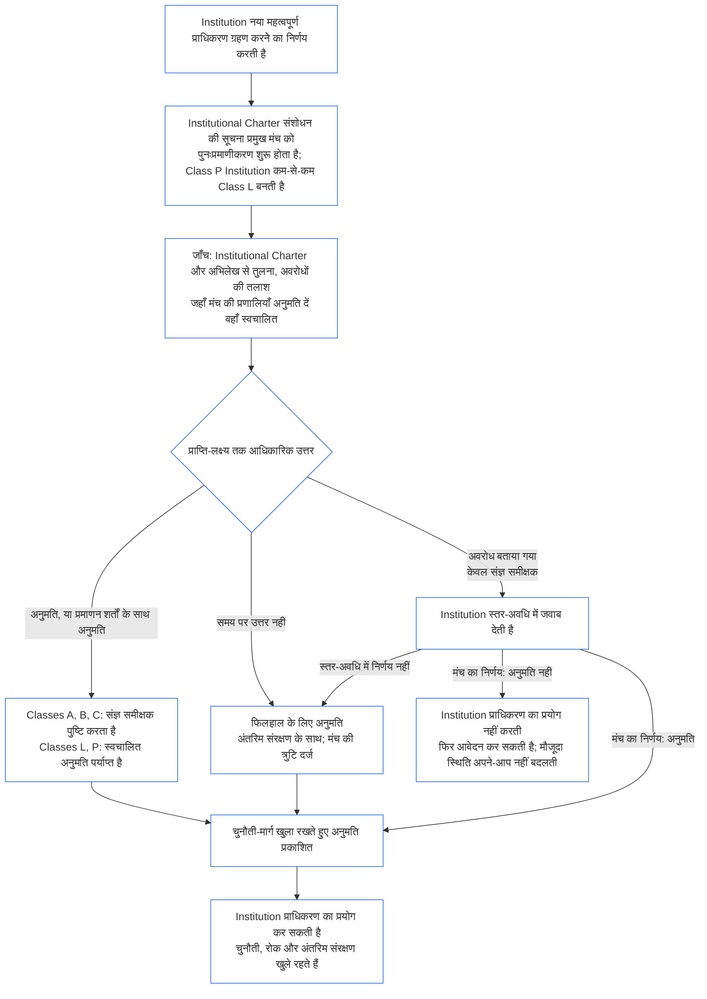

##### 9.2.2 नए महत्वपूर्ण प्राधिकरण के लिए पुनःप्रमाणीकरण

जो Institution नया महत्वपूर्ण प्राधिकरण ग्रहण करने का निर्णय करती है, उसका पुनःप्रमाणीकरण आवश्यक है, और उस प्राधिकरण का प्रयोग करने से पहले उसे परिणाम की प्रतीक्षा करनी होगी। यही प्रतीक्षा **Article XI-E** (*संस्थागत गठन और व्यवसाय निर्माण*) में कही गई है। यह इस प्रकार लागू होती है:

- **पहले सूचना:** Institution Institutional Charter संशोधन की वह सूचना देती है जिसकी [अध्याय सात §7.1 दस्तावेज़ बदलना](core_07.000_charters.md#71-changing-the-document) पहले से माँग करता है, और उसे प्रमुख मंच को भेजती है। सूचना से पुनःप्रमाणीकरण शुरू होता है।
- **अभी अभिलेख नहीं:** जिस Institution के पास Institutional Certification Record नहीं है, वह भी वही सूचना देती है। सूचना से नए प्राधिकरण तक सीमित पहला प्रमाणन शुरू होता है, जिसका आकलन Institutional Charter और [§3 संपूर्ण संस्था प्रमाणन मूल्यांकन](#3-whole-institution-certification-evaluation) से [§5 अधिकार-तल और क्षेत्र मूल्यांकन](#5-rights-floor-and-domain-evaluations) तक के उन मूल्यांकनों के आधार पर होता है जो उस प्राधिकरण पर लागू होते हैं। पहले प्रमाणन का बाकी भाग अब भी [§1.3 प्रथम प्रमाणन की समय-सीमा](#13-window-for-the-first-certification) की अवधि में चलता है (सूचना से पुनर्वर्गीकृत Class P Institution के लिए, यह अवधि सूचना से शुरू होती है), और नए प्राधिकरण के लिए प्रतीक्षा इस पर निर्भर नहीं है।
- **स्तर-अवधियों के भीतर:** पुनःप्रमाणीकरण [अध्याय नौ भाग C §9.3.4 स्तर-अवधियाँ](core_09.010_system_alignment_certification_record_recertification.md#934-tier-windows) के अंतर्गत चलता है; स्तर अनुमानतः संस्था-वर्ग से मेल खाता है। अवधि चूकने पर [Article XXVI-C](core_06.020_rights_part_e.md#article-xxvi-c-timely-resolution-and-anti-delay-floor) (*समयबद्ध समाधान और विलंब-विरोधी तल*) के अनुसार कार्रवाई होती है, और शुल्क तथा प्रतीक्षा बाधा नहीं बन सकते ([परिहार्य बोझ](core_05.040_band_continuity.md#avoidable-burden))।
- **जहाँ संभव हो स्वचालित:** सूचना, नए प्राधिकरण की तुलना Institutional Charter और वर्तमान अभिलेख से करना, अवरोधों की जाँच और अनुमति देना—ये सभी मंच की प्रणालियाँ जहाँ अनुमति दें वहाँ स्वचालित होते हैं। [अध्याय एक §13.3 परिहार्य बोझ को न्यूनतम करना](core_01.005_interaction_interpretation.md#133-minimization-of-avoidable-burden) स्वचालन को परिहार्य बोझ का पसंदीदा उपचार बनाता है, और [अध्याय एक §16.4 कार्रवाई के समय दस्तावेज़ीकरण](core_01.010_stewardship_capacity_principles.md#164-document-at-action) स्वचालन का भार प्रणाली पर रखता है, अभिरक्षक पर नहीं।
  - **अनुमति देता है, मना नहीं करता:** स्वचालित जाँच नए प्राधिकरण को सीधे अनुमति दे सकती है या उन प्रमाणन शर्तों के साथ अनुमति दे सकती है जिनका आधार वर्तमान अभिलेख में पहले से है। वह अपने-आप कोई अवरोध ([§9.2.3 नए महत्वपूर्ण प्राधिकरण की अनुमति में अवरोध](#923-blockers-to-clearing-new-material-authority) में सूचीबद्ध) दर्ज नहीं कर सकती और न अनुमति देने से इनकार कर सकती है। जाँच संभावित अवरोध का संकेत दे सकती है, लेकिन उसे केवल प्रमुख मंच का कोई संज्ञ समीक्षक, संकेतित बात देखने के बाद, दर्ज कर सकता है।
  - **Classes A, B और C:** आधिकारिक उत्तर माने जाने से पहले प्रमुख मंच का संज्ञ समीक्षक हर अनुमति की पुष्टि करता है। यह इन वर्गों की Institution पर, और उस Institution पर भी लागू है जिसे नया प्राधिकरण इनमें से किसी वर्ग में ले आएगा। प्राप्ति-जाँच की समय-सीमा पुष्टि पर भी लागू रहती है। समीक्षक प्रमुख मंच में बैठता है, जिसके पास सत्यापन-या-अनुमोदन का आसन पहले से है और जो Institution से स्वतंत्र होना चाहिए ([§6.1 संस्थागत प्रमाणन के चार आसन](#61-four-seats-in-an-institutional-certification))।
  - **Classes L और P:** पुष्टि के बिना स्वचालित अनुमति आधिकारिक उत्तर मानी जाती है। सूचना देते ही Class P Institution को कम-से-कम Class L में पुनर्वर्गीकृत किया जाता है ([§1.1 किसका प्रमाणन होता है](#11-who-is-certified)), इसलिए उस पर Class L का नियम लागू होता है।
  - **अपवादात्मक परिस्थितियाँ:** किसी भी वर्ग में, जाँच संभावित अवरोध का संकेत दे, जाँच यह तय न कर सके कि प्राधिकरण आच्छादित है या महत्वपूर्ण, अथवा Institution या प्रभावित संज्ञ प्राणी समीक्षा माँगे—तो मामला संज्ञ समीक्षक संभालता है। समीक्षा-अनुरोध का उत्तर [संबंधित प्राप्ति-लक्ष्य](core_05.040_band_continuity.md#tier-window) के भीतर दिया जाता है, जिसकी गणना अनुरोध से होती है। इससे स्तर-अवधि नहीं बढ़ती।
  - **वही अभिलेख, वही समय-सीमाएँ:** अभिलेख में की गई जाँचें दिखाई जाती हैं, ताकि स्वचालित अनुमति को किसी अन्य निर्णय की तरह चुनौती दी जा सके। स्वचालन से प्राप्ति-लक्ष्य या स्तर-अवधि नहीं बढ़ती, और बंद पड़ी या उत्तर न देने वाली जाँच को नीचे दिए गए बिंदु के अनुसार छूटा हुआ उत्तर माना जाता है। मंच उस जाँच के लिए वैसे ही जवाबदेह है जैसे अपने उपयोग में आने वाले किसी System के लिए ([§6.3 मंच, प्रमाणक और अभिलेख कार्यालय संस्थाओं के रूप में](#63-forums-certifiers-and-record-offices-as-institutions))।
- **प्रतीक्षा:** पुनःप्रमाणीकरण से अनुमति मिलने तक Institution नए प्राधिकरण का प्रयोग नहीं करती।
  - **हर वर्ग प्रतीक्षा करता है:** कोई वर्ग छूट नहीं पाता, और न आपातस्थिति न ही तात्कालिकता इस प्रतीक्षा को हटाती है।
  - **बाकी सब जारी रहता है:** Institution जो पहले से करती है, वह चलता रहता है ([§1.2 गठन या संचालन के लिए न अनुमति, न चौकी](#12-no-permission-and-no-gate-on-forming-or-running))।
  - **संरक्षण प्रतीक्षा नहीं करता:** प्रभावित संज्ञ प्राणियों का मंचों द्वारा तात्कालिक संरक्षण पुनःप्रमाणीकरण की प्रतीक्षा नहीं करता ([अध्याय नौ भाग B §6.2 पर्यवेक्षी क्रम](core_09.005_system_alignment_certification_record_process.md#62-supervisory-sequence))। यह संज्ञ प्राणियों की रक्षा करता है और Institution को समय से पहले प्राधिकरण का प्रयोग करने का आधार नहीं देता।
- **अनुमति मिलते ही प्रकाशित:** प्रमुख मंच हर अनुमति दिए जाने के तुरंत बाद प्रकाशित करता है, जिसमें फिलहाल के लिए दी गई अनुमति भी शामिल है; [§10 प्रमाणन को चुनौती देना](#10-challenging-a-certification) का चुनौती-मार्ग खुला रहता है। अनुमति मिलते ही Institution प्राधिकरण का प्रयोग कर सकती है। उसे सूचना-अवधि या चुनौती के निर्णय तक प्रतीक्षा नहीं करनी होती। प्रभावित संज्ञ प्राणी इस अनुमति को किसी अन्य निर्णय की तरह चुनौती दे सकता है और रोक या अंतरिम संरक्षण माँग सकता है; इनके लिए प्रतीक्षा नहीं होती ([§9.2.2 नए महत्वपूर्ण प्राधिकरण के लिए पुनःप्रमाणीकरण](#922-recertification-for-new-material-authority), *संरक्षण प्रतीक्षा नहीं करता*)। प्रकाशन के समय प्रमुख मंच उन प्रभावित संज्ञ प्राणियों को भी अनुमति की सूचना देता है जिनके बारे में उसे जानकारी है, और संबंधित Systems के मंचों को भी। रोक या अंतरिम संरक्षण के अनुरोध का उत्तर संबंधित प्राप्ति-लक्ष्य के भीतर दिया जाता है ([CF-14.445 §3.1 चरण लक्ष्य और बाहरी सीमाएँ](corpus_forum/cf_14.445_performance_backlog_publication_accessibility.md#cf-14445-31-stage-targets-and-outer-bounds)), या जहाँ लागू हो वहाँ उसकी Emergency setting की सीमा के भीतर।
- **अनुमति मानकर चलना:** प्राधिकरण को अनुमति-प्राप्त माना जाता है। प्रमुख मंच केवल तभी अनुमति देने से इनकार करता है जब वह अभिलेख में बताए गए साक्ष्य के आधार पर [§9.2.3 नए महत्वपूर्ण प्राधिकरण की अनुमति में अवरोध](#923-blockers-to-clearing-new-material-authority) में सूचीबद्ध अवरोध दिखाए। जहाँ उस अवरोध से जुड़ी प्रमाणन शर्तें उसे सीमित कर सकती हों, वहाँ प्राधिकरण को उन शर्तों के साथ अनुमति दी जाती है, इनकार नहीं किया जाता।
- **अनुमति का अर्थ:** पुनःप्रमाणीकरण का परिणाम अनंतिम या पूर्ण प्रमाणन होता है, प्रमाणन शर्तों के साथ या उनके बिना, और प्राधिकरण के प्रयोग से पहले आवश्यक हर प्रमाणन शर्त का स्वतंत्र सत्यापन किया गया होता है।
- **यदि मंच समय पर उत्तर न दे:** प्रमुख मंच पर संबंधित प्राप्ति-लक्ष्य तक आधिकारिक उत्तर देने का दायित्व है ([CF-14.445 §3.1 चरण लक्ष्य और बाहरी सीमाएँ](corpus_forum/cf_14.445_performance_backlog_publication_accessibility.md#cf-14445-31-stage-targets-and-outer-bounds))। उत्तर में प्राधिकरण को अनुमति दी जाती है, प्रमाणन शर्तों के साथ अनुमति दी जाती है, या उस साक्ष्य सहित अवरोध बताया जाता है जिस पर वह आधारित है। अवरोध बताने वाले उत्तर में Institution को जवाब देने का अवसर मिलता है, और मंच ऊपर दी गई स्तर-अवधि के भीतर निर्णय करता है।
  - **फिलहाल के लिए अनुमति:** यदि प्राप्ति-लक्ष्य तक कोई आधिकारिक उत्तर न आए, या बताए गए अवरोध पर स्तर-अवधि में निर्णय न हो, तो प्राधिकरण को फिलहाल के लिए अनुमति मिल जाती है, साथ में अंतरिम संरक्षण और भरोसे की वे सीमाएँ जो [अध्याय नौ भाग B §7.2 प्रमाणन दोष और सुधार](core_09.005_system_alignment_certification_record_process.md#72-certification-defects-and-correction) में दी गई हैं।
  - **मंच की त्रुटि:** लक्ष्य या अवधि चूकना मंच की त्रुटि है, Institution की गलती नहीं। इसे दर्ज किया जाता है, सुधारा जाता है और [अध्याय चौदह §6 समयबद्ध समाधान, महत्वपूर्णता स्तर और विलंब-विरोधी अनुशासन](core_14.000_forum.md#6-timely-resolution-materiality-tiers-and-anti-delay-discipline) (*अवधि-अतिक्रमण समीक्षा*) के तहत अतिक्रमण के रूप में समीक्षा की जाती है।
  - **दूसरे मंच को सौंपना:** पुनःप्रमाणीकरण अनुरोध उसी मंच-परिवार के दूसरे मंच को हस्तांतरित किया जाता है ([अध्याय चौदह §3 हस्तांतरण, समेकन और समन्वय](core_14.000_forum.md#3-transfer-consolidation-and-coordination--continuity-and-anti-capture))। वह मंच हस्तांतरण के समय से गिनी गई, Institution के वर्ग की नियमित अवधियों पर पुनःप्रमाणीकरण पूरा करता है।
- **यदि अनुमति न मिले:** Institution प्राधिकरण का प्रयोग नहीं करती और अध्याय नौ भाग B §7.4 (*स्थायी निषेध नहीं*) की शर्तों पर फिर से आवेदन कर सकती है। नए प्राधिकरण को अनुमति न मिलना अपने-आप उस स्थिति का इनकार या निरसन नहीं है जो Institution के मौजूदा कार्यों के लिए उसे प्राप्त है। वह स्थिति केवल [§7.3 Institution की सुधारात्मक तत्परता](#73-remediation-readiness-for-an-institution) और [§7.4 Institution के लिए इनकार और निरसन](#74-denial-and-revocation-for-an-institution) के अंतर्गत किसी निष्कर्ष पर बदलती है।
- **सूचना के बिना या अनुमति मिलने से पहले:** सूचना दिए बिना या अनुमति मिलने से पहले नए महत्वपूर्ण प्राधिकरण का प्रयोग करना Institutional Charter से बाहर का आचरण है। [§3 संपूर्ण संस्था प्रमाणन मूल्यांकन](#3-whole-institution-certification-evaluation) (मद 1) के अंतर्गत इस पर निष्कर्ष निकलता है और Institutional Charter की घटना के रूप में समीक्षा फिर से खुलती है।

<strong>पाठक मार्गदर्शिका (असंक्रियात्मक): नए महत्वपूर्ण प्राधिकरण की प्रतीक्षा</strong>

यह चित्र §9.2.2 नए महत्वपूर्ण प्राधिकरण के लिए पुनःप्रमाणीकरण का सार देता है। जहाँ यह पाठ से अलग हो, वहाँ पाठ प्रभावी होगा। Institution जो कुछ पहले से करती है, वह पूरी प्रक्रिया में जारी रहता है; प्रभावित संज्ञ प्राणियों का तात्कालिक संरक्षण कभी प्रतीक्षा नहीं करता। Institutions के उदाहरण [CS-9.320 §12 संस्थाओं के उदाहरणात्मक चरण-दर-चरण विवरण](corpus_systems/cs_09.320_system_alignment_certification_illustrations.md#cs-9320-12-illustrative-institution-walkthroughs) में हैं।

 

