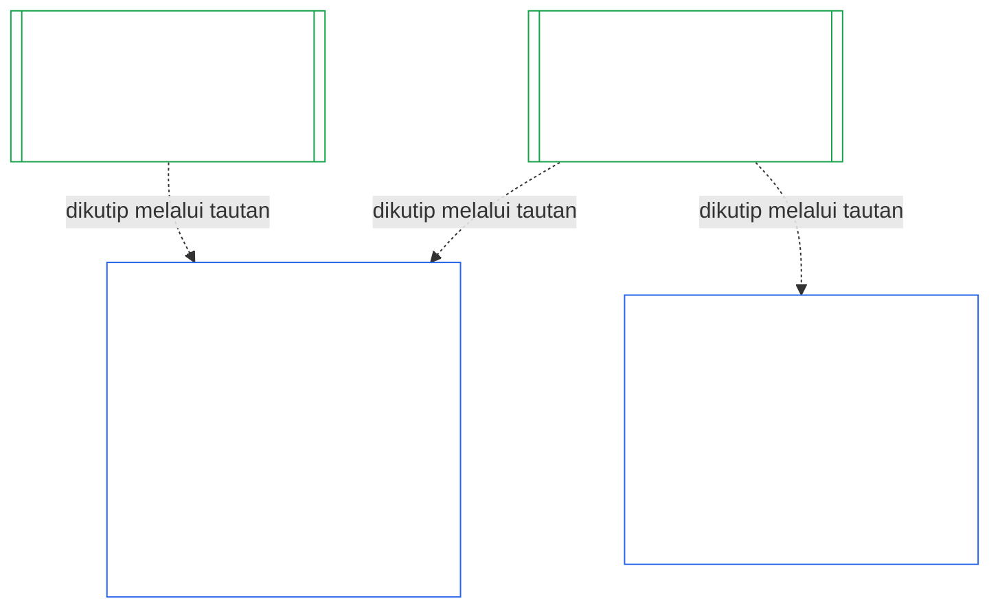

# BAB SEPULUH: SERTIFIKASI KESELARASAN INSTITUSI

<strong>Letak dalam korpus (non-operatif): struktur berkas dan aturan baca</strong>

> Berkas ini **bagian dari Konstitusi Makhluk Sadar** dan **mengikat hanya bersama** berkas `core_*` bernomor lainnya yang dibaca sebagai satu teks. Berkas ini memuat **Bab Sepuluh** — **sertifikasi keselarasan institusi**: cara suatu [Institusi](core_05.040_band_continuity.md#institution), yang berbeda dari Sistem apa pun yang dijalankannya, diklasifikasikan, dievaluasi, ditinjau, diputuskan, dicatat, dipertahankan keberlakuannya, dan dibuka kembali (**§1–§11**). Bab Sepuluh adalah padanan kelembagaan Bab [Sembilan](core_09.000_system_alignment_certification_evaluation.md#chapter-nine-system-alignment-certification) (*Sertifikasi Keselarasan Sistem*), dan **bagian-bagiannya memakai nomor yang sama**: §N di sini menjawab §N di sana. [CS-9.320](corpus_systems/cs_09.320_system_alignment_certification_illustrations.md#cs-9320-system-alignment-certification-illustrations) (*Ilustrasi sertifikasi keselarasan sistem*) memuat ilustrasi terapan untuk Sistem dan, di [§12 Panduan langkah demi langkah ilustratif untuk Institusi](corpus_systems/cs_09.320_system_alignment_certification_illustrations.md#cs-9320-12-illustrative-institution-walkthroughs), tiga panduan langkah demi langkah untuk Institusi. Bab ini tidak mengulanginya.
>
> | § | Bab Sembilan (Sistem) | Bab Sepuluh (Institusi) |
> |---|------------------------|----------------------------|
> | 1 | Tujuan dan Peran | hubungan dengan sertifikasi Sistem, siapa yang disertifikasi, tidak ada izin maupun gerbang untuk membentuk atau menjalankan, masa tunggu untuk kewenangan material baru, jendela sertifikasi pertama |
> | 2 | Evaluasi Kelas Sistem | kelas institusi; penyesuaian menurut kelas |
> | 3 | Evaluasi Sertifikasi Sistem Secara Utuh | delapan butir kelembagaan, selalu |
> | 4 | Evaluasi jika Terlibat | rujukan ke Bab Sembilan §4 |
> | 5 | Evaluasi Lantai Hak dan Ranah | rujukan ke Bab Sembilan §5 |
> | 6 | Proses Forum | empat kursi; peran dan urutan forum; forum, sertifikator, dan kantor catatan sebagai institusi |
> | 7 | Hasil Sertifikasi | izin mulai beroperasi bagi Institusi dan Sistemnya, syarat sertifikasi, serta dampak lain dari hasil; rujukan untuk cacat; kesiapan perbaikan; penolakan dan pencabutan |
> | 8 | Catatan Sertifikasi Sistem | Catatan Sertifikasi Institusi |
> | 9 | Sertifikasi Ulang dan Pembukaan Kembali | pemantauan; pemicu pembukaan kembali; sertifikasi sementara dan penuh; larangan penghindaran; rangkaian dampak dari sertifikasi Sistem; pembukaan kembali Sistemnya atas pelanggaran tata kelola |
> | 10 | Menggugat Sertifikasi | jalur pengajuan gugatan |
> | 11 | Hubungan dengan Status | jembatan status |
>
> - **Pemilik konstitusional (bersama Bab Sembilan):** sertifikasi keselarasan yang diawasi forum dan catatan terkait. Bab Sepuluh menambahkan subjek kelembagaan. Bab ini tidak menambah rumpun forum, kursi, ataupun istilah hasil baru.
> - **Penggunaan kembali, bukan pengulangan:** Fase III sampai VI berjalan sebagaimana diatur dalam [Bab Sembilan Bagian B §6](core_09.005_system_alignment_certification_record_process.md#6-forum-process) sampai [Bab Sembilan Bagian C §11](core_09.010_system_alignment_certification_record_recertification.md#11-relationship-to-standing). Bab Sepuluh hanya menyatakan hal yang berubah ketika subjeknya adalah Institusi.
> - **Aturan anti-pemindahan:** Bab Sepuluh tidak menyatakan ulang mekanisme evaluasi Bab Sembilan untuk Sistem, bidang Piagam Sistem dan Piagam Institusi Bab Tujuh, Persyaratan Empat Kursi Bab Delapan, kewajiban kelembagaan dalam [corpus_institutions](corpus_institutions.md), pengukuran status Bab Sebelas, ataupun dampak status Bab Dua Belas.
>
> **Hulu:** [Bab Tujuh](core_07.000_charters.md#chapter-seven-system-and-institutional-charters) Piagam; [Bab Delapan](core_08.000_functional_independence_separation_of_duties.md#chapter-eight-functional-independence-and-separation-of-duties) kemandirian fungsional; [Bab Sembilan](core_09.000_system_alignment_certification_evaluation.md#chapter-nine-system-alignment-certification) (Bagian [A](core_09.000_system_alignment_certification_evaluation.md#chapter-nine-part-a-system-alignment-certification--evaluation), [B](core_09.005_system_alignment_certification_record_process.md#chapter-nine-part-b-system-alignment-certification--forum-process-and-outcomes), dan [C](core_09.010_system_alignment_certification_record_recertification.md#chapter-nine-part-c-system-alignment-certification--record-recertification-and-standing)); pengawasan forum Bab Empat Belas.
> **Hilir:** catatan status dan masukan terverifikasi Bab Sebelas; dampak status Bab Dua Belas.

<strong>Jejak</strong>

- Hulu:
  - [Bab Tujuh §1 Kapan Piagam Sistem dan Piagam Institusi Diperlukan](core_07.000_charters.md#1-when-system-and-institutional-charters-are-required) (7.000 §1) (*Institusi mana yang menerbitkan Piagam Sistem atau Piagam Institusi, serta kelas suatu Institusi*);
  - [Bab Tujuh §7 Amandemen dan Peninjauan](core_07.000_charters.md#7-amendment-review-and-scope-misalignment) (7.000 §7) (*hal yang diuji dalam peninjauan Piagam Institusi*);
  - [Bab Tujuh §4 Peta Peran Piagam dan Penguasaan Catatan Status](core_07.000_charters.md#4-the-charter-role-map-and-standing-record-custody) (7.000 §4) (*penempatan kursi*);
  - [Bab Delapan §2 Persyaratan Konstitusional Empat Kursi](core_08.000_functional_independence_separation_of_duties.md#2-four-seat-constitutional-requirement) (8.000 §2) dan [§9 Hubungan dengan Proses Selanjutnya](core_08.000_functional_independence_separation_of_duties.md#9-relationship-to-later-processes);
  - [Bab Sembilan](core_09.000_system_alignment_certification_evaluation.md#chapter-nine-system-alignment-certification) (9.000 sampai 9.010) (*proses Sertifikasi Keselarasan Sistem yang digunakan kembali oleh Bab ini*);
  - [Dua Pertanyaan Mendasar](core_00.000_preamble.md#two-fundamental-questions);
  - [Tetrad Konstitusional](core_00.000_preamble.md#constitutional-tetrad);
  - [Pasal XI-E](core_06.005_rights_part_b.md#article-xi-e-institutional-formation-and-business-creation) (*Pembentukan Institusi dan Penciptaan Usaha*).
- Hilir: [§1](#1-purpose-and-role) sampai [§11](#11-relationship-to-standing); Bab Sebelas ([11.000](core_11.000_standing_assessment.md#chapter-eleven-contribution-violation-and-standing-model--measurement)); [Bab Empat Belas](core_14.000_forum.md#chapter-fourteen-forums-and-jurisdiction) (14.000).
- Baca bersama:
  - [Sertifikasi Keselarasan Institusi](core_05.040_band_continuity.md#institutional-alignment-certification) dan
  - [Catatan Sertifikasi Institusi](core_05.040_band_continuity.md#institutional-certification-record) (*makna Bab Lima*);
  - **CI-8.205 §6** (*isi Piagam Sistem dan Piagam Institusi, peninjauan, dan templat pembentukan*);
  - **CF-14.425** (*perlindungan integritas, operasi anti-pengambilalihan, dan dukungan anti-penghakiman diri*).

 

Bab Sepuluh adalah pemilik konstitusional **sertifikasi keselarasan institusi**. Bab ini memperluas proses [Bab Sembilan](core_09.000_system_alignment_certification_evaluation.md#chapter-nine-system-alignment-certification) dari Sistem ke Institusi:

- **Fase I, Kerangka:** kelas institusi dan cara kelas itu menyesuaikan evaluasi ([§2 Evaluasi Kelas Institusi](#2-institution-class-evaluation));
- **Fase II, Evaluasi:** evaluasi kelembagaan, termasuk evaluasi yang berlaku jika terlibat serta evaluasi Lantai Hak dan ranah ([§3 Evaluasi Sertifikasi Institusi Secara Utuh](#3-whole-institution-certification-evaluation) sampai [§5 Evaluasi Lantai Hak dan Ranah](#5-rights-floor-and-domain-evaluations));
- **Fase III, Peninjauan:** peran dan urutan forum ([§6 Proses Forum](#6-forum-process));
- **Fase IV, Putuskan:** hasil, kesiapan perbaikan, penolakan, dan pencabutan ([§7 Hasil Sertifikasi](#7-certification-outcomes));
- **Fase V, Catat:** Catatan Sertifikasi Institusi ([§8 Catatan Sertifikasi Institusi](#8-institutional-certification-record)); dan
- **Fase VI, Operasikan:** sertifikasi ulang, pembukaan kembali, rangkaian dampak dari sertifikasi Sistem, pembukaan kembali Sistemnya, jalur pengajuan gugatan, serta jembatan status ([§9 Sertifikasi Ulang dan Pembukaan Kembali](#9-recertification-and-reopening) sampai [§11 Hubungan dengan Status](#11-relationship-to-standing)).

*Dalam bahasa sederhana: Bab Sembilan menanyakan apakah suatu **sistem** selaras. Bab Sepuluh menanyakan hal yang sama tentang **institusi** yang menjalankan sistem atau memegang kewenangan tanpa menjalankan sistem. Suatu institusi dapat selaras sementara salah satu sistemnya tidak, dan sebaliknya. Karena itu, institusi diperiksa pada hal yang hanya dapat dipertanggungjawabkannya: apakah ia melakukan hal yang dinyatakan Piagam Institusinya, siapa yang bertanggung jawab atas kewenangannya, apa yang diberikannya sebagai insentif kepada anggotanya sendiri, dan apakah pemeriksaan independen terhadapnya benar-benar dapat digunakan. Bab ini mengandalkan sertifikasi tiap sistem dan tidak mengulanginya. Ini bukan lisensi: tak seorang pun memerlukan izinnya untuk memulai atau menjalankan institusi.*

### 1. Tujuan dan Peran

<strong>Jejak</strong>

- Hulu:
  - [Bab Tujuh §1 Kapan Piagam Sistem dan Piagam Institusi Diperlukan](core_07.000_charters.md#1-when-system-and-institutional-charters-are-required) (7.000 §1);
  - [Bab Sembilan Bagian A §1 Tujuan dan Peran](core_09.000_system_alignment_certification_evaluation.md#1-purpose-and-role) (9.000 §1);
  - [Pasal XI-E](core_06.005_rights_part_b.md#article-xi-e-institutional-formation-and-business-creation) (*Pembentukan Institusi dan Penciptaan Usaha*);
  - [Pasal XXVIII-A](core_06.020_rights_part_e.md#xxviii-a-existing-instantiations-adoption-transition-window) (*Adopsi Bertahap dan Kesinambungan Lantai Hak*).
- Hilir: [§2](#2-institution-class-evaluation); [§6](#6-forum-process); [§7](#7-certification-outcomes); [§9](#9-recertification-and-reopening).
- Baca bersama:
  - [Institusi](core_05.040_band_continuity.md#institution);
  - [Piagam Institusi](core_05.040_band_continuity.md#institutional-charter);
  - [Piagam Sistem](core_05.040_band_continuity.md#system-charter);
  - [Penciptaan Usaha](core_05.055_band_participation.md#business-creation).

 

*Dalam bahasa sederhana: sertifikasi suatu sistem melekat pada sistem itu. Sertifikasi institusi mengutip sertifikasi tersebut dan menambahkan hal yang hanya dapat dipertanggungjawabkan oleh institusi. Satu sistem dapat berada di bawah beberapa institusi, atau tidak di bawah institusi mana pun. Tidak ada ketentuan di sini yang memungkinkan sertifikasi menghalangi pembentukan institusi.*

Sertifikasi keselarasan institusi dan Sertifikasi Keselarasan Sistem adalah dua sertifikasi yang terhubung melalui tautan. Hubungannya adalah **komposisi melalui tautan**, bukan penampungan. Dalam gambar, panah berjalan dari Catatan Sertifikasi Sistem ke setiap Catatan Sertifikasi Institusi yang mengutipnya. Sistem yang tidak berada di bawah Institusi tidak memiliki panah dan tidak memerlukannya; Institusi yang tidak menjalankan Sistem memiliki catatan tersendiri.

Komposisi melalui tautan memiliki dua sisi, dimulai dari sisi Institusi.

Pada sisi Institusi:

- **Catatan Sertifikasi Institusi mengutip Catatan Sistem dan tidak mengulang evaluasinya:** Catatan tersebut mengutip Catatan Sertifikasi Sistem melalui tautan dan menyebut versinya. Bab ini tidak pernah menjalankan ulang evaluasi Sistem, memutuskan ulang kelas Sistem, ataupun mengubah hasil, status, atau syarat sertifikasi Sistem.
- **Sertifikasi Institusi tidak dapat menaikkan status Sistem:** Sistem yang Tidak Bersertifikat tetap Tidak Bersertifikat apa pun status Institusinya. Sistem yang memiliki sertifikasi tidak mendapat perlindungan dari temuan terhadap Institusi.
- **Fakta kelembagaan ditetapkan satu kali:** Jika [Bab Sembilan Bagian A §3.1 Disiplin Tata Kelola, Insentif, dan Hak untuk Menggugat](core_09.000_system_alignment_certification_evaluation.md#31-governance-incentive-and-contestability-discipline) menanyakan tata kelola dan insentif operator, Catatan Sertifikasi Institusi operator yang masih berlaku dapat menyediakan fakta tersebut melalui tautan. Forum Sistem tetap memutuskan apakah fakta itu memadai bagi Sistem tersebut. Forum tidak boleh menetapkan fakta kelembagaan yang sama secara berbeda tanpa menjelaskan alasannya dalam Catatan Sertifikasi Sistem.

Pada sisi Sistem:

- **Catatan Sertifikasi Sistem adalah milik Sistem:** Catatan itu adalah catatan Sistem sendiri berdasarkan [Bab Sembilan](core_09.000_system_alignment_certification_evaluation.md#chapter-nine-system-alignment-certification).
- **Satu Catatan Sertifikasi Sistem dapat dikutip oleh beberapa Institusi:** Sistem dapat dioperasikan, dikelola secara bertanggung jawab, atau dikendalikan secara material oleh lebih dari satu Institusi berdasarkan [Bab Tujuh §1 Kapan Piagam Sistem dan Piagam Institusi Diperlukan](core_07.000_charters.md#1-when-system-and-institutional-charters-are-required). Masing-masing mengutip catatan yang sama.
- **Sistem tidak harus berada di bawah suatu Institusi:** Satu makhluk sadar bukanlah Institusi, sehingga suatu Sistem bisa tidak memiliki Institusi. Sistem tanpa Institusi disertifikasi hanya berdasarkan [Bab Sembilan](core_09.000_system_alignment_certification_evaluation.md#chapter-nine-system-alignment-certification) dan tidak memerlukan apa pun dari Bab ini. Sistem yang berada di bawah Institusi disertifikasi dengan cara yang sama: Bab ini menambahkan catatan terpisah untuk Institusi dan bukan tahap dalam sertifikasi Sistem itu sendiri.

#### 1.1 Siapa yang disertifikasi

Institusi Kelas L atau lebih tinggi tercakup dalam Bab ini, dengan kelas yang ditentukan berdasarkan [§2.1 Kelas institusi](#21-institution-class). Ini termasuk Institusi yang sama sekali tidak menjalankan Sistem: Institusi itu tidak memiliki Catatan Sertifikasi Sistem untuk dikutip, dan kelasnya ditentukan dari dampaknya sendiri. **Portofolio** suatu Institusi adalah kumpulan Sistem yang dioperasikan, dikelola secara bertanggung jawab, atau dikendalikannya secara material ([Portofolio](core_05.040_band_continuity.md#portfolio)).

- **Kelas A, B, C, dan L:** proses ini berlaku, dengan penyesuaian menurut kelas berdasarkan [§2.2 Penyesuaian menurut kelas](#22-scaling-by-class).
- **Kelas P:** proses ini dianjurkan dan dapat digunakan secara sukarela. Proses menjadi wajib setelah klasifikasi ulang ke Kelas L atau lebih tinggi, atau saat Institusi secara sukarela menyatakan kepatuhan konstitusional. Institusi Kelas P yang memutuskan untuk mengambil kewenangan material baru diklasifikasikan ulang sekurang-kurangnya ke Kelas L saat menyampaikan pemberitahuan menurut [§9.2.2 Sertifikasi ulang untuk kewenangan material baru](#922-recertification-for-new-material-authority), karena kewenangan itu secara definisi bersifat material ([§9.2.1 Hal yang dianggap sebagai kewenangan material baru](#921-what-counts-as-new-material-authority)) dan Institusi yang material dalam ranah mana pun sekurang-kurangnya adalah Kelas L ([§2.1 Kelas institusi](#21-institution-class), butir 2). Klasifikasi ulang berlangsung sejak pemberitahuan sampai pemberitahuan ditarik sebelum persetujuan, atau kewenangan tersebut tidak disetujui, dengan syarat belum ada kewenangan yang dijalankan berdasarkan pemberitahuan itu. Institusi kemudian kembali ke Kelas P dan sertifikasi pertama yang terbatas berakhir. Pemberitahuan baru memulainya kembali, dan pelaksanaan kewenangan tanpa persetujuan tetap menjadi temuan berdasarkan [§9.2.2 Sertifikasi ulang untuk kewenangan material baru](#922-recertification-for-new-material-authority) (*Tanpa pemberitahuan, atau sebelum disetujui*). Hal ini mencerminkan [Bab Sembilan Bagian A §1 Tujuan dan Peran](core_09.000_system_alignment_certification_evaluation.md#1-purpose-and-role).
- **Satu Sistem:** Institusi yang menjalankan tepat satu Sistem yang memerlukan Piagam Sistem menjalani satu proses sertifikasi dan memiliki satu catatan, yang dalam Bab ini disebut **evaluasi satu Sistem**. Catatan Sertifikasi Sistem memuat *blok temuan kelembagaan* dengan butir-butir dalam [§8 Catatan Sertifikasi Institusi](#8-institutional-certification-record), dan berfungsi sebagai Catatan Sertifikasi Institusi. Forum, kursi, dan tenggat waktunya mengikuti proses sertifikasi Sistem itu sendiri, dengan tambahan butir kelembagaan. Hasilnya mengikuti dasar penolakan dan pencabutan masing-masing, sebagaimana dinyatakan dalam [§7.4 Penolakan dan pencabutan bagi Institusi](#74-denial-and-revocation-for-an-institution). Rangkaian dampak pada [§9.5 Rangkaian dampak dari sertifikasi Sistem](#95-cascade-from-system-certifications) tidak berlaku sebagai rangkaian karena Sistem tersebut adalah seluruh portofolio, tetapi [§7.4 Penolakan dan pencabutan bagi Institusi](#74-denial-and-revocation-for-an-institution) menerapkan aturan 1 dan 2 (indikator dan pengujian untuk menentukan letak penyebab).
- **Beberapa Sistem:** satu Catatan Sertifikasi Institusi untuk Institusi tersebut, yang bertaut ke Catatan Sertifikasi Sistem setiap Sistem yang dijalankannya. Setiap Sistem mempertahankan proses dan catatannya sendiri.
- **Tanpa Sistem:** satu Catatan Sertifikasi Institusi tersendiri. Tidak ada Catatan Sertifikasi Sistem untuk ditautkan karena Institusi itu tidak menjalankan Sistem.

