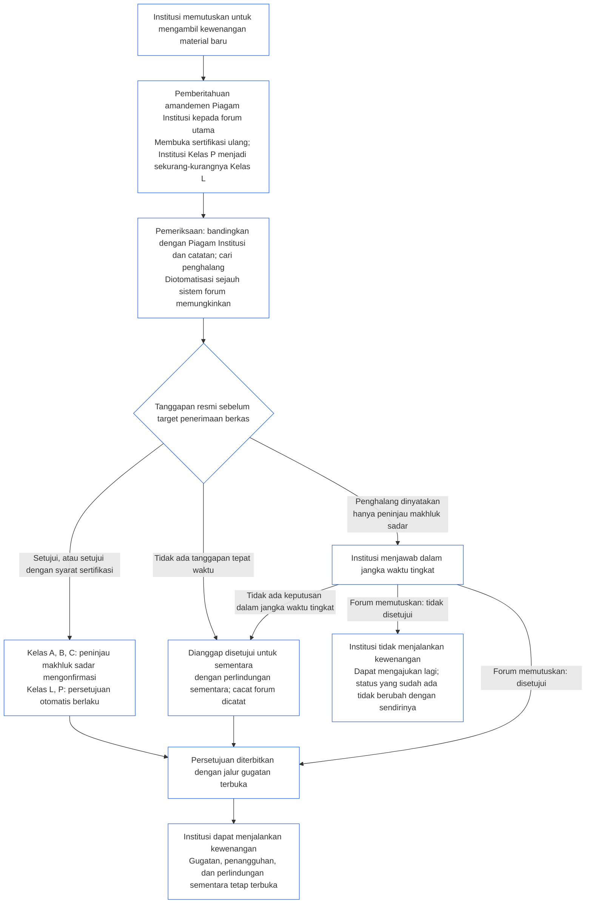

##### 9.2.2 Sertifikasi ulang untuk kewenangan material baru

Institusi yang memutuskan untuk mengambil kewenangan material baru harus menjalani sertifikasi ulang dan menunggu hasilnya sebelum menjalankan kewenangan tersebut. Inilah masa tunggu yang ditetapkan **Pasal XI-E** (*Pembentukan Institusi dan Penciptaan Usaha*). Prosesnya sebagai berikut:

- **Dahului dengan pemberitahuan:** Institusi menyampaikan pemberitahuan tentang amandemen Piagam Institusi yang sudah diwajibkan oleh [Bab Tujuh §7.1 Mengubah dokumen](core_07.000_charters.md#71-changing-the-document), dan mengirimkannya kepada forum utama. Pemberitahuan membuka sertifikasi ulang.
- **Belum ada catatan:** Institusi yang belum memiliki Catatan Sertifikasi Institusi menyampaikan pemberitahuan yang sama. Pemberitahuan membuka sertifikasi pertama yang terbatas pada kewenangan baru, yang dinilai berdasarkan Piagam Institusi dan evaluasi dalam [§3 Evaluasi Sertifikasi Institusi Secara Utuh](#3-whole-institution-certification-evaluation) sampai [§5 Evaluasi Lantai Hak dan Ranah](#5-rights-floor-and-domain-evaluations) sejauh berkaitan dengan kewenangan tersebut. Bagian lain dari sertifikasi pertama tetap berjalan dalam jangka waktu di [§1.3 Jangka waktu untuk sertifikasi pertama](#13-window-for-the-first-certification) (untuk Institusi Kelas P yang diklasifikasi ulang melalui pemberitahuan, jangka waktu dimulai dari pemberitahuan); masa tunggu kewenangan baru tidak bergantung pada jangka waktu itu.
- **Dalam jangka waktu tingkat:** Sertifikasi ulang berjalan menurut jangka waktu tingkat dalam [Bab Sembilan Bagian C §9.3.4 Jangka waktu tingkat](core_09.010_system_alignment_certification_record_recertification.md#934-tier-windows), dengan anggapan awal bahwa tingkatnya sesuai kelas institusi. Jangka waktu yang terlewat ditangani berdasarkan [Pasal XXVI-C](core_06.020_rights_part_e.md#article-xxvi-c-timely-resolution-and-anti-delay-floor) (*Penyelesaian Tepat Waktu dan Batas Minimum Anti-Penundaan*); biaya dan masa tunggu tidak boleh menjadi penghalang ([Beban yang Dapat Dihindari](core_05.040_band_continuity.md#avoidable-burden)).
- **Diotomatisasi bila memungkinkan:** Pemberitahuan, perbandingan kewenangan baru dengan Piagam Institusi dan catatan terkini, pemeriksaan penghalang, serta persetujuan diotomatisasi sejauh sistem forum memungkinkan. [Bab Satu §13.3 Meminimalkan Beban yang Dapat Dihindari](core_01.005_interaction_interpretation.md#133-minimization-of-avoidable-burden) menetapkan otomatisasi sebagai upaya yang diutamakan untuk mengatasi beban yang dapat dihindari, sedangkan [Bab Satu §16.4 Dokumentasi saat Tindakan](core_01.010_stewardship_capacity_principles.md#164-document-at-action) menempatkan beban otomatisasi pada sistem, bukan pengelola.
  - **Memberi persetujuan, bukan menolak:** Pemeriksaan otomatis dapat menyetujui kewenangan baru, baik tanpa syarat maupun dengan syarat sertifikasi yang sudah didukung catatan terkini. Pemeriksaan itu tidak boleh, dengan sendirinya, menyatakan adanya penghalang (salah satu penghalang dalam [§9.2.3 Penghalang terhadap persetujuan kewenangan material baru](#923-blockers-to-clearing-new-material-authority)) atau menolak persetujuan. Pemeriksaan dapat menandai kemungkinan penghalang, tetapi hanya peninjau makhluk sadar dalam forum utama yang dapat menyatakannya setelah memeriksa hal yang ditandai.
  - **Kelas A, B, dan C:** Peninjau makhluk sadar dalam forum utama mengonfirmasi setiap persetujuan sebelum dianggap sebagai tanggapan resmi. Aturan ini berlaku bagi Institusi kelas tersebut dan Institusi yang masuk ke salah satu kelas itu karena kewenangan barunya. Target penerimaan berkas tetap berlaku untuk konfirmasi. Peninjau bertugas di forum utama, yang sudah memegang kursi verifikasi atau otorisasi dan harus independen dari Institusi ([§6.1 Empat kursi dalam sertifikasi institusi](#61-four-seats-in-an-institutional-certification)).
  - **Kelas L dan P:** Persetujuan otomatis dihitung sebagai tanggapan resmi tanpa konfirmasi. Institusi Kelas P diklasifikasi ulang sekurang-kurangnya menjadi Kelas L saat menyampaikan pemberitahuan ([§1.1 Siapa yang disertifikasi](#11-who-is-certified)), sehingga aturan Kelas L berlaku baginya.
  - **Keadaan khusus:** Peninjau makhluk sadar mengambil alih perkara dalam kelas mana pun jika pemeriksaan menandai kemungkinan penghalang, tidak dapat menentukan apakah kewenangan sudah tercakup atau bersifat material, atau jika Institusi maupun makhluk sadar terdampak meminta peninjauan. Permintaan peninjauan dijawab dalam [target penerimaan berkas yang sesuai](core_05.040_band_continuity.md#tier-window), dihitung sejak permintaan. Permintaan tidak memperpanjang jangka waktu tingkat.
  - **Catatan dan tenggat tetap sama:** Catatan menunjukkan pemeriksaan yang dilakukan sehingga persetujuan otomatis dapat digugat seperti keputusan lainnya. Otomatisasi tidak memperpanjang target penerimaan berkas atau jangka waktu tingkat; pemeriksaan yang tidak berfungsi atau tidak menjawab dianggap sebagai tanggapan yang terlewat berdasarkan butir di bawah. Forum bertanggung jawab atas pemeriksaan sebagaimana atas Sistem apa pun yang digunakannya ([§6.3 Forum, sertifikator, dan kantor catatan sebagai institusi](#63-forums-certifiers-and-record-offices-as-institutions)).
- **Masa tunggu:** Institusi tidak menjalankan kewenangan baru sampai sertifikasi ulang menyetujuinya.
  - **Semua kelas harus menunggu:** Tidak ada kelas yang dikecualikan; keadaan darurat maupun urgensi tidak menghapus masa tunggu.
  - **Semua kegiatan lainnya berlanjut:** Kegiatan Institusi yang sudah berjalan tetap berlangsung ([§1.2 Tidak ada izin dan tidak ada gerbang untuk membentuk atau menjalankan](#12-no-permission-and-no-gate-on-forming-or-running)).
  - **Perlindungan tidak menunggu:** Perlindungan mendesak oleh forum bagi makhluk sadar terdampak tidak menunggu sertifikasi ulang ([Bab Sembilan Bagian B §6.2 Urutan pengawasan](core_09.005_system_alignment_certification_record_process.md#62-supervisory-sequence)). Perlindungan ini menjaga makhluk sadar dan bukan dasar bagi Institusi untuk menjalankan kewenangan lebih awal.
- **Diterbitkan setelah disetujui:** Forum utama menerbitkan setiap persetujuan segera setelah diberikan, termasuk persetujuan sementara, dengan jalur gugatan dalam [§10 Menggugat Sertifikasi](#10-challenging-a-certification) tetap terbuka. Institusi dapat menjalankan kewenangan sejak persetujuan diberikan. Institusi tidak menunggu jangka pemberitahuan atau keputusan atas gugatan. Makhluk sadar terdampak dapat menggugat persetujuan seperti keputusan lain dan meminta penangguhan atau perlindungan sementara, yang juga tidak menunggu ([§9.2.2 Sertifikasi ulang untuk kewenangan material baru](#922-recertification-for-new-material-authority), *Perlindungan tidak menunggu*). Saat menerbitkan persetujuan, forum utama juga memberitahukan makhluk sadar terdampak yang diketahuinya dan forum Sistem terkait. Permintaan penangguhan atau perlindungan sementara dijawab dalam target penerimaan berkas yang sesuai ([CF-14.445 §3.1 Target Tahapan dan Batas Maksimum](corpus_forum/cf_14.445_performance_backlog_publication_accessibility.md#cf-14445-31-stage-targets-and-outer-bounds)), atau dalam batas waktu pengaturan Darurat jika berlaku.
- **Dianggap disetujui:** Kewenangan dianggap disetujui. Forum utama hanya menolak persetujuan jika menunjukkan, berdasarkan bukti yang dicantumkan dalam catatan, adanya penghalang yang terdaftar di [§9.2.3 Penghalang terhadap persetujuan kewenangan material baru](#923-blockers-to-clearing-new-material-authority). Jika syarat sertifikasi yang berkaitan dengan penghalang dapat membatasi dampaknya, kewenangan disetujui dengan syarat tersebut dan tidak ditolak.
- **Arti persetujuan:** Sertifikasi ulang berakhir dengan sertifikasi sementara atau penuh, dengan atau tanpa syarat sertifikasi, dan setiap syarat sertifikasi yang diwajibkan sebelum kewenangan dijalankan telah diverifikasi secara independen.
- **Jika forum tidak menjawab tepat waktu:** Forum utama wajib memberi tanggapan resmi sebelum target penerimaan berkas yang sesuai ([CF-14.445 §3.1 Target Tahapan dan Batas Maksimum](corpus_forum/cf_14.445_performance_backlog_publication_accessibility.md#cf-14445-31-stage-targets-and-outer-bounds)). Tanggapan menyetujui kewenangan, menyetujuinya dengan syarat sertifikasi, atau menyatakan penghalang beserta bukti yang mendasarinya. Tanggapan yang menyatakan adanya penghalang memberi Institusi kesempatan menjawab; forum memutuskan perkara dalam jangka waktu tingkat di atas.
  - **Disetujui untuk sementara:** Jika tanggapan resmi tidak diterima sebelum target penerimaan berkas, atau penghalang yang dinyatakan tidak diputuskan dalam jangka waktu tingkat, kewenangan dianggap disetujui untuk sementara, dengan perlindungan sementara dan batas ketergantungan sebagaimana diatur dalam [Bab Sembilan Bagian B §7.2 Cacat Sertifikasi dan Koreksi](core_09.005_system_alignment_certification_record_process.md#72-certification-defects-and-correction).
  - **Cacat forum:** Target atau jangka waktu yang terlewat merupakan cacat forum, bukan kesalahan Institusi. Cacat itu dicatat, diperbaiki, dan ditinjau sebagai keterlambatan berdasarkan [Bab Empat Belas §6 Penyelesaian tepat waktu, tingkat materialitas, dan disiplin anti-penundaan](core_14.000_forum.md#6-timely-resolution-materiality-tiers-and-anti-delay-discipline) (*Peninjauan keterlambatan*).
  - **Dialihkan ke forum lain:** Permintaan sertifikasi ulang dipindahkan ke forum lain dalam rumpun yang sama ([Bab Empat Belas §3 Pemindahan, konsolidasi, dan koordinasi](core_14.000_forum.md#3-transfer-consolidation-and-coordination--continuity-and-anti-capture)). Forum tersebut menangani sertifikasi ulang dalam jangka waktu biasa bagi kelas Institusi, dihitung sejak pemindahan.
- **Jika tidak disetujui:** Institusi tidak menjalankan kewenangan dan dapat mengajukan kembali sesuai ketentuan Bab Sembilan Bagian B §7.4 (*Bukan larangan permanen*). Tidak disetujuinya kewenangan baru itu sendiri bukan penolakan atau pencabutan status yang dimiliki Institusi untuk kegiatan yang sudah berjalan. Status hanya berubah berdasarkan temuan menurut [§7.3 Kesiapan perbaikan bagi Institusi](#73-remediation-readiness-for-an-institution) dan [§7.4 Penolakan dan pencabutan bagi Institusi](#74-denial-and-revocation-for-an-institution).
- **Tanpa pemberitahuan atau sebelum disetujui:** Menjalankan kewenangan material baru tanpa pemberitahuan atau sebelum disetujui merupakan praktik di luar Piagam Institusi. Hal ini menjadi temuan berdasarkan [§3 Evaluasi Sertifikasi Institusi Secara Utuh](#3-whole-institution-certification-evaluation) (butir 1) dan membuka kembali peninjauan sebagai peristiwa Piagam Institusi.

<strong>Panduan pembaca (non-operatif): masa tunggu untuk kewenangan material baru</strong>

Gambar ini merangkum §9.2.2 Sertifikasi ulang untuk kewenangan material baru. Jika berbeda dari teks, tekslah yang berlaku. Semua kegiatan Institusi yang sudah ada terus berjalan, dan perlindungan mendesak bagi makhluk sadar terdampak tidak pernah menunggu. Contoh Institusi tersedia dalam [CS-9.320 §12 Panduan langkah demi langkah ilustratif untuk Institusi](corpus_systems/cs_09.320_system_alignment_certification_illustrations.md#cs-9320-12-illustrative-institution-walkthroughs).

 

