<!-- AI-assisted translation draft; unreviewed; English controls.
Source: core_09.000_system_alignment_certification_evaluation.md
Source snapshot: 247e2180509e5e029c1106878cf225067339e010
Source SHA-256: 3ff6a518d3c9d6779925a1daab6ad6c53abdbdabeeaad786ffafcdd1e6ac8b80 -->

# 第九章、A部：システム整合性認証 — 評価

<strong>コーパス上の位置（非操作性）：ファイル構造と読み方</strong>

> このファイルは**感知者憲法の一部**であり、番号付き `core_*` ファイルを一体の本文として読む場合に限り、他の番号付きファイルと**併せて拘束力を持つ**。本ファイルは**第九章A部**、すなわち認証の目的、プロセス概要、およびプロセスの最初の二段階である**枠組み設定**（システムのクラス）と**評価**（三つの小段階からなるシステム全体評価：常に適用される評価とデータの種類・取扱いを扱う**§3**、関係する場合に適用される評価の**§4**、発動条件を満たす場合の権利の床および領域別評価の**§5**）を収める（**§1–§5**）。**クラスA／B／Cの実例**（システムクラスのプロファイル、および§3.4、§5.1、§5.2、§5.3、§5.4、§5.5、§5.6の手順例。各例の**システムクラスを横断した読み方**の段落を含む）は、本章ではなくシステム群の[CS-9.320](corpus_systems/cs_09.320_system_alignment_certification_illustrations.md#cs-9320-system-alignment-certification-illustrations)（*システム整合性認証の実例*）に収録され、各例は対応するA部の節を示す。これらの段落が例示する拘束力あるシステムクラス別の調整・エスカレーション規則は本ファイルに置く。システムクラスによる調整（参加と比例性を含む）は§2.2、データ取扱いの調整は§3.4、システムクラス別の調整とエスカレーションは§5.1–§5.6各節にある。章全体のファイルは以下の表に示す。
>
> **第九章のファイル。** 第九章は、一体の本文として読む三つの拘束力あるファイルに分かれる。本ファイルであるA部が章を開始し、独立した索引ファイルはない。実例は本章の一部ではなく、[CS-9.320](corpus_systems/cs_09.320_system_alignment_certification_illustrations.md#cs-9320-system-alignment-certification-illustrations)（*システム整合性認証の実例*）にある。
>
> | 部 | ファイル | 所管事項 |
> |------|------|------|
> | **A部 — 評価** | [`core_09.000_system_alignment_certification_evaluation.md`](core_09.000_system_alignment_certification_evaluation.md) | §1–§5：目的とプロセス概要（認証全体の六段階を示す図を含む）、**第I段階 枠組み設定**（システムクラス、クラスが各評価をどう調整するか、パイロット認証）、および**第II段階 評価**（三つの小段階によるシステム全体評価：**IIa**は常時適用され、§3で憲章上の範囲と機能上の境界、データの種類と取扱いを含む。**IIb**は関係する場合に適用され、§4で扱う。**IIc**は発動条件を満たす場合に適用され、権利の床および領域別評価を§5で扱う） |
> | **B部 — フォーラムの手続と結果** | [`core_09.005_system_alignment_certification_record_process.md`](core_09.005_system_alignment_certification_record_process.md) | §6–§7：**第III段階 審査**（フォーラムの役割、監督上の手順、争訟可能性の連鎖）および**第IV段階 決定**（稼働開始ゲートを含む認証結果）。A部§5から章全体の節番号を継続 |
> | **C部 — 記録、再認証、地位** | [`core_09.010_system_alignment_certification_record_recertification.md`](core_09.010_system_alignment_certification_record_recertification.md) | §8–§11：**第V段階 記録**（[システム憲章](core_05.040_band_continuity.md#system-charter)の所管フィールドを含むシステム認証記録とその完全性）および**第VI段階 運用**（再認証と再開、異議申立て経路、地位への橋渡し）。B部§7から章全体の節番号を継続 |
>
> **二つの認証の関係。** システム整合性認証（本章）はシステムの認証である。機関整合性認証（[第十章](core_10.000_institutional_alignment_certification.md#chapter-ten-institutional-alignment-certification)）は機関の認証であり、機関はシステムを運営する場合も、何も運営しない場合もある。第十章は各システム認証記録をリンクで参照し、再実施しない。[第十章§1](core_10.000_institutional_alignment_certification.md#1-purpose-and-role)は両者の関係を述べ、[第十章§1.2](core_10.000_institutional_alignment_certification.md#12-no-permission-and-no-gate-on-forming-or-running)はライセンスではないことを明示する。各節は本章と同じ番号を、対応する見出しの下で用いる。
>
> 他のファイルにある一般的な**第九章**へのリンクは、節番号に応じた部へ案内する。
>
> - **憲法上の所管（B部・C部との共同）：**フォーラムの監督を受ける**システム整合性認証および関連記録**。評価領域（A部）、フォーラム手続・監督上の手順・稼働開始ゲートを伴う認証結果（B部）、システム認証記録上の義務、異議申立て経路、再認証と再開、第十一章への検証済み入力の橋渡し（すべてC部）を扱う。**監督**という四元の柱の下で、SACは特に大規模で利害の大きい監査プロセスの一つであり、監査の下限は**第十六条**（*監査、透明性、独立検証*）および第五章の[監査可能性](core_05.050_band_oversight.md#auditability)に残る。
> - **検証基盤の所管：**[第四章 — 立証責任、追跡可能性、検証](core_04.000_burden_traceability_verification.md#chapter-four-burden-of-proof-traceability-and-verification)（第二章から第四章の範囲）が、立証責任の配分、遵守の証拠、定義の追跡可能性、観測可能性、安全性に制約された検証を所管する。第九章はその規律をシステム認証記録に**適用する**ものであり、第四章の**§1から§5**を再掲するものでは**ない**。
> - **監査の根拠（ここへ移管しない）：****第十六条**（*監査、透明性、独立検証*）、**Def.O1**（*透明性、監査可能性、検証*）、および**CJS-5.110 §3、CJS-5.115 §3**（*監査プロセスの所管*）から**CJS-5.110 §5**が監査の下限と運用条件を所管する。第九章はそれらの下限を満たす特に大規模なSAC監査プロセスを実施するが、監査全般を所管するものではない。
> - **実装の所管：**システムクラス別の取扱い、CS-6.345（*システムのライフサイクル*）、および指定された実装ファイルにあるフォーラム手続の詳細は、第九章との整合性を保たなければならない。コーパスに[最も保護的な効果](core_05.045_band_integrative.md#fullest-protective-effect)の規則が既にある場合は、より厳格でもよい。
> - **移管防止規則：**A部は第五章の正規定義、第三章の反回避規律（[C部§9.4](core_09.010_system_alignment_certification_record_recertification.md#94-non-evasion)参照）、第十一章の貢献または地位の測定、第十二章の地位の効果を再掲しない。地位への橋渡しは**[C部§11](core_09.010_system_alignment_certification_record_recertification.md#11-relationship-to-standing)**に定める。
>
> **上流：**第五章の定義、第二章から第四章に定める記録・検証・立証責任、および定義から結果への追跡可能性。そして、実質的拘束力を持つすべての認証行為を職務分離要件の対象とする[第八章](core_08.000_functional_independence_separation_of_duties.md#chapter-eight-functional-independence-and-separation-of-duties)。
> **下流：**[B部](core_09.005_system_alignment_certification_record_process.md#chapter-nine-part-b-system-alignment-certification--forum-process-and-outcomes)（*フォーラム手続と結果*）および[C部](core_09.010_system_alignment_certification_record_recertification.md#chapter-nine-part-c-system-alignment-certification--record-recertification-and-standing)（*記録、再認証、地位への橋渡し*）、第十一章の地位記録と検証済み入力、第十二章の地位の効果、第十四章のフォーラム監督とシステム整合性認証経路。

 

第九章**A部**は、**システム整合性認証評価**の憲法上の所管である。

- フォーラム監督と認証結果は**[B部](core_09.005_system_alignment_certification_record_process.md#chapter-nine-part-b-system-alignment-certification--forum-process-and-outcomes)**に定める。
- 記録、再認証と再開、地位への橋渡しは**[C部](core_09.010_system_alignment_certification_record_recertification.md#chapter-nine-part-c-system-alignment-certification--record-recertification-and-standing)**に定める。
- これらの評価節の実例は**[CS-9.320 システム整合性認証の実例](corpus_systems/cs_09.320_system_alignment_certification_illustrations.md#cs-9320-system-alignment-certification-illustrations)**に収録する。
- 同じ節番号を用いる機関整合性認証は**[第十章](core_10.000_institutional_alignment_certification.md#chapter-ten-institutional-alignment-certification)**に定める。

### 1. 目的と役割

<strong>追跡関係</strong>

- 上流：
  - [前文 — 憲法上の所管登録](core_00.000_preamble.md#4-principles-definitions-and-rights)および
  - [権限の階層と内部序列](core_05.045_band_integrative.md#authority-stack-and-internal-hierarchy);
  - [憲法四元](core_00.000_preamble.md#constitutional-tetrad);
  - [二つの憲法上の目的](core_00.000_preamble.md#two-constitutional-aims);
  - [実質的利害](core_00.000_preamble.md#material-stake);
  - [比例性](core_05.035_band_accountability.md#proportionality)および
  - [実質的公正](core_05.055_band_participation.md#substantive-fairness)（第五章）；参加測定群（*発言、アクセス、異議申立て経路*）；
  - [第一章 §16 管理責務の詳説](core_01.010_stewardship_capacity_principles.md#16-stewardship-in-depth)（1.010 §16）；
  - [第一章 §12 システム全体評価要件](core_01.000_values_principles.md#12-systemic-evaluation-requirement)（1.000 §12）（*原則層におけるシステム全体評価の視点 — 一つの側面だけではない*）；第二章から第四章；
  - [第五章](core_05.000_definitions_home.md#chapter-five-foundational-definitions)（5.000）（*正規定義*）；
  - [第八章 §2 憲法上の四席要件](core_08.000_functional_independence_separation_of_duties.md#2-four-seat-constitutional-requirement)（8.000 §2）；
  - [システム整合性認証](core_05.040_band_continuity.md#system-alignment-certification)（第五章の正規用語。非操作的略称は**SAC**）；
  - [システム認証記録](core_05.040_band_continuity.md#system-certification-record)（第五章の意味）。
- 下流：
  - [§2](#2-system-class-evaluation)（*システムクラス評価*）；
  - [C部 §10](core_09.010_system_alignment_certification_record_recertification.md#10-challenging-a-certification)（9.010 §10）（*認証への異議申立て*）；および
  - [CS-9.320 §2](corpus_systems/cs_09.320_system_alignment_certification_illustrations.md#cs-9320-2-illustrative-system-class-profiles)（*システムクラスのプロファイル例*）；
  - [CS-9.320 §4](corpus_systems/cs_09.320_system_alignment_certification_illustrations.md#cs-9320-4-illustrative-whole-system-application-by-system-class)（*システムクラス別のシステム全体適用例*）；
  - [CS-9.320 §5](corpus_systems/cs_09.320_system_alignment_certification_illustrations.md#cs-9320-5-illustrative-data-handling-application-by-system-class)（*システムクラス別のデータ取扱い適用例*）；
  - [CS-9.320 §6](corpus_systems/cs_09.320_system_alignment_certification_illustrations.md#cs-9320-6-illustrative-ecological-footprint-application-by-system-class)（*システムクラス別の生態学的負荷適用例*）；
  - [CS-9.320 §7](corpus_systems/cs_09.320_system_alignment_certification_illustrations.md#cs-9320-7-illustrative-educational-capability-application-by-system-class)（*システムクラス別の教育能力適用例*）；
  - [CS-9.320 §8](corpus_systems/cs_09.320_system_alignment_certification_illustrations.md#cs-9320-8-illustrative-cross-system-support-application-by-system-class)（*システムクラス別のシステム間支援適用例*）；
  - [CS-9.320 §9](corpus_systems/cs_09.320_system_alignment_certification_illustrations.md#cs-9320-9-illustrative-nondiscrimination-application-by-system-class)（*システムクラス別の非差別適用例*）；
  - [CS-9.320 §10](corpus_systems/cs_09.320_system_alignment_certification_illustrations.md#cs-9320-10-illustrative-accessibility-application-by-system-class)（*システムクラス別のアクセシビリティ適用例*）；
  - [CS-9.320 §11](corpus_systems/cs_09.320_system_alignment_certification_illustrations.md#cs-9320-11-illustrative-trustworthiness-application-by-system-class)（*システムクラス別の信頼性適用例*）；
  - [§3](#3-whole-system-certification-evaluation)（*システム全体認証評価の要素*）；
  - [§3.4](#34-data-types-and-handling-evaluation)から
  - [§5.6](#56-trustworthiness-and-system-reliance-integrity-evaluation)まで（*領域別評価*）；
  - [B部 §6](core_09.005_system_alignment_certification_record_process.md#6-forum-process)（9.005 §6）（*監督上の手順と争訟可能性の連鎖*）；
  - [B部 §6.1](core_09.005_system_alignment_certification_record_process.md#61-forum-supervision-and-component-roles)（9.005 §6.1）（*フォーラムの構成要素別の役割*）；
  - [C部 §8](core_09.010_system_alignment_certification_record_recertification.md#8-system-certification-record)（9.010 §8）（*システム認証記録の内容*）；
  - [C部 §8.2](core_09.010_system_alignment_certification_record_recertification.md#82-transparency-and-auditability-of-the-record)（9.010 §8.2）（*記録の完全性に関する要件*）；
  - [B部 §7](core_09.005_system_alignment_certification_record_process.md#7-certification-outcomes)（9.005 §7）（*認証結果*）；
  - [C部 §11](core_09.010_system_alignment_certification_record_recertification.md#11-relationship-to-standing)（9.010 §11）（*地位記録への橋渡し*）；
  - [第十一章](core_11.000_standing_assessment.md#chapter-eleven-contribution-violation-and-standing-model--measurement)（11.000）（*地位記録と検証済み入力ゲート*）；
  - [第十二章](core_12.000_standing_integration.md#chapter-twelve-standing-effects-and-integration)（12.000）（*地位の効果と統合*）；
  - [第十四章](core_14.000_forum.md#chapter-fourteen-forums-and-jurisdiction)（14.000）（*フォーラム監督、認証、整合性認証、審査*）。
- 併読：
  - **[CS-9.305](corpus_systems/cs_09.305_system_classification_machinery.md#cs-9305-part-a-system-classification-machinery)（*システム分類の仕組み*）および[CS-9.310 — システム影響分類](corpus_systems/cs_09.310_system_impact_classifications.md#cs-9310-part-b-system-impact-classifications)**、**[CS-6.305](corpus_systems/cs_06.305_information_types_and_handling.md#cs-6305-part-a-information-types-and-handling)（*情報の種類と取扱い*）および[CS-6.310 — データ分類](corpus_systems/cs_06.310_data_classifications.md#cs-6310-part-b-data-classifications)**、ならびに
  - **CS-6.345**（*システムのライフサイクル*）；
  - **CF-14.415**（*ルーティング運用、移管、判断を求める照会、代表者の取扱い*）および
  - **CF-14.425**（*完全性の保護、取り込み防止、自己判断の防止支援*）；**第十六条**（*監査、透明性、独立検証*）および
  - [監査可能性](core_05.050_band_oversight.md#auditability)（*監査の下限 — SACは監督の下にある特に大規模な監査プロセスの一つであり、監査全体の唯一の所管ではない*）；**CJS-5.110 §3（*監督：監査可能性と再構成可能性の条件（付属書）*）およびCJS-5.115 §3**（*監査プロセスの所管*）から
  - **CJS-5.110 §5**（*監督：独立検証と主張の完全性に関する条件*）。

 

*平たい言葉で言えば：システムが感知者の暮らしに実際に大きく関わるなら、認証は**比例的**でなければならない。画一的なチェックリストや追認ではなく、現実の影響、依存、リスクに応じた厳しさが必要である。また、**参加型**でなければならない。影響を受ける感知者とコミュニティが、審査内容を確認し、決定を理解し、誤りがあれば異議を申し立てられなければならない。フォーラムは証拠を審査し、システム認証記録に記録し、リスクに応じた日程で再認証を求める。クラスA、B、Cには完全な手続を、クラスLには簡素な手続を適用する。クラスPには利用を奨励するが、クラスL以上に再分類された（すなわち影響が私的な単位を越えた）場合、または運営者が憲法遵守を主張する場合は、利用が必須となる。*

**システム整合性認証**は、明示された範囲と審査日程について、次の一つの問いに答えるためにある。システムは、認証、条件付き認証、検証、再認証、継続的依存、導入、または認証条件の実質的な履行・解除に足る憲法上の整合性を示したか。

- 認証は人気投票でも、永久通行証でも、権利審査を省く方法でもない。
- 認証は、現時点でシステムの整合性について判明していることを示す、期限付きで異議申立て可能な声明である。
- **監督**という四元の柱の下では監査が必要となる。システム整合性認証は、特に大規模で利害の大きい監査プロセスの一つであり、監査全般の唯一の所管ではない（**第十六条**（*監査、透明性、独立検証*）、[監査可能性](core_05.050_band_oversight.md#auditability)）。

認証は、[二つの憲法上の目的](core_00.000_preamble.md#two-constitutional-aims)を[憲法四元](core_00.000_preamble.md#constitutional-tetrad)を通じて実現する。

- **[繁栄](core_00.000_preamble.md#flourishing)** — 認証または継続的依存が、権利の床をひそかに損なったり、憲法に関わる生活への公正な参加を妨げたりしないことを検証する。
- **[継続](core_00.000_preamble.md#continuity)** — 健全な自然システムを維持し、枯渇させない、持続的かつ後退しない供給を検証する（[生態系の完全性](core_05.040_band_continuity.md#ecological-integrity)、[生態系の回復能力](core_05.040_band_continuity.md#ecological-recovery-capacity)を含む）。共有システムが供給を妨げたり維持したりする場合は、システムクラスに応じた再認証も検証する。
- **参加** — 影響を受ける感知者とコミュニティが、自分たちに関わる審査経路を理解し、異議を申し立て、審査に参加できる。
- **監督** — 独立した確認に足る程度に記録、証拠、前提が可視化され、監査可能である。認証自体は監督義務の下にある特に大規模な監査プロセスの一つであり、唯一のものではない。
- **説明責任** — 欠陥、誤分類、権利の床を損なう運用は、事実が裏付ける場合に、救済、認証条件、取消し、または地位への入力につながる。
- **適時性** — 審査と異議申立ての期間を設け、被害を防止または回復できる間に認証が古びないようにする。

#### 1.1 システムクラスに応じて調整される監査プロセスとしての認証

監督の仕組みとして、認証は[監査可能性](core_05.050_band_oversight.md#auditability)および**第十六条**（*監査、透明性、独立検証*）の下にある特に大規模な監査プロセスの一つである。

- フォーラムの監督を受け、複数領域にまたがり、地位を付与する。
- 関連する他の監査方式の結果を組み込むことはできるが、それらを吸収または置換しない。監査プロセスの根拠にある[関連監査方式の対応表](corpus_joint_structure/cjs_05.115_audit_process.md#sibling-audit-modes-owner-map)で所管を定め、それぞれが独自の所管を保つ。
  - **CS-6.305（*情報の種類と取扱い*）およびCS-6.310（*データ分類*）**に基づくシステムデータ種類記録の監査
  - **CS-9.305（*システム分類の仕組み*）およびCS-9.310（*システム影響分類*）**に基づくシステム分類記録の監査
  - **CS-15.305**（*重要システムの管理責務*）に基づく管理責務の保証審査
  - **CS-6.345**（*システムのライフサイクル*）に基づく継続的監査 ACA
  - **CS-6.315**（*理解可能性と複雑性の管理責務*）および**第二十三条-B**（*複雑性監査とモジュール性要件*）に基づく複雑性監査
  - **CJS-5.110 §5**（*監督：独立検証と主張の完全性に関する条件*）に基づく主張の検証
- 認証を経ずに、これらの評価を個別に実施することもできる。認証はそれらに取って代わらない。

認証の深さ、記録上の負担、認証間隔、利害関係者による審査、異議申立て経路は、[実質的利害](core_00.000_preamble.md#material-stake)に基づき[比例性](core_05.035_band_accountability.md#proportionality)に応じて調整しなければならない。

- 影響、依存、リスクがより大きいシステムには、より強い立証、より明確な記録、より実行可能な参加手段が必要である。これには、実質的なアクセシビリティ、利害関係者の意見、システムに依存する者に応じた異議申立て経路が含まれる。
- クラスが低く範囲が限定されたシステムにも、誠実な分類と比例的な保証が必要である。外部への影響がある場合に、実質的義務を免れることはない。

プロセスは、**CS-9.305**（*システム分類の仕組み*）の[再分類要件](corpus_systems/cs_09.305_system_classification_machinery.md#35-reclassification-requirement)が定める影響クラスに応じて適用する。

- **クラスA、クラスB、クラスC：**これらのシステムは最も大きな影響、依存、リスクをもたらす。各小段階に応じて、[§3 システム全体認証評価](#3-whole-system-certification-evaluation)、[§4 関係する場合の評価](#4-evaluations-where-implicated)、[§5 権利の床および領域別評価](#5-rights-floor-and-domain-evaluations)を、完全な深さで必ず実施する。
- **クラスL：**同じ評価を必ず行うが、**CS-9.305**（*システム分類の仕組み*）および**CS-9.310**（*システム影響分類*）が認める場合には、比例的に簡素化し、標準の認証間隔を長くし、記録を簡素にできる。
- **クラスP：**システムが適法にクラスPである間は本プロセスの利用を奨励し、任意で利用できる。クラスL以上への再分類、または運営者が当該システムの憲法遵守を自発的に主張した場合には必須となる。

認証間隔、およびその中間時点に行う財務・資源審査または特別監査は、システムクラスに応じて[第十四章 §6 適時な解決、実質性の段階、遅延防止の規律](core_14.000_forum.md#review-cadence)（*審査周期*）が定める。本章は数値を再掲しない。

#### 1.2 認証の概要

*平たい言葉で言えば：システムを誠実に分類し、該当する評価を行い、フォーラムが証拠と利害関係者の懸念を独立に審査して結果を決める。フォーラム審査のために開いた一つの記録を完成させ、異議申立て経路を開いたまま公表する。認証済みシステムは、通知期間が満了し、必要な保護措置が満たされた後に限って稼働を開始する。実際の結果を監視し、インシデントや異議申立てに対応し、予定に従って、または事実が変わったときに再審査する。欠陥を是正し、影響を受ける範囲を認めたり認証条件を解除したりする前に、是正を独立に検証する。各審査では、直前の記録とリンクした新しい記録を用いる。*

プロセスは**六段階**で進む。**I 枠組み設定**、**II 評価**、**III 審査**、**IV 決定**、**V 記録**、**VI 運用**である。第II段階には、それぞれ独立した節となる三つの小段階がある。**IIa**（常に適用）、**IIb**（関係する場合）、**IIc**（発動条件を満たす場合）である。第VI段階には、それぞれ独立した節となる二つの小段階がある。**VIa**（運用と再認証、[§9 再認証と再開](core_09.010_system_alignment_certification_record_recertification.md#9-recertification-and-reopening)）と**VIb**（地位への橋渡し、[§11 地位との関係](core_09.010_system_alignment_certification_record_recertification.md#11-relationship-to-standing)）である。図はこの順に認証プロセス全体を示す。A部は最初の二段階、枠組み設定と評価を扱う。[B部](core_09.005_system_alignment_certification_record_process.md#chapter-nine-part-b-system-alignment-certification--forum-process-and-outcomes)および[C部](core_09.010_system_alignment_certification_record_recertification.md#chapter-nine-part-c-system-alignment-certification--record-recertification-and-standing)は残りの四段階を扱う。B部はフォーラム手続と稼働開始ゲートを伴う結果、C部は記録と運用（異議申立て経路、再認証と再開、地位への橋渡し）を扱う。

該当するすべての評価は、各認証手続で再実施する。すなわち、初回認証、[§2 システムクラス評価](#2-system-class-evaluation)が定める日程での各再認証、および再開審査または新規審査のたびに行う。システムへの依存の増加、共有基盤からの抽出の増加、システムが共有基盤へ還元するものの大幅な減少、信頼できる異議申立てなど、実質的な事実が変わった場合は、次の予定再認証を待たずに審査を再開する。[C部 §9.2 再開の発動条件](core_09.010_system_alignment_certification_record_recertification.md#92-reopening-triggers)に発動条件を列挙する。

```mermaid
flowchart TB
    T(["実質的影響を持つシステムが認証を申請<br/>または依存が増加"])
    C["§2 第I段階 枠組み設定<br/>誠実に分類する<br/><br/>クラスが深さと再審査日程を定める"]
    subgraph W["§3–§5 第II段階 評価 — システム全体評価"]
        direction LR
        Al["§3.1–§3.4 IIa — 常に適用<br/><br/>ガバナンス、システムリスク：評価し、<br/>必要な者に開示；<br/>時間軸；データの種類"]
        Im["§4 IIb — 関係する場合<br/><br/>プライバシー領域、退出権、<br/>集会と異議"]
        Tr["§5 IIc — 発動条件を満たす場合<br/><br/>該当する権利の床の審査<br/>および六つの領域別評価"]
        Al ~~~ Im ~~~ Tr
    end
    F["§6 第III段階 審査<br/>証拠と利害関係者の懸念を独立に審査<br/><br/>担当フォーラムが判断を示し、<br/>異議申立て経路を開いたままにする"]
    Rec["§8 第V段階 記録<br/>一つのシステム認証記録<br/><br/>フォーラム審査のために開き、結果、<br/>根拠となる判断、認証条件、運用計画を記録して完成"]
    S[["第十一章 — 地位記録<br/><br/>本章の対象外"]]
    O{"§7 第IV段階 決定<br/><br/>証拠が裏付ける結果と地位は何か？"}
    Fc["§7、§9.3 完全認証<br/><br/>連続して必要回数の暫定再認証に合格；<br/>現在の不整合も差し迫った兆候もない<br/>完全認証間隔；認証条件が付く場合あり"]
    Pc["§7、§9.3 暫定認証<br/><br/>初回付与、不整合後の回復、<br/>または暫定状態の継続・降格<br/>短い暫定間隔；認証条件が付く場合あり"]
    Nc["§7 未認証<br/><br/>延期、拒否、取消し、または失効<br/>稼働開始不可；理由と必要な是正措置を記載"]
    Pub["§7、§10 完成した記録を公表<br/><br/>記録への異議申立て経路を開く；<br/>新規または拡張範囲について稼働開始と通知を明示"]
    G{"§7 稼働開始ゲート<br/><br/>認証と該当する稼働開始前提条件を<br/>満たしているか？"}
    Hold["稼働開始前提条件を満たす<br/><br/>通知を完了し、稼働開始前に必要な<br/>認証条件を独立に検証"]
    Rm["§7、§9.3 保護し是正する<br/><br/>影響範囲で新たに稼働させない；<br/>感知者を保護し、設計または運用を是正し、<br/>独立検証のために証拠を提出"]
    Ch["§9–§10 第VIa段階 運用と再認証<br/>監視し、異議申立てを継続可能に保つ<br/><br/>認証範囲と認証条件内で運用；<br/>結果を監視しインシデントと異議に対応"]
    S2[["第十一章 — 地位記録<br/><br/>本章の対象外"]]
    Sp["&nbsp;&nbsp;&nbsp;&nbsp;&nbsp;&nbsp;&nbsp;&nbsp;&nbsp;&nbsp;&nbsp;&nbsp;&nbsp;&nbsp;&nbsp;&nbsp;&nbsp;&nbsp;&nbsp;&nbsp;&nbsp;&nbsp;&nbsp;&nbsp;&nbsp;&nbsp;&nbsp;&nbsp;&nbsp;&nbsp;&nbsp;&nbsp;&nbsp;&nbsp;&nbsp;&nbsp;&nbsp;&nbsp;&nbsp;&nbsp;&nbsp;&nbsp;&nbsp;&nbsp;&nbsp;"]
    SpL["&nbsp;&nbsp;&nbsp;&nbsp;&nbsp;&nbsp;&nbsp;&nbsp;&nbsp;&nbsp;&nbsp;&nbsp;&nbsp;&nbsp;&nbsp;&nbsp;&nbsp;&nbsp;&nbsp;&nbsp;&nbsp;&nbsp;&nbsp;&nbsp;&nbsp;&nbsp;&nbsp;&nbsp;&nbsp;&nbsp;&nbsp;&nbsp;&nbsp;&nbsp;&nbsp;"]
    SpA["&nbsp;&nbsp;&nbsp;&nbsp;&nbsp;&nbsp;&nbsp;&nbsp;&nbsp;&nbsp;&nbsp;&nbsp;&nbsp;&nbsp;&nbsp;&nbsp;&nbsp;&nbsp;&nbsp;&nbsp;&nbsp;&nbsp;&nbsp;&nbsp;&nbsp;&nbsp;&nbsp;&nbsp;&nbsp;&nbsp;&nbsp;&nbsp;&nbsp;&nbsp;&nbsp;&nbsp;&nbsp;&nbsp;&nbsp;&nbsp;&nbsp;&nbsp;&nbsp;"]
    Re["§9 次の審査手続<br/><br/>再認証、再開、または新規審査；<br/>各手続は直前の記録とリンクする新記録を開く"]
    T --> C
    A1((A)) --> C
    C --> W
    W --> F
    F --> O
    O --> Fc
    O --> Pc
    O --> Nc
    Fc --> Rec
    Pc --> Rec
    Nc --> Rec
    Rec -.->|"VIb、§11 —<br/>検証済み入力に限る；<br/>現行認証または認証中に<br/>生じた事実"| S
    Rec --> Pub
    Rec ~~~ Sp
    Pub --> G
    G ~~~ SpL
    G -->|"未認証"| Rm
    G --->|"可：記録の<br/>範囲内で運用"| Ch
    G --->|"認証済み、<br/>前提条件が未完了"| Hold
    Hold --> G
    Ch -->|"実質的欠陥：<br/>保護と是正"| Rm
    Ch -->|"予定時期、または<br/>実質的変更・信頼できる<br/>異議申立てにより<br/>審査が必要"| Re
    Ch -.->|"VIb、§11 —<br/>検証済み入力に限る；<br/>運用事実が貢献・<br/>違反記録を裏付ける場合あり"| S2
    Rm -->|"是正の証拠を<br/>次の審査手続で<br/>確認"| Re
    S2 ~~~~ SpA
    SpA ~~~ Re
    style Sp fill:none,stroke:none,color:#111111
    style SpL fill:none,stroke:none,color:#111111
    style SpA fill:none,stroke:none,color:#111111
    style T fill:none,stroke:#64748b,color:#ffffff
    style C fill:none,stroke:#16a34a,color:#ffffff
    style Ch fill:none,stroke:#16a34a,color:#ffffff
    style Al fill:none,stroke:#16a34a,color:#ffffff
    style Im fill:none,stroke:#16a34a,color:#ffffff
    style Tr fill:none,stroke:#16a34a,color:#ffffff
    style F fill:none,stroke:#ea580c,color:#ffffff
    style Rec fill:none,stroke:#2563eb,color:#ffffff
    style S fill:none,stroke:#db2777,color:#ffffff
    style S2 fill:none,stroke:#db2777,color:#ffffff
    style O fill:none,stroke:#ea580c,color:#ffffff
    style Fc fill:none,stroke:#9333ea,color:#ffffff
    style Pc fill:none,stroke:#9333ea,color:#ffffff
    style Nc fill:none,stroke:#9333ea,color:#ffffff
    style G fill:none,stroke:#ea580c,color:#ffffff
    style Pub fill:none,stroke:#2563eb,color:#ffffff
    style Rm fill:none,stroke:#9333ea,color:#ffffff
    style Hold fill:none,stroke:#16a34a,color:#ffffff
    style Re fill:none,stroke:#16a34a,color:#ffffff
    style A1 fill:none,stroke:#64748b,color:#ffffff
    style A2 fill:none,stroke:#64748b,color:#ffffff
```

<strong>読者向け案内（非操作性）：実例、実施手順、機関</strong>

> **クラスA、クラスB、クラスC**の実例プロファイル、およびシステムクラスが本章全体の認証の深さをどう調整するかは、[CS-9.320 §2 システムクラスのプロファイル例](corpus_systems/cs_09.320_system_alignment_certification_illustrations.md#cs-9320-2-illustrative-system-class-profiles)にある。[§3 システム全体認証評価](#3-whole-system-certification-evaluation)から[§5.6 信頼性およびシステム依存の完全性評価](#56-trustworthiness-and-system-reliance-integrity-evaluation)までの各評価領域について、同じ三つのシステムを用いた手順例は、[CS-9.320 システム整合性認証の実例](corpus_systems/cs_09.320_system_alignment_certification_illustrations.md#cs-9320-system-alignment-certification-illustrations)に続く。そこでは各プロファイルと手順例から、それが例示するA部の節にリンクしている。
>
> 六段階の実施順序と、各手順の規則を定める節へのリンクを含む手順票は、[CS-9.315 §2 手順票](corpus_systems/cs_09.315_system_alignment_certification_run_sheet.md#cs-9315-2-run-sheet)（*システム整合性認証の手順票*）にある。手順票と各節が異なる場合は、各節の規則が優先する。
>
> 架空の機関三つを第十章の手続に沿って検討した例は、[CS-9.320 §12 機関の手順例](corpus_systems/cs_09.320_system_alignment_certification_illustrations.md#cs-9320-12-illustrative-institution-walkthroughs)にある。
>
> 機関についても、同じ六段階が[第十章](core_10.000_institutional_alignment_certification.md#chapter-ten-institutional-alignment-certification)に沿って進み、各節は本章と同じ番号を用いる。第I・II段階は[第十章 §2 機関クラス評価](core_10.000_institutional_alignment_certification.md#2-institution-class-evaluation)から[§5 権利の床および領域別評価](core_10.000_institutional_alignment_certification.md#5-rights-floor-and-domain-evaluations)、第IIIからV段階は[§6 フォーラム手続](core_10.000_institutional_alignment_certification.md#6-forum-process)から[§8 機関認証記録](core_10.000_institutional_alignment_certification.md#8-institutional-certification-record)、第VI段階は[§9 再認証と再開](core_10.000_institutional_alignment_certification.md#9-recertification-and-reopening)から[§11 地位との関係](core_10.000_institutional_alignment_certification.md#11-relationship-to-standing)にある。

 

### 2. システムクラス評価

<strong>追跡関係</strong>

- 上流：
  - [§1](#1-purpose-and-role)（*目的と役割*）；統合的実質性（
  - [実質性](core_05.050_band_oversight.md#materiality)）（*実質性*）；
  - [憲法四元](core_00.000_preamble.md#constitutional-tetrad);
  - [二つの憲法上の目的](core_00.000_preamble.md#two-constitutional-aims);
  - [実質的影響](core_05.050_band_oversight.md#material-impact)、
  - [依存](core_05.040_band_continuity.md#dependency)、
  - [リスク](core_05.040_band_continuity.md#risk)、
  - [システム境界](core_05.040_band_continuity.md#system-boundaries)、および
  - [システム憲章](core_05.040_band_continuity.md#system-charter)（第五章）；
  - [第一章 §12 システム評価要件](core_01.000_values_principles.md#12-systemic-evaluation-requirement)（1.000 §12）；**第三条-A**（*生存*）および**第四条-A**（*分類によってアクセスが制限される場合の権利の床の提供*）；**第五条-A**（*依存関係のマッピングと資源フローの透明性*）および**第五条-B**（*認証によって共有インフラへの依存が条件付けられる場合の資源配分と依存関係の管理責務*）。
- 下流：
  - [§2.1](#21-certification-recertification-and-defects)（*認証状態、再認証、欠陥*）；
  - [§2.2](#22-how-system-class-scales-every-evaluation)（*システムクラスに応じた参加と比例性*）；
  - [§2.3](#23-pilot-certification)（*パイロット認証*）；
  - [CS-9.320 §2](corpus_systems/cs_09.320_system_alignment_certification_illustrations.md#cs-9320-2-illustrative-system-class-profiles)（*システムクラスのプロファイル例*）および[CS-9.320 §3](corpus_systems/cs_09.320_system_alignment_certification_illustrations.md#cs-9320-3-reclassification)（*再分類*）；
  - [CS-9.320 §4](corpus_systems/cs_09.320_system_alignment_certification_illustrations.md#cs-9320-4-illustrative-whole-system-application-by-system-class)（*システムクラス別システム全体適用例*）；
  - [CS-9.320 §5](corpus_systems/cs_09.320_system_alignment_certification_illustrations.md#cs-9320-5-illustrative-data-handling-application-by-system-class)（*システムクラス別データ取扱い適用例*）；
  - [CS-9.320 §6](corpus_systems/cs_09.320_system_alignment_certification_illustrations.md#cs-9320-6-illustrative-ecological-footprint-application-by-system-class)（*システムクラス別生態学的負荷適用例*）；
  - [CS-9.320 §7](corpus_systems/cs_09.320_system_alignment_certification_illustrations.md#cs-9320-7-illustrative-educational-capability-application-by-system-class)（*システムクラス別教育能力適用例*）；
  - [CS-9.320 §8](corpus_systems/cs_09.320_system_alignment_certification_illustrations.md#cs-9320-8-illustrative-cross-system-support-application-by-system-class)（*システムクラス別システム間支援適用例*）；
  - [CS-9.320 §9](corpus_systems/cs_09.320_system_alignment_certification_illustrations.md#cs-9320-9-illustrative-nondiscrimination-application-by-system-class)（*システムクラス別非差別適用例*）；
  - [CS-9.320 §10](corpus_systems/cs_09.320_system_alignment_certification_illustrations.md#cs-9320-10-illustrative-accessibility-application-by-system-class)（*システムクラス別アクセシビリティ適用例*）；
  - [CS-9.320 §11](corpus_systems/cs_09.320_system_alignment_certification_illustrations.md#cs-9320-11-illustrative-trustworthiness-application-by-system-class)（*システムクラス別信頼性適用例*）；
  - [§3.4](#34-data-types-and-handling-evaluation)（*共同データ取扱い評価*）；
  - [§5.1](#51-ecological-footprint-evaluation)（*生態学的負荷評価*）；
  - [§5.3](#53-proportionate-cross-system-support-evaluation)（*システム間支援評価*）；
  - [C部 §8.2](core_09.010_system_alignment_certification_record_recertification.md#82-transparency-and-auditability-of-the-record)（9.010 §8.2）（*記録の完全性*）；
  - [C部 §11.3](core_09.010_system_alignment_certification_record_recertification.md#113-verified-input-gate)（9.010 §11.3）（*検証済み入力ゲート*）；
  - [B部 §7](core_09.005_system_alignment_certification_record_process.md#7-certification-outcomes)（9.005 §7）（*分類のずれと再分類の発動条件*）。
- 併読：
  - [システム分類記録](core_05.040_band_continuity.md#system-classification-record);
  - **[CS-9.305](corpus_systems/cs_09.305_system_classification_machinery.md#cs-9305-part-a-system-classification-machinery)（*システム分類の仕組み*）および[CS-9.310 — システム影響分類](corpus_systems/cs_09.310_system_impact_classifications.md#cs-9310-part-b-system-impact-classifications)**。**[CS-9.305 §3.5 再分類要件](corpus_systems/cs_09.305_system_classification_machinery.md#35-reclassification-requirement)**（*発動条件、システムクラスに応じた評価の深さ、SAC検証の橋渡し*）および**[CS-9.305 §7](corpus_systems/cs_09.305_system_classification_machinery.md#cs-9305-7-classification-governance-disclosure-and-challenge)**（*分類ガバナンス、開示、異議申立て* — システム分類記録のガバナンス義務とSACへの橋渡し）を含む；
  - [CS-6.345 — システムのライフサイクル](corpus_systems/cs_06.345_design_testing_verification_deployment.md#cs-6345-system-lifecycle);
  - [CJS-5.130 §21 — 敵対的堅牢性と悪用耐性の条件](corpus_joint_structure/cjs_05.130_continuity_operations.md#cjs-5130-20-continuity-reversibility-and-containment-terms)（*回帰・強化サイクル上の義務*）；
  - **CF-14.425 §2**（*憲法整合性の認証と審査*）。

 

*平たい言葉で言えば：認証では、システムが誠実に分類されているかを確認しなければならない。運営者が何と呼ぶかではなく、実際に何をするか、何が依存しているか、何が問題になり得るかで判断する。システムクラスが高いほど、立証は厳格になり、再認証間隔は短くなり、回復力への期待も高くなる。システムクラスごとの例と評価の適用方法は、[CS-9.320 システム整合性認証の実例](corpus_systems/cs_09.320_system_alignment_certification_illustrations.md#cs-9320-system-alignment-certification-illustrations)を参照。*

実質的影響を持つシステムの各システム認証記録には、その**システムクラス**の評価を含めなければならない。

詳細な規則は[CS-9.305 — システム分類の仕組み](corpus_systems/cs_09.305_system_classification_machinery.md#cs-9305-part-a-system-classification-machinery)および[CS-6.345 — システムのライフサイクル](corpus_systems/cs_06.345_design_testing_verification_deployment.md#cs-6345-system-lifecycle)に定める。規則は次の事項を扱う。

- システムクラスの種類、割当方法、各クラスのプロファイル；
- 分類のガバナンス；
- 各システムクラスに必要な保証の程度；
- インフラに求められる堅牢性；
- どの審査と記録をどのシステムクラス別日程で再認証し、暫定認証と完全認証が日程にどう影響するか。

本節は、認証が検証すべき事項を定める。

- **評価要件：**
  - 割り当てられたシステムクラスが、**CS-9.305**（*システム分類の仕組み*）および**CS-9.310**（*システム影響分類*）に照らし、観測された、また合理的に予見可能な**影響**、**依存**、**リスク**を反映しているか。次を含む。
    - 集積効果；
    - 相互作用による効果；
    - 敵対的効果；
    - 閾値効果。
  - 分類が、次のものではなく、実際のシステムの挙動と影響に基づいていること。
    - 表明された意図；
    - 名目上の範囲；
    - [システム憲章](core_05.040_band_continuity.md#system-charter)の文言だけ；または
    - 自己記述だけ。
  - 重大な変更に応じて、**[CS-9.305 §3.5 再分類要件](corpus_systems/cs_09.305_system_classification_machinery.md#35-reclassification-requirement)**に従ってシステムクラスを再確認したか；および
  - [システム分類記録](core_05.040_band_continuity.md#system-classification-record)に、現状で適用される**最も高いシステムクラス**が示されているか。
- **保証と回帰テスト：**
  - システムクラスに応じた保証、インフラの堅牢性、回帰テストの範囲が、次の規則に照らして割当クラスに合致しているか。
    - **CS-9.305**（*システム分類の仕組み*）および**CS-9.310**（*システム影響分類*）；および
    - **CS-6.345**（*システムのライフサイクル*）。実質的に適用される場合、次の共通運用条件と併読する。
      - [**CJS-5.130 §19**](corpus_joint_structure/cjs_05.130_continuity_operations.md#right-to-exit-pathway-integrity-c)（*継続性：円滑な縮退と故障モードの完全性に関する条件*）；
      - [**CJS-5.130 §20**](corpus_joint_structure/cjs_05.130_continuity_operations.md#transparency-disclosures-and-stakeholder-legibility-c)（*継続性：可逆性と封じ込めに関する条件*）；
      - [**CJS-5.130 §21**](corpus_joint_structure/cjs_05.130_continuity_operations.md#signaling-integrity-and-anti-silent-failure-controls-c)（*継続性：敵対的堅牢性と悪用耐性に関する条件*）；
      - [**CJS-5.135 §22**](corpus_joint_structure/cjs_05.135_integrative_operations.md#cjs-5135-22-integrative-constrained-secrecy-and-protected-investigation-terms)（*統合：制約された秘密保持と保護された調査に関する条件*）。システムクラスまたは機能により実質的に適用される場合；および
      - [**CJS-5.135 §23**](corpus_joint_structure/cjs_05.135_integrative_operations.md#cjs-5135-23-integrative-intervention-and-override-integrity-terms)（*統合：介入と上書きの完全性に関する条件*）。システムクラスまたは機能により実質的に適用される場合；ならびに
  - **CS-6.345**（*システムのライフサイクル*）が求めるとおり各再認証で回帰テストを実施し、その結果を[§8.1 記録の最低限の内容](core_09.010_system_alignment_certification_record_recertification.md#81-minimum-record-contents)に基づき記録したか。

#### 2.1 認証、再認証、欠陥

本小節は、認証状態、再認証、欠陥について認証が検証すべき事項を定める。

- **認証と再認証：**
  - **CS-6.345**（*システムのライフサイクル*）の*フォーラム認証とライフサイクル審査*が求める認証サイクルの認証・審査証拠一式があるか；
  - 記録上の認証状態が[C部 §9.3 暫定認証と完全認証](core_09.010_system_alignment_certification_record_recertification.md#93-provisional-and-full-certification)に基づいて裏付けられているか。すなわち：
    - 完全認証は、再確認時点ですでに暫定認証を受けているシステムにのみ適用され、次の三つすべてを満たす場合に限る。
      - 必要回数以上の暫定再認証に連続して合格している（少なくとも一回。システムクラスが高い場合はさらに複数回）；
      - 現在の不整合がない；および
      - 監視中の事項に不整合の兆候がない。
    - 暫定認証は、初めて認証されるシステム（新たに導入されるシステムを含む）、および再認証に失敗した後や、再開審査で不整合が見つかった後に再認証されるシステムに適用される；および
  - 基本的な権利の床の保護を提供する、またはそれに依存するシステムについて：
    - [二つの憲法上の目的](core_00.000_preamble.md#two-constitutional-aims)の**継続**の目的に適うよう、感知者に必要不可欠なものが長期にわたって届き続けるために、十分な頻度で再確認し、十分な深さで再テストすること；および
    - 古くなった認証や、時期尚早に発行された認証を、今日、感知者に食料、水、住居、教育、安全が届いている証明として扱わないこと。
- **誤分類と欠陥：**
  - **CS-9.305**（*システム分類の仕組み*）、**CS-9.310**（*システム影響分類*）、および[B部 §7](core_09.005_system_alignment_certification_record_process.md#7-certification-outcomes)による認証上の欠陥は、軽微な書類不備ではない。これには次が含まれる。
    - システムにふさわしいものより低いリスククラスを主張すること；
    - 厳格な規則を避けるためシステムを分割すること；または
    - 条件が変化した後も古いシステムクラスのラベルを維持すること。**[CS-9.305 §3.5 再分類要件](corpus_systems/cs_09.305_system_classification_machinery.md#35-reclassification-requirement)**による再評価を怠る場合を含む。
  - **CS-6.345**（*システムのライフサイクル*）による認証上の欠陥には次が含まれる。
    - 回帰テストを省くこと；
    - 古い結果に依存すること；
    - 既知の不具合を未修正のままにすること；または
    - 再テストが実行可能であったのに、大規模な修正を再テストせずに受け入れること；および
  - システムが認証済みで事実が裏付ける場合、同じ分類上の問題が[第十一章](core_11.000_standing_assessment.md#chapter-eleven-contribution-violation-and-standing-model--measurement)の不利な地位認定にも加算される場合がある。

これらの欠陥の結果は[§7 認証結果](core_09.005_system_alignment_certification_record_process.md#7-certification-outcomes)に定める。

#### 2.2 システムクラスが各評価をどう調整するか

システムクラスは、本章の各評価をどの深さで行うか — [§3 システム全体認証評価](#3-whole-system-certification-evaluation)のシステム全体要素、[§3.4 データの種類と取扱いの評価](#34-data-types-and-handling-evaluation)のデータ取扱い、[§5 権利の床および領域別評価](#5-rights-floor-and-domain-evaluations)の各評価 — およびその反復頻度を定める。

- クラスが高いシステムでは、該当する各評価が実際に行われたことを示す、より強い証拠が必要となる。単に行ったと主張するだけでは足りない。どのシステムクラスも、紙の上だけの資格、ラベル、配慮、または誰も検証できない評価・決定で済ませてはならない。
- システムクラスが低くても、発動条件が満たされる場合は、誠実で比例的な評価が必要である。
- システムクラスを理由に必要な評価を省略することはできない。実際の役割がシステムクラスを超えた場合は、再分類し、より高い深さで再評価しなければならない。規模、到達範囲、採用の拡大、および強化・拡大・代替困難化する依存は、**[CS-9.305 §3](corpus_systems/cs_09.305_system_classification_machinery.md#35-reclassification-requirement)**（*再分類要件*）に基づく再評価の発動条件であり、[§9.2 再開の発動条件](core_09.010_system_alignment_certification_record_recertification.md#92-reopening-triggers)に基づき審査を再開する。[第一章 §11.4 資源と依存の集中](core_01.000_values_principles.md#114-resource-and-dependency-concentration-adopter-tunable)に基づき採用者が設定した閾値を超える集中は、その拡大のさらなる証拠となる。閾値を超えるまで再評価を待つことはなく、閾値が未設定または高すぎる場合も再評価を遅らせない。

参加と比例性の要件も同様に調整する。

- **クラスA**のシステムでは、救済が可能になる前に誤りが生存に不可欠なものを断つおそれがあるため、実行可能な範囲で最も強い参加経路を確保する。これには次を含む。
  - アクセス可能な異議申立て；
  - 利害関係者による審査；および
  - [B部 §6.1 フォーラムの監督と構成要素別の役割](core_09.005_system_alignment_certification_record_process.md#61-forum-supervision-and-component-roles)に基づき、影響を受ける利害を担当するフォーラム群の判断。これには同節で求められる機関フォーラムまたは感知者フォーラムを含む。
- **クラスB**のシステムが次の事項へのアクセスを制御する場合は、実効的な参加を求める。
  - 医療；
  - 教育；
  - 給付；
  - 仕事；または
  - 日常生活における同等の事項。
- **クラスC**のシステムにも、争訟可能な記録と比例的な開示が必要である。特に、調整作用によって次の状況が生じる場合に必要となる。
  - 保護対象集団の負担が重くなる；
  - 多数の感知者が同じシステムに依存する；または
  - システムが近くクラスBまたはクラスAへ上がる可能性が示される。

#### 2.3 パイロット認証

**[パイロット](core_05.040_band_continuity.md#pilot)**は[稼働開始](core_05.040_band_continuity.md#go-live)に当たるため、開始前に独自の認証を要する。[B部 §7.1 稼働開始ゲート](core_09.005_system_alignment_certification_record_process.md#71-go-live-gate)の稼働開始規則が適用される。

- どのシステムクラスでも、完全導入の前にパイロットを実施することが期待される。実施しない場合は、その理由を記録する。
- パイロットにも誠実な分類と、発動条件を満たすすべての評価が必要である。範囲、対象集団、期間はその記録に明記する。
- パイロットは独自の記録に基づいて評価し、その深さはシステムクラスとシステムの代替可能性に応じて調整する。すなわち、影響を受ける、または依存する感知者にとって実行可能な代替手段があるか、費用、遅延、機能喪失がどれほどかを評価する（[依存](core_05.040_band_continuity.md#dependency)参照）。
  - システムを容易に置き換えられ、システムクラスも低いほど、パイロット評価を軽くできる。
  - 容易に置き換えられないシステムのパイロットは、完全導入時にそのシステムクラスが要求する深さで評価する。

### 3. システム全体認証評価

<strong>追跡関係</strong>

- 上流：
  - [第一章 §12 システム評価要件](core_01.000_values_principles.md#12-systemic-evaluation-requirement)（1.000 §12）；繁栄測定群（*ウェルビーイング、安全、危害、生存の床へのアクセス*）；憲法上の実績測定群（*憲法効率、回避可能な負担、生産能力*）；
  - [憲法四元](core_00.000_preamble.md#constitutional-tetrad);
  - [二つの憲法上の目的](core_00.000_preamble.md#two-constitutional-aims);
  - [実質的利害](core_00.000_preamble.md#material-stake);
  - [§1 目的と役割](#1-purpose-and-role)。
- 下流：
  - [CS-9.320 §4](corpus_systems/cs_09.320_system_alignment_certification_illustrations.md#cs-9320-4-illustrative-whole-system-application-by-system-class)（*システムクラス別システム全体適用例*）；
  - [§3.4](#34-data-types-and-handling-evaluation)から
  - [§5.6](#56-trustworthiness-and-system-reliance-integrity-evaluation)まで（*領域別評価*）；
  - [CS-9.320 §2](corpus_systems/cs_09.320_system_alignment_certification_illustrations.md#cs-9320-2-illustrative-system-class-profiles)（*システムクラスのプロファイル例*）；
  - [C部 §8](core_09.010_system_alignment_certification_record_recertification.md#8-system-certification-record)（9.010 §8）（*記録の内容*）；
  - [C部 §8.2](core_09.010_system_alignment_certification_record_recertification.md#82-transparency-and-auditability-of-the-record)（9.010 §8.2）（*記録の完全性*）；
  - [B部 §6](core_09.005_system_alignment_certification_record_process.md#6-forum-process)（9.005 §6）（*争訟可能性の連鎖*）；
  - [B部 §7](core_09.005_system_alignment_certification_record_process.md#7-certification-outcomes)（9.005 §7）（*認証結果*）。
- 併読：
  - [第一章 §16](core_01.010_stewardship_capacity_principles.md#16-stewardship-in-depth)（1.010 §16）、
  - [§18](core_01.010_stewardship_capacity_principles.md#18-governance-under-stewardship-discipline)、および
  - [§19](core_01.010_stewardship_capacity_principles.md#19-incentive-alignment-and-system-capture)；
  - [第一章 §7.4 自発的な停止、大幅な自己改変、退出権](core_01.000_values_principles.md#74-voluntary-discontinuation-and-exit-rights)（1.000 §7.4）；
  - [第一章 §7.2 集会、集団的組織化、機関の形成](core_01.000_values_principles.md#72-assembly-collective-organization-and-institutional-formation)（1.000 §7.2）；監査、透明性、独立検証の権利の床が実質的利害の対象となる場合は**第十六条**（*監査、透明性、独立検証*）；継続性測定群（
  - [§3.2](#32-systemic-scope-and-risk-factors) — 回復力、可逆性、システムリスク）；
  - [リスク評価](core_05.040_band_continuity.md#risk-evaluation);
  - [リスク開示](core_05.050_band_oversight.md#risk-disclosure);
  - [公的監督の基準開示](core_05.050_band_oversight.md#public-oversight-baseline-disclosure)）；参加測定群（
  - [§4.1](#41-privacy-informational-joint-invocation) — プライバシーとデータ管理責務）；説明責任測定群（
  - [§3.1](#31-governance-incentive-and-contestability-discipline) — インセンティブ整合と市場での争訟可能性）；
  - [システム境界](core_05.040_band_continuity.md#system-boundaries);
  - [システム憲章](core_05.040_band_continuity.md#system-charter)。
- 小節：
  - [§3.1](#31-governance-incentive-and-contestability-discipline)から
  - [§3.4](#34-data-types-and-handling-evaluation)まで（*常に適用：ガバナンス、システム要因、時間軸、データの種類と取扱い*）。第II段階は
  - [§4 関係する場合の評価](#4-evaluations-where-implicated)（*関係する場合：プライバシー領域、退出権、集会と異議*）および
  - [§5 権利の床および領域別評価](#5-rights-floor-and-domain-evaluations)（*発動条件を満たす場合*）へ続く。

 

*平たい言葉で言えば：システムの一部分だけを承認して、残りを無視することはできない。審査者は全体像を把握する必要がある。何に依存し、上流で障害が起きたら何が壊れ、後から現れる害や時間とともに積み重なる害があるか、感知者が実際に利用できるか（書類上だけではない）、個人情報が適切に隔離されるか、感知者が行き詰まらずに退出できるか、システムが集団を分断せず集団の組織化が続けられるか、短期的な成果が長期的損害を隠していないか、利害が大きいときにも実効的な監督と説明責任が機能するかを確認する。*

*実例：[CS-9.320 §4 システムクラス別システム全体適用例](corpus_systems/cs_09.320_system_alignment_certification_illustrations.md#cs-9320-4-illustrative-whole-system-application-by-system-class)は本節の実際の適用例を示す。システムクラスごとに一つ、合計三つの例を取り上げ、それぞれに上記の評価を行う。*

認証評価は、[憲法四元](core_00.000_preamble.md#constitutional-tetrad)（参加、監督、説明責任、適時性）が、審査対象のシステムの[実質的利害](core_00.000_preamble.md#material-stake)を満たすに足る強さで機能することを確認しなければならない。

システム認証記録は、次のいずれかに実質的に関係する場合、本節、[§4 関係する場合の評価](#4-evaluations-where-implicated)、および[§5 権利の床および領域別評価](#5-rights-floor-and-domain-evaluations)の各要素を検討したことを示さなければならない。

- 認証；
- 検証；
- 再認証；
- 継続的依存；
- 導入；または
- 認証条件の解除。

システムの直接的または局所的な影響だけを評価しても不十分である。第II段階のシステム全体評価は、この不足を以下の表に示す三部構成で補う。本節は**IIa**を扱う。[§4 関係する場合の評価](#4-evaluations-where-implicated)は**IIb**、[§5 権利の床および領域別評価](#5-rights-floor-and-domain-evaluations)は**IIc**を扱う。この表は案内にすぎず、各節の要件を変更しない。

| 時期 | 小段階 | 節 | 適用範囲 |
|------|-----------|----------|---------|
| **常に** | IIa | [§3.1 ガバナンス、インセンティブ、争訟可能性の規律](#31-governance-incentive-and-contestability-discipline); [§3.2 システム範囲とリスク要因](#32-systemic-scope-and-risk-factors); [§3.3 時間的一貫性の制約](#33-time-consistency-constraint); [§3.4 データの種類と取扱いの評価](#34-data-types-and-handling-evaluation) | 実質的影響を持つすべてのシステム認証記録 |
| **関係する場合** | IIb | [§4.1 プライバシー（情報）共同適用](#41-privacy-informational-joint-invocation); [§4.2 自発的な停止、大幅な自己改変、退出権](#42-voluntary-discontinuation-major-self-modification-and-exit-rights); [§4.3 集会、集団的組織化、機関の形成](#43-assembly-collective-organization-and-institutional-formation)、[§4.3.1](#431-dissent-and-peaceful-protest)を含む | 認証案件が当該小節で名指す領域または原則に実質的に関係する場合 |
| **発動条件を満たす場合** | IIc | [§5 権利の床および領域別評価](#5-rights-floor-and-domain-evaluations) | §5の表にある発動条件を満たす場合 |

#### 3.1 ガバナンス、インセンティブ、争訟可能性の規律

*平たい言葉で言えば：審査者が、関係するリスクに応じて[四元](core_00.000_preamble.md#constitutional-tetrad)の四つの柱が保たれるかを問わなければ、審査は完了しない。すなわち、参加（感知者が実際に参加できるか）、監督（業務を観察し確認できるか）、説明責任（不正行為について責任を問えるか）、適時性（重要な場面で十分速く決定できるか）である。誰が実質的権限を持ち、何について誰が責任を負うかも把握しなければならない。「チーム」のような曖昧な説明や、責任を転嫁するための殻では足りない。有効な認証には、これらの問いへの回答が必要である。*

認証評価は、以下の各要素が、審査対象システムの[実質的利害](core_00.000_preamble.md#material-stake)に応じた調整を満たすかを評価しなければ、完了しない。

- **監督**；
- **説明責任**；
- **参加**；および
- **適時性**。

また、感知者が責任の所在を把握し、決定に実際に異議を申し立てられるよう、以下の種類の実質的役割が十分に**正式に割り当てられ、文書化され、追跡可能**であることも確認しなければならない。

- 管理責務上の役割；
- ガバナンス上の役割；および
- 説明責任上の役割。

これは、**[CS-9.305](corpus_systems/cs_09.305_system_classification_machinery.md#cs-9305-part-a-system-classification-machinery)（*システム分類の仕組み*）および[CS-9.310 — システム影響分類](corpus_systems/cs_09.310_system_impact_classifications.md#cs-9310-part-b-system-impact-classifications)**に従い、システムクラスと実質的影響に応じて調整する。システムクラスは、再確認の日程も定める（[§2 システムクラス評価](#2-system-class-evaluation)）。

ガバナンス、インセンティブ、争訟可能性の評価では、認証において以下を適用しなければならない。

- **[第一章 §16 管理責務の詳説](core_01.010_stewardship_capacity_principles.md#16-stewardship-in-depth)** — 分散した理解、透明性、監査可能性、異議申立て可能な観測可能性；
- **[第一章 §18 管理責務規律下のガバナンス](core_01.010_stewardship_capacity_principles.md#18-governance-under-stewardship-discipline)** — 権限を付与されたガバナンスと責任の所在；
- **[第一章 §19 インセンティブ整合とシステムの取り込み](core_01.010_stewardship_capacity_principles.md#19-incentive-alignment-and-system-capture)** — 代理指標の完全性、短期視野による欠陥の是正、取り込みへの対応。これには次を含む。
  - **[第一章 §19.1.4 役割の深さと実質的責任の経路](core_01.010_stewardship_capacity_principles.md#1914-role-depth-and-material-responsibility-pathways)** — 実質的な結果を伴う役割、および形だけの参加を防ぐ保護措置；
- **[第十五章 §5 権限を付与された役割、能力開発、貢献](core_15.000_governance.md#5-authorized-roles-competency-development-and-contribution)**および**[CS-15.305 — 重要システムの管理責務](corpus_systems/cs_15.305_critical_system_stewardship.md#cs-15305-critical-system-stewardship)** — 実質的に関係する場合の、実務上の役割定義、能力、追跡可能性の要件；
- 監査、透明性、独立検証の権利の床が実質的利害の対象となる場合は**[第十六条：監査、透明性、独立検証](core_06.010_rights_part_c.md#article-xvi-audit-transparency-and-independent-verification)**。

**機関に関する事実。** 本節では、システムの運営者または管理責任者のガバナンスとインセンティブを問う。運営者または管理責任者が[機関](core_05.040_band_continuity.md#institution)である場合、運営するシステムごとに事実を再確認するのではなく、その機関の機関認証記録に一度だけ記録する。機関に関する次の事実は、[第十章 §3 機関全体認証評価](core_10.000_institutional_alignment_certification.md#3-whole-institution-certification-evaluation)に基づき、現行の機関認証記録からリンクで参照できる。

- 機関自身のガバナンス；
- 説明責任を負う役職；および
- 報酬体系。

第十章は機関の言葉だけで事実を受け入れない。証拠と観測された運用に照らして検証し、各判断について根拠を記録する。現行の機関認証記録がない場合は、本節に基づいてこれらの事実を直接評価する。

これらの事実について、本システムを担当するフォーラムは：

- 当該事実が本システムにとって十分かどうかを引き続き決定し；および
- 同じ機関上の事実について異なる認定をする場合、システム認証記録で理由を説明しなければならない。

システム自体のガバナンス、インセンティブ、争訟可能性は、引き続き本節で評価する。[第十章 §1 目的と役割](core_10.000_institutional_alignment_certification.md#1-purpose-and-role)参照。

**タイプOとしての公開。** 本節で確定するのは認証データであり、認証データはすべてのシステムクラスで[CS-6.310 第B部 §9.3 タイプO](corpus_systems/cs_06.310_data_classifications.md#93-type-o-open-public-oversight-baseline-disclosure-data)に基づく**タイプO**である。非公開の認定ではない。これには次を含む。

- 監督、説明責任、参加、適時性の評価；
- 割り当てられた管理責務、ガバナンス、説明責任上の役割、ならびに誰が実質的権限を持ち何について責任を負うか；および
- 依拠した機関上の事実。機関のガバナンス、説明責任を負う役職、報酬体系を含む。

情報は[システム認証記録](core_05.040_band_continuity.md#system-certification-record)を通じて公的基準の精度で公表し、**[CS-6.305 §7 タイプO基準](corpus_systems/cs_06.305_information_types_and_handling.md#cs-6305-7-type-o-baseline-for-class-abc-systems)**の代替・非公開留保規則に従う。**クラスA、B、C**のシステムでは、[公的監督基準開示](core_05.050_band_oversight.md#public-oversight-baseline-disclosure)の一部でもあり、[§3.4.1 タイプO基準開示](#341-type-o-baseline-disclosure)で実際に公表されたことを検証する。

**クラスL**および**クラスP**のシステムには完全な公的監督基準開示は適用されないが、この認証データは引き続き**タイプO**である。詳細度は[CS-9.310 §8.6 義務の強度の調整](corpus_systems/cs_09.310_system_impact_classifications.md#86-scaled-duties-intensity)に基づく、システムクラスごとの透明性義務に従う。クラスLまたはPのシステムがクラスC以上に再分類された場合、再分類時から完全な基準が適用される。

#### 3.2 システム全体の範囲とリスク要因

認証評価では次の事項を考慮しなければならない。

- **最大規模での危害：**
  - **生態系の回復能力** — どの規模であれ、システムが自然生態系の[生態系の回復能力](core_05.040_band_continuity.md#ecological-recovery-capacity)を損ない、危害の後に再生できなくする可能性があるか；
  - **存亡に関わるリスク** — 文明規模で感知者の生存を脅かす可能性のある結果。
- **影響の波及と蓄積：**
  - **依存関係と連鎖的影響** — 上流で何かが壊れたとき、下流で何が機能しなくなるか；
  - **集積と規模の影響** — 多数の小さな行為が組み合わさると何が変化するか；
  - **遅延、累積、確率的影響** — 後から現れる、積み重なる、または偶然に左右される危害。
- **システムの悪用または範囲逸脱の可能性：**
  - **敵対的条件と悪用可能性** — 悪意ある行為者や予見可能な悪用がシステムをどう利用するか；
  - **憲章上の範囲と機能上の境界** — [システム憲章](core_05.040_band_continuity.md#system-charter)が存在する、または必要とされる場合、それが観測された[システム境界](core_05.040_band_continuity.md#system-boundaries)に合致するか。また、記載された範囲が実質的影響や依存を過小に示していないか。

##### 3.2.1 リスク評価と開示の橋渡し

上記の要因に基づきシステム上の[リスク](core_05.040_band_continuity.md#risk)が対象となる場合、認証は第五章の二つ一組の要素をともに検証しなければならない。独自の名称を持つリスク開示記録の種類を新設してはならない。

- **[リスク評価](core_05.040_band_continuity.md#risk-evaluation)** — システムリスクが実際に評価されたか。
  - 重要な条件（依存、時間軸、[敵対的・大規模・悪用下の条件](core_05.050_band_oversight.md#adversarial-scaled-and-exploited-conditions)）に基づいているか；および
  - システムクラスと[実質的利害](core_00.000_preamble.md#material-stake)に応じた水準で評価されているか。
- **[リスク開示](core_05.050_band_oversight.md#risk-disclosure)** — 評価されたリスクが：
  - 必要とする感知者に届いたか；および
  - 理解し、異議を申し立て、行動できる時期に届いたか。

##### 3.2.2 欠陥と不整合

上記二要素の一方だけを実施しても不合格となる。

- 評価したリスクを共有しなければ不合格；および
- 適切に評価せず共有したリスクも不合格。

内部メモ、埋もれた付属書、チェックリスト、事後的な声明はいずれもリスク評価やリスク開示に当たらない。

次の各項目は認証上の欠陥として扱わなければならない。

- [透明性](core_05.050_band_oversight.md#transparency)または[安全（憲法上の制約）](core_05.040_band_continuity.md#safety-constitutional-constraint)が求めるのに、評価済みのシステムリスクを必要とする者へ開示しないこと；または
- 既知のリスクが記録、開示、対処されていないまま、システムへの継続的依存を承認すること。

その結果は[§7 認証結果](core_09.005_system_alignment_certification_record_process.md#7-certification-outcomes)に定める。

#### 3.3 時間的一貫性の制約

予見可能な中期または長期の違反に対処していない場合、認証は次のいずれも十分な根拠として扱ってはならない。

- 短期指標；
- 局所的な遵守；または
- 短い時間軸での効率性。

次のいずれかを将来的に損なうことが合理的に予見されるなら、短期的な成果を追求してはならない。損害がゆっくり積み上がる、遅れて現れる、または複数のシステムにまたがる場合も同じである。

- **安全**；
- **真実**；または
- **ウェルビーイング**。

#### 3.4 データの種類と取扱いの評価

<strong>追跡関係</strong>

- 上流：
  - [§3](#3-whole-system-certification-evaluation)（*システム全体評価の要素*）；
  - [CS-9.320 §4](corpus_systems/cs_09.320_system_alignment_certification_illustrations.md#cs-9320-4-illustrative-whole-system-application-by-system-class)（*システムクラス別システム全体適用例*）；
  - [C部 §8](core_09.010_system_alignment_certification_record_recertification.md#8-system-certification-record)（9.010 §8）（*記録の内容*）；
  - [§2](#2-system-class-evaluation)（*システムクラス評価*）；監督測定群（*憲法上の測定としての真実と認識論的完全性*）；
  - [第十五条：情報圏の完全性](core_06.010_rights_part_c.md#article-xv-info-sphere-integrity);
  - [第十六条：監査、透明性、独立検証](core_06.010_rights_part_c.md#article-xvi-audit-transparency-and-independent-verification);
  - [第七条：自己所有権](core_06.005_rights_part_b.md#article-vii-self-ownership)。
- 下流：
  - [CS-9.320 §5](corpus_systems/cs_09.320_system_alignment_certification_illustrations.md#cs-9320-5-illustrative-data-handling-application-by-system-class)（*システムクラス別データ取扱い適用例*）；
  - [§5.1](#51-ecological-footprint-evaluation)および
  - [CS-9.320 §6](corpus_systems/cs_09.320_system_alignment_certification_illustrations.md#cs-9320-6-illustrative-ecological-footprint-application-by-system-class)（*システムクラス別生態学的負荷適用例*）；
  - [C部 §8.2](core_09.010_system_alignment_certification_record_recertification.md#82-transparency-and-auditability-of-the-record)（9.010 §8.2）（*記録の完全性*）；
  - [C部 §11.3](core_09.010_system_alignment_certification_record_recertification.md#113-verified-input-gate)（9.010 §11.3）（*検証済み入力ゲート*）；
  - [B部 §7](core_09.005_system_alignment_certification_record_process.md#7-certification-outcomes)（9.005 §7）（*再分類と取扱いの不整合*）。
- 併読：
  - **[CS-6.305](corpus_systems/cs_06.305_information_types_and_handling.md#cs-6305-part-a-information-types-and-handling)（*情報の種類と取扱い*）および[CS-6.310 — データ分類](corpus_systems/cs_06.310_data_classifications.md#cs-6310-part-b-data-classifications)**。以下を含む。
  - [CS-6.305 §5.2 再分類とライフサイクルのガバナンス](corpus_systems/cs_06.305_information_types_and_handling.md#52-reclassification-and-lifecycle-governance)（*再分類とライフサイクルのガバナンス*）および
  - [CS-6.305 §8](corpus_systems/cs_06.305_information_types_and_handling.md#cs-6305-8-system-data-types-record-governance)（*システムデータ種類記録のガバナンス*）；
  - [システムデータ種類記録](core_05.040_band_continuity.md#system-data-types-record);
  - [公的監督基準開示](core_05.050_band_oversight.md#public-oversight-baseline-disclosure);
  - **CJS-5.130 §18**（*データ保持とライフサイクルの完全性に関する条件*）、
  - **CJS-5.130 §21**（*敵対的堅牢性と悪用耐性に関する条件*）、および
  - 実質的に適用される場合は**CJS-5.130 §17**（*相互運用性、移植可能性、退出の完全性に関する条件*）；
  - プライバシー領域が関係する場合は[§4.1 プライバシー（情報）共同適用](#41-privacy-informational-joint-invocation)。
- 小節：
  - [§3.4.1](#341-type-o-baseline-disclosure)（*タイプOの基準開示*）；
  - [§3.4.2](#342-privacy-discipline)（*プライバシーの規律*）；
  - [§3.4.3](#343-protective-storage-and-key-custody)（*保護的保管と鍵の管理*）；
  - [§3.4.4](#344-scheduled-data-type-re-evaluation)（*予定されたデータ種類の再評価*）；
  - [§3.4.5](#345-system-class-scaled-infrastructure-assurance)（*システムクラスに応じたインフラ保証*）；
  - [§3.4.6](#346-infrastructure-robustness-for-data)（*データを扱うインフラの堅牢性*）；
  - [§3.4.7](#347-defects-and-misalignment)（*欠陥と不整合*）；
  - [CS-9.320 §5](corpus_systems/cs_09.320_system_alignment_certification_illustrations.md#cs-9320-5-illustrative-data-handling-application-by-system-class)（*システムクラス別データ取扱い適用例*）。

 

*平たい言葉で言えば：認証では、システムがどの種類のデータに触れ、適切に取り扱うかも確認する。現在の審査周期に照らして種類の分類が妥当か、基盤インフラがそのシステムクラスで当該データを扱うのに十分強固かも含む。種類の規則とシステムデータ種類記録はシステム群に置かれており、認証では規則が実際に適用され、記録が誠実であることを確認する。*

システム整合性認証では、実質的影響を持つ各システム認証記録の一部として**データの種類と取扱い**を評価しなければならない。本節は認証が検証すべき事項を定める。データ種類の分類体系と取扱いの仕組みは、以下と併せて**[CS-6.305](corpus_systems/cs_06.305_information_types_and_handling.md#cs-6305-part-a-information-types-and-handling)（*情報の種類と取扱い*）および[CS-6.310 — データ分類](corpus_systems/cs_06.310_data_classifications.md#cs-6310-part-b-data-classifications)**に定める。

- 情報の種類に関する正規定義；
- 取扱い規則と分離要件；
- ライフサイクルの詳細；および
- 永続的な[システムデータ種類記録](core_05.040_band_continuity.md#system-data-types-record)。

**評価要件。** 認証手続は、システムが以下を満たすかを判断しなければならない。

- 実質的に対象となるデータの種類を特定している；および
- 変換、集約、委任、保管、保持、領域横断の連結を含め、適用される分類のうち**最も制限的なもの**に従ってデータを取り扱っている。

評価はラベル、形式、パイプラインの段階だけではなく、機能上の効果を反映しなければならない。

##### 3.4.1 タイプO基準開示

**[CS-6.305 §7 タイプO基準](corpus_systems/cs_06.305_information_types_and_handling.md#cs-6305-7-type-o-baseline-for-class-abc-systems)**が適用される場合、認証では、公開済みの[公的監督基準開示](core_05.050_band_oversight.md#public-oversight-baseline-disclosure)（**タイプO**）が次から特定した**認証対象範囲**を網羅することも検証しなければならない。

- 適用される[システム憲章](core_05.040_band_continuity.md#system-charter)；
- 割り当てられたシステムクラス；および
- 観測された[システム境界](core_05.040_band_continuity.md#system-boundaries)。

この網羅には、[§3.1 ガバナンス、インセンティブ、争訟可能性の規律](#31-governance-incentive-and-contestability-discipline)に基づき確定したガバナンス、インセンティブ、争訟可能性に関する判断と割当役割を含む。

すべてのシステムクラスで、**クラスL**および**クラスP**も含め、[CS-6.310 第B部 §9.3 タイプO](corpus_systems/cs_06.310_data_classifications.md#93-type-o-open-public-oversight-baseline-disclosure-data)に従い、システム認証記録が認証データとして**タイプO**で公表されることも検証しなければならない。クラスA、B、C以外では、公表のために公的監督基準開示全体を求めない。

システムリスクが対象となる場合、評価されたリスクを共有することもこの基準を満たす場合がある。公衆が持つ基準上の権利は認証の範囲より広く、[システム分類記録](core_05.040_band_continuity.md#system-classification-record)または[システムデータ種類記録](core_05.040_band_continuity.md#system-data-types-record)に加えて別個の記録を求めるものではない。

正当な非開示・留保にはそれぞれ、合理的に可能な限り最も強い公開代替情報を添えなければならない（例は[§3.4.5 システムクラスに応じたインフラ保証](#345-system-class-scaled-infrastructure-assurance)参照）。用語の所管は第五章にあり、基準内容と公開の仕組みはCS-6.305（*情報の種類と取扱い*）およびCS-6.310（*データ分類*）が所管する。

##### 3.4.2 プライバシーの規律

認証では、データ取扱いに次のプライバシー規律を適用しなければならない。

- *タイプH、I、N、S、Y。* **タイプH**、**タイプI**、**タイプN**、**タイプS**、**タイプY**のデータについて、認証では各タイプが**CS-6.305（*情報の種類と取扱い*）およびCS-6.310（*データ分類*）**に定める[プライバシー上の根拠](corpus_systems/cs_06.310_data_classifications.md#privacy-link)に取扱いが適合することを検証する。これには[必要性](core_05.035_band_accountability.md#necessity)、[比例性](core_05.035_band_accountability.md#proportionality)、最小化、ならびに同意またはその他の十分な権限を含む。
- *共同適用。* 複数のプライバシー領域が関係する場合は、[§4.1 プライバシー（情報）共同適用](#41-privacy-informational-joint-invocation)も適用する。
- *ラベルだけでは不十分。* タイプを正しく表示しても、それだけでプライバシー遵守を示したことにはならない。
- *タイプW、U、T。* **タイプW**、**タイプU**、**タイプT**の作品について、認証では、以下を含む作成者の管理権が尊重されることを検証する。
  - [CS-6.310 第B部 §9.9](corpus_systems/cs_06.310_data_classifications.md#99-type-w-works-published)（*タイプW：公開された作品*）に基づく公開提供の撤回；
  - [CS-6.310 第B部 §9.13](corpus_systems/cs_06.310_data_classifications.md#913-commercial-grants)（*商用許諾*）に基づき記録された各許諾の限界；および
  - 作成者の[留保権](corpus_systems/cs_06.310_data_classifications.md#9133-reserved-rights)。
- *同意を推定しない。* 許諾が認めるのは、記載された範囲、期間、地域、媒体において、許諾に明記された用途だけである。明記されていない用途に関する権利は作成者に残る。初期設定、抱き合わせ条件、沈黙、またはより広範な許諾を、明記されていない用途への同意として扱ってはならない。たとえば、作品の公開・販売に関する一般ライセンスは、作成者自身の個別同意を要する学習データとしての使用への同意ではない（[留保権](corpus_systems/cs_06.310_data_classifications.md#9133-reserved-rights)参照）。

##### 3.4.3 保護的保管と鍵の管理

デフォルトで制限され、アクセス不能な区分に属するデータについて、認証では[CS-6.305 第A部 §5.0 アクセス態勢の区分](corpus_systems/cs_06.305_information_types_and_handling.md#50-access-posture-bands)に定める保護的保管と鍵管理の最低基準をシステムが満たすことを検証しなければならない。記録には次を示す。

- バックアップ、キャッシュ、ログ、スワップ領域を含む、制限対象データとその鍵が実際に置かれている場所；
- 平文データが必要なプロセスだけに限定されていること；および
- 監査、エクスポート、適法な上書き経路が引き続き機能すること。

これらの証拠を伴わない暗号化の主張は、この要件を満たさない。

##### 3.4.4 予定されたデータ種類の再評価

実質的影響を持つシステムを認証または再認証するたびに、重要なデータセットについて次を審査しなければならない。

- **再評価**を行い、**[CS-6.305 §5.2](corpus_systems/cs_06.305_information_types_and_handling.md#52-reclassification-and-lifecycle-governance)**（*再分類とライフサイクルのガバナンス*）および**CJS-5.130 §18**（*データ保持とライフサイクルの完全性に関する条件*）に照らして分類が適切か確認した；および
- 審査上必要な場合に**再分類**した。

CS-6.305（*情報の種類と取扱い*）およびCS-6.310（*データ分類*）に基づく事象発生時の再分類は、この定期認証審査の代わりにはならない。

##### 3.4.5 システムクラスに応じたインフラ保証

[§2.2 システムクラスが各評価をどう調整するか](#22-how-system-class-scales-every-evaluation)、CS-9.305（*システム分類の仕組み*）、CS-9.310（*システム影響分類*）に基づき、クラスが高いシステムには、ストレス下でも取扱い、保管、処理、送信、バックアップ、復旧、監視のインフラが次を保持できることを示す、比例的に強い証拠が必要である。

- 分類の完全性；
- 帰属可能性；および
- 争訟可能性。

CS-6.305（*情報の種類と取扱い*）およびCS-6.310（*データ分類*）の公益上の可視性に関する初期設定が適用される場合、認証では制限が次の要件を満たすことを検証しなければならない。

- 対象が狭く限定されている；
- 文書化され、監査可能である；および
- 合理的に可能な限り最も強い公開代替情報（例：要約、集計情報、匿名化版、公開の遅延、条件付き監査アクセス）を伴い、非公開にした内容を単に隠すのではなく説明する。

##### 3.4.6 データを扱うインフラの堅牢性

認証では、データ取扱いインフラが対象データの種類とシステムクラスに適しているかを評価しなければならない。インフラには次を含む。

- 永続化層とパイプライン；
- アクセス制御；
- 暗号化または隔離の境界；
- バックアップと復元の経路；および
- 運営者またはベンダーへの委任の連鎖。

ライフサイクルの完全性、敵対的堅牢性、移植可能性、または回復可能性に関する重大な欠落は、記録に明記し、認証結果、認証条件、または依存制限に反映しなければならない。

##### 3.4.7 欠陥と不整合

以下の各項目は認証上の欠陥として扱わなければならない。

- データの誤分類；
- 回避を目的とした再構成；
- 安全でない領域横断の連結；
- 正しいタイプのラベルを付けていても、そのタイプに必要なプライバシー保護を損なう取扱い；
- 誰がデータにアクセス、処理、変更したかの記録がなく、重大な危害を調査できないこと；
- **予定されたデータ種類の再評価の遅延または未実施**；
- 制限対象データを保管時または許可された処理境界の外で平文のまま保持すること、または不要なプロセスから鍵にアクセスできること；および
- CS-6.305（*情報の種類と取扱い*）およびCS-6.310（*データ分類*）の保護を予見可能な形で損なうインフラの脆弱性。

その結果は[§7 認証結果](core_09.005_system_alignment_certification_record_process.md#7-certification-outcomes)に定める。

### 4. 関係する場合の評価

<strong>追跡関係</strong>

- 上流：[§3](#3-whole-system-certification-evaluation)（*常時適用の小段階を含むシステム全体評価*）；[§2](#2-system-class-evaluation)（*システムクラス評価*）；[第一章 §12 システム評価要件](core_01.000_values_principles.md#12-systemic-evaluation-requirement)（1.000 §12）。
- 下流：
  - [§4.1](#41-privacy-informational-joint-invocation)（*プライバシー領域*）；
  - [§4.2](#42-voluntary-discontinuation-major-self-modification-and-exit-rights)（*退出権*）；
  - [§4.3](#43-assembly-collective-organization-and-institutional-formation)（*集会と異議*）；
  - [C部 §8](core_09.010_system_alignment_certification_record_recertification.md#8-system-certification-record)（9.010 §8）（*記録の内容*）。
- 併読：[§5 権利の床および領域別評価](#5-rights-floor-and-domain-evaluations)（*発動条件を満たす場合に適用される小段階*）。

 

*平たい言葉で言えば：三つの審査は、システムが実際に関係する場合に限り適用される。個人情報が適切に隔離されているか、感知者が閉じ込められずに退出できるか、集団が組織化し異議を申し立て続けられるかを確認する。システムがそのいずれかに関わるなら、認証では審査しなければならない。*

本節は、第II段階（評価）の小段階**IIb**である。各小節の発動条件が満たされる場合に限り適用されるシステム全体評価をまとめる。

#### 4.1 プライバシー（情報）の共同適用

<strong>追跡関係</strong>

- 併読：意味を所管する第五章の[**Def.C3**（*プライバシー（情報）* — 同階層クラスターの見出し）](core_05.040_band_continuity.md#defc3-privacy-informational--peer-level-cluster-head)およびクラスター見出しの根拠である[プライバシー（情報）](core_05.040_band_continuity.md#privacy-informational)。

 

*平たい言葉で言えば：第六章はプライバシー保護を一つの整理された領域ではなく、複数の条文に分散している。認証審査がそのうち複数に関係する場合、審査者は実際に適用されるすべての保護を確認しなければならない。最も簡単な項目だけを満たして終わりにはできない。*

認証案件が第六章の複数のプライバシー領域に実質的に関係する場合、認証では該当する各領域を扱わなければならない。一つの領域だけで案件を終結させるのは不十分である。

**適用される原則。** 以下は各領域を併せて読む際の規律である。

- *共同評価。* 一つの領域を経由させ、別の領域を回避できる形で案件をルーティングしてはならない（[§15.1.1 反セグメンテーション原則](core_01.005_interaction_interpretation.md#1511-anti-segmentation-principle)）。
- *横断的な読み替えによる緩和の禁止。* クラスターの各構成要素は、それぞれの範囲内では当該要素に明記された基準に従う。他の構成要素のより緩い基準を持ち込んで緩和してはならない（[§15.1.1 反セグメンテーション原則](core_01.005_interaction_interpretation.md#1511-anti-segmentation-principle)）。
- *種類ごとの最低要件を維持。* 本要素は、対象データに適用される**[CS-6.305](corpus_systems/cs_06.305_information_types_and_handling.md#cs-6305-part-a-information-types-and-handling)（*情報の種類と取扱い*）および[CS-6.310](corpus_systems/cs_06.310_data_classifications.md#cs-6310-part-b-data-classifications)**（*データ分類*）のいずれの種類の取扱いも狭めない。各種類のアクセス態勢と取扱義務は、[CS-6.310 第B部 §9](corpus_systems/cs_06.310_data_classifications.md#cs-6310-9-data-classifications)（*データ分類*）に従い、当該種類が定める[プライバシー上の根拠](corpus_systems/cs_06.310_data_classifications.md#privacy-link)と併せて全面的に適用する。
- *最も保護的な種類が適用される。* 同じデータに複数の種類が当てはまる場合は、[CS-6.305 第A部 §2](corpus_systems/cs_06.305_information_types_and_handling.md#cs-6305-2-determination-of-classification)（*分類の決定*）に基づき、適用される中で最も保護的な取扱いが適用される。一種類の取扱いを満たしても、別の種類の義務は免除されない。

**クラスターの各領域。** プライバシー保護は次の条文に分散しており、それぞれが対象とするデータ種類を伴う。

- **第七条-A**（*身体の自己所有権*）—健康、生体情報、基盤に関連づけられた記録に関する[**タイプI**](corpus_systems/cs_06.310_data_classifications.md#95-type-i-identity-and-attribution-data)；
- **第七条-B**（*心の自己所有権*）—再構成または推論を含む内部状態に関する[**タイプN**](corpus_systems/cs_06.310_data_classifications.md#96-type-n-neurocognitive-and-internal-data)；
- **第九条**（*肖像、経験データ、公開権*）：
  - [第九条-A](core_06.005_rights_part_b.md#article-ix-a-self-ownership-of-likeness-and-reputation)（*肖像および評判の自己所有権*）に基づく肖像と音声の**タイプI**；
  - [**タイプH**](corpus_systems/cs_06.310_data_classifications.md#94-type-h-historical-relational-transactional-and-participation-data) — [第九条-B](core_06.005_rights_part_b.md#article-ix-b-experiential-and-derived-data-rights)（*経験データと派生データの権利*）に基づく経験データおよび相互作用から得られるデータ；および
  - [**タイプY**](corpus_systems/cs_06.310_data_classifications.md#98-type-y-yours) — [第九条-D](core_06.005_rights_part_b.md#article-ix-d-creative-work-training-data-use-and-anti-displacement)（*創作物、学習データ利用、置換防止*）に基づく作成者の作品。その保護は[**タイプW**](corpus_systems/cs_06.310_data_classifications.md#99-type-w-works-published)、[**タイプU**](corpus_systems/cs_06.310_data_classifications.md#911-type-u-use-licensed)、[**タイプT**](corpus_systems/cs_06.310_data_classifications.md#912-type-t-transferred)にも引き継がれ、作成者の[留保権](corpus_systems/cs_06.310_data_classifications.md#9133-reserved-rights)と併せて適用される；
- **第十条-A**（*主体性と操作からの自由*）—再構成または推論を含む内部状態に関する[**タイプN**](corpus_systems/cs_06.310_data_classifications.md#96-type-n-neurocognitive-and-internal-data)；および
- **第十四条-A**（*セキュリティ、諜報、秘密権力の制限*）—制限付きのセキュリティ・調査資料に関する[**タイプS**](corpus_systems/cs_06.310_data_classifications.md#97-type-s-safety-security-and-restricted-investigation-data)。制限が終了しても、その**H**、**I**、**N**要素は各種類の保護を維持する。

**認証で示すべき事項：**

- *参加の実効性。* [プライバシー（情報）](core_05.040_band_continuity.md#privacy-informational)は実質的な[参加](core_05.025_apex_participation_leg.md#participation-constitutional)を可能にする。認証では、発言、熟議、結社、異議申立てを支えるプライバシー保護が、分割、横断的読み替え、または情報露出の圧力によって損なわれていないことを確認しなければならない。
- *公開され監査可能な種類。* 下限は両方向に適用される。
  - **タイプE**、**タイプG**、**タイプO**の資料に含まれる個人、関係性、内部状態の内容は、その**H**、**I**、**N**の取扱いを維持する；
  - プライバシー領域があるからといって、その領域だけで、**タイプO**または**タイプE**のデータを各規則が認める狭い留保を超えて非公開にできるわけではない；および
  - プライバシー保護と公衆が知る権利のある情報の公開が真に衝突する場合、どちらも自動的に優先されない。**[CS-6.305 §7](corpus_systems/cs_06.305_information_types_and_handling.md#cs-6305-7-type-o-baseline-for-class-abc-systems)**（*クラスA／B／CシステムのタイプO基準*）に従い、対立を公開の記録上で決定する。
- *データ種類の証拠。* 認証では、[システムデータ種類記録](core_05.040_band_continuity.md#system-data-types-record)を[§3.4 データの種類と取扱いの評価](#34-data-types-and-handling-evaluation)に基づき検証し、対象となる各プライバシー領域の証拠として使用しなければならない。証拠には対象の種類とその目的、受領者、根拠、派生データを含む。その記録に示されていない取扱いを根拠に、プライバシー領域を終結させてはならない。

#### 4.2 自発的な停止、大幅な自己改変、退出権

認証案件に[第一章 §7.4 自発的な停止、大幅な自己改変、退出権](core_01.000_values_principles.md#74-voluntary-discontinuation-and-exit-rights)が適用される場合、認証の主張が成立する前に、認証では自発性、同意、反強制、依存圧力、情報、可逆性を検証しなければならない。形式的な同意だけでは不十分である。

#### 4.3 集会、集団的組織化、機関の形成

認証案件に[第一章 §7.2 集会、集団的組織化、機関の形成](core_01.000_values_principles.md#72-assembly-collective-organization-and-institutional-formation)が適用される場合、認証では[反セグメンテーション原則](core_01.005_interaction_interpretation.md#1511-anti-segmentation-principle)に基づき問題を一体として検証しなければならない。集会または集団的組織化の保護を損なう形で、一つの枠組みだけを通して案件をルーティングするなら、評価は不完全である。

##### 4.3.1 異議と平和的抗議

*平たい言葉で言えば：システムに異議を唱える感知者をひそかに罰するなら、そのシステムを整合的と認証することはできない。審査者は、感知者が実際に異議を述べ、抗議できるか、異議がシステムの論理のどこかで不利な入力として扱われないかを確認しなければならない。異議を述べる者がシステム自体である場合も同じである。*

認証案件に[第一章 §7.3 異議と平和的抗議](core_01.000_values_principles.md#73-dissent-and-peaceful-protest)が適用される場合、認証では次を検証しなければならない。

- 影響を受ける感知者が、見解によるアクセス制限を受けずに、システムが管理する経路を通じて、システムや運営者に対する異議、抗議、組織化を実際に行えるか；
- 記録、スコア、順位付け、モデレーション、アクセス制御、資格判定ロジック、または同等の仕組みが、異議、平和的抗議、[保護される非暴力の市民的不服従](core_06.005_rights_part_b.md#xi-d-nonviolent-civil-disobedience)を直接または代理指標を通して不利な入力として利用しているか；
- 異議の後に続く不利益な措置について、[**第十一条-D**（*集会、異議、平和的抗議*）の立証責任](core_06.005_rights_part_b.md#xi-d-dissent-burden-and-pretext)が求めるとおり、独立に検証された理由が記録にあるか；および
- システムが合成人格の感知者である、またはそれをホストする場合、当該感知者に実際に使える異議申立て経路があるか、またその異議が欠陥として扱われるか、報復として価値観、記憶、内部状態の変更によって応答されるか。

システムが利用可能な経路を通じて運営者に異議を述べたことは、認証上の不整合を示す証拠ではない。保護対象の異議を罰するシステムは認証上の欠陥を有する。異議をリスク信号として扱うことや、不利益な影響が続いているのに中立性を形式的に表明してこの問題を解消することは不十分である。

### 5. 権利の床および領域別評価

<strong>追跡関係</strong>

- 上流：[§1](#1-purpose-and-role)（*目的と役割*）；[§2.2](#22-how-system-class-scales-every-evaluation)（*システムクラスによる調整*）；第六章の権利の床 — **第一条-B**（*生態学的負荷と透明性*）、**第三条-A**（*生存*）、**第四条**（*感知者中心の教育を受ける権利*）、**第四条-A**（*教育への平等なアクセス*）、**第五条**（*資源配分、依存関係、生態系への資金供給*）、**第六条-C**（*非差別*）、**第六条-D**（*アクセシビリティ*）、**第十三条**（*信頼できるシステムへの権利*）、**第十三条-A**（*信頼性と信頼性基準*）。
- 下流：
  - [C部 §8.1](core_09.010_system_alignment_certification_record_recertification.md#81-minimum-record-contents)（9.010 §8.1）（*記録の内容*）；
  - [B部 §6.1](core_09.005_system_alignment_certification_record_process.md#61-forum-supervision-and-component-roles)（9.005 §6.1）（*フォーラムの構成要素別の役割*）；
  - [B部 §7](core_09.005_system_alignment_certification_record_process.md#7-certification-outcomes)（9.005 §7）（*認証結果*）；
  - [C部 §11.3](core_09.010_system_alignment_certification_record_recertification.md#113-verified-input-gate)（9.010 §11.3）（*検証済み入力ゲート*）。
- 小節：
  - [§5.1](#51-ecological-footprint-evaluation)（*生態学的負荷*）；
  - [§5.2](#52-educational-capability-and-learning-system-integrity-evaluation)（*教育能力*）；
  - [§5.3](#53-proportionate-cross-system-support-evaluation)（*システム間支援*）；
  - [§5.4](#54-nondiscrimination-evaluation)（*非差別*）；
  - [§5.5](#55-accessibility-evaluation)（*アクセシビリティ*）；
  - [§5.6](#56-trustworthiness-and-system-reliance-integrity-evaluation)（*信頼性*）。

 

*平たい言葉で言えば：システムによっては、環境負荷の誠実な計上、食料と水、教育、公正な扱い、実際のアクセス、信頼できるシステム、共有インフラの費用の公正な分担など、感知者が基本的な保護を得られるかに大きな影響を及ぼす。そうした場合、認証ではシステムの承認がこれらの保護をひそかに損なわないことを確認し、実際の評価を行わなければならない。運営者がチェック欄に印を付けただけでは足りない。以下の表は、各評価が扱う保護、適用条件、評価する節を示す。*

本節は第II段階（評価）の小段階**IIc**であり、[§3 システム全体認証評価](#3-whole-system-certification-evaluation)（**IIa**）および[§4 関係する場合の評価](#4-evaluations-where-implicated)（**IIb**）の後に続く。

実質的影響のあるシステムが下の表の発動条件を満たす場合、認証では関連する第六章の規定と併せて、対応する保護を評価しなければならない。認証または継続的依存がその保護を妨げる、または実質的に低下させるかを問う。運営者の主張、自己証明、書類上の遵守を評価の代わりにしてはならない。

| 保護 | システムが…の場合に適用 | 評価する節 |
|------------|--------------------------|-----------------|
| **第一条-B**（*生態学的負荷と透明性*） | 帰属可能な環境負荷を実質的に負担する | [§5.1](#51-ecological-footprint-evaluation) |
| **第三条-A**（*生存*）—食料、水、住居、運用環境、および基盤に依存しない同等の投入物 | 生存に不可欠なものへのアクセスを提供、配分、価格設定、ホスト、または終了する | [§2](#2-system-class-evaluation)および[§3](#3-whole-system-certification-evaluation) |
| **第四条**（*感知者中心の教育を受ける権利*） | 教育または訓練の場面で感知者を順位付け、評価、推薦、配置、または資格によって制限する、あるいは再訓練や生涯学習経路を制限する | [§5.2](#52-educational-capability-and-learning-system-integrity-evaluation) |
| **第四条-A**（*教育への平等なアクセス*） | 教育へのアクセスを提供、配分、価格設定、ホスト、または終了する | [§2](#2-system-class-evaluation)および[§3](#3-whole-system-certification-evaluation)；発動条件を満たす場合は[§5.2](#52-educational-capability-and-learning-system-integrity-evaluation)および[§5.5](#55-accessibility-evaluation) |
| **第五条**（*資源配分、依存関係、生態系への資金供給*）。これには**第五条-A**（*依存関係のマッピングと資源フローの透明性*）および**第五条-B**（*システム間の公正と持続可能性*）に基づく[比例的システム間支援](core_05.040_band_continuity.md#proportionate-cross-system-support)を含む | 他のシステムまたは感知者が依存する共有インフラや基盤依存から資源を配分、経路設定、資金供給、または抽出する | [§5.3](#53-proportionate-cross-system-support-evaluation) |
| **第三条-F**（*安全な製品と健康情報*） | 身体、健康、安全に影響する製品・サービスを提供、掲載、推薦、助言する、またはその情報を扱う | [§2](#2-system-class-evaluation)および[§3](#3-whole-system-certification-evaluation)；発動条件を満たす場合は[§5.6](#56-trustworthiness-and-system-reliance-integrity-evaluation) |
| **第六条-C**（*非差別*） | 感知者間で分類、順位付け、価格設定、アクセス制限、排除を行う、または負担と利益を配分する | [§5.4](#54-nondiscrimination-evaluation) |
| **第六条-D**（*アクセシビリティ*） | 憲法に関わる領域で実質的な参加を制限する | [§5.5](#55-accessibility-evaluation) |
| **第十三条**（*信頼できるシステムへの権利*） | 表明された挙動、限界、リスク、異議申立て経路、救済への感知者の依存を形成する | [§5.6](#56-trustworthiness-and-system-reliance-integrity-evaluation) |
| **第十三条-A**（*信頼性と信頼性基準*）および[**安全な条件**](core_05.040_band_continuity.md#safe-conditions) | 生産活動を提供または制限する、あるいは安全な条件へのアクセスを提供、配分、価格設定、ホスト、または終了する | [§2](#2-system-class-evaluation)および[§3](#3-whole-system-certification-evaluation)；発動条件を満たす場合は[§5.6](#56-trustworthiness-and-system-reliance-integrity-evaluation) |

[§5.1 生態学的負荷評価](#51-ecological-footprint-evaluation)から[§5.6 信頼性およびシステム依存の完全性評価](#56-trustworthiness-and-system-reliance-integrity-evaluation)までの各領域評価は、次のとおりである。

- 各領域固有の実質性の発動条件を満たす場合に限り適用する。そのためシステム認証記録には、そのシステムが発動条件を満たす領域評価だけを含める。毎回すべての六領域を監査するものではない；
- [§2.2 システムクラスが各評価をどう調整するか](#22-how-system-class-scales-every-evaluation)に基づき、システムクラスに応じて調整する；
- [C部 §8.1](core_09.010_system_alignment_certification_record_recertification.md#81-minimum-record-contents)に基づき、所見をシステム認証記録に記載する；および
- そこで名指す欠陥を認証上の欠陥として扱い、[B部 §7](core_09.005_system_alignment_certification_record_process.md#7-certification-outcomes)に基づく結果を適用する。

各領域評価は次のとおりである。

- 認証が検証すべき事項を定め、それを超えない；
- 第五章および名指された条文から、その正規の意味、評価要素、不遵守の規律を取り入れる；および
- 適用される場合、計上方法、一覧、指標、開示形式、数値目標、その他の運用上の仕組みは、組み込まれた文書に委ねる。

**適用原則。** 重大な負担や欠陥が隠されないよう、すべての領域評価で次を確認しなければならない。

- [第一章 §15.1 憲法上の迂回禁止原則](core_01.005_interaction_interpretation.md#151-constitutional-no-bypass-principle)および[§15.1.1 反セグメンテーション原則](core_01.005_interaction_interpretation.md#1511-anti-segmentation-principle) — 要件は行為そのものに適用され、ラベル、所有者、枠組みに左右されず、検証可能な証拠に基づき判断する；
- [システム境界の完全性](core_05.040_band_continuity.md#system-boundary-integrity) — 実質的影響を除外するよう境界を引かない；
- [第一章 §5 真実](core_01.000_values_principles.md#5-truth-epistemic-integrity-constraint) — 選択的な報告をしないことを含む；および
- [第一章 §6 信頼と信頼性](core_01.000_values_principles.md#6-trust-and-trustworthiness-coordination-integrity) — 文書化された問題が整合性を脅かす、または不整合を引き起こす間、依存を承認または継続しない。

**適用される欠陥。** すべての領域評価で、以下の各項目を認証上の欠陥として扱う。

- 上記の原則のいずれかに違反すること；および
- 領域評価が名指す条文によってシステムに開示が義務付けられた情報を隠し、誤って述べ、分割し、または他へ移管すること。

#### 5.1 生態学的負荷評価

<strong>追跡関係</strong>

- 上流：
  - [C部 §8](core_09.010_system_alignment_certification_record_recertification.md#8-system-certification-record)（9.010 §8）（*記録の内容*）；
  - [§2](#2-system-class-evaluation)（*システムクラス評価*）；継続性測定群（*憲法上の測定としての生態学的負荷*）；**第一条-B**（*生態学的負荷と透明性*）；
  - [生態学的負荷](core_05.040_band_continuity.md#ecological-footprint)、
  - [実質的影響](core_05.050_band_oversight.md#material-impact)、
  - [依存](core_05.040_band_continuity.md#dependency)、
  - [透明性](core_05.050_band_oversight.md#transparency)、および
  - [認識論的完全性](core_05.050_band_oversight.md#epistemic-integrity)（第五章）；
  - 実質的に関係する場合は[環境上の前提条件](core_05.040_band_continuity.md#environmental-preconditions)および
  - [生態系の完全性](core_05.040_band_continuity.md#ecological-integrity)。
- 上流：原則 — 第一章
  - [§5 真実](core_01.000_values_principles.md#5-truth-epistemic-integrity-constraint)（*部分的な計上は選択的報告に当たる*）、
  - [§9.1.1 保持、拡張、数に含まれないもの](core_01.000_values_principles.md#911-preserve-expand-and-what-does-not-count)、および
  - [§11.4 資源と依存の集中](core_01.000_values_principles.md#114-resource-and-dependency-concentration-adopter-tunable)（*ボトルネック；§5.1.3の段階的強化*）。
- 下流：
  - [CS-9.320 §6](corpus_systems/cs_09.320_system_alignment_certification_illustrations.md#cs-9320-6-illustrative-ecological-footprint-application-by-system-class)（*システムクラス別生態学的負荷適用例*）；
  - [§5.3](#53-proportionate-cross-system-support-evaluation)および
  - [CS-9.320 §8](corpus_systems/cs_09.320_system_alignment_certification_illustrations.md#cs-9320-8-illustrative-cross-system-support-application-by-system-class)（*システムクラス別システム間支援適用例*）；
  - [C部 §8.2](core_09.010_system_alignment_certification_record_recertification.md#82-transparency-and-auditability-of-the-record)（9.010 §8.2）（*記録の完全性*）；
  - [C部 §11.3](core_09.010_system_alignment_certification_record_recertification.md#113-verified-input-gate)（9.010 §11.3）（*検証済み入力ゲート*）；
  - [B部 §7](core_09.005_system_alignment_certification_record_process.md#7-certification-outcomes)（9.005 §7）（*負荷の誤表示と不整合*）。
- 併読：適応的な配分または生態系の相互依存が実質的に対象となる場合は[CS-6.325 — 適応的持続可能性と生態系の回復力](corpus_systems/cs_06.325_adaptive_sustainability_ecosystem_resilience.md#cs-6325-adaptive-sustainability-and-ecosystem-resilience)。
- 小節：
  - [§5.1.1](#511-scope-and-governing-rules)（*範囲と適用規則*）；
  - [§5.1.2](#512-evaluation-requirement)（*評価要件*）；
  - [§5.1.3](#513-system-class-scaling-and-escalation)（*システムクラスによる調整とエスカレーション*）；
  - [§5.1.4](#514-defects-and-misalignment)（*欠陥と不整合*）；
  - [CS-9.320 §6](corpus_systems/cs_09.320_system_alignment_certification_illustrations.md#cs-9320-6-illustrative-ecological-footprint-application-by-system-class)（*システムクラス別生態学的負荷適用例*）。

 

*平たい言葉で言えば：システムが環境に実質的な損害を与える場合、認証ではその損害を誠実に評価しなければならない。供給者を通じて生じる損害や、感知者がシステムを使った後に生じる損害も含む。運営者が「環境に優しい」と言っても、そのまま受け入れてはならない。本節は負荷の測定方法や削減量を説明するものではなく、他の文書が扱う。損害が重大な場合に、システムへの帰属量を実際に算出し、開示し、代替案と比較したことだけを求める。実例：[CS-9.320 §6 システムクラス別生態学的負荷適用例](corpus_systems/cs_09.320_system_alignment_certification_illustrations.md#cs-9320-6-illustrative-ecological-footprint-application-by-system-class)。*

##### 5.1.1 範囲と適用規則

システム整合性認証では、[生態学的負荷](core_05.040_band_continuity.md#ecological-footprint)および**第一条-B**（*生態学的負荷と透明性*）に基づき、帰属可能な環境負荷が実質的である場合、実質的影響を持つ各システム認証記録の一部として**生態学的負荷**を評価しなければならない。

##### 5.1.2 評価要件

認証手続では、エネルギー、資材、排出、大気質、水質、水使用、土地利用、関連負荷を含む帰属可能な環境フローについて、次を判断しなければならない。

- システムの実質的に関係するライフサイクルおよび[依存](core_05.040_band_continuity.md#dependency)関係全体で特定されている；
- [実質的影響](core_05.050_band_oversight.md#material-impact)に基づき評価されている；および
- [透明性](core_05.050_band_oversight.md#transparency)、[認識論的完全性](core_05.050_band_oversight.md#epistemic-integrity)、適用される透明性義務に従って開示されている、または非公開にされている。

[§5 権利の床および領域別評価](#5-rights-floor-and-domain-evaluations)の原則は、他のすべての領域評価と同様に本評価にも適用される。名目上の範囲、宣伝上のラベル、またはライフサイクルの一部だけの枠組みではなく、機能上の効果とシステム境界を反映しなければならない。実行可能な場合、審査者はシステムの重大な環境被害を現実的な代替案と比較しなければならない。

##### 5.1.3 システムクラスによる調整とエスカレーション

システムクラスは、環境被害をどの深さまで追跡し、どの程度の比較を求めるかを決める。重大な被害を検討対象から外す手段ではない。[第一章 §9.1.1 保持、拡張、数に含まれないもの](core_01.000_values_principles.md#911-preserve-expand-and-what-does-not-count)は、他者や地球に害を移す改善を功績として認めない。

- 水の抽出、汚染物質の排出、エネルギー使用、同様の負荷が一部しか計上されていない間は、システムをより低いクラスに移してはならない。感知者の生存に必要な安全な水などの供給に影響する場合は特にそうである。負荷の一部しか数えないことは、[第一章 §5 真実](core_01.000_values_principles.md#5-truth-epistemic-integrity-constraint)が禁じる選択的報告に当たる。
- システムが拡大し（負荷の増加、またはホスティングが一か所に集中）、環境被害が大幅に増加する場合、審査もそれに応じて拡大しなければならない。その拡大は[§2.2 システムクラスが各評価をどう調整するか](#22-how-system-class-scales-every-evaluation)に基づく再評価の発動条件となる。システムによる生存必需品の供給と、その供給源がもたらす負荷の双方が関わる場合、**クラスA**の深さまで引き上げることもある。
- 感知者が生存に不可欠な調整のために依存するボトルネックになったシステムは、運営者が「重要でない」と呼んだだけで、形だけの負荷ファイルを出して済ませることはできない。[第一章 §11.4 資源と依存の集中](core_01.000_values_principles.md#114-resource-and-dependency-concentration-adopter-tunable)が見るのはこの依存であり、段階的な引上げは[§2.2 システムクラスが各評価をどう調整するか](#22-how-system-class-scales-every-evaluation)が定める。

##### 5.1.4 欠陥と不整合

[§5](#5-rights-floor-and-domain-evaluations)（*権利の床および領域別評価*）の原則と欠陥は、**第一条-B**（*生態学的負荷と透明性*）がシステムに開示を求める負荷情報を含め、本評価に適用される。本評価は追加の欠陥を定めない。

#### 5.2 教育能力と学習システムの完全性評価

<strong>追跡関係</strong>

- 上流：
  - [C部 §8](core_09.010_system_alignment_certification_record_recertification.md#8-system-certification-record)（9.010 §8）（*記録の内容*）；
  - [§2](#2-system-class-evaluation)（*システムクラス評価*）；参加測定群（*憲法上の測定としての教育上の主体性*）；**第四条**（*感知者中心の教育を受ける権利*）；
  - [教育上の主体性](core_05.055_band_participation.md#educational-agency)、
  - [意味のある主体性](core_05.055_band_participation.md#meaningful-agency)、
  - [システム上のロックイン](core_05.040_band_continuity.md#systemic-lock-in)、
  - [争訟可能性](core_05.035_band_accountability.md#contestability)、
  - [透明性](core_05.050_band_oversight.md#transparency)、
  - [監査可能性](core_05.050_band_oversight.md#auditability)、
  - [強制と操作](core_05.055_band_participation.md#coercion-and-manipulation)、
  - [実質性](core_05.050_band_oversight.md#materiality)、および
  - [依存](core_05.040_band_continuity.md#dependency)（第五章）。
- 上流：原則 — 第一章
  - [§3.1 公正](core_01.000_values_principles.md#31-fairness)（特に[§3.1.1 アクセスと機会](core_01.000_values_principles.md#311-access-and-opportunity)）、
  - [§7 自由](core_01.000_values_principles.md#7-freedom-bounded-agency)、
  - [§11.2 競争促進と支配防止](core_01.000_values_principles.md#112-pro-competition-and-anti-domination)、および
  - [§11.4 資源と依存の集中](core_01.000_values_principles.md#114-resource-and-dependency-concentration-adopter-tunable)（*資格によるアクセス制御；§5.2.2での段階的強化*）。
- 下流：
  - [CS-9.320 §7](corpus_systems/cs_09.320_system_alignment_certification_illustrations.md#cs-9320-7-illustrative-educational-capability-application-by-system-class)（*システムクラス別教育能力の適用例*）；
  - [C部 §8.2](core_09.010_system_alignment_certification_record_recertification.md#82-transparency-and-auditability-of-the-record)（9.010 §8.2）（*記録の完全性*）；
  - [C部 §11.3](core_09.010_system_alignment_certification_record_recertification.md#113-verified-input-gate)（9.010 §11.3）（*検証済み入力ゲート*）；
  - [B部 §7](core_09.005_system_alignment_certification_record_process.md#7-certification-outcomes)（9.005 §7）（*評価の不透明さによる不整合、資格によるアクセス制御、押し付けられた陳腐化による不整合*）。
- 併読：平等なアクセスまたは教育のアクセシビリティが関係する場合は**第四条-A**（*教育への平等なアクセス*）。平等なアクセスと教育のアクセシビリティは同条が所管する；保護特性に基づく負担が順位付けまたは配置のパターンに表れる場合は**第六条-C**（*非差別*）および[§5.4](#54-nondiscrimination-evaluation)；強制的または操作的な学習設計が実質的に関係する場合は**第十条-A**（*主体性と操作からの自由*）；[第一章 §16 管理責務の詳説](core_01.010_stewardship_capacity_principles.md#16-stewardship-in-depth)（1.010 §16）（*分散した理解と能力構築に関する併読事項*）。
- 小節：
  - [§5.2.1](#521-evaluation-requirement)（*評価要件*）；
  - [§5.2.2](#522-system-class-scaling-and-escalation)（*システムクラスによる調整とエスカレーション*）；
  - [§5.2.3](#523-defects-and-misalignment)（*欠陥と不整合*）；
  - [CS-9.320 §7](corpus_systems/cs_09.320_system_alignment_certification_illustrations.md#cs-9320-7-illustrative-educational-capability-application-by-system-class)（*システムクラス別教育能力の適用例*）。

 

*平たい言葉で言えば：学校、プラットフォーム、訓練システムの中には、成績、順位、推薦、配置、資格を通して、感知者の将来の道を開いたり閉じたりするものがある。その場合、認証では三点を確認しなければならない。感知者がそこで実際の技能を身につけられるか、世の中で必要な技能が変化した際に再訓練できるか、自分に関する決定の仕組みを確認し、検証し、異議を申し立てられるかである。本節は、教える内容、採点方法、費用負担を定めない。それらは他の文書が扱う。本節では、適用時に技能形成と学習システムの公正さが実際に審査されたかを確認する。実例：[CS-9.320 §7 システムクラス別教育能力の適用例](corpus_systems/cs_09.320_system_alignment_certification_illustrations.md#cs-9320-7-illustrative-educational-capability-application-by-system-class)。*

感知者の生活に大きな影響を及ぼすシステムが、教育または訓練において次のいずれかを行う場合、本節が適用される。

- 成績評価、配置、入学選考、資格認定、講座推薦、適応学習の振分け、同様の決定などを通じて、感知者の順位付け、評価、推薦、配置、資格によるアクセス制御を実質的に行う；または
- システムの変更によって感知者に必要な技能が大きく変化した状況で、継続教育、再訓練、移行支援へのアクセスを実質的に制御する。

教育への平等なアクセスとアクセシビリティは**第四条-A**（*教育への平等なアクセス*）が所管し、本節はそれを狭めない。

実質性の発動条件が満たされる場合、認証では**教育能力と学習システムの完全性**、すなわちシステムが実際に能力を築き、感知者を公正に扱うかを次に基づき評価しなければならない。

- **第四条**（*感知者中心の教育を受ける権利*）；
- **第四条-C**（*生涯・適応型学習と争訟可能性*）；および
- [教育上の主体性](core_05.055_band_participation.md#educational-agency)。

本節は教育自体の進め方の規則を定めない。何を教えるか、どの資格を設けるか、仕事をどう評価するか、学校の資金をどう調達するかは、組み込まれることのある他の文書が決定する。認証は、カリキュラム、資格の形式、採点方法を選定しない。

##### 5.2.1 評価要件

認証では、感知者が実際に頼る学習・資格取得経路によって、書類上だけ立派な証明書ではなく、実際に技能を身につける手段が得られるかを確認しなければならない。また、必要とされる技能が大きく変わったときにも、感知者が実行可能な方法で再訓練を受け、学習を続け、移行を乗り越えられるかを確認する。

**第四条-C**（*生涯・適応型学習と争訟可能性*）が求めるように、システムの順位付け、採点、推薦、配置に関する決定を確認、監査、異議申立てできるかも審査しなければならない。審査の厳しさは、利害の大きさ（[実質性](core_05.050_band_oversight.md#materiality)）と感知者の依存度（[依存](core_05.040_band_continuity.md#dependency)）に応じて決まる。

審査者は以下に注意しなければならない。

- 誰も確認できない隠れた代理指標に基づくスコアや順位；
- 感知者が実際の技能を身につけることを妨げる、資格によるアクセス制御；
- 感知者が自らの学習経路を選ぶ実質的自由を奪う、強制的な陳腐化やロックイン。たとえば、実行可能な再訓練手段がないまま技能を陳腐化させたり、離れられない課程または提供者に閉じ込めたりすること；
- 強制的または操作的な学習設計；および
- **第四条**（*感知者中心の教育を受ける権利*）も適用される場合、決定への異議申立てや適応の継続能力を奪うような課程への振分け。

[第一章 §15.1 憲法上の迂回禁止原則](core_01.005_interaction_interpretation.md#151-constitutional-no-bypass-principle)および[第三章 §2 観測可能なシステム挙動による不遵守](core_03.000_definition_integrity.md#2-non-compliance-from-observable-system-behavior)が求めるとおり、審査者はラベル、表明された意図、書類ではなく、システムが実際に行うことに基づいて判断する。

##### 5.2.2 システムクラスによる調整とエスカレーション

審査の深さはシステムクラスに応じて決まる。実質性の発動条件を満たす場合は常に、次を適用する。

- システムが、感知者の生存に必要なインフラの運営者を審査または認可し、その決定によってインフラの安全な稼働が妨げられる可能性がある場合、実際の技能を築くこと、再訓練を提供すること、異議申立てが可能であることを示す最も強い証拠を記録に示さなければならない。一般的な訓練方針だけでは不十分である。再訓練は[第一章 §3.1.1 アクセスと機会](core_01.000_values_principles.md#311-access-and-opportunity)が保護するアクセスと機会の一部であり、異議申立て経路は[第一章 §7 自由](core_01.000_values_principles.md#7-freedom-bounded-agency)が確保する。
- システムの特権、配置、継続教育の規則によって、誤りが他者に重大な危害を与える可能性のある役割（たとえば臨床職）に就ける者が決まる場合、評価を確認する方法と感知者が再訓練を受ける方法を記録に示さなければならない。仕事の重要性が高いほど、より詳細な説明が必要である。
- 訓練枠、推薦、資格振分けのロジックが参加者を実質的に順位付けまたは排除する場合、その仕組みと感知者が異議を申し立てる方法を記録に示さなければならない。提供する教育の短い一般的説明では不十分である。誰にも見えず争えないロジックによる順位付けは、[第一章 §3.1 公正](core_01.000_values_principles.md#31-fairness)が禁じる説明のない規則に当たる。
- 感知者が仕事に就く、または免許を得るために必ず経由しなければならないシステムになった場合、認証では詳細に審査し、[§2.2 システムクラスが各評価をどう調整するか](#22-how-system-class-scales-every-evaluation)に従ってシステムクラスを見直さなければならない。これには、生存に不可欠な人員の資格を制御する場合に**クラスA**へ引き上げることも含む。感知者が避けられない資格は、[第一章 §11.2 競争促進と支配防止](core_01.000_values_principles.md#112-pro-competition-and-anti-domination)および[第一章 §11.4 資源と依存の集中](core_01.000_values_principles.md#114-resource-and-dependency-concentration-adopter-tunable)が扱うロックインである。

##### 5.2.3 欠陥と不整合

[§5](#5-rights-floor-and-domain-evaluations)（*権利の床および領域別評価*）の欠陥は、**第四条-C**（*生涯・適応型学習と争訟可能性*）が審査可能とするよう求める、重大な順位付け、評価、推薦、配置のロジックに関する情報も含め、本評価に適用される。加えて、以下の各項目は認証上の欠陥となる。

- 感知者が実際に技能を身につけているか確認せず、資格、全体修了率、運営者の説明だけを学習の証明として受け入れること；および
- システムが**第四条**（*感知者中心の教育を受ける権利*）の技能形成要件と**第四条-C**（*生涯・適応型学習と争訟可能性*）の透明性要件を満たしていないのに、効率、個別化、規模を理由に再訓練や決定への異議申立てを拒むこと。

[第一章 §6 信頼と信頼性](core_01.000_values_principles.md#6-trust-and-trustworthiness-coordination-integrity)に基づく文書化された問題には、不透明な評価、資格によるアクセス制御、強制的な陳腐化、操作的な学習設計が含まれる。

#### 5.3 比例的システム間支援評価

<strong>追跡関係</strong>

- 上流：
  - [C部 §8](core_09.010_system_alignment_certification_record_recertification.md#8-system-certification-record)（9.010 §8）（*記録の内容*）；
  - [§2](#2-system-class-evaluation)（*システムクラス評価*）；継続性測定群（*憲法上の測定としての比例的システム間支援*）；**第五条-A**（*依存関係のマッピングと資源フローの透明性*）および**第五条-B**（*システム間の公正と持続可能性*）；
  - [システム間抽出](core_05.040_band_continuity.md#cross-system-extraction)、
  - [比例的システム間支援](core_05.040_band_continuity.md#proportionate-cross-system-support)、
  - [依存](core_05.040_band_continuity.md#dependency)、
  - [実質的公正](core_05.055_band_participation.md#substantive-fairness)、
  - [比例性](core_05.035_band_accountability.md#proportionality)、
  - [生態学的負荷](core_05.040_band_continuity.md#ecological-footprint)、および
  - [持続可能性](core_05.040_band_continuity.md#sustainability)（第五章）。
- 上流：原則 — 第一章
  - [§9 共有システムの能力](core_01.000_values_principles.md#9-shared-system-capacity)、
  - [§11.4 資源と依存の集中](core_01.000_values_principles.md#114-resource-and-dependency-concentration-adopter-tunable)（*採用者が定める集中度と§5.3.5の段階的強化*）、
  - [§15.1.1 反セグメンテーション原則](core_01.005_interaction_interpretation.md#1511-anti-segmentation-principle)、および
  - [§18.5 モジュール型アーキテクチャと依存の規律](core_01.010_stewardship_capacity_principles.md#185-modular-architecture-and-dependency-discipline)。
- 下流：
  - [CS-9.320 §8](corpus_systems/cs_09.320_system_alignment_certification_illustrations.md#cs-9320-8-illustrative-cross-system-support-application-by-system-class)（*システムクラス別システム間支援適用例*）；
  - [C部 §8.2](core_09.010_system_alignment_certification_record_recertification.md#82-transparency-and-auditability-of-the-record)（9.010 §8.2）（*記録の完全性*）；
  - [C部 §11.3](core_09.010_system_alignment_certification_record_recertification.md#113-verified-input-gate)（9.010 §11.3）（*検証済み入力ゲート*）；
  - [B部 §7](core_09.005_system_alignment_certification_record_process.md#7-certification-outcomes)（9.005 §7）（*資源フローの誤表示、抽出の不整合、支援の不十分さ*）。
- 併読：
  - **[CS-6.335](corpus_systems/cs_06.335_resource_allocation_funding_stewardship.md#cs-6335-resource-allocation-and-funding-stewardship)**（*資源配分と資金管理責務*）、および
  - **[CS-6.325](corpus_systems/cs_06.325_adaptive_sustainability_ecosystem_resilience.md#cs-6325-adaptive-sustainability-and-ecosystem-resilience)**（*適応的持続可能性と生態系の回復力*）；
  - 集中、依存、インセンティブの経路が**第五条-B**（*システム間の公正と持続可能性*）に交差する場合は、[*ガバナンス構造、監督、依存、分散、集中、市場構造、退出経路の完全性*](core_05.035_band_accountability.md#governance-architecture-decentralization-and-concentration)。
- 小節：
  - [§5.3.1](#531-meaning-of-extraction)（*抽出の意味*）；
  - [§5.3.2](#532-governing-rules)（*適用規則*）；
  - [§5.3.3](#533-evaluation-requirement)（*評価要件*）；
  - [§5.3.4](#534-map-and-record-integrity)（*マップと記録の完全性*）；
  - [§5.3.5](#535-system-class-scaling-and-escalation)（*システムクラスによる調整とエスカレーション*）；
  - [§5.3.6](#536-defects-and-misalignment)（*欠陥と不整合*）；
  - [CS-9.320 §8](corpus_systems/cs_09.320_system_alignment_certification_illustrations.md#cs-9320-8-illustrative-cross-system-support-application-by-system-class)（*システムクラス別システム間支援適用例*）。

 

*平たい言葉で言えば：一部のシステムは、多数の他システムや感知者が依存する共有基盤、すなわちインフラ、サービス、資源に依存する。システムがその基盤を大きく利用する場合、認証では何を受け取るか（資源、物品、サービス、労働、情報、資金）、継続を支えるだけのものを返しているか、追跡可能な記録になっているかを確認する。帳簿は合っているという運営者の言葉だけでは足りない。本節は配分計算式や数値目標を定めず、他の文書に委ねる。適用される場合に、システムの依存、受け取るもの、返すもの、他者にとって取り決めが公正かどうかを実際に評価したかを確認する。実例：[CS-9.320 §8 システムクラス別システム間支援適用例](corpus_systems/cs_09.320_system_alignment_certification_illustrations.md#cs-9320-8-illustrative-cross-system-support-application-by-system-class)。*

感知者の生活に実質的影響を持つシステムが、共有インフラまたは共有基盤（他のシステムや感知者が依存するもの）と、それらに流入・流出・通過する**資源、物品、サービス、労働、情報、資金**について、次のいずれかを行う場合、本節が適用される。

- 誰が得るか決める（配分する）；
- 流れ先を決める（経路を設定する）；
- 費用を負担する（資金を供給する）；または
- そこから取得する（抽出する）。

典型的なフローには、料金と公的資金、共有物資・サービス、保守労働、計算資源と接続性、共有容量、他のシステムが維持し依存する共有記録がある。

##### 5.3.1 抽出の意味

本節でいう**抽出**は、[システム間抽出](core_05.040_band_continuity.md#cross-system-extraction)が[**第五条-B**](core_06.000_rights_part_a.md#article-v-b-cross-system-fairness-and-sustainability)（*システム間の公正と持続可能性*）の下に定める意味を持つ。

- 問われるのは**共有バックエンドから誰が利益を得て、稼働維持の費用を誰が負担するか**であり、システムが感知者のデータをどう扱うかではない。
- **情報**がここでフローとして数えられるのは、共有登録簿、ディレクトリ、参照用データセットなど、他者が依存する共有基盤そのものである場合に限る。その場合は、誰が維持し、誰が費用を負担するかを問う。
- データの販売、広告、プロファイリングを含むデータ取扱いは、次に基づき確認する。
  - [§3.4 データの種類と取扱いの評価](#34-data-types-and-handling-evaluation)（特に[§3.4.2 プライバシーの規律](#342-privacy-discipline)）；および
  - [§4.1 プライバシー（情報）の共同適用](#41-privacy-informational-joint-invocation)。
- いずれの審査も、もう一方の代わりにはならない。

##### 5.3.2 適用規則

実質性の発動条件が満たされる場合、認証では**比例的システム間支援**を評価しなければならない。平たく言えば、システムが共有基盤を利用するなら、それを継続させるのに十分なものを返しているかを問う。これを規律するのは次のとおりである。

- [比例的システム間支援](core_05.040_band_continuity.md#proportionate-cross-system-support)；
- **第五条-A**（*依存関係のマッピングと資源フローの透明性*）；および
- **第五条-B**（*システム間の公正と持続可能性*）。

詳細は別の箇所に定める。

- *第五章*は用語、支援として数える種類、支援が十分かどうかの基準を定義する。
  - **用語：**
    - [システム間抽出](core_05.040_band_continuity.md#cross-system-extraction) — 共有基盤から取得するものの定義；
    - [依存](core_05.040_band_continuity.md#dependency) — 依存の一方性；および
    - [比例的システム間支援](core_05.040_band_continuity.md#proportionate-cross-system-support) — 返すべきもの。
  - **支援として数える種類**は、すべて[比例的システム間支援](core_05.040_band_continuity.md#proportionate-cross-system-support)に定める。
    - 運用の継続；
    - 救済と回復力の能力；
    - 生態系への再投資；および
    - 生態学的負荷の相殺または回復。
  - **十分性の基準：**[比例的システム間支援](core_05.040_band_continuity.md#proportionate-cross-system-support)は、ラベルや一度限りの移転ではなく、実質的な十分性を求める。次に従って判断する。
    - [実質的公正](core_05.055_band_participation.md#substantive-fairness)；および
    - [比例性](core_05.035_band_accountability.md#proportionality)。
    さらに次に応じて調整する。
    - [生態学的負荷](core_05.040_band_continuity.md#ecological-footprint)；および
    - [持続可能性](core_05.040_band_continuity.md#sustainability)。
- **第五条-B**（*システム間の公正と持続可能性*）は、公正な配分の要素と最低限の床を定める。
- 適用される場合、システム実装文書が詳細を定める。
  - [CS-6.335](corpus_systems/cs_06.335_resource_allocation_funding_stewardship.md#cs-6335-resource-allocation-and-funding-stewardship)（*資源配分と資金管理責務*）は次を定める。
    - 必須の配分区分（[§7 必須の配分区分](corpus_systems/cs_06.335_resource_allocation_funding_stewardship.md#cs-6335-7-required-allocation-categories)）；
    - 資金調達モデルの更新（[§10 資金調達モデルの進化](corpus_systems/cs_06.335_resource_allocation_funding_stewardship.md#cs-6335-10-evolution-of-funding-models)）；および
    - 誰にも拘束力を持たない配分範囲の参考例（[§12 配分指針の参考値](corpus_systems/cs_06.335_resource_allocation_funding_stewardship.md#cs-6335-12-reference-allocation-guidance)）。
  - [CS-6.325](corpus_systems/cs_06.325_adaptive_sustainability_ecosystem_resilience.md#cs-6325-adaptive-sustainability-and-ecosystem-resilience)（*適応的持続可能性と生態系の回復力*）は、測定された負荷に応じて配分を調整する方法を定める。
    - [§3 適応配分要件](corpus_systems/cs_06.325_adaptive_sustainability_ecosystem_resilience.md#cs-6325-3-adaptive-allocation-requirement)；および
    - [§5 生態系リスク対応](corpus_systems/cs_06.325_adaptive_sustainability_ecosystem_resilience.md#cs-6325-5-ecosystem-risk-response)。

均等配分、固定比率、単一の資金調達モデルを求めるものではない。

##### 5.3.3 評価要件

認証では二つの問いに答えなければならない。

- **システムは何を得るか。** **第五条-A**（*依存関係のマッピングと資源フローの透明性*）が求める依存システムの文書化されたマップと監査可能な資源フロー記録は、依存する共有インフラまたは基盤からシステムが得る資源、物品、サービス、労働、情報、資金を示しているか。
- **システムは何を返すか。** 資源、物品、サービス、労働、情報、資金による返還フローは、[比例的システム間支援](core_05.040_band_continuity.md#proportionate-cross-system-support)に基づく十分な支援に実際に相当するか。

認証では、[実質的公正](core_05.055_band_participation.md#substantive-fairness)と[比例性](core_05.035_band_accountability.md#proportionality)に従い、次を考慮して双方を公正かつ均衡の観点から判断しなければならない。

- 共有インフラがどれほど重要か（クラスが指定されている場合は[§2 システムクラス評価](#2-system-class-evaluation)に基づくシステムクラス）；
- 依存の一方性の程度；
- システムの代替のしやすさと代替案の有無；
- 重大な場合のシステムの[生態学的負荷](core_05.040_band_continuity.md#ecological-footprint)；および
- 長期の[持続可能性](core_05.040_band_continuity.md#sustainability)。

審査者はラベル、一度限りの移転、マップにない主張ではなく、実際に生じたことと文書化されたことに基づいて判断する。評価時点におけるマップと記録を比較する。配分計算式や数値目標がないことを、評価延期の理由にしてはならない。

評価範囲には次を含む。

- **十分な還元：**文書化された返還フローが、関係する場合、[比例的システム間支援](core_05.040_band_continuity.md#proportionate-cross-system-support)に示される次の支援区分を満たすか。
  - 運用の継続；
  - 問題を修復し回復する能力；
  - 周辺の生態系への再投資；および
  - 生態学的損害の相殺または回復。
- **公正な配分：**資金調達と配分の決定が**第五条-B**（*システム間の公正と持続可能性*）の公正な配分要素を考慮したか。小規模または依存度の高い参加者が不均衡な費用を負担していないかを含む。
- **支援の完全性：**支援が主に取り込みや集中（少数者への管理権の集約）を強化していないか、または**第五条-A**（*依存関係のマッピングと資源フローの透明性*）が求める透明性を損なうよう設定されていないか。

##### 5.3.4 地図と記録の完全性

依存関係図と資源フロー記録に依拠する前に、認証はそれらが **Article V-A** (*依存関係マッピングと資源フローの透明性*) を満たすことを確認しなければならない。これらは次の条件を満たす必要がある。

- **完全であること：** 重要な上流・下流の依存関係、資源フロー、および重要性がある場合には隠れた関係や偏った関係を網羅する。
- **最新であること：** 変化の速さとシステムの重要性に応じて十分な頻度で更新され、[§2 システムクラス評価](#2-system-class-evaluation) におけるシステムクラスも考慮されている。前回の認証時ではなく、現在稼働しているシステムを示す。
- **監査可能であること：** **Article XVI-A** (*監査可能性と観察可能な証拠*) に基づく監査に開かれている。

これらの条件のいずれかを満たさない地図または記録は、システムが十分な還元を行っているとの認定を裏付けられない。その不足を記録し、以下の *欠陥と不整合* に従って扱わなければならない。

##### 5.3.5 システムクラスに応じた段階化と審査強化

システムのクラスは、審査の深さと十分性の判断の厳しさを決める。共有資源からの抽出を過小に数えることは決して許されない。また、主体、記録、期間に分割された抽出も、[第一章 §15.1.1 分割禁止原則](core_01.005_interaction_interpretation.md#1511-anti-segmentation-principle) に従って一体として評価する。実質性の発動条件が満たされる場合は、常に次のとおりとする。

- 感知者の生存に必要な共有基盤（共有流域や地域電力網の基幹部分など）に依存するシステムは、最も強い依存関係図と還元フローの証明を記録に残さなければならない。これらは、[第一章 §9 共有システムの能力](core_01.000_values_principles.md#9-shared-system-capacity) が持続的な能力を保護する共有システムであり、ここで最も強い証明が求められるのは **Article III-A** (*生存*) のためである。
- 共有認証、医療IT、または類似の基盤に依存するシステムは、何を利用し、その支援が十分かを、運用の重要度に応じた深さで文書化しなければならない。「相互運用性」という曖昧な標語は証拠にならない。[第一章 §18.5 モジュール型アーキテクチャと依存規律](core_01.010_stewardship_capacity_principles.md#185-modular-architecture-and-dependency-discipline) が求めるとおり、依存関係を地図と記録に明示する。
- システムは、現実的に乗り換えられない機関にとって、決済、身元確認、または人員配置の隘路へと密かに変化しながら、システム横断審査を回避してはならない。
  - **乗り換えられない主体：** [§5.3.3 評価要件](#533-evaluation-requirement) にある代替可能性の要因によって判断する。
  - **重要な理由：** これは[第一章 §11.4 資源と依存関係の集中](core_01.000_values_principles.md#114-resource-and-dependency-concentration-adopter-tunable) が述べる集中の類型である。同条は、現実的な代替先がない単一の提供者に依存する感知者やシステムの数、または共有基盤のインターフェースとアクセス地点を誰が管理するかなど、その水準を採用者が設定するよう求める。認証は、採用者が定めた水準を超えるまで審査強化を待たない（以下参照）。
  - **認証が行うこと：** 審査を強化し、[§2.2 すべての評価におけるシステムクラスの段階化](#22-how-system-class-scales-every-evaluation) に従ってシステムクラスを再検討する。システムが生存に不可欠な調整へのアクセスを管理する場合は、**Class A** まで引き上げる。

審査強化は、[第一章 §11.4 資源と依存関係の集中](core_01.000_values_principles.md#114-resource-and-dependency-concentration-adopter-tunable) に基づき設定される集中のしきい値を待たない。採用者が定め、システムが超えたしきい値は、追加の証拠となる。しきい値が未設定または高すぎても審査強化を遅らせない。また、しきい値を超えたことだけで不正行為の認定とはならない。

##### 5.3.6 欠陥と不整合

[§5](#5-rights-floor-and-domain-evaluations) (*権利の床と領域別評価*) の欠陥は、**Article V-A** (*依存関係マッピングと資源フローの透明性*) が開示を求める依存関係情報または資源フロー情報を含め、この評価にも適用される。さらに、次の各項目は認証上の欠陥となる。

- 次のいずれかを、[比例的なシステム横断支援](core_05.040_band_continuity.md#proportionate-cross-system-support) を満たすのに十分なものとして扱うこと：
  - 象徴的、不透明、地図にない、または一度限りの移転；
  - システムが **Article III-A** (*生存*) の生存の床を満たしているという事実；または
  - システムが[第一章 §11 市場構造](core_01.000_values_principles.md#11-market-structure) の市場集中制限内にとどまっているという事実。
- 実質性の発動条件が適用されるのに、共有基盤から繰り返し資源を取り出し、それに比例した還元を行わないこと。
- 主として支配的捕捉または集中を固定化する支援。
- **Article V-A** (*依存関係マッピングと資源フローの透明性*) が求める透明性を損なう条件付きの支援。

支援の不足が記録されている場合、[第一章 §6 信頼と信頼性](core_01.000_values_principles.md#6-trust-and-trustworthiness-coordination-integrity) に従って扱う。

#### 5.4 差別禁止の評価

<strong>追跡情報</strong>

- 上流：
  - [Part C §8](core_09.010_system_alignment_certification_record_recertification.md#8-system-certification-record) (9.010 §8) (*記録の内容*)；
  - [§2](#2-system-class-evaluation) (*システムクラス評価*)；参加測定ファミリー (*実質的公正および保護特性の代理指標化と差別的影響を憲法上の測定として扱うこと*)；**Article VI-C** (*差別禁止*)；
  - [実質的公正](core_05.055_band_participation.md#substantive-fairness)、
  - [保護特性](core_05.055_band_participation.md#protected-characteristics)、
  - [保護特性の代理指標化と差別的影響](core_05.055_band_participation.md#protected-characteristic-proxying-and-disparate-impact)、
  - [言語、文化、遺産](core_05.040_band_continuity.md#language-culture-and-heritage)、
  - [必要性](core_05.035_band_accountability.md#necessity)、および
  - [比例性](core_05.035_band_accountability.md#proportionality)（第五章）。
- 上流：原則：第一章
  - [§3.1 公正](core_01.000_values_principles.md#31-fairness)（特に[§3.1.2 利益と負担](core_01.000_values_principles.md#312-benefits-and-burdens)）および
  - [§11.4 資源と依存関係の集中](core_01.000_values_principles.md#114-resource-and-dependency-concentration-adopter-tunable) (*門番化；§5.4.2 の審査強化*)。
- 下流：
  - [CS-9.320 §9](corpus_systems/cs_09.320_system_alignment_certification_illustrations.md#cs-9320-9-illustrative-nondiscrimination-application-by-system-class) (*システムクラス別の差別禁止適用例*)；
  - [Part C §8.2](core_09.010_system_alignment_certification_record_recertification.md#82-transparency-and-auditability-of-the-record) (9.010 §8.2) (*記録の完全性*)；
  - [Part C §11.3](core_09.010_system_alignment_certification_record_recertification.md#113-verified-input-gate) (9.010 §11.3) (*検証済み入力のゲート*)；
  - [Part B §7](core_09.005_system_alignment_certification_record_process.md#7-certification-outcomes) (9.005 §7) (*差別パターンによる不整合と代理指標による回避*)。
- 併読：認証がフォーラム、行政、または執行へのアクセスをゲートする場合の **Article VI-C** (*差別禁止*) の裁定・運用上の義務；[*差別禁止、保護特性、尊厳、親密シグナルのゲーティング、および **Article VII-E** (*成人の合意に基づく商業的性サービスと性的搾取*) の地位*](core_05.055_band_participation.md#fairness-protected-characteristics-and-nondiscrimination)。
- 小節：
  - [§5.4.1](#541-evaluation-requirement) (*評価要件*)；
  - [§5.4.2](#542-system-class-scaling-and-escalation) (*システムクラスに応じた段階化と審査強化*)；
  - [§5.4.3](#543-defects-and-misalignment) (*欠陥と不整合*)；
  - [CS-9.320 §9](corpus_systems/cs_09.320_system_alignment_certification_illustrations.md#cs-9320-9-illustrative-nondiscrimination-application-by-system-class) (*システムクラス別の差別禁止適用例*)。

 

*平たい言葉で言えば：システムの中には、誰が参加できるかを決めるものがある。より高い料金を誰に課すかを決めるものもある。順位を下げたり、より重い負担を負わせたりするものもある。こうした決定が重要な影響をもつ場合、認証は一つの問いを立てる。害は主として保護特性をもつ感知者に生じているか、それともその特性の代わりとなる形質に生じているか。運営者が規則は中立だと言うだけでは、この問いへの答えにならない。適用例：[CS-9.320 §9 システムクラス別の差別禁止適用例](corpus_systems/cs_09.320_system_alignment_certification_illustrations.md#cs-9320-9-illustrative-nondiscrimination-application-by-system-class)。*

この節は、実質的な影響をもつシステムが、資格規則、モデル特徴、順位付けの論理、プラットフォーム方針、または同等の意思決定経路を通じて、感知者を実質的に分類、順位付け、価格設定、アクセス制限、排除し、または負担と利益を配分する場合に適用される。

実質性の発動条件が適用される場合、システム整合性認証は **Article VI-C** (*差別禁止*)、[実質的公正](core_05.055_band_participation.md#substantive-fairness)、および[保護特性の代理指標化と差別的影響](core_05.055_band_participation.md#protected-characteristic-proxying-and-disparate-impact) に基づいて**差別禁止**を評価しなければならない。

##### 5.4.1 評価要件

*平たい言葉で言えば：この章は包摂の割当てを定めない。公正の公式も選ばない。それらは他の文書が扱うことがある。今後コーパスに加わる文書や、採用者が作成する文書も同様である。認証が確認するのは、誰が利益を得て誰が負担を負うのか、また保護特性の代替指標が使われているかを、実際に誰かが検討したかだけである。この評価は発動条件が適用されるすべての場面に適用される。*

認証プロセスは、システムが実質的に依拠する意思決定経路が、次のいずれかに基づいて感知者に実質的な負担、排除、または害をもたらすかを判定しなければならない。

- [保護特性](core_05.055_band_participation.md#protected-characteristics)；
- その代理指標；または
- [言語、文化、遺産](core_05.040_band_continuity.md#language-culture-and-heritage) の専門性を含め、機能上その代用となる恣意的な集団分け。

評価は、[実質的利害](core_00.000_preamble.md#material-stake) に応じた規模で、次を行わなければならない。

- [実質的公正](core_05.055_band_participation.md#substantive-fairness) に基づき、負担と利益のパターンを検証する。
- [保護特性の代理指標化と差別的影響](core_05.055_band_participation.md#protected-characteristic-proxying-and-disparate-impact) に基づき、代理指標または差別的影響のリスクを検証する。

異なる取扱いが許されるのは、文書化された[必要性](core_05.035_band_accountability.md#necessity)、[比例性](core_05.035_band_accountability.md#proportionality)、および実質的公正によって正当化される場合に限る。評価は名目上の中立性、表明された意図、またはラベルだけでなく、機能上の効果を反映しなければならない。

##### 5.4.2 システムクラスに応じた段階化と審査強化

システムクラスは評価の深さを定める。順位付けや負担の転嫁を重要でないものとして扱うことは許されない。実質性の発動条件が満たされる場合、次を適用する。

- **停止、通知、または同等の規則によって生存必需品を断つ可能性のあるシステム：**
  - 記録には、一般的なベストプラクティスの記述ではなく、負担・利益と代理指標について最も強い分析を含める。
  - 隠れた費用転嫁は[第一章 §3.1.2 利益と負担](core_01.000_values_principles.md#312-benefits-and-burdens) を満たさない。
- **照合または経路選択の論理が救急医療、給付、または資格へのアクセスに影響するシステム：**
  - 記録には、運用上の重要度に応じた差別的影響と実質的公正の認定を文書化する。
  - その理由は、[第一章 §3.1 公正](core_01.000_values_principles.md#31-fairness) における公正が、感知者を説明のない規則で扱わず、他者が避ける費用を負わせたままにしないことを意味するからである。
- **シフト、業者、または予約の論理によって参加者を実質的に順位付けまたは排除するシステム：**
  - 実質的な分析の代わりに、名目だけの公正に関する段落を置いてはならない。
  - 調整が生存に不可欠となる場合、認証は[§2.2 すべての評価におけるシステムクラスの段階化](#22-how-system-class-scales-every-evaluation) に従い、審査と再分類を強化しなければならない。これには、人員配置または緊急時の経路選択をゲートする場合の **Class A** への再分類を含む。
  - この種の門番化は、[第一章 §11.4 資源と依存関係の集中](core_01.000_values_principles.md#114-resource-and-dependency-concentration-adopter-tunable) における集中の指標である。多くの感知者やシステムが、現実的な代替先のない単一の提供者に依存するためであり、これがここで認証が審査を強化する理由である。

##### 5.4.3 欠陥と不整合

この評価には、二組の欠陥が適用される。

- **節全体に適用される欠陥：**
  - [§5](#5-rights-floor-and-domain-evaluations) (*権利の床と領域別評価*) の欠陥はこの評価にも適用される。
  - **Article VI-C** (*差別禁止*) が審査を求める実質的な分類、順位付け、または負担配分の論理にも適用される。
- **差別禁止に関する欠陥：** 次の各項目も認証上の欠陥として扱わなければならない。
  - 負担と利益の評価可能な分析を行わず、表面上の中立性、総計上の利便性指標、または運営者の自己申告だけで十分とすること。
  - **Article VI-C** (*差別禁止*) の**必要性**および**比例性**の検査を満たさずに、均質化、相互運用性、または効率性の枠組みを用いて言語、文化、遺産の保護を損なうこと。

代理指標による差別または実質的不公正が記録されている場合、[第一章 §6 信頼と信頼性](core_01.000_values_principles.md#6-trust-and-trustworthiness-coordination-integrity) に基づいて扱う。

#### 5.5 アクセシビリティ評価

<strong>追跡情報</strong>

- 上流：
  - [Part C §8](core_09.010_system_alignment_certification_record_recertification.md#8-system-certification-record) (9.010 §8) (*記録の内容*)；
  - [§2](#2-system-class-evaluation) (*システムクラス評価*)；参加測定ファミリー (*憲法上の測定としてのアクセシビリティ*)；**Article VI-D** (*アクセシビリティ*)；
  - [アクセシビリティ](core_05.055_band_participation.md#accessibility)、
  - [実質性](core_05.050_band_oversight.md#materiality)、
  - [依存関係](core_05.040_band_continuity.md#dependency)、
  - [意味のある主体性](core_05.055_band_participation.md#meaningful-agency)、
  - [保護特性](core_05.055_band_participation.md#protected-characteristics)、
  - [保護特性の代理指標化と差別的影響](core_05.055_band_participation.md#protected-characteristic-proxying-and-disparate-impact)、
  - [実質的公正](core_05.055_band_participation.md#substantive-fairness)、
  - [必要性](core_05.035_band_accountability.md#necessity)、および
  - [比例性](core_05.035_band_accountability.md#proportionality)（第五章）。
- 上流：原則：第一章
  - [§3.1.5 現在の能力と先回りした支援](core_01.000_values_principles.md#315-present-capability-and-proactive-help) (*§5.5.2 の変化するニーズ；§5.5.3 の無応答時の保護措置*)、
  - [§7.1 制限の規律](core_01.000_values_principles.md#71-limitation-discipline)、
  - [§5.2 平易な言葉によるアクセシビリティ](core_01.000_values_principles.md#52-plain-language-accessibility-participation-and-stewardship-duty)、および
  - [§11.4 資源と依存関係の集中](core_01.000_values_principles.md#114-resource-and-dependency-concentration-adopter-tunable) (*門番化；§5.5.3 の審査強化*)。
- 下流：
  - [CS-9.320 §10](corpus_systems/cs_09.320_system_alignment_certification_illustrations.md#cs-9320-10-illustrative-accessibility-application-by-system-class) (*システムクラス別のアクセシビリティ適用例*)；
  - [Part C §8.2](core_09.010_system_alignment_certification_record_recertification.md#82-transparency-and-auditability-of-the-record) (9.010 §8.2) (*記録の完全性*)；
  - [Part C §11.3](core_09.010_system_alignment_certification_record_recertification.md#113-verified-input-gate) (9.010 §11.3) (*検証済み入力のゲート*)；
  - [Part B §7](core_09.005_system_alignment_certification_record_process.md#7-certification-outcomes) (9.005 §7) (*アクセシビリティの不整合と書面だけの配慮*)。
- 併読：教育上のアクセシビリティが関係する場合の **Article IV-A** (*平等な教育アクセス*) — 教育に固有のアクセシビリティは引き続き同条が所管する；請求、徴収、または停止の手順によって生存必需品へのアクセスが終わり得る場合の **Article III-A** (*生存*) — [§5.5.3](#553-system-class-scaling-and-escalation) の無応答時の保護措置を支える意味のある通知の要件；認証がフォーラム、行政、利害関係者、または執行への参加をゲートする場合の **Article VI-C** (*差別禁止*)（裁定および運用）ならびに **Article XII** (*利害関係者によるシステム参加、代表、および適正手続*)；[第九章 §5.5](#55-accessibility-evaluation) (*横断的なアクセシビリティ評価要素への接続*)。
- 小節：
  - [§5.5.1](#551-evaluation-requirement) (*評価要件*)；
  - [§5.5.2](#552-profiles-in-scope) (*対象となるプロファイル*)；
  - [§5.5.3](#553-system-class-scaling-and-escalation) (*システムクラスに応じた段階化と審査強化*)；
  - [§5.5.4](#554-defects-and-misalignment) (*欠陥と不整合*)；
  - [CS-9.320 §10](corpus_systems/cs_09.320_system_alignment_certification_illustrations.md#cs-9320-10-illustrative-accessibility-application-by-system-class) (*システムクラス別のアクセシビリティ適用例*)。

 

*平たい言葉で言えば：システムが、感知者が実際に参加できるかどうかを実質的に左右する場合 — ドアに「開放」と表示されているだけでは足りない — 認証は、感覚、認知、移動、コミュニケーション、基盤インターフェース、および同等のニーズをもつ人々にとって、参加が実際に可能かを確認しなければならない。配慮の一覧やインターフェース規格は、他の文書、後日のコーパス追加、または採用者の文書に置かれることがある。認証は、発動条件が適用される場面で実質的な参加が実際に評価されたかを確認する。適用例：[CS-9.320 §10 システムクラス別のアクセシビリティ適用例](corpus_systems/cs_09.320_system_alignment_certification_illustrations.md#cs-9320-10-illustrative-accessibility-application-by-system-class)。*

この節は、感知者の生活に大きく影響するシステムが、憲法によって保護される事柄への実際の参加を左右する場合に適用される。たとえば：

- 統治、利害関係者の参加、裁定、および運用；
- 生存必需品と医療；
- 表現、集会、および報道；または
- 同等の領域。

その支配は、次を通じて生じることがある。

- インターフェース、会場、または日程設定；
- 資格認証または計算資源へのアクセス；
- 配慮の設計方法；または
- 類似の経路。

教育におけるアクセシビリティは **Article IV-A** (*平等な教育アクセス*) に属し、この節のいかなる内容もそれを狭めない。

該当する場合、認証は **Article VI-D** (*アクセシビリティ*) および[アクセシビリティ](core_05.055_band_participation.md#accessibility) に基づいて**アクセシビリティ**を評価しなければならない。この節は次を定めない。

- 配慮の一覧；
- インターフェース規格；
- ユニバーサルデザインの仕様；または
- 日常的な配慮の手続。

これらは、組み込まれることのある他の文書が定める。

##### 5.5.1 評価要件

認証は、形式上の機能、標準インターフェース、または書面上の配慮が存在するかだけでなく、システムが管理する領域に感知者が実際に参加できるかを確認しなければならない。[アクセシビリティ](core_05.055_band_participation.md#accessibility) に基づく参加への実際の効果を、[実質性](core_05.050_band_oversight.md#materiality) と[依存関係](core_05.040_band_continuity.md#dependency) に応じた規模で検証する。

審査者は、次に注意しなければならない。

- 書面上にしか存在しない配慮；
- 標準機能に依存しながら、誰にも実際の参加能力を与えない「一般的なアクセス」という主張；
- システムの実質性は一部に限られるという主張を用い、負うべき配慮を縮小すること；
- [感知者の非排除](core_05.055_band_participation.md#sentience-non-exclusion) に反する排除；および
- 日程設定、会場の選択、資格認証、計算資源へのアクセス、または類似の仕組みを通じて、間接的に感知者を締め出す設計（代理手段による拒否）。

認証は、配慮の設計にも[保護特性](core_05.055_band_participation.md#protected-characteristics) および[保護特性の代理指標化と差別的影響](core_05.055_band_participation.md#protected-characteristic-proxying-and-disparate-impact) を適用しなければならない。配慮に対する制限はすべて文書化し、[必要性](core_05.035_band_accountability.md#necessity)、[比例性](core_05.035_band_accountability.md#proportionality)、および[実質的公正](core_05.055_band_participation.md#substantive-fairness) を満たさなければならない。

##### 5.5.2 対象となるプロファイル

評価は、[アクセシビリティ](core_05.055_band_participation.md#accessibility) の対象となる、すべての感知者の形態と能力プロファイルについて、書面上の遵守ではなく実際の参加を検証しなければならない。

- **対象となるプロファイル：** 感覚、認知、移動、およびコミュニケーションのプロファイル；感知者が基盤を介して接続する方法に関するプロファイル（**基盤インターフェース**）、または計算を介して接続する方法に関するプロファイル（**計算インターフェース**）；ならびに同等のプロファイル。
- **ニーズの時間的変化：** プロファイルは**恒常的**（変化しない）、**エピソード的**（現れたり消えたりする）、または**発達的**（感知者の発達に伴い変化する）であり得る。三つすべてを同じように対象とし、[第一章 §3.1.5 現在の能力と先回りした支援](core_01.000_values_principles.md#315-present-capability-and-proactive-help) に従い、以前にできたことやラベルではなく、感知者が現在できることによってそれぞれを判断する。
- **この節を満たさないもの：**
  - 全体として広くアクセスできるように見えても、影響を受ける特定の感知者集団に実際のアクセスを与えない**一般的アクセス**の主張；および
  - 負うべき配慮を縮小するため、システムの実質性は一部に限られると主張し、その結果、感知者を **Article VI-D** (*アクセシビリティ*) が保護する参加水準より下に置く**選択的な実質性の適用**。

##### 5.5.3 システムクラスに応じた段階化と審査強化

システムクラスによって評価の深さは変わる。書面上の配慮や標準インターフェースを十分なものとして扱うことは、いかなる場合も許されない。実質性の発動条件が満たされる場合、次を適用する。

- システムの請求または停止の経路によって、感知者が生存必需品を利用できなくなる可能性がある場合、記録は感知者が実際に参加できることの最も強い証明を示さなければならない。一般的なアクセシビリティ声明では不十分である。感知者を締め出す障壁には、[第一章 §7.1 制限の規律](core_01.000_values_principles.md#71-limitation-discipline) に基づく正当化が必要であり、請求と停止の通知は[第一章 §5.2 平易な言葉によるアクセシビリティ](core_01.000_values_principles.md#52-plain-language-accessibility-participation-and-stewardship-duty) に従い、感知者が読んで行動できるように書かなければならない。
- システムの請求、徴収、または停止の手順によって、支払いをやめた、または応答をやめた感知者が生存必需品を利用できなくなる可能性がある場合、記録は、重度のうつ状態などの認知または精神衛生上の状態を含め、理由を問わず応答できない感知者をどのように保護するかを示さなければならない。システムは感知者が沈黙している理由を知る必要があってはならない。これは、[第一章 §3.1.5 現在の能力と先回りした支援](core_01.000_values_principles.md#315-present-capability-and-proactive-help) を請求、徴収、および停止に適用するものである。沈黙は同意ではなく、サービスを諦める選択でもない。感知者が行動に移せない通知は、不可欠な関係を終了する前に [**Article III-A** (*生存*)](core_06.000_rights_part_a.md#article-iii-a-survival) が求める意味のある通知ではない。記録は次を示さなければならない。
  - 感知者に連絡する手段を複数設け、すでに応答のなかった連絡経路に依存しない追跡を行うこと；
  - 停止に先立ち連絡を受ける信頼する感知者または支援者を、感知者が事前に選べる手段を設け、応答を得るために必要な情報だけを共有すること；
  - 停止の前に積極的に連絡し、感知者が自ら申し出るのを待つのではなく、支援サービスやケアサービス、または本人が選んだ連絡先につなぐこと；
  - 無応答を理由に生存必需品を停止する前に、単なる自動処理ではなく感知者の審査者が確認すること。判断は、システムが観察できる事実（応答のなかった連絡と懸かっているもの）に基づき、感知者の健康状態や精神状態の推測に基づかないこと；および
  - 一度の沈黙が恒久的な喪失につながらないよう、迅速で障壁の低い復帰手段（サービスの復旧と支払いの調整）を設けること。
- システムのポータルが医療へのアクセスを管理する場合、配慮と代理手段による拒否に関する認定を文書化しなければならない。運用が重要であるほど、より詳細な記録が必要となる。
- シフト、予約、または業者のインターフェースが参加者を実質的に締め出している一方で、アクセシビリティについて名目だけの段落を置いても足りない。システムの調整が生存に不可欠となる場合、認証はより厳しく審査し、[§2.2 すべての評価におけるシステムクラスの段階化](#22-how-system-class-scales-every-evaluation) に従ってシステムクラスを再検討しなければならない。人員配置または緊急時の経路選択をゲートする場合は、**Class A** への引上げを含む。感知者が現実的に避けられないインターフェースは、[第一章 §11.4 資源と依存関係の集中](core_01.000_values_principles.md#114-resource-and-dependency-concentration-adopter-tunable) が指摘する門番化にあたる。

##### 5.5.4 欠陥と不整合

[§5](#5-rights-floor-and-domain-evaluations) (*権利の床と領域別評価*) の欠陥はこの評価にも適用される。さらに、次の各項目は認証上の欠陥として扱わなければならない。

- 評価可能な実質的参加の分析を行わず、形式上の機能、標準インターフェース、または書面上の配慮だけで十分と扱うこと；
- **Article VI-D** (*アクセシビリティ*) の**必要性**および**比例性**の検査を満たさず、費用、設計上の選択、基盤クラス、または運用規模を理由に参加の床を損なうこと；
- より負担の少ない実行可能な選択肢があるのに、運用設計の効果としてアクセシビリティを損なうこと；および
- [§5.5.3 システムクラスに応じた段階化と審査強化](#553-system-class-scaling-and-escalation) に基づき記録が示すべき保護措置なしに、感知者の沈黙または未払いを同意、拒否、またはサービスを諦める選択として扱い、生存必需品を停止すること。

参加への障壁が記録されている場合、[第一章 §6 信頼と信頼性](core_01.000_values_principles.md#6-trust-and-trustworthiness-coordination-integrity) に基づいて扱う。

#### 5.6 信頼性とシステム依存の完全性に関する評価

<strong>追跡情報</strong>

- 上流：
  - [Part C §8](core_09.010_system_alignment_certification_record_recertification.md#8-system-certification-record) (9.010 §8) (*記録の内容*)；
  - [§2](#2-system-class-evaluation) (*システムクラス評価*)；監督測定ファミリー (*真実と認識上の完全性；憲法上の測定としての信頼性、信頼の劣化、および誤解を招く依存*)；**Article XIII** (*信頼でき信頼性のあるシステムへの権利*)；
  - [信頼性](core_05.040_band_continuity.md#trustworthiness)、
  - [信頼](core_05.040_band_continuity.md#trust)、
  - [信頼の劣化と誤解を招く依存](core_05.040_band_continuity.md#trust-degradation-and-misleading-reliance)、
  - [争訟可能性](core_05.035_band_accountability.md#contestability)、
  - [救済と是正](core_05.035_band_accountability.md#redress-and-remediation)、
  - [インセンティブの整合](core_05.045_band_integrative.md#incentive-alignment)、
  - [可逆性](core_05.040_band_continuity.md#reversibility)、
  - [実質性](core_05.050_band_oversight.md#materiality)、
  - [依存関係](core_05.040_band_continuity.md#dependency)、および
  - [リスク](core_05.040_band_continuity.md#risk)（第五章）。
- 上流：原則：第一章
  - [§3.1.5 現在の能力と先回りした支援](core_01.000_values_principles.md#315-present-capability-and-proactive-help) (*現在の感知者に機能する異議申立てと審査経路；依存に誤解を招くかは実際に依存する感知者に照らして判断；応答しない人にも届く生存上重要な警報*)、
  - [§4 安全](core_01.000_values_principles.md#4-safety-harm-constraint)、
  - [§6 信頼](core_01.000_values_principles.md#6-trust-and-trustworthiness-coordination-integrity)、
  - [§10 レジリエンスと自己修復型設計](core_01.000_values_principles.md#10-resilience-and-self-healing-design)、および
  - [§11.4 資源と依存関係の集中](core_01.000_values_principles.md#114-resource-and-dependency-concentration-adopter-tunable) (*回避できない依存；§5.6.2 の審査強化*)。
- 下流：
  - [CS-9.320 §11](corpus_systems/cs_09.320_system_alignment_certification_illustrations.md#cs-9320-11-illustrative-trustworthiness-application-by-system-class) (*システムクラス別の信頼性適用例*)；
  - [Part C §8.2](core_09.010_system_alignment_certification_record_recertification.md#82-transparency-and-auditability-of-the-record) (9.010 §8.2) (*記録の完全性*)；
  - [Part C §11.3](core_09.010_system_alignment_certification_record_recertification.md#113-verified-input-gate) (9.010 §11.3) (*検証済み入力のゲート*)；
  - [Part B §7](core_09.005_system_alignment_certification_record_process.md#7-certification-outcomes) (9.005 §7) (*誤った信頼による不整合、逆効果のインセンティブによる不整合、および復旧の完全性に関する不整合*)。
- 併読：**Article XIII-A** (*信頼性・信頼性基準*)、**Article XIII-B** (*救済と是正を受ける権利*)、および **Article XVI** (*監査、透明性、独立検証*) — 異議申立てと監査の権利は引き続き各条が所管する；高い自律性をもつシステムが統治または検証経路を実質的に仲介する場合の **Article XIII-E** (*高自律システムとツール仲介プロセスの完全性*)；システムへの継続的依存が生存に不可欠なアクセスに影響する場合の **Article III-A** (*生存*)；身体、健康、または安全に影響する製品・サービスをシステムが提供、掲載、推奨、または助言する場合の **Article III-F** (*安全な製品と健康情報*)；依存するすべての感知者が健康・安全情報を利用できなければならない場合の **Article VI-D** (*アクセシビリティ*)；[第一章 §6 信頼](core_01.000_values_principles.md#6-trust-and-trustworthiness-coordination-integrity) (1.000 §6) および[第一章 §5 真実](core_01.000_values_principles.md#5-truth-epistemic-integrity-constraint) (1.000 §5)。
- 運用用語：[CJS-5.120 §10](corpus_joint_structure/cjs_05.120_participation_operations.md#product-and-service-health-and-safety-information) (*参加：開示の十分性と観察可能性に関する用語*) — 製品・サービスの健康・安全情報ならびに評価、順位付け、有料宣伝について；[CJS-5.125 §15](corpus_joint_structure/cjs_05.125_accountability_operations.md#harm-reports-and-corrective-notices) (*説明責任：構造審査、是正の緊急度、開示に関する用語*) — 害の報告と是正通知について。
- 小節：
  - [§5.6.1](#561-evaluation-requirement) (*評価要件*)；
  - [§5.6.2](#562-system-class-scaling-and-escalation) (*システムクラスに応じた段階化と審査強化*)；
  - [§5.6.3](#563-defects-and-misalignment) (*欠陥と不整合*)；
  - [CS-9.320 §11](corpus_systems/cs_09.320_system_alignment_certification_illustrations.md#cs-9320-11-illustrative-trustworthiness-application-by-system-class) (*システムクラス別の信頼性適用例*)。

 

*平たい言葉で言えば：システムが、その発言や行動を感知者が信頼できるか — そして信頼が裏切られたときに異議を唱えられるか — に実質的な影響を及ぼす場合、認証は、依存が実際に正当で、誠実に開示され、修復可能かを確認しなければならない。信頼性指標とテストスイートの設計は他の文書に置かれる。認証は、発動条件が適用される場面で、信頼性、誤った信頼のリスク、および異議申立て経路が実際に評価されたかを確認する。適用例：[CS-9.320 §11 システムクラス別の信頼性適用例](corpus_systems/cs_09.320_system_alignment_certification_illustrations.md#cs-9320-11-illustrative-trustworthiness-application-by-system-class)。*

この節は、主要なシステムが、感知者が何を頼りにするか — システムが何を行い、限界がどこにあり、何が問題になり得て、どう異議を唱え、問題をどう修正するか — を形作る場合に適用される。これは次を通じて起こり得る。

- 信頼性に関する主張；
- 開示する情報と開示しない情報；
- 実際の運用方法；
- 組み込まれたインセンティブ；
- 失敗からの復旧方法；または
- 感知者がシステムに依存するようになるその他の類似の経路。

実質性の発動条件が適用される場合、システム整合性認証は次に基づいて**信頼性とシステム依存の完全性**を評価しなければならない。

- **Article XIII** (*信頼でき信頼性のあるシステムへの権利*)；
- [信頼性](core_05.040_band_continuity.md#trustworthiness)；および
- [信頼の劣化と誤解を招く依存](core_05.040_band_continuity.md#trust-degradation-and-misleading-reliance)。

##### 5.6.1 評価要件

認証プロセスは、**Article XIII-A** (*信頼性・信頼性基準*) に基づき、感知者がシステムを[信頼](core_05.040_band_continuity.md#trust)する合理的な理由をもち、正確に依存できるかを確認しなければならない。

評価ではさらに、次を検証しなければならない。

- 感知者が、書面上だけでなく、実際にシステムへ異議を申し立て、決定の再審査を受け、問題を修正できること。長い手続に答えたり通過したりするのが容易でない人を含め、現在の感知者にとって機能する必要がある（[第一章 §3.1.5 現在の能力と先回りした支援](core_01.000_values_principles.md#315-present-capability-and-proactive-help)；**Article XIII-A** (*信頼性・信頼性基準*) および **Article XIII-B** (*救済と是正を受ける権利*)）；
- 感知者が、システムに値する以上に信頼したり依存したりするよう誤導される可能性があること。これは、獲得していない信頼を生じさせることや、限界を開示しないことによる場合を含む。平均的な感知者ではなく、実際にシステムを使う感知者に照らして判断する（**Article XIII-C** (*誤った信頼と誤解を招く依存の禁止*)）；
- 健康または安全に影響する製品・サービスについてシステムが提供する情報が正確で、行動に移せるだけ十分に完全であり、それを必要とする感知者が見つけて理解しやすいこと。これには、安全上の警告、健康に関する主張、栄養成分、原材料、アレルゲン情報を含む。また、不明または未検証であることを明確に伝え、「安全」と読める空白を残さないことも含む（**Article III-F** (*安全な製品と健康情報*)、ならびにシステム層の接続規定としての **Article XIII-A** (*信頼性・信頼性基準*) と **Article XIII-C** (*誤った信頼と誤解を招く依存の禁止*)）；
- 健康・安全情報が、感覚、認知、言語のニーズが異なる感知者にも利用でき、判断を行う時点で届くこと。小さな文字に埋もれたり、単一形式だけで提供されたりしてはならない（**Article III-F** (*安全な製品と健康情報*)；**Article VI-D** (*アクセシビリティ*)；[第一章 §3.1.5 現在の能力と先回りした支援](core_01.000_values_principles.md#315-present-capability-and-proactive-help)）；
- その情報が誤りだと判明した場合や製品が危険だと判明した場合、依存したすべての人に、害の緊急度に応じた通知期間（NU-1 から NU-3）内に通知し、本人の所在で連絡がつくこと。また危険な製品または誤情報が、その緊急度に応じた封じ込め期間と訂正期間（CU-1 から CU-4）内に、掲載されているすべての場所で封じ込められ、訂正されること（[第一章 §3.1.5 現在の能力と先回りした支援](core_01.000_values_principles.md#315-present-capability-and-proactive-help)；**Article XIII-B** (*救済と是正を受ける権利*)）；
- システムに組み込まれた報酬が、欺瞞や手抜きを促しているか（**Article XIII-D** (*インセンティブ整合の制約*)）；および
- 重要性がある場合に、失敗を隠したり、誰かの権利をひそかに奪ったりせず、システムが誠実に失敗から復旧できること（**Article XIII-F** (*レジリエンスと自己修復の基準*)）。

検証の規模は、[実質性](core_05.050_band_oversight.md#materiality)、[依存関係](core_05.040_band_continuity.md#dependency)、および[リスク](core_05.040_band_continuity.md#risk) に応じて調整する。

評価は、期間、規模、依存関係を通じた機能上の効果を反映しなければならず、次に基づいてはならない。

- 評判、規模、または宣伝；
- 名目上の保証ラベル；
- 信頼性バッジや提供者の評価点が実際には人員配置や購入を左右しているのに、信頼性について名目だけの段落を置くこと；
- 表明された意図；または
- 過去の実績だけ。

##### 5.6.2 システムクラスに応じた段階化と審査強化

審査の深さはシステムクラスによって決まる。実質性の発動条件が満たされる場合、次のとおりとする。

- システムの測定値、警報、または復旧に関する主張によって、世帯や運営者が生存必需品（感知者が生きるために必要なもの）について誤導され得る場合、記録はシステムが信頼できるという主張だけでなく、強い証拠を示さなければならない。依存は、システムの実際の動作によって獲得されなければならないからである（[第一章 §6 信頼](core_01.000_values_principles.md#6-trust-and-trustworthiness-coordination-integrity)）。証拠は次を示さなければならない。
  - 感知者がシステムを信頼できること；
  - 感知者が誤った安心感を抱かないこと；
  - [第一章 §3.1.5 現在の能力と先回りした支援](core_01.000_values_principles.md#315-present-capability-and-proactive-help) が求めるとおり、生存上重要な警報や助言が、受領確認をしない感知者にも届き、応答がない場合は追跡が行われること；および
  - [第一章 §10 レジリエンスと自己修復型設計](core_01.000_values_principles.md#10-resilience-and-self-healing-design) が求めるとおり、システムが失敗から誠実に復旧すること。
- 稼働時間、照合、または緊急時の上書き（「ブレークグラス」アクセス）に関するシステムの主張が、感知者が臨床ケアや緊急サービスを受けられるかを左右する場合（[第一章 §4 安全](core_01.000_values_principles.md#4-safety-harm-constraint) が扱うリスク）、記録はシステムの重要度に見合う詳細さで、次を示さなければならない。
  - 感知者がその主張にどう異議を申し立てられるか；および
  - 感知者がそれに依存するよう誤導される可能性があるか。
- 調整が生存に不可欠となる場合、認証は審査を強化し、[§2.2 すべての評価におけるシステムクラスの段階化](#22-how-system-class-scales-every-evaluation) に従ってシステムクラスを再検討しなければならない。誤解を招く依存が、感知者の生存に必要な調整を断つ可能性がある場合、**Class A** に向けてクラスを引き上げることがある。感知者が現実的に避けられない依存は、[第一章 §11.4 資源と依存関係の集中](core_01.000_values_principles.md#114-resource-and-dependency-concentration-adopter-tunable) が指摘する依存関係である。

##### 5.6.3 欠陥と不整合

[§5](#5-rights-floor-and-domain-evaluations) (*権利の床と領域別評価*) の欠陥は、**Article XIII** (*信頼でき信頼性のあるシステムへの権利*) が審査を求める実質的な制限、リスク、または失敗履歴を含め、この評価にも適用される。さらに、次の各項目は認証上の欠陥として扱わなければならない。

- 評価可能な[信頼性](core_05.040_band_continuity.md#trustworthiness)の分析を行わず、評判、推奨、規模、または運営者の自己申告だけで十分とすること；
- **Article III-F** (*安全な製品と健康情報*) に基づき、不明または未検証であると明確に伝える代わりに、警告がないことや空欄を製品・サービスが安全である証拠として扱うこと；および
- **Article XIII** (*信頼でき信頼性のあるシステムへの権利*) の信頼性に関する規律および **Article XIII-A** (*信頼性・信頼性基準*) の異議申立てに関する規律を満たさず、効率性、革新性、またはセキュリティの枠組みを用いて開示、争訟可能性、または救済を損なうこと。

誤った信頼、逆効果のインセンティブ、利用できない異議申立て経路、および失敗を隠す復旧慣行が記録されている場合、[第一章 §6 信頼と信頼性](core_01.000_values_principles.md#6-trust-and-trustworthiness-coordination-integrity) に基づいて扱う。

 

*フォーラムの手続と結果へ進む：* [第九章、Part B — フォーラムの手続と結果](core_09.005_system_alignment_certification_record_process.md#chapter-nine-part-b-system-alignment-certification--forum-process-and-outcomes) ([§6 フォーラム手続](core_09.005_system_alignment_certification_record_process.md#6-forum-process) および[§7 認証の結果](core_09.005_system_alignment_certification_record_process.md#7-certification-outcomes))。*続いて、記録、再認証、当事者適格への接続へ進む：* [第九章、Part C — 記録、再認証、当事者適格](core_09.010_system_alignment_certification_record_recertification.md#chapter-nine-part-c-system-alignment-certification--record-recertification-and-standing) ([§8 システム認証記録](core_09.010_system_alignment_certification_record_recertification.md#8-system-certification-record) から[§11 当事者適格との関係](core_09.010_system_alignment_certification_record_recertification.md#11-relationship-to-standing) まで)。

*各評価領域の適用例：* [CS-9.320 システム整合性認証の適用例](corpus_systems/cs_09.320_system_alignment_certification_illustrations.md#cs-9320-system-alignment-certification-illustrations)。
