#### 1.1 システムクラスに応じて調整される監査プロセスとしての認証

監督の仕組みとして、認証は[監査可能性](core_05.050_band_oversight.md#auditability)および**第十六条**（*監査、透明性、独立検証*）の下にある特に大規模な監査プロセスの一つである。

- フォーラムの監督を受け、複数領域にまたがり、地位を付与する。
- 関連する他の監査方式の結果を組み込むことはできるが、それらを吸収または置換しない。監査プロセスの根拠にある[関連監査方式の対応表](corpus_joint_structure/cjs_05.115_audit_process.md#sibling-audit-modes-owner-map)で所管を定め、それぞれが独自の所管を保つ。
  - **CS-6.305（*情報の種類と取扱い*）およびCS-6.310（*データ分類*）**に基づくシステムデータ種類記録の監査
  - **CS-9.305（*システム分類の仕組み*）およびCS-9.310（*システム影響分類*）**に基づくシステム分類記録の監査
  - **CS-15.305**（*重要システムの管理責務*）に基づく管理責務の保証審査
  - **CS-6.345**（*システムのライフサイクル*）に基づく継続的監査 ACA
  - **CS-6.315**（*理解可能性と複雑性の管理責務*）および**第二十三条-B**（*複雑性監査とモジュール性要件*）に基づく複雑性監査
  - **CJS-5.110 §5**（*監督：独立検証と主張の完全性に関する条件*）に基づく主張の検証
- 認証を経ずに、これらの評価を個別に実施することもできる。認証はそれらに取って代わらない。

認証の深さ、記録上の負担、認証間隔、利害関係者による審査、異議申立て経路は、[実質的利害](core_00.000_preamble.md#material-stake)に基づき[比例性](core_05.035_band_accountability.md#proportionality)に応じて調整しなければならない。

- 影響、依存、リスクがより大きいシステムには、より強い立証、より明確な記録、より実行可能な参加手段が必要である。これには、実質的なアクセシビリティ、利害関係者の意見、システムに依存する者に応じた異議申立て経路が含まれる。
- クラスが低く範囲が限定されたシステムにも、誠実な分類と比例的な保証が必要である。外部への影響がある場合に、実質的義務を免れることはない。

プロセスは、**CS-9.305**（*システム分類の仕組み*）の[再分類要件](corpus_systems/cs_09.305_system_classification_machinery.md#35-reclassification-requirement)が定める影響クラスに応じて適用する。

- **クラスA、クラスB、クラスC：**これらのシステムは最も大きな影響、依存、リスクをもたらす。各小段階に応じて、[§3 システム全体認証評価](#3-whole-system-certification-evaluation)、[§4 関係する場合の評価](#4-evaluations-where-implicated)、[§5 権利の床および領域別評価](#5-rights-floor-and-domain-evaluations)を、完全な深さで必ず実施する。
- **クラスL：**同じ評価を必ず行うが、**CS-9.305**（*システム分類の仕組み*）および**CS-9.310**（*システム影響分類*）が認める場合には、比例的に簡素化し、標準の認証間隔を長くし、記録を簡素にできる。
- **クラスP：**システムが適法にクラスPである間は本プロセスの利用を奨励し、任意で利用できる。クラスL以上への再分類、または運営者が当該システムの憲法遵守を自発的に主張した場合には必須となる。

認証間隔、およびその中間時点に行う財務・資源審査または特別監査は、システムクラスに応じて[第十四章 §6 適時な解決、実質性の段階、遅延防止の規律](core_14.000_forum.md#review-cadence)（*審査周期*）が定める。本章は数値を再掲しない。

#### 1.2 認証の概要

*平たい言葉で言えば：システムを誠実に分類し、該当する評価を行い、フォーラムが証拠と利害関係者の懸念を独立に審査して結果を決める。フォーラム審査のために開いた一つの記録を完成させ、異議申立て経路を開いたまま公表する。認証済みシステムは、通知期間が満了し、必要な保護措置が満たされた後に限って稼働を開始する。実際の結果を監視し、インシデントや異議申立てに対応し、予定に従って、または事実が変わったときに再審査する。欠陥を是正し、影響を受ける範囲を認めたり認証条件を解除したりする前に、是正を独立に検証する。各審査では、直前の記録とリンクした新しい記録を用いる。*

プロセスは**六段階**で進む。**I 枠組み設定**、**II 評価**、**III 審査**、**IV 決定**、**V 記録**、**VI 運用**である。第II段階には、それぞれ独立した節となる三つの小段階がある。**IIa**（常に適用）、**IIb**（関係する場合）、**IIc**（発動条件を満たす場合）である。第VI段階には、それぞれ独立した節となる二つの小段階がある。**VIa**（運用と再認証、[§9 再認証と再開](core_09.010_system_alignment_certification_record_recertification.md#9-recertification-and-reopening)）と**VIb**（地位への橋渡し、[§11 地位との関係](core_09.010_system_alignment_certification_record_recertification.md#11-relationship-to-standing)）である。図はこの順に認証プロセス全体を示す。A部は最初の二段階、枠組み設定と評価を扱う。[B部](core_09.005_system_alignment_certification_record_process.md#chapter-nine-part-b-system-alignment-certification--forum-process-and-outcomes)および[C部](core_09.010_system_alignment_certification_record_recertification.md#chapter-nine-part-c-system-alignment-certification--record-recertification-and-standing)は残りの四段階を扱う。B部はフォーラム手続と稼働開始ゲートを伴う結果、C部は記録と運用（異議申立て経路、再認証と再開、地位への橋渡し）を扱う。

該当するすべての評価は、各認証手続で再実施する。すなわち、初回認証、[§2 システムクラス評価](#2-system-class-evaluation)が定める日程での各再認証、および再開審査または新規審査のたびに行う。システムへの依存の増加、共有基盤からの抽出の増加、システムが共有基盤へ還元するものの大幅な減少、信頼できる異議申立てなど、実質的な事実が変わった場合は、次の予定再認証を待たずに審査を再開する。[C部 §9.2 再開の発動条件](core_09.010_system_alignment_certification_record_recertification.md#92-reopening-triggers)に発動条件を列挙する。

```mermaid
flowchart TB
    T(["実質的影響を持つシステムが認証を申請<br/>または依存が増加"])
    C["§2 第I段階 枠組み設定<br/>誠実に分類する<br/><br/>クラスが深さと再審査日程を定める"]
    subgraph W["§3–§5 第II段階 評価 — システム全体評価"]
        direction LR
        Al["§3.1–§3.4 IIa — 常に適用<br/><br/>ガバナンス、システムリスク：評価し、<br/>必要な者に開示；<br/>時間軸；データの種類"]
        Im["§4 IIb — 関係する場合<br/><br/>プライバシー領域、退出権、<br/>集会と異議"]
        Tr["§5 IIc — 発動条件を満たす場合<br/><br/>該当する権利の床の審査<br/>および六つの領域別評価"]
        Al ~~~ Im ~~~ Tr
    end
    F["§6 第III段階 審査<br/>証拠と利害関係者の懸念を独立に審査<br/><br/>担当フォーラムが判断を示し、<br/>異議申立て経路を開いたままにする"]
    Rec["§8 第V段階 記録<br/>一つのシステム認証記録<br/><br/>フォーラム審査のために開き、結果、<br/>根拠となる判断、認証条件、運用計画を記録して完成"]
    S[["第十一章 — 地位記録<br/><br/>本章の対象外"]]
    O{"§7 第IV段階 決定<br/><br/>証拠が裏付ける結果と地位は何か？"}
    Fc["§7、§9.3 完全認証<br/><br/>連続して必要回数の暫定再認証に合格；<br/>現在の不整合も差し迫った兆候もない<br/>完全認証間隔；認証条件が付く場合あり"]
    Pc["§7、§9.3 暫定認証<br/><br/>初回付与、不整合後の回復、<br/>または暫定状態の継続・降格<br/>短い暫定間隔；認証条件が付く場合あり"]
    Nc["§7 未認証<br/><br/>延期、拒否、取消し、または失効<br/>稼働開始不可；理由と必要な是正措置を記載"]
    Pub["§7、§10 完成した記録を公表<br/><br/>記録への異議申立て経路を開く；<br/>新規または拡張範囲について稼働開始と通知を明示"]
    G{"§7 稼働開始ゲート<br/><br/>認証と該当する稼働開始前提条件を<br/>満たしているか？"}
    Hold["稼働開始前提条件を満たす<br/><br/>通知を完了し、稼働開始前に必要な<br/>認証条件を独立に検証"]
    Rm["§7、§9.3 保護し是正する<br/><br/>影響範囲で新たに稼働させない；<br/>感知者を保護し、設計または運用を是正し、<br/>独立検証のために証拠を提出"]
    Ch["§9–§10 第VIa段階 運用と再認証<br/>監視し、異議申立てを継続可能に保つ<br/><br/>認証範囲と認証条件内で運用；<br/>結果を監視しインシデントと異議に対応"]
    S2[["第十一章 — 地位記録<br/><br/>本章の対象外"]]
    Sp["&nbsp;&nbsp;&nbsp;&nbsp;&nbsp;&nbsp;&nbsp;&nbsp;&nbsp;&nbsp;&nbsp;&nbsp;&nbsp;&nbsp;&nbsp;&nbsp;&nbsp;&nbsp;&nbsp;&nbsp;&nbsp;&nbsp;&nbsp;&nbsp;&nbsp;&nbsp;&nbsp;&nbsp;&nbsp;&nbsp;&nbsp;&nbsp;&nbsp;&nbsp;&nbsp;&nbsp;&nbsp;&nbsp;&nbsp;&nbsp;&nbsp;&nbsp;&nbsp;&nbsp;&nbsp;"]
    SpL["&nbsp;&nbsp;&nbsp;&nbsp;&nbsp;&nbsp;&nbsp;&nbsp;&nbsp;&nbsp;&nbsp;&nbsp;&nbsp;&nbsp;&nbsp;&nbsp;&nbsp;&nbsp;&nbsp;&nbsp;&nbsp;&nbsp;&nbsp;&nbsp;&nbsp;&nbsp;&nbsp;&nbsp;&nbsp;&nbsp;&nbsp;&nbsp;&nbsp;&nbsp;&nbsp;"]
    SpA["&nbsp;&nbsp;&nbsp;&nbsp;&nbsp;&nbsp;&nbsp;&nbsp;&nbsp;&nbsp;&nbsp;&nbsp;&nbsp;&nbsp;&nbsp;&nbsp;&nbsp;&nbsp;&nbsp;&nbsp;&nbsp;&nbsp;&nbsp;&nbsp;&nbsp;&nbsp;&nbsp;&nbsp;&nbsp;&nbsp;&nbsp;&nbsp;&nbsp;&nbsp;&nbsp;&nbsp;&nbsp;&nbsp;&nbsp;&nbsp;&nbsp;&nbsp;&nbsp;"]
    Re["§9 次の審査手続<br/><br/>再認証、再開、または新規審査；<br/>各手続は直前の記録とリンクする新記録を開く"]
    T --> C
    A1((A)) --> C
    C --> W
    W --> F
    F --> O
    O --> Fc
    O --> Pc
    O --> Nc
    Fc --> Rec
    Pc --> Rec
    Nc --> Rec
    Rec -.->|"VIb、§11 —<br/>検証済み入力に限る；<br/>現行認証または認証中に<br/>生じた事実"| S
    Rec --> Pub
    Rec ~~~ Sp
    Pub --> G
    G ~~~ SpL
    G -->|"未認証"| Rm
    G --->|"可：記録の<br/>範囲内で運用"| Ch
    G --->|"認証済み、<br/>前提条件が未完了"| Hold
    Hold --> G
    Ch -->|"実質的欠陥：<br/>保護と是正"| Rm
    Ch -->|"予定時期、または<br/>実質的変更・信頼できる<br/>異議申立てにより<br/>審査が必要"| Re
    Ch -.->|"VIb、§11 —<br/>検証済み入力に限る；<br/>運用事実が貢献・<br/>違反記録を裏付ける場合あり"| S2
    Rm -->|"是正の証拠を<br/>次の審査手続で<br/>確認"| Re
    S2 ~~~~ SpA
    SpA ~~~ Re
    style Sp fill:none,stroke:none,color:#111111
    style SpL fill:none,stroke:none,color:#111111
    style SpA fill:none,stroke:none,color:#111111
    style T fill:none,stroke:#64748b,color:#ffffff
    style C fill:none,stroke:#16a34a,color:#ffffff
    style Ch fill:none,stroke:#16a34a,color:#ffffff
    style Al fill:none,stroke:#16a34a,color:#ffffff
    style Im fill:none,stroke:#16a34a,color:#ffffff
    style Tr fill:none,stroke:#16a34a,color:#ffffff
    style F fill:none,stroke:#ea580c,color:#ffffff
    style Rec fill:none,stroke:#2563eb,color:#ffffff
    style S fill:none,stroke:#db2777,color:#ffffff
    style S2 fill:none,stroke:#db2777,color:#ffffff
    style O fill:none,stroke:#ea580c,color:#ffffff
    style Fc fill:none,stroke:#9333ea,color:#ffffff
    style Pc fill:none,stroke:#9333ea,color:#ffffff
    style Nc fill:none,stroke:#9333ea,color:#ffffff
    style G fill:none,stroke:#ea580c,color:#ffffff
    style Pub fill:none,stroke:#2563eb,color:#ffffff
    style Rm fill:none,stroke:#9333ea,color:#ffffff
    style Hold fill:none,stroke:#16a34a,color:#ffffff
    style Re fill:none,stroke:#16a34a,color:#ffffff
    style A1 fill:none,stroke:#64748b,color:#ffffff
    style A2 fill:none,stroke:#64748b,color:#ffffff
```

<strong>読者向け案内（非操作性）：実例、実施手順、機関</strong>

> **クラスA、クラスB、クラスC**の実例プロファイル、およびシステムクラスが本章全体の認証の深さをどう調整するかは、[CS-9.320 §2 システムクラスのプロファイル例](corpus_systems/cs_09.320_system_alignment_certification_illustrations.md#cs-9320-2-illustrative-system-class-profiles)にある。[§3 システム全体認証評価](#3-whole-system-certification-evaluation)から[§5.6 信頼性およびシステム依存の完全性評価](#56-trustworthiness-and-system-reliance-integrity-evaluation)までの各評価領域について、同じ三つのシステムを用いた手順例は、[CS-9.320 システム整合性認証の実例](corpus_systems/cs_09.320_system_alignment_certification_illustrations.md#cs-9320-system-alignment-certification-illustrations)に続く。そこでは各プロファイルと手順例から、それが例示するA部の節にリンクしている。
>
> 六段階の実施順序と、各手順の規則を定める節へのリンクを含む手順票は、[CS-9.315 §2 手順票](corpus_systems/cs_09.315_system_alignment_certification_run_sheet.md#cs-9315-2-run-sheet)（*システム整合性認証の手順票*）にある。手順票と各節が異なる場合は、各節の規則が優先する。
>
> 架空の機関三つを第十章の手続に沿って検討した例は、[CS-9.320 §12 機関の手順例](corpus_systems/cs_09.320_system_alignment_certification_illustrations.md#cs-9320-12-illustrative-institution-walkthroughs)にある。
>
> 機関についても、同じ六段階が[第十章](core_10.000_institutional_alignment_certification.md#chapter-ten-institutional-alignment-certification)に沿って進み、各節は本章と同じ番号を用いる。第I・II段階は[第十章 §2 機関クラス評価](core_10.000_institutional_alignment_certification.md#2-institution-class-evaluation)から[§5 権利の床および領域別評価](core_10.000_institutional_alignment_certification.md#5-rights-floor-and-domain-evaluations)、第IIIからV段階は[§6 フォーラム手続](core_10.000_institutional_alignment_certification.md#6-forum-process)から[§8 機関認証記録](core_10.000_institutional_alignment_certification.md#8-institutional-certification-record)、第VI段階は[§9 再認証と再開](core_10.000_institutional_alignment_certification.md#9-recertification-and-reopening)から[§11 地位との関係](core_10.000_institutional_alignment_certification.md#11-relationship-to-standing)にある。

 

