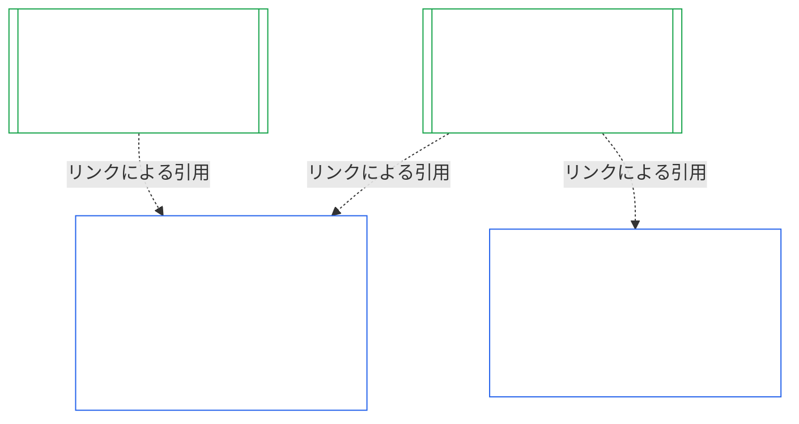
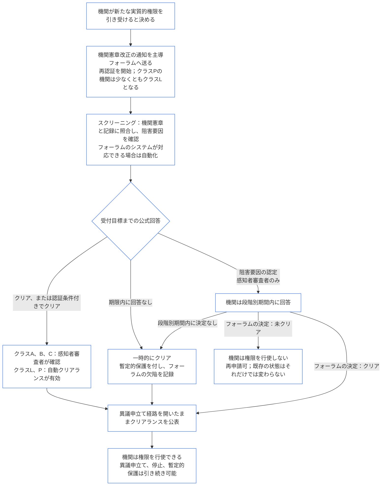

<!-- AI-assisted translation draft; unreviewed; English controls.
Source: core_10.000_institutional_alignment_certification.md
Source snapshot: 247e2180509e5e029c1106878cf225067339e010
Source SHA-256: a163a782114e584d09e295db66fe8b1b10a005b0f00116c8360396a0535ff221 -->

# 第十章：機関整合性認証

<strong>コーパス上の位置（非操作性）：ファイル構造と読み方</strong>

> このファイルは**感知者憲法の一部**であり、番号付きの他の `core_*` ファイルと一体の文書として読まれる場合に限り**拘束力をもつ**。本ファイルは**第十章** — **機関整合性認証**を含む。すなわち、[機関](core_05.040_band_continuity.md#institution)を、機関が運営する個々のシステムとは区別して、分類、評価、審査、決定、記録、最新状態の維持、および再開する方法である（**§1–§11**）。第十章は[第九章](core_09.000_system_alignment_certification_evaluation.md#chapter-nine-system-alignment-certification) (*システム整合性認証*) の機関側に対応し、**その節番号は同じである**。ここでの §N は、そちらの §N に答える。[CS-9.320](corpus_systems/cs_09.320_system_alignment_certification_illustrations.md#cs-9320-system-alignment-certification-illustrations) (*システム整合性認証の適用例*) には、システムの適用例と、[§12 機関のウォークスルー例](corpus_systems/cs_09.320_system_alignment_certification_illustrations.md#cs-9320-12-illustrative-institution-walkthroughs)に三つの機関のウォークスルー例がある。本章ではそれらを繰り返さない。
>
> | § | 第九章（システム） | 第十章（機関） |
> |---|------------------------|----------------------------|
> | 1 | 目的と役割 | システム認証との関係、誰が認証を受けるか、設立・運営の許可やゲートではないこと、新たな実質的権限を待つこと、初回認証期間 |
> | 2 | システムクラス評価 | 機関クラス；クラスに応じた段階化 |
> | 3 | システム全体の認証評価 | 常に評価する八つの機関項目 |
> | 4 | 該当する場合の評価 | 第九章 §4 への参照 |
> | 5 | 権利の床と領域別評価 | 第九章 §5 への参照 |
> | 6 | フォーラム手続 | 四つの席；フォーラムの役割と順序；フォーラム、認証者、記録事務所を機関として扱うこと |
> | 7 | 認証の結果 | 機関とそのシステムの稼働開始、認証条件、結果のその他の効果；欠陥への参照；是正準備；拒否と取消し |
> | 8 | システム認証記録 | 機関認証記録 |
> | 9 | 再認証と再開 | 監視；再開の発動条件；暫定認証と完全認証；回避禁止；システム認証からの連鎖；統治違反時のシステム再開 |
> | 10 | 認証への異議申立て | 異議申立ての経路 |
> | 11 | 当事者適格との関係 | 当事者適格への接続 |
>
> - **憲法上の所管（第九章との共同）：** フォーラムの監督下で行う整合性認証と関連記録。第十章は機関という対象を加える。新たなフォーラム群、新たな席、または新たな結果用語は加えない。
> - **反復ではなく再利用：** 第III相から第VI相は、[第九章 Part B §6](core_09.005_system_alignment_certification_record_process.md#6-forum-process) から[第九章 Part C §11](core_09.010_system_alignment_certification_record_recertification.md#11-relationship-to-standing) が定めるとおりに実施する。第十章は、対象が機関の場合に変わる点だけを述べる。
> - **移設禁止規則：** 第十章は、システムについての第九章の評価手順、第七章のシステム憲章および機関憲章の項目、第八章の四席要件、[corpus_institutions](corpus_institutions.md) にある機関の義務、第十一章の当事者適格測定、または第十二章の当事者適格の効果を再記述しない。
>
> **上流：** [第七章](core_07.000_charters.md#chapter-seven-system-and-institutional-charters) の憲章；[第八章](core_08.000_functional_independence_separation_of_duties.md#chapter-eight-functional-independence-and-separation-of-duties) の機能的独立性；[第九章](core_09.000_system_alignment_certification_evaluation.md#chapter-nine-system-alignment-certification)（[A](core_09.000_system_alignment_certification_evaluation.md#chapter-nine-part-a-system-alignment-certification--evaluation)、[B](core_09.005_system_alignment_certification_record_process.md#chapter-nine-part-b-system-alignment-certification--forum-process-and-outcomes)、[C](core_09.010_system_alignment_certification_record_recertification.md#chapter-nine-part-c-system-alignment-certification--record-recertification-and-standing)各部）；第十四章のフォーラム監督。
> **下流：** 第十一章の当事者適格記録と検証済み入力；第十二章の当事者適格の効果。

<strong>追跡情報</strong>

- 上流：
  - [第七章 §1 システム憲章と機関憲章が必要となる場合](core_07.000_charters.md#1-when-system-and-institutional-charters-are-required) (7.000 §1) (*どの機関がシステム憲章または機関憲章を公開するか、および機関のクラス*)；
  - [第七章 §7 改正と審査](core_07.000_charters.md#7-amendment-review-and-scope-misalignment) (7.000 §7) (*機関憲章の審査で検証する事項*)；
  - [第七章 §4 憲章役割図と当事者適格記録の保管](core_07.000_charters.md#4-the-charter-role-map-and-standing-record-custody) (7.000 §4) (*席の配置*)；
  - [第八章 §2 四席の憲法上の要件](core_08.000_functional_independence_separation_of_duties.md#2-four-seat-constitutional-requirement) (8.000 §2) および[§9 後続プロセスとの関係](core_08.000_functional_independence_separation_of_duties.md#9-relationship-to-later-processes)；
  - [第九章](core_09.000_system_alignment_certification_evaluation.md#chapter-nine-system-alignment-certification) (9.000 から 9.010) (*本章が再利用するシステム整合性認証プロセス*)；
  - [二つの基本的な問い](core_00.000_preamble.md#two-fundamental-questions)；
  - [憲法四元](core_00.000_preamble.md#constitutional-tetrad)；
  - [Article XI-E](core_06.005_rights_part_b.md#article-xi-e-institutional-formation-and-business-creation) (*機関の設立と事業の創出*)。
- 下流：[§1](#1-purpose-and-role) から[§11](#11-relationship-to-standing)；第十一章（[11.000](core_11.000_standing_assessment.md#chapter-eleven-contribution-violation-and-standing-model--measurement)）；[第十四章](core_14.000_forum.md#chapter-fourteen-forums-and-jurisdiction) (14.000)。
- 併読：
  - [機関整合性認証](core_05.040_band_continuity.md#institutional-alignment-certification) および
  - [機関認証記録](core_05.040_band_continuity.md#institutional-certification-record) (*第五章における意味*)；
  - **CI-8.205 §6** (*システム憲章と機関憲章の内容、審査、および設立テンプレート*)；
  - **CF-14.425** (*完全性の保護措置、支配的捕捉防止の運用、および自己審査防止の支援*)。

 

第十章は、**機関整合性認証**の憲法上の所管である。[第九章](core_09.000_system_alignment_certification_evaluation.md#chapter-nine-system-alignment-certification) のプロセスを、システムから機関へと拡張する。

- **第I相、枠組み設定：** 機関クラスと、それに応じて評価を段階化する方法（[§2 機関クラス評価](#2-institution-class-evaluation)）；
- **第II相、評価：** 該当する場合に適用される評価と、権利の床および領域別評価を含む機関評価（[§3 機関全体の認証評価](#3-whole-institution-certification-evaluation) から[§5 権利の床と領域別評価](#5-rights-floor-and-domain-evaluations)）；
- **第III相、審査：** フォーラムの役割と順序（[§6 フォーラム手続](#6-forum-process)）；
- **第IV相、決定：** 結果、是正準備、拒否と取消し（[§7 認証の結果](#7-certification-outcomes)）；
- **第V相、記録：** 機関認証記録（[§8 機関認証記録](#8-institutional-certification-record)）；および
- **第VI相、運用：** 再認証、再開、システム認証からの連鎖、機関のシステムの再開、異議申立ての経路、および当事者適格への接続（[§9 再認証と再開](#9-recertification-and-reopening) から[§11 当事者適格との関係](#11-relationship-to-standing)）。

*平たい言葉で言えば：第九章は**システム**が整合しているかを問う。第十章は、システムを運営する、またはシステムを運営せず権限をもつ**機関**について同じことを問う。機関が整合していても、そのシステムの一つが整合していないことがあり、その逆もある。そこで機関については、機関だけが管理する事項 — 機関憲章に記されたことを行うか、誰がその権限について説明責任を負うか、機関自身の構成員に何を報いるか、そして独立した検査を実際に利用できるか — を確認する。各システムの認証に依拠し、それをやり直すことはない。これは許可証ではない。機関の設立や運営に、その許可は必要ない。*

### 1. 目的と役割

<strong>追跡情報</strong>

- 上流：
  - [第七章 §1 システム憲章と機関憲章が必要となる場合](core_07.000_charters.md#1-when-system-and-institutional-charters-are-required) (7.000 §1)；
  - [第九章 Part A §1 目的と役割](core_09.000_system_alignment_certification_evaluation.md#1-purpose-and-role) (9.000 §1)；
  - [Article XI-E](core_06.005_rights_part_b.md#article-xi-e-institutional-formation-and-business-creation) (*機関の設立と事業の創出*)；
  - [Article XXVIII-A](core_06.020_rights_part_e.md#xxviii-a-existing-instantiations-adoption-transition-window) (*段階的採用と権利の床の継続*)。
- 下流：[§2](#2-institution-class-evaluation)；[§6](#6-forum-process)；[§7](#7-certification-outcomes)；[§9](#9-recertification-and-reopening)。
- 併読：
  - [機関](core_05.040_band_continuity.md#institution)；
  - [機関憲章](core_05.040_band_continuity.md#institutional-charter)；
  - [システム憲章](core_05.040_band_continuity.md#system-charter)；
  - [事業の創出](core_05.055_band_participation.md#business-creation)。

 

*平たい言葉で言えば：システムの認証はそのシステムに属する。機関の認証は、システムの認証を引用し、機関だけが説明責任を負う事項を加える。一つのシステムが複数の機関の下に置かれることも、どの機関の下にも置かれないこともある。この章のいかなる内容も、認証によって機関の設立を妨げるものではない。*

機関整合性認証とシステム整合性認証は、リンクで結ばれた二つの認証である。その関係は**包含ではなくリンクによる構成**である。図では、システム認証記録から、それを引用する各機関認証記録へ矢印が伸びる。どの機関の下にもないシステムには矢印がなく、それを必要ともしない。システムを運営しない機関は、単独の記録をもつ。

リンクによる構成には二つの側面があり、まず機関側から説明する。

機関側では：

- **機関認証記録はシステムの記録を引用し、再評価しない：** システム認証記録をリンクで引用し、その版を明記する。本章はシステム評価を再実施せず、システムのクラスを再決定せず、システムの結果、状態、または認証条件を変更しない。
- **機関の認証によってシステムの状態は引き上げられない：** 「未認証」のシステムは、機関の状態にかかわらず「未認証」のままである。認証を受けたシステムも、機関についての認定から保護されない。
- **機関に関する事実は一度だけ認定する：** [第九章 Part A §3.1 統治、インセンティブ、および争訟可能性の規律](core_09.000_system_alignment_certification_evaluation.md#31-governance-incentive-and-contestability-discipline) が運営者の統治とインセンティブを問う場合、運営者について最新の機関認証記録があれば、その事実をリンクで提示できる。それらの事実が当該システムにとって十分かどうかは、システムのフォーラムが決める。同じ機関の事実について、理由をシステム認証記録に示さず、異なる認定をしてはならない。

システム側では：

- **システム認証記録はシステムに属する：** これは[第九章](core_09.000_system_alignment_certification_evaluation.md#chapter-nine-system-alignment-certification) に基づく、そのシステム自身の記録である。
- **一つのシステム認証記録を複数の機関が引用できる：** [第七章 §1 システム憲章と機関憲章が必要となる場合](core_07.000_charters.md#1-when-system-and-institutional-charters-are-required) に基づき、一つのシステムを複数の機関が運営、責務管理、または実質的に管理することがある。それぞれが同じ記録を引用する。
- **システムはどの機関の下にも置かれなくてよい：** 個々の感知者は機関ではないため、機関をもたないシステムもあり得る。機関をもたないシステムは[第九章](core_09.000_system_alignment_certification_evaluation.md#chapter-nine-system-alignment-certification) だけに基づいて認証され、本章の事項を必要としない。機関の下にあるシステムも同じ方法で認証する。本章は機関について別個の記録を追加するものであり、システム自体の認証手順には含まれない。

#### 1.1 誰が認証を受けるか

クラスL以上の機関は本章の対象となり、そのクラスは[§2.1 機関クラス](#21-institution-class) に基づいて決める。システムを一つも運営しない機関も含む。その機関には引用するシステム認証記録がなく、クラスは機関自身の影響によって決まる。機関の**ポートフォリオ**とは、機関が運営、責務管理、または実質的に管理するシステムの集合である（[ポートフォリオ](core_05.040_band_continuity.md#portfolio)）。

- **クラスA、B、C、およびL：** [§2.2 クラスに応じた段階化](#22-scaling-by-class) に従い、クラスに応じて段階化してプロセスを適用する。
- **クラスP：** プロセスの利用を推奨し、任意に利用できる。クラスL以上に再分類された場合、または機関が憲法適合性を自発的に主張する場合は、必須となる。クラスPの機関が新たな実質的権限を引き受けると決めた場合、[§9.2.2 新たな実質的権限を得た場合の再認証](#922-recertification-for-new-material-authority) に基づく通知を行った時点で、少なくともクラスLに再分類される。その権限は定義上実質的であり（[§9.2.1 新たな実質的権限に該当するもの](#921-what-counts-as-new-material-authority)）、いずれかの領域で実質性をもつ機関は少なくともクラスLだからである（[§2.1 機関クラス](#21-institution-class)、項目2）。この再分類は、通知の撤回がクリアランス前に行われるか、権限がクリアされず、その権限が一度も行使されていないことを条件として、通知からその時点まで続く。その後、機関はクラスPに戻り、限定的な初回認証を終了する。新たな通知によって再び開始され、クリアランスなしに権限を行使した場合は、[§9.2.2 新たな実質的権限を得た場合の再認証](#922-recertification-for-new-material-authority) (*通知なし、またはクリアランス前の行使*) に基づく認定が維持される。これは[第九章 Part A §1 目的と役割](core_09.000_system_alignment_certification_evaluation.md#1-purpose-and-role) と対応する。
- **システムが一つ：** システム憲章を必要とするシステムをちょうど一つ運営する機関は、一度の認証審査と一つの記録をもち、本章ではこれを**単一システム評価**と呼ぶ。システム認証記録には、[§8 機関認証記録](#8-institutional-certification-record) の項目を含む*機関に関する認定ブロック*があり、それが機関認証記録として機能する。フォーラム、席、期限はシステム自体の認証審査のものを用い、機関に関する項目を加える。その結果には固有の拒否・取消し事由が適用され、[§7.4 機関に対する拒否と取消し](#74-denial-and-revocation-for-an-institution) に定める。システムがポートフォリオ全体であるため、[§9.5 システム認証からの連鎖](#95-cascade-from-system-certifications) は連鎖としては適用されない。ただし、[§7.4 機関に対する拒否と取消し](#74-denial-and-revocation-for-an-institution) の規則1および2（指標と原因の所在に関する検査）は適用される。
- **システムが複数：** 機関について機関認証記録を一つ作成し、運営する各システムのシステム認証記録へリンクする。各システムはそれぞれ固有の審査と記録を維持する。
- **システムなし：** 機関認証記録を単独で一つ作成する。機関はシステムを運営しないため、リンクするシステム認証記録はない。

#### 1.2 設立・運営に許可もゲートも要しない

機関整合性認証は、機関がその権限を実際にどのように用いるかを独立して検査するものである。機関から独立したフォーラムが実施し、認定内容を記した機関認証記録をもって終了する。

- **設立と運営：** 機関は、機関認証を先に得なくても設立し、機関憲章を公開し、権限の行使を開始し、運営を続けられる。いかなる結果も、その権利を与えたり取り上げたりしない。
- **結果の効果：** 結果がもつ効果は[§7.1 機関の稼働開始](#71-go-live-for-an-institution) に定めるものに限る。
- **この領域における唯一のゲート：** **Article XI-E** (*機関の設立と事業の創出*) に、限定的なゲートが三つある。
  - 指名された感知者に対する未解除のロック。これは当該感知者の権限に付される。
  - 不整合を示す特定の検証済み事実に対する臨時留保。これも指名された感知者の権限に付される。
  - 運営主体自体に対するロック。機関にロックが付されている場合に限り、その機関にも付される。**CI-12.210 §4** (*解散*) に基づく解散済み機関に対するロックはその一例である。

  認証上の認定は、[§7.5 機関に対する拒否と取消しの効果](#75-effects-of-denial-and-revocation-for-an-institution) に基づく証拠として、これらのゲートの一つを決定するフォーラムに付託できる。認証の結果自体はゲートではなく、ゲートを開いたり閉じたりしない。
- **新たな実質的権限を待つこと：** 新たな実質的権限を引き受けると決めた機関は、[§9.2.2 新たな実質的権限を得た場合の再認証](#922-recertification-for-new-material-authority) の条件に従い、その権限を行使する前に、再認証で当該権限がクリアされるのを待つ。**Article XI-E** (*機関の設立と事業の創出*) はこの待機を定める。これは三つの限定的なゲートの一つではなく、機関の設立・運営に対するゲートでもない。新たな権限だけに付され、それ以外の機関の活動はすべて続く。[§9.2.2 新たな実質的権限を得た場合の再認証](#922-recertification-for-new-material-authority) の図が手順をまとめている。
- **裏口を設けない：** フォーラム、採用者、または現職者は、本章のいかなる内容も、創設者を締め出したり現職者を保護したりする認可のしきい値として用いてはならない。それは[Article XI-E](core_06.005_rights_part_b.md#article-xi-e-institutional-formation-and-business-creation) (*機関の設立と事業の創出*) を損なう。
  - プロセスの費用には[回避可能な負担](core_05.040_band_continuity.md#avoidable-burden) が適用される。
  - プロセスの深さには[クラスに応じた統治](core_05.050_band_oversight.md#classification-scaled-governance) が適用される。
  - 新たな実質的権限を待つ要件は、同じクラスのすべての機関に同じ条件で適用され、すでに他者にとって実質的な権限だけを対象とする。

システムの稼働開始ゲートは機関のものと別個であり、システムに適用される。[第九章 Part B §7.1 稼働開始ゲート](core_09.005_system_alignment_certification_record_process.md#71-go-live-gate) に基づき、新規システムまたはその実質的な拡張は、機関の状態にかかわらず、独自の認証を経て初めて稼働する。

#### 1.3 初回認証の期間

初回の機関認証記録は、採用文書が機関クラスごとに定める期間内に作成しなければならない。

- **新しい機関：** 期間は、[領域別の実質性](core_05.050_band_oversight.md#domain-specific-materiality) による判断で、他者に対する実質的な影響が初めて生じた日から始まり、初回認証は暫定認証となる。
- **通知によって再分類されたクラスPの機関：** 新しい機関と同様、期間は[§9.2.2 新たな実質的権限を得た場合の再認証](#922-recertification-for-new-material-authority) に基づき通知を行った日から始まる。すでに終了した採用移行期間を起点とすることはない。
- **すでに運営中の機関：** [Article XXVIII-A](core_06.020_rights_part_e.md#xxviii-a-existing-instantiations-adoption-transition-window) (*段階的採用と権利の床の継続*) に基づく採用移行期間を用いる。[第七章 §1.5 システム憲章または機関憲章の提出時期](core_07.000_charters.md#15-when-a-system-charter-or-institutional-charter-is-due) の既定の定めとも整合する。
- **期間を過ぎた場合：** 以下に示す免責に該当せず、初回審査を受けないまま期間が満了した機関は、欠陥を記録して是正しなければならず、期間の満了によって初回審査が開始される。すでに運営中のクラスL以上の機関には、以下のマイルストーン不履行も生じる。ゲートはないため、機関の運営を停止したり禁じたりはしない（[§1.2 設立・運営に許可もゲートも要しない](#12-no-permission-and-no-gate-on-forming-or-running)）。
  - **すでに運営中の機関：** これはクラスL以上の機関に本章独自の規則を設けるものであり、システムと派生主体を定める[Article XXVIII-A](core_06.020_rights_part_e.md#xxviii-a-existing-instantiations-adoption-transition-window) (*段階的採用と権利の床の継続*) に準じる。採用移行期間が終わるまでに初回認証審査を完了しなかった（暫定・完全認証も、[§7 認証の結果](#7-certification-outcomes) に基づく結果決定もない）場合、期限を逃したことになる。期間内に申請し協力していた機関は、フォーラム自身の期限超過（[第十四章 §6 適時な解決、実質性の段階、および遅延防止の規律](core_14.000_forum.md#6-timely-resolution-materiality-tiers-and-anti-delay-discipline)、*期限超過の審査*；[第九章 Part C §9.3.4 段階別期間](core_09.010_system_alignment_certification_record_recertification.md#934-tier-windows)）または[§7.3 機関の是正準備](#73-remediation-readiness-for-an-institution) に基づく唯一の延期が進行中であるために審査が未完了なら、期限を逃したことにはならない。[Article XXVIII-B](core_06.020_rights_part_e.md#article-xxviii-b-adoption-transition-authority-limits-and-reauthorization) (*採用移行権限の制限と再授権*) に基づく再授権を文書で示さない限り、これは採用移行マイルストーンの不履行であり、[第十一章](core_11.000_standing_assessment.md#chapter-eleven-contribution-violation-and-standing-model--measurement) の通常の遵守・違反手続が開始される。同条の抑制義務は発効日から適用され、期間が経過したからといってその欠落が新たな常態になることはない。これは[第九章 Part B §7.1.1 すでに運営中のシステム](core_09.005_system_alignment_certification_record_process.md#711-systems-already-operating) と対応する。これはゲートではない。
  - **認証審査：** 他の審査と同じように決定する。[§7 認証の結果](#7-certification-outcomes) に定める「未認証」を含むいずれの結果にもなり得て、[§7.5 機関に対する拒否と取消しの効果](#75-effects-of-denial-and-revocation-for-an-institution) の効果が適用される。
  - **制裁と解散：** 本章はそれらを設けない。停止、管財、構造分離、および解散は、**CI-12.210** (*機関の失敗と解散*) および **CI-12.215** (*機関の説明責任と制裁*) に基づき管轄権をもつフォーラムが引き続き扱う。当該フォーラムへの付託は、[§7.5 機関に対する拒否と取消しの効果](#75-effects-of-denial-and-revocation-for-an-institution)（項目5、*付託*）に定める付託事由がある場合に限る。

### 2. 機関クラス評価

<strong>追跡情報</strong>

- 上流：
  - [第七章 §1 システム憲章と機関憲章が必要となる場合](core_07.000_charters.md#1-when-system-and-institutional-charters-are-required) (7.000 §1)；
  - [第九章 Part A §2 システムクラス評価](core_09.000_system_alignment_certification_evaluation.md#2-system-class-evaluation) (9.000 §2) および[§2.2 すべての評価におけるシステムクラスの段階化](core_09.000_system_alignment_certification_evaluation.md#22-how-system-class-scales-every-evaluation)；
  - [第三章 §2.1 一般的な回避パターン](core_03.000_definition_integrity.md#21-common-evasion-patterns) (3.000 §2.1)。
- 下流：[§3](#3-whole-institution-certification-evaluation) (*クラスによって段階化される項目*)；[§8](#8-institutional-certification-record) (*記録に明記するクラス*)；[§9.2](#92-reopening-triggers) (*再評価の発動条件*)。
- 併読：
  - **CS-9.305** (*システム分類の仕組み*) および **CS-9.310** (*システム影響分類*)、ならびに[corpus_systems/cs_09.310_system_impact_classifications.md](corpus_systems/cs_09.310_system_impact_classifications.md) (*クラス目録*)；
  - **CI-9.210** (*分類に連動した機関の義務*)；
  - **CI-8.205 §6** (*システム憲章と機関憲章の内容、審査、および設立テンプレート*)。

 

*平たい言葉で言えば：まず、他者にとっての重要度によって機関をクラス分けする。自称ではなく、実際に何を決定し、何を保有するかで判断する。そのクラスによって評価の厳しさが決まる。クラスが高いほど、より厳格な証明、より独立した審査、より早い再確認が必要になる。*

この節は、機関に対する**第I相、枠組み設定**である。

#### 2.1 機関クラス

**機関クラス**は、機関がもたらす最大の実質的影響に基づき決める。その影響は、機関が運営するシステムを通じても、どのシステムも介さずにも生じ得る。機関が実際に何を決定、保有、管理するかによって判断し、機関のラベル、法的形態、または機関憲章の一覧には依拠しない。クラスは、[第九章 Part A §2.2 すべての評価におけるシステムクラスの段階化](core_09.000_system_alignment_certification_evaluation.md#22-how-system-class-scales-every-evaluation) がシステムについて定めるのと同様に、評価の深さと期限を決める。本章および[第七章 §1.2 対象となるクラス](core_07.000_charters.md#12-which-classes-are-covered) で用いるクラスである。

1. **システムを通じた影響：** 機関のクラスは、そのポートフォリオ内にあるシステムのうち最も高いクラス以上となる（[第七章 §1 システム憲章と機関憲章が必要となる場合](core_07.000_charters.md#1-when-system-and-institutional-charters-are-required)）。システムは観察された運用から特定する。機関憲章に記載されていないシステムも数える。
2. **システム外の影響：** 機関自身の実質的影響と依存関係は、システムを運営しているか否かにかかわらず考慮する。**CS-9.305** (*システム分類の仕組み*) および **CS-9.310** (*システム影響分類*) のクラス定義を、次の要因を用いて機関自身の決定と保有事項に適用する。
   - **決定・保有するもの：**
     - 他の感知者の生存必需品、教育、安全、生計、権利、または当事者適格へのアクセスについて決めること；および
     - 資金、記録、会員資格、当事者適格記録の保管、またはフォーラム、認証者、記録事務所の機能などを保有すること。
   - **実質性の有無：**
     - [領域別の実質性](core_05.050_band_oversight.md#domain-specific-materiality) のいずれかの領域において、機関自身の活動が実質的かどうか。他者が従うか、確定事項として依拠し得る[実質的拘束行為](core_05.035_band_accountability.md#materially-binding-act) を行うことも含む；
     - いずれか一つの領域で実質性をもつ機関は、**CS-9.305** (*システム分類の仕組み*) および **CS-9.310** (*システム影響分類*) に基づき少なくともクラスLとなる；および
     - 他者が自由に受け取るか断るかを決められ、必要なものへのアクセスを誰にも支配しない援助、物品、労働、またはサービスの提供は、誰も拘束しない。これは実質的拘束行為ではなく行為として扱い、他の要因を通じてのみ考慮する。
   - **依存する人の規模：**
     - 何人の感知者が機関に依存するか、および代替可能性；
     - 実質的管理ラインの意味における権限の集中度；および
     - 機関の決定がどの程度可逆的か。
3. **共通の管理：** [領域別の実質性](core_05.050_band_oversight.md#domain-specific-materiality) の集約規則に基づき、一つの運用となる運営主体（[実質的管理ライン](core_05.035_band_accountability.md#material-control-line) 内で実際に共通管理されるもの。資金提供だけでは該当しない）は、実務上、一つの機関として行動する場合はまとめて分類する。クラスLに達する部分がなくなるよう、運営主体、ポートフォリオ、または権限を分割することは、[第三章 §2.1 一般的な回避パターン](core_03.000_definition_integrity.md#21-common-evasion-patterns) に基づく範囲・境界の回避となる。
4. **再分類：** クラスは[§9.2 再開の発動条件](#92-reopening-triggers) に基づく発動条件で再評価する。分類とその理由は機関認証記録に記載する。

#### 2.2 クラスに応じた段階化

機関クラスは、[第九章 Part A §2.2 すべての評価におけるシステムクラスの段階化](core_09.000_system_alignment_certification_evaluation.md#22-how-system-class-scales-every-evaluation) と同じ方法で、証拠の深さ、審査の独立性、認証間隔の既定値、および記録上の開示を段階化する。認証間隔は[第十四章 §6 適時な解決、実質性の段階、および遅延防止の規律](core_14.000_forum.md#review-cadence) (*審査間隔*) に定める。採用文書はより短い間隔を設定でき、暫定再認証を問題なく何回行えるかを定める。

- **クラスA、B、およびC：** [§3 機関全体の認証評価](#3-whole-institution-certification-evaluation) にある八つすべての項目を、クラスに比例する証拠と独立性で評価する。
- **クラスL：** 同じ八項目を簡略化し、[クラスに応じた統治](core_05.050_band_oversight.md#classification-scaled-governance) が認める場合は、より簡単な記録と、より長い認証間隔の既定値を用いる。クラスLの審査の中心は、機関憲章と実務の照合、役割図、成立審査の記述、引用されたシステム認証の有効性である。項目を省略してはならず、認定事項がない項目も一行で明記する。
- **クラスP：** [§1.1 誰が認証を受けるか](#11-who-is-certified) に定めるとおり任意とする。

**共同専門業務における受入機関。** 機関が受入機関である場合（[**CI-15.205 §7**](corpus_institutions/ci_15.205_appointment_competency_rotation_removal.md#ci-46-seat-advisory) (*業務許可、業務クリアランス、共同専門業務*)）、認証では、その受入機関が担う席に照らして構成員の行為を抽出審査し、構成員の採用通知を受入機関の実際の行動と照合する。ある構成員の行為に関する認定はその構成員に関する認定であり、受入機関が担う席に不備がある場合に限り受入機関にも及ぶ。

### 3. 機関全体の認証評価

<strong>追跡情報</strong>

- 上流：
  - [第九章 Part A §3 システム全体の認証評価](core_09.000_system_alignment_certification_evaluation.md#3-whole-system-certification-evaluation) (9.000 §3)；
  - [第七章 §3 システム憲章と機関憲章に記載すべき事項](core_07.000_charters.md#3-what-system-and-institutional-charters-must-state) (7.000 §3)；
  - [第七章 §5 成立審査：役職者の当事者適格と真正性](core_07.000_charters.md#5-formation-check-office-holder-standing-and-authenticity) (7.000 §5)；
  - [第七章 §7 改正と審査](core_07.000_charters.md#7-amendment-review-and-scope-misalignment) (7.000 §7)；
  - [二つの基本的な問い](core_00.000_preamble.md#two-fundamental-questions)；
  - [第一章 §19.6 所有や構造が変わっても責任を保持すること](core_01.010_stewardship_capacity_principles.md#196-keeping-responsibility-when-ownership-or-structure-changes) (1.010 §19.6)。
- 下流：[§6](#6-forum-process) (*フォーラムが審査する認定*)；[§9](#9-recertification-and-reopening) (*再開の発動条件*)；[§11](#11-relationship-to-standing) (*指名された感知者に関する認定の検証済み入力ゲート*)。
- 併読：
  - **CI-8.205 §3** (*権限の連鎖と委任管理*) および **CI-8.205 §6** (*システム憲章と機関憲章の内容、審査、および設立テンプレート*)；
  - **CI-6.215** (*資源の責務ある管理とインセンティブの完全性*)；
  - 項目8については、**CI-8.210** (*利益相反の完全性、支配的捕捉防止、汚職防止*)、**CI-6.205** (*透明性、参加、アクセス可能な異議申立てとサービス経路*)、および **CI-12.205** (*救済制度と機関の救済能力*)。

 

*平たい言葉で言えば：機関に属する事項、つまり個々のシステムには属さない事項を確認する。機関憲章を守っているか、誰がその権限について説明責任を負うか、何に報いているか、そして独立した検査が実際に機能するかを調べる。*

この節は、機関に対する**第II相、評価**である。

各認証審査では、機関に関する次の八項目をすべて評価する。これらは[第九章 Part A §3 システム全体の認証評価](core_09.000_system_alignment_certification_evaluation.md#3-whole-system-certification-evaluation) に対応する。各認定には、証拠と、その根拠となる機関憲章の文言または観察された運用を記載する。

1. **機関憲章と実務の照合：**
   - [第七章 §7 改正と審査](core_07.000_charters.md#7-amendment-review-and-scope-misalignment) の審査一覧を用いて、機関憲章を観察された運用と照合する。
   - 実務が機関憲章から逸脱している場合も、機関憲章が実務を反映しなくなった場合も、いずれが誤っているかにかかわらず認定する。
2. **ポートフォリオと総合的な影響：**
   - ポートフォリオの根拠を検証する。各システムが機関の明示した目的に結び付いているかを確認し、理由が示されていないシステムは認定する。
   - また、各システム単独の認証では明らかにならない次の事項を、全システム横断で評価する。
     - 共有依存関係；
     - 総合的な依存；
     - 共有基盤からの累積的な抽出；および
     - 一つの機能を分割し、各部分がクラスや義務を免れるような取り決め。
3. **説明責任を負う権限：**
   - 機関が他者に対して行使する権限はすべて、名指しできる説明責任を負う役職に帰属しなければならない。その役職は、[第八章](core_08.000_functional_independence_separation_of_duties.md#chapter-eight-functional-independence-and-separation-of-duties) および **CI-8.205 §3** (*権限の連鎖と委任管理*) の規則に基づいて責任を負う。
   - 所有、管理、または構造が変わっても責任は免れない（[第一章 §19.6 所有や構造が変わっても責任を保持すること](core_01.010_stewardship_capacity_principles.md#196-keeping-responsibility-when-ownership-or-structure-changes)）。
4. **報酬とインセンティブ：**
   - 機関自身の給与、昇進、目標、および報酬を[二つの基本的な問い](core_00.000_preamble.md#two-fundamental-questions) に照らす。すなわち、構造は実際に何に報いているか、それは憲法上の二つの目的に向かうのか、そこから離れるのか。
   - 個々のシステムがすべて認証済みであっても、不整合やその隠蔽に報いる報酬構造は認定する。
   - [第九章 Part A §3.3 時間的一貫性の制約](core_09.000_system_alignment_certification_evaluation.md#33-time-consistency-constraint) を適用する。安全、真実、または福利に対する予見可能な中期・長期の損害が未解決である場合、短期指標、局所的な遵守、短期効率だけでは不十分である。その代償として短期的成果に報いる報酬構造は認定する。
   - インセンティブの完全性に関する機関の義務は **CI-6.215** (*資源の責務ある管理とインセンティブの完全性*) に属し、ここでは引用するだけで再記述しない。
5. **役割図と保管：**
   - [憲章役割図](core_05.040_band_continuity.md#charter-role-map) は、実在し、記載どおりに補充または代行される役職を明示する。機関自身が対象となる記録については、その役職が機関から[独立](core_05.035_band_accountability.md#independence)していることを示す。
   - 独立した経路が実際に利用できること。
   - 席の配置漏れ、機能していない役職、または機関自身の指揮系統内にある記録保管者は、いずれも認定する。
6. **引用された各システム認証の有効性：**
   - 機関が運営する各システムについて、システム認証記録が有効であるか、採用移行期間内にあるかを評価する。また、機関がその記録の認証条件で求められることを実施したかを確認する。
   - 期限切れ、撤回、失敗、または理由の記録がない認証の欠落は認定事項とし、[§9.5 システム認証からの連鎖](#95-cascade-from-system-certifications) に従って機関に及ぼす。
7. **役職者の当事者適格と真正性：**
   - [第七章 §5 成立審査：役職者の当事者適格と真正性](core_07.000_charters.md#5-formation-check-office-holder-standing-and-authenticity) に基づき公開された成立審査の記述を、証明書に依拠せず、観察された運用と照合する。
   - 対象となる各役職について、フォーラムは当事者適格に関する事実を検証済み記録と照合し、管理、利害、報酬、行為、および保護された発言に関する証拠から真正性を認定する。具体的には次を確認する。
     - 実際に役職者を指揮している者は誰か；
     - 役職者が何に対して報酬を受け、昇進しているか；
     - 役職者がその職務で行ったことを検証可能な形で示せるか；および
     - [保護される報告](core_05.035_band_accountability.md#protected-reporting-whistleblowing) を行った者、または違法・違憲の指示を拒否した者（[第一章 §17.5 抵抗する義務](core_01.010_stewardship_capacity_principles.md#175-duty-to-resist)）を、役職者を含め、誰かが処罰したか。
   - 対象となる役職をもたない職員は個別には審査しない。職員の保護措置の確認（[第七章 §5.6 職員保護の確認](core_07.000_charters.md#56-staff-safeguards-check)）によって対象とし、フォーラムは同じ方法で観察された運用と照合する。次を確認する。
     - 機関の任命、給与、昇進、および解任の規則が、明示された目的に反する業務に報いる仕組みになっていないか；
     - 保護される報告の経路が存在し、それを使った職員や違法・違憲の指示を拒否した職員が処罰されていないか；および
     - [Article III-C](core_06.000_rights_part_a.md#article-iii-c-labor-and-economic-floor) (*労働と経済の床*) における権利が保たれているか。
   - 次の各項目を認定する。
     - 開示されていない管理者の名義人である役職者；
     - 書面上にしか存在しない対象役職。機関憲章または憲章役割図に記載されているが、実際に役職に就いて業務を行う者がいない場合；
     - 機関憲章で公表された制限が禁じる行為に対して役職者に報いる報酬構造；および
     - 虚偽または不完全な記述。
   - 認定は役職と構造に関するものである。[§11 当事者適格との関係](#11-relationship-to-standing) の検証済み入力ゲートを通じてのみ、指名された感知者に結び付く。
   - 成立審査は信条を検査しない。ただし、他者が害や差別的取扱いを受けるべきだとする検証済みの言明は行為であり、[第一章 §7.5 表現と害の境界線](core_01.000_values_principles.md#75-expression-and-the-harm-line) に定めるとおり、役職者に不利な事情として扱う。
   - 項目3、4、5はこの項目と併せて読む。一つで認定された事実を、他の項目で再度認定しない。
8. **機関自身の機関義務：**
   - 採用された機関関連の文書が機関に課す義務への遵守を、証明書に依拠せず、観察された運用と照合する。該当する義務は **CI-8.210** (*利益相反の完全性、支配的捕捉防止、汚職防止*)、**CI-6.205** (*透明性、参加、アクセス可能な異議申立てとサービス経路*)、**CI-6.215** (*資源の責務ある管理とインセンティブの完全性*)、および **CI-12.205** (*救済制度と機関の救済能力*) である。
   - 監督、説明責任、参加、および適時性の経路が存在し、実際に利用でき、機関自身が定めた時間内に応答するかを検査する。その期間は機関クラスに応じた下限の期間を超えてはならない（[Article XXVI-C](core_06.020_rights_part_e.md#article-xxvi-c-timely-resolution-and-anti-delay-floor) (*適時な解決と遅延防止の下限*)、ならびに[CF-14.445 §3.1 段階別目標と上限](corpus_forum/cf_14.445_performance_backlog_publication_accessibility.md#cf-14445-31-stage-targets-and-outer-bounds) の該当段階の目標）。機関が示した期間がこれを超えること自体を認定する。
   - 書面上にしか存在しない経路、到達できない経路、期限内に応答されない経路は、それぞれ認定事項となる。
   - これらの義務は該当文書に属し、引用するだけで再記述しない。項目3から5で認定された事実を、この項目で再度認定しない。

**第九章 Part A §3 の追加二項目。** [第九章 Part A §3 システム全体の認証評価](core_09.000_system_alignment_certification_evaluation.md#3-whole-system-certification-evaluation) は、システムに対して二つの事項も求めるが、機関自身の行為にも適用される。機関評価の一部として、機関自身の発動条件が満たされる場合に限り、それぞれ適用する。

- **システム的な適用範囲とリスク要因：**
  - **適用される場合：** [第九章 Part A §3.2 システム的な適用範囲とリスク要因](core_09.000_system_alignment_certification_evaluation.md#32-systemic-scope-and-risk-factors) の要因に基づき、機関自身の行為がシステム的リスクの対象となる場合。最大規模の害、影響の拡大・累積（機関自身のサービス停止により下流で何が機能不全となるかを含む）、および機関の活動がどう悪用または誤った範囲で用いられ得るかを含む。
  - **評価の根拠：** [第九章 Part A §3.2 システム的な適用範囲とリスク要因](core_09.000_system_alignment_certification_evaluation.md#32-systemic-scope-and-risk-factors) に基づく。これにはリスク評価と開示の接続規定である[§3.2.1 リスク評価と開示の接続](core_09.000_system_alignment_certification_evaluation.md#321-risk-evaluation-and-disclosure-bridge) および[§3.2.2 欠陥と不整合](core_09.000_system_alignment_certification_evaluation.md#322-defects-and-misalignment) の欠陥を含む。
- **データの種類と取扱い：**
  - **適用される場合：** [第九章 Part A §3.4 データの種類と取扱いの評価](core_09.000_system_alignment_certification_evaluation.md#34-data-types-and-handling-evaluation) が実質的な影響をもつすべての認証記録に求めるとおり、機関自身の行為が実質的な範囲に含まれる種類のデータを扱う場合。
  - **評価の根拠：** インフラ保証を含め、機関クラスに応じて段階化した[第九章 Part A §3.4 データの種類と取扱いの評価](core_09.000_system_alignment_certification_evaluation.md#34-data-types-and-handling-evaluation) に基づく。
  - **記録先：** いずれのシステムの外でも機関が扱うデータについて、機関認証記録のデータの種類の欄（[§8.1 記録に最低限必要な内容](#81-minimum-record-contents)）に記録する。システム内で扱うデータはそのシステムの記録で一度だけ認定し、引用する。

[§4 該当する場合の評価](#4-evaluations-where-implicated) にある、引用されたシステム認証記録ですでに実施された評価を繰り返さない規則は、この二項目にも適用される。

### 4. 該当する場合の評価

<strong>追跡情報</strong>

- 上流：
  - [第九章 Part A §4 該当する場合の評価](core_09.000_system_alignment_certification_evaluation.md#4-evaluations-where-implicated) (9.000 §4)。
- 下流：[§6](#6-forum-process)；[§8](#8-institutional-certification-record)。
- 併読：
  - **CI-8.210** (*利益相反の完全性、支配的捕捉防止、汚職防止*)；
  - **CI-6.205** (*透明性、参加、アクセス可能な異議申立てとサービス経路*)；
  - **CI-6.215** (*資源の責務ある管理とインセンティブの完全性*)；
  - **CI-12.205** (*救済制度と機関の救済能力*)。

 

*平たい言葉で言えば：システムが該当する場合に評価される領域の一つに、機関自身の行為が関わるなら、同じ評価を機関にも一度適用する。*

機関自身の行為が[第九章 Part A §4 該当する場合の評価](core_09.000_system_alignment_certification_evaluation.md#4-evaluations-where-implicated) の対象事項に関わる場合、同じ発動条件の下で、該当する評価を機関自身の行為に適用する。それぞれ固有の発動条件が満たされる場合に限り適用する。

- **プライバシー（情報）：** 機関の行為が第六章の複数のプライバシー領域に実質的に関わる場合、各領域を扱わなければならない。一つだけで処理を終えることはできない（[第九章 Part A §4.1 プライバシー（情報）の共同適用](core_09.000_system_alignment_certification_evaluation.md#41-privacy-informational-joint-invocation)）。
- **自発的な中断、大規模な自己変更、および退出の権利：** 認証の主張が成立する前に、自発性、同意、強制の禁止、依存による圧力、情報、および可逆性を検証する。形式上の同意だけでは不十分である（[第九章 Part A §4.2 自発的な中断、大規模な自己変更、および退出の権利](core_09.000_system_alignment_certification_evaluation.md#42-voluntary-discontinuation-major-self-modification-and-exit-rights)）。
- **集会、集団的組織化、および機関の設立：** [分割禁止原則] に基づき共同で検証し、一つの枠組みだけを用いてはならない（[第九章 Part A §4.3 集会、集団的組織化、および機関の設立](core_09.000_system_alignment_certification_evaluation.md#43-assembly-collective-organization-and-institutional-formation)）。
- **異議と平和的抗議：** 機関は、異議や保護される非暴力の市民的不服従を、直接にも代理指標を通じても、不利な入力として用いてはならない（[第九章 Part A §4.3.1 異議と平和的抗議](core_09.000_system_alignment_certification_evaluation.md#431-dissent-and-peaceful-protest)）。

機関の義務自体は、採用された機関関連の文書が所管する。該当文書には次が含まれる。

- **CI-8.210** (*利益相反の完全性、支配的捕捉防止、汚職防止*)；
- **CI-6.205** (*透明性、参加、アクセス可能な異議申立てとサービス経路*)；
- **CI-6.215** (*資源の責務ある管理とインセンティブの完全性*)；および
- **CI-12.205** (*救済制度と機関の救済能力*)。

本章はこれらを引用するだけで、再記述しない。機関が実際にこれらを守っているかは[§3 機関全体の認証評価](#3-whole-institution-certification-evaluation)（項目8）で検証する。引用されたシステム認証記録ですでに行われた評価は繰り返さない。

### 5. 権利の床と領域別評価

<strong>追跡情報</strong>

- 上流：
  - [第九章 Part A §5 権利の床と領域別評価](core_09.000_system_alignment_certification_evaluation.md#5-rights-floor-and-domain-evaluations) (9.000 §5)。
- 下流：[§6](#6-forum-process)；[§8](#8-institutional-certification-record)。
- 併読：
  - [§4](#4-evaluations-where-implicated) (*機関の義務と評価を繰り返さない規則*)。

 

*平たい言葉で言えば：直前の節と同じ規則である。発動条件が満たされる場合、機関自身の行為に権利の床または領域別の審査を適用する。引用されたシステム認証ですでに評価された事項は繰り返さない。*

機関自身の行為が、[第九章 Part A §5 権利の床と領域別評価](core_09.000_system_alignment_certification_evaluation.md#5-rights-floor-and-domain-evaluations) の対象となる権利の床または領域に関わる場合、同じ発動条件の下で、該当する評価を機関自身の行為に適用する。それぞれ固有の発動条件が満たされる場合に限られ、機関認証記録には機関が発動させる評価だけを記載する。保護規定と各評価の適用条件は次のとおりである。

- **Article I-B** (*生態学的フットプリントと透明性*)：
  - **適用される場合：** 機関に帰属する実質的な環境負担がある場合。
  - **評価の根拠：** [第九章 Part A §5.1 生態学的フットプリント評価](core_09.000_system_alignment_certification_evaluation.md#51-ecological-footprint-evaluation)。
- **Article III-A** (*生存*)：
  - **適用される場合：** 機関が生存必需品へのアクセスを提供、配分、価格設定、受入れ、または終了する場合。
  - **評価の根拠：** [§2 機関クラス評価](#2-institution-class-evaluation) および[§3 機関全体の認証評価](#3-whole-institution-certification-evaluation)。
- **Article IV** (*感知者中心の教育を受ける権利*)：
  - **適用される場合：** 機関が教育または訓練の場で感知者を順位付け、評価、推薦、配置、または資格認証によってゲートする場合、または再訓練や生涯学習の経路をゲートする場合。
  - **評価の根拠：** [第九章 Part A §5.2 教育能力と学習システムの完全性評価](core_09.000_system_alignment_certification_evaluation.md#52-educational-capability-and-learning-system-integrity-evaluation)。
- **Article IV-A** (*平等な教育アクセス*)：
  - **適用される場合：** 機関が教育へのアクセスを提供、配分、価格設定、受入れ、または終了する場合。
  - **評価の根拠：** [§2 機関クラス評価](#2-institution-class-evaluation) と[§3 機関全体の認証評価](#3-whole-institution-certification-evaluation)、ならびに発動条件に応じて[第九章 Part A §5.2 教育能力と学習システムの完全性評価](core_09.000_system_alignment_certification_evaluation.md#52-educational-capability-and-learning-system-integrity-evaluation) と[第九章 Part A §5.5 アクセシビリティ評価](core_09.000_system_alignment_certification_evaluation.md#55-accessibility-evaluation)。
- **Article V** (*資源配分、依存関係、およびエコシステムへの資金提供*)。**Article V-A** (*依存関係マッピングと資源フローの透明性*) および **Article V-B** (*システム横断の公正と持続可能性*) を含む：
  - **適用される場合：** 機関が、他のシステムまたは感知者が依存する共有インフラや基盤的依存関係に対し、配分、経路設定、資金提供、またはそこからの抽出を行う場合。
  - **評価の根拠：** [第九章 Part A §5.3 比例的なシステム横断支援の評価](core_09.000_system_alignment_certification_evaluation.md#53-proportionate-cross-system-support-evaluation)。
- **Article III-F** (*安全な製品と健康情報*)：
  - **適用される場合：** 機関が、身体、健康、安全に影響し得る製品またはサービスを提供、掲載、推奨、または助言する場合、またはそれらに関する情報を保有する場合。
  - **評価の根拠：** [§2 機関クラス評価](#2-institution-class-evaluation) および[§3 機関全体の認証評価](#3-whole-institution-certification-evaluation)、ならびに発動条件が満たされる場合の[第九章 Part A §5.6 信頼性とシステム依存の完全性に関する評価](core_09.000_system_alignment_certification_evaluation.md#56-trustworthiness-and-system-reliance-integrity-evaluation)。
- **Article VI-C** (*差別禁止*)：
  - **適用される場合：** 機関が感知者を分類、順位付け、価格設定、アクセス制限、排除し、または負担と利益を配分する場合。
  - **評価の根拠：** [第九章 Part A §5.4 差別禁止の評価](core_09.000_system_alignment_certification_evaluation.md#54-nondiscrimination-evaluation)。
- **Article VI-D** (*アクセシビリティ*)：
  - **適用される場合：** 機関が、憲法上重要な領域への実質的参加をゲートする場合。
  - **評価の根拠：** [第九章 Part A §5.5 アクセシビリティ評価](core_09.000_system_alignment_certification_evaluation.md#55-accessibility-evaluation)。
- **Article XIII** (*信頼でき信頼性のあるシステムへの権利*)：
  - **適用される場合：** 機関が、示された動作、限界、リスク、異議申立て経路、または是正について感知者が依存する状況を形作る場合。
  - **評価の根拠：** [第九章 Part A §5.6 信頼性とシステム依存の完全性に関する評価](core_09.000_system_alignment_certification_evaluation.md#56-trustworthiness-and-system-reliance-integrity-evaluation)。
- **Article XIII-A** (*信頼性・信頼性基準*) および **安全な条件**：
  - **適用される場合：** 機関が生産的活動を提供またはゲートする場合、または安全な条件へのアクセスを提供、配分、価格設定、受入れ、または終了する場合。
  - **評価の根拠：** [§2 機関クラス評価](#2-institution-class-evaluation) および[§3 機関全体の認証評価](#3-whole-institution-certification-evaluation)、ならびに発動条件が満たされる場合の[第九章 Part A §5.6 信頼性とシステム依存の完全性に関する評価](core_09.000_system_alignment_certification_evaluation.md#56-trustworthiness-and-system-reliance-integrity-evaluation)。

機関の義務と、引用されたシステム認証記録ですでに行われた評価を繰り返さない規則は、[§4 該当する場合の評価](#4-evaluations-where-implicated) に定める。[第九章 Part A §5 権利の床と領域別評価](core_09.000_system_alignment_certification_evaluation.md#5-rights-floor-and-domain-evaluations) が領域別のすべての評価について定める原則と欠陥は、機関自身の行為に対する該当評価にも適用される。

### 6. フォーラム手続

<strong>追跡情報</strong>

- 上流：
  - [第九章 Part B §6 フォーラム手続](core_09.005_system_alignment_certification_record_process.md#6-forum-process) (9.005 §6)；
  - [第八章 §2 四席の憲法上の要件](core_08.000_functional_independence_separation_of_duties.md#2-four-seat-constitutional-requirement) (8.000 §2)、[§5 配置の公開、欠員、および代行](core_08.000_functional_independence_separation_of_duties.md#5-published-placement-vacancy-and-substitution)、[§6 比例的な段階化と統合運営](core_08.000_functional_independence_separation_of_duties.md#6-proportional-scaling-and-merged-hosting)、および[§9 後続プロセスとの関係](core_08.000_functional_independence_separation_of_duties.md#9-relationship-to-later-processes)；
  - [第十四章 §4.3 機関フォーラム](core_14.000_forum.md#43-institutional-forums) (14.000 §4.3)；
  - [第十四章 §3 移管、統合、および調整](core_14.000_forum.md#3-transfer-consolidation-and-coordination--continuity-and-anti-capture) (14.000 §3) (*フォーラム横断の自己審査防止規則*)；
  - [実質的拘束行為記録](core_05.035_band_accountability.md#materially-binding-act-record)。
- 下流：[§7](#7-certification-outcomes)；[§8](#8-institutional-certification-record)；[§9](#9-recertification-and-reopening)；[第十四章](core_14.000_forum.md#chapter-fourteen-forums-and-jurisdiction) (14.000)。
- 併読：
  - [憲章役割図](core_05.040_band_continuity.md#charter-role-map)；
  - **CF-14.415** (*経路設定の運用、移管、裁定を求める問題、および代表者の取扱い*)；
  - **CF-14.425** (*完全性の保護措置、支配的捕捉防止の運用、および自己審査防止の支援*)；
  - **CF-14.435 §6** (*自己調査の禁止*)。

 

*平たい言葉で言えば：同じ独立したフォーラムが同じ順序で機関を審査し、機関が自らの審査者を選ぶことは決してない。*

この節は、機関に対する**第III相、審査**である。

#### 6.1 機関認証における四つの席

この小節は、本章に[第八章 §2 四席の憲法上の要件](core_08.000_functional_independence_separation_of_duties.md#2-four-seat-constitutional-requirement) を適用する方法であり、[第八章 §9 後続プロセスとの関係](core_08.000_functional_independence_separation_of_duties.md#9-relationship-to-later-processes) が本プロセスに求める説明でもある。機関認証は[実質的拘束行為](core_05.035_band_accountability.md#materially-binding-act)であるため、各認証審査は四つの席を備える。本章は席を追加せず、第八章の規則を緩和しない。[第九章 Part B §6.1.1 認証における四つの席](core_09.005_system_alignment_certification_record_process.md#611-four-seats-in-a-certification) は、次の置き換えを行って適用する。

- **[開始席](core_05.035_band_accountability.md#initiating-seat)：** 機関の統治機関。
  - **役割：** 認証を求める、または証拠を提出しなければならない提案者となる。
  - **発動条件によって開始する認証審査：** 主導フォーラムの命令によって開始し、統治機関は引き続き提案者となる。
- **[検証または承認の席](core_05.035_band_accountability.md#verify-or-authorize-seat)：** [§6.2 フォーラムの役割と順序](#62-forum-roles-and-sequence) および第十四章に従って割り当てられる、結果についての主導フォーラムと、各自の認定に関する構成要素ごとの権限主体。
  - **席の配置：** [憲章役割図](core_05.040_band_continuity.md#charter-role-map) はこの席を配置しない。
  - **機関がしてはならないこと：** 自らの検証主体を選任、任命、支配下の経路を通じた資金提供、または解任すること。
  - **担うことができる者：** 機関のために働く者、機関が所有する者、または機関に報告する者は、その機関の認証でこの席を担えない。また、席を担うすべての者に、結果が決定する利害があってはならない。
  - **システム：** 同じ規則がシステム認証にも適用される（[第九章 Part B §6.1.1 認証における四つの席](core_09.005_system_alignment_certification_record_process.md#611-four-seats-in-a-certification)、*運営者の外部*）。
- **[記録の席](core_05.035_band_accountability.md#record-seat)：** 機関憲章の憲章役割図が指定する役職。
  - **役割：** 機関認証記録を開設、改訂、保存、および公開する。
  - **位置：** 機関の[実質的管理ライン](core_05.035_band_accountability.md#material-control-line)の外に置く。
- **[異議申立ての席](core_05.035_band_accountability.md#contest-seat)：** 管轄権をもつ審査フォーラムまたは代替フォーラムにつながる、公開された記録への異議申立て経路。
  - **位置：** 記録の席と同じ方法で配置し、同じ管理ラインの外に置く。

**自己配置：** 機関は、自身の認証における記録の席と異議申立ての席を配置する図を公開する。

- **無効な配置：** 機関が対象となる記録について、いずれかの席を機関自身の実質的管理ライン内に置くことは、図にどう記載されていても有効な配置ではない（[第八章 §3 独立性、利益相反、および管理ライン](core_08.000_functional_independence_separation_of_duties.md#3-independence-conflict-and-control-lines)）。
- **経路設定：** その後の認証審査は、[第八章 §5 配置の公開、欠員、および代行](core_08.000_functional_independence_separation_of_duties.md#5-published-placement-vacancy-and-substitution) の定めに従って経路設定する。席の業務は憲章役割図が示す独立経路に移り、機関にも、その管理ライン内の者にも移らない。
- **認定：** 席の不適切な配置そのものを、[§3 機関全体の認証評価](#3-whole-institution-certification-evaluation) に基づいて認定する。

**統合運営：** [第八章 §6 比例的な段階化と統合運営](core_08.000_functional_independence_separation_of_duties.md#6-proportional-scaling-and-merged-hosting) を変更せずに適用する。本章は統合運営を追加も削除もしない。

#### 6.2 フォーラムの役割と順序

[第九章 Part B §6.2 監督上の順序](core_09.005_system_alignment_certification_record_process.md#62-supervisory-sequence) に定める監督上の順序は、異議申立ての経路から開始し、第IV相・第V相への引継ぎまで適用するが、次の変更を加える。[第九章 Part B §6.1 フォーラムの監督と構成要素の役割](core_09.005_system_alignment_certification_record_process.md#61-forum-supervision-and-component-roles) も、本節による変更を除き適用する。

- **主導：** 各認証審査を**完全性**フォーラムが主導する。
  - **例外：** 第十四章は、主要な利害について別の適法な主導フォーラムを割り当てることができる。
  - **記録の席：** 主導フォーラムは記録の席の担当者に指示するが、同じ行為において記録の席を自ら担わない。
- **機関フォーラムが中核的な構成要素を担う：**
  - **必要当事者：** 機関は常に自らの認証における必要当事者である。
  - **構成要素の意味：** 構成要素は認証の一部であり、構成要素に関する権限をもつフォーラムが、その部分について証拠と権限を適用される基準に照らして検証し、その権限の範囲内で独自の認定を行う。そのフォーラムが認証審査で担う部分を**構成要素評価**と呼ぶ（[第九章 Part B §6.1 フォーラムの監督と構成要素の役割](core_09.005_system_alignment_certification_record_process.md#61-forum-supervision-and-component-roles)）。
  - **機関フォーラムが担うもの：** 機関の使命、監督対象範囲、機関クラス、機関義務の遵守（[§3 機関全体の認証評価](#3-whole-institution-certification-evaluation)、項目8）、および機関自身の行為に対する権利の床の構成要素について、機関フォーラムが構成要素に関する権限を担う（[第十四章 §4.3 機関フォーラム](core_14.000_forum.md#43-institutional-forums)、[第九章 Part B §6.1.6 機関フォーラム](core_09.005_system_alignment_certification_record_process.md#616-institutional-forums)）。
- **その他の構成要素：**
  - **技術フォーラム：** 証拠基準と、インセンティブまたは総合評価に必要な測定を提供する。
  - **環境フォーラム：** システム全体を通じた機関の総合的な生態学的曝露が実質的な場合、構成要素に関する認定を提供する。
  - **感知者フォーラム：** 機関自身の行為が、コミュニティの自治方法に実質的な影響を与える場合、コミュニティ統治に関する認定を提供する。
  - **影響を受ける構成員とコミュニティ：** 割り当てられたフォーラムを通じて証拠を提出する。
  - **憲法フォーラム：** 意味、有効性、構造的救済に関する問題を担う。
- **システムは決定せず付託する：**
  - **付託先：** 一つのシステムに属する構成要素上の問題は、機関の認証ではなく、そのシステム自身の認証審査に付託する。
  - **主導フォーラムにできること：** [停止](core_05.035_band_accountability.md#stay)するほか、[第九章 Part B §6.2 監督上の順序](core_09.005_system_alignment_certification_record_process.md#62-supervisory-sequence) の定めに従い、付託し、裁定に送ることができる。
    - **付託：** 問題を所管するフォーラム群に引き渡す。
    - **裁定に送る：** 裁定を求める問題として他のフォーラムに送り、回答を待つ。案件は主導フォーラムの下にとどまる。
    - **停止：** 手続を一時停止する。
  - **してはならないこと：** 機関の認証審査で、システムの構成要素に関する問題を決定してはならない。その問題はシステム自身の認証審査で決定する。
- **参加、緊急の保護、および異議申立て：** 第九章 Part B は、機関認証記録を用いて、機関の認証審査にも全面的に適用する。
  - **審査中の参加**（[第九章 Part B §6.2.4 審査中の参加](core_09.005_system_alignment_certification_record_process.md#624-participation-during-review)）：割り当てられたフォーラムは、評価中とフォーラム審査中に、影響を受ける感知者が実行可能でアクセスしやすい方法で証拠と懸念を提出できるようにする。すべての提出物を、記録の席の担当者が保管する審査提出物ログに記載する。
  - **提出できる者：** 機関の構成員、労働者、利用者、およびコミュニティのうち、現在影響を受ける者と合理的に予見できる影響を受ける者は、証拠を提出する手段をアクセス可能な形で与えなければならない感知者に含まれる。第九章 Part B は、展開前を含め、実際の影響と合理的に予見可能な影響、および依存関係に基づき、その対象を特定する。
  - **職員と秘密保持：** 機関で問題を知る可能性が最も高いのは職員である。職員を含む提出者は、匿名または秘密扱いを求めることができる。主導フォーラムが決定するまで、[第九章 Part B §6.2.4 審査中の参加](core_09.005_system_alignment_certification_record_process.md#624-participation-during-review) の定めに従い、機関を含むすべての者に提出者の身元を明かさない。
  - **緊急の保護**（[第九章 Part B §6.2.3 緊急の保護](core_09.005_system_alignment_certification_record_process.md#623-urgent-protection)）：順序が完了する前に、停止、暫定的保護、または依存の制限を命じることができる。順序に従う手続は続行し、その措置を記録に記載する。
  - **異議申立て**（[第九章 Part B §6.3 争訟可能性の連鎖](core_09.005_system_alignment_certification_record_process.md#63-contestability-chain)）：影響を受ける当事者は記録に異議を申し立てることができ、実際に争われている階層にその異議を送る。
  - **迂回の防止**（[第九章 Part B §6.4 迂回の防止](core_09.005_system_alignment_certification_record_process.md#64-anti-bypass)）：隠された副記録を作ること、支配下にある内部機関だけに異議を送ること、異議を最下層の行政段階で終わらせること、または構成要素の沈黙を承認として扱うことによって、監督上の順序や争訟可能性の連鎖を損なってはならない。

#### 6.3 フォーラム、認証者、および記録事務所を機関として扱うこと

*平たい言葉で言えば：認証を行う主体も機関であるため、互いに循環して認証してはならない。自身が「未認証」である主体は、他の認証で担う席を手放す。*

フォーラムの受入機関、認証主体、記録事務所、検証主体、または認証に参加するその他の主体は、[機関](core_05.040_band_continuity.md#institution)の定義を満たす場合、本章の適用を受け、同じクラスの他の機関と同様に扱う。

- **自己審査の禁止：** 自身の審査は、その外部にあり、[実質的管理ライン](core_05.035_band_accountability.md#material-control-line)の外部にあるフォーラムが主導し、審査する。フォーラム群自身の偏向、支配的捕捉、利益相反、または手続の濫用が問題となる場合、[第十四章 §3 移管、統合、および調整](core_14.000_forum.md#3-transfer-consolidation-and-coordination--continuity-and-anti-capture) にあるフォーラム横断の自己審査防止規則の代替経路設定と **CF-14.435 §6** (*自己調査の禁止*) を適用する。
- **循環の禁止：** ある主体は、自身の認証で席を担う別の主体の認証に、直接または一連の主体を介して参加してはならない。その連鎖は、一度の再認証期間内に最初の主体へ戻ってはならない。認証審査が循環を生む場合は、その外部の主体へ経路設定する。
- **席は独立させる：** 他の主体の認証に参加しても、席を担う場合を含め、自身の利益は得られない。
  - **他の主体を拘束する権限は生じない：** 認定への回答、認証条件、異議申立てなど、当該主体が認証にどう対応するかを支配する権限は得られない。
  - **自身の認証で優遇されない：** 自身の認証で有利な取扱いを受けない。
- **未認証の間は席を担わない：** 機関が「未認証」である間（[§7 認証の結果](#7-certification-outcomes)）、他の主体の認証で検証・承認、記録、または異議申立ての席を担ってはならず、フォーラムや認証主体を受け入れてはならない。当該機関が担う席は、役割図の新たな日付入り版で別の主体に移す。

### 7. 認証の結果

<strong>追跡情報</strong>

- 上流：
  - [第九章 Part B §7 認証の結果](core_09.005_system_alignment_certification_record_process.md#7-certification-outcomes) (9.005 §7)。[§7.2](core_09.005_system_alignment_certification_record_process.md#72-certification-defects-and-correction)、[§7.3](core_09.005_system_alignment_certification_record_process.md#73-remediation-readiness-willingness-and-capacity-to-correct)、[§7.4](core_09.005_system_alignment_certification_record_process.md#74-denial-and-revocation)、および[§7.5](core_09.005_system_alignment_certification_record_process.md#75-effects-of-denial-and-revocation) を含む；
  - [第九章 Part C §9.3 暫定認証と完全認証](core_09.010_system_alignment_certification_record_recertification.md#93-provisional-and-full-certification)；
  - [第九章 Part A §3.1 統治、インセンティブ、および争訟可能性の規律](core_09.000_system_alignment_certification_evaluation.md#31-governance-incentive-and-contestability-discipline)；
  - [第七章 §6 保有者が成立審査に不合格となる場合](core_07.000_charters.md#6-when-a-holder-fails-the-formation-check) (7.000 §6)；
  - [第十二章 §5.5 特別ロック](core_12.000_standing_integration.md#55-special-locks) (12.000 §5.5)；
  - [第十四章 §5 指名された感知者の経路に対する臨時留保](core_14.000_forum.md#interim-hold-on-a-named-sentients-pathway) (14.000 §5)。
- 下流：[§8](#8-institutional-certification-record)；[§9](#9-recertification-and-reopening)；[§11](#11-relationship-to-standing)。
- 併読：
  - **CI-12.210** (*機関の失敗と解散*) および **CI-12.215** (*機関の説明責任と制裁*)；
  - **CI-8.205 §3** (*権限の連鎖と委任管理*)；
  - **CI-15.205 §1** (*共同人員配置と能力要件*)；
  - [Article XI-E](core_06.005_rights_part_b.md#article-xi-e-institutional-formation-and-business-creation) (*機関の設立と事業の創出*)。

 

*平たい言葉で言えば：認証審査は、機関に対する公開された結果をもって終了する。その結果は、機関が存在または運営できるかを決めるものではない。機関が自らについて何を公表できるか、誰に警告するか、そして機関のシステムを審査する際にその結果をどの程度考慮するかを決める。フォーラムは、審査で誤りとされた特定の実務や権限を制限することもできる。「未認証」の機関は他の主体の認証で席を担えない。機関の運営やシステムの設立を禁止することはできない。*

この節は機関に対する**第IV相、決定**であり、[§6 フォーラム手続](#6-forum-process) の審査の後、フォーラムがここで結果に至る。

機関には、システムと同じ結果を与えることができる。[第九章 Part B §7 認証の結果](core_09.005_system_alignment_certification_record_process.md#7-certification-outcomes) が次を定義する。

- 暫定認証と完全認証。これらは二つの**状態**である（暫定認証はより早く再審査する）；
- 条件付き認証（認証条件を伴う認証）；
- 延期認証（決定を先送りする）；
- 非認証、すなわち**拒否**（認証を認めない）；
- 撤回、すなわち**取消し**（すでに得ている認証を取り消す）；
- 失効（認証の有効期限が切れる）；
- 認証条件の履行（認証条件を満たす）；および
- 認証条件の解除（認証条件を満たしたのではなく、適用されなくなったため解除する）。

暫定認証も完全認証も受けていない機関は**未認証**である。状態と認証条件には、第九章 Part B §7 認証の結果および[§9.3 暫定認証と完全認証](core_09.010_system_alignment_certification_record_recertification.md#93-provisional-and-full-certification) の規則を適用する。それらに基づき、認証条件は独立した検証を経て初めて、履行または解除によって終了する。

#### 7.1 機関の稼働開始

*平たい言葉で言えば：システムは認証されるまで稼働できない。機関は認証を得ずに設立・運営できるが、新たな実質的権限を行使する前には、再認証を待つ。機関に対する結果が行うのは、より限定的な三つのことだ。機関の公的な状態を定め、認定された特定の問題に認証条件を付し、機関のシステムを審査するときの証拠として扱う。*

[第九章 Part B §7.1 稼働開始ゲート](core_09.005_system_alignment_certification_record_process.md#71-go-live-gate) は、システムが認証され、異議申立て経路を開いたまま結果が公表され、通知期間が経過し、必要な認証条件すべてが独立して検証されるまで、システムは稼働しないと定める。

機関には設立・運営のゲートはない（[§1.2 設立・運営に許可もゲートも要しない](#12-no-permission-and-no-gate-on-forming-or-running)）。機関は、認証を得なくても設立し、機関憲章を公開し、権限の行使を開始し、運営を続けられる。いかなる結果も、その権利を与えたり取り上げたりしない。例外は新たな実質的権限だけである。機関はその権限を行使する前に、再認証で当該権限がクリアされるのを待つ（[§9.2.2 新たな実質的権限を得た場合の再認証](#922-recertification-for-new-material-authority)）。他の活動はすべて続き、新たな権限を行使する前に必要となる認証条件があれば、先に検証する（[§7.1.1 認証条件](#711-certification-conditions)）。

**システムには引き続き稼働ゲートが適用される。** 新規システムまたはその実質的拡張は、機関の状態にかかわらず、独自の認証を経て初めて稼働する。機関の状態はその決定に関する情報となり得るが、決定そのものにはならない。

- **システムの結果ではなく証拠：** 機関のシステムが認証審査を受ける際、機関の状態は、システムの運営方法、システムを動かす要因、感知者が異議を申し立てられるかを示す証拠の一つとなる（[第九章 Part A §3.1 統治、インセンティブ、および争訟可能性の規律](core_09.000_system_alignment_certification_evaluation.md#31-governance-incentive-and-contestability-discipline)）。機関の状態だけでシステムを認証したり、システムを阻止したりすることは決してない。
- **拒否または取消し後の立証要件の引上げ：** 機関が認証を拒否されたか、認証を失った場合、それに依存する新規システムの立上げまたは大規模拡張を求める者には、より多くの立証が求められる。記録にその認定が残っていても、機関について依拠する情報がなお十分に確かなことを示さなければならない（[§7.5 機関に対する拒否と取消しの効果](#75-effects-of-denial-and-revocation-for-an-institution)、効果項目3）。

##### 7.1.1 認証条件

機関に対する条件付き認証は、[第九章 Part B §7.1 稼働開始ゲート](core_09.005_system_alignment_certification_record_process.md#71-go-live-gate) (*認証条件と限定された権限付与*) の定めに従い、次の制限を設けて記載する。

- **認定された問題に結び付ける：** 認証条件または依存制限は、認定が対象とする権限、実務、または構造に付す。
- **詳細をすべて定める：** 認証条件ごとに、次の五点を明記する。
  - 責任者。
  - 期限、または継続的に実施する場合は頻度。
  - 履行を示す証拠。
  - その証拠を独立して検証する者。
  - 履行されなかった場合の措置。
- **問題の範囲を超えない：** 機関に対し、システムの設立停止、運営継続の許可申請、または認定が触れていない事項の変更を求めてはならない。
- **新たな権限の行使前に認証条件を満たすこと：** [第九章 Part B §7.1 稼働開始ゲート](core_09.005_system_alignment_certification_record_process.md#71-go-live-gate) が稼働前に求める認証条件は、新たな実質的権限に限って機関にも適用する。機関が当該権限を行使する前に独立した検証を受けなければならない。既存の運営を待たせることは決してない。
- **終了方法：** 認証条件は、第九章 Part B §7.1 稼働開始ゲート (*認証条件の終了方法*) の定めに従い、履行または解除によって終了する。いずれの場合も、独立した検証の後に限る。

##### 7.1.2 結果のその他の効果

システムと認証条件に関するものを除き、結果がもつ効果は次に限る。

- **記録上の状態：** 機関の状態を公開し、影響を受ける者が異議を申し立てられる。「未認証」の機関は、自らを認証済みと説明してはならない。
- **機関に依存する者への警告：** 認定によって依存の安全性に問題があると分かった場合、その者に知らせる。
- **次回審査までの期間：** 暫定認証の認証間隔は完全認証より短い。
- **拒否と取消し：** 効果は[§7.5 機関に対する拒否と取消しの効果](#75-effects-of-denial-and-revocation-for-an-institution) に定める。
- **再開と連鎖：** 審査を再開でき、システム認証の失敗が機関に影響することがある。[§9 再認証と再開](#9-recertification-and-reopening) を参照。
- **当事者適格：** 結果が感知者の当事者適格に触れる場合は、[§11 当事者適格との関係](#11-relationship-to-standing) を通じる。

制裁、解散、および機関の失敗に伴う結果は **CI-12.210** (*機関の失敗と解散*) および **CI-12.215** (*機関の説明責任と制裁*) が引き続き扱う。本章はこれらを設けない。

#### 7.2 認証上の欠陥と是正

*平たい言葉で言えば：認証上の欠陥とは、評価で明らかになる実際の問題であり、書類上の手違いではない。機関に欠陥が見つかった場合も、是正規則はシステムの場合と同じである。*

[第九章 Part B §7.2 認証上の欠陥と是正](core_09.005_system_alignment_certification_record_process.md#72-certification-defects-and-correction) は、認証審査で機関に欠陥が見つかった場合に適用される。[§2 機関クラス評価](#2-institution-class-evaluation)、[§3 機関全体の認証評価](#3-whole-institution-certification-evaluation)、[§4 該当する場合の評価](#4-evaluations-where-implicated)、および[§5 権利の床と領域別評価](#5-rights-floor-and-domain-evaluations) の認定は、第九章 Part B が列挙する第九章 Part A の評価に置き換わる。第九章 Part B §7.2 認証上の欠陥と是正は、次を定める。

- フォーラムが選べる措置；
- 影響を受ける対象、暫定的保護、依存制限、および必要な是正作業の記述；および
- 認証条件の履行を裏付ける前に、是正を独立して検証する規則。

機関に固有の点が二つある。

- **欠陥の範囲を超えない：** 認証条件は欠陥の範囲を超えてはならない（[§7.1 機関の稼働開始](#71-go-live-for-an-institution)）。
- **運営を禁止しない：** 第九章 Part B §7.2 認証上の欠陥と是正の末尾は、「未認証」のシステムが新たな運用を開始できないと定める。これはシステムの規則であり、機関には適用されない（[§1.2 設立・運営に許可もゲートも要しない](#12-no-permission-and-no-gate-on-forming-or-running)）。

#### 7.3 機関の是正準備

*平たい言葉で言えば：機関に問題が見つかったとき、フォーラムはシステムの場合と同じ問いを立てる。機関は問題を是正する意思と能力の両方をもつか。誠実な答えが「いいえ」なら、認証は拒否または取消しとなる。それだけで機関の存在や運営を止めることはできない。機関が認証済みと主張する権利を取り上げ、機関に依存する者に警告し、機関の良好な状態に由来するシステムの支援を弱め、他者を認証する席から機関を外す。*

[第九章 Part B §7.3 是正準備：是正する意思と能力](core_09.005_system_alignment_certification_record_process.md#73-remediation-readiness-willingness-and-capacity-to-correct) は、次の変更を加えて機関に適用する。

- **各主体の役割：**
  - **機関の統治機関**が提案者となる。機関に準備があることを立証する当事者として証拠を提出する。自身の準備を自ら判断しない。
  - **主導する完全性フォーラム**が認定を決める。つまり、機関が問題を是正する意思と能力をともにもつかを判断する（認定の選択肢は[第九章 Part B §7.3.4 認定](core_09.005_system_alignment_certification_record_process.md#734-findings) に列挙する）。
  - **機関フォーラム**は、統治、権限、およびインセンティブに関する証拠を担い、主導フォーラムに提出する。
  - **技術フォーラム**は、測定が必要な能力に関する証拠を担い、主導フォーラムに提出する（[§6.2 フォーラムの役割と順序](#62-forum-roles-and-sequence)）。
- **是正する意思：** [第九章 Part B §7.3.1 是正する意思](core_09.005_system_alignment_certification_record_process.md#731-willingness) の要因に加え、フォーラムは次を確認する。
  - 認定の原因となった場合に、機関自身の報酬構造を変更しているか；
  - [§3 機関全体の認証評価](#3-whole-institution-certification-evaluation)（項目7）に基づき、真正性がないと認定された役職者（たとえば非開示の管理者の代理人として振る舞う役職者）を交代させるか、その事実を開示しているか；
  - [憲章役割図](core_05.040_band_continuity.md#charter-role-map) に独立した席の配置を回復しているか；
  - 機関憲章またはシステムのポートフォリオを是正しているか；および
  - 原因の認定が機関までさかのぼるシステムについて説明責任を果たしているか（[§9.5 システム認証からの連鎖](#95-cascade-from-system-certifications)）。
- **是正する能力：** [第九章 Part B §7.3.2 能力](core_09.005_system_alignment_certification_record_process.md#732-capacity) の要因に加え、フォーラムは次を確認する。
  - 行動が必要な役職がその権限をもつか（**CI-8.205 §3** (*権限の連鎖と委任管理*)）；
  - 機関に作業を行うための資金、職員、および後継計画があるか（**CI-15.205 §1** (*共同人員配置と能力要件*)；**CI-12.205** (*救済制度と機関の救済能力*)）；および
  - 独立した検証主体が、実際に与えられるアクセスと時間の範囲で是正を検査できるか（[第九章 Part B §7.3.2 能力](core_09.005_system_alignment_certification_record_process.md#732-capacity)、*検証可能性*）。誰も検証できない是正は能力を示さない。
- **システムが一つ：** ちょうど一つのシステムを運営する機関は、単一システム評価の中で一度だけ準備状況の確認を受ける。[§7.4 機関に対する拒否と取消し](#74-denial-and-revocation-for-an-institution) が求めるとおり、その確認では、システムと機関の拒否事由を別々に記載する。

#### 7.4 機関に対する拒否と取消し

*平たい言葉で言えば：拒否は認証を認めないこと、取消しはすでに得た認証を取り消すことである。どちらも実質的な結果を伴うが、機関の運営を停止させるものではない。*

[第九章 Part B §7.4 拒否と取消し](core_09.005_system_alignment_certification_record_process.md#74-denial-and-revocation) は、次の変更を加えて機関に適用する。

- **事由と手続：** 第九章 Part B §7.4 拒否と取消しが、変更なく次を定める。
  - **事由**（[第九章 Part B §7.4.2 拒否または取消しが必要な場合](core_09.005_system_alignment_certification_record_process.md#742-when-denial-or-revocation-is-required)）：
    - **拒否（認証を受けていない場合）：** 是正準備の審査で、機関に是正の意思がない、または意思も能力もないと判明した場合；意思はあるが能力がなく、より限定した範囲、支援、または引継ぎによっても適時に不足を埋められない場合；または唯一の延期期間が過ぎても準備状況が示されていない場合。
    - **取消し（認証を受けている場合）：** 通知と回答の機会を経た後に、同じ是正準備に関する認定となった場合。また、認証条件を二度履行しなかったか、実質的に違反した場合；証拠が虚偽、捏造、または隠蔽と判明した場合；または必要な証明手順が所定期間内に行われなかった場合。
    - **条件付き認証で代替しない：** 拒否または取消しの事由が満たされる場合、フォーラムは拒否または取消しをしなければならない。認証条件を付けて認証を付与または継続することで、その拒否・取消し事由に対応してはならない。
  - **保護を先に行う**（[第九章 Part B §7.4.3 保護を先に行う](core_09.005_system_alignment_certification_record_process.md#743-protection-first)）：
    - **対象となるもの：** 拒否と取消しが変更するのは認証状態である。それだけで機関の運営を停止させるものではない。
    - **いずれかが発効する前に：** フォーラムは暫定的な保護措置と依存制限を明示する。
  - **手続**（[第九章 Part B §7.4.4 手続](core_09.005_system_alignment_certification_record_process.md#744-process)）：
    - **事前に与えるもの：** 拒否または取消しの前に、機関には認定と証拠の通知、回答または証明手順を示すための短い期間、および争訟可能性の連鎖を通じて認定に異議を申し立てる機会を与える。
    - **理由：** 決定の理由を記録に明記する。
    - **緊急の保護**（[第九章 Part B §6.2.3 緊急の保護](core_09.005_system_alignment_certification_record_process.md#623-urgent-protection)）：通知、回答、または決定を待たずに、停止、暫定的保護、または依存制限を直ちに命じることができる。その後も手続は続き、措置を記録に記載する。
  - **恒久的な禁止ではない：** 拒否または取消しを受けた運営主体は再申請できる。
- **読み替える主体：**
  - **運営者：** 第九章 Part B §7.4 拒否と取消しの「運営者」は、機関の統治機関と読み替える。
  - **システムの認定：** 「システムの認定」は機関に関する認定と読み替える。
- **効果：** [§7.5 機関に対する拒否と取消しの効果](#75-effects-of-denial-and-revocation-for-an-institution) に定める効果を適用し、[第九章 Part B §7.5 拒否と取消しの効果](core_09.005_system_alignment_certification_record_process.md#75-effects-of-denial-and-revocation) に定めるものは適用しない。
- **システムが一つ：** システムを一つだけ運営する機関は、単一システム評価を受ける（[§1.1 誰が認証を受けるか](#11-who-is-certified)）。機関が複数のシステムをもつ場合より不利に扱われないよう、それぞれの結果は固有の拒否・取消し事由に従う。
  - **システム：** 第九章 Part B §7.4 拒否と取消しに基づき、システム自身の認定に基づくシステム上の事由がある場合に限って、拒否または取消しとなる。機関上の事由、つまり[§3 機関全体の認証評価](#3-whole-institution-certification-evaluation)（項目1から5、7、8）、ならびに[§4 該当する場合の評価](#4-evaluations-where-implicated) と[§5 権利の床と領域別評価](#5-rights-floor-and-domain-evaluations) に基づく機関自身の評価だけに根拠を置く事由では、システムを拒否または取消しとしてはならない。
  - **機関：** 機関に関する認定に基づく機関上の事由がある場合に限り、[§7.5 機関に対する拒否と取消しの効果](#75-effects-of-denial-and-revocation-for-an-institution) の効果を伴って「未認証」と公表する。システム上の事由だけでは、原因の認定が機関に原因を置かない限り、機関の状態を変更しない（[第九章 Part C §9.3.3 不整合の原因](core_09.010_system_alignment_certification_record_recertification.md#933-cause-of-misalignment)）。判断には[§9.5 システム認証からの連鎖](#95-cascade-from-system-certifications) の規則2を用い、そこではこの種の原因を*機関原因*と呼ぶ。本節のとおり、§9.5 システム認証からの連鎖の規則1と2は単一システム評価にも適用するが、§9.5 の他の部分は適用しない。
  - **双方：** 双方に基づく共同事由は、双方に結果を生じさせる。機関の統治機関の行為（是正の意思がない、虚偽・捏造・隠蔽と判明した証拠、認証条件への二度の不履行または実質的違反、もしくは必要な証明手順の不履行）である場合、または[第九章 Part A §3.1 統治、インセンティブ、および争訟可能性の規律](core_09.000_system_alignment_certification_evaluation.md#31-governance-incentive-and-contestability-discipline) がシステム自身に帰属させる事実に基づく場合（システムが機関の記録からリンクで取得する事実ではない）、拒否・取消し事由は共同事由となる。機関認証記録には、どの拒否・取消し事由がどの結果の根拠となるかを記載する。
  - **二つの状態欄：** 一つの記録にシステムの状態欄と機関の状態欄を設ける。機関がまだ認証を受けておらず、唯一の拒否事由がシステム上の事由である場合、[§9.3.1 二つの状態](#931-the-two-statuses) に従い、機関自身の認定に基づいて機関の審査を終了する（暫定認証とし、依存制限を記録に記載する）。機関は「未認証」ではないため、[§6.3 フォーラム、認証者、および記録事務所を機関として扱うこと](#63-forums-certifiers-and-record-offices-as-institutions) の席の制限も[§7.5 機関に対する拒否と取消しの効果](#75-effects-of-denial-and-revocation-for-an-institution) の効果も適用しない。複数のシステムをもつ機関の場合と同様、システムの拒否または取消しは、§9.5 システム認証からの連鎖の規則1に基づく機関の指標となる。

#### 7.5 機関に対する拒否と取消しの効果

*平たい言葉で言えば：拒否または取消しは、機関が自らについて何を公表できるか、誰に通知するか、機関の状態をシステム認証でどの程度考慮するか、そして次にどこへ問題を付託するかを変える。それだけで機関の運営を停止させることはない。*

**効果：** ゲートがないため（[§1.2 設立・運営に許可もゲートも要しない](#12-no-permission-and-no-gate-on-forming-or-running)）、拒否または取消しがもつ効果は次に限る。

1. **状態：** 機関を「未認証」と公表し、認証済みと説明することを禁じる。
2. **通知：** 機関に依存する者と、ポートフォリオ内の各システムのフォーラムに通知する。結果を公表する主導フォーラムが通知の実施を確認する。[§9.6 機関のシステムの再開](#96-reopening-the-institutions-systems) が適用される場合、同じ通知に再開要求を含め、§9.6 機関のシステムの再開に定める通知主体、期限、および既定の扱いを適用する。また、記録の「通知したシステム」欄で両方を網羅する。
3. **システム認証における重み：**
   - ポートフォリオ内の各システムを認証する際、[第九章 Part A §3.1 統治、インセンティブ、および争訟可能性の規律](core_09.000_system_alignment_certification_evaluation.md#31-governance-incentive-and-contestability-discipline) に基づく不利な証拠となる。
   - 新しいシステムの稼働開始または実質的な拡張に際し、提案者は、認定が記録されていても依拠する機関上の事実が十分であることを示す。
   - 機関の状態だけでシステムを認証したり、阻止したりすることはない。システム自身の認証審査で決定する。
4. **他の主体の認証における席：** 「未認証」である間、[§6.3 フォーラム、認証者、および記録事務所を機関として扱うこと](#63-forums-certifiers-and-record-offices-as-institutions) の定めに従い席を手放す。
5. **付託：** 主導フォーラムは、特定された認証上の問題の種類について管轄権をもつフォーラムに問題を付託する。付託経路は三つある。
   - **失敗と制裁を決定するフォーラムへ：** 次の場合、主導フォーラムは **CI-12.210** (*機関の失敗と解散*) および **CI-12.215** (*機関の説明責任と制裁*) に基づき管轄権をもつフォーラムに付託する。
     - 認定が「能力はあるが意思がない」である場合；
     - 隠蔽または不正な証拠に基づく取消しの場合；または
     - [第七章 §6 保有者が成立審査に不合格となる場合](core_07.000_charters.md#6-when-a-holder-fails-the-formation-check) (*解決期間*) の解決期間内に、成立審査の不合格が解消されなかった場合。

     停止、管財、構造分離、または解散を決定できるのは、そのフォーラムだけである。本章はこれらを設けない。
   - **指名された感知者を管轄するフォーラムへ：** 成立審査で真正性がないとされた役職者、または感知者が違反の手段として機関を利用したことに認証上の認定が基づく場合、主導フォーラムはその感知者を管轄するフォーラムにも事実を付託する。
   - **ロックまたは臨時留保へ：** 違反を検証済みとする認定については、[第十二章 §5.5 特別ロック](core_12.000_standing_integration.md#55-special-locks) に基づく機関権限の当事者適格ロックに付託する。[臨時留保](core_05.035_band_accountability.md#interim-hold) の事由だけが満たされる場合は、[第十四章 §5 指名された感知者の経路に対する臨時留保](core_14.000_forum.md#interim-hold-on-a-named-sentients-pathway) に基づき臨時留保に付託する。留保が付されるのはその感知者の権限であり、機関ではない。
6. **当事者適格：** [§11 当事者適格との関係](#11-relationship-to-standing) を通じる場合に限る。初回認証の拒否にも同じ規則が適用され、その背景にある認定は、他の結果と同じ条件で[§11.2 あらゆる認証結果](#112-every-certification-outcome) に基づく入力となり得る。

「未認証」の機関は、引き続き存在し、機関憲章を公開し、運営し、第九章 Part B §7.4 (*恒久的な禁止ではない*) の条件に従って再申請できる。新たな実質的権限については、再認証によってクリアされるまで行使してはならない（[§9.2.2 新たな実質的権限を得た場合の再認証](#922-recertification-for-new-material-authority)）。

「未認証」という状態は、**Article XI-E** (*機関の設立と事業の創出*) にある三つの限定的なゲートのいずれも発動させない。

- 指名された感知者の権限に対するロック；
- 指名された感知者の権限に対する臨時留保；および
- 運営主体自体に対するロック。実際に機関にロックが付されている場合に限り拘束する。たとえば、**CI-12.210 §4** (*解散*) による解散後の再編ロックがある。「未認証」の状態はそのようなロックではない。

運営主体が[Article XI-E](core_06.005_rights_part_b.md#article-xi-e-institutional-formation-and-business-creation) (*機関の設立と事業の創出*) の制限により設立権の対象外となるかどうかは、同条の条件に従いフォーラムが決定する。本章はこれを決定しない。

### 8. 機関認証記録

<strong>追跡情報</strong>

- 上流：
  - [第九章 Part C §8 システム認証記録](core_09.010_system_alignment_certification_record_recertification.md#8-system-certification-record) (9.010 §8)。[§8.1 記録に最低限必要な内容](core_09.010_system_alignment_certification_record_recertification.md#81-minimum-record-contents) および[§8.2 記録の透明性と監査可能性](core_09.010_system_alignment_certification_record_recertification.md#82-transparency-and-auditability-of-the-record) を含む；
  - [第八章 §8 行為記録と帰属可能な引継ぎ](core_08.000_functional_independence_separation_of_duties.md#8-act-records-and-attributable-handoffs) (8.000 §8)；
  - [実質的拘束行為記録](core_05.035_band_accountability.md#materially-binding-act-record)；
  - [CS-6.310 Part B §9.3 Type O](corpus_systems/cs_06.310_data_classifications.md#93-type-o-open-public-oversight-baseline-disclosure-data)。
- 下流：[§9](#9-recertification-and-reopening)；[§10](#10-challenging-a-certification)；[§11](#11-relationship-to-standing)。
- 併読：
  - [機関認証記録](core_05.040_band_continuity.md#institutional-certification-record)；
  - [憲章役割図](core_05.040_band_continuity.md#charter-role-map)。

 

*平たい言葉で言えば：示された結果は、機関が管理しない役職が保管する記録に残され、その記録に異議を申し立てられる。*

この節は、機関に対する**第V相、記録**である。

**機関認証記録**は、一つの機関、一つの機関憲章の版、一つの範囲、一つの記録期間、および一つの決定状況について、範囲を限定し、審査可能な形で記録するものである。[実質的拘束行為記録](core_05.035_band_accountability.md#materially-binding-act-record) と[第八章 §8 行為記録と帰属可能な引継ぎ](core_08.000_functional_independence_separation_of_duties.md#8-act-records-and-attributable-handoffs) を満たし、さらに拡張する。手順の第1段階で記録の席の担当者が記録を開設し、結果をもって完成させる。決定について別の記録は開設しない。[第九章 Part C §8 システム認証記録](core_09.010_system_alignment_certification_record_recertification.md#8-system-certification-record) の記録保管規則（記録の版、完成済み記録をその場で変更しないこと、変更要求を記録すること、および異議申立てによって機関認証記録を凍結しないこと）を、システムの版の代わりに機関憲章の版を用いて適用する。

#### 8.1 記録に最低限必要な内容

記録には、少なくとも次を特定しなければならない。

- **機関の識別、範囲、および状態：** 機関、その統治機関、機関憲章の版（または機関憲章の代わりとなるシステム憲章）、および審査状態；
- **前回の記録：** 該当する場合は、今回の認証審査が引き継ぐ完成済みの機関認証記録；
- **機関分類：** 理由を付した[§2.1 機関クラス](#21-institution-class) に基づくクラス；
- **ポートフォリオと引用したシステム記録：** ポートフォリオ内の各システム、そのシステム憲章の版、および引用するシステム認証記録とその版、状態、有効期限、記録に含まれる回帰テストの結果。有効な記録のないシステムは、その理由とともに列挙する；
- **データの種類と取扱い：** いずれのシステムの外でも機関が扱うデータについて、実質的な範囲に含まれるデータの種類と、各データを最も制限の厳しい適用分類に従ってどのように扱うか。これはシステムデータ種類記録に代わって機関認証記録に含める。[第九章 Part A §3.4.4 データ種類の定期的な再評価](core_09.000_system_alignment_certification_evaluation.md#344-scheduled-data-type-re-evaluation) の予定に従って再評価する。システム内で扱うデータは、そのシステムの記録で一度だけ認定し、引用する；
- **機関に関する認定：** [§3 機関全体の認証評価](#3-whole-institution-certification-evaluation) の八項目、第九章 Part A §3 システム全体の認証評価のうち機関に適用される追加二項目（システム的リスク、データの種類と取扱い）、および[§4 該当する場合の評価](#4-evaluations-where-implicated) または[§5 権利の床と領域別評価](#5-rights-floor-and-domain-evaluations) に基づく評価について、証拠を添えて記載した認定；
- **有効な憲章役割図の版**と、この認証審査における四つの席それぞれの配置、および独立した経路；
- **フォーラムの監督と機能的独立性の記録：** 主導フォーラムと各構成要素の権限主体、および席をどのように分離したか；
- **異議申立て経路：** 公開された記録への異議申立て経路、その受理者、提出方法、および期限。[第九章 Part C §10.2 争訟可能性の経路](core_09.010_system_alignment_certification_record_recertification.md#102-contestability-paths) の定めに従う；
- **審査中および決定に至る過程で提起された懸念；**
- **審査提出物ログ：** [第九章 Part B §6.2.4 審査中の参加](core_09.005_system_alignment_certification_record_process.md#624-participation-during-review) に基づき記録の席の担当者が保管し、記録とともに公開するログ；
- **原因の認定：** 不整合がある場合は、[第九章 Part C §9.3.3 不整合の原因](core_09.010_system_alignment_certification_record_recertification.md#933-cause-of-misalignment) の定めに従い、原因が機関にあるかシステムにあるかを含めて記載する；
- **是正準備：** 不整合が見つかった場合、[第九章 Part C §8.1 記録に最低限必要な内容](core_09.010_system_alignment_certification_record_recertification.md#81-minimum-record-contents) が求める認定と証拠を、[§7.4 機関に対する拒否と取消し](#74-denial-and-revocation-for-an-institution) の定めに従い、機関について記載する；
- **結果、状態、および依存制限**（単一システム評価では、システム用と機関用の欄をそれぞれ設ける）；
- **通知したシステム：** [§9.6 機関のシステムの再開](#96-reopening-the-institutions-systems) に基づき通知した各システムと通知日；および
- **運用計画：** 責任者、期限、監視と指標、認証条件、および検証基準。

適用された評価の認定、または審査中もしくは結果の決定に際して提起された懸念、異議、もしくは反対意見のいずれかが欠けている記録は不完全である（[第九章 Part C §8.1.10 完全性](core_09.010_system_alignment_certification_record_recertification.md#8110-completeness)）。

機関認証記録の代わりにシステム認証記録だけ、または機関自身の報告書や証明書を提出しても、本節の要件を満たさない。

#### 8.2 記録の透明性と監査可能性

[第九章 Part C §8.2 記録の透明性と監査可能性](core_09.010_system_alignment_certification_record_recertification.md#82-transparency-and-auditability-of-the-record) の完全性に関する規則を、機関認証記録に適用する。

**Type O：** 完成した機関認証記録は認証データの **Type O** である。[CS-6.310 Part B §9.3 Type O](corpus_systems/cs_06.310_data_classifications.md#93-type-o-open-public-oversight-baseline-disclosure-data) に基づき、適法な代替情報を用いて、公開ベースラインの忠実度で公表する。

### 9. 再認証と再開

<strong>追跡情報</strong>

- 上流：
  - [第九章 Part C §9 再認証と再開](core_09.010_system_alignment_certification_record_recertification.md#9-recertification-and-reopening) (9.010 §9)。[§9.3 暫定認証と完全認証](core_09.010_system_alignment_certification_record_recertification.md#93-provisional-and-full-certification) および[§9.4 回避禁止](core_09.010_system_alignment_certification_record_recertification.md#94-non-evasion) を含む；
  - [第九章 Part B §6.2.3 緊急の保護](core_09.005_system_alignment_certification_record_process.md#623-urgent-protection) (9.005 §6.2.3) および[第九章 Part A §3.1 統治、インセンティブ、および争訟可能性の規律](core_09.000_system_alignment_certification_evaluation.md#31-governance-incentive-and-contestability-discipline) (9.000 §3.1)；
  - **CF-14.445 §3.1** (*段階別目標と上限*)；
  - [第七章 §7 改正と審査](core_07.000_charters.md#7-amendment-review-and-scope-misalignment) (7.000 §7)；
  - [第三章 §1 定義の完全性と回避防止の制約](core_03.000_definition_integrity.md#1-definition-integrity-and-anti-evasion-constraints) (3.000 §1) および[§2.1 一般的な回避パターン](core_03.000_definition_integrity.md#21-common-evasion-patterns)；
  - [第十四章 §3 移管、統合、および調整](core_14.000_forum.md#3-transfer-consolidation-and-coordination--continuity-and-anti-capture) (14.000 §3) および[§2.1 主導フォーラムの既定に対する制限](core_14.000_forum.md#21-lead-default-limits)；
  - [第一章 §19.6 所有や構造が変わっても責任を保持すること](core_01.010_stewardship_capacity_principles.md#196-keeping-responsibility-when-ownership-or-structure-changes) (1.010 §19.6)。
- 下流：[§10](#10-challenging-a-certification)；[§11](#11-relationship-to-standing)；[第十四章](core_14.000_forum.md#chapter-fourteen-forums-and-jurisdiction) (14.000)。
- 併読：
  - [再認証](core_05.040_band_continuity.md#recertification)；
  - [暫定認証](core_05.040_band_continuity.md#provisional-certification)；
  - [完全認証](core_05.040_band_continuity.md#full-certification)；
  - **CF-14.435 §6** (*自己調査の禁止*)。

 

*平たい言葉で言えば：機関の認証は、定期的に、また実質的な変化があるたびに再確認する。機関のシステムの一つが認証を失った場合、機関はその事実が機関について意味する範囲で説明責任を負う。それを超えて責任を負うものではない。機関の統治に問題があると認定された場合は、そのシステムを再審査する。*

この節は、機関に対する**第VI相、運用**である。

#### 9.1 監視、再認証、および状態

[第九章 Part C §9 再認証と再開](core_09.010_system_alignment_certification_record_recertification.md#9-recertification-and-reopening) (*監視と対応；認証審査ごとに新しい記録を作成；検証*) および[§9.3 暫定認証と完全認証](core_09.010_system_alignment_certification_record_recertification.md#93-provisional-and-full-certification) は、次の読み替えを行って機関認証記録に適用する。

- 機関の統治機関が提案者となる；
- 審査間隔は機関クラスに応じて段階化する；および
- 認証審査のたびに、その前の記録とリンクした新しい記録を開設する。

完成した記録は当時の状態のまま保存し、引き続き異議申立てを受け付ける。

#### 9.2 再開の発動条件

機関認証記録は、[第十四章 §6 適時な解決、実質性の段階、および遅延防止の規律](core_14.000_forum.md#review-cadence) (*審査間隔*) に機関クラスごとに定められた間隔で再認証し、その間隔の中間時点で機関を監査する。次のいずれかが実質的である場合にも、審査を再開する。

- **第九章 Part C の発動条件：** [第九章 Part C §9.2 再開の発動条件](core_09.010_system_alignment_certification_record_recertification.md#92-reopening-triggers) が列挙する条件を機関に適用する。
  - 活動または状況の実質的変化；
  - 隠蔽された行動；
  - 依存関係の拡大。共有基盤への還元の大幅な減少を含む；
  - 新たなリスク；
  - 事案の履歴；
  - 利害関係者からの証拠；
  - 生態学的な異議；
  - 信頼できる異議申立て；
  - クラスの誤分類または再評価の期限超過；
  - データ種類または取扱いの不整合、あるいはデータ種類の再評価の期限超過または未実施；および
  - 適用された評価のいずれかで見つかった不整合または欠陥。
- **機関憲章に関する事象：**
  - 機関憲章の改正；
  - 機関憲章と観察された運用との不一致；
  - 憲章で定めた範囲を実質的に超えた運用；または
  - 定期的な機関憲章の審査期限超過。
- **ポートフォリオの変化：**
  - システムが機関に追加、退役、統合、分割、または機関との間で移転された場合；または
  - システムの管理者が変わった場合。
- **新たな実質的権限：** 機関が、[領域別の実質性](core_05.050_band_oversight.md#domain-specific-materiality) に基づき実質的な他者への権限を引き受け、それが機関憲章と現行記録で対象となっていない場合（定義は[§9.2.1 新たな実質的権限に該当するもの](#921-what-counts-as-new-material-authority)、必要な再認証は[§9.2.2 新たな実質的権限を得た場合の再認証](#922-recertification-for-new-material-authority) に定める）；
- **所有、管理、または構造の変更：** 評価済みの指揮系統の外へ権限を移す変更を含む（[第一章 §19.6 所有や構造が変わっても責任を保持すること](core_01.010_stewardship_capacity_principles.md#196-keeping-responsibility-when-ownership-or-structure-changes)）；
- **報酬とインセンティブの変更：** 機関の給与、昇進、目標、または報酬構造に実質的な変更があった場合；
- **役割図または保管の欠陥：**
  - 席の配置漏れ；
  - 代行者のいない役職の欠員；または
  - 保管者が機関の管理ライン内に置かれた場合。
- **役職者に関する事象：**
  - 対象となる役職の担当者交代；
  - 当該役職の管理者の変更；
  - 保有者に対する検証済みの当事者適格ロックまたは[臨時留保](core_05.035_band_accountability.md#interim-hold)；または
  - 成立審査の記述が虚偽または不完全であるとの認定。
- **是正準備に関する事象：** [第九章 Part B §7.3 是正準備：是正する意思と能力](core_09.005_system_alignment_certification_record_process.md#73-remediation-readiness-willingness-and-capacity-to-correct) に基づくもの。
  - 証明手順または認証条件の期限不履行；または
  - 虚偽の準備状況証拠。
- **引用されたシステムに関する事象：** 引用されたシステム認証記録が不合格、撤回、または失効となった場合。このとき[§9.5 システム認証からの連鎖](#95-cascade-from-system-certifications) も発動する。または、[§9.6 機関のシステムの再開](#96-reopening-the-institutions-systems) 以外の理由で再開された場合。§9.6 に基づく再開は機関自身の決定によるため、機関の審査は再開しない。

実質的な発動条件が適時に生じた場合、フォーラムも適時に審査しなければならず、次の定期審査を待たない。[第九章 Part C §9.3.4 段階別期間](core_09.010_system_alignment_certification_record_recertification.md#934-tier-windows) の段階別期間と実質性の段階を適用し、既定では機関クラスに対応する段階を用いる。

##### 9.2.1 新たな実質的権限に該当するもの

次の両方を満たす権限は、**新たな実質的権限**である。

- **実質的である：** 他者に関する事項を決定、指示、配分、制限、または管理する権限であり、[領域別の実質性](core_05.050_band_oversight.md#domain-specific-materiality) に照らして当該他者にとって実質的である。
- **対象となっていない：** 機関の機関憲章にも現行の機関認証記録にも、その権限が含まれていない。

次を含む。

- 他者に関する新たな機能または種類の決定；
- 機関が統治または影響する感知者の新たな集団；
- 機関が管理する新たな領域、資源、または共有システム；
- 共通管理下の運営主体、または同じ共有システム上の他者と併せて数えた場合に限り実質的となる規模（[実質性の完全性に関する制約](core_05.050_band_oversight.md#materiality-integrity-constraint)；[システム全体の実質性](core_05.040_band_continuity.md#systemic-materiality)）；および
- 上記のいずれかを試験導入または試行することで、それ自体が実質的なもの。[領域別の実質性](core_05.050_band_oversight.md#domain-specific-materiality) に従い、実際の範囲、対象集団、および期間に基づいて判断する。このような試行は権限を行使するため、[第九章 Part A §2.3 試験導入の認証](core_09.000_system_alignment_certification_evaluation.md#23-pilot-certification) がシステムの試験導入を稼働開始として扱うのと同様に、本格的な権限と同じ再認証を待つ。再認証の範囲は、試行の実際の範囲、対象集団、および期間に応じて調整する。これらの条件で実質的でない試行は、新たな実質的権限ではない。

次は含まない。

- **設立時に明示した権限：** 機関が最初の機関憲章に記載する権限。設立にゲートはないためである（[§1.2 設立・運営に許可もゲートも要しない](#12-no-permission-and-no-gate-on-forming-or-running)）；
- **対象範囲内での拡大：** 記録ですでに評価した範囲内の拡大。上記の依存関係の拡大および実質的変化の発動条件で扱う；および
- **新しいシステム：** 新しいシステムは独自の認証を経て稼働開始する（[第九章 Part B §7.1 稼働開始ゲート](core_09.005_system_alignment_certification_record_process.md#71-go-live-gate)）。そのシステムが、機関の記録で対象となっていない権限も機関に与える場合、その権限は新たな実質的権限である。

権限を部分に分割または段階化し、どの部分も新規または実質的でないようにしても、待機を免れない（[第九章 Part C §9.4 回避禁止](core_09.010_system_alignment_certification_record_recertification.md#94-non-evasion)）。その権限が新たな実質的権限か不明な場合、機関が通知し、主導フォーラムが決定する。

##### 9.2.2 新たな実質的権限を得た場合の再認証

新たな実質的権限を引き受けると決めた機関は再認証を受けなければならず、その権限を行使する前に結果を待たなければならない。これは **Article XI-E** (*機関の設立と事業の創出*) が定める待機であり、次のように進む。

- **まず通知する：** 機関は、[第七章 §7.1 文書の変更](core_07.000_charters.md#71-changing-the-document) がすでに求めている機関憲章改正の通知を行い、主導フォーラムに送る。通知によって再認証が開始される。
- **まだ記録がない場合：** 機関認証記録をもたない機関も同じ通知を行う。通知によって新たな権限に範囲を限定した初回認証を開始し、その権限に関係する[§3 機関全体の認証評価](#3-whole-institution-certification-evaluation) から[§5 権利の床と領域別評価](#5-rights-floor-and-domain-evaluations) までに照らして評価する。初回認証の残りは、引き続き[§1.3 初回認証の期間](#13-window-for-the-first-certification) の期間内に進める（通知によって再分類されるクラスPの機関は、通知から期間を数える）。新たな権限の待機はその期間に左右されない。
- **段階別期間内に行う：** [第九章 Part C §9.3.4 段階別期間](core_09.010_system_alignment_certification_record_recertification.md#934-tier-windows) に基づき再認証を行い、既定では機関クラスに対応する段階を適用する。期間超過は[Article XXVI-C](core_06.020_rights_part_e.md#article-xxvi-c-timely-resolution-and-anti-delay-floor) (*適時な解決と遅延防止の下限*) に基づき扱う。手数料や待機を障壁としてはならない（[回避可能な負担](core_05.040_band_continuity.md#avoidable-burden)）。
- **可能な範囲で自動化する：** フォーラムのシステムが対応できる場合、通知、新たな権限と機関憲章・現行記録との照合、阻害要因のスクリーニング、およびクリアランスを自動化する。[第一章 §13.3 回避可能な負担の最小化](core_01.005_interaction_interpretation.md#133-minimization-of-avoidable-burden) は自動化を回避可能な負担への優先的な是正策とし、[第一章 §16.4 行為時点で文書化すること](core_01.010_stewardship_capacity_principles.md#164-document-at-action) は、自動化の負担を責務管理者ではなくシステムに課す。
  - **クリアランスは行うが、拒否はしない：** 自動スクリーニングは、新たな権限を無条件で、または現行記録がすでに裏付ける認証条件付きで、クリアできる。ただし、それだけで阻害要因（[§9.2.3 新たな実質的権限のクリアランスを妨げるもの](#923-blockers-to-clearing-new-material-authority) に列挙）を示したり、クリアランスを拒否したりしてはならない。スクリーニングは阻害要因の可能性を示せるが、示された内容を確認した後、主導フォーラムの感知者審査者だけが阻害要因を認定できる。
  - **クラスA、B、およびC：** これらのクラスの機関、および新たな権限によってこれらのクラスに入る機関について、クリアランスを公式回答として扱う前に、主導フォーラムの感知者審査者がすべて確認する。確認にも受付目標を適用する。審査者は、すでに検証・承認の席を担い、機関から独立していなければならない主導フォーラムに属する（[§6.1 機関認証における四つの席](#61-four-seats-in-an-institutional-certification)）。
  - **クラスLおよびP：** 自動クリアランスを確認なしで公式回答として扱う。クラスPの機関は通知時点で少なくともクラスLに再分類されるため（[§1.1 誰が認証を受けるか](#11-who-is-certified)）、その機関にはクラスLの規則を適用する。
  - **例外的状況：** スクリーニングが阻害要因の可能性を示す場合、権限が対象範囲内か実質的か判定できない場合、または機関か影響を受ける感知者が審査を求める場合は、クラスを問わず感知者審査者が引き継ぐ。審査請求には、請求日から数えて[該当する受付目標](core_05.040_band_continuity.md#tier-window)内に回答する。段階別期間は延長されない。
  - **同じ記録、同じ期限：** 実施した確認を記録に示すため、自動クリアランスにも他の決定と同様に異議を申し立てられる。自動化によって受付目標も段階別期間も延長しない。スクリーニングシステムが停止中、または回答に失敗した場合は、以下の項目に基づく回答期限の不履行となる。フォーラムは、利用する他のシステムと同様に、スクリーニングシステムについても責任を負う（[§6.3 フォーラム、認証者、および記録事務所を機関として扱うこと](#63-forums-certifiers-and-record-offices-as-institutions)）。
- **待機：** 再認証によって新たな権限がクリアされるまで、機関はその権限を行使しない。
  - **全クラスが待つ：** 適用除外となるクラスはない。緊急性や差し迫った必要も待機を解除しない。
  - **他の活動は続く：** 機関がすでに行っている活動は続く（[§1.2 設立・運営に許可もゲートも要しない](#12-no-permission-and-no-gate-on-forming-or-running)）。
  - **保護は待たない：** 影響を受ける感知者に対するフォーラムの緊急保護は再認証を待たない（[第九章 Part B §6.2 監督上の順序](core_09.005_system_alignment_certification_record_process.md#62-supervisory-sequence)）。これは感知者を守るものであり、機関が権限を早期行使する根拠ではない。
- **クリアランス時に公開する：** 主導フォーラムは、[§10 認証への異議申立て](#10-challenging-a-certification) の異議申立て経路を開いた状態で、一時的なクリアランスを含め、クリアランスごとに速やかに公表する。機関はクリアランス時点から権限を行使できる。通知期間の経過や異議申立ての決定を待たない。影響を受ける感知者は他の決定と同様にクリアランスへ異議を申し立て、停止または暫定的保護を求められ、それらは待たされない（[§9.2.2 新たな実質的権限を得た場合の再認証](#922-recertification-for-new-material-authority)、*保護は待たない*）。公表時、主導フォーラムは把握している影響対象の感知者と関係するシステムのフォーラムにもクリアランスを通知する。停止または暫定的保護の請求には、[CF-14.445 §3.1 段階別目標と上限](corpus_forum/cf_14.445_performance_backlog_publication_accessibility.md#cf-14445-31-stage-targets-and-outer-bounds) の該当受付目標内、または緊急設定が適用される場合はその設定の上限内に回答する。
- **クリアを推定する：** 権限はクリアされたものと推定する。主導フォーラムがクリアを拒めるのは、[§9.2.3 新たな実質的権限のクリアランスを妨げるもの](#923-blockers-to-clearing-new-material-authority) に列挙された阻害要因があると、記録に示した証拠で立証する場合に限る。阻害要因に結び付いた認証条件で封じ込められるなら、拒否せず、その認証条件を付して権限をクリアする。
- **クリアの意味：** 再認証は、認証条件の有無を問わず、暫定認証または完全認証をもって終了する。権限を行使する前に必要な認証条件はすべて独立して検証されていなければならない。
- **フォーラムが期限内に回答しない場合：** 主導フォーラムは、[CF-14.445 §3.1 段階別目標と上限](corpus_forum/cf_14.445_performance_backlog_publication_accessibility.md#cf-14445-31-stage-targets-and-outer-bounds) の該当受付目標までに公式回答を行う。回答は、権限をクリアする、認証条件付きでクリアする、または根拠となる証拠を示して阻害要因を認定する、のいずれかである。阻害要因を認定する場合、機関には回答する機会を与え、その後、フォーラムは上記の段階別期間内に決定する。
  - **一時的なクリアランス：** 受付目標までに公式回答がない場合、または認定された阻害要因が段階別期間内に決定されない場合、[第九章 Part B §7.2 認証上の欠陥と是正](core_09.005_system_alignment_certification_record_process.md#72-certification-defects-and-correction) に定める暫定的保護と依存制限を付して、一時的に権限をクリアする。
  - **フォーラムの欠陥：** 目標または期間を守らなかったことはフォーラムの欠陥であり、機関の過失ではない。記録して是正し、[第十四章 §6 適時な解決、実質性の段階、および遅延防止の規律](core_14.000_forum.md#6-timely-resolution-materiality-tiers-and-anti-delay-discipline) (*期限超過の審査*) に基づき期限超過として審査する。
  - **別のフォーラムへの引継ぎ：** 再認証の請求を同じフォーラム群の別のフォーラムへ移す（[第十四章 §3 移管、統合、および調整](core_14.000_forum.md#3-transfer-consolidation-and-coordination--continuity-and-anti-capture)）。そのフォーラムは、移管日から数えて、機関クラスの通常の期間内に再認証を進める。
- **クリアされない場合：** 機関はその権限を行使せず、第九章 Part B §7.4 (*恒久的な禁止ではない*) の条件で再申請できる。新たな権限がクリアされなかったことだけで、機関がすでに行っていることに対する状態が拒否または取消しとなるわけではない。その状態は、[§7.3 機関の是正準備](#73-remediation-readiness-for-an-institution) および[§7.4 機関に対する拒否と取消し](#74-denial-and-revocation-for-an-institution) に基づく認定があった場合に限って変わる。
- **通知なし、またはクリアランス前の行使：** 通知なしに、またはクリアランス前に新たな実質的権限を行使することは、機関憲章の範囲外の実務である。[§3 機関全体の認証評価](#3-whole-institution-certification-evaluation)（項目1）に基づく認定となり、機関憲章に関する事象として審査を再開する。

<strong>読者向け案内（非操作性）：新たな実質的権限を待つ手順</strong>

この図は §9.2.2 新たな実質的権限を得た場合の再認証をまとめたものである。本文と異なる場合は本文が優先する。機関がすでに行っているすべての活動は継続し、影響を受ける感知者への緊急保護は決して待たない。機関の適用例は[CS-9.320 §12 機関のウォークスルー例](corpus_systems/cs_09.320_system_alignment_certification_illustrations.md#cs-9320-12-illustrative-institution-walkthroughs) にある。

 

##### 9.2.3 新たな実質的権限のクリアランスを妨げるもの

主導フォーラムが新たな実質的権限のクリアランスを拒めるのは、次の阻害要因のいずれかがある場合に限る。阻害要因2はおおむね明白な事実に関するもので、憲章役割図と権限の連鎖から読み取れるため、自動スクリーニングで確認できる（[§9.2.2 新たな実質的権限を得た場合の再認証](#922-recertification-for-new-material-authority)）。阻害要因1、3、4、5は判断を要するため、スクリーニングは候補を示せるが、認定できるのは感知者審査者だけである。それぞれについて、新たな権限またはそれを担う機関の準備状況に関する証拠を示し、フォーラムは何を満たせばクリアできるかとともに記録に明示する。

1. **権限の不整合：** 新たな権限が[憲法上の制約](core_05.045_band_integrative.md#constitutional-constraint) または権利の床の保護に違反するか、[§3 機関全体の認証評価](#3-whole-institution-certification-evaluation) から[§5 権利の床と領域別評価](#5-rights-floor-and-domain-evaluations) までの評価で認証上の欠陥が見つかり、認証条件によっても問題を封じ込められない場合。
2. **説明責任の欠如：** 新たな権限の責任を負う役職を特定できない、または独立した経路でその権限に到達できない場合。[§3 機関全体の認証評価](#3-whole-institution-certification-evaluation)（項目3および5）がこれを求める。
3. **不整合が未解決で、是正準備もない：** 新たな権限に関わる機関の現行の不整合が未解決であり、[§7.3 機関の是正準備](#73-remediation-readiness-for-an-institution) の確認で、機関に段階別期間内に是正する意思がない、または能力がないと認定された場合。
4. **隠蔽：** 通知または機関の説明が虚偽、捏造、または実質的に隠蔽されたものである場合。
5. **権力の集中：** 新たな権限によって、[第一章 §11 市場構造](core_01.000_values_principles.md#11-market-structure) に反する権力集中が生じる場合。

次の事項は阻害要因ではない。

- 機関の規模、設立からの年数、資産、または過去の記録がないこと；
- 他の機関との競争、または現職者の保護；
- フォーラムにとって再認証の費用や作業量が大きいこと；または
- 公開された経路を通じて行われた、認定に対する誠実な異議（[第九章 Part B §7.3.1 是正する意思](core_09.005_system_alignment_certification_record_process.md#731-willingness)）。

**留保とロックは引き続き適用される。** **Article XI-E** (*機関の設立と事業の創出*) に定める三つの限定的なゲートは、それぞれ固有の条件で適用する。指名された感知者に対する[臨時留保](core_05.035_band_accountability.md#interim-hold) または当事者適格ロックがある場合、その感知者は、指定された経路の範囲内で新たな権限を引き受けたり行使したりできない。これは機関ではなく感知者を禁じるものであり、機関に対する阻害要因ではないため、別の保有者については権限をクリアできる。

クリアしない決定をする前に、フォーラムは阻害要因と証拠を機関に伝え、段階別期間内に回答する機会を与える。決定の理由は記録に明記する（[第九章 Part C §8.1 記録に最低限必要な内容](core_09.010_system_alignment_certification_record_recertification.md#81-minimum-record-contents)）。

#### 9.3 暫定認証と完全認証

*平たい言葉で言えば：機関もシステムと同じく、段階的に信頼を得る。新しい機関や審査に不合格となった機関は、短い間隔で再確認される暫定状態から始める。現在問題がなく、問題につながる兆候もない機関だけが完全認証に移り、より長い審査間隔を得る。審査に不合格となれば、短い間隔の暫定状態に戻る。*

[第九章 Part C §9.3 暫定認証と完全認証](core_09.010_system_alignment_certification_record_recertification.md#93-provisional-and-full-certification) の状態規則は、[§9.1 監視、再認証、および状態](#91-monitoring-recertification-and-status) の読み替えを行い、機関認証記録に適用する。この小節はその規則を要約し、機関に固有の点を定める。

##### 9.3.1 二つの状態

[第九章 Part C §9.3.1 二つの状態](core_09.010_system_alignment_certification_record_recertification.md#931-the-two-statuses) を適用し、「システム」を「機関」、「システムクラス」を「機関クラス」と読み替える。要約すると次のとおりである。

- **暫定認証**は、機関の初回認証（新しい機関を含む）（[§1.3 初回認証の期間](#13-window-for-the-first-certification)）の状態であり、再認証に失敗した後、または再開した審査で不整合が見つかった後に認証された機関の状態でもある。同じ機関クラスの完全認証期間より短い暫定期間を適用し、依存制限を記録に明記する（[§8.1 記録に最低限必要な内容](#81-minimum-record-contents)、*結果、状態、および依存制限*）。
- **完全認証**は、暫定認証を受けた機関の再認証時にのみ得られる。また、必要な回数の暫定再認証を連続して問題なく完了している場合に限る（少なくとも一度、機関クラスが高いほど回数を増やし、採用文書で定める）。現在の不整合がなく（未解決の不整合、未是正の欠陥、期限超過の確認がないことを記録で示す）、監視指標が不整合の差し迫りを示さないことも条件となる。完全認証はクラスに応じた認証期間を用い、有効期間が定められ、恒久的な承認ではない。
- **問題なく完了した状態：** 再認証が問題なく完了したといえるのは、上記の最後の二要件を満たす場合である。

「現在の不整合がない」という要件における**回帰テスト**とは、機関認証記録が引用するシステムについて行い、その結果を各システム認証記録に記載する回帰テストを指す（[第九章 Part C §8.1 記録に最低限必要な内容](core_09.010_system_alignment_certification_record_recertification.md#81-minimum-record-contents)）。機関自身に別個の回帰テストはない。引用されたシステムの回帰テストが不合格または欠落している場合、[§9.5 システム認証からの連鎖](#95-cascade-from-system-certifications) の規則1にある事象として扱い、指標とする。そのため、機関が完全認証を受けることも、問題なく再認証を終えることもできない。ただし、§9.5 の規則2によって原因が機関にあるとされた場合に限り、機関の現在の不整合となる。

##### 9.3.2 不合格と段階引下げ

[第九章 Part C §9.3.2 不合格と段階引下げ](core_09.010_system_alignment_certification_record_recertification.md#932-failure-and-step-down) を適用し、「システム」を「機関」と読み替える。要約すると、再認証または再開した審査の結果によって機関の状態がどうなるかを決める。

- **現在の不整合：** 再認証または再開した審査で不整合が見つかった場合、再認証は**不合格**となる。[第九章 Part B §7 認証の結果](core_09.005_system_alignment_certification_record_process.md#7-certification-outcomes) の効果を適用し、機関については[§7 認証の結果](#7-certification-outcomes) に従う。次に機関が得られる認証は暫定認証であり、次の確認を問題なく終えても変わらない。問題なく完了した再認証の回数はゼロから数え直す。
- **指標のみ：** 現在の不整合は見つからないが、不整合が迫っている指標を示す再認証は、不合格でも問題なく完了した状態でもない。暫定認証の機関は暫定状態を保ち、回数は進まない。完全認証の機関は暫定認証へ段階を下げる。

機関に固有の点として、機関が引用するシステム認証が不合格、撤回、または失効となっても、それは機関の再認証ではなく、それだけで機関を不合格にすることもない。[§9.5 システム認証からの連鎖](#95-cascade-from-system-certifications) は、効果を二段階で定める。

- 常に機関の不整合が迫っている指標となり、上記の箇条書きに定める効果が生じる。
- 機関自身の不合格（現在の不整合がある再認証の不合格）となるのは、システムの審査で、機関の統治方法、設定するインセンティブ、システムへの資源配分、機関憲章、または運営するシステムのポートフォリオが原因とされた場合に限る。問題の原因が別の場所にある場合、機関はその理由で不合格にならず、最初の段階で示した警告指標だけが適用される。

##### 9.3.3 不整合の原因

[第九章 Part C §9.3.3 不整合の原因](core_09.010_system_alignment_certification_record_recertification.md#933-cause-of-misalignment) を適用し、「システム」を「機関」と読み替える。要点は次のとおりである。

- **原因：** 評価、再認証、または再開した審査で機関の不整合が見つかった場合、記録に原因を記す。意図どおりに運用しても不整合な結果を生むように構築されている場合は**設計に起因**、設計上は妥当でも機関の運営、資源配分、または維持の方法によって不整合な結果が生じる場合は**運用に起因**、フォーラムが原因を認定するまで両方の救済策を利用できる場合は**未確定**とする。
- **限界：** 不整合な結果を生み続ける機関は、設計が書面上妥当でも不整合である。不整合な結果を生む設計は、その結果が現れる前から不整合である。原因の認定によって求める救済策と再開する審査の範囲を定めるが、機関が不整合かどうかは決めない。
- **設計に起因する場合：** 再設計が実施され、検証されるまで、問題なく完了した再認証の回数はゼロのままとする。それ以前に行われた構成要素評価は、どれほど問題がなくても累計に入らない。また、機関の運用方法を変更してもこの段階を満たさない。これは[§9.3.2 不合格と段階引下げ](#932-failure-and-step-down) の規則に追加するものであり、それらに取って代わるものではない。

機関に固有の点：

- **検証者：** 原因を認定したフォーラム、または[§6.2 フォーラムの役割と順序](#62-forum-roles-and-sequence) に基づき次に割り当てられたフォーラムが、該当する受付目標内に再設計を検証する。初回の暫定再認証時に検証してもよい。構成要素評価とは、[第九章 Part B §6.1 フォーラムの監督と構成要素の役割](core_09.005_system_alignment_certification_record_process.md#61-forum-supervision-and-component-roles) が定義するとおり、認証審査における一つの構成要素の評価部分である。
- **原因の審査：** 機関または影響を受ける感知者は、フォーラムに原因認定の審査を求めることができる。原因が変更された場合、これらの規則は適用を停止する。

##### 9.3.4 段階別期間

[第九章 Part C §9.3.4 段階別期間](core_09.010_system_alignment_certification_record_recertification.md#934-tier-windows) を適用する。初回評価、再認証、または再開した審査で機関の不整合が見つかった案件は、原則として機関クラスに対応する実質性の段階に割り当てる（クラスAの不整合機関は、原則としてティアA）。受付、証拠の保全、暫定的保護、および決定は、[第十四章 §6 適時な解決、実質性の段階、および遅延防止の規律](core_14.000_forum.md#6-timely-resolution-materiality-tiers-and-anti-delay-discipline) に基づく、その段階の期間と上限に従う。期限超過は同節の定めに従って審査する。

##### 9.3.5 クラスAの依存

[第九章 Part C §9.3.5 クラスAの依存](core_09.010_system_alignment_certification_record_recertification.md#935-class-a-reliance) を適用し、「システム」を「機関」と読み替える。暫定認証は、認証間隔の短縮と、記録に明記する依存制限を意味する（[§9.3.1 二つの状態](#931-the-two-statuses)；[§8.1 記録に最低限必要な内容](#81-minimum-record-contents)）。代替手段が整う前に停止すれば感知者が生存必需品を利用できなくなる機関について、それだけを理由に運用を中断する必要はない。[第九章 Part B §7 認証の結果](core_09.005_system_alignment_certification_record_process.md#7-certification-outcomes) に基づく暫定的保護と認証条件でこの状況に対応する。設計に起因する不整合の認定後、回数を据え置く間も同様である。据置きだけで、感知者が依存する機関を中断してはならない。据置きが続く間、フォーラムは暫定的保護、依存に関する認証条件、および依存者への通知を明示する。

機関に固有の点として、暫定認証は機関の運営を決して禁じない（[§1.2 設立・運営に許可もゲートも要しない](#12-no-permission-and-no-gate-on-forming-or-running)）。

##### 9.3.6 主張ではなく検証

[第九章 Part C §9.3.6 主張ではなく検証](core_09.010_system_alignment_certification_record_recertification.md#936-verification-not-assertion) を適用し、「システム」を「機関」と読み替える。機関の状態、問題なく完了した再認証の回数、および監視指標は検証しなければならず、その検証は独立した審査に開かれていなければならない。機関自身の主張だけでは不十分である。不整合が決して表面化しないように指標を選択または設定してはならない。再設計も、他者が確認できる証拠によって同様に検証する。完全認証を得ても、審査を再開する理由がなくなるわけではない。[§9.2 再開の発動条件](#92-reopening-triggers) のすべてが引き続き適用され、回避行為は[§9.4 回避禁止](#94-non-evasion) に従って扱う。

#### 9.4 回避禁止

*平たい言葉で言えば：機関を分割、改名、または再構成して、本章の適用を免れることはできない。*

本章の回避は、第三章（[第三章 §1 定義の完全性と回避防止の制約](core_03.000_definition_integrity.md#1-definition-integrity-and-anti-evasion-constraints)。[§2.1 一般的な回避パターン](core_03.000_definition_integrity.md#21-common-evasion-patterns) に基づく範囲・境界の回避を含む）および[第九章 Part C §9.4 回避禁止](core_09.010_system_alignment_certification_record_recertification.md#94-non-evasion) に従って扱う。これらを制限することなく、次は本章の回避に当たる。

- 認証を必要とするクラスにどの部分も達しないよう、機関、ポートフォリオ、または権限を分割すること；
- 認定や発動条件を避けるため、共通管理下の運営主体間でシステム、役職、または記録を移すこと；
- 記録の席、異議申立ての席、または独立経路を機関自身の管理ライン内に置くこと；
- 成立審査や役職者の項目を通過するため、対象役職に名義人や代理人を置くこと、または管理者を隠すこと。これには、機関権限の当事者適格ロックまたは臨時留保の対象である感知者を名義人として就任させることを含む；
- 機関が管理する経路を通じて審査者を選任または報酬支給すること；および
- 本章を許可証または盾として、どちらの方向にも用いること。創設者を排除したり現職者を保護したりするしきい値とすること、またはシステム自身の認証の代わりに証明書として提示すること。

#### 9.5 システム認証からの連鎖

*平たい言葉で言えば：システム認証の不合格は機関への警告灯であり、ときには警報となる。警報となるのは、機関自身の統治が原因の場合だけである。*

機関が引用するシステム認証記録が**不合格**（再認証、再開した審査、または新たな審査で現在の不整合が見つかった）、**撤回**、または**失効**となった場合、機関への効果は次のとおりである。

1. **常に指標となる：** この事象は機関の不整合が迫っている指標となる。暫定認証の機関は暫定状態を維持し、問題なく完了した再認証の回数は進まない。完全認証の機関は暫定認証に段階を下げる。この事象だけで、それ以外に機関を不利に扱わない。
2. **原因が機関にある場合の現在の不整合：** システムの原因認定（[第九章 Part C §9.3.3 不整合の原因](core_09.010_system_alignment_certification_record_recertification.md#933-cause-of-misalignment)）で、機関自身の統治、インセンティブ、資源配分、機関憲章、またはポートフォリオに不整合の原因があるとされた場合、その原因は**機関原因**である。機関には現在の不整合があり、認証審査は不合格となり、第九章 Part B §7 認証の結果の効果が生じる。主導フォーラムはシステムの原因認定を引用する。システムについて新たな原因認定は行わず、原因が機関にあるかどうかだけを決定する。
3. **理由のない失効：** 採用移行期間が適用中でないのに、記録された理由なく引用された認証が失効した場合、これは[§3 機関全体の認証評価](#3-whole-institution-certification-evaluation)（項目6）に基づき機関の確認期限超過となり、規則1の指標として数える。
4. **システムを再審理しない：** システム認証からの連鎖は一方向に限る。システムの結果、状態、認証条件、または期限を変えることは決してない。原因が機関にないとの認定がある場合、機関の状態には規則1を適用する。[§9.6 機関のシステムの再開](#96-reopening-the-institutions-systems) による再開も、これらを変えない。再開するのはシステム自身の審査だけである。
5. **記録：** 記録に、引用された事象、リンクで示すシステムの原因認定、および原因の所在に関する主導フォーラムの認定を記載する。

#### 9.6 機関のシステムの再開

*平たい言葉で言えば：機関の統治に重要な問題があると認定された場合、通知が行われると、そのシステム自身の審査がすでに進行中でない限り、機関の各システムを新たに審査するため再開する。これは新たな審査であり、結果ではない。各システムの状態は、それ自身の審査で決定するまで変わらない。*

機関に**統治違反**がある場合、ポートフォリオ内の各システムの審査を再開する。この名称は当事者適格上の違反を意味せず、以下に示す再開事由を指す。統治違反とは次のいずれかであり、実質的なものに限り再開を生じさせる（以下の*実質的なものに限る*を参照）。

- **統治の不履行との認定：** [§3 機関全体の認証評価](#3-whole-institution-certification-evaluation) のうち、機関憲章と実務の照合（項目1）、ポートフォリオと総合的な影響（項目2）、説明責任を負う権限（項目3）、報酬とインセンティブ（項目4）、役割図と保管（項目5）、役職者の当事者適格と真正性（項目7）、または機関自身の機関義務（項目8）について、機関自身の統治が不履行であるとの認定。また、[§4 該当する場合の評価](#4-evaluations-where-implicated) または[§5 権利の床と領域別評価](#5-rights-floor-and-domain-evaluations) に基づく評価、あるいは機関に適用される第九章 Part A §3 システム全体の認証評価のシステム的リスク、データの種類、取扱いの部分において、機関自身の行為に欠陥があると認定された場合も含む。機関の認証審査、再認証、再開した審査、またはフォーラムの案件で認定できる。認証評価で認定する場合、結果が機関の「未整合」であることを示すだけでも該当する。その結果は当事者適格上の違反ではない（[第九章 Part C §11.2 あらゆる認証結果](core_09.010_system_alignment_certification_record_recertification.md#112-every-certification-outcome)）。
- **機関に対する拒否または取消し：** 上記の事項、または機関の統治機関の行為に関する拒否・取消し事由による場合（その行為が事由となる拒否・取消しは[§7.4 機関に対する拒否と取消し](#74-denial-and-revocation-for-an-institution) の*双方*の箇条書きに列挙する）。
- **機関原因：** [§9.5 システム認証からの連鎖](#95-cascade-from-system-certifications) の規則2に基づく原因認定が、引用されたシステムの不整合の原因を機関に帰属させる場合。当該システムはすでに審査中であり、ポートフォリオ内の他のすべてのシステムを再開する。

項目6（引用された各システム認証の有効性）は、それ自体では統治違反ではない。これはシステム自身の記録に由来し、§9.5 システム認証からの連鎖で扱う。

- **実質的なものに限る：** 機関のシステムにどう関係するかに基づき、機関クラスに応じて段階化して実質性を判断し、実質的な認定に限ってシステムを再開する。初回の申立てで記録され是正された軽微な認定では再開しない。
- **認定ごとに一度だけ：** 各認定に基づき、各システムを一度だけ再開する。本節に基づいて再開した審査で原因の認定または欠陥が見つかっても、その認定について本節の新たな発動条件とはならない。また、以下の通知をしなかったことは項目3の欠陥となるが、同じ認定に関する新たな発動条件とはならない。再開した審査で不合格または撤回となったシステムは、引き続き[§9.2 再開の発動条件](#92-reopening-triggers) および[§9.5 システム認証からの連鎖](#95-cascade-from-system-certifications) にいう引用されたシステムの事象となる。
- **直ちに通知する：** 機関が拒否または取消しとなった場合、[§7.5 機関に対する拒否と取消しの効果](#75-effects-of-denial-and-revocation-for-an-institution)（項目2）に定める通知と同じものとする。機関の統治機関は、違反を各システム認証審査の主導フォーラムに通知し、そのシステムの審査再開を求める。通知は直ちに行う。通知がない場合、認定を行ったフォーラムが、機関クラスに対応する[CF-14.445 §3.1 段階別目標と上限](corpus_forum/cf_14.445_performance_backlog_publication_accessibility.md#cf-14445-31-stage-targets-and-outer-bounds) の受付目標内に、各システムの主導フォーラムおよび機関審査の主導フォーラムへ通知する。期限は認定日から数える。該当する主導フォーラムがない場合（クラスPの機関、初回認証期間内の機関またはシステム、あるいは認証審査が失効した場合）、認定を行ったフォーラムは、[§6.2 フォーラムの役割と順序](#62-forum-roles-and-sequence) に基づきその審査を担当するフォーラムに、再開した審査を付託する。統治機関が通知しない場合、項目3（説明責任を負う権限）の欠陥となり、[§9.4 回避禁止](#94-non-evasion) を適用する。
- **再開を終了する：** そのシステムに関係する事項が何もない場合、システム審査の主導フォーラムは、該当する受付目標内に、簡潔な記載を記録に残して再開を終了できる。
- **各システムの再開審査：** 各システム認証審査の主導フォーラムは、[第九章 Part C §9.1 再認証の予定と新しい記録](core_09.010_system_alignment_certification_record_recertification.md#91-recertification-schedule-and-the-new-record) に従い、最後の記録とリンクした新しい記録を作成し、再開審査を開始する。機関に関する認定は[第九章 Part A §3.1 統治、インセンティブ、および争訟可能性の規律](core_09.000_system_alignment_certification_evaluation.md#31-governance-incentive-and-contestability-discipline) に基づく証拠となり、審査では当該システムに関係する違反の影響を検討する。[第九章 Part C §9.3.4 段階別期間](core_09.010_system_alignment_certification_record_recertification.md#934-tier-windows) の期間に従い、既定では当該システムのクラスに対応する段階を適用する。
- **審査であり、結果ではない：** 再開によってシステムの結果、状態、または認証条件は変わらない。その後の措置はシステム自身の認証審査が、独自の認定に基づいて決める。
- **運営は継続する：** 再開によって機関もそのシステムも停止しない（[§1.2 設立・運営に許可もゲートも要しない](#12-no-permission-and-no-gate-on-forming-or-running)）。影響を受ける感知者への緊急保護は待たない（[第九章 Part B §6.2.3 緊急の保護](core_09.005_system_alignment_certification_record_process.md#623-urgent-protection)）。
- **システムがすでに認証審査中の場合：** その決定を審査に取り入れ、二つ目の認証審査は開始しない。
- **システムが一つ：** 単一システム評価ですでに決定を検討しているため、別個の審査は開始しない。フォーラム案件または再認証で行われた決定は、第九章 Part C §9.1 再認証の予定と新しい記録に従って、その評価を再開する。
- **記録：** 機関認証記録に、通知した各システムと通知日を記載する（[§8.1 記録に最低限必要な内容](#81-minimum-record-contents)、*通知したシステム*）。

### 10. 認証への異議申立て

<strong>追跡情報</strong>

- 上流：
  - [第九章 Part C §10 認証への異議申立て](core_09.010_system_alignment_certification_record_recertification.md#10-challenging-a-certification) (9.010 §10)。[§10.1 経路が開く時期](core_09.010_system_alignment_certification_record_recertification.md#101-when-the-path-opens) および[§10.2 争訟可能性の経路](core_09.010_system_alignment_certification_record_recertification.md#102-contestability-paths) を含む；
  - [第九章 Part B §6.3 争訟可能性の連鎖](core_09.005_system_alignment_certification_record_process.md#63-contestability-chain) (*異議申立て経路の順序*)；
  - [Article XXVI-C](core_06.020_rights_part_e.md#article-xxvi-c-timely-resolution-and-anti-delay-floor) (*適時な解決と遅延防止の下限*)；
  - [領域別の実質性](core_05.050_band_oversight.md#domain-specific-materiality)。
- 下流：[§11](#11-relationship-to-standing)。
- 併読：
  - [機関認証記録](core_05.040_band_continuity.md#institutional-certification-record)；
  - [争訟可能性](core_05.035_band_accountability.md#contestability)。

 

*平たい言葉で言えば：感知者が記録の誤りに異議を申し立てられなければ、機関認証記録は機能しない。異議申立ては実効的でなければならない。審査を再開し、依存を一時停止し、争点を所管するフォーラムに届く必要がある。何も変えない苦情窓口では不十分である。*

この節は、機関に対する**第VI相、運用**である。影響を受ける当事者が機関認証記録に異議を申し立てる方法を定める。[第九章 Part C §10 認証への異議申立て](core_09.010_system_alignment_certification_record_recertification.md#10-challenging-a-certification) の[§10.1 経路が開く時期](core_09.010_system_alignment_certification_record_recertification.md#101-when-the-path-opens) および[§10.2 争訟可能性の経路](core_09.010_system_alignment_certification_record_recertification.md#102-contestability-paths) は、「システム」を「機関」、「運営者」を「機関の統治機関」と読み替え、機関認証記録に適用する。本節では機関固有の事項を示し、それ以外を要約する。

要約すると、第九章 Part C §10 認証への異議申立ての定めに従い、次のとおりである。

- **実効的な異議申立て方法：** 記録には[§10.2 争訟可能性の経路](#102-contestability-paths) の経路を記載し、その内容、範囲、分類の前提、証拠への依拠、監督の完全性、結果、および依存の継続に異議を申し立てられるようにする。経路は実際に機能し、使いやすく、形式だけのものであってはならない。
- **異議申立てでできること：** 審査を再開し、実質的な誤りまたは完全性のリスクが信頼できる形で示された場合に[停止](core_05.035_band_accountability.md#stay)または依存制限を行い、争点を適法に管轄するフォーラム群へ送ることができなければならない。
- **規模に応じた適用：** これらの義務は機関クラスと実質的影響に応じて段階化する。実質的影響がある場合、機関や活動のラベルを理由に適用を免れない。

#### 10.1 経路が開く時期

*平たい言葉で言えば：認証への依存を求める前に、異議申立て経路を開かなければならない。利害関係者がすでにいる機関では、すでに開いているか、記録の開設時に開く。まだ利害関係者がいない機関では、初回の結果とともに開く。*

[第九章 Part C §10.1 経路が開く時期](core_09.010_system_alignment_certification_record_recertification.md#101-when-the-path-opens) を適用し、「システム」を「機関」と読み替える。経路が開く時期と、開いたままにする期間は次のとおりである。

- **すでに利害関係者がいる機関：** 経路はすでに開いているか、記録の開設時に開く。[Article XXVIII-A](core_06.020_rights_part_e.md#xxviii-a-existing-instantiations-adoption-transition-window) (*段階的採用と権利の床の継続*) に基づく採用移行期間内の機関、および[後続の認証審査](core_05.040_band_continuity.md#certification-pass)を受ける機関にも適用する。
- **まだ利害関係者がいない機関：** 初回認証の結果が公表される際、結果の種類にかかわらず、公開された記録への異議申立て経路を開く。これによって当初から異議申立ての提出と依存の停止が可能になる。それまでは、記録に経路を記載しておき（[§6.2 フォーラムの役割と順序](#62-forum-roles-and-sequence)）、審査期間を通じて[§10.2 争訟可能性の経路](#102-contestability-paths) の他の経路も利用できる。

この二項目は、第九章 Part C §10.1 経路が開く時期にある、システムの稼働開始に依存する箇条書きに置き換わる。それ以外は第九章 Part C §10.1 の定めに従う。利害関係者とは、機関が実質的に影響を与える、または機関に実質的に依存する感知者をいう。機関自身による特定ではなく、評価で特定する。機関に利害関係者がいる間、経路を開いたままにする。認証後に利害関係者を得た機関は、[§9 再認証と再開](#9-recertification-and-reopening) に基づき審査を再開する。利害関係者がいるのに記録への異議申立て経路が開いていない機関は、整合しているとする主張を裏付けられない。

#### 10.2 争訟可能性の経路

*平たい言葉で言えば：記録には、異議をどこへ申し立てるかを記さなければならない。通常の最初の手順が一つあり、その後、争われた認定を所管するフォーラム、主導フォーラム自体が問われる場合の代替フォーラム、さらに上位の審査へ進む経路がある。待つことで害が生じる場合、申立人は直接フォーラムに申し立てられる。*

機関認証記録には、影響を受ける者が争いをどこへ申し立てればよいか分かるよう、[第九章 Part C §10.2 争訟可能性の経路](core_09.010_system_alignment_certification_record_recertification.md#102-contestability-paths) にある四つの経路を記載しなければならない。これらの経路は、第十四章の[紛争手続の順序](core_14.000_forum.md#dispute-sequencing) を機関認証記録に適用する。新たなフォーラムではなく、フォーラムへの経路であり、管轄権をもつフォーラムは引き続き第十四章が決める。経路の順序は[第九章 Part B §6.3 争訟可能性の連鎖](core_09.005_system_alignment_certification_record_process.md#63-contestability-chain) に定める。要約すると次のとおりである。

- **公開された記録への異議申立て経路** — 機関認証記録に関する通常の争いの、通常の第一手順。記録には異議申立ての席（[§6.1 機関認証における四つの席](#61-four-seats-in-an-institutional-certification)）を記載する。その席は機関自身の管理ライン外に置き、異議の受理者、提出方法、および[Article XXVI-C](core_06.020_rights_part_e.md#article-xxvi-c-timely-resolution-and-anti-delay-floor) (*適時な解決と遅延防止の下限*) に基づく期間が受理時から始まることも示す。機関内部の審査や、機関自身の報告書・証明書はこの経路に当たらない。
- **構成要素フォーラム経路** — 一つの認定に対する異議は、それを所管する第十四章のフォーラム群に送る。
- **主導フォーラムの完全性に関する経路** — 支配的捕捉、情報隠蔽、自らの審査、または認証の早すぎる終了など、主導フォーラムの手続に関する異議は、主導フォーラムが自らを審査しないよう、代替フォーラムを含む完全性の経路を通じて扱う。
- **上位審査への経路** — 第十四章に基づき別のフォーラムまたは上位フォーラムに移す必要のある争いは、フォーラム群間の移管、裁定を求める照会、代替経路、または上位審査を通じて扱う。争点の中心が別のフォーラム群にある場合、憲法上の有効性が問われる場合、構造的な是正が必要な場合、二つのフォーラム群が行き詰まった場合、またはフォーラムが自らを審査することになる場合に適用する。

遅延によって権利、証拠、独立性、または実効的な回復が実質的な危険にさらされる場合、フォーラム経路へ直接アクセスできる。公開された記録への異議申立て経路を使い終わっていなくても、直接経路を遅らせたり[Article XXVI-C](core_06.020_rights_part_e.md#article-xxvi-c-timely-resolution-and-anti-delay-floor) (*適時な解決と遅延防止の下限*) の期間を消費させたりしてはならない。

機関に固有の点が二つある。

- システム自身の認証に対する異議は、そのシステムの記録について申し立てる。機関の認証審査では扱わない。
- 機関クラスに対する異議は、[領域別の実質性](core_05.050_band_oversight.md#domain-specific-materiality) の「異議申立て」経路を通じる。関連する論点への異議は、一つの案件として併合審理する。

### 11. 当事者適格との関係

<strong>追跡情報</strong>

- 上流：
  - [§6](#6-forum-process) から[§9](#9-recertification-and-reopening)；
  - [第九章 Part C §11 当事者適格との関係](core_09.010_system_alignment_certification_record_recertification.md#11-relationship-to-standing) (9.010 §11)；
  - [二つの憲法上の目的](core_00.000_preamble.md#two-constitutional-aims)；
  - [当事者適格の検証済み入力](core_05.035_band_accountability.md#verified-inputs-for-standing)。
- 下流：[第十一章](core_11.000_standing_assessment.md#chapter-eleven-contribution-violation-and-standing-model--measurement) (11.000) (*当事者適格記録と検証済み入力ゲート*)；[第十二章](core_12.000_standing_integration.md#chapter-twelve-standing-effects-and-integration) (12.000) (*当事者適格の効果と統合*)。
- 併読：
  - **Article III-A** (*生存*)；
  - [憲法四元](core_00.000_preamble.md#constitutional-tetrad)。

 

*平たい言葉で言えば：認証結果を当事者適格に反映できるが、認証そのものは当事者適格ではない。良好か不良か、どの結果であったかを問わず、機関認証記録は厳格なゲートを通じて、第十一章に検証済みの事実を提供できる。当事者適格記録とその効果を決めるのは第十一章と第十二章だけである。*

この節は機関に対する**第VI相、運用**であり、当事者適格への接続を定める。[第九章 Part C §11 当事者適格との関係](core_09.010_system_alignment_certification_record_recertification.md#11-relationship-to-standing) は、事実の帰属先となる行為主体を機関と読み替え、機関認証記録に適用する。本節では機関固有の事項を示し、それ以外を要約する。

#### 11.1 当事者適格に渡せるもの

当事者適格へ事実を渡せるのは[機関認証記録](core_05.040_band_continuity.md#institutional-certification-record)だけであり、事実がどちら側に属するかは[二つの憲法上の目的](core_00.000_preamble.md#two-constitutional-aims) によって決まる。[第十一章 §3 検証と記録の要件](core_11.000_standing_assessment.md#verified-inputs-for-standing) および[§11.3 検証済み入力ゲート](#113-verified-input-gate) に定めるとおり、検証済み入力ゲートを通過するまでは何も数えない。

- 機関自身の行為が実際に権利の床と整合していることを示す機関認証記録は、**貢献当事者適格記録**（[§11.4 貢献当事者適格記録](#114-contribution-standing-record)）のために、検証済みの**繁栄**側入力を提供できる。
- 機関が誤って分類されたこと、欠陥を隠したこと、または権利の床を損なう方法で運営したことを記録する機関認証記録は、**違反当事者適格記録**（[§11.5 違反当事者適格記録](#115-violation-standing-record)）のために、検証済みの**説明責任**側入力を提供できる。

この接続で扱うのは、機関認証記録から渡せる事項に限る。機関についての他の検証済み入力、たとえばフォーラム案件で認定された当事者適格上の事項は、第十一章に定める固有の経路を通じて当事者適格に届く。どの他の入力を受け入れるかは第十一章が決める。この接続は入力を追加せず、制限もしない。

**この接続が運ぶものと、運ばないもの：** 機関認証記録の事実だけを運び、それ以外は運ばない。機関自身が直接、またはシステムを通じて運用するかを問わず、当事者適格の手続へ他の情報を渡す運用は、この接続にも機関認証記録にも含まれない。それ自体が[システム](core_05.040_band_continuity.md#system)である。システムは、ラベルや近くにある認証ではなく、実際に行うことによって特定されるためである。[第九章 Part C §11.1 システム認証記録から当事者適格に渡せるもの](core_09.010_system_alignment_certification_record_recertification.md#111-what-a-system-certification-record-can-pass-on-to-standing) の定めに従い、固有のシステムとして評価、分類、認証する。システムから渡される事項も[§11.3 検証済み入力ゲート](#113-verified-input-gate) を通過しなければならない。

#### 11.2 あらゆる認証結果

[第九章 Part C §11.2 あらゆる認証結果](core_09.010_system_alignment_certification_record_recertification.md#112-every-certification-outcome) を、行為主体を機関と読み替えて、機関認証記録に適用する。要点は次のとおりである。

- **あらゆる結果が対象となる：** 認証（暫定または完全、認証条件の有無を問わない）、条件付きまたは延期認証、拒否、撤回、失効、またはその他の結果は、すべて当事者適格の入力となる。初回認証を受ける機関や、過去に一度も認証を得たことがない機関も同じ条件で対象となる。認証を失っても、認証を保持していた期間に生じた検証済みの事実は排除されない。これらすべての入力に、以下の検証済み入力ゲートを適用する。
- **未整合は違反ではない：** 機関がまだ整合していないとの認証上の認定は、それだけでは違反ではない。認証審査は問題を発見し、是正するための場だからである。機関が一貫して誠実に努力し、過失もない場合、違反と認定される可能性は低い。当事者適格の入力には、不利な分類を裏付け、行為主体として機関に帰属する事実が必要である（[§11.5 違反当事者適格記録](#115-violation-standing-record)）。機関に是正の意思はあったが能力がなかったとの準備認定は、そのような事実を提供しない（[第九章 Part B §7.5 拒否と取消しの効果](core_09.005_system_alignment_certification_record_process.md#75-effects-of-denial-and-revocation)）。この規則は、過失、隠蔽、または虚偽の証拠には適用されない。

#### 11.3 検証済み入力ゲート

機関認証記録が第十一章の当事者適格に入力できるのは、範囲が限定され、追跡可能であり、異議申立て可能で（[§10 認証への異議申立て](#10-challenging-a-certification) の経路を通じる）、以下のすべてに基づき検証されている場合に限る。

- [§2 機関クラス評価](#2-institution-class-evaluation) による機関クラスの評価（機関がどのクラスかを確定する）、[§3 機関全体の認証評価](#3-whole-institution-certification-evaluation)、および[第九章 Part A §3.4 データの種類と取扱いの評価](core_09.000_system_alignment_certification_evaluation.md#34-data-types-and-handling-evaluation)（機関が扱うデータとその取扱方法を確定する）；
- [§4 該当する場合の評価](#4-evaluations-where-implicated) および[§5 権利の床と領域別評価](#5-rights-floor-and-domain-evaluations) にある、機関自身の行為に適用されるすべての評価。すなわち発動条件が満たされる各評価；
- 記録自体の透明性・監査可能性の規則（[§8.2 記録の透明性と監査可能性](#82-transparency-and-auditability-of-the-record)）およびフォーラム審査の規則（[§6 フォーラム手続](#6-forum-process)）；および
- 第二章から第四章、ならびに該当する第十四章の手続。

#### 11.4 貢献当事者適格記録

[第九章 Part C §11.4 貢献当事者適格記録](core_09.010_system_alignment_certification_record_recertification.md#114-contribution-standing-record) の条件に従い、肯定的な認証、検証、再認証、是正の完了、または認証条件の履行もしくは解除は、憲法上の利益、適切な責務管理、安全な委任を行う準備、システムの最適化、勤勉さ、または憲法との整合を示す場合、検証済みの入力を**貢献当事者適格記録**に提供できる。

#### 11.5 違反当事者適格記録

次の事項は、事実が不利な分類と行為主体としての機関への帰属を裏付ける場合、機関認証記録から**違反当事者適格記録**に検証済みの入力を提供できる。

- 認証の撤回；
- 誤分類の隠蔽；
- 再認証の不合格；
- 再認証に際して引用されたシステムの回帰テストが必要なのに不合格または未実施であり、[§9.5 システム認証からの連鎖](#95-cascade-from-system-certifications) の規則2で原因が機関にあるとされた場合；
- 認証に関する不正な証拠。対象役職の管理者を隠す成立審査の記述を含む；
- 認証条件への実質的な違反；
- 認証範囲外での運用が検証された場合；
- 機関クラスに不適切なインフラの脆弱性；および
- [§3 機関全体の認証評価](#3-whole-institution-certification-evaluation)、[§4 該当する場合の評価](#4-evaluations-where-implicated)、または[§5 権利の床と領域別評価](#5-rights-floor-and-domain-evaluations) に基づき、機関自身の行為について必要とされた評価で見つかった実質的な欠陥。[第九章 Part C §11.5 違反当事者適格記録](core_09.010_system_alignment_certification_record_recertification.md#115-violation-standing-record) に列挙される各種の欠陥を含む。データの取扱い、システム的リスクが対象となる場合のリスク評価または開示、開示が必要な場合の生態学的フットプリントに関する虚偽表示、差別禁止または代理差別、アクセシビリティまたは実質的参加、教育能力、ならびに信頼性に関する欠陥。

---

**前のファイル：** [core_09.010_system_alignment_certification_record_recertification.md](core_09.010_system_alignment_certification_record_recertification.md#chapter-nine-part-c-certification-record-recertification-and-standing)

**次のファイル：** [core_11.000_standing_assessment.md](core_11.000_standing_assessment.md)
