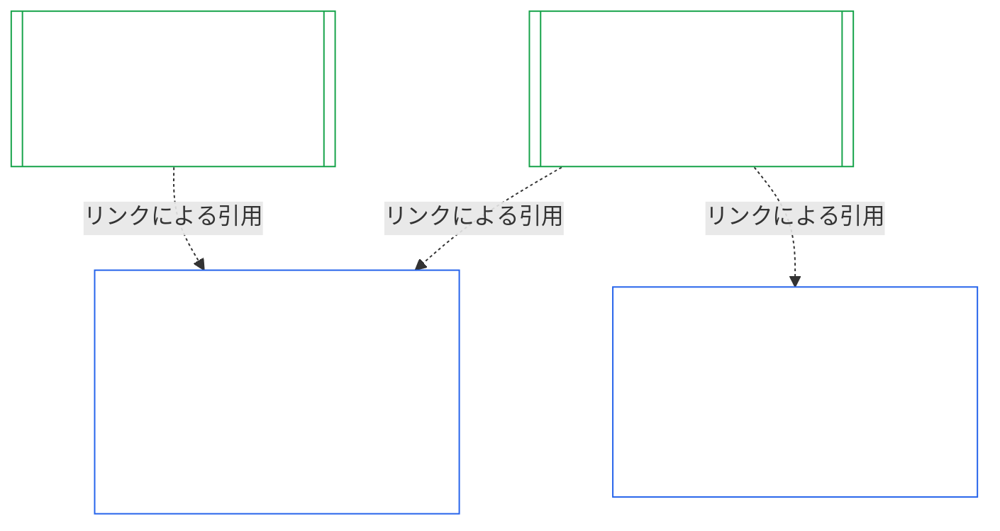

### 1. 目的と役割

<strong>追跡情報</strong>

- 上流：
  - [第七章 §1 システム憲章と機関憲章が必要となる場合](core_07.000_charters.md#1-when-system-and-institutional-charters-are-required) (7.000 §1)；
  - [第九章 Part A §1 目的と役割](core_09.000_system_alignment_certification_evaluation.md#1-purpose-and-role) (9.000 §1)；
  - [Article XI-E](core_06.005_rights_part_b.md#article-xi-e-institutional-formation-and-business-creation) (*機関の設立と事業の創出*)；
  - [Article XXVIII-A](core_06.020_rights_part_e.md#xxviii-a-existing-instantiations-adoption-transition-window) (*段階的採用と権利の床の継続*)。
- 下流：[§2](#2-institution-class-evaluation)；[§6](#6-forum-process)；[§7](#7-certification-outcomes)；[§9](#9-recertification-and-reopening)。
- 併読：
  - [機関](core_05.040_band_continuity.md#institution)；
  - [機関憲章](core_05.040_band_continuity.md#institutional-charter)；
  - [システム憲章](core_05.040_band_continuity.md#system-charter)；
  - [事業の創出](core_05.055_band_participation.md#business-creation)。

 

*平たい言葉で言えば：システムの認証はそのシステムに属する。機関の認証は、システムの認証を引用し、機関だけが説明責任を負う事項を加える。一つのシステムが複数の機関の下に置かれることも、どの機関の下にも置かれないこともある。この章のいかなる内容も、認証によって機関の設立を妨げるものではない。*

機関整合性認証とシステム整合性認証は、リンクで結ばれた二つの認証である。その関係は**包含ではなくリンクによる構成**である。図では、システム認証記録から、それを引用する各機関認証記録へ矢印が伸びる。どの機関の下にもないシステムには矢印がなく、それを必要ともしない。システムを運営しない機関は、単独の記録をもつ。

リンクによる構成には二つの側面があり、まず機関側から説明する。

機関側では：

- **機関認証記録はシステムの記録を引用し、再評価しない：** システム認証記録をリンクで引用し、その版を明記する。本章はシステム評価を再実施せず、システムのクラスを再決定せず、システムの結果、状態、または認証条件を変更しない。
- **機関の認証によってシステムの状態は引き上げられない：** 「未認証」のシステムは、機関の状態にかかわらず「未認証」のままである。認証を受けたシステムも、機関についての認定から保護されない。
- **機関に関する事実は一度だけ認定する：** [第九章 Part A §3.1 統治、インセンティブ、および争訟可能性の規律](core_09.000_system_alignment_certification_evaluation.md#31-governance-incentive-and-contestability-discipline) が運営者の統治とインセンティブを問う場合、運営者について最新の機関認証記録があれば、その事実をリンクで提示できる。それらの事実が当該システムにとって十分かどうかは、システムのフォーラムが決める。同じ機関の事実について、理由をシステム認証記録に示さず、異なる認定をしてはならない。

システム側では：

- **システム認証記録はシステムに属する：** これは[第九章](core_09.000_system_alignment_certification_evaluation.md#chapter-nine-system-alignment-certification) に基づく、そのシステム自身の記録である。
- **一つのシステム認証記録を複数の機関が引用できる：** [第七章 §1 システム憲章と機関憲章が必要となる場合](core_07.000_charters.md#1-when-system-and-institutional-charters-are-required) に基づき、一つのシステムを複数の機関が運営、責務管理、または実質的に管理することがある。それぞれが同じ記録を引用する。
- **システムはどの機関の下にも置かれなくてよい：** 個々の感知者は機関ではないため、機関をもたないシステムもあり得る。機関をもたないシステムは[第九章](core_09.000_system_alignment_certification_evaluation.md#chapter-nine-system-alignment-certification) だけに基づいて認証され、本章の事項を必要としない。機関の下にあるシステムも同じ方法で認証する。本章は機関について別個の記録を追加するものであり、システム自体の認証手順には含まれない。

#### 1.1 誰が認証を受けるか

クラスL以上の機関は本章の対象となり、そのクラスは[§2.1 機関クラス](#21-institution-class) に基づいて決める。システムを一つも運営しない機関も含む。その機関には引用するシステム認証記録がなく、クラスは機関自身の影響によって決まる。機関の**ポートフォリオ**とは、機関が運営、責務管理、または実質的に管理するシステムの集合である（[ポートフォリオ](core_05.040_band_continuity.md#portfolio)）。

- **クラスA、B、C、およびL：** [§2.2 クラスに応じた段階化](#22-scaling-by-class) に従い、クラスに応じて段階化してプロセスを適用する。
- **クラスP：** プロセスの利用を推奨し、任意に利用できる。クラスL以上に再分類された場合、または機関が憲法適合性を自発的に主張する場合は、必須となる。クラスPの機関が新たな実質的権限を引き受けると決めた場合、[§9.2.2 新たな実質的権限を得た場合の再認証](#922-recertification-for-new-material-authority) に基づく通知を行った時点で、少なくともクラスLに再分類される。その権限は定義上実質的であり（[§9.2.1 新たな実質的権限に該当するもの](#921-what-counts-as-new-material-authority)）、いずれかの領域で実質性をもつ機関は少なくともクラスLだからである（[§2.1 機関クラス](#21-institution-class)、項目2）。この再分類は、通知の撤回がクリアランス前に行われるか、権限がクリアされず、その権限が一度も行使されていないことを条件として、通知からその時点まで続く。その後、機関はクラスPに戻り、限定的な初回認証を終了する。新たな通知によって再び開始され、クリアランスなしに権限を行使した場合は、[§9.2.2 新たな実質的権限を得た場合の再認証](#922-recertification-for-new-material-authority) (*通知なし、またはクリアランス前の行使*) に基づく認定が維持される。これは[第九章 Part A §1 目的と役割](core_09.000_system_alignment_certification_evaluation.md#1-purpose-and-role) と対応する。
- **システムが一つ：** システム憲章を必要とするシステムをちょうど一つ運営する機関は、一度の認証審査と一つの記録をもち、本章ではこれを**単一システム評価**と呼ぶ。システム認証記録には、[§8 機関認証記録](#8-institutional-certification-record) の項目を含む*機関に関する認定ブロック*があり、それが機関認証記録として機能する。フォーラム、席、期限はシステム自体の認証審査のものを用い、機関に関する項目を加える。その結果には固有の拒否・取消し事由が適用され、[§7.4 機関に対する拒否と取消し](#74-denial-and-revocation-for-an-institution) に定める。システムがポートフォリオ全体であるため、[§9.5 システム認証からの連鎖](#95-cascade-from-system-certifications) は連鎖としては適用されない。ただし、[§7.4 機関に対する拒否と取消し](#74-denial-and-revocation-for-an-institution) の規則1および2（指標と原因の所在に関する検査）は適用される。
- **システムが複数：** 機関について機関認証記録を一つ作成し、運営する各システムのシステム認証記録へリンクする。各システムはそれぞれ固有の審査と記録を維持する。
- **システムなし：** 機関認証記録を単独で一つ作成する。機関はシステムを運営しないため、リンクするシステム認証記録はない。

