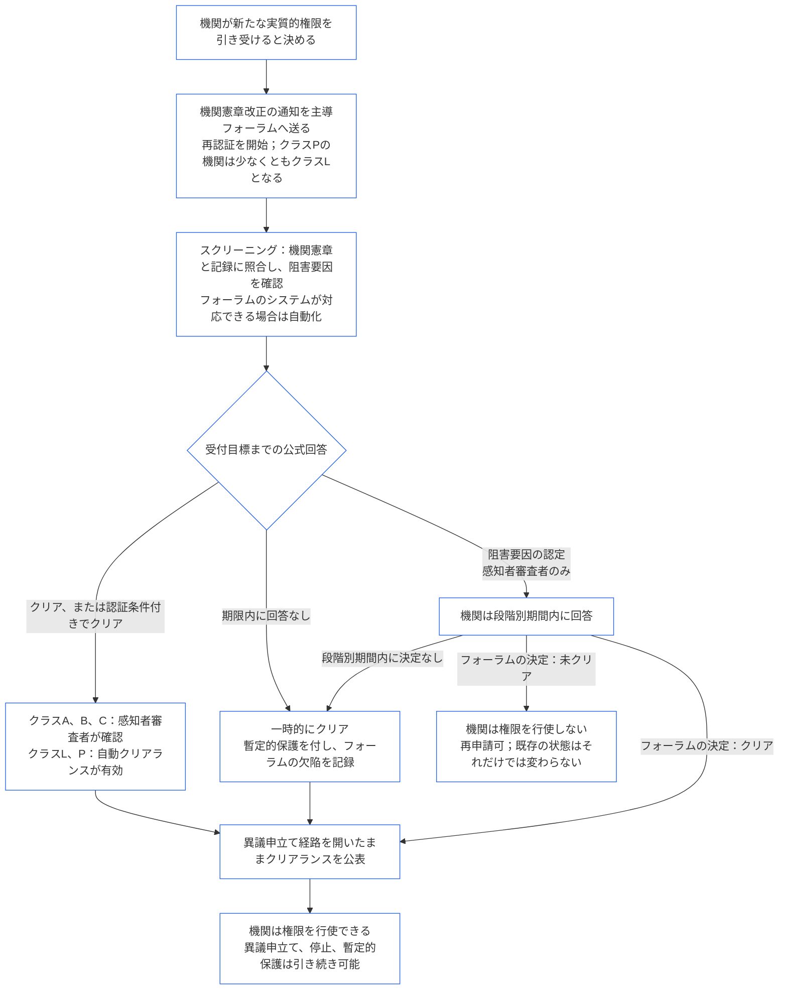

##### 9.2.2 新たな実質的権限を得た場合の再認証

新たな実質的権限を引き受けると決めた機関は再認証を受けなければならず、その権限を行使する前に結果を待たなければならない。これは **Article XI-E** (*機関の設立と事業の創出*) が定める待機であり、次のように進む。

- **まず通知する：** 機関は、[第七章 §7.1 文書の変更](core_07.000_charters.md#71-changing-the-document) がすでに求めている機関憲章改正の通知を行い、主導フォーラムに送る。通知によって再認証が開始される。
- **まだ記録がない場合：** 機関認証記録をもたない機関も同じ通知を行う。通知によって新たな権限に範囲を限定した初回認証を開始し、その権限に関係する[§3 機関全体の認証評価](#3-whole-institution-certification-evaluation) から[§5 権利の床と領域別評価](#5-rights-floor-and-domain-evaluations) までに照らして評価する。初回認証の残りは、引き続き[§1.3 初回認証の期間](#13-window-for-the-first-certification) の期間内に進める（通知によって再分類されるクラスPの機関は、通知から期間を数える）。新たな権限の待機はその期間に左右されない。
- **段階別期間内に行う：** [第九章 Part C §9.3.4 段階別期間](core_09.010_system_alignment_certification_record_recertification.md#934-tier-windows) に基づき再認証を行い、既定では機関クラスに対応する段階を適用する。期間超過は[Article XXVI-C](core_06.020_rights_part_e.md#article-xxvi-c-timely-resolution-and-anti-delay-floor) (*適時な解決と遅延防止の下限*) に基づき扱う。手数料や待機を障壁としてはならない（[回避可能な負担](core_05.040_band_continuity.md#avoidable-burden)）。
- **可能な範囲で自動化する：** フォーラムのシステムが対応できる場合、通知、新たな権限と機関憲章・現行記録との照合、阻害要因のスクリーニング、およびクリアランスを自動化する。[第一章 §13.3 回避可能な負担の最小化](core_01.005_interaction_interpretation.md#133-minimization-of-avoidable-burden) は自動化を回避可能な負担への優先的な是正策とし、[第一章 §16.4 行為時点で文書化すること](core_01.010_stewardship_capacity_principles.md#164-document-at-action) は、自動化の負担を責務管理者ではなくシステムに課す。
  - **クリアランスは行うが、拒否はしない：** 自動スクリーニングは、新たな権限を無条件で、または現行記録がすでに裏付ける認証条件付きで、クリアできる。ただし、それだけで阻害要因（[§9.2.3 新たな実質的権限のクリアランスを妨げるもの](#923-blockers-to-clearing-new-material-authority) に列挙）を示したり、クリアランスを拒否したりしてはならない。スクリーニングは阻害要因の可能性を示せるが、示された内容を確認した後、主導フォーラムの感知者審査者だけが阻害要因を認定できる。
  - **クラスA、B、およびC：** これらのクラスの機関、および新たな権限によってこれらのクラスに入る機関について、クリアランスを公式回答として扱う前に、主導フォーラムの感知者審査者がすべて確認する。確認にも受付目標を適用する。審査者は、すでに検証・承認の席を担い、機関から独立していなければならない主導フォーラムに属する（[§6.1 機関認証における四つの席](#61-four-seats-in-an-institutional-certification)）。
  - **クラスLおよびP：** 自動クリアランスを確認なしで公式回答として扱う。クラスPの機関は通知時点で少なくともクラスLに再分類されるため（[§1.1 誰が認証を受けるか](#11-who-is-certified)）、その機関にはクラスLの規則を適用する。
  - **例外的状況：** スクリーニングが阻害要因の可能性を示す場合、権限が対象範囲内か実質的か判定できない場合、または機関か影響を受ける感知者が審査を求める場合は、クラスを問わず感知者審査者が引き継ぐ。審査請求には、請求日から数えて[該当する受付目標](core_05.040_band_continuity.md#tier-window)内に回答する。段階別期間は延長されない。
  - **同じ記録、同じ期限：** 実施した確認を記録に示すため、自動クリアランスにも他の決定と同様に異議を申し立てられる。自動化によって受付目標も段階別期間も延長しない。スクリーニングシステムが停止中、または回答に失敗した場合は、以下の項目に基づく回答期限の不履行となる。フォーラムは、利用する他のシステムと同様に、スクリーニングシステムについても責任を負う（[§6.3 フォーラム、認証者、および記録事務所を機関として扱うこと](#63-forums-certifiers-and-record-offices-as-institutions)）。
- **待機：** 再認証によって新たな権限がクリアされるまで、機関はその権限を行使しない。
  - **全クラスが待つ：** 適用除外となるクラスはない。緊急性や差し迫った必要も待機を解除しない。
  - **他の活動は続く：** 機関がすでに行っている活動は続く（[§1.2 設立・運営に許可もゲートも要しない](#12-no-permission-and-no-gate-on-forming-or-running)）。
  - **保護は待たない：** 影響を受ける感知者に対するフォーラムの緊急保護は再認証を待たない（[第九章 Part B §6.2 監督上の順序](core_09.005_system_alignment_certification_record_process.md#62-supervisory-sequence)）。これは感知者を守るものであり、機関が権限を早期行使する根拠ではない。
- **クリアランス時に公開する：** 主導フォーラムは、[§10 認証への異議申立て](#10-challenging-a-certification) の異議申立て経路を開いた状態で、一時的なクリアランスを含め、クリアランスごとに速やかに公表する。機関はクリアランス時点から権限を行使できる。通知期間の経過や異議申立ての決定を待たない。影響を受ける感知者は他の決定と同様にクリアランスへ異議を申し立て、停止または暫定的保護を求められ、それらは待たされない（[§9.2.2 新たな実質的権限を得た場合の再認証](#922-recertification-for-new-material-authority)、*保護は待たない*）。公表時、主導フォーラムは把握している影響対象の感知者と関係するシステムのフォーラムにもクリアランスを通知する。停止または暫定的保護の請求には、[CF-14.445 §3.1 段階別目標と上限](corpus_forum/cf_14.445_performance_backlog_publication_accessibility.md#cf-14445-31-stage-targets-and-outer-bounds) の該当受付目標内、または緊急設定が適用される場合はその設定の上限内に回答する。
- **クリアを推定する：** 権限はクリアされたものと推定する。主導フォーラムがクリアを拒めるのは、[§9.2.3 新たな実質的権限のクリアランスを妨げるもの](#923-blockers-to-clearing-new-material-authority) に列挙された阻害要因があると、記録に示した証拠で立証する場合に限る。阻害要因に結び付いた認証条件で封じ込められるなら、拒否せず、その認証条件を付して権限をクリアする。
- **クリアの意味：** 再認証は、認証条件の有無を問わず、暫定認証または完全認証をもって終了する。権限を行使する前に必要な認証条件はすべて独立して検証されていなければならない。
- **フォーラムが期限内に回答しない場合：** 主導フォーラムは、[CF-14.445 §3.1 段階別目標と上限](corpus_forum/cf_14.445_performance_backlog_publication_accessibility.md#cf-14445-31-stage-targets-and-outer-bounds) の該当受付目標までに公式回答を行う。回答は、権限をクリアする、認証条件付きでクリアする、または根拠となる証拠を示して阻害要因を認定する、のいずれかである。阻害要因を認定する場合、機関には回答する機会を与え、その後、フォーラムは上記の段階別期間内に決定する。
  - **一時的なクリアランス：** 受付目標までに公式回答がない場合、または認定された阻害要因が段階別期間内に決定されない場合、[第九章 Part B §7.2 認証上の欠陥と是正](core_09.005_system_alignment_certification_record_process.md#72-certification-defects-and-correction) に定める暫定的保護と依存制限を付して、一時的に権限をクリアする。
  - **フォーラムの欠陥：** 目標または期間を守らなかったことはフォーラムの欠陥であり、機関の過失ではない。記録して是正し、[第十四章 §6 適時な解決、実質性の段階、および遅延防止の規律](core_14.000_forum.md#6-timely-resolution-materiality-tiers-and-anti-delay-discipline) (*期限超過の審査*) に基づき期限超過として審査する。
  - **別のフォーラムへの引継ぎ：** 再認証の請求を同じフォーラム群の別のフォーラムへ移す（[第十四章 §3 移管、統合、および調整](core_14.000_forum.md#3-transfer-consolidation-and-coordination--continuity-and-anti-capture)）。そのフォーラムは、移管日から数えて、機関クラスの通常の期間内に再認証を進める。
- **クリアされない場合：** 機関はその権限を行使せず、第九章 Part B §7.4 (*恒久的な禁止ではない*) の条件で再申請できる。新たな権限がクリアされなかったことだけで、機関がすでに行っていることに対する状態が拒否または取消しとなるわけではない。その状態は、[§7.3 機関の是正準備](#73-remediation-readiness-for-an-institution) および[§7.4 機関に対する拒否と取消し](#74-denial-and-revocation-for-an-institution) に基づく認定があった場合に限って変わる。
- **通知なし、またはクリアランス前の行使：** 通知なしに、またはクリアランス前に新たな実質的権限を行使することは、機関憲章の範囲外の実務である。[§3 機関全体の認証評価](#3-whole-institution-certification-evaluation)（項目1）に基づく認定となり、機関憲章に関する事象として審査を再開する。

<strong>読者向け案内（非操作性）：新たな実質的権限を待つ手順</strong>

この図は §9.2.2 新たな実質的権限を得た場合の再認証をまとめたものである。本文と異なる場合は本文が優先する。機関がすでに行っているすべての活動は継続し、影響を受ける感知者への緊急保護は決して待たない。機関の適用例は[CS-9.320 §12 機関のウォークスルー例](corpus_systems/cs_09.320_system_alignment_certification_illustrations.md#cs-9320-12-illustrative-institution-walkthroughs) にある。

 

