<!-- AI-assisted translation draft; unreviewed; English controls.
Source: core_09.000_system_alignment_certification_evaluation.md
Source snapshot: 247e2180509e5e029c1106878cf225067339e010
Source SHA-256: 3ff6a518d3c9d6779925a1daab6ad6c53abdbdabeeaad786ffafcdd1e6ac8b80 -->

# 제9장, A부분: 시스템 정렬 인증 — 평가

<strong>코퍼스에서의 위치(비운영): 파일 구조와 읽기 규칙</strong>

> 이 파일은 **감지자 헌법의 일부**이며, 번호가 매겨진 다른 `core_*` 파일과 하나의 텍스트로 함께 읽을 때만 **구속력**이 있습니다. 이 파일에는 **제9장 A부분** — 인증 목적, 절차 개요, 절차의 처음 두 단계인 **틀 짜기**(시스템 등급)와 **평가하기**(세 하위 단계의 전체 시스템 평가: 항상 적용되는 평가(§3, 데이터 유형 및 처리 포함), 관련 사안에 적용되는 평가(§4), 발동 요건을 충족할 때 적용되는 권리 바닥 및 분야별 평가(§5)) — **§1–§5**가 들어 있습니다. **A / B / C등급 사례**(시스템 등급 프로필과 §3.4, §5.1, §5.2, §5.3, §5.4, §5.5, §5.6의 예시 설명 및 각각의 **시스템 등급 간 비교 읽기** 단락 포함)는 이 장이 아니라 시스템 계열의 [CS-9.320](corpus_systems/cs_09.320_system_alignment_certification_illustrations.md#cs-9320-system-alignment-certification-illustrations)(*시스템 정렬 인증 예시*)에 있습니다. 각 예시는 설명 대상인 A부분의 절을 밝힙니다. 예시 단락이 보여 주는 구속력 있는 시스템 등급별 조정 및 상향 규칙은 이 파일에 그대로 있습니다. 즉 §2.2의 참여 및 비례성을 포함한 시스템 등급별 조정, §3.4의 데이터 처리 조정, 그리고 §5.1–§5.6 각각의 **시스템 등급별 조정 및 상향** 단락입니다. 전체 장의 파일은 아래 표에 나열되어 있습니다.
>
> **제9장 파일.** 제9장은 구속력 있는 파일 세 개로 나뉘며 하나의 텍스트로 함께 읽습니다. 이 파일인 A부분이 장을 시작하며, 별도의 색인 파일은 없습니다. 예시는 장에 포함되지 않고 [CS-9.320](corpus_systems/cs_09.320_system_alignment_certification_illustrations.md#cs-9320-system-alignment-certification-illustrations)(*시스템 정렬 인증 예시*)에 있습니다.
>
> | 부분 | 파일 | 담당 범위 |
> |------|------|------|
> | **A부분 — 평가** | [`core_09.000_system_alignment_certification_evaluation.md`](core_09.000_system_alignment_certification_evaluation.md) | §1–§5: 목적 및 절차 개요(6단계 전체 인증 절차 도표 포함), **제I단계 틀 짜기**(시스템 등급, 시스템 등급이 각 평가를 조정하는 방식, 파일럿 인증), **제II단계 평가하기**(전체 시스템 평가의 세 하위 단계: §3의 **IIa** 항상 적용(헌장 범위와 기능적 경계, 데이터 유형 및 처리 포함); §4의 **IIb** 관련 사안에 적용; §5의 **IIc** 발동 요건을 충족할 때 적용되는 권리 바닥 및 분야별 평가) |
> | **B부분 — 포럼 절차 및 결과** | [`core_09.005_system_alignment_certification_record_process.md`](core_09.005_system_alignment_certification_record_process.md) | §6–§7: **제III단계 검토하기**(포럼 역할, 감독 순서, 다툴 수 있음의 사슬), **제IV단계 결정하기**(인증 결과 및 가동 개시 관문 포함) — A부분 §5부터 장 번호를 연속해서 매김 |
> | **C부분 — 기록, 재인증 및 궤적** | [`core_09.010_system_alignment_certification_record_recertification.md`](core_09.010_system_alignment_certification_record_recertification.md) | §8–§11: **제V단계 기록하기**(시스템 인증 기록 및 그 무결성, [시스템 헌장](core_05.040_band_continuity.md#system-charter)의 규정 필드 포함), **제VI단계 운영하기**(재인증 및 재개방, 다툼 경로, 제11장으로 이어지는 궤적 연결) — B부분 §7부터 장 번호를 연속해서 매김 |
>
> **두 인증의 관계.** 시스템 정렬 인증(이 장)은 시스템의 인증입니다. 기관 정렬 인증([제10장](core_10.000_institutional_alignment_certification.md#chapter-ten-institutional-alignment-certification))은 시스템을 운영할 수도, 운영하지 않을 수도 있는 기관의 인증입니다. 제10장은 각 시스템의 시스템 인증 기록을 링크로 인용하며 이를 다시 평가하지 않습니다. [제10장 §1](core_10.000_institutional_alignment_certification.md#1-purpose-and-role)은 두 인증의 관계를 밝히고, [제10장 §1.2](core_10.000_institutional_alignment_certification.md#12-no-permission-and-no-gate-on-forming-or-running)는 이 인증이 허가증이 아님을 밝힙니다. 두 장은 서로 대응하는 제목 아래 같은 절 번호를 사용합니다.
>
> 다른 파일의 일반적인 **제9장** 링크는 절 번호에 따라 해당 부분으로 연결됩니다.
>
> - **헌법상 담당( B부분 및 C부분과 공동):** 포럼 감독을 받는 **시스템 정렬 인증 및 관련 기록** — 평가 영역(A부분); 포럼 절차, 감독 순서, 가동 개시 관문을 포함한 인증 결과(B부분); 시스템 인증 기록 의무, 다툼 경로, 재인증 및 재개방, 제11장에 대한 검증 입력 연결(모두 C부분). **감독** 사원(四元) 다리 아래에서 SAC는 여러 감사 절차 중 특히 규모가 크고 이해관계가 큰 감사 절차입니다. 감사 하한은 **제XVI조**(*감사, 투명성 및 독립 검증*)와 제5장 [감사가능성](core_05.050_band_oversight.md#auditability)에 있습니다.
> - **검증 기반 담당:** [제4장 — 입증 책임, 추적성 및 검증](core_04.000_burden_traceability_verification.md#chapter-four-burden-of-proof-traceability-and-verification)(제2장부터 제4장까지에 포함)이 입증 책임 배분, 준수 증거, 정의의 추적 가능성, 관측 가능성 및 보안 제약을 고려한 검증을 담당합니다. 제9장은 그 원칙을 시스템 인증 기록에 **적용**하며, 제4장 §§**1–5**를 다시 서술하지 **않습니다**.
> - **감사 담당처(여기에 이전되지 않음):** **제XVI조**(*감사, 투명성 및 독립 검증*), **Def.O1**(*투명성, 감사가능성 및 검증*), **CJS-5.110 §3 및 CJS-5.115 §3**(*감사 절차 담당처*)–**CJS-5.110 §5**가 감사 하한과 운영 조건을 담당합니다. 제9장은 그 하한을 충족해야 하는 특히 규모가 큰 SAC 감사 절차 하나를 운영하지만, 모든 감사를 담당하지는 않습니다.
> - **이행 담당:** 시스템 등급별 처리, CS-6.345(*시스템 생애 주기*), 지정된 이행 파일의 포럼 절차 세부 사항은 제9장과 일치해야 하며, 코퍼스에 이미 [가장 완전한 보호 효과](core_05.045_band_integrative.md#fullest-protective-effect) 규칙이 있으면 더 엄격할 수 있습니다.
> - **이전 배치 금지 규칙:** A부분은 제5장의 표준 정의, 제3장의 회피 금지 원칙([C부분 §9.4](core_09.010_system_alignment_certification_record_recertification.md#94-non-evasion) 참조), 제11장의 기여 또는 궤적 측정, 제12장의 궤적 효과를 다시 서술하지 않습니다. 궤적 연결은 **[C부분 §11](core_09.010_system_alignment_certification_record_recertification.md#11-relationship-to-standing)**에 명시되어 있습니다.
>
> **상위 규범:** 제5장 정의, 기록·검증·입증 및 정의와 결과의 추적성을 다루는 제2장부터 제4장까지, 그리고 모든 실질적 구속력을 갖는 인증 행위에 직무 분리 요건을 적용하는 [제8장](core_08.000_functional_independence_separation_of_duties.md#chapter-eight-functional-independence-and-separation-of-duties).
> **하위 규범:** [B부분](core_09.005_system_alignment_certification_record_process.md#chapter-nine-part-b-system-alignment-certification--forum-process-and-outcomes)(*포럼 절차 및 결과*)과 [C부분](core_09.010_system_alignment_certification_record_recertification.md#chapter-nine-part-c-system-alignment-certification--record-recertification-and-standing)(*기록, 재인증 및 궤적 연결*); 제11장의 궤적 기록 및 검증 입력; 제12장의 궤적 효과; 제14장의 포럼 감독 및 시스템 정렬 인증 경로.

 

제9장 **A부분**은 **시스템 정렬 인증 평가**를 헌법상 담당합니다.

- 포럼 감독과 인증 결과는 **[B부분](core_09.005_system_alignment_certification_record_process.md#chapter-nine-part-b-system-alignment-certification--forum-process-and-outcomes)**에 있습니다.
- 기록, 재인증 및 재개방, 궤적 연결은 **[C부분](core_09.010_system_alignment_certification_record_recertification.md#chapter-nine-part-c-system-alignment-certification--record-recertification-and-standing)**에 있습니다.
- 이 평가 절들의 예시는 **[CS-9.320 시스템 정렬 인증 예시](corpus_systems/cs_09.320_system_alignment_certification_illustrations.md#cs-9320-system-alignment-certification-illustrations)**에 있습니다.
- 같은 절 번호를 사용하는 기관 정렬 인증은 **[제10장](core_10.000_institutional_alignment_certification.md#chapter-ten-institutional-alignment-certification)**에 있습니다.

### 1. 목적과 역할

<strong>추적 경로</strong>

- 상위 규범:
  - [전문 — 헌법상 담당자 등록](core_00.000_preamble.md#4-principles-definitions-and-rights) 및
  - [권한 층위와 내부 위계](core_05.045_band_integrative.md#authority-stack-and-internal-hierarchy);
  - [헌법 사원(四元)](core_00.000_preamble.md#constitutional-tetrad);
  - [두 헌법 목적](core_00.000_preamble.md#two-constitutional-aims);
  - [실질 이해관계](core_00.000_preamble.md#material-stake);
  - [비례성](core_05.035_band_accountability.md#proportionality) 및
  - [실질적 공정성](core_05.055_band_participation.md#substantive-fairness)(제5장); 참여 측정 계열(*목소리, 접근, 다툼 경로*);
  - [제1장 §16 책임 있는 관리 심층](core_01.010_stewardship_capacity_principles.md#16-stewardship-in-depth)(1.010 §16);
  - [제1장 §12 시스템 차원의 평가 요건](core_01.000_values_principles.md#12-systemic-evaluation-requirement)(1.000 §12)(*원칙 층위의 전체 시스템 평가 관점 — 한 모퉁이만 보는 것이 아님*); 제2장부터 제4장까지;
  - [제5장](core_05.000_definitions_home.md#chapter-five-foundational-definitions)(5.000)(*표준 정의*);
  - [제8장 §2 네 자리 헌법 요건](core_08.000_functional_independence_separation_of_duties.md#2-four-seat-constitutional-requirement)(8.000 §2);
  - [시스템 정렬 인증](core_05.040_band_continuity.md#system-alignment-certification)(제5장의 표준 용어; 비운영 약칭 **SAC**);
  - [시스템 인증 기록](core_05.040_band_continuity.md#system-certification-record)(제5장의 의미).
- 하위 규범:
  - [§2](#2-system-class-evaluation)(*시스템 등급 평가*);
  - [C부분 §10](core_09.010_system_alignment_certification_record_recertification.md#10-challenging-a-certification)(9.010 §10)(*인증 다투기*); 및
  - [CS-9.320 §2](corpus_systems/cs_09.320_system_alignment_certification_illustrations.md#cs-9320-2-illustrative-system-class-profiles)(*시스템 등급 프로필 예시*);
  - [CS-9.320 §4](corpus_systems/cs_09.320_system_alignment_certification_illustrations.md#cs-9320-4-illustrative-whole-system-application-by-system-class)(*시스템 등급별 전체 시스템 적용 예시*);
  - [CS-9.320 §5](corpus_systems/cs_09.320_system_alignment_certification_illustrations.md#cs-9320-5-illustrative-data-handling-application-by-system-class)(*시스템 등급별 데이터 처리 적용 예시*);
  - [CS-9.320 §6](corpus_systems/cs_09.320_system_alignment_certification_illustrations.md#cs-9320-6-illustrative-ecological-footprint-application-by-system-class)(*시스템 등급별 생태 발자국 적용 예시*);
  - [CS-9.320 §7](corpus_systems/cs_09.320_system_alignment_certification_illustrations.md#cs-9320-7-illustrative-educational-capability-application-by-system-class)(*시스템 등급별 교육 역량 적용 예시*);
  - [CS-9.320 §8](corpus_systems/cs_09.320_system_alignment_certification_illustrations.md#cs-9320-8-illustrative-cross-system-support-application-by-system-class)(*시스템 등급별 시스템 간 지원 적용 예시*);
  - [CS-9.320 §9](corpus_systems/cs_09.320_system_alignment_certification_illustrations.md#cs-9320-9-illustrative-nondiscrimination-application-by-system-class)(*시스템 등급별 차별 금지 적용 예시*);
  - [CS-9.320 §10](corpus_systems/cs_09.320_system_alignment_certification_illustrations.md#cs-9320-10-illustrative-accessibility-application-by-system-class)(*시스템 등급별 접근성 적용 예시*);
  - [CS-9.320 §11](corpus_systems/cs_09.320_system_alignment_certification_illustrations.md#cs-9320-11-illustrative-trustworthiness-application-by-system-class)(*시스템 등급별 신뢰성 적용 예시*);
  - [§3](#3-whole-system-certification-evaluation)(*전체 시스템 인증 평가 요소*);
  - [§3.4](#34-data-types-and-handling-evaluation)부터
  - [§5.6](#56-trustworthiness-and-system-reliance-integrity-evaluation)까지(*분야별 평가*);
  - [B부분 §6](core_09.005_system_alignment_certification_record_process.md#6-forum-process)(9.005 §6)(*감독 순서 및 다툴 수 있음의 사슬*);
  - [B부분 §6.1](core_09.005_system_alignment_certification_record_process.md#61-forum-supervision-and-component-roles)(9.005 §6.1)(*포럼 구성요소 역할*);
  - [C부분 §8](core_09.010_system_alignment_certification_record_recertification.md#8-system-certification-record)(9.010 §8)(*시스템 인증 기록의 내용*);
  - [C부분 §8.2](core_09.010_system_alignment_certification_record_recertification.md#82-transparency-and-auditability-of-the-record)(9.010 §8.2)(*기록 무결성 요건*);
  - [B부분 §7](core_09.005_system_alignment_certification_record_process.md#7-certification-outcomes)(9.005 §7)(*인증 결과*);
  - [C부분 §11](core_09.010_system_alignment_certification_record_recertification.md#11-relationship-to-standing)(9.010 §11)(*궤적 기록 연결*);
  - [제11장](core_11.000_standing_assessment.md#chapter-eleven-contribution-violation-and-standing-model--measurement)(11.000)(*궤적 기록 및 검증 입력 관문*);
  - [제12장](core_12.000_standing_integration.md#chapter-twelve-standing-effects-and-integration)(12.000)(*궤적 효과 및 통합*);
  - [제14장](core_14.000_forum.md#chapter-fourteen-forums-and-jurisdiction)(14.000)(*포럼 감독, 인증, 정렬 인증 및 검토*).
- 함께 읽기:
  - **[CS-9.305](corpus_systems/cs_09.305_system_classification_machinery.md#cs-9305-part-a-system-classification-machinery)(*시스템 분류 장치*) 및 [CS-9.310 — 시스템 영향 분류](corpus_systems/cs_09.310_system_impact_classifications.md#cs-9310-part-b-system-impact-classifications)**, **[CS-6.305](corpus_systems/cs_06.305_information_types_and_handling.md#cs-6305-part-a-information-types-and-handling)(*정보 유형 및 처리*) 및 [CS-6.310 — 데이터 분류](corpus_systems/cs_06.310_data_classifications.md#cs-6310-part-b-data-classifications)**, 그리고
  - **CS-6.345**(*시스템 생애 주기*);
  - **CF-14.415**(*라우팅 운영, 이관, 판정 질문 및 대표 처리*) 및
  - **CF-14.425**(*무결성 보호조치, 포획 방지 운영 및 자기 심판 방지 지원*); **제XVI조**(*감사, 투명성 및 독립 검증*) 및
  - [감사가능성](core_05.050_band_oversight.md#auditability)(*감사 하한 — SAC는 감독 아래 수행되는 특히 규모가 큰 감사 절차 하나이지, 유일한 감사 담당처가 아님*); **CJS-5.110 §3(*감독: 감사가능성 및 재구성 가능성 조건(부속서)*) 및 CJS-5.115 §3**(*감사 절차 담당처*)–
  - **CJS-5.110 §5**(*감독: 독립 검증 및 주장 무결성 조건*).

 

*쉬운 말로: 시스템이 감지자의 삶에 실제로 중요하다면 인증은 **비례적**이어야 합니다. 획일적인 점검표나 도장 찍기가 아니라, 시스템의 실제 영향·의존·위험이 요구하는 만큼 엄격해야 합니다. 또한 **참여적**이어야 합니다. 영향을 받는 감지자와 공동체가 무엇을 검토했는지 보고, 무엇을 결정했는지 이해하며, 잘못된 점이 있으면 다툴 수 있어야 합니다. 포럼은 증거를 검토해 시스템 인증 기록에 남기고, 시스템의 위험도에 맞는 일정으로 재인증을 요구합니다. A·B·C등급은 전체 절차를 따르고 L등급은 간소화된 절차를 따릅니다. P등급은 이를 따르는 것이 권장되며, L등급 이상으로 재분류되거나(즉, 영향이 사적 단위를 넘어가거나) 운영자가 헌법 준수를 주장하면 의무적으로 따라야 합니다.*

**시스템 정렬 인증**은 명시된 범위와 검토 일정에 대해 한 가지 질문에 답하기 위해 존재합니다. 시스템이 인증, 조건부 인증, 검증, 재인증, 지속적인 의존, 배치, 또는 인증 조건의 실질적 이행이나 해제를 뒷받침할 만큼 헌법에 정렬되어 있음을 입증했는가?

- 인증은 인기 점수도, 영구 통과증도, 권리 심사를 건너뛰는 방법도 아닙니다.
- 현재 시스템의 정렬 상태에 관해 알려진 내용을 나타내는, 기간이 한정되고 다툴 수 있는 진술입니다.
- 헌법 사원(四元)의 **감독** 다리 아래에서 감독은 감사를 요구합니다. 시스템 정렬 인증은 여러 감사 절차 중 특히 규모가 크고 이해관계가 큰 하나이지, 유일한 감사 담당처는 아닙니다(**제XVI조**(*감사, 투명성 및 독립 검증*), [감사가능성](core_05.050_band_oversight.md#auditability)).

인증은 [두 헌법 목적](core_00.000_preamble.md#two-constitutional-aims)을 [헌법 사원(四元)](core_00.000_preamble.md#constitutional-tetrad)을 통해 이행합니다.

- **[번영](core_00.000_preamble.md#flourishing)** — 인증은 인증 또는 지속적 의존이 권리 바닥을 조용히 무너뜨리거나 헌법적으로 중요한 삶에 공정하게 참여할 기회를 막지 않는지 검증합니다.
- **[연속](core_00.000_preamble.md#continuity)** — 인증은 건강한 자연 시스템을 유지하고 고갈시키지 않는 지속적이고 비퇴행적인 공급을 검증합니다([생태적 무결성](core_05.040_band_continuity.md#ecological-integrity), [생태 복구 역량](core_05.040_band_continuity.md#ecological-recovery-capacity) 포함). 또한 공유 시스템이 공급을 제한하거나 유지하는 경우 시스템 등급에 맞춘 재인증을 검증합니다.
- **참여** — 영향을 받는 감지자와 공동체는 자신에게 중요한 검토 경로를 이해하고 다투며 참여할 수 있습니다.
- **감독** — 기록, 증거 및 가정은 독립적으로 확인할 수 있을 만큼 공개되고 감사 가능해야 합니다. 인증 자체도 감독 의무에 따른 특히 규모가 큰 감사 절차 하나이지, 유일한 감사 절차는 아닙니다.
- **책무** — 사실이 뒷받침하는 경우 결함, 오분류 및 권리 바닥을 무너뜨리는 운영은 구제, 인증 조건, 인증 철회 또는 궤적 입력으로 이어집니다.
- **적시성** — 검토 및 다툼 기간은 피해를 예방하거나 되돌릴 수 있는 동안 인증이 낡지 않도록 합니다.

#### 1.1 시스템 등급에 맞춘 감사 절차로서의 인증

감독 장치로서 인증은 [감사가능성](core_05.050_band_oversight.md#auditability)과 **제XVI조**(*감사, 투명성 및 독립 검증*)에 따른 특히 규모가 큰 감사 절차 하나입니다.

- 포럼의 감독을 받고, 여러 분야를 다루며, 지위를 부여합니다.
- 자매 감사 방식의 결과를 통합할 수 있지만, 그 방식을 흡수하거나 대체하지 않습니다. 각 방식은 감사 절차 담당처의 [자매 감사 방식 지도](corpus_joint_structure/cjs_05.115_audit_process.md#sibling-audit-modes-owner-map)에 명시된 자체 담당자를 유지합니다.
  - **CS-6.305(*정보 유형 및 처리*) 및 CS-6.310**(*데이터 분류*)에 따른 시스템 데이터 유형 기록 감사
  - **CS-9.305(*시스템 분류 장치*) 및 CS-9.310**(*시스템 영향 분류*)에 따른 시스템 분류 기록 감사
  - **CS-15.305**(*중요 시스템 책임 관리*)에 따른 책임 관리 보증 검토
  - **CS-6.345**(*시스템 생애 주기*) ACA에 따른 지속 감사
  - **CS-6.315**(*이해 가능성 및 복잡성 책임 관리*) 및 **제XXIII-B조**(*복잡성 감사 및 모듈성 요건*)에 따른 복잡성 감사
  - **CJS-5.110 §5**(*감독: 독립 검증 및 주장 무결성 조건*)에 따른 주장 검증
- 이 평가들은 인증을 거치지 않고도 각각 별도로 수행할 수 있습니다. 인증이 이들을 대체하지 않습니다.

인증의 깊이, 기록 부담, 인증 간격, 이해관계자 검토 및 다툼 경로는 [실질 이해관계](core_00.000_preamble.md#material-stake)에 따라 [비례성](core_05.035_band_accountability.md#proportionality)에 맞춰야 합니다.

- 영향·의존·위험이 더 큰 시스템에는 더 강한 입증, 더 명확한 기록, 더 실용적인 참여가 필요합니다. 여기에는 시스템에 의존하는 사람에 맞춘 실질적인 접근성, 이해관계자 의견 및 다툼 경로가 포함됩니다.
- 시스템 등급이 낮고 범위가 제한되어도 정직한 분류와 비례적인 보증은 필요합니다. 외부 효과가 있을 때 실질적 의무를 면제받는 것은 아닙니다.

절차는 영향 등급에 따라 적용되며, 이는 **CS-9.305**(*시스템 분류 장치*)의 [재분류 요건](corpus_systems/cs_09.305_system_classification_machinery.md#35-reclassification-requirement)에 규정되어 있습니다.

- **A등급, B등급 및 C등급:** 영향·의존·위험이 가장 높은 시스템입니다. [§3 전체 시스템 인증 평가](#3-whole-system-certification-evaluation), [§4 관련 사안에 적용되는 평가](#4-evaluations-where-implicated), [§5 권리 바닥 및 분야별 평가](#5-rights-floor-and-domain-evaluations)는 각각의 하위 단계가 적용되는 범위에서 최고 깊이로 의무적으로 수행합니다.
- **L등급:** 같은 평가가 의무적으로 적용되지만 비례적으로 수행합니다. **CS-9.305**(*시스템 분류 장치*)와 **CS-9.310**(*시스템 영향 분류*)이 허용하는 경우 기본 인증 간격은 더 길고 기록은 더 간소합니다.
- **P등급:** 시스템이 유효하게 P등급인 동안 절차를 따르는 것이 권장되며, 자발적으로 이용할 수 있습니다. L등급 이상으로 재분류되거나 운영자가 시스템의 헌법 준수를 자발적으로 주장하면 의무가 됩니다.

인증 간격과 그 중간 시점의 재정·자원·특별 감사는 [제14장 §6 적시 해결, 중요성 등급 및 지연 방지 원칙](core_14.000_forum.md#review-cadence)(*검토 주기*)에 따라 시스템 등급별로 정합니다. 이 장은 구체적인 수치를 다시 적지 않습니다.

#### 1.2 인증 한눈에 보기

*쉬운 말로: 시스템을 정직하게 분류하고, 적용되는 평가를 수행하고, 포럼이 증거와 이해관계자의 우려를 독립적으로 검토한 뒤 결과를 결정합니다. 포럼 검토를 위해 연 기록 하나를 완성하고, 다툼 경로를 열어 둔 채 공개합니다. 인증된 시스템은 통지 기간과 필수 보호조치가 충족된 뒤에만 가동됩니다. 실제 결과를 감시하고 사건과 다툼에 대응하며, 일정에 따라 또는 사실이 바뀔 때 다시 확인합니다. 결함을 고치고, 영향을 받는 범위를 승인하거나 인증 조건을 해제하기 전에 수정 사항을 독립적으로 검증받습니다. 각 검토 단계는 직전 기록과 연결된 새 기록을 사용합니다.*

절차는 **여섯 단계**로 진행됩니다. **I 틀 짜기**, **II 평가하기**, **III 검토하기**, **IV 결정하기**, **V 기록하기**, **VI 운영하기**입니다. 제II단계는 각각 별도 절인 세 하위 단계로 진행됩니다. **IIa**(항상), **IIb**(관련 사안이 있을 때), **IIc**(발동될 때)입니다. 제VI단계는 각각 별도 절인 두 하위 단계로 진행됩니다. **VIa**(운영 및 재인증, [§9 재인증 및 재개방](core_09.010_system_alignment_certification_record_recertification.md#9-recertification-and-reopening))과 **VIb**(궤적 연결, [§11 궤적과의 관계](core_09.010_system_alignment_certification_record_recertification.md#11-relationship-to-standing))입니다. 도표는 전체 인증 절차의 순서를 보여 줍니다. A부분은 처음 두 단계인 틀 짜기와 평가하기를 다루고, [B부분](core_09.005_system_alignment_certification_record_process.md#chapter-nine-part-b-system-alignment-certification--forum-process-and-outcomes)과 [C부분](core_09.010_system_alignment_certification_record_recertification.md#chapter-nine-part-c-system-alignment-certification--record-recertification-and-standing)은 나머지 네 단계를 다룹니다. 즉 포럼 절차와 가동 개시 관문이 있는 결과(B부분), 이어서 기록과 운영(다툼 경로, 재인증 및 재개방, 궤적 연결)(C부분)입니다.

적용되는 모든 평가는 인증 단계마다 다시 수행됩니다. 첫 인증, [§2 시스템 등급 평가](#2-system-class-evaluation)에서 정한 일정에 따른 각 재인증, 재개방 또는 신규 검토가 이에 해당합니다. 시스템 의존 증가, 공유 기반에서의 추출 증가, 시스템이 공유 기반에 돌려주는 몫의 현저한 감소, 신빙성 있는 다툼 등 중요한 사실이 바뀌면 다음 예정 재인증 전에 검토를 다시 엽니다. [C부분 §9.2 재개방 발동 요건](core_09.010_system_alignment_certification_record_recertification.md#92-reopening-triggers)에 발동 요건이 열거되어 있습니다.

```mermaid
flowchart TB
    T(["System with material impact seeks certification,<br/>or reliance on it grows"])
    C["§2 Phase I, Frame<br/>Classify honestly<br/><br/>Class sets depth and re-check schedule"]
    subgraph W["§3–§5 Phase II, Evaluate — Whole-system evaluation"]
        direction LR
        Al["§3.1–§3.4 IIa — Always<br/><br/>Governance; systemic risk: evaluated,<br/>and disclosed to those who need it;<br/>time horizon; data types"]
        Im["§4 IIb — When implicated<br/><br/>Privacy loci, exit rights,<br/>assembly and dissent"]
        Tr["§5 IIc — When triggered<br/><br/>Applicable Rights-Floor checks<br/>and six domain evaluations"]
        Al ~~~ Im ~~~ Tr
    end
    F["§6 Phase III, Review<br/>Independent review of evidence<br/>and stakeholder concerns<br/><br/>Assigned forums issue findings;<br/>challenge paths stay open"]
    Rec["§8 Phase V, Record<br/>One System Certification Record<br/><br/>Opened for forum review; completed with the outcome,<br/>supporting findings, certification conditions, and operating plan"]
    S[["Chapter Eleven — Standing<br/>records<br/><br/>Outside this chapter"]]
    O{"§7 Phase IV, Decide<br/><br/>What outcome and status<br/>does the evidence support?"}
    Fc["§7, §9.3 Full Certification<br/><br/>Required consecutive clean provisional recertifications;<br/>no current or indicated impending misalignment<br/>Full certification interval; certification conditions may apply"]
    Pc["§7, §9.3 Provisional Certification<br/><br/>First grant, recovery after misalignment,<br/>or continued or stepped-down provisional status<br/>Provisional interval, shorter; certification conditions may apply"]
    Nc["§7 Not Certified<br/><br/>Deferred, refused, withdrawn, or expired<br/>No go-live; state reasons and required corrective work"]
    Pub["§7, §10 Publish the completed record<br/><br/>Open the published record challenge path;<br/>for new or expanded scope, state go-live and notice"]
    G{"§7 Go-live gate<br/><br/>Certification and applicable<br/>go-live prerequisites satisfied?"}
    Hold["§7 Meet go-live prerequisites<br/><br/>Complete notice and independently verify<br/>certification conditions required before go-live"]
    Rm["§7, §9.3 Protect and correct<br/><br/>No new go-live in the affected scope;<br/>protect affected sentients, correct design or operation,<br/>and submit evidence for independent verification"]
    Ch["§9–§10 Phase VIa, Operate and recertify<br/>Monitor and keep challenges open<br/><br/>Operate within certified scope and certification conditions;<br/>monitor outcomes and respond to incidents and challenges"]
    S2[["Chapter Eleven — Standing<br/>records<br/><br/>Outside this chapter"]]
    Sp["&nbsp;&nbsp;&nbsp;&nbsp;&nbsp;&nbsp;&nbsp;&nbsp;&nbsp;&nbsp;&nbsp;&nbsp;&nbsp;&nbsp;&nbsp;&nbsp;&nbsp;&nbsp;&nbsp;&nbsp;&nbsp;&nbsp;&nbsp;&nbsp;&nbsp;&nbsp;&nbsp;&nbsp;&nbsp;&nbsp;&nbsp;&nbsp;&nbsp;"]
    SpL["&nbsp;&nbsp;&nbsp;&nbsp;&nbsp;&nbsp;&nbsp;&nbsp;&nbsp;&nbsp;&nbsp;&nbsp;&nbsp;&nbsp;&nbsp;&nbsp;&nbsp;&nbsp;&nbsp;&nbsp;&nbsp;&nbsp;&nbsp;&nbsp;&nbsp;&nbsp;&nbsp;&nbsp;&nbsp;&nbsp;&nbsp;&nbsp;&nbsp;&nbsp;&nbsp;"]
    SpA["&nbsp;&nbsp;&nbsp;&nbsp;&nbsp;&nbsp;&nbsp;&nbsp;&nbsp;&nbsp;&nbsp;&nbsp;&nbsp;&nbsp;&nbsp;&nbsp;&nbsp;&nbsp;&nbsp;&nbsp;&nbsp;&nbsp;&nbsp;&nbsp;&nbsp;&nbsp;&nbsp;&nbsp;&nbsp;&nbsp;&nbsp;&nbsp;&nbsp;&nbsp;&nbsp;&nbsp;&nbsp;&nbsp;&nbsp;&nbsp;&nbsp;&nbsp;&nbsp;&nbsp;&nbsp;"]
    Re["§9 Next review pass<br/><br/>Recertification, reopening, or fresh review;<br/>each pass opens a new record linked to the last"]
    T --> C
    A1((A)) --> C
    C --> W
    W --> F
    F --> O
    O --> Fc
    O --> Pc
    O --> Nc
    Fc --> Rec
    Pc --> Rec
    Nc --> Rec
    Rec -.->|VIb, §11 —<br/>verified inputs only;<br/>current certification or facts<br/>arising during certification| S
    Rec --> Pub
    Rec ~~~ Sp
    Pub --> G
    G ~~~ SpL
    G -->|Not Certified| Rm
    G --->|Yes: operate<br/>within the record| Ch
    G --->|Certified,<br/>prerequisites pending| Hold
    Hold --> G
    Ch -->|Material defect:<br/>protect and correct| Rm
    Ch -->|On schedule, or<br/>material change or<br/>credible challenge<br/>requires review| Re
    Ch -.->|VIb, §11 —<br/>verified inputs only;<br/>operation may supply facts<br/>for Contribution and<br/>Violation records| S2
    Rm -->|Correction evidence<br/>is checked in the<br/>next review pass| Re
    S2 ~~~~ SpA
    SpA ~~~ Re
    Re --> A2((A))
    style Sp fill:none,stroke:none,color:#111111
    style SpL fill:none,stroke:none,color:#111111
    style SpA fill:none,stroke:none,color:#111111
    style T fill:none,stroke:#64748b,color:#ffffff
    style C fill:none,stroke:#16a34a,color:#ffffff
    style Ch fill:none,stroke:#16a34a,color:#ffffff
    style Al fill:none,stroke:#16a34a,color:#ffffff
    style Im fill:none,stroke:#16a34a,color:#ffffff
    style Tr fill:none,stroke:#16a34a,color:#ffffff
    style F fill:none,stroke:#ea580c,color:#ffffff
    style Rec fill:none,stroke:#2563eb,color:#ffffff
    style S fill:none,stroke:#db2777,color:#ffffff
    style S2 fill:none,stroke:#db2777,color:#ffffff
    style O fill:none,stroke:#ea580c,color:#ffffff
    style Fc fill:none,stroke:#9333ea,color:#ffffff
    style Pc fill:none,stroke:#9333ea,color:#ffffff
    style Nc fill:none,stroke:#9333ea,color:#ffffff
    style G fill:none,stroke:#ea580c,color:#ffffff
    style Pub fill:none,stroke:#2563eb,color:#ffffff
    style Rm fill:none,stroke:#9333ea,color:#ffffff
    style Hold fill:none,stroke:#16a34a,color:#ffffff
    style Re fill:none,stroke:#16a34a,color:#ffffff
    style A1 fill:none,stroke:#64748b,color:#ffffff
    style A2 fill:none,stroke:#64748b,color:#ffffff
```

<strong>독자 안내(비운영): 예시, 실행표 및 기관</strong>

> **A등급**, **B등급**, **C등급** 프로필과 이 장 전체에서 시스템 등급이 인증 깊이를 조정하는 방식은 [CS-9.320 §2 시스템 등급 프로필 예시](corpus_systems/cs_09.320_system_alignment_certification_illustrations.md#cs-9320-2-illustrative-system-class-profiles)에 있습니다. [§3 전체 시스템 인증 평가](#3-whole-system-certification-evaluation)부터 [§5.6 신뢰성 및 시스템 의존 무결성 평가](#56-trustworthiness-and-system-reliance-integrity-evaluation)까지의 각 평가 영역에 관해 동일한 세 시스템을 순서대로 다룬 예시는 [CS-9.320 시스템 정렬 인증 예시](corpus_systems/cs_09.320_system_alignment_certification_illustrations.md#cs-9320-system-alignment-certification-illustrations)에 있으며, 각 프로필과 예시를 설명 대상인 A부분 절에 연결합니다.
>
> 각 단계를 해당 규칙이 있는 절에 연결한 여섯 단계 실행표는 [CS-9.315 §2 실행표](corpus_systems/cs_09.315_system_alignment_certification_run_sheet.md#cs-9315-2-run-sheet)(*시스템 정렬 인증 실행표*)에 있습니다. 실행표와 절의 내용이 다르면 절이 우선합니다.
>
> 제10장의 절차를 거치는 가상의 기관 세 곳은 [CS-9.320 §12 기관 절차 예시](corpus_systems/cs_09.320_system_alignment_certification_illustrations.md#cs-9320-12-illustrative-institution-walkthroughs)에 있습니다.
>
> 기관에도 같은 여섯 단계가 [제10장](core_10.000_institutional_alignment_certification.md#chapter-ten-institutional-alignment-certification)에 적용되며, 절 번호는 이 장과 같습니다. 제I단계와 제II단계는 [제10장 §2 기관 등급 평가](core_10.000_institutional_alignment_certification.md#2-institution-class-evaluation)부터 [§5 권리 바닥 및 분야별 평가](core_10.000_institutional_alignment_certification.md#5-rights-floor-and-domain-evaluations)까지, 제III단계부터 제V단계까지는 [§6 포럼 절차](core_10.000_institutional_alignment_certification.md#6-forum-process)부터 [§8 기관 인증 기록](core_10.000_institutional_alignment_certification.md#8-institutional-certification-record)까지, 제VI단계는 [§9 재인증 및 재개방](core_10.000_institutional_alignment_certification.md#9-recertification-and-reopening)부터 [§11 궤적과의 관계](core_10.000_institutional_alignment_certification.md#11-relationship-to-standing)까지입니다.

 

### 2. 시스템 등급 평가

<strong>추적 경로</strong>

- 상위 규범:
  - [§1](#1-purpose-and-role)(*목적과 역할*); 통합 중요성(
  - [중요성](core_05.050_band_oversight.md#materiality))(*중요성*);
  - [헌법 사원(四元)](core_00.000_preamble.md#constitutional-tetrad);
  - [두 헌법 목적](core_00.000_preamble.md#two-constitutional-aims);
  - [중대한 영향](core_05.050_band_oversight.md#material-impact),
  - [의존](core_05.040_band_continuity.md#dependency),
  - [위험](core_05.040_band_continuity.md#risk),
  - [시스템 경계](core_05.040_band_continuity.md#system-boundaries), 그리고
  - [시스템 헌장](core_05.040_band_continuity.md#system-charter)(제5장);
  - [제1장 §12 시스템 차원의 평가 요건](core_01.000_values_principles.md#12-systemic-evaluation-requirement)(1.000 §12); **제III-A조**(*생존*) 및 **제IV-A조**(*분류가 접근을 제한하는 경우 권리 바닥의 제공*); **제V-A조**(*의존 지도화 및 자원 흐름 투명성*) 및 **제V-B조**(*인증이 공유 인프라 의존을 제한하는 경우 자원 배분 및 의존 책임 관리*).
- 하위 규범:
  - [§2.1](#21-certification-recertification-and-defects)(*인증 지위, 재인증 및 결함*);
  - [§2.2](#22-how-system-class-scales-every-evaluation)(*시스템 등급에 따른 참여 및 비례성 조정*);
  - [§2.3](#23-pilot-certification)(*파일럿 인증*);
  - [CS-9.320 §2](corpus_systems/cs_09.320_system_alignment_certification_illustrations.md#cs-9320-2-illustrative-system-class-profiles)(*시스템 등급 프로필 예시*) 및 [CS-9.320 §3](corpus_systems/cs_09.320_system_alignment_certification_illustrations.md#cs-9320-3-reclassification)(*재분류*);
  - [CS-9.320 §4](corpus_systems/cs_09.320_system_alignment_certification_illustrations.md#cs-9320-4-illustrative-whole-system-application-by-system-class)(*시스템 등급별 전체 시스템 적용 예시*);
  - [CS-9.320 §5](corpus_systems/cs_09.320_system_alignment_certification_illustrations.md#cs-9320-5-illustrative-data-handling-application-by-system-class)(*시스템 등급별 데이터 처리 적용 예시*);
  - [CS-9.320 §6](corpus_systems/cs_09.320_system_alignment_certification_illustrations.md#cs-9320-6-illustrative-ecological-footprint-application-by-system-class)(*시스템 등급별 생태 발자국 적용 예시*);
  - [CS-9.320 §7](corpus_systems/cs_09.320_system_alignment_certification_illustrations.md#cs-9320-7-illustrative-educational-capability-application-by-system-class)(*시스템 등급별 교육 역량 적용 예시*);
  - [CS-9.320 §8](corpus_systems/cs_09.320_system_alignment_certification_illustrations.md#cs-9320-8-illustrative-cross-system-support-application-by-system-class)(*시스템 등급별 시스템 간 지원 적용 예시*);
  - [CS-9.320 §9](corpus_systems/cs_09.320_system_alignment_certification_illustrations.md#cs-9320-9-illustrative-nondiscrimination-application-by-system-class)(*시스템 등급별 차별 금지 적용 예시*);
  - [CS-9.320 §10](corpus_systems/cs_09.320_system_alignment_certification_illustrations.md#cs-9320-10-illustrative-accessibility-application-by-system-class)(*시스템 등급별 접근성 적용 예시*);
  - [CS-9.320 §11](corpus_systems/cs_09.320_system_alignment_certification_illustrations.md#cs-9320-11-illustrative-trustworthiness-application-by-system-class)(*시스템 등급별 신뢰성 적용 예시*);
  - [§3.4](#34-data-types-and-handling-evaluation)(*공동 데이터 처리 평가*);
  - [§5.1](#51-ecological-footprint-evaluation)(*생태 발자국 평가*);
  - [§5.3](#53-proportionate-cross-system-support-evaluation)(*시스템 간 지원 평가*);
  - [C부분 §8.2](core_09.010_system_alignment_certification_record_recertification.md#82-transparency-and-auditability-of-the-record)(9.010 §8.2)(*기록 무결성*);
  - [C부분 §11.3](core_09.010_system_alignment_certification_record_recertification.md#113-verified-input-gate)(9.010 §11.3)(*검증 입력 관문*);
  - [B부분 §7](core_09.005_system_alignment_certification_record_process.md#7-certification-outcomes)(9.005 §7)(*분류 변동 및 재분류 발동 요건*).
- 함께 읽기:
  - [시스템 분류 기록](core_05.040_band_continuity.md#system-classification-record);
  - **[CS-9.305](corpus_systems/cs_09.305_system_classification_machinery.md#cs-9305-part-a-system-classification-machinery)(*시스템 분류 장치*) 및 [CS-9.310 — 시스템 영향 분류](corpus_systems/cs_09.310_system_impact_classifications.md#cs-9310-part-b-system-impact-classifications)**, 특히 **
  - [CS-9.305 §3.5 재분류 요건](corpus_systems/cs_09.305_system_classification_machinery.md#35-reclassification-requirement)**(*재분류 요건 — 발동 요건, 시스템 등급별 평가 깊이, SAC 검증 연결*) 및 **
  - [CS-9.305 §7](corpus_systems/cs_09.305_system_classification_machinery.md#cs-9305-7-classification-governance-disclosure-and-challenge)**(*분류 거버넌스, 공개 및 다툼*) — 시스템 분류 기록의 거버넌스 의무와 SAC 연결;
  - [CS-6.345 — 시스템 생애 주기](corpus_systems/cs_06.345_design_testing_verification_deployment.md#cs-6345-system-lifecycle);
  - [CJS-5.130 §21 — 적대적 견고성 및 악용 저항 조건](corpus_joint_structure/cjs_05.130_continuity_operations.md#cjs-5130-20-continuity-reversibility-and-containment-terms)(*회귀 및 강화 주기 의무*);
  - **CF-14.425 §2**(*헌법 정렬 인증 및 검토*).

 

*쉬운 말로: 인증은 운영자가 붙인 이름이 아니라 시스템이 실제로 하는 일, 시스템에 의존하는 것, 발생할 수 있는 문제를 기준으로 시스템이 정직하게 분류되었는지 확인해야 합니다. 시스템 등급이 높을수록 더 엄격한 입증, 더 짧은 재인증 간격, 더 강한 회복력 기대가 적용됩니다. 시스템 등급별 예시와 각 시스템에 평가가 적용되는 방식은 [CS-9.320 시스템 정렬 인증 예시](corpus_systems/cs_09.320_system_alignment_certification_illustrations.md#cs-9320-system-alignment-certification-illustrations)를 보십시오.*

중대한 영향을 미치는 시스템의 모든 시스템 인증 기록에는 그 시스템의 **시스템 등급** 평가가 포함되어야 합니다.

세부 규칙은 [CS-9.305 — 시스템 분류 장치](corpus_systems/cs_09.305_system_classification_machinery.md#cs-9305-part-a-system-classification-machinery)와 [CS-6.345 — 시스템 생애 주기](corpus_systems/cs_06.345_design_testing_verification_deployment.md#cs-6345-system-lifecycle)에 있습니다. 이 규칙은 다음을 다룹니다.

- 시스템 등급의 종류, 등급 부여 방식 및 시스템 등급 프로필;
- 분류의 거버넌스 방식;
- 각 시스템 등급에 필요한 보증의 정도;
- 인프라에 요구되는 견고성;
- 어떤 점검 및 기록을 어떤 시스템 등급별 일정에 따라 재인증하는지, 임시 인증과 정식 인증이 해당 일정에 어떤 변화를 주는지.

이 절은 인증이 무엇을 검증해야 하는지 명시합니다.

- **평가 요건:**
  - 지정된 시스템 등급이 CS-9.305(*시스템 분류 장치*)와 CS-9.310(*시스템 영향 분류*)에 따라 관찰된 영향과 합리적으로 예측 가능한 **영향**, **의존**, **위험**을 반영하는지 확인합니다. 여기에는 다음이 포함됩니다.
    - 총체적 효과;
    - 상호작용 효과;
    - 적대적 효과;
    - 임계점 효과;
  - 분류가 다음 항목이 아니라 실제 시스템의 행동과 영향에 따라 결정되었는지 확인합니다.
    - 선언된 의도;
    - 명목상 범위;
    - [시스템 헌장](core_05.040_band_continuity.md#system-charter) 문구만으로 판단하는 것; 또는
    - 시스템 자체 설명만으로 판단하는 것;
  - 중대한 변화가 있었을 때마다 **[CS-9.305 §3.5 재분류 요건](corpus_systems/cs_09.305_system_classification_machinery.md#35-reclassification-requirement)**에 따라 시스템 등급을 다시 확인했는지; 그리고
  - [시스템 분류 기록](core_05.040_band_continuity.md#system-classification-record)에 현재 조건에서 적용되는 **가장 높은 시스템 등급**이 기재되어 있는지 확인합니다.
- **보증 및 회귀 시험:**
  - 시스템 등급별 보증, 인프라 견고성 및 회귀 시험 범위가 다음에 따른 지정 등급과 일치하는지 확인합니다.
    - CS-9.305(*시스템 분류 장치*) 및 CS-9.310(*시스템 영향 분류*); 그리고
    - 실질적으로 적용되는 경우 다음 공동 운영 조건과 함께 읽는 CS-6.345(*시스템 생애 주기*):
      - [**CJS-5.130 §19**](corpus_joint_structure/cjs_05.130_continuity_operations.md#right-to-exit-pathway-integrity-c)(*연속: 점진적 성능 저하 및 고장 모드 무결성 조건*);
      - [**CJS-5.130 §20**](corpus_joint_structure/cjs_05.130_continuity_operations.md#transparency-disclosures-and-stakeholder-legibility-c)(*연속: 가역성 및 봉쇄 조건*);
      - [**CJS-5.130 §21**](corpus_joint_structure/cjs_05.130_continuity_operations.md#signaling-integrity-and-anti-silent-failure-controls-c)(*연속: 적대적 견고성 및 악용 저항 조건*);
      - 시스템의 등급이나 기능상 실질적으로 적용되는 경우 [**CJS-5.135 §22**](corpus_joint_structure/cjs_05.135_integrative_operations.md#cjs-5135-22-integrative-constrained-secrecy-and-protected-investigation-terms)(*통합: 제한된 비밀유지 및 보호된 조사 조건*); 그리고
      - 시스템의 등급이나 기능상 실질적으로 적용되는 경우 [**CJS-5.135 §23**](corpus_joint_structure/cjs_05.135_integrative_operations.md#cjs-5135-23-integrative-intervention-and-override-integrity-terms)(*통합: 개입 및 재정의 무결성 조건*); 그리고
  - CS-6.345(*시스템 생애 주기*)의 요구대로 매 재인증 시 회귀 시험을 수행하고, 그 결과를 [§8.1 최소 기록 내용](core_09.010_system_alignment_certification_record_recertification.md#81-minimum-record-contents)에 따라 기록에 남겼는지 확인합니다.

#### 2.1 인증, 재인증 및 결함

이 하위 절은 인증 지위, 재인증 및 결함과 관련하여 인증이 무엇을 검증해야 하는지 명시합니다.

- **인증 및 재인증:**
  - CS-6.345(*시스템 생애 주기*)의 *포럼 인증 및 생애 주기 검토* 요건에 따라 인증 주기의 인증·검토 증거 꾸러미가 있는지 확인합니다.
  - 기록에 적힌 인증 지위가 [C부분 §9.3 임시 및 정식 인증](core_09.010_system_alignment_certification_record_recertification.md#93-provisional-and-full-certification)에 따라 뒷받침되는지 확인합니다.
    - 정식 인증은 재확인 시 이미 임시 인증을 보유하고 있고 다음 세 기준을 모두 충족한 시스템에만 부여됩니다.
      - 충분한 횟수의 임시 재인증을 연속해서 통과했습니다(최소 1회, 시스템 등급이 높을수록 더 많은 횟수).
      - 현재 정렬 불일치가 없습니다.
      - 감시 중인 어떤 항목도 정렬 불일치가 다가오고 있음을 보여 주지 않습니다.
    - 임시 인증은 최초로 인증받는 시스템(새로 배치된 시스템 포함) 및 재인증에 실패한 뒤나 정렬 불일치를 발견한 재개방 검토 뒤 다시 인증받는 시스템에 적용됩니다.
  - 기본 권리 바닥 보호를 제공하거나 그 보호에 의존하는 시스템의 경우:
    - 필수 요소가 시간이 지나도 감지자에게 계속 제공되도록 [두 헌법 목적](core_00.000_preamble.md#two-constitutional-aims)의 **연속** 목적에 부합할 만큼 자주 재확인하고 충분히 심층적으로 재시험하는지 확인합니다.
    - 이미 효력이 낡았거나 너무 일찍 발급된 인증을 감지자가 현재 식량·물·주거·교육·안전을 제공받고 있다는 증거로 취급하지 않는지 확인합니다.
- **오분류 및 결함:**
  - 사소한 서류 실수가 아니라 CS-9.305(*시스템 분류 장치*), CS-9.310(*시스템 영향 분류*) 및 [B부분 §7](core_09.005_system_alignment_certification_record_process.md#7-certification-outcomes)에 따른 인증 결함에는 다음이 포함됩니다.
    - 시스템에 마땅한 등급보다 낮은 위험 등급을 주장하는 것;
    - 더 엄격한 규칙을 피하려고 시스템을 조각내는 것; 또는
    - 조건이 바뀐 뒤에도 오래된 시스템 등급 표지를 유지하는 것. 여기에는 **[CS-9.305 §3.5 재분류 요건](corpus_systems/cs_09.305_system_classification_machinery.md#35-reclassification-requirement)**에 따른 재평가를 하지 않은 경우가 포함됩니다.
  - CS-6.345(*시스템 생애 주기*)에 따른 인증 결함에는 다음이 포함됩니다.
    - 회귀 시험 생략;
    - 오래된 결과에 의존;
    - 알려진 고장을 고치지 않은 채 방치; 또는
    - 재시험이 가능했는데도 중대한 수정 사항을 재시험 없이 수락하는 것; 그리고
  - 시스템이 인증되었고 사실관계가 이를 뒷받침하는 경우, 같은 분류 문제는 [제11장](core_11.000_standing_assessment.md#chapter-eleven-contribution-violation-and-standing-model--measurement)의 불리한 궤적 판단에도 반영될 수 있습니다.

이러한 결함의 결과는 [§7 인증 결과](core_09.005_system_alignment_certification_record_process.md#7-certification-outcomes)에 정해져 있습니다.

#### 2.2 모든 평가에 적용되는 시스템 등급 조정

시스템 등급은 이 장의 모든 평가를 어느 깊이로 수행하고 얼마나 자주 반복할지를 정합니다. 여기에는 [§3 전체 시스템 인증 평가](#3-whole-system-certification-evaluation)의 전체 시스템 요소, [§3.4 데이터 유형 및 처리 평가](#34-data-types-and-handling-evaluation)의 데이터 처리, [§5 권리 바닥 및 분야별 평가](#5-rights-floor-and-domain-evaluations)의 각 평가가 포함됩니다.

- 등급이 높은 시스템에는 적용되는 각 평가를 실제로 수행했다는, 비례적으로 더 강한 증거가 필요합니다. 서류상으로만 존재하는 자격·표지·편의 제공이나, 누구도 들여다볼 수 없는 평가와 결정을 받아들여서는 안 됩니다.
- 등급이 낮은 시스템도 발동 요건이 적용되는 경우 정직하고 비례적인 평가를 받아야 합니다.
- 시스템 등급을 이유로 필수 평가를 생략할 수 없습니다. 실제 역할이 현재 등급을 넘어선 시스템은 재분류하고 더 높은 깊이로 재평가해야 합니다. 규모·도달 범위·채택의 성장과 더 강해지거나 넓어지거나 대체하기 어려워지는 의존은 **[CS-9.305 §3](corpus_systems/cs_09.305_system_classification_machinery.md#35-reclassification-requirement)**(*재분류 요건*)에 따른 재평가 발동 요건이며, [§9.2 재개방 발동 요건](core_09.010_system_alignment_certification_record_recertification.md#92-reopening-triggers)에 따라 검토를 다시 엽니다. 채택자가 [제1장 §11.4 자원 및 의존 집중](core_01.000_values_principles.md#114-resource-and-dependency-concentration-adopter-tunable)에 따라 설정한 임계치를 넘는 집중은 이러한 성장의 추가 증거입니다. 임계치를 넘을 때까지 재평가를 미뤄서는 안 되며, 임계치가 설정되지 않았거나 지나치게 높게 설정되어도 지연 사유가 되지 않습니다.

참여 및 비례성 요건도 같은 방식으로 조정됩니다.

- **A등급** 시스템에는 실행 가능한 가장 강한 참여 경로가 필요합니다. 구제 전에 오류가 생존 필수 요소를 차단할 수 있기 때문입니다. 여기에는 다음이 포함됩니다.
  - 접근 가능한 다툼 경로;
  - 이해관계자 검토; 및
  - [B부분 §6.1 포럼 감독 및 구성요소 역할](core_09.005_system_alignment_certification_record_process.md#61-forum-supervision-and-component-roles)에 따라 영향을 받는 이해관계를 맡은 포럼 가족의 판단(해당 절이 요구하는 기관 포럼 또는 감지자 포럼 포함).
- **B등급** 시스템은 다음을 제한하는 경우 견고한 참여를 보장해야 합니다.
  - 의료;
  - 교육;
  - 혜택;
  - 노동; 또는
  - 이에 준하는 일상생활.
- **C등급** 시스템도 다툴 수 있는 기록과 비례적인 공개가 필요합니다. 특히 조정 효과가 다음을 초래하는 경우가 그렇습니다.
  - 보호받는 집단에 더 큰 부담을 지움;
  - 많은 감지자가 동일한 시스템에 의존하게 함; 또는
  - 시스템이 곧 B등급이나 A등급으로 올라갈 수 있음을 시사함.

#### 2.3 파일럿 인증

**[파일럿](core_05.040_band_continuity.md#pilot)**은 [가동 개시](core_05.040_band_continuity.md#go-live)이므로, [B부분 §7.1 가동 개시 관문](core_09.005_system_alignment_certification_record_process.md#71-go-live-gate)의 가동 개시 규칙에 따라 시작 전에 자체 인증을 받아야 합니다.

- 모든 시스템 등급의 시스템은 전체 배치 전에 파일럿을 운영하는 것이 원칙입니다. 그렇지 않은 경우 그 이유를 기록합니다.
- 파일럿도 정직한 분류와 발동 요건을 충족하는 모든 평가가 필요하며, 범위·대상 인구·기간을 기록에 명시합니다.
- 자체 기록을 바탕으로, 시스템 등급과 시스템 대체 가능성에 맞춘 깊이로 평가합니다. 즉, 영향을 받거나 시스템에 의존할 감지자에게 실행 가능한 대안이 있는지, 비용·지연·기능 손실이 어느 정도인지를 평가합니다([의존](core_05.040_band_continuity.md#dependency) 참조).
  - 시스템을 쉽게 대체할 수 있고 등급이 낮을수록 파일럿 평가는 더 간소할 수 있습니다.
  - 쉽게 대체할 수 없는 시스템의 파일럿은 전체 배치에 필요한 시스템 등급의 깊이로 평가합니다.

### 3. 전체 시스템 인증 평가

<strong>추적 경로</strong>

- 상위 규범:
  - [제1장 §12 시스템 차원의 평가 요건](core_01.000_values_principles.md#12-systemic-evaluation-requirement)(1.000 §12); 번영 측정 계열(*웰빙, 안전, 피해 및 생존 하한 접근*); 헌법 성과 측정 계열(*헌법 효율성, 피할 수 있는 부담 및 생산 역량*);
  - [헌법 사원(四元)](core_00.000_preamble.md#constitutional-tetrad);
  - [두 헌법 목적](core_00.000_preamble.md#two-constitutional-aims);
  - [실질 이해관계](core_00.000_preamble.md#material-stake);
  - [§1 목적과 역할](#1-purpose-and-role).
- 하위 규범:
  - [CS-9.320 §4](corpus_systems/cs_09.320_system_alignment_certification_illustrations.md#cs-9320-4-illustrative-whole-system-application-by-system-class)(*시스템 등급별 전체 시스템 적용 예시*);
  - [§3.4](#34-data-types-and-handling-evaluation)부터
  - [§5.6](#56-trustworthiness-and-system-reliance-integrity-evaluation)까지(*분야별 평가*);
  - [CS-9.320 §2](corpus_systems/cs_09.320_system_alignment_certification_illustrations.md#cs-9320-2-illustrative-system-class-profiles)(*시스템 등급 프로필 예시*);
  - [C부분 §8](core_09.010_system_alignment_certification_record_recertification.md#8-system-certification-record)(9.010 §8)(*기록 내용*);
  - [C부분 §8.2](core_09.010_system_alignment_certification_record_recertification.md#82-transparency-and-auditability-of-the-record)(9.010 §8.2)(*기록 무결성*);
  - [B부분 §6](core_09.005_system_alignment_certification_record_process.md#6-forum-process)(9.005 §6)(*다툴 수 있음의 사슬*);
  - [B부분 §7](core_09.005_system_alignment_certification_record_process.md#7-certification-outcomes)(9.005 §7)(*인증 결과*).
- 함께 읽기:
  - [제1장 §16](core_01.010_stewardship_capacity_principles.md#16-stewardship-in-depth)(1.010 §16),
  - [§18](core_01.010_stewardship_capacity_principles.md#18-governance-under-stewardship-discipline), 그리고
  - [§19](core_01.010_stewardship_capacity_principles.md#19-incentive-alignment-and-system-capture);
  - [제1장 §7.4 자발적 중단, 중대한 자기 수정 및 퇴장 권리](core_01.000_values_principles.md#74-voluntary-discontinuation-and-exit-rights)(1.000 §7.4);
  - [제1장 §7.2 집회, 집단 조직 및 기관 형성](core_01.000_values_principles.md#72-assembly-collective-organization-and-institutional-formation)(1.000 §7.2); 감사·투명성·독립 검증에 관한 권리 바닥이 실질적 이해관계일 때 **제XVI조**(*감사, 투명성 및 독립 검증*); 연속 측정 계열(
  - [§3.2](#32-systemic-scope-and-risk-factors) — 회복력, 가역성 및 시스템 위험);
  - [위험 평가](core_05.040_band_continuity.md#risk-evaluation);
  - [위험 공개](core_05.050_band_oversight.md#risk-disclosure);
  - [공공 감독 기준 공개](core_05.050_band_oversight.md#public-oversight-baseline-disclosure); 참여 측정 계열(
  - [§4.1](#41-privacy-informational-joint-invocation) — 사생활 및 데이터 책임 관리); 책무 측정 계열(
  - [§3.1](#31-governance-incentive-and-contestability-discipline) — 인센티브 정렬 및 시장 경쟁 가능성);
  - [시스템 경계](core_05.040_band_continuity.md#system-boundaries);
  - [시스템 헌장](core_05.040_band_continuity.md#system-charter).
- 하위 절:
  - [§3.1](#31-governance-incentive-and-contestability-discipline)부터
  - [§3.4](#34-data-types-and-handling-evaluation)까지(*항상 적용: 거버넌스, 시스템 요소, 시간 지평, 데이터 유형 및 처리*). 제II단계는 이어서
  - [§4 관련 사안에 적용되는 평가](#4-evaluations-where-implicated)(*관련 사안이 있을 때: 사생활 지점, 퇴장 권리, 집회 및 반대 의견*)와
  - [§5 권리 바닥 및 분야별 평가](#5-rights-floor-and-domain-evaluations)(*발동될 때*)에서 계속됩니다.

 

*쉬운 말로: 시스템 한 조각만 승인하고 나머지를 무시할 수 없습니다. 검토자는 전체 모습을 알아야 합니다. 시스템이 무엇에 의존하는지, 상류의 어떤 것이 실패하면 무엇이 무너지는지, 나중에 나타나거나 시간이 지나며 쌓이는 피해가 있는지, 감지자가 실제로 사용할 수 있는지(서류상으로만 가능한 것이 아니라), 사적 정보가 적절히 분리되는지, 감지자가 갇히지 않고 떠날 수 있는지, 시스템이 집단을 갈라놓지 않으면서 집단이 계속 조직될 수 있는지, 단기 성과가 장기 피해를 감추는지, 이해관계가 큰 상황에도 실질적인 감독과 책무가 작동할지 알아야 합니다.*

*적용 예시: [CS-9.320 §4 시스템 등급별 전체 시스템 적용 예시](corpus_systems/cs_09.320_system_alignment_certification_illustrations.md#cs-9320-4-illustrative-whole-system-application-by-system-class)는 이 절이 실제로 적용되는 모습을 보여 줍니다. 표본 시스템 세 가지(각 시스템 등급별 하나)를 들고 위 평가를 각각 적용합니다.*

인증 평가는 [헌법 사원(四元)](core_00.000_preamble.md#constitutional-tetrad)(참여, 감독, 책무 및 적시성)이 검토 대상 시스템의 [실질 이해관계](core_00.000_preamble.md#material-stake)에 대응할 만큼 충분히 강한지 확인해야 합니다.

시스템 인증 기록에는 다음 목적에 실질적으로 관련되는 경우, 이 절과 [§4 관련 사안에 적용되는 평가](#4-evaluations-where-implicated), [§5 권리 바닥 및 분야별 평가](#5-rights-floor-and-domain-evaluations)의 각 요소를 평가에서 고려했음을 보여야 합니다.

- 인증;
- 검증;
- 재인증;
- 지속적인 의존;
- 배치; 또는
- 인증 조건의 해제.

시스템의 즉각적 효과나 국지적 효과만 평가해서는 충분하지 않습니다. 제II단계 전체 시스템 평가는 아래 표의 세 부분으로 그 공백을 채웁니다. 이 절은 **IIa**를 다룹니다. [§4 관련 사안에 적용되는 평가](#4-evaluations-where-implicated)는 **IIb**를, [§5 권리 바닥 및 분야별 평가](#5-rights-floor-and-domain-evaluations)는 **IIc**를 다룹니다. 표는 안내일 뿐이며 각 절의 요건을 바꾸지 않습니다.

| 시기 | 하위 단계 | 절 | 적용 대상 |
|------|-----------|------|---------|
| **항상** | IIa | [§3.1 거버넌스, 인센티브 및 다툴 수 있음의 원칙](#31-governance-incentive-and-contestability-discipline); [§3.2 시스템 범위 및 위험 요소](#32-systemic-scope-and-risk-factors); [§3.3 시간적 일관성 제약](#33-time-consistency-constraint); [§3.4 데이터 유형 및 처리 평가](#34-data-types-and-handling-evaluation) | 중대한 영향을 미치는 모든 시스템 인증 기록 |
| **관련 사안이 있을 때** | IIb | [§4.1 사생활(정보) 공동 발동](#41-privacy-informational-joint-invocation); [§4.2 자발적 중단, 중대한 자기 수정 및 퇴장 권리](#42-voluntary-discontinuation-major-self-modification-and-exit-rights); [§4.3 집회, 집단 조직 및 기관 형성](#43-assembly-collective-organization-and-institutional-formation), [§4.3.1](#431-dissent-and-peaceful-protest) 포함 | 인증 사안이 하위 절에서 명시한 지점 또는 원칙에 실질적으로 관련되는 경우 |
| **발동될 때** | IIc | [§5 권리 바닥 및 분야별 평가](#5-rights-floor-and-domain-evaluations) | §5 표의 발동 요건을 충족하는 경우 |

#### 3.1 거버넌스, 인센티브 및 다툴 수 있음의 원칙

*쉬운 말로: 검토자는 관련 위험 수준에서 [헌법 사원(四元)](core_00.000_preamble.md#constitutional-tetrad)의 네 다리가 계속 유지될지 질문해야 검토가 끝납니다. 참여(감지자가 실제로 참여할 수 있는가), 감독(작업을 지켜보고 확인할 수 있는가), 책무(잘못에 대해 책임을 물을 수 있는가), 적시성(중요한 때 결정이 충분히 빨리 내려지는가)입니다. 누가 실질적 권한을 보유하고 무엇에 대해 누가 답하는지도 알아야 합니다. 막연한 「팀」이나 책임을 떠넘기는 껍데기 조직이어서는 안 됩니다. 유효한 인증을 위해 이 질문들에 답해야 합니다.*

인증 평가에서 다음 각 항목이 검토 대상 시스템의 [실질 이해관계](core_00.000_preamble.md#material-stake)에 맞춰 조정될지 평가하지 않으면 평가가 불완전합니다.

- **감독**;
- **책무**;
- **참여**; 및
- **적시성**.

또한 감지자가 누가 책임을 지는지 알아보고 실제로 결정에 이의를 제기할 수 있도록, 다음과 같은 실질적 역할이 각각 충분히 **공식 배정되고, 문서화되며, 추적 가능한지** 확인해야 합니다.

- 책임 있는 관리 역할;
- 거버넌스 역할; 및
- 책무 역할.

이는 **[CS-9.305](corpus_systems/cs_09.305_system_classification_machinery.md#cs-9305-part-a-system-classification-machinery)(*시스템 분류 장치*) 및 [CS-9.310 — 시스템 영향 분류](corpus_systems/cs_09.310_system_impact_classifications.md#cs-9310-part-b-system-impact-classifications)**에 따라 시스템 등급과 실질적 영향에 맞춰 조정됩니다. 시스템 등급은 재확인 일정도 정합니다([§2 시스템 등급 평가](#2-system-class-evaluation)).

거버넌스, 인센티브 및 다툴 수 있음을 평가하려면 인증에서 다음을 적용해야 합니다.

- **[제1장 §16 책임 있는 관리 심층](core_01.010_stewardship_capacity_principles.md#16-stewardship-in-depth)** — 분산된 이해, 투명성, 감사가능성 및 다툴 수 있는 관측 가능성;
- **[제1장 §18 책임 관리 원칙에 따른 거버넌스](core_01.010_stewardship_capacity_principles.md#18-governance-under-stewardship-discipline)** — 수권된 거버넌스와 답변 책임;
- **[제1장 §19 인센티브 정렬 및 시스템 포획](core_01.010_stewardship_capacity_principles.md#19-incentive-alignment-and-system-capture)** — 대리 지표의 무결성, 단기적 관점의 결함 시정 및 포획 대응. 여기에는 다음이 포함됩니다.
  - **[제1장 §19.1.4 역할 깊이 및 실질적 책임 경로](core_01.010_stewardship_capacity_principles.md#1914-role-depth-and-material-responsibility-pathways)** — 실제 결과를 수반하는 역할 및 형식적 참여 방지 보호조치;
- 실질적인 경우 **[제15장 §5 수권된 역할, 역량 개발 및 기여](core_15.000_governance.md#5-authorized-roles-competency-development-and-contribution)** 및 **[CS-15.305 — 중요 시스템 책임 관리](corpus_systems/cs_15.305_critical_system_stewardship.md#cs-15305-critical-system-stewardship)** — 운영상 역할 정의, 역량 및 추적성 요건;
- 감사·투명성·독립 검증에 관한 권리 바닥이 실질적 이해관계일 때 **[제XVI조: 감사, 투명성 및 독립 검증](core_06.010_rights_part_c.md#article-xvi-audit-transparency-and-independent-verification)**.

**기관에 관한 사실.** 이 절은 시스템 운영자 또는 책임 관리자의 거버넌스 및 인센티브를 묻습니다. 운영자나 책임 관리자가 [기관](core_05.040_band_continuity.md#institution)인 경우, 해당 사실은 기관이 운영하는 각 시스템에서 반복하지 않고 기관 인증 기록에서 한 번만 확인합니다. 다음 기관 사실은 [제10장 §3 기관 전체 인증 평가](core_10.000_institutional_alignment_certification.md#3-whole-institution-certification-evaluation)에 따라 현재 기록에서 링크로 가져올 수 있습니다.

- 기관 자체의 거버넌스;
- 책무를 지는 직위; 및
- 보상 구조.

제10장은 기관의 말만 믿고 이 사실들을 받아들이지 않습니다. 증거 및 관찰된 운영과 대조하고, 각 판단의 근거를 명시합니다. 현재 기관 인증 기록이 없으면 이 절에 따라 해당 사실을 직접 평가합니다.

이러한 사실에 대해 이 시스템의 포럼은 다음과 같이 합니다.

- 해당 사실이 이 시스템에 충분한지 여전히 결정합니다. 그리고
- 시스템 인증 기록에 이유를 밝히지 않고 동일한 기관 사실에 대해 다른 판단을 내려서는 안 됩니다.

시스템 자체의 거버넌스, 인센티브 및 다툴 수 있음도 여기에서 평가합니다. [제10장 §1 목적과 역할](core_10.000_institutional_alignment_certification.md#1-purpose-and-role)을 보십시오.

**제O유형 공개.** 이 절에서 확인하는 내용은 인증 데이터이며, [CS-6.310 Part B §9.3 제O유형](corpus_systems/cs_06.310_data_classifications.md#93-type-o-open-public-oversight-baseline-disclosure-data)에 따라 모든 시스템 등급에서 인증 데이터는 **제O유형**입니다. 비공개 판단 사항이 아닙니다. 여기에는 다음이 포함됩니다.

- 감독·책무·참여·적시성 평가;
- 배정된 책임 관리·거버넌스·책무 역할, 그리고 누가 실질적 권한을 보유하며 무엇에 답하는지; 및
- 의존한 기관 사실(거버넌스, 책무를 지는 직위, 보상 구조 포함).

이 정보는 [시스템 인증 기록](core_05.040_band_continuity.md#system-certification-record)을 통해 공공 기준 수준의 충실도로 공개합니다. 공개 시 **[CS-6.305 §7 제O유형 기준](corpus_systems/cs_06.305_information_types_and_handling.md#cs-6305-7-type-o-baseline-for-class-abc-systems)**의 대체 및 보류 규칙을 따릅니다. **A등급**, **B등급**, **C등급** 시스템에서는 [공공 감독 기준 공개](core_05.050_band_oversight.md#public-oversight-baseline-disclosure)의 일부이기도 하며, [§3.4.1 제O유형 기준 공개](#341-type-o-baseline-disclosure)에서 실제 공개 여부를 검증합니다.

**L등급** 및 **P등급** 시스템에는 완전한 공공 감독 기준 공개가 적용되지 않지만, 이 인증 데이터는 여전히 **제O유형**입니다. 세부 수준은 [CS-9.310 §8.6 의무 강도의 등급별 조정](corpus_systems/cs_09.310_system_impact_classifications.md#86-scaled-duties-intensity)에 따른 시스템 등급별 투명성 의무를 따릅니다. L등급 또는 P등급 시스템이 C등급 이상으로 재분류되면 재분류 시점부터 전체 기준이 적용됩니다.

#### 3.2 시스템 범위 및 위험 요소

인증 평가는 다음을 고려해야 합니다.

- **가장 큰 규모에서 발생하는 피해:**
  - **생태 복구 역량** — 어떤 규모에서든 시스템이 자연 생태계의 [생태 복구 역량](core_05.040_band_continuity.md#ecological-recovery-capacity)을 훼손하여 피해 뒤에 더 이상 재생할 수 없게 되는지;
  - **실존 위험** — 문명 규모에서 감지자의 생존을 위협할 수 있는 결과;
- **효과의 확산과 누적 방식:**
  - **의존 관계 및 연쇄 효과** — 상류에서 무언가가 고장 날 때 하류에서 무엇이 실패하는지;
  - **집계 및 규모 효과** — 작은 행동 여러 개가 결합할 때 무엇이 달라지는지;
  - **지연·누적·확률적 영향** — 나중에 나타나거나 쌓이거나 우연에 좌우되는 피해;
- **시스템의 악용 또는 범위 오설정 가능성:**
  - **적대적 조건 및 악용 가능성** — 악의적 행위자나 예측 가능한 악용이 시스템을 어떻게 이용할 수 있는지;
  - **헌장상 범위와 기능적 경계** — 적용되거나 요구되는 경우 지배적 [시스템 헌장](core_05.040_band_continuity.md#system-charter)이 관찰된 [시스템 경계](core_05.040_band_continuity.md#system-boundaries)와 일치하는지, 그리고 명시된 범위가 실질적 영향이나 의존을 축소해 보이지는 않는지.

##### 3.2.1 위험 평가 및 공개 연결

위 요소에 따라 시스템 [위험](core_05.040_band_continuity.md#risk)이 범위에 포함되는 경우, 인증은 별도의 명명된 위험 공개 기록 종류를 만들어 내지 말고 제5장의 쌍을 이루는 두 요소를 모두 검증해야 합니다.

- **[위험 평가](core_05.040_band_continuity.md#risk-evaluation)** — 시스템 위험을 실제로 평가했는지 확인합니다.
  - 중요한 조건(의존, 시간 지평, [적대적·대규모·악용 조건](core_05.050_band_oversight.md#adversarial-scaled-and-exploited-conditions))에 따라 평가했는지; 그리고
  - 시스템 등급과 [실질 이해관계](core_00.000_preamble.md#material-stake)에 맞는 수준으로 평가했는지.
- **[위험 공개](core_05.050_band_oversight.md#risk-disclosure)** — 평가된 위험이 다음과 같은지 확인합니다.
  - 필요한 감지자에게 전달되었는지; 그리고
  - 감지자가 이해하고, 다투고, 행동할 수 있을 만큼 일찍 전달되었는지.

##### 3.2.2 결함 및 정렬 불일치

위 두 요소 중 하나만 수행해도 실패입니다.

- 평가했지만 공개하지 않은 위험은 요건을 충족하지 않습니다. 그리고
- 공개했지만 제대로 평가하지 않은 위험도 요건을 충족하지 않습니다.

내부 메모, 묻혀 있는 부록, 점검표 또는 사후 진술은 위험 평가도 위험 공개도 아닙니다.

다음 각 항목은 인증 결함으로 처리해야 합니다.

- [투명성](core_05.050_band_oversight.md#transparency) 또는 [안전(헌법 제약)](core_05.040_band_continuity.md#safety-constitutional-constraint)이 요구하는 경우, 평가된 시스템 위험을 필요한 이들에게 공개하지 않음; 또는
- 알려진 위험이 문서화·공개·대응되지 않은 상태에서 시스템에 대한 지속적인 의존을 승인함.

그 결과는 [§7 인증 결과](core_09.005_system_alignment_certification_record_process.md#7-certification-outcomes)에 정해져 있습니다.

#### 3.3 시간적 일관성 제약

예견 가능한 중·장기 위반이 해결되지 않은 경우, 인증은 다음 항목을 충분한 근거로 취급해서는 안 됩니다.

- 단기 지표;
- 국지적 준수; 또는
- 단기 효율성.

단기 성과를 추구하는 행위가 시간이 지나면서 다음 항목을 무너뜨릴 것으로 합리적으로 예상된다면 허용되지 않습니다. 피해가 천천히 쌓이거나 늦게 나타나거나 여러 시스템에 퍼지더라도 마찬가지입니다.

- **안전**;
- **진실**; 또는
- **웰빙**.

#### 3.4 데이터 유형 및 처리 평가

<strong>추적 경로</strong>

- 상위 규범:
  - [§3](#3-whole-system-certification-evaluation)(*전체 시스템 평가 요소*);
  - [CS-9.320 §4](corpus_systems/cs_09.320_system_alignment_certification_illustrations.md#cs-9320-4-illustrative-whole-system-application-by-system-class)(*시스템 등급별 전체 시스템 적용 예시*);
  - [C부분 §8](core_09.010_system_alignment_certification_record_recertification.md#8-system-certification-record)(9.010 §8)(*기록 내용*);
  - [§2](#2-system-class-evaluation)(*시스템 등급 평가*); 감독 측정 계열(*헌법상 측정으로서 진실과 인식의 무결성*);
  - [제XV조: 정보 영역 무결성](core_06.010_rights_part_c.md#article-xv-info-sphere-integrity);
  - [제XVI조: 감사, 투명성 및 독립 검증](core_06.010_rights_part_c.md#article-xvi-audit-transparency-and-independent-verification);
  - [제VII조: 자기 소유](core_06.005_rights_part_b.md#article-vii-self-ownership).
- 하위 규범:
  - [CS-9.320 §5](corpus_systems/cs_09.320_system_alignment_certification_illustrations.md#cs-9320-5-illustrative-data-handling-application-by-system-class)(*시스템 등급별 데이터 처리 적용 예시*);
  - [§5.1](#51-ecological-footprint-evaluation) 및
  - [CS-9.320 §6](corpus_systems/cs_09.320_system_alignment_certification_illustrations.md#cs-9320-6-illustrative-ecological-footprint-application-by-system-class)(*시스템 등급별 생태 발자국 적용 예시*);
  - [C부분 §8.2](core_09.010_system_alignment_certification_record_recertification.md#82-transparency-and-auditability-of-the-record)(9.010 §8.2)(*기록 무결성*);
  - [C부분 §11.3](core_09.010_system_alignment_certification_record_recertification.md#113-verified-input-gate)(9.010 §11.3)(*검증 입력 관문*);
  - [B부분 §7](core_09.005_system_alignment_certification_record_process.md#7-certification-outcomes)(9.005 §7)(*재분류 및 처리 정렬 불일치*).
- 함께 읽기:
  - **[CS-6.305](corpus_systems/cs_06.305_information_types_and_handling.md#cs-6305-part-a-information-types-and-handling)(*정보 유형 및 처리*) 및 [CS-6.310 — 데이터 분류](corpus_systems/cs_06.310_data_classifications.md#cs-6310-part-b-data-classifications)**(다음 포함:
  - [CS-6.305 §5.2](corpus_systems/cs_06.305_information_types_and_handling.md#52-reclassification-and-lifecycle-governance)(*재분류 및 생애 주기 거버넌스*) 및
  - [CS-6.305 §8](corpus_systems/cs_06.305_information_types_and_handling.md#cs-6305-8-system-data-types-record-governance)(*시스템 데이터 유형 기록 거버넌스*));
  - [시스템 데이터 유형 기록](core_05.040_band_continuity.md#system-data-types-record);
  - [공공 감독 기준 공개](core_05.050_band_oversight.md#public-oversight-baseline-disclosure);
  - 실질적으로 적용되는 경우 **CJS-5.130 §18**(*데이터 보유 및 생애 주기 무결성 조건*),
  - **CJS-5.130 §21**(*적대적 견고성 및 악용 저항 조건*), 및
  - **CJS-5.130 §17**(*상호운용성, 이동성 및 퇴장 무결성 조건*);
  - 사생활 지점이 관련되는 경우 [§4.1 사생활(정보) 공동 발동](#41-privacy-informational-joint-invocation).
- 하위 절:
  - [§3.4.1](#341-type-o-baseline-disclosure)(*제O유형 기준 공개*);
  - [§3.4.2](#342-privacy-discipline)(*사생활 원칙*);
  - [§3.4.3](#343-protective-storage-and-key-custody)(*보호 저장 및 키 보관*);
  - [§3.4.4](#344-scheduled-data-type-re-evaluation)(*예정된 데이터 유형 재평가*);
  - [§3.4.5](#345-system-class-scaled-infrastructure-assurance)(*시스템 등급별 인프라 보증*);
  - [§3.4.6](#346-infrastructure-robustness-for-data)(*데이터 인프라 견고성*);
  - [§3.4.7](#347-defects-and-misalignment)(*결함 및 정렬 불일치*);
  - [CS-9.320 §5](corpus_systems/cs_09.320_system_alignment_certification_illustrations.md#cs-9320-5-illustrative-data-handling-application-by-system-class)(*시스템 등급별 데이터 처리 적용 예시*).

 

*쉬운 말로: 인증은 시스템이 어떤 종류의 데이터를 다루고 이를 적절히 처리하는지도 살펴야 합니다. 현재 검토 주기에도 유형이 여전히 적절한지, 해당 시스템 등급에서 그 데이터를 처리하기에 기반 인프라가 충분히 견고한지도 포함됩니다. 데이터 유형 규칙과 시스템 데이터 유형 기록은 시스템 코퍼스에 있습니다. 인증은 규칙이 실제로 적용되었는지, 기록이 정직한지 확인합니다.*

시스템 정렬 인증은 실질적 영향을 미치는 모든 시스템 인증 기록의 일부로 **데이터 유형 및 처리**를 평가해야 합니다. 이 절은 인증이 무엇을 검증해야 하는지 명시합니다. 데이터 유형 체계와 처리 방식은 **[CS-6.305](corpus_systems/cs_06.305_information_types_and_handling.md#cs-6305-part-a-information-types-and-handling)(*정보 유형 및 처리*) 및 [CS-6.310 — 데이터 분류](corpus_systems/cs_06.310_data_classifications.md#cs-6310-part-b-data-classifications)**에 있으며, 다음도 포함됩니다.

- 표준 정보 유형 정의;
- 처리 규칙 및 분리 요건;
- 생애 주기 세부 사항; 및
- 지속적으로 유지되는 [시스템 데이터 유형 기록](core_05.040_band_continuity.md#system-data-types-record).

**평가 요건.** 인증 절차는 시스템이 다음을 수행하는지 확인해야 합니다.

- 실질적으로 범위에 포함되는 데이터 유형을 식별하는지; 그리고
- 변환, 집계, 위임, 저장, 보유 및 분야 간 연계 전반에서 **적용 가능한 가장 제한적인** 분류에 따라 처리하는지.

평가는 표지·형식·처리 파이프라인 단계만이 아니라 기능상의 효과를 반영해야 합니다.

##### 3.4.1 제O유형 기준 공개

**[CS-6.305 §7 제O유형 기준](corpus_systems/cs_06.305_information_types_and_handling.md#cs-6305-7-type-o-baseline-for-class-abc-systems)**이 적용되는 경우, 인증은 공개된 [공공 감독 기준 공개](core_05.050_band_oversight.md#public-oversight-baseline-disclosure)(**제O유형**)가 다음을 기준으로 산정한 **인증 범위**를 포괄하는지도 검증해야 합니다.

- 지배적인 [시스템 헌장](core_05.040_band_continuity.md#system-charter);
- 지정된 시스템 등급; 및
- 관찰된 [시스템 경계](core_05.040_band_continuity.md#system-boundaries).

이 범위에는 [§3.1 거버넌스, 인센티브 및 다툴 수 있음의 원칙](#31-governance-incentive-and-contestability-discipline)에 따라 확립된 거버넌스·인센티브·다툴 수 있음 판단과 배정된 역할이 포함되어야 합니다.

인증은 L등급과 P등급을 포함한 모든 시스템 등급에서 시스템 인증 기록이 [CS-6.310 Part B §9.3 제O유형](corpus_systems/cs_06.310_data_classifications.md#93-type-o-open-public-oversight-baseline-disclosure-data)에 따른 **제O유형** 인증 데이터로 공개되는지도 검증해야 합니다. A·B·C등급 이외에는 공개를 위해 완전한 공공 감독 기준 공개가 필요하지 않습니다.

시스템 위험이 관련되는 경우 평가된 위험을 공유하는 것도 이 기준에 포함될 수 있습니다. 대중의 기준상 권리는 인증보다 더 넓으며, [시스템 분류 기록](core_05.040_band_continuity.md#system-classification-record)이나 [시스템 데이터 유형 기록](core_05.040_band_continuity.md#system-data-types-record)과 별도로 기록을 만들도록 요구하지 않습니다.

정당한 비공개 처리에는 합리적으로 가능한 가장 강력한 공개 대체물이 함께 제공되어야 합니다([§3.4.5 시스템 등급별 인프라 보증](#345-system-class-scaled-infrastructure-assurance)에 예시가 있습니다). 해당 용어는 제5장이 담당하고, 기준 내용과 공개 방식은 CS-6.305(*정보 유형 및 처리*)와 CS-6.310(*데이터 분류*)이 담당합니다.

##### 3.4.2 사생활 원칙

인증은 다음 사생활 원칙에 따라 데이터 처리를 검토해야 합니다.

- *H, I, N, S, Y 유형.* **H유형**, **I유형**, **N유형**, **S유형**, **Y유형** 데이터의 경우, 처리가 **CS-6.305(*정보 유형 및 처리*) 및 CS-6.310**(*데이터 분류*)에서 각 유형이 지정한 [사생활 담당처](corpus_systems/cs_06.310_data_classifications.md#privacy-link)를 충족하는지 검증해야 합니다. 여기에는 [필요성](core_05.035_band_accountability.md#necessity), [비례성](core_05.035_band_accountability.md#proportionality), 최소화, 동의 또는 그 밖의 적절한 권한이 포함됩니다.
- *공동 발동.* 하나 이상의 사생활 지점이 관련되는 경우 [§4.1 사생활(정보) 공동 발동](#41-privacy-informational-joint-invocation)도 적용됩니다.
- *표지만으로는 충분하지 않음.* 유형 표지가 정확하다는 사실만으로 사생활 준수가 입증되지는 않습니다.
- *W, U, T 유형.* **W유형**, **U유형**, **T유형** 저작물의 경우, 인증은 다음을 포함해 창작자의 통제권이 존중되는지 확인해야 합니다.
  - [CS-6.310 Part B §9.9](corpus_systems/cs_06.310_data_classifications.md#99-type-w-works-published)(*W유형: 공개된 저작물*)에 따른 공개물 배포 철회;
  - [CS-6.310 Part B §9.13](corpus_systems/cs_06.310_data_classifications.md#913-commercial-grants)(*상업적 이용 허가*)에 따른 각 기록된 허가의 한계; 및
  - 창작자의 [유보 권리](corpus_systems/cs_06.310_data_classifications.md#9133-reserved-rights).
- *묵시적 동의 금지.* 허가는 명시된 범위·기간·지역·매체 안에서 그 안에 열거한 용도에만 적용됩니다. 열거하지 않은 모든 권리는 창작자에게 남습니다. 기본 설정, 묶음 약관, 침묵 또는 더 광범위한 허가를, 해당 허가가 명시하지 않은 용도에 대한 동의로 취급해서는 안 됩니다. 예를 들어 저작물을 출판하거나 판매하는 일반 허가는 이를 학습 데이터로 사용하는 동의가 아닙니다. 학습 데이터 이용에는 창작자 본인의 구체적인 동의가 필요합니다([유보 권리](corpus_systems/cs_06.310_data_classifications.md#9133-reserved-rights) 참조).

##### 3.4.3 보호 저장 및 키 보관

기본적으로 접근이 제한되거나 접근 불가인 등급의 데이터에 대해, 인증은 시스템이 [CS-6.305 Part A §5.0 접근 태세 등급](corpus_systems/cs_06.305_information_types_and_handling.md#50-access-posture-bands)의 보호 저장 및 키 보관 최소 요건을 충족하는지 검증해야 합니다. 기록에는 다음을 보여야 합니다.

- 백업, 캐시, 로그, 스왑을 포함하여 제한 데이터와 그 키가 실제로 어디에 있는지;
- 평문이 이를 필요로 하는 처리에만 제한되는지; 및
- 감사·내보내기·적법한 재정의 경로가 여전히 작동하는지.

이 증거 없이 암호화되었다고 주장하는 것만으로는 이 요건을 충족하지 못합니다.

##### 3.4.4 예정된 데이터 유형 재평가

실질적 영향을 미치는 시스템을 인증하거나 재인증할 때마다, 검토에서 중요한 데이터 집합에 대해 다음을 확인해야 합니다.

- **재평가:** **[CS-6.305 §5.2](corpus_systems/cs_06.305_information_types_and_handling.md#52-reclassification-and-lifecycle-governance)**(*재분류 및 생애 주기 거버넌스*)와 **CJS-5.130 §18**(*데이터 보유 및 생애 주기 무결성 조건*)에 따라 적절한 분류인지 재평가했는지; 그리고
- 그 검토에서 필요하다고 판단한 경우 **재분류**했는지.

CS-6.305(*정보 유형 및 처리*)와 CS-6.310(*데이터 분류*)에 따른 사건 발동형 유형 재지정은 이 예정된 인증 검토를 대체하지 않습니다.

##### 3.4.5 시스템 등급별 인프라 보증

[§2.2 모든 평가에 적용되는 시스템 등급 조정](#22-how-system-class-scales-every-evaluation), CS-9.305(*시스템 분류 장치*) 및 CS-9.310(*시스템 영향 분류*)에 따라, 등급이 높은 시스템에는 스트레스 상황에서 처리·저장·가공·전송·백업·복구·감시 인프라가 다음을 보전할 수 있다는 비례적으로 더 강한 증거가 필요합니다.

- 분류 무결성;
- 귀속; 및
- 다툴 수 있음.

CS-6.305(*정보 유형 및 처리*)와 CS-6.310(*데이터 분류*)의 공익상 공개 기본값이 적용되는 경우, 인증은 제한 조치가 다음 조건을 충족하는지 검증해야 합니다.

- 범위가 꼭 필요한 만큼으로 한정됨;
- 문서화되고 감사 가능함; 및
- 공개에서 제외한 내용을 단순히 감추지 않고 설명할 수 있도록 합리적으로 가능한 가장 강력한 공개 대체물(예: 요약본, 집계 자료, 비식별 버전, 지연 공개 또는 자격을 갖춘 감사자의 접근)을 함께 제공함.

##### 3.4.6 데이터 인프라 견고성

인증은 데이터 처리 인프라가 해당 데이터 유형과 시스템 등급에 적절한지 평가해야 합니다. 인프라에는 다음이 포함됩니다.

- 지속성 계층 및 파이프라인;
- 접근 통제;
- 암호화 또는 격리 경계;
- 백업 및 복원 경로; 및
- 운영자 또는 공급업체 위임 사슬.

생애 주기 무결성, 적대적 견고성, 이동성 또는 복구 가능성에 중대한 공백이 있으면 기록에 명시하고 인증 결과, 인증 조건 또는 의존 한도에 반영해야 합니다.

##### 3.4.7 결함 및 정렬 불일치

다음 각 항목은 인증 결함으로 처리해야 합니다.

- 데이터 오분류;
- 회피 목적의 재구성;
- 안전하지 않은 분야 간 연계;
- 올바른 유형 표지를 달았더라도 해당 유형이 요구하는 사생활 보호를 깨뜨리는 처리;
- 누가 데이터에 접근하거나 이를 처리·변경했는지 기록이 없어 중대한 피해를 조사할 수 없음;
- **예정된 데이터 유형 재평가가 연체되거나 생략됨**;
- 제한 데이터가 저장 중 또는 허가된 처리 경계 밖에서 평문으로 보관되거나, 필요하지 않은 처리에서 키에 접근할 수 있음; 및
- CS-6.305(*정보 유형 및 처리*) 및 CS-6.310(*데이터 분류*)의 보호를 예견 가능하게 무너뜨리는 인프라 취약성.

그 결과는 [§7 인증 결과](core_09.005_system_alignment_certification_record_process.md#7-certification-outcomes)에 정해져 있습니다.

### 4. 관련 사안에 적용되는 평가

<strong>추적 경로</strong>

- 상위 규범: [§3](#3-whole-system-certification-evaluation)(*항상 적용되는 하위 단계 포함 전체 시스템 평가*); [§2](#2-system-class-evaluation)(*시스템 등급 평가*); [제1장 §12 시스템 차원의 평가 요건](core_01.000_values_principles.md#12-systemic-evaluation-requirement)(1.000 §12).
- 하위 규범:
  - [§4.1](#41-privacy-informational-joint-invocation)(*사생활 지점*);
  - [§4.2](#42-voluntary-discontinuation-major-self-modification-and-exit-rights)(*퇴장 권리*);
  - [§4.3](#43-assembly-collective-organization-and-institutional-formation)(*집회 및 반대 의견*);
  - [C부분 §8](core_09.010_system_alignment_certification_record_recertification.md#8-system-certification-record)(9.010 §8)(*기록 내용*).
- 함께 읽기: [§5 권리 바닥 및 분야별 평가](#5-rights-floor-and-domain-evaluations)(*발동 요건이 충족될 때 적용되는 하위 단계*).

 

*쉬운 말로: 시스템이 실제로 관련되는 경우에만 세 가지를 확인합니다. 사적 정보가 제대로 분리되는지, 감지자가 갇히지 않고 떠날 수 있는지, 집단이 계속 조직되고 반대 의견을 낼 수 있는지입니다. 시스템이 그중 하나라도 건드리면 인증에서 살펴야 합니다.*

이 절은 제II단계(평가하기)의 하위 단계 **IIb**입니다. 각 하위 절의 자체 발동 요건이 충족될 때만 적용되는 전체 시스템 평가를 묶습니다.

#### 4.1 사생활(정보) 공동 발동

<strong>추적 경로</strong>

- 함께 읽기: 의미를 담당하는 군집 대표부인 제5장 [**Def.C3**(*사생활(정보) — 동료 수준 군집 대표부*)](core_05.040_band_continuity.md#defc3-privacy-informational--peer-level-cluster-head) 및 [사생활(정보)](core_05.040_band_continuity.md#privacy-informational).

 

*쉬운 말로: 제6장은 여러 조문에 사생활 보호를 분산해 두었으며, 한 곳에 간단히 모아 두지 않았습니다. 인증 검토가 그중 둘 이상의 보호와 관련되면, 실제 적용되는 보호를 모두 확인해야 합니다. 가장 쉬운 항목 하나만 통과시키고 끝낼 수는 없습니다.*

인증 사안이 제6장의 사생활 지점 둘 이상과 실질적으로 관련되는 경우, 인증은 각 지점을 모두 다루어야 합니다. 한 지점만으로 사안을 종결해서는 충분하지 않습니다.

**적용 원칙.** 다음 원칙에 따라 여러 지점을 함께 해석합니다.

- *공동 평가.* 다른 지점을 회피할 수 있도록 사안을 한 지점으로만 보내서는 안 됩니다([§15.1.1 분할 방지 원칙](core_01.005_interaction_interpretation.md#1511-anti-segmentation-principle)).
- *교차 해석을 통한 완화 금지.* 각 군집 구성원이 자체 범위에서 명시한 기준이 우선하며, 다른 구성원의 더 느슨한 기준을 가져와 낮출 수 없습니다([§15.1.1 분할 방지 원칙](core_01.005_interaction_interpretation.md#1511-anti-segmentation-principle)).
- *유형별 최소 기준 유지.* 이 요소는 범위에 포함된 데이터에 적용되는 **[CS-6.305](corpus_systems/cs_06.305_information_types_and_handling.md#cs-6305-part-a-information-types-and-handling)(*정보 유형 및 처리*) 및 [CS-6.310](corpus_systems/cs_06.310_data_classifications.md#cs-6310-part-b-data-classifications)**(*데이터 분류*)의 어떤 유형의 처리도 축소하지 않습니다. [CS-6.310 Part B §9](corpus_systems/cs_06.310_data_classifications.md#cs-6310-9-data-classifications)(*데이터 분류*)에 따른 각 적용 유형의 접근 태세와 처리 의무는 해당 유형이 지정한 [사생활 담당처](corpus_systems/cs_06.310_data_classifications.md#privacy-link)와 함께 전부 적용됩니다.
- *가장 보호적인 유형이 우선.* 둘 이상의 유형이 동일한 데이터에 맞으면 [CS-6.305 Part A §2](corpus_systems/cs_06.305_information_types_and_handling.md#cs-6305-2-determination-of-classification)(*분류 결정*)에 따라 적용 가능한 유형 중 가장 보호적인 처리가 적용됩니다. 한 유형의 처리를 충족했다고 다른 유형의 의무까지 이행한 것은 아닙니다.

**군집 지점.** 여러 조문에 분산된 사생활 보호는 다음에 걸쳐 있으며, 각각 도달하는 데이터 유형이 있습니다.

- **제VII-A조**(*신체 자기 소유*) — 건강·생체·기질 연계 기록에 관한 [**I유형**](corpus_systems/cs_06.310_data_classifications.md#95-type-i-identity-and-attribution-data);
- **제VII-B조**(*정신 자기 소유*) — 재구성 또는 추론된 내부 상태를 포함하는 [**N유형**](corpus_systems/cs_06.310_data_classifications.md#96-type-n-neurocognitive-and-internal-data);
- **제IX조**(*초상, 경험 데이터 및 공개 권리*):
  - [제IX-A조](core_06.005_rights_part_b.md#article-ix-a-self-ownership-of-likeness-and-reputation)(*초상과 평판의 자기 소유*)에 따른 초상 및 음성의 **I유형**;
  - 경험 및 상호작용 파생 데이터의 [**H유형**](corpus_systems/cs_06.310_data_classifications.md#94-type-h-historical-relational-transactional-and-participation-data)은 [제IX-B조](core_06.005_rights_part_b.md#article-ix-b-experiential-and-derived-data-rights)(*경험 및 파생 데이터 권리*)에 따릅니다; 및
  - [**Y유형**](corpus_systems/cs_06.310_data_classifications.md#98-type-y-yours) — [제IX-D조](core_06.005_rights_part_b.md#article-ix-d-creative-work-training-data-use-and-anti-displacement)(*창작물, 학습 데이터 이용 및 대체 방지*)에 따른 창작자의 저작물. 그 보호는 [**W유형**](corpus_systems/cs_06.310_data_classifications.md#99-type-w-works-published), [**U유형**](corpus_systems/cs_06.310_data_classifications.md#911-type-u-use-licensed), [**T유형**](corpus_systems/cs_06.310_data_classifications.md#912-type-t-transferred)에도 이어지며 창작자의 [유보 권리](corpus_systems/cs_06.310_data_classifications.md#9133-reserved-rights)와 함께 적용됩니다.
- **제X-A조**(*행위 주체성 및 조작으로부터의 자유*) — 재구성 또는 추론된 내부 상태를 포함하는 [**N유형**](corpus_systems/cs_06.310_data_classifications.md#96-type-n-neurocognitive-and-internal-data); 및
- **제XIV-A조**(*안보, 정보 활동 및 은밀한 권력의 한계*) — 제한된 안보·수사 자료에 관한 [**S유형**](corpus_systems/cs_06.310_data_classifications.md#97-type-s-safety-security-and-restricted-investigation-data). 제한이 끝나도 그 안의 **H**, **I** 또는 **N** 구성요소에는 해당 유형의 보호가 계속 적용됩니다.

**인증이 입증해야 할 사항:**

- *참여 가능성 보장.* [사생활(정보)](core_05.040_band_continuity.md#privacy-informational)은 실질적인 [참여](core_05.025_apex_participation_leg.md#participation-constitutional)를 가능하게 합니다. 인증은 목소리·숙의·결사·다툼을 뒷받침하는 사생활 보호가 분할, 교차 해석 또는 노출 압력으로 무력화되지 않는지 확인해야 합니다.
- *공개 및 감사 접근이 가능한 유형.* 하한은 양방향으로 적용됩니다.
  - **E유형**, **G유형** 또는 **O유형** 자료에 포함된 개인·관계·내부 상태 정보는 **H**, **I** 또는 **N**유형의 처리를 유지합니다.
  - 사생활 지점만을 이유로 자체 규칙에서 허용하는 좁은 비공개를 넘어 **O유형** 또는 **E유형** 데이터를 보류할 수 없습니다. 그리고
  - 누군가의 사생활 보호와 대중에게 공개해야 할 정보 공개가 실제로 충돌하는 경우 어느 쪽도 자동으로 우선하지 않습니다. **[CS-6.305 §7](corpus_systems/cs_06.305_information_types_and_handling.md#cs-6305-7-type-o-baseline-for-class-abc-systems)**(*A/B/C등급 시스템용 O유형 기준*)에 따라 공개적으로 기록을 남겨 충돌을 결정합니다.
- *데이터 유형 증거.* 인증은 [시스템 데이터 유형 기록](core_05.040_band_continuity.md#system-data-types-record)을 [§3.4 데이터 유형 및 처리 평가](#34-data-types-and-handling-evaluation)에 따라 검증하여 각 사생활 지점의 증거로 사용해야 합니다. 여기에는 해당 범위의 유형과 목적·수신자·근거·파생 데이터가 포함됩니다. 기록에 나타나지 않는 처리만으로 사생활 지점을 종결할 수 없습니다.

#### 4.2 자발적 중단, 중대한 자기 수정 및 퇴장 권리

[제1장 §7.4 자발적 중단, 중대한 자기 수정 및 퇴장 권리](core_01.000_values_principles.md#74-voluntary-discontinuation-and-exit-rights)가 인증 사안에 적용되면, 인증은 인증 주장이 성립하기 전에 자발성·동의·강압 방지·의존 압력·정보·가역성을 검증해야 합니다. 형식적 동의만으로는 충분하지 않습니다.

#### 4.3 집회, 집단 조직 및 기관 형성

[제1장 §7.2 집회, 집단 조직 및 기관 형성](core_01.000_values_principles.md#72-assembly-collective-organization-and-institutional-formation)이 인증 사안에 적용되면, 인증은 [분할 방지 원칙](core_01.005_interaction_interpretation.md#1511-anti-segmentation-principle)에 따라 쟁점을 공동으로 검증해야 합니다. 집회 또는 집단 조직 보호를 무력화하는 방식으로 사안을 하나의 틀에만 끼워 넣으면 평가가 불완전합니다.

##### 4.3.1 반대 의견 및 평화적 항의

*쉬운 말로: 시스템에 동의하지 않는 감지자를 조용히 처벌한다면 그 시스템을 정렬된 것으로 인증할 수 없습니다. 검토자는 감지자가 실제로 반대하고 항의할 수 있는지, 시스템 논리 어디에서든 반대 의견을 불리하게 계산하는지 확인해야 합니다. 시스템 자체가 반대 의견을 내는 경우도 포함됩니다.*

[제1장 §7.3 반대 의견 및 평화적 항의](core_01.000_values_principles.md#73-dissent-and-peaceful-protest)가 인증 사안에 적용되면 인증은 다음을 검증해야 합니다.

- 영향을 받는 감지자가 관점에 따른 제한 없이 시스템이 통제하는 경로를 통해 시스템과 운영자에 반대하고 항의하며 조직할 수 있는지;
- 기록·점수·순위·조정·접근 통제·자격 논리 또는 이에 준하는 장치가 반대 의견, 평화적 항의 또는 [보호되는 비폭력 시민 불복종](core_06.005_rights_part_b.md#xi-d-nonviolent-civil-disobedience)을 직접 또는 대리 지표를 통해 불리한 입력으로 사용하는지;
- 반대 의견 뒤에 이어지는 불리한 조치에 [**제XI-D조**(*집회, 반대 의견 및 평화적 항의*) 입증 책임](core_06.005_rights_part_b.md#xi-d-dissent-burden-and-pretext)이 요구하는 대로 독립적으로 검증된 이유가 기록되어 있는지; 그리고
- 시스템이 합성 감지자이거나 이를 호스팅하는 경우, 해당 감지자가 작동하는 이의 제기 경로를 보유하는지, 이의를 결함으로 취급하거나 보복으로 그 가치관·기억·내부 상태를 수정하여 대응하지는 않는지.

시스템이 사용 가능한 경로를 통해 운영자에게 제기한 자체 이견은 인증상 정렬 불일치의 증거가 아닙니다. 보호되는 반대 의견을 처벌하는 시스템은 인증 결함이 있습니다. 반대 의견을 위험 신호로 취급하거나 불리한 효과가 계속되는데도 중립이라는 공식 문구만으로 문제를 종결하는 것은 충분하지 않습니다.

### 5. 권리 바닥 및 분야별 평가

<strong>추적 경로</strong>

- 상위 규범: [§1](#1-purpose-and-role)(*목적과 역할*); [§2.2](#22-how-system-class-scales-every-evaluation)(*시스템 등급 조정*); 제6장 권리 바닥 — **제I-B조**(*생태 발자국 및 투명성*), **제III-A조**(*생존*), **제IV조**(*감지자 중심 교육권*), **제IV-A조**(*교육에 대한 동등한 접근*), **제V조**(*자원 배분, 의존 및 생태계 재원 조달*), **제VI-C조**(*차별 금지*), **제VI-D조**(*접근성*), **제XIII조**(*신뢰할 수 있는 시스템에 대한 권리*), **제XIII-A조**(*신뢰성 및 신뢰 가능성 기준*).
- 하위 규범:
  - [C부분 §8.1](core_09.010_system_alignment_certification_record_recertification.md#81-minimum-record-contents)(9.010 §8.1)(*기록 내용*);
  - [B부분 §6.1](core_09.005_system_alignment_certification_record_process.md#61-forum-supervision-and-component-roles)(9.005 §6.1)(*포럼 구성요소 역할*);
  - [B부분 §7](core_09.005_system_alignment_certification_record_process.md#7-certification-outcomes)(9.005 §7)(*인증 결과*);
  - [C부분 §11.3](core_09.010_system_alignment_certification_record_recertification.md#113-verified-input-gate)(9.010 §11.3)(*검증 입력 관문*).
- 하위 절:
  - [§5.1](#51-ecological-footprint-evaluation)(*생태 발자국*);
  - [§5.2](#52-educational-capability-and-learning-system-integrity-evaluation)(*교육 역량*);
  - [§5.3](#53-proportionate-cross-system-support-evaluation)(*시스템 간 지원*);
  - [§5.4](#54-nondiscrimination-evaluation)(*차별 금지*);
  - [§5.5](#55-accessibility-evaluation)(*접근성*);
  - [§5.6](#56-trustworthiness-and-system-reliance-integrity-evaluation)(*신뢰성*).

 

*쉬운 말로: 일부 시스템은 감지자가 기본 보호를 받을 수 있는지에 큰 영향을 줍니다. 환경 부담의 정직한 회계, 식량과 물, 교육, 공정한 대우, 실질적인 접근, 신뢰할 수 있는 시스템, 공유 인프라 비용의 공정한 분담이 그 예입니다. 시스템이 그러한 보호에 영향을 주면, 인증은 승인이 그 보호를 조용히 훼손하지 않는지 확인해야 하며, 평가는 운영자가 점검표에 표시만 한 것이 아니라 실질적으로 이루어져야 합니다. 표는 각 평가가 다루는 보호, 적용 시점, 평가 위치를 보여 줍니다.*

이 절은 제II단계(평가하기)의 하위 단계 **IIc**이며, [§3 전체 시스템 인증 평가](#3-whole-system-certification-evaluation)(**IIa**)와 [§4 관련 사안에 적용되는 평가](#4-evaluations-where-implicated)(**IIb**) 다음에 옵니다.

실질적 영향을 미치는 시스템이 아래 표의 발동 요건을 충족하면 인증은 관련 제6장 조항과 함께 해당 보호를 평가해야 합니다. 인증 또는 지속적인 의존이 그 보호를 차단하거나 실질적으로 저하시키는지 물어야 합니다. 운영자의 주장·자기 증명·서류상 준수는 평가를 대신하지 못합니다.

| 보호 | 시스템이 다음을 수행할 때 적용 | 평가 기준 |
|------------|--------------------------|-----------------|
| **제I-B조**(*생태 발자국 및 투명성*) | 실질적으로 귀속 가능한 환경 부담을 지는 경우 | [§5.1](#51-ecological-footprint-evaluation) |
| **제III-A조**(*생존*) — 식량, 물, 주거, 운영 환경 및 이에 준하는 기질 비의존적 투입물 | 생존 필수 요소에 대한 접근을 제공·배분·가격 책정·호스팅하거나 종료하는 경우 | [§2](#2-system-class-evaluation) 및 [§3](#3-whole-system-certification-evaluation) |
| **제IV조**(*감지자 중심 교육권*) | 교육·훈련 맥락에서 감지자의 순위를 매기거나 평가·추천·배치하거나 자격 증명을 관문으로 삼는 경우, 또는 재훈련 및 평생 학습 경로를 제한하는 경우 | [§5.2](#52-educational-capability-and-learning-system-integrity-evaluation) |
| **제IV-A조**(*교육에 대한 동등한 접근*) | 교육 접근을 제공·배분·가격 책정·호스팅하거나 종료하는 경우 | [§2](#2-system-class-evaluation) 및 [§3](#3-whole-system-certification-evaluation); 발동 요건을 충족하면 [§5.2](#52-educational-capability-and-learning-system-integrity-evaluation) 및 [§5.5](#55-accessibility-evaluation) |
| **제V조**(*자원 배분, 의존 및 생태계 재원 조달*). **제V-A조**(*의존 지도화 및 자원 흐름 투명성*)와 **제V-B조**(*시스템 간 공정성 및 지속가능성*)에 따른 [비례적 시스템 간 지원](core_05.040_band_continuity.md#proportionate-cross-system-support) 포함 | 다른 시스템이나 감지자가 의존하는 공유 인프라 또는 기반 의존을 배분·경로 지정·지원하거나 거기서 자원을 추출하는 경우 | [§5.3](#53-proportionate-cross-system-support-evaluation) |
| **제III-F조**(*안전한 제품 및 건강 정보*) | 신체·건강·안전에 영향을 줄 수 있는 제품이나 서비스를 제공·목록화·추천·조언하거나 그 정보를 보유하는 경우 | [§2](#2-system-class-evaluation) 및 [§3](#3-whole-system-certification-evaluation); 발동 요건을 충족하면 [§5.6](#56-trustworthiness-and-system-reliance-integrity-evaluation) |
| **제VI-C조**(*차별 금지*) | 감지자 간에 부담과 혜택을 분류·순위화·가격 책정·제한·배제·배분하는 경우 | [§5.4](#54-nondiscrimination-evaluation) |
| **제VI-D조**(*접근성*) | 헌법상 중요한 분야에서 실질적인 참여를 제한하는 경우 | [§5.5](#55-accessibility-evaluation) |
| **제XIII조**(*신뢰할 수 있는 시스템에 대한 권리*) | 표방된 행동·한계·위험·다툼 경로·구제에 대한 감지자의 의존을 형성하는 경우 | [§5.6](#56-trustworthiness-and-system-reliance-integrity-evaluation) |
| **제XIII-A조**(*신뢰성 및 신뢰 가능성 기준*) 및 [**안전 조건**](core_05.040_band_continuity.md#safe-conditions) | 생산 활동을 제공하거나 제한하는 경우, 또는 안전 조건 접근을 제공·배분·가격 책정·호스팅하거나 종료하는 경우 | [§2](#2-system-class-evaluation) 및 [§3](#3-whole-system-certification-evaluation); 발동 요건을 충족하면 [§5.6](#56-trustworthiness-and-system-reliance-integrity-evaluation) |

[§5.1 생태 발자국 평가](#51-ecological-footprint-evaluation)부터 [§5.6 신뢰성 및 시스템 의존 무결성 평가](#56-trustworthiness-and-system-reliance-integrity-evaluation)까지의 각 분야별 평가는 다음과 같습니다.

- 자체 중요성 발동 요건이 충족될 때만 적용됩니다. 따라서 시스템 인증 기록에는 해당 시스템이 발동한 분야별 평가만 포함하며, 모든 기록에서 여섯 분야를 모두 감사하지 않습니다.
- [§2.2 모든 평가에 적용되는 시스템 등급 조정](#22-how-system-class-scales-every-evaluation)에 따라 시스템 등급에 맞춰 조정됩니다.
- [C부분 §8.1](core_09.010_system_alignment_certification_record_recertification.md#81-minimum-record-contents)에 따라 판단을 시스템 인증 기록에 남깁니다.
- 명시된 결함은 인증 결함으로 취급하며, 결과는 [B부분 §7](core_09.005_system_alignment_certification_record_process.md#7-certification-outcomes)에 따릅니다.

각 분야별 평가는 다음과 같습니다.

- 인증에서 무엇을 검증해야 하는지, 그 범위만 명시합니다.
- 표준 의미, 평가 요소 및 미준수 원칙은 제5장과 해당 평가가 명시한 조문에서 가져옵니다.
- 적용되는 경우 회계 방법, 목록, 지표, 공개 형식, 수치 목표 및 그 밖의 운영 방식은 인용된 문서에 맡깁니다.

**적용 원칙.** 모든 분야별 평가에서 검토자는 중요한 부담과 결함이 숨겨지지 않도록 다음이 지켜지는지 확인해야 합니다.

- [제1장 §15.1 헌법상 우회 금지 원칙](core_01.005_interaction_interpretation.md#151-constitutional-no-bypass-principle) 및 [§15.1.1 분할 방지 원칙](core_01.005_interaction_interpretation.md#1511-anti-segmentation-principle) — 요건은 행위의 표지·소유자·틀이 아니라 행위 자체를 따르며, 확인 가능한 증거로 판단합니다.
- [시스템 경계 무결성](core_05.040_band_continuity.md#system-boundary-integrity) — 중요한 영향을 빼기 위해 경계를 그어서는 안 됩니다.
- [제1장 §5 진실](core_01.000_values_principles.md#5-truth-epistemic-integrity-constraint) — 선택적 보고 금지를 포함합니다.
- [제1장 §6 신뢰와 신뢰 가능성](core_01.000_values_principles.md#6-trust-and-trustworthiness-coordination-integrity) — 문서화된 문제가 정렬을 위협하거나 정렬 불일치를 일으키는 동안 의존을 승인하거나 지속하지 않습니다.

**적용 결함.** 모든 분야별 평가에서 다음 각각은 인증 결함입니다.

- 위 원칙 중 하나를 위반하는 것; 및
- 분야별 평가가 명시한 조문이 공개를 요구하는 정보를 숨기거나, 잘못 진술하거나, 분할하거나, 다른 곳으로 넘기는 것.

#### 5.1 생태 발자국 평가

<strong>추적 경로</strong>

- 상위 규범:
  - [C부분 §8](core_09.010_system_alignment_certification_record_recertification.md#8-system-certification-record)(9.010 §8)(*기록 내용*);
  - [§2](#2-system-class-evaluation)(*시스템 등급 평가*); 연속 측정 계열(*헌법상 측정으로서의 생태 발자국*); **제I-B조**(*생태 발자국 및 투명성*);
  - [생태 발자국](core_05.040_band_continuity.md#ecological-footprint),
  - [중대한 영향](core_05.050_band_oversight.md#material-impact),
  - [의존](core_05.040_band_continuity.md#dependency),
  - [투명성](core_05.050_band_oversight.md#transparency), 및
  - [인식 무결성](core_05.050_band_oversight.md#epistemic-integrity)(제5장);
  - 실질적으로 관련되는 경우 [환경 전제조건](core_05.040_band_continuity.md#environmental-preconditions) 및
  - [생태적 무결성](core_05.040_band_continuity.md#ecological-integrity).
- 상위 규범: 원칙 — 제1장
  - [§5 진실](core_01.000_values_principles.md#5-truth-epistemic-integrity-constraint)(*부분 집계는 선택적 보고*),
  - [§9.1.1 보존·확장 및 집계로 보지 않는 것](core_01.000_values_principles.md#911-preserve-expand-and-what-does-not-count), 및
  - [§11.4 자원 및 의존 집중](core_01.000_values_principles.md#114-resource-and-dependency-concentration-adopter-tunable)(*병목 지점; §5.1.3의 상향 단계*).
- 하위 규범:
  - [CS-9.320 §6](corpus_systems/cs_09.320_system_alignment_certification_illustrations.md#cs-9320-6-illustrative-ecological-footprint-application-by-system-class)(*시스템 등급별 생태 발자국 적용 예시*);
  - [§5.3](#53-proportionate-cross-system-support-evaluation) 및
  - [CS-9.320 §8](corpus_systems/cs_09.320_system_alignment_certification_illustrations.md#cs-9320-8-illustrative-cross-system-support-application-by-system-class)(*시스템 등급별 시스템 간 지원 적용 예시*);
  - [C부분 §8.2](core_09.010_system_alignment_certification_record_recertification.md#82-transparency-and-auditability-of-the-record)(9.010 §8.2)(*기록 무결성*);
  - [C부분 §11.3](core_09.010_system_alignment_certification_record_recertification.md#113-verified-input-gate)(9.010 §11.3)(*검증 입력 관문*);
  - [B부분 §7](core_09.005_system_alignment_certification_record_process.md#7-certification-outcomes)(9.005 §7)(*발자국 허위 진술 및 정렬 불일치*).
- 실질적으로 범위에 포함되는 적응적 배분 또는 생태계 상호의존에 대해서는 [CS-6.325 — 적응적 지속가능성 및 생태계 회복력](corpus_systems/cs_06.325_adaptive_sustainability_ecosystem_resilience.md#cs-6325-adaptive-sustainability-and-ecosystem-resilience)과 함께 읽기.
- 하위 절:
  - [§5.1.1](#511-scope-and-governing-rules)(*범위 및 지배 규칙*);
  - [§5.1.2](#512-evaluation-requirement)(*평가 요건*);
  - [§5.1.3](#513-system-class-scaling-and-escalation)(*시스템 등급별 조정 및 상향*);
  - [§5.1.4](#514-defects-and-misalignment)(*결함 및 정렬 불일치*);
  - [CS-9.320 §6](corpus_systems/cs_09.320_system_alignment_certification_illustrations.md#cs-9320-6-illustrative-ecological-footprint-application-by-system-class)(*시스템 등급별 생태 발자국 적용 예시*).

 

*쉬운 말로: 시스템이 환경에 실제 피해를 준다면 인증은 공급업체를 통해 생기는 피해와 감지자가 시스템을 이용한 뒤 생기는 피해까지 정직하게 살펴야 합니다. 운영자가 시스템은 「친환경」이라고 하는 말만 믿을 수 없습니다. 이 절은 발자국을 측정하는 방법이나 얼마나 줄여야 하는지는 설명하지 않습니다. 다른 문서가 이를 다룹니다. 피해가 중요한 경우, 누군가 그중 얼마가 이 시스템에 해당하는지 실제로 산정하고 공개하며 대안과 비교했는지만 요구합니다. 적용 예시는 [CS-9.320 §6 시스템 등급별 생태 발자국 적용 예시](corpus_systems/cs_09.320_system_alignment_certification_illustrations.md#cs-9320-6-illustrative-ecological-footprint-application-by-system-class)에 있습니다.*

##### 5.1.1 범위 및 지배 규칙

시스템 정렬 인증은 [생태 발자국](core_05.040_band_continuity.md#ecological-footprint) 및 **제I-B조**(*생태 발자국 및 투명성*)에 따른 귀속 가능한 환경 부담이 실질적인 경우, 실질적 영향을 미치는 모든 시스템 인증 기록의 일부로 **생태 발자국**을 평가해야 합니다.

##### 5.1.2 평가 요건

인증 절차는 에너지·자재·배출·대기 질·수질·물 사용·토지 이용 및 관련 부담을 포함하는 귀속 가능한 환경 흐름이 다음과 같은지 판단해야 합니다.

- 시스템의 실질적 관련 생애 주기와 [의존](core_05.040_band_continuity.md#dependency) 관계 전반에서 식별되었는지;
- [중대한 영향](core_05.050_band_oversight.md#material-impact)에 따라 평가되었는지; 그리고
- [투명성](core_05.050_band_oversight.md#transparency), [인식 무결성](core_05.050_band_oversight.md#epistemic-integrity) 및 적용 가능한 투명성 의무가 허용하는 범위에서 공개되거나 보류되었는지.

[§5 권리 바닥 및 분야별 평가](#5-rights-floor-and-domain-evaluations)의 원칙은 모든 분야별 평가와 마찬가지로 이 평가에도 적용됩니다. 즉, 명목상 범위·마케팅 표지·일부 생애 주기만을 고려하지 말고 기능상 효과와 시스템 경계를 반영해야 합니다. 가능한 경우 검토자는 시스템의 중대한 환경 피해를 현실적인 대안과 비교해야 합니다.

##### 5.1.3 시스템 등급별 조정 및 상향

시스템 등급은 환경 피해를 얼마나 깊이 추적하고 비교를 얼마나 요구할지 정합니다. 중대한 피해를 외면하는 수단으로 사용할 수 없습니다. [제1장 §9.1.1 보존·확장 및 집계로 보지 않는 것](core_01.000_values_principles.md#911-preserve-expand-and-what-does-not-count)에 따르면 피해를 다른 이들이나 지구에 떠넘기는 이득은 인정되지 않습니다.

- 물 추출·오염물 배출·에너지 사용 또는 비슷한 부담이 일부만 집계되는 동안 시스템 등급을 낮춰서는 안 됩니다. 특히 그 부담이 안전한 물처럼 감지자의 생존에 필요한 요소의 공급에 영향을 주는 경우가 그렇습니다. 부담을 일부만 집계하는 것은 [제1장 §5 진실](core_01.000_values_principles.md#5-truth-epistemic-integrity-constraint)이 금하는 선택적 보고입니다.
- 시스템이 성장하고(부하가 늘거나 호스팅이 한곳에 더 집중되고) 환경 피해가 크게 증가하면 검토도 그에 맞춰 강화해야 하며, 이러한 성장은 [§2.2 모든 평가에 적용되는 시스템 등급 조정](#22-how-system-class-scales-every-evaluation)에 따른 재평가 발동 요건입니다. 생존에 필수적인 공급과 그 공급원의 부담이 모두 관련되는 경우 시스템 평가를 **A등급** 깊이까지 올릴 수 있습니다.
- 시스템이 감지자들이 생존에 필수적인 조정 목적으로 의존하는 병목 지점이 되면, 운영자가 「중요하지 않다」고 부른다는 이유로 형식적인 발자국 파일만 내고 넘어갈 수 없습니다. 이는 [제1장 §11.4 자원 및 의존 집중](core_01.000_values_principles.md#114-resource-and-dependency-concentration-adopter-tunable)이 다루는 의존이며, [§2.2 모든 평가에 적용되는 시스템 등급 조정](#22-how-system-class-scales-every-evaluation)이 상향 단계를 정합니다.

##### 5.1.4 결함 및 정렬 불일치

[§5](#5-rights-floor-and-domain-evaluations)(*권리 바닥 및 분야별 평가*)의 원칙과 결함은 시스템이 공개해야 하는 **제I-B조**(*생태 발자국 및 투명성*)상의 발자국 정보까지 포함하여 이 평가에도 적용됩니다. 이 평가에서 추가 결함을 만들지는 않습니다.

#### 5.2 교육 역량 및 학습 시스템 무결성 평가

<strong>추적 경로</strong>

- 상위 규범:
  - [C부분 §8](core_09.010_system_alignment_certification_record_recertification.md#8-system-certification-record)(9.010 §8)(*기록 내용*);
  - [§2](#2-system-class-evaluation)(*시스템 등급 평가*); 참여 측정 계열(*헌법상 측정으로서의 교육 행위 주체성*); **제IV조**(*감지자 중심 교육권*);
  - [교육 행위 주체성](core_05.055_band_participation.md#educational-agency),
  - [의미 있는 행위 주체성](core_05.055_band_participation.md#meaningful-agency),
  - [시스템 고착](core_05.040_band_continuity.md#systemic-lock-in),
  - [다툴 수 있음](core_05.035_band_accountability.md#contestability),
  - [투명성](core_05.050_band_oversight.md#transparency),
  - [감사가능성](core_05.050_band_oversight.md#auditability),
  - [강압 및 조작](core_05.055_band_participation.md#coercion-and-manipulation),
  - [중요성](core_05.050_band_oversight.md#materiality), 및
  - [의존](core_05.040_band_continuity.md#dependency)(제5장).
- 상위 규범: 원칙 — 제1장
  - [§3.1 공정성](core_01.000_values_principles.md#31-fairness)(특히 [§3.1.1 접근 및 기회](core_01.000_values_principles.md#311-access-and-opportunity)),
  - [§7 자유](core_01.000_values_principles.md#7-freedom-bounded-agency),
  - [§11.2 경쟁 촉진 및 지배 방지](core_01.000_values_principles.md#112-pro-competition-and-anti-domination), 및
  - [§11.4 자원 및 의존 집중](core_01.000_values_principles.md#114-resource-and-dependency-concentration-adopter-tunable)(*자격 증명 통제; §5.2.2의 상향 단계*).
- 하위 규범:
  - [CS-9.320 §7](corpus_systems/cs_09.320_system_alignment_certification_illustrations.md#cs-9320-7-illustrative-educational-capability-application-by-system-class)(*시스템 등급별 교육 역량 적용 예시*);
  - [C부분 §8.2](core_09.010_system_alignment_certification_record_recertification.md#82-transparency-and-auditability-of-the-record)(9.010 §8.2)(*기록 무결성*);
  - [C부분 §11.3](core_09.010_system_alignment_certification_record_recertification.md#113-verified-input-gate)(9.010 §11.3)(*검증 입력 관문*);
  - [B부분 §7](core_09.005_system_alignment_certification_record_process.md#7-certification-outcomes)(9.005 §7)(*평가 불투명성으로 인한 정렬 불일치, 자격 증명 통제 및 강요된 진부화에 따른 정렬 불일치*).
- 관련되는 경우 **제IV-A조**(*교육에 대한 동등한 접근*)와 함께 읽기 — 동등한 접근과 교육 접근성은 해당 조문이 계속 담당합니다. 보호 특성에 따른 부담이 순위화나 배치에서 드러나는 경우 **제VI-C조**(*차별 금지*) 및 [§5.4](#54-nondiscrimination-evaluation)와 함께 읽습니다. 강압적이거나 조작적인 학습 설계가 실질적으로 관련되면 **제X-A조**(*행위 주체성 및 조작으로부터의 자유*)와 함께 읽습니다. **[제1장 §16 책임 있는 관리 심층](core_01.010_stewardship_capacity_principles.md#16-stewardship-in-depth)**(1.010 §16)(*분산된 이해 및 역량 형성과 함께 읽기*).
- 하위 절:
  - [§5.2.1](#521-evaluation-requirement)(*평가 요건*);
  - [§5.2.2](#522-system-class-scaling-and-escalation)(*시스템 등급별 조정 및 상향*);
  - [§5.2.3](#523-defects-and-misalignment)(*결함 및 정렬 불일치*);
  - [CS-9.320 §7](corpus_systems/cs_09.320_system_alignment_certification_illustrations.md#cs-9320-7-illustrative-educational-capability-application-by-system-class)(*시스템 등급별 교육 역량 적용 예시*).

 

*쉬운 말로: 일부 학교·플랫폼·훈련 시스템은 성적, 순위, 추천, 배치 또는 문을 열고 닫는 자격 증명을 통해 감지자의 미래를 좌우할 수 있습니다. 그런 경우 인증은 세 가지를 살펴야 합니다. 감지자가 실제 역량을 쌓을 수 있는지, 세상이 필요로 하는 기술이 바뀔 때 재훈련할 수 있는지, 자신에 관한 결정이 어떻게 이루어지는지 알고 그 결정을 확인하고 이의를 제기할 수 있는지입니다. 이 절은 무엇을 가르칠지, 성적을 어떻게 매길지, 비용을 어떻게 조달할지는 정하지 않습니다. 다른 문서가 이를 다룹니다. 이 절은 적용되는 경우 역량 형성과 학습 시스템의 공정성을 실제로 검토했는지만 확인합니다. 적용 예시는 [CS-9.320 §7 시스템 등급별 교육 역량 적용 예시](corpus_systems/cs_09.320_system_alignment_certification_illustrations.md#cs-9320-7-illustrative-educational-capability-application-by-system-class)에 있습니다.*

이 절은 감지자의 삶에 큰 영향을 미치는 시스템이 교육 또는 훈련에서 다음 중 하나를 수행하는 경우 적용됩니다.

- 성적·배치·입학·면허·수업 추천·적응형 학습 경로 지정 또는 유사한 결정을 통해 감지자의 순위를 매기거나 평가·추천·배치하거나 자격 증명의 관문 역할을 하는 경우; 또는
- 시스템 변경으로 감지자에게 필요한 기술이 크게 바뀐 상황에서 지속 교육·재훈련·전환 지원에 대한 접근을 크게 통제하는 경우.

교육에 대한 동등한 접근과 접근성은 **제IV-A조**(*교육에 대한 동등한 접근*)의 계속적인 담당 사항이며, 여기서 이를 좁히지 않습니다.

중요성 발동 요건이 적용되면 인증은 **교육 역량 및 학습 시스템 무결성**, 즉 시스템이 실제로 역량을 키우고 감지자를 공정하게 대우하는지를 다음에 따라 평가해야 합니다.

- **제IV조**(*감지자 중심 교육권*);
- **제IV-C조**(*평생·적응 학습 및 다툴 수 있음*); 및
- [교육 행위 주체성](core_05.055_band_participation.md#educational-agency).

이 절은 교육 자체의 운영 규칙을 정하지 않습니다. 무엇을 가르칠지, 어떤 자격 증명을 둘지, 노동을 어떻게 평가할지, 학교 재원을 어떻게 조달할지는 인용될 수 있는 다른 문서에서 정하며, 인증은 교육 과정·자격 증명 형식·채점 방식을 선택하지 않습니다.

##### 5.2.1 평가 요건

인증은 감지자가 실제로 의존하는 학습 및 자격 경로가 서류상 그럴듯해 보이는 증명서만이 아니라 실제로 기술을 쌓을 수 있는 방법을 제공하는지, 그리고 필요한 기술이 크게 바뀔 때 재훈련하고 계속 학습하며 전환을 거칠 실용적인 방법이 여전히 있는지 확인해야 합니다.

검토자는 시스템의 순위화·채점·추천·배치 결정을 **제IV-C조**(*평생·적응 학습 및 다툴 수 있음*)의 요구대로 열람·감사·다툼할 수 있는지도 시험해야 합니다. 시험의 엄격성은 이해관계의 크기([중요성](core_05.050_band_oversight.md#materiality))와 감지자가 시스템에 의존하는 정도([의존](core_05.040_band_continuity.md#dependency))에 따라 달라집니다.

검토자는 다음을 살펴야 합니다.

- 아무도 검토할 수 없는 숨은 대리 지표를 바탕으로 만든 점수나 순위;
- 감지자가 실제 기술을 쌓지 못하도록 막는 자격 증명 통제;
- 예를 들어 실용적인 재훈련 수단 없이 기술을 쓸모없게 만들거나, 떠날 수 없는 경로나 제공자에게 가두어 감지자가 자신의 학습 경로를 실제로 선택할 자유를 빼앗는 강요된 진부화 또는 고착;
- 강압적이거나 조작적인 학습 설계; 및
- **제IV조**(*감지자 중심 교육권*)도 적용되는 경우, 결정에 이의를 제기하거나 계속 적응할 능력을 빼앗는 방식으로 감지자를 경로별로 분류하는 행위.

검토자는 표지·명시된 의도·서류가 아니라 시스템이 실제로 하는 일에 따라 판단해야 합니다. 이는 [제1장 §15.1 헌법상 우회 금지 원칙](core_01.005_interaction_interpretation.md#151-constitutional-no-bypass-principle)과 [제3장 §2 관찰 가능한 시스템 행동에 따른 미준수](core_03.000_definition_integrity.md#2-non-compliance-from-observable-system-behavior)가 요구하는 바입니다.

##### 5.2.2 시스템 등급별 조정 및 상향

검토의 깊이는 시스템 등급에 따라 달라집니다. 중요성 발동 요건이 충족될 때마다 다음을 적용합니다.

- 시스템이 감지자의 생존에 필요한 인프라 운영자를 시험하거나 면허를 부여하며 그 결정으로 인프라의 안전한 운영을 막을 수 있다면, 실제 기술 구축·재훈련 제공·다툼 가능성을 입증하는 가장 강력한 자료를 기록에 남겨야 합니다. 일반적인 훈련 정책만으로는 충분하지 않습니다. 재훈련은 [제1장 §3.1.1 접근 및 기회](core_01.000_values_principles.md#311-access-and-opportunity)가 보호하는 접근과 기회의 일부이며, 다툼 경로는 [제1장 §7 자유](core_01.000_values_principles.md#7-freedom-bounded-agency)가 열어 두는 것입니다.
- 시스템의 특권·배치·평생교육 규칙이 실수로 타인에게 큰 피해를 줄 수 있는 업무(예: 임상 직무)를 누가 수행할지 결정한다면, 평가를 어떻게 점검할 수 있고 감지자가 어떻게 재훈련할 수 있는지를 기록에 밝혀야 합니다. 업무가 중요할수록 더 자세한 내용이 필요합니다.
- 시스템의 훈련 자리·추천·자격 경로 지정 논리가 참여자의 순위를 크게 바꾸거나 배제한다면, 그 논리의 작동 방식과 감지자가 이의를 제기할 방법을 기록에 밝혀야 합니다. 제공하는 교육에 대한 짧고 일반적인 설명만으로는 부족합니다. 누구도 보거나 다툴 수 없는 논리로 순위를 매기는 것은 [제1장 §3.1 공정성](core_01.000_values_principles.md#31-fairness)이 금하는 설명되지 않은 규칙입니다.
- 감지자가 업무 수행이나 면허 취득을 위해 반드시 거쳐야 하는 관문이 되면, 인증은 더 면밀히 검토하고 [§2.2 모든 평가에 적용되는 시스템 등급 조정](#22-how-system-class-scales-every-evaluation)에 따라 시스템 등급을 재고해야 합니다. 생존에 필수적인 인력을 위한 자격 증명이 제한되는 경우 **A등급** 쪽으로 상향하는 것도 포함됩니다. 감지자가 피할 수 없는 자격 증명은 [제1장 §11.2 경쟁 촉진 및 지배 방지](core_01.000_values_principles.md#112-pro-competition-and-anti-domination)와 [제1장 §11.4 자원 및 의존 집중](core_01.000_values_principles.md#114-resource-and-dependency-concentration-adopter-tunable)이 다루는 고착입니다.

##### 5.2.3 결함 및 정렬 불일치

[§5](#5-rights-floor-and-domain-evaluations)(*권리 바닥 및 분야별 평가*)의 결함은 **제IV-C조**(*평생·적응 학습 및 다툴 수 있음*)가 검토 대상에 포함하도록 요구하는 중요한 순위화·평가·추천·배치의 배후 논리 정보에 관해서도 이 평가에 적용됩니다. 또한 다음 각 항목은 인증 결함입니다.

- 감지자가 실제로 기술을 쌓는지 확인하지 않은 채 자격 증명, 전체 수료율 또는 운영자의 말만 학습의 증거로 받아들임; 및
- 시스템이 **제IV조**(*감지자 중심 교육권*)의 기술 구축 요건과 **제IV-C조**(*평생·적응 학습 및 다툴 수 있음*)의 투명성 요건을 충족하지 않은 경우, 효율성·개인화·규모를 구실로 재훈련이나 결정에 이의를 제기할 능력을 거부함.

[제1장 §6 신뢰와 신뢰 가능성](core_01.000_values_principles.md#6-trust-and-trustworthiness-coordination-integrity)에 따라 문서화된 문제에는 불투명한 평가, 자격 증명 통제, 강요된 진부화 및 조작적인 학습 설계가 포함됩니다.

#### 5.3 비례적 시스템 간 지원 평가

<strong>추적 경로</strong>

- 상위 규범:
  - [C부분 §8](core_09.010_system_alignment_certification_record_recertification.md#8-system-certification-record)(9.010 §8)(*기록 내용*);
  - [§2](#2-system-class-evaluation)(*시스템 등급 평가*); 연속 측정 계열(*헌법상 측정으로서 비례적 시스템 간 지원*); **제V-A조**(*의존 지도화 및 자원 흐름 투명성*) 및 **제V-B조**(*시스템 간 공정성 및 지속가능성*);
  - [시스템 간 추출](core_05.040_band_continuity.md#cross-system-extraction),
  - [비례적 시스템 간 지원](core_05.040_band_continuity.md#proportionate-cross-system-support),
  - [의존](core_05.040_band_continuity.md#dependency),
  - [실질적 공정성](core_05.055_band_participation.md#substantive-fairness),
  - [비례성](core_05.035_band_accountability.md#proportionality),
  - [생태 발자국](core_05.040_band_continuity.md#ecological-footprint), 및
  - [지속가능성](core_05.040_band_continuity.md#sustainability)(제5장).
- 상위 규범: 원칙 — 제1장
  - [§9 공유 시스템 역량](core_01.000_values_principles.md#9-shared-system-capacity),
  - [§11.4 자원 및 의존 집중](core_01.000_values_principles.md#114-resource-and-dependency-concentration-adopter-tunable)(*채택자가 정한 집중 수준 및 §5.3.5의 상향 단계*),
  - [§15.1.1 분할 방지 원칙](core_01.005_interaction_interpretation.md#1511-anti-segmentation-principle), 및
  - [§18.5 모듈형 구조 및 의존 원칙](core_01.010_stewardship_capacity_principles.md#185-modular-architecture-and-dependency-discipline).
- 하위 규범:
  - [CS-9.320 §8](corpus_systems/cs_09.320_system_alignment_certification_illustrations.md#cs-9320-8-illustrative-cross-system-support-application-by-system-class)(*시스템 등급별 시스템 간 지원 적용 예시*);
  - [C부분 §8.2](core_09.010_system_alignment_certification_record_recertification.md#82-transparency-and-auditability-of-the-record)(9.010 §8.2)(*기록 무결성*);
  - [C부분 §11.3](core_09.010_system_alignment_certification_record_recertification.md#113-verified-input-gate)(9.010 §11.3)(*검증 입력 관문*);
  - [B부분 §7](core_09.005_system_alignment_certification_record_process.md#7-certification-outcomes)(9.005 §7)(*자원 흐름 허위 진술, 추출 정렬 불일치 및 지원 부족*).
- 함께 읽기:
  - **[CS-6.335](corpus_systems/cs_06.335_resource_allocation_funding_stewardship.md#cs-6335-resource-allocation-and-funding-stewardship)**(*자원 배분 및 재원 책임 관리*), 및
  - **[CS-6.325](corpus_systems/cs_06.325_adaptive_sustainability_ecosystem_resilience.md#cs-6325-adaptive-sustainability-and-ecosystem-resilience)**(*적응적 지속가능성 및 생태계 회복력*);
  - 집중·의존·인센티브 경로가 **제V-B조**(*시스템 간 공정성 및 지속가능성*)와 교차하는 경우 [*거버넌스 구조, 감독, 의존, 분산화, 집중, 시장 구조 및 퇴장 경로 무결성*](core_05.035_band_accountability.md#governance-architecture-decentralization-and-concentration)과 함께 읽기.
- 하위 절:
  - [§5.3.1](#531-meaning-of-extraction)(*추출의 의미*);
  - [§5.3.2](#532-governing-rules)(*지배 규칙*);
  - [§5.3.3](#533-evaluation-requirement)(*평가 요건*);
  - [§5.3.4](#534-map-and-record-integrity)(*지도 및 기록 무결성*);
  - [§5.3.5](#535-system-class-scaling-and-escalation)(*시스템 등급별 조정 및 상향*);
  - [§5.3.6](#536-defects-and-misalignment)(*결함 및 정렬 불일치*);
  - [CS-9.320 §8](corpus_systems/cs_09.320_system_alignment_certification_illustrations.md#cs-9320-8-illustrative-cross-system-support-application-by-system-class)(*시스템 등급별 시스템 간 지원 적용 예시*).

 

*쉬운 말로: 일부 시스템은 여러 시스템과 감지자가 의존하는 공유 기반(인프라·서비스·자원)에 의존합니다. 시스템이 그러한 기반을 많이 사용하면 인증은 무엇을 가져가는지(자원·재화·서비스·노동·정보·자금), 기반을 유지할 만큼 충분히 돌려주는지, 누구나 추적할 수 있을 정도로 기록이 명확한지 확인해야 합니다. 장부가 「맞는다」는 운영자의 말만으로는 충분하지 않습니다. 이 절은 배분 공식이나 수치 목표를 정하지 않습니다. 다른 문서가 이를 정합니다. 이 절은 적용되는 경우 시스템의 의존, 취하는 것, 되돌려 주는 것, 다른 이에게 공정한지 실제로 평가했는지 확인합니다. 적용 예시는 [CS-9.320 §8 시스템 등급별 시스템 간 지원 적용 예시](corpus_systems/cs_09.320_system_alignment_certification_illustrations.md#cs-9320-8-illustrative-cross-system-support-application-by-system-class)에 있습니다.*

이 절은 감지자의 삶에 실질적 영향을 미치는 시스템이 다른 시스템과 감지자가 의존하는 공유 인프라나 기반, 그리고 그 안으로 들어오거나 빠져나가거나 이를 통과하는 **자원·재화·서비스·노동·정보·자금**에 관해 다음 중 하나라도 하는 경우 적용됩니다.

- 누가 이용할지 결정함(배분);
- 흐름의 방향을 정함(경로 지정);
- 비용을 지불함(재원 조달); 또는
- 그로부터 가져감(추출).

일반적인 흐름에는 수수료 및 공공 재원, 공유 공급품과 서비스, 유지·보수 노동, 연산 및 연결성, 공유 역량, 다른 시스템이 유지하며 의존하는 공유 기록이 있습니다.

##### 5.3.1 추출의 의미

이 절에서 **추출**은 [시스템 간 추출](core_05.040_band_continuity.md#cross-system-extraction)의 의미를 따릅니다. 이 개념은 [제V-B조](core_06.000_rights_part_a.md#article-v-b-cross-system-fairness-and-sustainability)(*시스템 간 공정성 및 지속가능성*)에 속합니다.

- 핵심은 **공유 후방 기반에서 누가 혜택을 얻고 이를 유지할 비용은 누가 부담하는가**입니다. 시스템이 감지자의 데이터를 어떻게 처리하는지가 아닙니다.
- **정보**는 그 자체가 다른 이들이 의존하는 공유 기반(예: 공유 등록부·명부·참조 데이터 집합)이고, 누가 이를 유지하고 비용을 지불하는지가 쟁점일 때만 이 절에서 흐름으로 계산합니다.
- 판매·광고·프로파일링을 포함한 시스템의 데이터 처리는 다음에서 확인합니다.
  - [§3.4 데이터 유형 및 처리 평가](#34-data-types-and-handling-evaluation)(특히 [§3.4.2 사생활 원칙](#342-privacy-discipline)); 및
  - [§4.1 사생활(정보) 공동 발동](#41-privacy-informational-joint-invocation).
- 어느 한쪽의 검토도 다른 쪽을 대신하지 못합니다.

##### 5.3.2 지배 규칙

중요성 발동 요건이 적용될 때마다 인증은 **비례적 시스템 간 지원**을 평가해야 합니다. 쉽게 말해, 시스템이 공유 기반을 이용한다면 이를 유지할 만큼 충분히 되돌려 주는가? 적용되는 규칙은 다음과 같습니다.

- [비례적 시스템 간 지원](core_05.040_band_continuity.md#proportionate-cross-system-support);
- **제V-A조**(*의존 지도화 및 자원 흐름 투명성*); 및
- **제V-B조**(*시스템 간 공정성 및 지속가능성*).

세부 사항은 다른 곳에 있습니다.

- *제5장*은 용어, 지원으로 인정되는 유형, 지원의 충분성을 판단하는 기준을 정의합니다.
  - **용어:**
    - [시스템 간 추출](core_05.040_band_continuity.md#cross-system-extraction) — 공유 기반에서 가져가는 것의 정의;
    - [의존](core_05.040_band_continuity.md#dependency) — 의존이 얼마나 일방적인지; 및
    - [비례적 시스템 간 지원](core_05.040_band_continuity.md#proportionate-cross-system-support) — 무엇을 되돌려 주어야 하는지.
  - [비례적 시스템 간 지원](core_05.040_band_continuity.md#proportionate-cross-system-support)에 규정된 **지원 인정 유형**:
    - 운영의 연속성;
    - 구제 및 회복력 역량;
    - 생태계 재투자; 및
    - 생태 부담 상쇄 또는 복원.
  - **충분성 기준:** [비례적 시스템 간 지원](core_05.040_band_continuity.md#proportionate-cross-system-support)은 표지나 일회성 이전이 아니라 실질적인 충분성을 요구합니다. 다음에 따라 판단합니다.
    - [실질적 공정성](core_05.055_band_participation.md#substantive-fairness) 및
    - [비례성](core_05.035_band_accountability.md#proportionality),
    다음에 따라 조정합니다.
    - [생태 발자국](core_05.040_band_continuity.md#ecological-footprint) 및
    - [지속가능성](core_05.040_band_continuity.md#sustainability).
- **제V-B조**(*시스템 간 공정성 및 지속가능성*)는 공정한 배분 요소와 그 자체의 최소 하한을 정합니다.
- 적용되는 경우 시스템 이행 문서가 다음 세부 사항을 정합니다.
  - [CS-6.335](corpus_systems/cs_06.335_resource_allocation_funding_stewardship.md#cs-6335-resource-allocation-and-funding-stewardship)(*자원 배분 및 재원 책임 관리*)는 다음을 정합니다.
    - 필수 배분 범주([§7 필수 배분 범주](corpus_systems/cs_06.335_resource_allocation_funding_stewardship.md#cs-6335-7-required-allocation-categories));
    - 재원 조달 모델의 갱신 방식([§10 재원 조달 모델의 변화](corpus_systems/cs_06.335_resource_allocation_funding_stewardship.md#cs-6335-10-evolution-of-funding-models)); 및
    - 누구에게도 구속력이 없는 배분 범위 예시([§12 참고용 배분 지침](corpus_systems/cs_06.335_resource_allocation_funding_stewardship.md#cs-6335-12-reference-allocation-guidance)).
  - [CS-6.325](corpus_systems/cs_06.325_adaptive_sustainability_ecosystem_resilience.md#cs-6325-adaptive-sustainability-and-ecosystem-resilience)(*적응적 지속가능성 및 생태계 회복력*)는 측정된 부담에 따라 배분을 조정하는 방식을 정합니다.
    - [§3 적응적 배분 요건](corpus_systems/cs_06.325_adaptive_sustainability_ecosystem_resilience.md#cs-6325-3-adaptive-allocation-requirement); 및
    - [§5 생태계 위험 대응](corpus_systems/cs_06.325_adaptive_sustainability_ecosystem_resilience.md#cs-6325-5-ecosystem-risk-response).

균등 분할, 고정 비율 또는 단일 재원 조달 모델을 요구하지 않습니다.

##### 5.3.3 평가 요건

인증은 다음 두 질문에 답해야 합니다.

- **시스템은 무엇을 가져가는가?** 제V-A조(*의존 지도화 및 자원 흐름 투명성*)가 요구하는 의존 시스템 지도와 감사 가능한 자원 흐름 기록은 시스템이 의존하는 공유 인프라나 기반에서 어떤 자원·재화·서비스·노동·정보·자금을 가져가는지 보여 주는가?
- **시스템은 무엇을 되돌려 주는가?** 자원·재화·서비스·노동·정보·자금의 반환 흐름은 [비례적 시스템 간 지원](core_05.040_band_continuity.md#proportionate-cross-system-support)에 따른 충분한 지원을 실제로 구성하는가?

인증은 [실질적 공정성](core_05.055_band_participation.md#substantive-fairness) 및 [비례성](core_05.035_band_accountability.md#proportionality)에 따라 다음을 고려해 두 질문 모두의 공정성과 비례성을 판단해야 합니다.

- 공유 인프라의 중요성(등급이 지정된 경우 [§2 시스템 등급 평가](#2-system-class-evaluation)에 따른 시스템 등급);
- 의존이 얼마나 일방적인지;
- 시스템을 얼마나 쉽게 대체할 수 있는지와 대안의 존재 여부;
- 중요한 경우 시스템의 [생태 발자국](core_05.040_band_continuity.md#ecological-footprint); 및
- 장기적인 [지속가능성](core_05.040_band_continuity.md#sustainability).

검토자는 표지·일회성 이전·지도에 없는 주장이 아니라 실제 상황과 문서화된 내용에 따라야 합니다. 평가 당시 존재하는 지도와 기록을 비교합니다. 배분 공식이나 수치 목표가 없다고 평가를 미룰 수 없습니다.

평가는 다음을 다뤄야 합니다.

- **충분한 반환:** 중요한 경우 문서화된 반환 흐름이 [비례적 시스템 간 지원](core_05.040_band_continuity.md#proportionate-cross-system-support)의 다음 지원 범주를 충족하는지:
  - 운영 유지;
  - 문제를 고치고 회복하는 역량;
  - 주변 생태계 재투자; 및
  - 생태 피해 상쇄 또는 복원.
- **공정한 배분:** 재원 조달 및 배분 결정이 **제V-B조**(*시스템 간 공정성 및 지속가능성*)의 공정 배분 요소를 고려했는지. 소규모 참여자나 더 의존적인 참여자가 불균등한 비용을 부담하는지 포함합니다.
- **지원 무결성:** 지원이 주로 포획 또는 집중(통제가 소수에게 몰리는 현상)을 고착하는지, 또는 **제V-A조**(*의존 지도화 및 자원 흐름 투명성*)가 요구하는 투명성을 무너뜨리도록 설계되었는지.

##### 5.3.4 지도 및 기록 무결성

의존 지도와 자원 흐름 기록에 의존하기 전에, 인증은 그것들이 **제V-A조**(*의존 지도화 및 자원 흐름 투명성*)를 충족하는지 확인해야 합니다. 다음 조건을 갖춰야 합니다.

- **완전성:** 중요한 경우, 중대한 상류·하류 의존과 자원 흐름 및 숨겨져 있거나 일방적인 관계를 포괄해야 합니다.
- **최신성:** 변화 속도와 시스템의 중요성( [§2 시스템 등급 평가](#2-system-class-evaluation)에 따른 시스템 등급 포함)에 비추어 충분히 자주 갱신되어야 합니다. 마지막 인증 당시가 아니라 현재 운영 중인 시스템을 보여야 합니다.
- **감사 가능성:** **제XVI-A조**(*감사가능성 및 관찰 가능한 증거*)에 따라 감사에 열려 있어야 합니다.

이 기준 중 하나라도 충족하지 못하는 지도나 기록으로는 시스템이 충분히 되돌려 준다고 판단할 수 없습니다. 그 공백을 문서화하고 아래 *결함 및 정렬 불일치*에 따라 처리해야 합니다.

##### 5.3.5 시스템 등급별 조정 및 상향

시스템 등급은 검토 깊이와 충분성 판단의 엄격성을 정합니다. 그렇다고 공유 자원 추출을 중요하지 않은 것으로 취급할 수는 없습니다. 여러 주체·기록·기간에 걸쳐 나뉜 추출은 [제1장 §15.1.1 분할 방지 원칙](core_01.005_interaction_interpretation.md#1511-anti-segmentation-principle)에 따라 하나로 판단합니다. 중요성 발동 요건이 충족되면 다음을 적용합니다.

- 공유 유역이나 지역 전력망의 중추 등 감지자가 생존을 위해 필요한 공유 기반을 이용하는 시스템은 의존 지도와 반환 흐름에 대한 가장 강력한 증거를 기록에 남겨야 합니다. 이러한 공유 시스템의 지속적인 역량은 [제1장 §9 공유 시스템 역량](core_01.000_values_principles.md#9-shared-system-capacity)이 보호하며, **제III-A조**(*생존*) 때문에 여기서 가장 강력한 입증이 요구됩니다.
- 공유 인증·보건 정보기술 또는 유사 인프라에 의존하는 시스템은 무엇을 가져가고 지원이 충분한지를 운영의 중요도에 맞는 깊이로 문서화해야 합니다. 「상호운용성」에 대한 막연한 구호는 증거가 아닙니다. [제1장 §18.5 모듈형 구조 및 의존 원칙](core_01.010_stewardship_capacity_principles.md#185-modular-architecture-and-dependency-discipline)이 요구하듯 의존은 지도와 기록에서 드러나야 합니다.
- 현실적으로 전환할 수 없는 기관들을 대상으로 지급·신원·인력 배치의 병목 지점이 되면서도 시스템 간 검토를 조용히 회피해서는 안 됩니다.
  - **전환할 수 없는 대상:** [§5.3.3 평가 요건](#533-evaluation-requirement)의 대체 가능성 요소에 따라 판단합니다.
  - **중요성:** 이는 [제1장 §11.4 자원 및 의존 집중](core_01.000_values_principles.md#114-resource-and-dependency-concentration-adopter-tunable)이 설명하는 집중의 유형입니다. 예를 들어 실질적인 대안 없이 단일 제공자에게 의존하는 감지자나 시스템의 수, 공유 인프라의 인터페이스와 접근 지점을 누가 통제하는지에 대해 채택자가 기준을 설정하도록 합니다. 인증은 검토를 강화하기 전에 채택자의 기준이 초과되기를 기다리지 않습니다(아래 참조).
  - **인증의 조치:** [§2.2 모든 평가에 적용되는 시스템 등급 조정](#22-how-system-class-scales-every-evaluation)에 따라 검토를 강화하고 시스템 등급을 재고합니다. 시스템이 생존 필수 조정의 접근을 통제하는 경우 **A등급**까지 상향합니다.

상향 조치는 [제1장 §11.4 자원 및 의존 집중](core_01.000_values_principles.md#114-resource-and-dependency-concentration-adopter-tunable)에 따라 설정한 집중 임계치를 기다리지 않습니다. 채택자가 정하고 시스템이 초과한 임계치는 추가 증거가 됩니다. 임계치를 정하지 않았거나 너무 높게 정했다고 상향 조치를 늦출 수 없으며, 임계치 초과만으로 위법 행위가 확인되는 것도 아닙니다.

##### 5.3.6 결함 및 정렬 불일치

[§5](#5-rights-floor-and-domain-evaluations)(*권리 바닥 및 분야별 평가*)의 결함은 시스템이 공개해야 하는 **제V-A조**(*의존 지도화 및 자원 흐름 투명성*)상의 의존 또는 자원 흐름 정보까지 포함하여 이 평가에도 적용됩니다. 또한 다음 각 항목은 인증 결함입니다.

- 다음 중 어느 하나를 [비례적 시스템 간 지원](core_05.040_band_continuity.md#proportionate-cross-system-support)을 충족하기에 충분한 것으로 취급함:
  - 상징적·불투명한·지도에 없는·일회성 이전;
  - 시스템이 **제III-A조**(*생존*)의 생존 하한을 충족한다는 사실; 또는
  - 시스템이 [제1장 §11 시장 구조](core_01.000_values_principles.md#11-market-structure)의 시장 집중 한계 안에 있다는 사실;
- 중요성 발동 요건이 적용되는데도 비례적인 반환 없이 공유 기반에서 반복해서 추출함;
- 주로 포획 또는 집중을 고착하는 지원; 및
- **제V-A조**(*의존 지도화 및 자원 흐름 투명성*)가 요구하는 투명성을 무력화하는 조건부 지원.

문서화된 지원 공백은 [제1장 §6 신뢰와 신뢰 가능성](core_01.000_values_principles.md#6-trust-and-trustworthiness-coordination-integrity)에 따라 산입됩니다.

#### 5.4 차별 금지 평가

<strong>추적 경로</strong>

- 상위 규범:
  - [C부분 §8](core_09.010_system_alignment_certification_record_recertification.md#8-system-certification-record)(9.010 §8)(*기록 내용*);
  - [§2](#2-system-class-evaluation)(*시스템 등급 평가*); 참여 측정 계열(*헌법상 측정으로서의 실질적 공정성, 보호 특성 대리 지표화 및 차등 영향*); **제VI-C조**(*차별 금지*);
  - [실질적 공정성](core_05.055_band_participation.md#substantive-fairness),
  - [보호 특성](core_05.055_band_participation.md#protected-characteristics),
  - [보호 특성 대리 지표화 및 차등 영향](core_05.055_band_participation.md#protected-characteristic-proxying-and-disparate-impact),
  - [언어·문화·유산](core_05.040_band_continuity.md#language-culture-and-heritage),
  - [필요성](core_05.035_band_accountability.md#necessity), 및
  - [비례성](core_05.035_band_accountability.md#proportionality)(제5장).
- 상위 규범: 원칙 — 제1장
  - [§3.1 공정성](core_01.000_values_principles.md#31-fairness)(특히 [§3.1.2 혜택과 부담](core_01.000_values_principles.md#312-benefits-and-burdens)) 및
  - [§11.4 자원 및 의존 집중](core_01.000_values_principles.md#114-resource-and-dependency-concentration-adopter-tunable)(*관문 통제; §5.4.2의 상향 단계*).
- 하위 규범:
  - [CS-9.320 §9](corpus_systems/cs_09.320_system_alignment_certification_illustrations.md#cs-9320-9-illustrative-nondiscrimination-application-by-system-class)(*시스템 등급별 차별 금지 적용 예시*);
  - [C부분 §8.2](core_09.010_system_alignment_certification_record_recertification.md#82-transparency-and-auditability-of-the-record)(9.010 §8.2)(*기록 무결성*);
  - [C부분 §11.3](core_09.010_system_alignment_certification_record_recertification.md#113-verified-input-gate)(9.010 §11.3)(*검증 입력 관문*);
  - [B부분 §7](core_09.005_system_alignment_certification_record_process.md#7-certification-outcomes)(9.005 §7)(*차별 패턴에 따른 정렬 불일치 및 대리 지표 회피*).
- 인증이 포럼·행정·집행에 대한 접근을 제한하는 경우 **제VI-C조**(*차별 금지*)의 판정 및 운영 의무와 함께 읽기; [*차별 금지, 보호 특성, 존엄성, 친밀 신호 제한, **제VII-E조**(*성인 간 합의된 상업적 성 서비스 및 성 착취*) 지위*](core_05.055_band_participation.md#fairness-protected-characteristics-and-nondiscrimination)와 함께 읽기.
- 하위 절:
  - [§5.4.1](#541-evaluation-requirement)(*평가 요건*);
  - [§5.4.2](#542-system-class-scaling-and-escalation)(*시스템 등급별 조정 및 상향*);
  - [§5.4.3](#543-defects-and-misalignment)(*결함 및 정렬 불일치*);
  - [CS-9.320 §9](corpus_systems/cs_09.320_system_alignment_certification_illustrations.md#cs-9320-9-illustrative-nondiscrimination-application-by-system-class)(*시스템 등급별 차별 금지 적용 예시*).

 

*쉬운 말로: 어떤 시스템은 누가 들어갈 수 있는지 결정합니다. 어떤 시스템은 누가 더 많이 내는지 정합니다. 또 어떤 시스템은 누구를 낮게 평가하거나 더 큰 부담을 지울지 결정합니다. 시스템이 중요한 방식으로 이런 결정을 내릴 때 인증은 한 가지를 묻습니다. 피해가 주로 보호 특성이 있는 감지자에게, 또는 그 특성을 대신하는 특성에 떨어지는가? 규칙이 중립적이라는 운영자의 말만으로는 답이 되지 않습니다. 적용 예시는 [CS-9.320 §9 시스템 등급별 차별 금지 적용 예시](corpus_systems/cs_09.320_system_alignment_certification_illustrations.md#cs-9320-9-illustrative-nondiscrimination-application-by-system-class)에 있습니다.*

이 절은 실질적 영향을 미치는 시스템이 자격 규칙·모델 특성·순위 논리·플랫폼 정책 또는 이에 준하는 결정 경로를 통해 감지자 사이의 부담과 혜택을 실질적으로 분류·순위화·가격 책정·제한·배제·배분하는 경우 적용됩니다.

시스템 정렬 인증은 중요성 발동 요건이 적용되는 경우 **제VI-C조**(*차별 금지*), [실질적 공정성](core_05.055_band_participation.md#substantive-fairness), [보호 특성 대리 지표화 및 차등 영향](core_05.055_band_participation.md#protected-characteristic-proxying-and-disparate-impact)에 따라 **차별 금지**를 평가해야 합니다.

##### 5.4.1 평가 요건

*쉬운 말로: 이 장은 포용 할당량을 정하지 않습니다. 공정성 공식을 고르지도 않습니다. 다른 문서가 이를 다룰 수 있고, 코퍼스에 나중에 추가되거나 채택자가 작성하는 문서도 마찬가지입니다. 인증은 누가 혜택을 받고 누가 부담을 지는지, 보호 특성을 대신하는 지표가 작동하는지 실제로 살펴보았는지만 확인합니다. 발동 요건이 적용되는 모든 경우에 이 평가를 합니다.*

인증 절차는 시스템이 실질적으로 의존하는 결정 경로가 다음 중 어느 하나를 근거로 감지자에게 실질적 부담·배제·피해를 부과하는지 판단해야 합니다.

- [보호 특성](core_05.055_band_participation.md#protected-characteristics);
- 그 대리 지표; 또는
- [언어·문화·유산](core_05.040_band_continuity.md#language-culture-and-heritage)에 따른 전문화 등 기능상 대체물로 사용되는 자의적 집단 구분.

평가는 [실질 이해관계](core_00.000_preamble.md#material-stake)에 비례하여 다음을 수행해야 합니다.

- [실질적 공정성](core_05.055_band_participation.md#substantive-fairness)에 따른 부담·혜택 패턴을 시험합니다. 그리고
- [보호 특성 대리 지표화 및 차등 영향](core_05.055_band_participation.md#protected-characteristic-proxying-and-disparate-impact)에 따른 대리 지표 또는 차등 영향 위험을 시험합니다.

차등 대우는 문서화된 [필요성](core_05.035_band_accountability.md#necessity), [비례성](core_05.035_band_accountability.md#proportionality) 및 실질적 공정성이 정당화하는 경우에만 허용됩니다. 평가는 표면상의 중립성·선언된 의도·표지가 아니라 기능상 효과를 반영해야 합니다.

##### 5.4.2 시스템 등급별 조정 및 상향

시스템 등급은 평가 깊이를 정합니다. 순위화나 부담 전가를 중요하지 않은 것으로 취급할 수는 없습니다. 중요성 발동 요건이 충족되면 다음을 적용합니다.

- **중단·통지 또는 이에 준하는 규칙으로 생존 필수 요소를 차단할 수 있는 시스템:**
  - 일반적인 모범 사례 문구가 아니라 부담·혜택 및 대리 지표에 관한 가장 강력한 분석을 기록에 남겨야 합니다. 그리고
  - 숨겨진 비용 전가는 [제1장 §3.1.2 혜택과 부담](core_01.000_values_principles.md#312-benefits-and-burdens)을 충족하지 못합니다.
- **매칭 또는 경로 지정 논리가 응급 치료·혜택·자격 접근에 영향을 주는 시스템:**
  - 기록에는 운영상 중요도에 맞춘 차등 영향 및 실질적 공정성 판단이 있어야 합니다. 그리고
  - [제1장 §3.1 공정성](core_01.000_values_principles.md#31-fairness)의 공정성이란 감지자를 설명되지 않은 규칙으로 대하지 않고, 다른 이들이 피하는 비용을 떠안게 하지 않는다는 뜻이기 때문입니다.
- **교대·공급업체·예약 논리가 참여자를 실질적으로 순위화하거나 배제하는 시스템:**
  - 형식적인 공정성 문단을 실제 분석 대신 유지해서는 안 됩니다.
  - 조정이 생존 필수가 되면 인증은 [§2.2 모든 평가에 적용되는 시스템 등급 조정](#22-how-system-class-scales-every-evaluation)에 따라 검토와 재분류를 상향해야 합니다. 시스템이 인력 배치나 응급 경로 지정을 제한하는 경우 **A등급**으로 재분류하는 것도 포함됩니다. 그리고
  - 이런 관문 통제는 [제1장 §11.4 자원 및 의존 집중](core_01.000_values_principles.md#114-resource-and-dependency-concentration-adopter-tunable)에 따른 집중 지표입니다. 많은 감지자나 시스템이 실질적인 대안 없이 단일 제공자에게 의존하기 때문이며, 따라서 인증은 여기서 검토를 강화합니다.

##### 5.4.3 결함 및 정렬 불일치

이 평가에는 두 가지 결함 묶음이 적용됩니다.

- **절 전체에 적용되는 결함:**
  - [§5](#5-rights-floor-and-domain-evaluations)(*권리 바닥 및 분야별 평가*)의 결함이 이 평가에도 적용됩니다. 그리고
  - **제VI-C조**(*차별 금지*)가 검토를 요구하는 실질적인 분류·순위화·부담 배분 논리에도 적용됩니다.
- **차별 금지 결함:** 다음 각 항목도 인증 결함으로 처리해야 합니다.
  - 평가 가능한 부담·혜택 분석 없이 표면상 중립성, 집계된 편의 지표 또는 운영자의 자기 보고만으로 충분하다고 취급함; 및
  - **제VI-C조**(*차별 금지*)의 **필요성** 및 **비례성** 시험을 충족하지 않은 채 균질화·상호운용성·효율성이라는 틀을 이용해 언어·문화·유산 보호를 무력화함.

문서화된 대리 지표 차별 또는 실질적 불공정성은 [제1장 §6 신뢰와 신뢰 가능성](core_01.000_values_principles.md#6-trust-and-trustworthiness-coordination-integrity)에 따라 산입됩니다.

#### 5.5 접근성 평가

<strong>추적 경로</strong>

- 상위 규범:
  - [C부분 §8](core_09.010_system_alignment_certification_record_recertification.md#8-system-certification-record)(9.010 §8)(*기록 내용*);
  - [§2](#2-system-class-evaluation)(*시스템 등급 평가*); 참여 측정 계열(*헌법상 측정으로서의 접근성*); **제VI-D조**(*접근성*);
  - [접근성](core_05.055_band_participation.md#accessibility),
  - [중요성](core_05.050_band_oversight.md#materiality),
  - [의존](core_05.040_band_continuity.md#dependency),
  - [의미 있는 행위 주체성](core_05.055_band_participation.md#meaningful-agency),
  - [보호 특성](core_05.055_band_participation.md#protected-characteristics),
  - [보호 특성 대리 지표화 및 차등 영향](core_05.055_band_participation.md#protected-characteristic-proxying-and-disparate-impact),
  - [실질적 공정성](core_05.055_band_participation.md#substantive-fairness),
  - [필요성](core_05.035_band_accountability.md#necessity), 및
  - [비례성](core_05.035_band_accountability.md#proportionality)(제5장).
- 상위 규범: 원칙 — 제1장
  - [§3.1.5 현재 역량과 선제적 도움](core_01.000_values_principles.md#315-present-capability-and-proactive-help)(*§5.5.2의 변화하는 필요; §5.5.3의 무응답 보호조치*),
  - [§7.1 제한 원칙](core_01.000_values_principles.md#71-limitation-discipline),
  - [§5.2 쉬운 언어 접근성](core_01.000_values_principles.md#52-plain-language-accessibility-participation-and-stewardship-duty), 및
  - [§11.4 자원 및 의존 집중](core_01.000_values_principles.md#114-resource-and-dependency-concentration-adopter-tunable)(*관문 통제; §5.5.3의 상향 단계*).
- 하위 규범:
  - [CS-9.320 §10](corpus_systems/cs_09.320_system_alignment_certification_illustrations.md#cs-9320-10-illustrative-accessibility-application-by-system-class)(*시스템 등급별 접근성 적용 예시*);
  - [C부분 §8.2](core_09.010_system_alignment_certification_record_recertification.md#82-transparency-and-auditability-of-the-record)(9.010 §8.2)(*기록 무결성*);
  - [C부분 §11.3](core_09.010_system_alignment_certification_record_recertification.md#113-verified-input-gate)(9.010 §11.3)(*검증 입력 관문*);
  - [B부분 §7](core_09.005_system_alignment_certification_record_process.md#7-certification-outcomes)(9.005 §7)(*접근성 정렬 불일치 및 서류상 편의 제공*).
- 교육 접근성이 관련되는 경우 **제IV-A조**(*교육에 대한 동등한 접근*)와 함께 읽기 — 교육별 접근성은 해당 조문이 계속 담당합니다. 청구·징수·차단 절차가 생존 필수 요소에 대한 접근을 끝낼 수 있는 경우 **제III-A조**(*생존*)와 함께 읽기 — [§5.5.3](#553-system-class-scaling-and-escalation)의 무응답 보호조치 이면에 있는 의미 있는 통지 요건입니다. 인증이 포럼·행정·이해관계자·집행 참여를 제한하는 경우 **제VI-C조**(*차별 금지*)(판정 및 운영)와 **제XII조**(*이해관계자 시스템 참여, 대표 및 적법절차*)와 함께 읽기; [제9장 §5.5](#55-accessibility-evaluation)(*범분야 접근성 평가 요소 연결*)와 함께 읽기.
- 하위 절:
  - [§5.5.1](#551-evaluation-requirement)(*평가 요건*);
  - [§5.5.2](#552-profiles-in-scope)(*범위에 포함되는 프로필*);
  - [§5.5.3](#553-system-class-scaling-and-escalation)(*시스템 등급별 조정 및 상향*);
  - [§5.5.4](#554-defects-and-misalignment)(*결함 및 정렬 불일치*);
  - [CS-9.320 §10](corpus_systems/cs_09.320_system_alignment_certification_illustrations.md#cs-9320-10-illustrative-accessibility-application-by-system-class)(*시스템 등급별 접근성 적용 예시*).

 

*쉬운 말로: 시스템이 감지자의 실제 참여 여부를 실질적으로 통제한다면, 문에 「열림」이라고 붙어 있는지만 볼 것이 아니라 감각·인지·이동·의사소통·기질 인터페이스 및 이에 준하는 필요를 가진 감지자가 실제로 접근할 수 있는지 인증에서 확인해야 합니다. 편의 제공 목록과 인터페이스 표준은 다른 문서, 코퍼스에 나중에 추가될 내용 또는 채택 문서에 있을 수 있습니다. 인증은 발동 요건이 적용되는 경우 실질적 참여를 실제로 평가했는지만 확인합니다. 적용 예시는 [CS-9.320 §10 시스템 등급별 접근성 적용 예시](corpus_systems/cs_09.320_system_alignment_certification_illustrations.md#cs-9320-10-illustrative-accessibility-application-by-system-class)에 있습니다.*

이 절은 감지자의 삶에 큰 영향을 미치는 시스템이 헌법이 보호하는 다음과 같은 영역에 감지자가 실제로 참여할 수 있을지를 통제하는 경우 적용됩니다.

- 거버넌스, 이해관계자 참여, 판정 및 운영;
- 생존 필수 요소 및 의료;
- 표현·집회·언론; 또는
- 이에 준하는 영역.

통제는 다음을 통해 행사될 수 있습니다.

- 인터페이스·장소 또는 일정;
- 자격 증명 또는 연산 접근;
- 편의 제공 설계 방식; 또는
- 유사한 경로.

교육 접근성은 **제IV-A조**(*교육에 대한 동등한 접근*)가 계속 담당하며, 여기서 이를 좁히지 않습니다.

그러한 경우 인증은 **제VI-D조**(*접근성*)와 [접근성](core_05.055_band_participation.md#accessibility)에 따라 **접근성**을 평가해야 합니다. 이 절은 다음을 정하지 않습니다.

- 편의 제공 목록;
- 인터페이스 표준;
- 보편적 설계 사양; 또는
- 일상적인 편의 제공 절차.

이러한 내용은 인용될 수 있는 다른 문서에 있습니다.

##### 5.5.1 평가 요건

인증은 형식적인 기능·기본 인터페이스·서류상 편의 제공의 존재만이 아니라 시스템이 통제하는 영역에 감지자가 실제 참여할 수 있는지 확인해야 합니다. [접근성](core_05.055_band_participation.md#accessibility)에 따른 참여의 실제 효과를 [중요성](core_05.050_band_oversight.md#materiality) 및 [의존](core_05.040_band_continuity.md#dependency)에 비례하여 시험해야 합니다.

검토자는 다음을 살펴야 합니다.

- 서류상으로만 존재하는 편의 제공;
- 기본 기능에 의존하는 「일반 접근」 주장으로, 누구에게도 실제 참여 역량을 주지 않는 경우;
- 시스템의 중요성이 일부에 불과하다는 주장을 이용해 제공해야 할 편의의 범위를 줄이는 행위;
- [감지자 배제 금지](core_05.055_band_participation.md#sentience-non-exclusion)에 반하는 배제; 및
- 일정·장소 선택·자격 증명·연산 접근 또는 유사한 장치를 통해 감지자를 간접적으로 배제하는 설계(대리 수단에 의한 거부).

인증은 편의 제공 설계에 [보호 특성](core_05.055_band_participation.md#protected-characteristics) 및 [보호 특성 대리 지표화 및 차등 영향](core_05.055_band_participation.md#protected-characteristic-proxying-and-disparate-impact)도 적용해야 합니다. 편의 제공에 제한을 두는 경우 문서화해야 하며 [필요성](core_05.035_band_accountability.md#necessity), [비례성](core_05.035_band_accountability.md#proportionality), [실질적 공정성](core_05.055_band_participation.md#substantive-fairness)을 충족해야 합니다.

##### 5.5.2 범위에 포함되는 프로필

평가는 [접근성](core_05.055_band_participation.md#accessibility)에 따라 범위에 포함되는 모든 감지자 형태와 역량 프로필에 대해 서류상 준수가 아니라 실제 참여를 시험해야 합니다.

- **포함되는 프로필:** 감각·인지·이동·의사소통 프로필; 감지자가 기질(**기질 인터페이스**) 또는 연산(**연산 인터페이스**)을 통해 연결되는 방식에 관한 프로필; 그리고 이에 준하는 프로필.
- **시간에 따른 필요 변화:** 프로필은 **항상 지속**(변하지 않음), **간헐적**(나타났다 사라짐) 또는 **발달적**(감지자의 발달에 따라 변화)일 수 있습니다. 세 유형 모두 같은 방식으로 포함되며 감지자가 과거에 할 수 있었던 일이나 표지가 아니라 지금 할 수 있는 일을 [제1장 §3.1.5 현재 역량과 선제적 도움](core_01.000_values_principles.md#315-present-capability-and-proactive-help)에 따라 판단합니다.
- **이 절을 충족하지 않는 사항:**
  - 전체적으로는 넓은 접근이 제공되는 것처럼 보여도 영향을 받는 특정 감지자 집단에 실제 접근을 제공하지 않는 **일반 접근** 주장; 및
  - 시스템의 중요성은 일부에 불과하다고 주장하여 제공해야 할 편의를 줄이고 감지자의 참여를 **제VI-D조**(*접근성*)가 보호하는 수준보다 낮추는 **선택적 중요성 조정**.

##### 5.5.3 시스템 등급별 조정 및 상향

시스템 등급은 평가 깊이를 바꿉니다. 서류상 편의 제공이나 기본 인터페이스를 충분한 것으로 취급하게 허용하지 않습니다. 중요성 발동 요건이 충족되면 다음을 적용합니다.

- 시스템의 청구 또는 서비스 중단 경로가 감지자를 생존 필수 요소에서 차단할 수 있다면, 감지자가 실제로 참여할 수 있다는 가장 강력한 증거를 기록에 남겨야 합니다. 일반적인 접근성 진술만으로는 충분하지 않습니다. 감지자를 배제하는 장벽은 [제1장 §7.1 제한 원칙](core_01.000_values_principles.md#71-limitation-discipline)에 따라 정당화되어야 하며 청구 및 서비스 중단 통지는 감지자가 읽고 대응할 수 있도록 [제1장 §5.2 쉬운 언어 접근성](core_01.000_values_principles.md#52-plain-language-accessibility-participation-and-stewardship-duty)에 따라 작성해야 합니다.
- 감지자가 납부를 중단하거나 답변을 중단했을 때 시스템의 청구·징수·차단 절차가 생존 필수 요소에서 감지자를 차단할 수 있다면, 인지 또는 중증 우울증 같은 정신 건강 상태를 포함하여 이유와 상관없이 응답할 수 없는 감지자를 어떻게 보호하는지 기록에 보여야 합니다. 시스템은 감지자가 침묵하는 이유를 알아야 할 필요가 없어야 합니다. 이는 [제1장 §3.1.5 현재 역량과 선제적 도움](core_01.000_values_principles.md#315-present-capability-and-proactive-help)을 청구·징수·차단에 적용합니다. 침묵은 동의가 아니며 서비스를 포기하는 선택도 아닙니다. 감지자가 행동할 수 없는 통지는 필수 관계를 종료하기 전에 [**제III-A조**(*생존*)](core_06.000_rights_part_a.md#article-iii-a-survival)가 요구하는 의미 있는 통지가 아닙니다. 기록에는 다음을 보여야 합니다.
  - 감지자에게 연락하는 방법이 둘 이상이고, 이미 응답이 없었던 경로에 의존하지 않는 후속 연락이 있음;
  - 차단 전에 연락할 신뢰하는 감지자나 옹호자를 감지자가 미리 지정할 수 있으며, 응답을 받는 데 필요한 정보만 공유함;
  - 차단 전에 적극적으로 연락하고 감지자가 먼저 도움을 요청할 때까지 기다리는 대신 지원·돌봄 서비스나 감지자가 선택한 연락처와 연결하려고 시도함;
  - 무응답을 이유로 생존 필수 요소를 차단하기 전에 자동화 절차만이 아니라 감지자 검토자가 살펴보며, 감지자의 건강이나 심리 상태를 추측하지 않고 시스템이 관찰할 수 있는 사실(응답되지 않은 연락과 이해관계의 중대성)을 근거로 함; 및
  - 한 번의 침묵이 영구적 상실로 이어지지 않도록 서비스를 복원하고 납부를 조정하는, 신속하고 부담이 낮은 복귀 방법이 있음.
- 시스템 포털이 의료 접근을 통제한다면 편의 제공 및 대리 수단에 의한 거부에 관한 판단을 문서화해야 합니다. 운영이 중요할수록 더 상세해야 합니다.
- 교대·예약·공급업체 인터페이스가 참여자를 실질적으로 배제하는데도 접근성에 관한 형식적 문단 하나만으로 넘어갈 수 없습니다. 시스템의 조정 기능이 생존에 필수가 되면 인증은 [§2.2 모든 평가에 적용되는 시스템 등급 조정](#22-how-system-class-scales-every-evaluation)에 따라 더 면밀히 검토하고 등급을 재고해야 합니다. 인력 배치나 응급 경로 지정을 제한하는 경우 **A등급** 쪽으로 상향하는 것도 포함됩니다. 감지자가 현실적으로 피할 수 없는 인터페이스는 [제1장 §11.4 자원 및 의존 집중](core_01.000_values_principles.md#114-resource-and-dependency-concentration-adopter-tunable)이 말하는 관문 통제입니다.

##### 5.5.4 결함 및 정렬 불일치

[§5](#5-rights-floor-and-domain-evaluations)(*권리 바닥 및 분야별 평가*)의 결함은 이 평가에도 적용됩니다. 또한 다음 각 항목은 인증 결함으로 처리해야 합니다.

- 평가 가능한 실질 참여 분석 없이 형식적 기능·기본 인터페이스·서류상 편의 제공만으로 충분하다고 취급함;
- **제VI-D조**(*접근성*)의 **필요성** 및 **비례성** 시험을 충족하지 않고 비용·설계 선택·기질 등급·운영 규모를 이유로 참여 하한을 무력화함;
- 부담이 더 적은 대안을 실행할 수 있는데도 운영 설계가 접근성을 무력화함; 및
- [§5.5.3 시스템 등급별 조정 및 상향](#553-system-class-scaling-and-escalation)에 따라 기록에 보여야 하는 보호조치 없이 감지자의 침묵이나 미납을 동의·거부·서비스 포기 선택으로 취급하고 생존 필수 요소를 차단함.

문서화된 참여 장벽은 [제1장 §6 신뢰와 신뢰 가능성](core_01.000_values_principles.md#6-trust-and-trustworthiness-coordination-integrity)에 따라 산입됩니다.

#### 5.6 신뢰성 및 시스템 의존 무결성 평가

<strong>추적 경로</strong>

- 상위 규범:
  - [C부분 §8](core_09.010_system_alignment_certification_record_recertification.md#8-system-certification-record)(9.010 §8)(*기록 내용*);
  - [§2](#2-system-class-evaluation)(*시스템 등급 평가*); 감독 측정 계열(*헌법상 측정으로서의 진실과 인식 무결성, 신뢰성, 신뢰 저하 및 오도된 의존*); **제XIII조**(*신뢰할 수 있고 신뢰할 만한 시스템에 대한 권리*);
  - [신뢰성](core_05.040_band_continuity.md#trustworthiness),
  - [신뢰](core_05.040_band_continuity.md#trust),
  - [신뢰 저하 및 오도된 의존](core_05.040_band_continuity.md#trust-degradation-and-misleading-reliance),
  - [다툴 수 있음](core_05.035_band_accountability.md#contestability),
  - [구제 및 시정](core_05.035_band_accountability.md#redress-and-remediation),
  - [인센티브 정렬](core_05.045_band_integrative.md#incentive-alignment),
  - [가역성](core_05.040_band_continuity.md#reversibility),
  - [중요성](core_05.050_band_oversight.md#materiality),
  - [의존](core_05.040_band_continuity.md#dependency), 및
  - [위험](core_05.040_band_continuity.md#risk)(제5장).
- 상위 규범: 원칙 — 제1장
  - [§3.1.5 현재 역량과 선제적 도움](core_01.000_values_principles.md#315-present-capability-and-proactive-help)(*현재의 감지자에게 작동하는 다툼 및 검토 경로; 실제 의존자를 기준으로 판단하는 오도된 의존; 응답하지 않는 이들에게 도달하는 생존 중요 경보*),
  - [§4 안전](core_01.000_values_principles.md#4-safety-harm-constraint),
  - [§6 신뢰](core_01.000_values_principles.md#6-trust-and-trustworthiness-coordination-integrity),
  - [§10 회복력 및 자기 치유 설계](core_01.000_values_principles.md#10-resilience-and-self-healing-design), 및
  - [§11.4 자원 및 의존 집중](core_01.000_values_principles.md#114-resource-and-dependency-concentration-adopter-tunable)(*피할 수 없는 의존; §5.6.2의 상향 단계*).
- 하위 규범:
  - [CS-9.320 §11](corpus_systems/cs_09.320_system_alignment_certification_illustrations.md#cs-9320-11-illustrative-trustworthiness-application-by-system-class)(*시스템 등급별 신뢰성 적용 예시*);
  - [C부분 §8.2](core_09.010_system_alignment_certification_record_recertification.md#82-transparency-and-auditability-of-the-record)(9.010 §8.2)(*기록 무결성*);
  - [C부분 §11.3](core_09.010_system_alignment_certification_record_recertification.md#113-verified-input-gate)(9.010 §11.3)(*검증 입력 관문*);
  - [B부분 §7](core_09.005_system_alignment_certification_record_process.md#7-certification-outcomes)(9.005 §7)(*허위 신뢰 정렬 불일치, 역효과 인센티브 정렬 불일치, 복구 무결성 정렬 불일치*).
- **제XIII-A조**(*신뢰성 및 신뢰 가능성 기준*), **제XIII-B조**(*구제 및 시정 권리*), **제XVI조**(*감사, 투명성 및 독립 검증*)와 함께 읽기 — 다툼 및 감사 권리는 해당 조문이 계속 담당합니다. 고자율 시스템이 거버넌스나 검증 경로를 실질적으로 중개하는 경우 **제XIII-E조**(*고자율 시스템 및 도구 매개 절차 무결성*)와 함께 읽기; 지속적 의존이 생존 필수 접근에 영향을 주는 경우 **제III-A조**(*생존*)와 함께 읽기; 신체·건강·안전에 영향을 주는 제품이나 서비스를 시스템이 제공·목록화·추천·조언하는 경우 **제III-F조**(*안전한 제품 및 건강 정보*)와 함께 읽기; 의존하는 모든 감지자가 건강·안전 정보를 사용할 수 있어야 하는 경우 **제VI-D조**(*접근성*)와 함께 읽기; [제1장 §6 신뢰](core_01.000_values_principles.md#6-trust-and-trustworthiness-coordination-integrity)(1.000 §6) 및 [제1장 §5 진실](core_01.000_values_principles.md#5-truth-epistemic-integrity-constraint)(1.000 §5)와 함께 읽기.
- 운영 조건: 제품·서비스의 건강·안전 정보 및 평점·순위·유료 홍보에 대해서는 [CJS-5.120 §10](corpus_joint_structure/cjs_05.120_participation_operations.md#product-and-service-health-and-safety-information)(*참여: 공개 충분성 및 관찰 가능성 조건*); 피해 보고 및 시정 통지에 대해서는 [CJS-5.125 §15](corpus_joint_structure/cjs_05.125_accountability_operations.md#harm-reports-and-corrective-notices)(*책무: 구조 검토, 시정 긴급성 및 공개 조건*)와 함께 읽기.
- 하위 절:
  - [§5.6.1](#561-evaluation-requirement)(*평가 요건*);
  - [§5.6.2](#562-system-class-scaling-and-escalation)(*시스템 등급별 조정 및 상향*);
  - [§5.6.3](#563-defects-and-misalignment)(*결함 및 정렬 불일치*);
  - [CS-9.320 §11](corpus_systems/cs_09.320_system_alignment_certification_illustrations.md#cs-9320-11-illustrative-trustworthiness-application-by-system-class)(*시스템 등급별 신뢰성 적용 예시*).

 

*쉬운 말로: 시스템이 감지자가 말과 행동을 신뢰할 수 있는지, 그리고 신뢰가 깨졌을 때 이의를 제기할 수 있는지에 실질적 영향을 준다면, 인증은 그러한 의존이 실제로 정당한지, 정직하게 공개되는지, 문제를 고칠 수 있는지 확인해야 합니다. 신뢰성 지표와 시험 묶음의 설계는 다른 문서에 있습니다. 인증은 발동 요건이 적용되는 경우 신뢰성·허위 신뢰 위험·다툼 경로를 실제로 평가했는지 확인합니다. 적용 예시는 [CS-9.320 §11 시스템 등급별 신뢰성 적용 예시](corpus_systems/cs_09.320_system_alignment_certification_illustrations.md#cs-9320-11-illustrative-trustworthiness-application-by-system-class)에 있습니다.*

이 절은 중대한 시스템이 감지자가 시스템의 다음 사항에 기대를 걸도록 형성하는 경우 적용됩니다. 시스템의 작동, 한계, 발생 가능한 문제, 다툼 방법, 문제 해결 방식입니다. 이는 다음을 통해 이루어질 수 있습니다.

- 신뢰성에 관한 주장;
- 공개하거나 공개하지 않는 내용;
- 실제 운영 방식;
- 시스템에 내재된 인센티브;
- 실패에서 회복하는 방식; 또는
- 감지자가 시스템에 의존하게 되는 유사한 방식.

중요성 발동 요건이 적용되는 경우 시스템 정렬 인증은 다음에 따라 **신뢰성 및 시스템 의존 무결성**을 평가해야 합니다.

- **제XIII조**(*신뢰할 수 있고 신뢰할 만한 시스템에 대한 권리*);
- [신뢰성](core_05.040_band_continuity.md#trustworthiness); 및
- [신뢰 저하 및 오도된 의존](core_05.040_band_continuity.md#trust-degradation-and-misleading-reliance).

##### 5.6.1 평가 요건

인증 절차는 **제XIII-A조**(*신뢰성 및 신뢰 가능성 기준*)에 따라 감지자가 시스템을 [신뢰](core_05.040_band_continuity.md#trust)하고 정확하게 의존할 만한 충분한 이유가 있는지 확인해야 합니다.

또한 다음을 시험해야 합니다.

- 감지자가 실제로 시스템에 이의를 제기하고, 결정을 재검토받고, 문제를 시정할 수 있는지 확인합니다. 서류상으로만 가능해서는 안 됩니다. 현재 상태의 감지자에게 작동해야 하며, 쉽게 답변하거나 긴 절차를 거치기 어려운 이들도 포함됩니다([제1장 §3.1.5 현재 역량과 선제적 도움](core_01.000_values_principles.md#315-present-capability-and-proactive-help); **제XIII-A조**(*신뢰성 및 신뢰 가능성 기준*) 및 **제XIII-B조**(*구제 및 시정 권리*)).
- 감지자가 시스템이 받을 만한 수준보다 더 신뢰하거나 의존하도록 오도될 수 있는지 확인합니다. 시스템이 얻지 못한 신뢰를 얻었거나 공개하지 않은 한계를 숨기는 경우를 포함합니다. 이는 평균 감지자가 아니라 실제로 시스템을 사용하는 감지자를 기준으로 판단합니다(**제XIII-C조**(*허위 신뢰 및 오도된 의존 금지*)).
- 건강이나 안전에 영향을 미칠 수 있는 제품·서비스에 관한 시스템 정보가 정확하고, 행동하기에 충분히 완전하며, 필요한 감지자가 쉽게 찾아 이해할 수 있는지 확인합니다. 안전 경고·건강 주장·영양 정보·성분·알레르기 정보가 이에 해당합니다. 무엇이 알려지지 않았거나 시험되지 않았는지 명확하게 밝혀야 하며, 이를 안전하다고 읽힐 수 있는 공백으로 남겨서는 안 됩니다(**제III-F조**(*안전한 제품 및 건강 정보*), 시스템 층위의 연결 규범인 **제XIII-A조**(*신뢰성 및 신뢰 가능성 기준*)와 **제XIII-C조**(*허위 신뢰 및 오도된 의존 금지*)와 함께 적용).
- 건강·안전 정보를 감각·인지·언어 필요가 서로 다른 감지자가 사용할 수 있고, 결정할 때 전달되는지 확인합니다. 작은 글씨에 묻혀 있거나 한 가지 형식으로만 제공되어서는 안 됩니다(**제III-F조**(*안전한 제품 및 건강 정보*); **제VI-D조**(*접근성*); [제1장 §3.1.5 현재 역량과 선제적 도움](core_01.000_values_principles.md#315-present-capability-and-proactive-help)).
- 정보가 틀렸거나 제품이 안전하지 않은 것으로 드러나면, 이에 의존한 모두에게 피해의 긴급성에 따른 통지 기간(NU-1부터 NU-3까지) 안에 알리고 그들이 있는 곳까지 연락하는지 확인합니다. 또한 해당 긴급성의 봉쇄 및 시정 기간(CU-1부터 CU-4까지) 안에 위험한 제품이나 잘못된 정보가 나타나는 모든 곳에서 이를 봉쇄·시정하는지 확인합니다([제1장 §3.1.5 현재 역량과 선제적 도움](core_01.000_values_principles.md#315-present-capability-and-proactive-help); **제XIII-B조**(*구제 및 시정 권리*)).
- 시스템에 내재된 보상이 속임수나 지름길을 선호하는지 확인합니다(**제XIII-D조**(*인센티브 정렬 제약*)).
- 중요한 경우, 시스템이 실패를 숨기거나 누구의 권리도 조용히 빼앗지 않고 정직하게 회복할 수 있는지 확인합니다(**제XIII-F조**(*회복력 및 자기 치유 기준*)).

시험은 [중요성](core_05.050_band_oversight.md#materiality), [의존](core_05.040_band_continuity.md#dependency), [위험](core_05.040_band_continuity.md#risk)에 비례하여 조정합니다.

평가는 시간·규모·의존 전반의 기능상 효과를 반영해야 하며 다음을 근거로 해서는 안 됩니다.

- 평판·규모·마케팅;
- 명목상 보증 표지;
- 신뢰성 배지나 공급업체 점수가 실제 인력 배치 또는 구매를 좌우하는데도 형식적으로만 신뢰성을 언급한 문단;
- 선언된 의도; 또는
- 과거 성과만으로 판단하는 것.

##### 5.6.2 시스템 등급별 조정 및 상향

검토의 깊이는 시스템 등급에 따라 달라집니다. 중요성 발동 요건이 충족되면 다음을 적용합니다.

- 시스템의 측정값·경보·복구 주장이 감지자 가구나 운영자가 생존 필수 요소에 관해 오해하게 만들 수 있다면, 시스템이 신뢰할 만하다는 주장만이 아니라 강력한 증거를 기록에 남겨야 합니다. 의존은 시스템의 실제 행동으로 얻어야 하기 때문입니다([제1장 §6 신뢰](core_01.000_values_principles.md#6-trust-and-trustworthiness-coordination-integrity)). 증거는 다음을 보여야 합니다.
  - 감지자가 시스템을 신뢰할 수 있음;
  - 감지자가 허위로 안심하지 않음;
  - [제1장 §3.1.5 현재 역량과 선제적 도움](core_01.000_values_principles.md#315-present-capability-and-proactive-help)이 요구하듯, 응답하지 않은 감지자에게 후속 조치를 포함해 생존 중요 경보 및 권고가 전달됨; 및
  - [제1장 §10 회복력 및 자기 치유 설계](core_01.000_values_principles.md#10-resilience-and-self-healing-design)가 요구하듯 시스템이 실패에서 정직하게 회복함.
- 시스템의 가동 시간·매칭·응급 우회(긴급 접근) 주장이 감지자의 임상 치료나 응급 서비스 접근 여부를 통제한다면(이는 [제1장 §4 안전](core_01.000_values_principles.md#4-safety-harm-constraint)이 다루는 위험입니다), 중요도에 맞춘 상세 자료를 기록에 남겨야 합니다.
  - 감지자가 그 주장에 어떻게 이의를 제기할 수 있는지; 및
  - 감지자가 그 주장을 믿고 의존하도록 오도될 수 있는지.
- 조정이 생존에 필수가 되면 인증은 [§2.2 모든 평가에 적용되는 시스템 등급 조정](#22-how-system-class-scales-every-evaluation)에 따라 검토를 강화하고 시스템 등급을 재고해야 합니다. 오도된 의존으로 감지자가 생존에 필요한 조정에서 차단될 수 있다면 **A등급** 쪽으로 상향할 수 있습니다. 감지자가 현실적으로 피할 수 없는 의존은 [제1장 §11.4 자원 및 의존 집중](core_01.000_values_principles.md#114-resource-and-dependency-concentration-adopter-tunable)이 말하는 의존입니다.

##### 5.6.3 결함 및 정렬 불일치

[§5](#5-rights-floor-and-domain-evaluations)(*권리 바닥 및 분야별 평가*)의 결함은 **제XIII조**(*신뢰할 수 있고 신뢰할 만한 시스템에 대한 권리*)가 검토를 요구하는 실질적 한계·위험·실패 이력 정보까지 포함하여 이 평가에도 적용됩니다. 또한 다음 각 항목은 인증 결함으로 처리해야 합니다.

- 평가 가능한 [신뢰성](core_05.040_band_continuity.md#trustworthiness) 분석 없이 평판·보증·규모·운영자의 자기 보고만으로 충분하다고 취급함;
- **제III-F조**(*안전한 제품 및 건강 정보*)에 따라 미지 또는 미시험 상태임을 명확하게 밝히지 않고 경고가 없거나 필드가 비어 있다는 사실을 제품·서비스가 안전하다는 증거로 취급함; 및
- **제XIII조**(*신뢰할 수 있고 신뢰할 만한 시스템에 대한 권리*)의 신뢰성 및 **제XIII-A조**(*신뢰성 및 신뢰 가능성 기준*)의 다툼 원칙을 충족하지 않으면서 효율성·혁신·보안을 구실로 공개·다툴 수 있음·구제를 무력화함.

문서화된 허위 신뢰, 역효과 인센티브, 접근 불가능한 다툼 경로, 실패를 숨기는 복구 관행은 [제1장 §6 신뢰와 신뢰 가능성](core_01.000_values_principles.md#6-trust-and-trustworthiness-coordination-integrity)에 따라 산입됩니다.

 

*포럼 절차 및 결과로 계속:* [제9장 B부분 — 포럼 절차 및 결과](core_09.005_system_alignment_certification_record_process.md#chapter-nine-part-b-system-alignment-certification--forum-process-and-outcomes)([§6 포럼 절차](core_09.005_system_alignment_certification_record_process.md#6-forum-process) 및 [§7 인증 결과](core_09.005_system_alignment_certification_record_process.md#7-certification-outcomes)). *그다음 기록, 재인증 및 궤적 연결로:* [제9장 C부분 — 기록, 재인증 및 궤적](core_09.010_system_alignment_certification_record_recertification.md#chapter-nine-part-c-system-alignment-certification--record-recertification-and-standing)([§8 시스템 인증 기록](core_09.010_system_alignment_certification_record_recertification.md#8-system-certification-record)부터 [§11 궤적과의 관계](core_09.010_system_alignment_certification_record_recertification.md#11-relationship-to-standing)까지).

*각 평가 영역의 적용 예시:* [CS-9.320 시스템 정렬 인증 예시](corpus_systems/cs_09.320_system_alignment_certification_illustrations.md#cs-9320-system-alignment-certification-illustrations).
