#### 1.1 시스템 등급에 맞춘 감사 절차로서의 인증

감독 장치로서 인증은 [감사가능성](core_05.050_band_oversight.md#auditability)과 **제XVI조**(*감사, 투명성 및 독립 검증*)에 따른 특히 규모가 큰 감사 절차 하나입니다.

- 포럼의 감독을 받고, 여러 분야를 다루며, 지위를 부여합니다.
- 자매 감사 방식의 결과를 통합할 수 있지만, 그 방식을 흡수하거나 대체하지 않습니다. 각 방식은 감사 절차 담당처의 [자매 감사 방식 지도](corpus_joint_structure/cjs_05.115_audit_process.md#sibling-audit-modes-owner-map)에 명시된 자체 담당자를 유지합니다.
  - **CS-6.305(*정보 유형 및 처리*) 및 CS-6.310**(*데이터 분류*)에 따른 시스템 데이터 유형 기록 감사
  - **CS-9.305(*시스템 분류 장치*) 및 CS-9.310**(*시스템 영향 분류*)에 따른 시스템 분류 기록 감사
  - **CS-15.305**(*중요 시스템 책임 관리*)에 따른 책임 관리 보증 검토
  - **CS-6.345**(*시스템 생애 주기*) ACA에 따른 지속 감사
  - **CS-6.315**(*이해 가능성 및 복잡성 책임 관리*) 및 **제XXIII-B조**(*복잡성 감사 및 모듈성 요건*)에 따른 복잡성 감사
  - **CJS-5.110 §5**(*감독: 독립 검증 및 주장 무결성 조건*)에 따른 주장 검증
- 이 평가들은 인증을 거치지 않고도 각각 별도로 수행할 수 있습니다. 인증이 이들을 대체하지 않습니다.

인증의 깊이, 기록 부담, 인증 간격, 이해관계자 검토 및 다툼 경로는 [실질 이해관계](core_00.000_preamble.md#material-stake)에 따라 [비례성](core_05.035_band_accountability.md#proportionality)에 맞춰야 합니다.

- 영향·의존·위험이 더 큰 시스템에는 더 강한 입증, 더 명확한 기록, 더 실용적인 참여가 필요합니다. 여기에는 시스템에 의존하는 사람에 맞춘 실질적인 접근성, 이해관계자 의견 및 다툼 경로가 포함됩니다.
- 시스템 등급이 낮고 범위가 제한되어도 정직한 분류와 비례적인 보증은 필요합니다. 외부 효과가 있을 때 실질적 의무를 면제받는 것은 아닙니다.

절차는 영향 등급에 따라 적용되며, 이는 **CS-9.305**(*시스템 분류 장치*)의 [재분류 요건](corpus_systems/cs_09.305_system_classification_machinery.md#35-reclassification-requirement)에 규정되어 있습니다.

- **A등급, B등급 및 C등급:** 영향·의존·위험이 가장 높은 시스템입니다. [§3 전체 시스템 인증 평가](#3-whole-system-certification-evaluation), [§4 관련 사안에 적용되는 평가](#4-evaluations-where-implicated), [§5 권리 바닥 및 분야별 평가](#5-rights-floor-and-domain-evaluations)는 각각의 하위 단계가 적용되는 범위에서 최고 깊이로 의무적으로 수행합니다.
- **L등급:** 같은 평가가 의무적으로 적용되지만 비례적으로 수행합니다. **CS-9.305**(*시스템 분류 장치*)와 **CS-9.310**(*시스템 영향 분류*)이 허용하는 경우 기본 인증 간격은 더 길고 기록은 더 간소합니다.
- **P등급:** 시스템이 유효하게 P등급인 동안 절차를 따르는 것이 권장되며, 자발적으로 이용할 수 있습니다. L등급 이상으로 재분류되거나 운영자가 시스템의 헌법 준수를 자발적으로 주장하면 의무가 됩니다.

인증 간격과 그 중간 시점의 재정·자원·특별 감사는 [제14장 §6 적시 해결, 중요성 등급 및 지연 방지 원칙](core_14.000_forum.md#review-cadence)(*검토 주기*)에 따라 시스템 등급별로 정합니다. 이 장은 구체적인 수치를 다시 적지 않습니다.

#### 1.2 인증 한눈에 보기

*쉬운 말로: 시스템을 정직하게 분류하고, 적용되는 평가를 수행하고, 포럼이 증거와 이해관계자의 우려를 독립적으로 검토한 뒤 결과를 결정합니다. 포럼 검토를 위해 연 기록 하나를 완성하고, 다툼 경로를 열어 둔 채 공개합니다. 인증된 시스템은 통지 기간과 필수 보호조치가 충족된 뒤에만 가동됩니다. 실제 결과를 감시하고 사건과 다툼에 대응하며, 일정에 따라 또는 사실이 바뀔 때 다시 확인합니다. 결함을 고치고, 영향을 받는 범위를 승인하거나 인증 조건을 해제하기 전에 수정 사항을 독립적으로 검증받습니다. 각 검토 단계는 직전 기록과 연결된 새 기록을 사용합니다.*

절차는 **여섯 단계**로 진행됩니다. **I 틀 짜기**, **II 평가하기**, **III 검토하기**, **IV 결정하기**, **V 기록하기**, **VI 운영하기**입니다. 제II단계는 각각 별도 절인 세 하위 단계로 진행됩니다. **IIa**(항상), **IIb**(관련 사안이 있을 때), **IIc**(발동될 때)입니다. 제VI단계는 각각 별도 절인 두 하위 단계로 진행됩니다. **VIa**(운영 및 재인증, [§9 재인증 및 재개방](core_09.010_system_alignment_certification_record_recertification.md#9-recertification-and-reopening))과 **VIb**(궤적 연결, [§11 궤적과의 관계](core_09.010_system_alignment_certification_record_recertification.md#11-relationship-to-standing))입니다. 도표는 전체 인증 절차의 순서를 보여 줍니다. A부분은 처음 두 단계인 틀 짜기와 평가하기를 다루고, [B부분](core_09.005_system_alignment_certification_record_process.md#chapter-nine-part-b-system-alignment-certification--forum-process-and-outcomes)과 [C부분](core_09.010_system_alignment_certification_record_recertification.md#chapter-nine-part-c-system-alignment-certification--record-recertification-and-standing)은 나머지 네 단계를 다룹니다. 즉 포럼 절차와 가동 개시 관문이 있는 결과(B부분), 이어서 기록과 운영(다툼 경로, 재인증 및 재개방, 궤적 연결)(C부분)입니다.

적용되는 모든 평가는 인증 단계마다 다시 수행됩니다. 첫 인증, [§2 시스템 등급 평가](#2-system-class-evaluation)에서 정한 일정에 따른 각 재인증, 재개방 또는 신규 검토가 이에 해당합니다. 시스템 의존 증가, 공유 기반에서의 추출 증가, 시스템이 공유 기반에 돌려주는 몫의 현저한 감소, 신빙성 있는 다툼 등 중요한 사실이 바뀌면 다음 예정 재인증 전에 검토를 다시 엽니다. [C부분 §9.2 재개방 발동 요건](core_09.010_system_alignment_certification_record_recertification.md#92-reopening-triggers)에 발동 요건이 열거되어 있습니다.

```mermaid
flowchart TB
    T(["System with material impact seeks certification,<br/>or reliance on it grows"])
    C["§2 Phase I, Frame<br/>Classify honestly<br/><br/>Class sets depth and re-check schedule"]
    subgraph W["§3–§5 Phase II, Evaluate — Whole-system evaluation"]
        direction LR
        Al["§3.1–§3.4 IIa — Always<br/><br/>Governance; systemic risk: evaluated,<br/>and disclosed to those who need it;<br/>time horizon; data types"]
        Im["§4 IIb — When implicated<br/><br/>Privacy loci, exit rights,<br/>assembly and dissent"]
        Tr["§5 IIc — When triggered<br/><br/>Applicable Rights-Floor checks<br/>and six domain evaluations"]
        Al ~~~ Im ~~~ Tr
    end
    F["§6 Phase III, Review<br/>Independent review of evidence<br/>and stakeholder concerns<br/><br/>Assigned forums issue findings;<br/>challenge paths stay open"]
    Rec["§8 Phase V, Record<br/>One System Certification Record<br/><br/>Opened for forum review; completed with the outcome,<br/>supporting findings, certification conditions, and operating plan"]
    S[["Chapter Eleven — Standing<br/>records<br/><br/>Outside this chapter"]]
    O{"§7 Phase IV, Decide<br/><br/>What outcome and status<br/>does the evidence support?"}
    Fc["§7, §9.3 Full Certification<br/><br/>Required consecutive clean provisional recertifications;<br/>no current or indicated impending misalignment<br/>Full certification interval; certification conditions may apply"]
    Pc["§7, §9.3 Provisional Certification<br/><br/>First grant, recovery after misalignment,<br/>or continued or stepped-down provisional status<br/>Provisional interval, shorter; certification conditions may apply"]
    Nc["§7 Not Certified<br/><br/>Deferred, refused, withdrawn, or expired<br/>No go-live; state reasons and required corrective work"]
    Pub["§7, §10 Publish the completed record<br/><br/>Open the published record challenge path;<br/>for new or expanded scope, state go-live and notice"]
    G{"§7 Go-live gate<br/><br/>Certification and applicable<br/>go-live prerequisites satisfied?"}
    Hold["§7 Meet go-live prerequisites<br/><br/>Complete notice and independently verify<br/>certification conditions required before go-live"]
    Rm["§7, §9.3 Protect and correct<br/><br/>No new go-live in the affected scope;<br/>protect affected sentients, correct design or operation,<br/>and submit evidence for independent verification"]
    Ch["§9–§10 Phase VIa, Operate and recertify<br/>Monitor and keep challenges open<br/><br/>Operate within certified scope and certification conditions;<br/>monitor outcomes and respond to incidents and challenges"]
    S2[["Chapter Eleven — Standing<br/>records<br/><br/>Outside this chapter"]]
    Sp["&nbsp;&nbsp;&nbsp;&nbsp;&nbsp;&nbsp;&nbsp;&nbsp;&nbsp;&nbsp;&nbsp;&nbsp;&nbsp;&nbsp;&nbsp;&nbsp;&nbsp;&nbsp;&nbsp;&nbsp;&nbsp;&nbsp;&nbsp;&nbsp;&nbsp;&nbsp;&nbsp;&nbsp;&nbsp;&nbsp;&nbsp;&nbsp;&nbsp;"]
    SpL["&nbsp;&nbsp;&nbsp;&nbsp;&nbsp;&nbsp;&nbsp;&nbsp;&nbsp;&nbsp;&nbsp;&nbsp;&nbsp;&nbsp;&nbsp;&nbsp;&nbsp;&nbsp;&nbsp;&nbsp;&nbsp;&nbsp;&nbsp;&nbsp;&nbsp;&nbsp;&nbsp;&nbsp;&nbsp;&nbsp;&nbsp;&nbsp;&nbsp;&nbsp;&nbsp;"]
    SpA["&nbsp;&nbsp;&nbsp;&nbsp;&nbsp;&nbsp;&nbsp;&nbsp;&nbsp;&nbsp;&nbsp;&nbsp;&nbsp;&nbsp;&nbsp;&nbsp;&nbsp;&nbsp;&nbsp;&nbsp;&nbsp;&nbsp;&nbsp;&nbsp;&nbsp;&nbsp;&nbsp;&nbsp;&nbsp;&nbsp;&nbsp;&nbsp;&nbsp;&nbsp;&nbsp;&nbsp;&nbsp;&nbsp;&nbsp;&nbsp;&nbsp;&nbsp;&nbsp;&nbsp;&nbsp;"]
    Re["§9 Next review pass<br/><br/>Recertification, reopening, or fresh review;<br/>each pass opens a new record linked to the last"]
    T --> C
    A1((A)) --> C
    C --> W
    W --> F
    F --> O
    O --> Fc
    O --> Pc
    O --> Nc
    Fc --> Rec
    Pc --> Rec
    Nc --> Rec
    Rec -.->|VIb, §11 —<br/>verified inputs only;<br/>current certification or facts<br/>arising during certification| S
    Rec --> Pub
    Rec ~~~ Sp
    Pub --> G
    G ~~~ SpL
    G -->|Not Certified| Rm
    G --->|Yes: operate<br/>within the record| Ch
    G --->|Certified,<br/>prerequisites pending| Hold
    Hold --> G
    Ch -->|Material defect:<br/>protect and correct| Rm
    Ch -->|On schedule, or<br/>material change or<br/>credible challenge<br/>requires review| Re
    Ch -.->|VIb, §11 —<br/>verified inputs only;<br/>operation may supply facts<br/>for Contribution and<br/>Violation records| S2
    Rm -->|Correction evidence<br/>is checked in the<br/>next review pass| Re
    S2 ~~~~ SpA
    SpA ~~~ Re
    Re --> A2((A))
    style Sp fill:none,stroke:none,color:#111111
    style SpL fill:none,stroke:none,color:#111111
    style SpA fill:none,stroke:none,color:#111111
    style T fill:none,stroke:#64748b,color:#ffffff
    style C fill:none,stroke:#16a34a,color:#ffffff
    style Ch fill:none,stroke:#16a34a,color:#ffffff
    style Al fill:none,stroke:#16a34a,color:#ffffff
    style Im fill:none,stroke:#16a34a,color:#ffffff
    style Tr fill:none,stroke:#16a34a,color:#ffffff
    style F fill:none,stroke:#ea580c,color:#ffffff
    style Rec fill:none,stroke:#2563eb,color:#ffffff
    style S fill:none,stroke:#db2777,color:#ffffff
    style S2 fill:none,stroke:#db2777,color:#ffffff
    style O fill:none,stroke:#ea580c,color:#ffffff
    style Fc fill:none,stroke:#9333ea,color:#ffffff
    style Pc fill:none,stroke:#9333ea,color:#ffffff
    style Nc fill:none,stroke:#9333ea,color:#ffffff
    style G fill:none,stroke:#ea580c,color:#ffffff
    style Pub fill:none,stroke:#2563eb,color:#ffffff
    style Rm fill:none,stroke:#9333ea,color:#ffffff
    style Hold fill:none,stroke:#16a34a,color:#ffffff
    style Re fill:none,stroke:#16a34a,color:#ffffff
    style A1 fill:none,stroke:#64748b,color:#ffffff
    style A2 fill:none,stroke:#64748b,color:#ffffff
```

<strong>독자 안내(비운영): 예시, 실행표 및 기관</strong>

> **A등급**, **B등급**, **C등급** 프로필과 이 장 전체에서 시스템 등급이 인증 깊이를 조정하는 방식은 [CS-9.320 §2 시스템 등급 프로필 예시](corpus_systems/cs_09.320_system_alignment_certification_illustrations.md#cs-9320-2-illustrative-system-class-profiles)에 있습니다. [§3 전체 시스템 인증 평가](#3-whole-system-certification-evaluation)부터 [§5.6 신뢰성 및 시스템 의존 무결성 평가](#56-trustworthiness-and-system-reliance-integrity-evaluation)까지의 각 평가 영역에 관해 동일한 세 시스템을 순서대로 다룬 예시는 [CS-9.320 시스템 정렬 인증 예시](corpus_systems/cs_09.320_system_alignment_certification_illustrations.md#cs-9320-system-alignment-certification-illustrations)에 있으며, 각 프로필과 예시를 설명 대상인 A부분 절에 연결합니다.
>
> 각 단계를 해당 규칙이 있는 절에 연결한 여섯 단계 실행표는 [CS-9.315 §2 실행표](corpus_systems/cs_09.315_system_alignment_certification_run_sheet.md#cs-9315-2-run-sheet)(*시스템 정렬 인증 실행표*)에 있습니다. 실행표와 절의 내용이 다르면 절이 우선합니다.
>
> 제10장의 절차를 거치는 가상의 기관 세 곳은 [CS-9.320 §12 기관 절차 예시](corpus_systems/cs_09.320_system_alignment_certification_illustrations.md#cs-9320-12-illustrative-institution-walkthroughs)에 있습니다.
>
> 기관에도 같은 여섯 단계가 [제10장](core_10.000_institutional_alignment_certification.md#chapter-ten-institutional-alignment-certification)에 적용되며, 절 번호는 이 장과 같습니다. 제I단계와 제II단계는 [제10장 §2 기관 등급 평가](core_10.000_institutional_alignment_certification.md#2-institution-class-evaluation)부터 [§5 권리 바닥 및 분야별 평가](core_10.000_institutional_alignment_certification.md#5-rights-floor-and-domain-evaluations)까지, 제III단계부터 제V단계까지는 [§6 포럼 절차](core_10.000_institutional_alignment_certification.md#6-forum-process)부터 [§8 기관 인증 기록](core_10.000_institutional_alignment_certification.md#8-institutional-certification-record)까지, 제VI단계는 [§9 재인증 및 재개방](core_10.000_institutional_alignment_certification.md#9-recertification-and-reopening)부터 [§11 궤적과의 관계](core_10.000_institutional_alignment_certification.md#11-relationship-to-standing)까지입니다.

 

