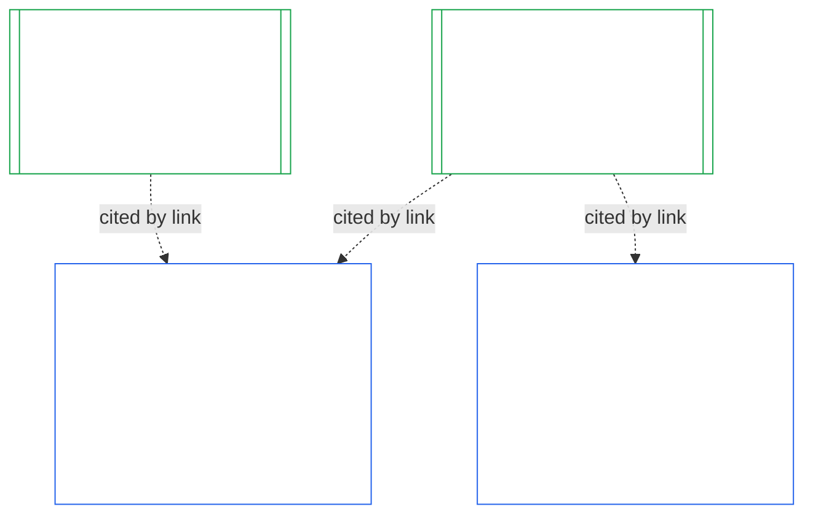

### 1. 목적과 역할

<strong>추적</strong>

- 상위 문서:
  - [제7장 §1 시스템 헌장과 기관 헌장이 필요한 경우](core_07.000_charters.md#1-when-system-and-institutional-charters-are-required) (7.000 §1);
  - [제9장 A부 §1 목적과 역할](core_09.000_system_alignment_certification_evaluation.md#1-purpose-and-role) (9.000 §1);
  - [제XI-E조](core_06.005_rights_part_b.md#article-xi-e-institutional-formation-and-business-creation) (*기관의 성립과 사업 창설*);
  - [제XXVIII-A조](core_06.020_rights_part_e.md#xxviii-a-existing-instantiations-adoption-transition-window) (*단계적 채택과 권리 바닥의 연속성*).
- 하위 문서: [§2](#2-institution-class-evaluation); [§6](#6-forum-process); [§7](#7-certification-outcomes); [§9](#9-recertification-and-reopening).
- 함께 읽을 문서:
  - [기관](core_05.040_band_continuity.md#institution);
  - [기관 헌장](core_05.040_band_continuity.md#institutional-charter);
  - [시스템 헌장](core_05.040_band_continuity.md#system-charter);
  - [사업 창설](core_05.055_band_participation.md#business-creation).

 

*쉬운 말로: 시스템의 인증은 그 시스템에 속합니다. 기관의 인증은 시스템 인증들을 인용하고, 기관만이 답할 수 있는 내용을 더합니다. 하나의 시스템은 여러 기관 아래에 있거나 어느 기관에도 속하지 않을 수 있습니다. 이 장의 어떤 내용도 기관을 시작하는 데 인증이 걸림돌이 되게 하지 않습니다.*

기관 정렬 인증과 시스템 정렬 인증은 링크로 연결된 두 인증입니다. 그 관계는 **포함이 아니라 링크를 통한 구성**입니다. 그림에서 화살표는 시스템 인증 기록에서 그 기록을 인용하는 각 기관 인증 기록으로 이어집니다. 어떤 기관에도 속하지 않는 시스템에는 화살표가 없고 필요하지도 않습니다. 어떤 시스템도 운영하지 않는 기관은 단독 기록을 가집니다.

링크를 통한 구성에는 두 측면이 있으며, 먼저 기관 측면을 봅니다.

기관 측면:

- **기관 인증 기록은 시스템 기록을 인용하며 다시 평가하지 않습니다:** 링크로 시스템 인증 기록을 인용하고 그 버전을 명시합니다. 이 장은 시스템 평가를 다시 실행하거나 시스템 등급을 다시 결정하거나 시스템의 결과, 상태 또는 인증 조건을 바꾸지 않습니다.
- **기관 인증으로 시스템 인증을 끌어올릴 수 없습니다:** 인증되지 않음 상태인 시스템은 기관의 상태와 관계없이 인증되지 않음으로 남습니다. 인증을 보유한 시스템도 기관의 판단으로부터 보호받지 않습니다.
- **기관에 관한 사실은 한 번만 확인합니다:** [제9장 A부 §3.1 거버넌스·유인·다툼 가능성 규율](core_09.000_system_alignment_certification_evaluation.md#31-governance-incentive-and-contestability-discipline)에서 운영자의 거버넌스와 유인을 묻는 경우, 운영자에 대한 최신 기관 인증 기록이 링크를 통해 해당 사실을 제공할 수 있습니다. 그래도 시스템의 포럼은 그 사실이 해당 시스템에 충분한지 결정합니다. 같은 기관 관련 사실을 시스템 인증 기록에 이유를 밝히지 않고 다르게 판단해서는 안 됩니다.

시스템 측면:

- **시스템 인증 기록은 시스템에 속합니다:** [제9장](core_09.000_system_alignment_certification_evaluation.md#chapter-nine-system-alignment-certification)에 따른 시스템 자체 기록입니다.
- **하나의 시스템 인증 기록을 여러 기관이 인용할 수 있습니다:** [제7장 §1 시스템 헌장과 기관 헌장이 필요한 경우](core_07.000_charters.md#1-when-system-and-institutional-charters-are-required)에 따라 하나의 시스템을 둘 이상의 기관이 운영하거나, 책임 있게 관리하거나, 실질적으로 통제할 수 있습니다. 각 기관은 같은 기록을 인용합니다.
- **시스템은 어떤 기관에도 속하지 않을 수 있습니다:** 단일 감지자는 기관이 아니므로 시스템에 기관이 없을 수 있습니다. 기관이 없는 시스템은 [제9장](core_09.000_system_alignment_certification_evaluation.md#chapter-nine-system-alignment-certification)만으로 인증되며 이 장에 따른 어떤 절차도 필요하지 않습니다. 기관에 속한 시스템도 똑같이 인증됩니다. 이 장은 기관을 위한 별도의 기록을 추가할 뿐, 시스템 자체 인증의 단계가 아닙니다.

#### 1.1 누가 인증을 받는가

등급 L 이상인 기관은 이 장의 적용 대상이며, 등급은 [§2.1 기관 등급](#21-institution-class)에 따라 정합니다. 여기에는 시스템을 전혀 운영하지 않는 기관도 포함됩니다. 인용할 시스템 인증 기록은 없으며, 기관 자체의 영향에 따라 등급이 정해집니다. 기관의 **포트폴리오**는 기관이 운영하거나, 책임 있게 관리하거나, 실질적으로 통제하는 시스템의 집합입니다([포트폴리오](core_05.040_band_continuity.md#portfolio)).

- **등급 A, B, C 및 L:** 절차가 적용되며 [§2.2 등급별 규모 조정](#22-scaling-by-class)에 따라 규모를 조정합니다.
- **등급 P:** 절차의 이용을 권장하며 자발적으로 이용할 수 있습니다. 등급 L 이상으로 재분류되거나 기관이 자발적으로 헌법 준수를 주장하면 의무가 됩니다. 새로운 실질 권한을 맡기로 한 등급 P 기관은 [§9.2.2 새로운 실질 권한에 따른 재인증](#922-recertification-for-new-material-authority)의 통지를 하는 시점에 최소 등급 L로 재분류됩니다. 그 권한은 정의상 실질적([§9.2.1 새로운 실질 권한에 해당하는 것](#921-what-counts-as-new-material-authority))이고, 어느 영역에서든 실질적인 기관은 최소 등급 L이기 때문입니다([§2.1 기관 등급](#21-institution-class), 항목 2). 이 재분류는 통지 시점부터 통지가 승인 전에 철회되거나, 해당 권한이 승인되지 않는 때까지 지속됩니다. 단, 그 권한이 한 번도 행사되지 않았어야 합니다. 그러면 기관은 등급 P로 돌아가며 제한적인 최초 인증 기간은 끝납니다. 새 통지를 하면 기간이 다시 시작됩니다. 승인 없이 권한을 행사하면 [§9.2.2 새로운 실질 권한에 따른 재인증](#922-recertification-for-new-material-authority)(*통지 없이 또는 승인 전에*)에 따른 판단 대상으로 남습니다. 이는 [제9장 A부 §1 목적과 역할](core_09.000_system_alignment_certification_evaluation.md#1-purpose-and-role)에 대응합니다.
- **시스템 하나:** 시스템 헌장이 필요한 시스템을 정확히 하나 운영하는 기관은 인증 절차 한 번과 기록 하나를 가지며, 이 장은 이를 **단일 시스템 평가**라고 부릅니다. 시스템 인증 기록에는 [§8 기관 인증 기록](#8-institutional-certification-record)의 항목을 담는 *기관 판단 사항 블록*이 포함되며, 이 블록이 기관 인증 기록 역할을 합니다. 포럼, 좌석, 기한은 기관 항목을 더한 시스템 자체 인증 절차의 것을 따릅니다. 결과에는 각자의 거부 및 취소 사유가 적용되며, [§7.4 기관에 대한 거부와 취소](#74-denial-and-revocation-for-an-institution)에 규정되어 있습니다. 시스템이 포트폴리오 전체이므로 [§9.5 시스템 인증에서 이어지는 연쇄](#95-cascade-from-system-certifications)는 연쇄로 적용되지 않습니다. 다만 [§7.4 기관에 대한 거부와 취소](#74-denial-and-revocation-for-an-institution)의 규칙 1과 2(지표 및 원인이 어디에 있는지를 판단하는 검사)는 적용됩니다.
- **시스템 여러 개:** 기관에 대한 기관 인증 기록 하나를 작성하고, 기관이 운영하는 각 시스템의 시스템 인증 기록을 링크로 연결합니다. 각 시스템은 자체 인증 절차와 자체 기록을 유지합니다.
- **시스템 없음:** 기관 인증 기록 하나만 둡니다. 기관이 시스템을 운영하지 않으므로 링크할 시스템 인증 기록은 없습니다.

