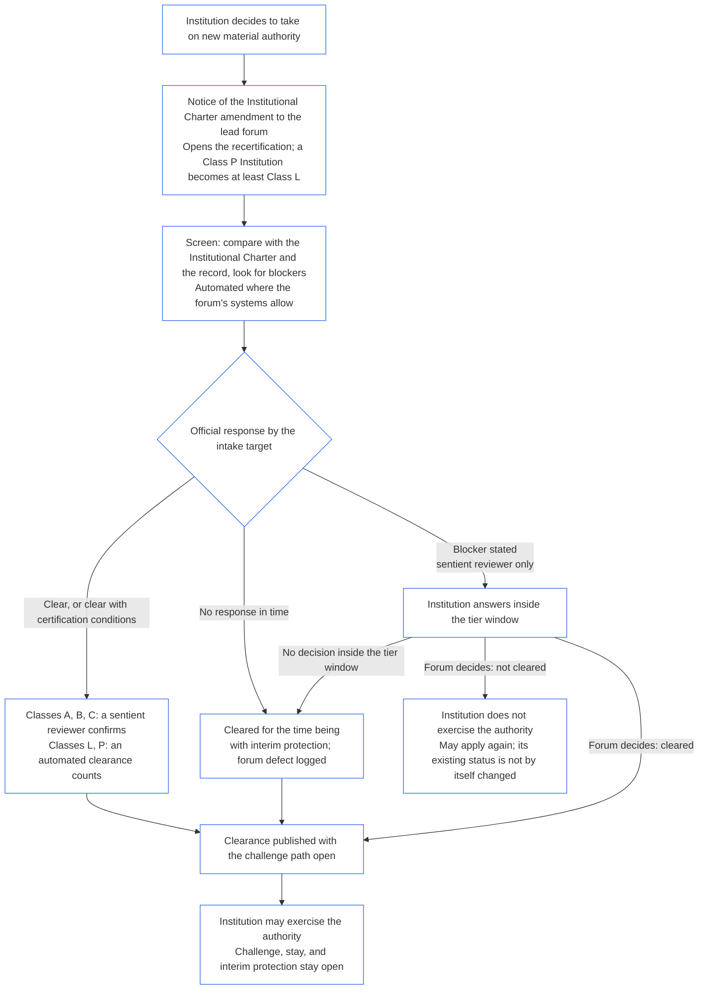

##### 9.2.2 새로운 실질 권한에 따른 재인증

새로운 실질 권한을 맡기로 결정한 기관은 재인증을 받아야 하며, 해당 권한을 행사하기 전에 결과를 기다려야 합니다. 이는 **제XI-E조**(*기관의 성립과 사업 창설*)가 정한 대기입니다. 절차는 다음과 같습니다.

- **먼저 통지:** 기관은 [제7장 §7.1 문서 변경](core_07.000_charters.md#71-changing-the-document)에서 이미 요구한 기관 헌장 개정 통지를 하고 주관 포럼에 보냅니다. 통지와 함께 재인증이 시작됩니다.
- **기록이 아직 없는 경우:** 기관 인증 기록이 없는 기관도 같은 통지를 합니다. 통지는 새로운 권한에 한정된 최초 인증을 시작합니다. 해당 권한에 적용되는 기관 헌장 및 [§3 기관 전체 인증 평가](#3-whole-institution-certification-evaluation)부터 [§5 권리 바닥 및 영역 평가](#5-rights-floor-and-domain-evaluations)까지의 평가에 비추어 판단합니다. 최초 인증의 나머지 부분은 여전히 [§1.3 최초 인증 기간](#13-window-for-the-first-certification)의 기간 안에 진행됩니다(통지로 재분류되는 등급 P 기관은 통지일부터 기간을 계산). 새 권한을 기다리는 일은 그 기간과 무관합니다.
- **등급별 기간 내 처리:** [제9장 C부 §9.3.4 등급별 기간](core_09.010_system_alignment_certification_record_recertification.md#934-tier-windows)에 따라 재인증하며, 기본적으로 기관 등급에 맞는 등급을 적용합니다. 기간을 넘기면 [제XXVI-C조](core_06.020_rights_part_e.md#article-xxvi-c-timely-resolution-and-anti-delay-floor)(*적시 해결 및 지연 방지 바닥*)에 따라 처리하며, 수수료와 대기가 장벽이 되어서는 안 됩니다([피할 수 있는 부담](core_05.040_band_continuity.md#avoidable-burden)).
- **가능한 곳에서는 자동화:** 통지, 새 권한과 기관 헌장 및 최신 기록의 대조, 차단 요인 확인, 승인 처리는 포럼의 시스템이 허용하는 곳에서 자동화합니다. [제1장 §13.3 피할 수 있는 부담 최소화](core_01.005_interaction_interpretation.md#133-minimization-of-avoidable-burden)는 자동화를 피할 수 있는 부담의 우선적 구제책으로 삼고, [제1장 §16.4 행위 시 기록](core_01.010_stewardship_capacity_principles.md#164-document-at-action)은 자동화 부담을 책임 관리자 개인이 아니라 시스템에 둡니다.
  - **승인 처리이지 거부가 아님:** 자동 검토는 새 권한을 즉시 승인하거나 최신 기록이 이미 뒷받침하는 인증 조건을 붙여 승인할 수 있습니다. 그 자체로 차단 요인([§9.2.3 새로운 실질 권한의 승인 차단 요인](#923-blockers-to-clearing-new-material-authority)을 참조)을 명시하거나 승인을 거부할 수는 없습니다. 검토 시스템은 차단 가능성을 표시할 수 있지만, 표시 내용을 확인한 뒤 주관 포럼의 감지자 검토자만 차단 요인을 명시할 수 있습니다.
  - **등급 A, B, C:** 주관 포럼의 감지자 검토자가 모든 승인 처리를 확인해야 공식 답변으로 인정됩니다. 이 등급의 기관과 새 권한에 따라 이 등급에 들어가는 기관에 모두 적용됩니다. 확인에도 접수 목표 기한이 적용됩니다. 검토자는 이미 검증 또는 승인 좌석을 보유한 주관 포럼에 속하며, [§6.1 기관 인증의 네 좌석](#61-four-seats-in-an-institutional-certification)에 따라 기관과 독립되어야 합니다.
  - **등급 L, P:** 자동 승인 처리는 확인 없이 공식 답변으로 인정됩니다. 등급 P 기관은 통지할 때 최소 등급 L로 재분류되므로([§1.1 누가 인증을 받는가](#11-who-is-certified)) 등급 L 규칙이 적용됩니다.
  - **예외적인 상황:** 자동 검토가 차단 가능성을 표시하거나, 권한이 기존에 포함되었는지 또는 실질적인지 판단할 수 없거나, 기관 또는 영향받는 감지자가 검토를 요청하는 경우에는 모든 등급에서 감지자 검토자가 사안을 맡습니다. 검토 요청에는 요청일부터 계산한 [해당 접수 목표 기한](core_05.040_band_continuity.md#tier-window) 안에 답변합니다. 이 요청은 등급별 기간을 연장하지 않습니다.
  - **같은 기록과 동일한 기한:** 어떤 검토를 했는지 기록에 남기므로 자동 승인 처리에도 다른 결정과 동일하게 이의를 제기할 수 있습니다. 자동화는 접수 목표 기한이나 등급별 기간을 연장하지 않습니다. 검토 시스템이 중단되거나 응답하지 못하면 아래 항목에 따라 응답 기한을 넘긴 것으로 봅니다. 포럼은 자신이 사용하는 시스템과 마찬가지로 검토 시스템에도 책임을 집니다([§6.3 기관으로서의 포럼, 인증자, 기록 사무소](#63-forums-certifiers-and-record-offices-as-institutions)).
- **대기:** 재인증이 승인할 때까지 기관은 새 권한을 행사하지 않습니다.
  - **모든 등급에 대기 적용:** 예외 등급은 없으며 비상이나 긴급 상황도 대기를 해제하지 않습니다.
  - **나머지 활동은 계속:** 기관의 기존 활동은 계속됩니다([§1.2 설립 또는 운영에 대한 허가나 관문이 아님](#12-no-permission-and-no-gate-on-forming-or-running)).
  - **보호 조치는 기다리지 않음:** 영향받는 감지자에 대한 포럼의 긴급 보호는 재인증을 기다리지 않습니다([제9장 B부 §6.2 감독 순서](core_09.005_system_alignment_certification_record_process.md#62-supervisory-sequence)). 이는 감지자를 보호하는 조치이지 기관이 권한을 조기에 행사할 근거가 아닙니다.
- **승인 즉시 공개:** 주관 포럼은 승인 처리를 할 때마다 이를 즉시 공개합니다. 당분간 승인하는 경우도 포함하며, [§10 인증에 대한 이의 제기](#10-challenging-a-certification)의 이의 제기 경로를 열어 둡니다. 기관은 승인 즉시 권한을 행사할 수 있습니다. 통지 기간이나 이의 제기 결정이 끝날 때까지 기다리지 않습니다. 영향받는 감지자는 다른 결정과 마찬가지로 승인 처리에 이의를 제기하고 정지 또는 임시 보호를 요청할 수 있으며, 이는 지체하지 않습니다([§9.2.2 새로운 실질 권한에 따른 재인증](#922-recertification-for-new-material-authority), *보호 조치는 기다리지 않음*). 주관 포럼은 공개와 동시에 알고 있는 영향받는 감지자와 관련 시스템 포럼에 승인 통지를 합니다. 정지 또는 임시 보호 요청에는 [CF-14.445 §3.1 단계 목표와 상한](corpus_forum/cf_14.445_performance_backlog_publication_accessibility.md#cf-14445-31-stage-targets-and-outer-bounds)의 해당 접수 목표 기한 안에 답변합니다. 비상 설정이 적용되는 경우 그 설정의 한도 안에 답변합니다.
- **승인 추정:** 권한은 승인된 것으로 추정합니다. 주관 포럼은 [§9.2.3 새로운 실질 권한의 승인 차단 요인](#923-blockers-to-clearing-new-material-authority)에 열거된 차단 요인을 기록에 증거와 함께 제시하는 경우에만 승인을 거부합니다. 차단 요인에 맞춘 인증 조건으로 문제를 억제할 수 있다면 거부하지 않고 그 인증 조건을 붙여 승인합니다.
- **승인의 의미:** 재인증은 인증 조건을 붙이거나 붙이지 않은 잠정 또는 완전 인증으로 종결되며, 권한 행사 전에 충족해야 하는 인증 조건은 모두 독립적으로 검증됩니다.
- **포럼이 제때 응답하지 않는 경우:** 주관 포럼은 [CF-14.445 §3.1 단계 목표와 상한](corpus_forum/cf_14.445_performance_backlog_publication_accessibility.md#cf-14445-31-stage-targets-and-outer-bounds)의 해당 접수 목표 기한까지 공식 답변을 해야 합니다. 답변은 권한 승인, 인증 조건을 붙인 승인, 또는 증거를 명시한 차단 요인 제시 중 하나입니다. 차단 요인을 제시하면 기관에 답변 기회를 주고 포럼은 위의 등급별 기간 내에 결정합니다.
  - **당분간 승인:** 접수 목표 기한까지 공식 답변이 없거나, 명시된 차단 요인을 등급별 기간 안에 결정하지 못하면 [제9장 B부 §7.2 인증 결함과 시정](core_09.005_system_alignment_certification_record_process.md#72-certification-defects-and-correction)에 따른 임시 보호와 의존 제한을 두고 권한을 당분간 승인합니다.
  - **포럼의 결함:** 접수 목표 기한이나 등급별 기간을 넘긴 것은 포럼의 결함이지 기관의 잘못이 아닙니다. 이를 기록하고 시정하며 [제14장 §6 적시 해결, 실질성 등급, 지연 방지 규율](core_14.000_forum.md#6-timely-resolution-materiality-tiers-and-anti-delay-discipline)(*기한 초과 검토*)에 따라 검토합니다.
  - **다른 포럼으로 이관:** 재인증 요청을 같은 포럼 가족의 다른 포럼으로 이관합니다([제14장 §3 이관, 통합, 조정](core_14.000_forum.md#3-transfer-consolidation-and-coordination--continuity-and-anti-capture)). 해당 포럼은 이관일부터 기관 등급에 대한 통상 기간을 적용해 재인증을 진행합니다.
- **승인되지 않은 경우:** 기관은 권한을 행사하지 않으며 제9장 B부 §7.4(*영구 금지 아님*)의 조건에 따라 다시 신청할 수 있습니다. 새 권한을 승인하지 않는다는 사실만으로 기관이 기존에 보유한 인증 상태가 거부되거나 취소되는 것은 아닙니다. 상태는 [§7.3 기관의 시정 준비태세](#73-remediation-readiness-for-an-institution) 및 [§7.4 기관에 대한 거부와 취소](#74-denial-and-revocation-for-an-institution)에 따른 판단이 있을 때만 변경됩니다.
- **통지 없이 또는 승인 전에 행사:** 통지하지 않거나 승인 전에 새로운 실질 권한을 행사하는 것은 기관 헌장을 벗어난 관행입니다. [§3 기관 전체 인증 평가](#3-whole-institution-certification-evaluation)(항목 1)에 따른 판단 사항이며 기관 헌장 관련 사건으로 검토를 다시 엽니다.

<strong>독자 안내(비운영): 새로운 실질 권한에 대한 대기</strong>

이 그림은 §9.2.2 새로운 실질 권한에 따른 재인증을 요약합니다. 그림과 본문이 다르면 본문이 우선합니다. 기관의 기존 활동은 계속되며, 영향받는 감지자에 대한 긴급 보호는 절대로 기다리지 않습니다. 기관 사례는 [CS-9.320 §12 기관 설명 사례](corpus_systems/cs_09.320_system_alignment_certification_illustrations.md#cs-9320-12-illustrative-institution-walkthroughs)에 있습니다.

 

