#### 1.1 प्रमाणन ही प्रणाली-वर्गानुसार प्रमाणबद्ध लेखापरीक्षण प्रक्रिया

पर्यवेक्षण यंत्रणा म्हणून, [लेखापरीक्षणयोग्यता](core_05.050_band_oversight.md#auditability) आणि **अनुच्छेद XVI** (*लेखापरीक्षण, पारदर्शकता आणि स्वतंत्र पडताळणी*) अंतर्गत प्रमाणन ही एक विशेषतः मोठी लेखापरीक्षण प्रक्रिया आहे:

- ती मंच-पर्यवेक्षित, बहुक्षेत्रीय आणि स्थिती प्रदान करणारी आहे.
- ती समकक्ष लेखापरीक्षण पद्धतींचे परिणाम एकत्र करू शकते; पण त्यांना सामावून घेत नाही किंवा त्यांची जागा घेत नाही. प्रत्येक पद्धतीचे स्वतंत्र स्वामित्व असते, जे लेखापरीक्षणाच्या मुख्य स्थानातील [समकक्ष लेखापरीक्षण पद्धती नकाशात](corpus_joint_structure/cjs_05.115_audit_process.md#sibling-audit-modes-owner-map) नमूद आहे:
  - **CS-6.305 (*माहितीचे प्रकार आणि हाताळणी*) आणि CS-6.310** (*डेटा वर्गीकरण*) अंतर्गत प्रणाली डेटा-प्रकार नोंदीचे लेखापरीक्षण
  - **CS-9.305 (*प्रणाली वर्गीकरण यंत्रणा*) आणि CS-9.310** (*प्रणाली प्रभाव वर्गीकरण*) अंतर्गत प्रणाली वर्गीकरण नोंदीचे लेखापरीक्षण
  - **CS-15.305** (*महत्त्वपूर्ण प्रणाली कारभारीपण*) अंतर्गत कारभारी आश्वासन पुनरावलोकने
  - **CS-6.345** (*प्रणाली जीवनचक्र*) ACA अंतर्गत सातत्यपूर्ण लेखापरीक्षण
  - **CS-6.315** (*समजण्याजोगेपणा आणि गुंतागुंतीचे कारभारीपण*) आणि **अनुच्छेद XXIII-B** (*गुंतागुंत लेखापरीक्षण आणि मॉड्युलरिटीच्या अटी*) अंतर्गत गुंतागुंत लेखापरीक्षण
  - **CJS-5.110 §5** (*पर्यवेक्षण: स्वतंत्र पडताळणी आणि दाव्याच्या अखंडतेच्या अटी*) अंतर्गत दावा पडताळणी
- प्रमाणन प्रक्रियेतून न जाता यापैकी कोणतेही मूल्यांकन स्वतंत्रपणे करता येते. प्रमाणन त्यांची जागा घेत नाही.

प्रमाणनाची खोली, नोंदीचा भार, प्रमाणन कालावधी, हितधारक पुनरावलोकन आणि आव्हान मार्ग [भौतिक दाव](core_00.000_preamble.md#material-stake) नुसार [प्रमाणबद्धतेने](core_05.035_band_accountability.md#proportionality) ठरले पाहिजेत:

- अधिक प्रभाव, अधिक अवलंबित्व आणि अधिक जोखीम असलेल्या प्रणालींसाठी अधिक मजबूत पुरावे, अधिक स्पष्ट नोंदी आणि अधिक व्यवहार्य सहभाग आवश्यक — यात प्रणालीवर अवलंबून असलेल्यांनुसार प्रमाणबद्ध केलेली वास्तविक सुलभता, हितधारकांचे इनपुट आणि आव्हान मार्ग समाविष्ट आहेत.
- कमी प्रणाली-वर्ग आणि मर्यादित व्याप्ती यांसाठीही प्रामाणिक वर्गीकरण आणि प्रमाणबद्ध आश्वासन आवश्यक आहे; बाह्य परिणाम असतील तेव्हा भौतिक कर्तव्यांपासून त्यांना सूट मिळत नाही.

**CS-9.305** (*प्रणाली वर्गीकरण यंत्रणा*) मधील [पुनर्वर्गीकरणाची अट](corpus_systems/cs_09.305_system_classification_machinery.md#35-reclassification-requirement) सांगते त्याप्रमाणे प्रक्रिया प्रभाव-वर्गानुसार लागू होते:

- **वर्ग A, वर्ग B आणि वर्ग C:** या प्रणालींचा प्रभाव, अवलंबित्व आणि जोखीम सर्वाधिक असतो. [§3 संपूर्ण-प्रणाली प्रमाणन मूल्यांकन](#3-whole-system-certification-evaluation), [§4 संबंधित ठिकाणी लागू होणारी मूल्यांकने](#4-evaluations-where-implicated) आणि [§5 अधिकार-तळ व क्षेत्रीय मूल्यांकने](#5-rights-floor-and-domain-evaluations) अंतर्गत संपूर्ण-प्रणाली मूल्यांकन, प्रत्येक उपटप्प्याला लागू होईल त्यानुसार, पूर्ण खोलीत करणे बंधनकारक आहे;
- **वर्ग L:** तेच मूल्यांकन बंधनकारक, पण प्रमाणबद्ध असते; **CS-9.305** (*प्रणाली वर्गीकरण यंत्रणा*) आणि **CS-9.310** (*प्रणाली प्रभाव वर्गीकरण*) परवानगी देत असल्यास प्रमाणनाचा मूलभूत कालावधी अधिक मोठा आणि नोंदी सोप्या असतात; आणि
- **वर्ग P:** प्रणाली वैधरीत्या वर्ग P असेपर्यंत प्रक्रिया वापरण्यास प्रोत्साहन असते आणि वर्ग P प्रणाली ती स्वेच्छेने वापरू शकते. वर्ग L किंवा त्याहून वर पुनर्वर्गीकरण झाल्यावर, किंवा परिचालकाने स्वेच्छेने प्रणालीसाठी संवैधानिक अनुपालनाचा दावा केल्यास, प्रक्रिया बंधनकारक होते.

प्रमाणन कालावधी आणि त्याच्या मध्यावर होणारे आर्थिक, संसाधन किंवा विशेष लेखापरीक्षण [अध्याय चौदा §6 वेळेवर निराकरण, भौतिकतेचे स्तर आणि विलंबविरोधी शिस्त](core_14.000_forum.md#review-cadence) (*पुनरावलोकन कालावधी*) मध्ये प्रणाली-वर्गानुसार ठरवले आहेत. हा अध्याय आकडे पुन्हा सांगत नाही.

#### 1.2 प्रमाणनाचा झटपट आढावा

*सोप्या भाषेत: प्रणालीचे प्रामाणिक वर्गीकरण करा, लागू मूल्यांकने करा, मंचांकडून पुरावे आणि हितधारकांच्या चिंता स्वतंत्ररीत्या तपासून घ्या आणि परिणाम ठरवा. मंच पुनरावलोकनासाठी उघडलेली एकच नोंद पूर्ण करा आणि आव्हान मार्ग खुला ठेवून प्रकाशित करा. प्रमाणित प्रणाली सूचना कालावधी आणि आवश्यक संरक्षणे पूर्ण झाल्यानंतरच कार्यान्वित होते. प्रत्यक्ष परिणामांचे निरीक्षण करा, घटना आणि आव्हानांना प्रतिसाद द्या आणि वेळापत्रकानुसार किंवा तथ्ये बदलल्यावर पुन्हा तपासा. दोष दुरुस्त करा आणि प्रभावित व्याप्ती अधिकृत करण्यापूर्वी किंवा प्रमाणनाच्या अटीतून मुक्त करण्यापूर्वी दुरुस्तीची स्वतंत्र पडताळणी करून घ्या. प्रत्येक पुनरावलोकन टप्प्यात मागील नोंदीशी जोडलेली नवी नोंद वापरली जाते.*

प्रक्रियेचे **सहा टप्पे** आहेत: **I चौकट ठरवणे**, **II मूल्यांकन**, **III पुनरावलोकन**, **IV निर्णय**, **V नोंद** आणि **VI संचालन**. टप्पा II तीन उपटप्प्यांत चालतो आणि प्रत्येकासाठी स्वतंत्र विभाग आहे: **IIa** (नेहमी), **IIb** (संबंधित ठिकाणी) आणि **IIc** (अट पूर्ण झाल्यावर). टप्पा VI देखील दोन उपटप्प्यांत चालतो आणि प्रत्येकासाठी स्वतंत्र विभाग आहे: **VIa** (संचालन आणि पुनर्प्रमाणन, [§9 पुनर्प्रमाणन आणि पुनर्उद्घाटन](core_09.010_system_alignment_certification_record_recertification.md#9-recertification-and-reopening)) आणि **VIb** (पात्रतेचा दुवा, [§11 पात्रतेशी संबंध](core_09.010_system_alignment_certification_record_recertification.md#11-relationship-to-standing)). तक्ता संपूर्ण प्रमाणन प्रक्रिया याच क्रमाने दाखवतो. भाग अ मध्ये पहिले दोन टप्पे — चौकट ठरवणे आणि मूल्यांकन — आहेत; [भाग ब](core_09.005_system_alignment_certification_record_process.md#chapter-nine-part-b-system-alignment-certification--forum-process-and-outcomes) आणि [भाग क](core_09.010_system_alignment_certification_record_recertification.md#chapter-nine-part-c-system-alignment-certification--record-recertification-and-standing) मध्ये शेवटचे चार टप्पे आहेत: मंच प्रक्रिया आणि कार्यारंभ-द्वारासह परिणाम (भाग ब), त्यानंतर नोंद आणि संचालन (आव्हान मार्ग, पुनर्प्रमाणन व पुनर्उद्घाटन आणि पात्रतेचा दुवा) (भाग क).

लागू होणारे प्रत्येक मूल्यांकन प्रत्येक प्रमाणन टप्प्यात पुन्हा केले जाते: पहिल्या प्रमाणनाच्या वेळी, [§2 प्रणाली-वर्ग मूल्यांकन](#2-system-class-evaluation) ने ठरवलेल्या वेळापत्रकानुसार प्रत्येक पुनर्प्रमाणनात आणि प्रत्येक पुनर्उद्घाटन किंवा नव्या पुनरावलोकनात. प्रणालीवरील अवलंबित्व वाढणे, सामायिक पायाभूत स्रोतांमधून होणारे उपशोषण वाढणे, प्रणाली त्यात परत देत असलेल्या योगदानात लक्षणीय घट होणे किंवा विश्वासार्ह आव्हान यांसारखी भौतिक तथ्ये बदलल्यास पुढील नियोजित पुनर्प्रमाणनापूर्वी पुनरावलोकन पुन्हा उघडले जाते. [भाग क §9.2 पुनर्उद्घाटनाची कारणे](core_09.010_system_alignment_certification_record_recertification.md#92-reopening-triggers) कारणांची यादी देतो.

```mermaid
flowchart TB
    T(["भौतिक परिणाम असलेली प्रणाली प्रमाणन मागते,<br/>किंवा तिच्यावरील अवलंबित्व वाढते"])
    C["§2 टप्पा I, चौकट ठरवणे<br/>प्रामाणिक वर्गीकरण<br/><br/>वर्ग खोली आणि पुनर्तपासणीचे वेळापत्रक ठरवतो"]
    subgraph W["§3–§5 टप्पा II, मूल्यांकन — संपूर्ण-प्रणाली मूल्यांकन"]
        direction LR
        Al["§3.1–§3.4 IIa — नेहमी<br/><br/>प्रशासन; प्रणालीगत जोखीम: मूल्यांकन आणि<br/>ज्यांना गरज आहे त्यांना प्रकटीकरण;<br/>कालावधी; डेटा प्रकार"]
        Im["§4 IIb — संबंधित ठिकाणी<br/><br/>गोपनीयता बिंदू, बाहेर पडण्याचे अधिकार,<br/>सभा आणि असहमती"]
        Tr["§5 IIc — अट पूर्ण झाल्यावर<br/><br/>लागू अधिकार-तळ तपासण्या<br/>आणि सहा क्षेत्रीय मूल्यांकने"]
        Al ~~~ Im ~~~ Tr
    end
    F["§6 टप्पा III, पुनरावलोकन<br/>पुरावे आणि हितधारकांच्या चिंतांचे<br/>स्वतंत्र पुनरावलोकन<br/><br/>नियुक्त मंच निष्कर्ष देतात;<br/>आव्हान मार्ग खुले राहतात"]
    Rec["§8 टप्पा V, नोंद<br/>एक प्रणाली प्रमाणन नोंद<br/><br/>मंच पुनरावलोकनासाठी उघडली जाते; निकालासह,<br/>समर्थक निष्कर्ष, प्रमाणनाच्या अटी आणि संचालन योजना नोंदवून पूर्ण केली जाते"]
    S[["अध्याय अकरा — पात्रता<br/>नोंदी<br/><br/>या अध्यायाबाहेर"]]
    O{"§7 टप्पा IV, निर्णय<br/><br/>पुराव्याला कोणता परिणाम आणि<br/>स्थिती समर्थन देते?"}
    Fc["§7, §9.3 पूर्ण प्रमाणन<br/><br/>सलग स्वच्छ तात्पुरत्या पुनर्प्रमाणनांची आवश्यक संख्या;<br/>सध्याची किंवा निकटवर्ती सूचित विसंगती नाही<br/>पूर्ण प्रमाणन कालावधी; प्रमाणनाच्या अटी लागू होऊ शकतात"]
    Pc["§7, §9.3 तात्पुरते प्रमाणन<br/><br/>पहिली मंजुरी, विसंगतीनंतर पुनर्प्राप्ती,<br/>किंवा तात्पुरती स्थिती चालू ठेवणे किंवा खाली येणे<br/>कमी तात्पुरता कालावधी; प्रमाणनाच्या अटी लागू होऊ शकतात"]
    Nc["§7 प्रमाणित नाही<br/><br/>स्थगित, नाकारलेले, मागे घेतलेले किंवा कालबाह्य<br/>कार्यारंभ नाही; कारणे आणि आवश्यक सुधारक काम नमूद करा"]
    Pub["§7, §10 पूर्ण नोंद प्रकाशित करा<br/><br/>प्रकाशित नोंदीचा आव्हान मार्ग उघडा;<br/>नव्या किंवा विस्तारित व्याप्तीसाठी कार्यारंभ आणि सूचना नमूद करा"]
    G{"§7 कार्यारंभ-द्वार<br/><br/>प्रमाणन आणि लागू<br/>कार्यारंभपूर्व अटी पूर्ण आहेत का?"}
    Hold["कार्यारंभपूर्व अटी पूर्ण करा<br/><br/>सूचना पूर्ण करा आणि कार्यारंभापूर्वी आवश्यक<br/>प्रमाणन अटींची स्वतंत्र पडताळणी करा"]
    Rm["§7, §9.3 संरक्षण आणि दुरुस्ती<br/><br/>प्रभावित व्याप्तीत नवा कार्यारंभ नाही;<br/>प्रभावित संज्ञ प्राण्यांचे संरक्षण करा, रचना किंवा संचालन दुरुस्त करा,<br/>आणि स्वतंत्र पडताळणीसाठी पुरावे सादर करा"]
    Ch["§9–§10 टप्पा VIa, संचालन आणि पुनर्प्रमाणन<br/>निरीक्षण करा आणि आव्हाने खुली ठेवा<br/><br/>प्रमाणित व्याप्ती व प्रमाणनाच्या अटींमध्ये कार्य करा;<br/>परिणामांवर लक्ष ठेवा आणि घटना व आव्हानांना प्रतिसाद द्या"]
    S2[["अध्याय अकरा — पात्रता<br/>नोंदी<br/><br/>या अध्यायाबाहेर"]]
    Sp["&nbsp;&nbsp;&nbsp;&nbsp;&nbsp;&nbsp;&nbsp;&nbsp;&nbsp;&nbsp;&nbsp;&nbsp;&nbsp;&nbsp;&nbsp;&nbsp;&nbsp;&nbsp;&nbsp;&nbsp;&nbsp;&nbsp;&nbsp;&nbsp;&nbsp;&nbsp;&nbsp;&nbsp;&nbsp;&nbsp;&nbsp;&nbsp;&nbsp;"]
    SpL["&nbsp;&nbsp;&nbsp;&nbsp;&nbsp;&nbsp;&nbsp;&nbsp;&nbsp;&nbsp;&nbsp;&nbsp;&nbsp;&nbsp;&nbsp;&nbsp;&nbsp;&nbsp;&nbsp;&nbsp;&nbsp;&nbsp;&nbsp;&nbsp;&nbsp;&nbsp;&nbsp;&nbsp;&nbsp;&nbsp;&nbsp;&nbsp;&nbsp;&nbsp;&nbsp;"]
    SpA["&nbsp;&nbsp;&nbsp;&nbsp;&nbsp;&nbsp;&nbsp;&nbsp;&nbsp;&nbsp;&nbsp;&nbsp;&nbsp;&nbsp;&nbsp;&nbsp;&nbsp;&nbsp;&nbsp;&nbsp;&nbsp;&nbsp;&nbsp;&nbsp;&nbsp;&nbsp;&nbsp;&nbsp;&nbsp;&nbsp;&nbsp;&nbsp;&nbsp;&nbsp;&nbsp;&nbsp;&nbsp;&nbsp;&nbsp;&nbsp;&nbsp;&nbsp;&nbsp;&nbsp;&nbsp;"]
    Re["§9 पुढील पुनरावलोकन टप्पा<br/><br/>पुनर्प्रमाणन, पुनर्उद्घाटन किंवा नवे पुनरावलोकन;<br/>प्रत्येक टप्प्यात मागील नोंदीशी जोडलेली नवी नोंद उघडते"]
    T --> C
    A1((A)) --> C
    C --> W
    W --> F
    F --> O
    O --> Fc
    O --> Pc
    O --> Nc
    Fc --> Rec
    Pc --> Rec
    Nc --> Rec
    Rec -.->|VIb, §11 —<br/>फक्त सत्यापित इनपुट;<br/>सध्याचे प्रमाणन किंवा<br/>प्रमाणनादरम्यान उद्भवलेली तथ्ये| S
    Rec --> Pub
    Rec ~~~ Sp
    Pub --> G
    G ~~~ SpL
    G -->|प्रमाणित नाही| Rm
    G --->|होय: नोंदीच्या<br/>व्याप्तीत संचालन| Ch
    G --->|प्रमाणित,<br/>पूर्वअटी प्रलंबित| Hold
    Hold --> G
    Ch -->|भौतिक दोष:<br/>संरक्षण आणि दुरुस्ती| Rm
    Ch -->|वेळापत्रकानुसार किंवा<br/>भौतिक बदल किंवा<br/>विश्वासार्ह आव्हानामुळे<br/>पुनरावलोकन आवश्यक| Re
    Ch -.->|VIb, §11 —<br/>फक्त सत्यापित इनपुट;<br/>संचालनातून योगदान आणि<br/>उल्लंघन नोंदींसाठी<br/>तथ्ये मिळू शकतात| S2
    Rm -->|पुढील पुनरावलोकन<br/>टप्प्यात दुरुस्तीचा पुरावा<br/>तपासला जातो| Re
    S2 ~~~~ SpA
    SpA ~~~ Re
    Re --> A2((A))
    style Sp fill:none,stroke:none,color:#111111
    style SpL fill:none,stroke:none,color:#111111
    style SpA fill:none,stroke:none,color:#111111
    style T fill:none,stroke:#64748b,color:#ffffff
    style C fill:none,stroke:#16a34a,color:#ffffff
    style Ch fill:none,stroke:#16a34a,color:#ffffff
    style Al fill:none,stroke:#16a34a,color:#ffffff
    style Im fill:none,stroke:#16a34a,color:#ffffff
    style Tr fill:none,stroke:#16a34a,color:#ffffff
    style F fill:none,stroke:#ea580c,color:#ffffff
    style Rec fill:none,stroke:#2563eb,color:#ffffff
    style S fill:none,stroke:#db2777,color:#ffffff
    style S2 fill:none,stroke:#db2777,color:#ffffff
    style O fill:none,stroke:#ea580c,color:#ffffff
    style Fc fill:none,stroke:#9333ea,color:#ffffff
    style Pc fill:none,stroke:#9333ea,color:#ffffff
    style Nc fill:none,stroke:#9333ea,color:#ffffff
    style G fill:none,stroke:#ea580c,color:#ffffff
    style Pub fill:none,stroke:#2563eb,color:#ffffff
    style Rm fill:none,stroke:#9333ea,color:#ffffff
    style Hold fill:none,stroke:#16a34a,color:#ffffff
    style Re fill:none,stroke:#16a34a,color:#ffffff
    style A1 fill:none,stroke:#64748b,color:#ffffff
    style A2 fill:none,stroke:#64748b,color:#ffffff
```

<strong>वाचक मार्गदर्शक (असंक्रियात्मक): उदाहरणे, कार्यपत्र आणि संस्था</strong>

> **वर्ग A**, **वर्ग B** आणि **वर्ग C** यांची उदाहरणार्थ प्रोफाइल — आणि या अध्यायभर प्रणाली-वर्ग प्रमाणनाची खोली कशी ठरवतो — [CS-9.320 §2 प्रणाली-वर्ग प्रोफाइलची उदाहरणे](corpus_systems/cs_09.320_system_alignment_certification_illustrations.md#cs-9320-2-illustrative-system-class-profiles) येथे आहेत. [§3 संपूर्ण-प्रणाली प्रमाणन मूल्यांकन](#3-whole-system-certification-evaluation) ते [§5.6 विश्वासार्हता आणि प्रणालीवरील अवलंबित्व अखंडता मूल्यांकन](#56-trustworthiness-and-system-reliance-integrity-evaluation) मधील प्रत्येक मूल्यांकन क्षेत्रासाठी त्याच तीन प्रणालींची मार्गदर्शित उदाहरणे [CS-9.320 प्रणाली संरेखन प्रमाणन उदाहरणे](corpus_systems/cs_09.320_system_alignment_certification_illustrations.md#cs-9320-system-alignment-certification-illustrations) येथे आहेत; प्रत्येक प्रोफाइल व उदाहरण त्याने स्पष्ट केलेल्या भाग अ मधील विभागाशी जोडलेले आहे.
>
> प्रत्येक टप्प्यातील नियमाच्या विभागाशी दुवा असलेले सहा टप्प्यांचे क्रमवार कार्यपत्र [CS-9.315 §2 कार्यपत्र](corpus_systems/cs_09.315_system_alignment_certification_run_sheet.md#cs-9315-2-run-sheet) (*प्रणाली संरेखन प्रमाणन कार्यपत्र*) येथे आहे. कार्यपत्र आणि विभाग यांत फरक असल्यास विभागातील नियम लागू होतो.
>
> अध्याय दहाची प्रक्रिया पार करून दाखवणाऱ्या तीन काल्पनिक संस्था [CS-9.320 §12 संस्थांची उदाहरणार्थ मार्गदर्शित प्रकरणे](corpus_systems/cs_09.320_system_alignment_certification_illustrations.md#cs-9320-12-illustrative-institution-walkthroughs) येथे आहेत.
>
> संस्थेसाठी हेच सहा टप्पे [अध्याय दहा](core_10.000_institutional_alignment_certification.md#chapter-ten-institutional-alignment-certification) मधून चालतात; त्यातील विभागांचे क्रमांक या अध्यायातील विभागांप्रमाणेच आहेत: टप्पे I व II [अध्याय दहा §2 संस्था-वर्ग मूल्यांकन](core_10.000_institutional_alignment_certification.md#2-institution-class-evaluation) ते [§5 अधिकार-तळ व क्षेत्रीय मूल्यांकने](core_10.000_institutional_alignment_certification.md#5-rights-floor-and-domain-evaluations) मध्ये; टप्पे III ते V [§6 मंच प्रक्रिया](core_10.000_institutional_alignment_certification.md#6-forum-process) ते [§8 संस्था प्रमाणन नोंद](core_10.000_institutional_alignment_certification.md#8-institutional-certification-record) मध्ये; आणि टप्पा VI [§9 पुनर्प्रमाणन आणि पुनर्उद्घाटन](core_10.000_institutional_alignment_certification.md#9-recertification-and-reopening) ते [§11 पात्रतेशी संबंध](core_10.000_institutional_alignment_certification.md#11-relationship-to-standing) मध्ये.

 

