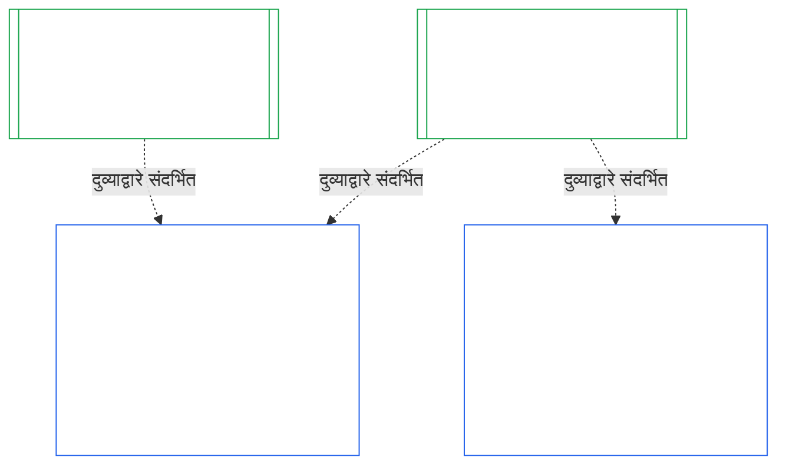

### 1. उद्देश आणि भूमिका

<strong>Trace</strong>

- पूर्वस्रोत:
  - [अध्याय सात §1 प्रणाली आणि संस्थात्मक सनदा कधी आवश्यक असतात](core_07.000_charters.md#1-when-system-and-institutional-charters-are-required) (7.000 §1);
  - [अध्याय नऊ भाग A §1 उद्देश आणि भूमिका](core_09.000_system_alignment_certification_evaluation.md#1-purpose-and-role) (9.000 §1);
  - [अनुच्छेद XI-E](core_06.005_rights_part_b.md#article-xi-e-institutional-formation-and-business-creation) (*संस्थात्मक स्थापना आणि व्यवसायनिर्मिती*);
  - [अनुच्छेद XXVIII-A](core_06.020_rights_part_e.md#xxviii-a-existing-instantiations-adoption-transition-window) (*टप्प्याटप्प्याने अवलंब आणि अधिकार-तळ सातत्य*).
- अधःस्रोत: [§2](#2-institution-class-evaluation); [§6](#6-forum-process); [§7](#7-certification-outcomes); [§9](#9-recertification-and-reopening).
- यांसह वाचा:
  - [संस्था](core_05.040_band_continuity.md#institution);
  - [संस्थात्मक सनद](core_05.040_band_continuity.md#institutional-charter);
  - [प्रणाली सनद](core_05.040_band_continuity.md#system-charter);
  - [व्यवसायनिर्मिती](core_05.055_band_participation.md#business-creation).

 

*सोप्या शब्दांत: प्रणालीचे प्रमाणन त्या प्रणालीचे असते. संस्थेचे प्रमाणन त्या प्रमाणनांचा संदर्भ देते आणि फक्त संस्थाच ज्यासाठी उत्तर देऊ शकते ते जोडते. एक प्रणाली अनेक संस्थांखाली किंवा कोणत्याही संस्थेखाली नसू शकते. येथे कोणतीही बाब संस्था सुरू करण्याच्या आड येण्यासाठी प्रमाणनाला परवानगी देत नाही.*

संस्थात्मक संरेखन प्रमाणन आणि प्रणाली संरेखन प्रमाणन ही दुव्याने जोडलेली दोन प्रमाणने आहेत. त्यांचा संबंध **दुव्याद्वारे संयोजनाचा** आहे, अंतर्भावाचा नाही. आकृतीत, प्रणाली प्रमाणन नोंदीपासून तिचा संदर्भ देणाऱ्या प्रत्येक संस्थात्मक प्रमाणन नोंदीकडे बाण जातो. कोणत्याही संस्थेखाली नसलेल्या प्रणालीला बाण नसतो आणि त्याची गरजही नसते; कोणतीही प्रणाली चालवत नसलेल्या संस्थेची स्वतंत्र नोंद असते.

दुव्याद्वारे संयोजनाच्या दोन बाजू आहेत; पहिली संस्था-संबंधित आहे.

संस्थेच्या बाजूने:

- **संस्थात्मक प्रमाणन नोंद प्रणालीचा संदर्भ देते; तिचे मूल्यांकन पुन्हा करत नाही:** ती प्रणाली प्रमाणन नोंदीचा दुव्याद्वारे संदर्भ देते आणि तिची आवृत्ती नमूद करते. हा अध्याय प्रणालीचे मूल्यांकन पुन्हा करत नाही, प्रणालीच्या वर्गावर पुन्हा निर्णय देत नाही किंवा तिचा निकाल, स्थिती अथवा प्रमाणनाच्या अटी बदलत नाही.
- **संस्थेचे प्रमाणन प्रणालीचे प्रमाणन उंचावू शकत नाही:** प्रमाणित नसलेली प्रणाली संस्थेची स्थिती काहीही असली तरी प्रमाणित नसलेलीच राहते. प्रमाणित प्रणालीला संस्थेच्या निष्कर्षापासून संरक्षण मिळत नाही.
- **संस्थात्मक तथ्ये एकदाच निश्चित होतात:** [अध्याय नऊ भाग A §3.1 शासन, प्रोत्साहन आणि आव्हानक्षमता शिस्त](core_09.000_system_alignment_certification_evaluation.md#31-governance-incentive-and-contestability-discipline) चालकाच्या शासन व प्रोत्साहनांबद्दल विचारत असेल, तर चालकाची सध्याची संस्थात्मक प्रमाणन नोंद दुव्याद्वारे त्या तथ्यांचा पुरवठा करू शकते. ती तथ्ये त्या प्रणालीसाठी पुरेशी आहेत का हे प्रणालीचे मंचच ठरवतात. प्रणाली प्रमाणन नोंदीत कारण न सांगता तेच संस्थात्मक तथ्य वेगळे ठरवता येत नाही.

प्रणालीच्या बाजूने:

- **प्रणाली प्रमाणन नोंद प्रणालीची असते:** [अध्याय नऊ](core_09.000_system_alignment_certification_evaluation.md#chapter-nine-system-alignment-certification) अंतर्गत ती प्रणालीची स्वतःची नोंद असते.
- **एका प्रणाली प्रमाणन नोंदीचा अनेक संस्था संदर्भ देऊ शकतात:** [अध्याय सात §1 प्रणाली आणि संस्थात्मक सनदा कधी आवश्यक असतात](core_07.000_charters.md#1-when-system-and-institutional-charters-are-required) अंतर्गत एकापेक्षा अधिक संस्था प्रणाली चालवू, तिचे कारभारीपण करू किंवा तिच्यावर भौतिक नियंत्रण ठेवू शकतात. प्रत्येक संस्था त्याच नोंदीचा संदर्भ देते.
- **प्रणाली कोणत्याही संस्थेखाली असणे आवश्यक नाही:** एकच संज्ञ प्राणी संस्था नसतो, म्हणून प्रणालीखाली कोणतीही संस्था नसू शकते. संस्था नसलेल्या प्रणालीचे प्रमाणन केवळ [अध्याय नऊ](core_09.000_system_alignment_certification_evaluation.md#chapter-nine-system-alignment-certification) अंतर्गत होते आणि या अध्यायाकडून तिला काहीही लागत नाही. एखादी प्रणाली संस्थेखाली असली तरी तिचे प्रमाणन त्याच प्रकारे होते: हा अध्याय संस्थेसाठी स्वतंत्र नोंद जोडतो आणि प्रणालीच्या स्वतःच्या प्रमाणनातील पायरी नाही.

#### 1.1 कोण प्रमाणित होते

वर्ग L किंवा त्यावरील संस्था या अध्यायाच्या व्याप्तीत येते; तिचा वर्ग [§2.1 संस्था-वर्ग](#21-institution-class) अंतर्गत ठरतो. यात कोणतीही प्रणाली चालवत नसलेली संस्थाही येते: संदर्भ देण्यासाठी तिच्याकडे प्रणाली प्रमाणन नोंद नसते आणि तिचा वर्ग तिच्या स्वतःच्या परिणामांवरून ठरतो. संस्थेचा **पोर्टफोलिओ** म्हणजे ती चालवत असलेल्या, कारभारीपण करत असलेल्या किंवा भौतिक नियंत्रणात ठेवत असलेल्या प्रणालींचा संच ([पोर्टफोलिओ](core_05.040_band_continuity.md#portfolio)).

- **वर्ग A, B, C आणि L:** [§2.2 वर्गानुसार प्रमाणबद्धीकरण](#22-scaling-by-class) अंतर्गत वर्गानुसार प्रमाणबद्ध केलेली प्रक्रिया लागू होते.
- **वर्ग P:** प्रक्रिया करण्यास प्रोत्साहन दिले जाते आणि ती स्वेच्छेने वापरता येते. वर्ग L किंवा त्यावरील वर्गात पुनर्वर्गीकरण झाल्यास किंवा संस्था स्वेच्छेने घटनात्मक अनुपालनाचा दावा करत असल्यास ती अनिवार्य होते. नवीन भौतिक अधिकार स्वीकारण्याचा निर्णय घेणाऱ्या वर्ग P संस्थेचे [§9.2.2 नवीन भौतिक अधिकारासाठी पुनःप्रमाणन](#922-recertification-for-new-material-authority) मधील सूचना देताना किमान वर्ग L मध्ये पुनर्वर्गीकरण होते; कारण व्याख्येनुसार तो अधिकार भौतिक असतो ([§9.2.1 नवीन भौतिक अधिकार कशाला म्हणतात](#921-what-counts-as-new-material-authority)) आणि कोणत्याही क्षेत्रात भौतिक असलेली संस्था किमान वर्ग L असते ([§2.1 संस्था-वर्ग](#21-institution-class), मुद्दा 2). सूचना मंजुरीपूर्वी मागे घेतली जाईपर्यंत किंवा अधिकाराला मंजुरी नाकारली जाईपर्यंत हे पुनर्वर्गीकरण लागू राहते; मात्र त्या अधिकाराचा वापर झालेला नसला पाहिजे. त्यानंतर संस्था पुन्हा वर्ग P मध्ये जाते आणि मर्यादित प्रथम प्रमाणन संपते. नव्या सूचनेने ते पुन्हा सुरू होते; आणि मंजुरीशिवाय अधिकार वापरणे हे [§9.2.2 नवीन भौतिक अधिकारासाठी पुनःप्रमाणन](#922-recertification-for-new-material-authority) (*सूचनेशिवाय किंवा मंजुरीपूर्वी*) अंतर्गत निष्कर्षच राहते. हे [अध्याय नऊ भाग A §1 उद्देश आणि भूमिका](core_09.000_system_alignment_certification_evaluation.md#1-purpose-and-role) शी सुसंगत आहे.
- **एक प्रणाली:** प्रणाली सनदा आवश्यक असलेली नेमकी एक प्रणाली चालवणाऱ्या संस्थेची एक प्रमाणन फेरी आणि एक नोंद असते; या अध्यायात तिला **एक-प्रणाली मूल्यांकन** म्हणतात. प्रणाली प्रमाणन नोंदीत [§8 संस्थात्मक प्रमाणन नोंद](#8-institutional-certification-record) मधील मुद्दे असलेला *संस्थात्मक निष्कर्षांचा विभाग* असतो आणि तो संस्थात्मक प्रमाणन नोंद म्हणून काम करतो. मंच, जागा आणि कालमर्यादा या प्रणालीच्या स्वतःच्या प्रमाणन फेरीतील असतात; त्यात संस्थात्मक मुद्दे जोडले जातात. [§7.4 संस्थेसाठी नकार आणि रद्द करणे](#74-denial-and-revocation-for-an-institution) मध्ये सांगितल्याप्रमाणे त्यांचे निकाल त्यांच्या स्वतःच्या नकार व रद्द करण्याच्या आधारांनुसार ठरतात. प्रणालीच संपूर्ण पोर्टफोलिओ असल्याने [§9.5 प्रणाली प्रमाणनांतून येणारी साखळी](#95-cascade-from-system-certifications) साखळी म्हणून लागू होत नाही; परंतु [§7.4 संस्थेसाठी नकार आणि रद्द करणे](#74-denial-and-revocation-for-an-institution) मधील नियम 1 आणि 2 (संकेतक आणि कारण कुठे आहे याची चाचणी) लागू होतात.
- **अनेक प्रणाली:** संस्थेसाठी एक संस्थात्मक प्रमाणन नोंद असते; ती संस्था चालवत असलेल्या प्रत्येक प्रणालीच्या प्रणाली प्रमाणन नोंदीशी दुवा जोडते. प्रत्येक प्रणालीची स्वतःची प्रमाणन फेरी आणि नोंद कायम राहते.
- **प्रणाली नाही:** स्वतंत्र अशी एक संस्थात्मक प्रमाणन नोंद असते. संस्थेकडे चालवण्यासाठी प्रणाली नसल्यामुळे जोडण्यासाठी प्रणाली प्रमाणन नोंद नसते.

