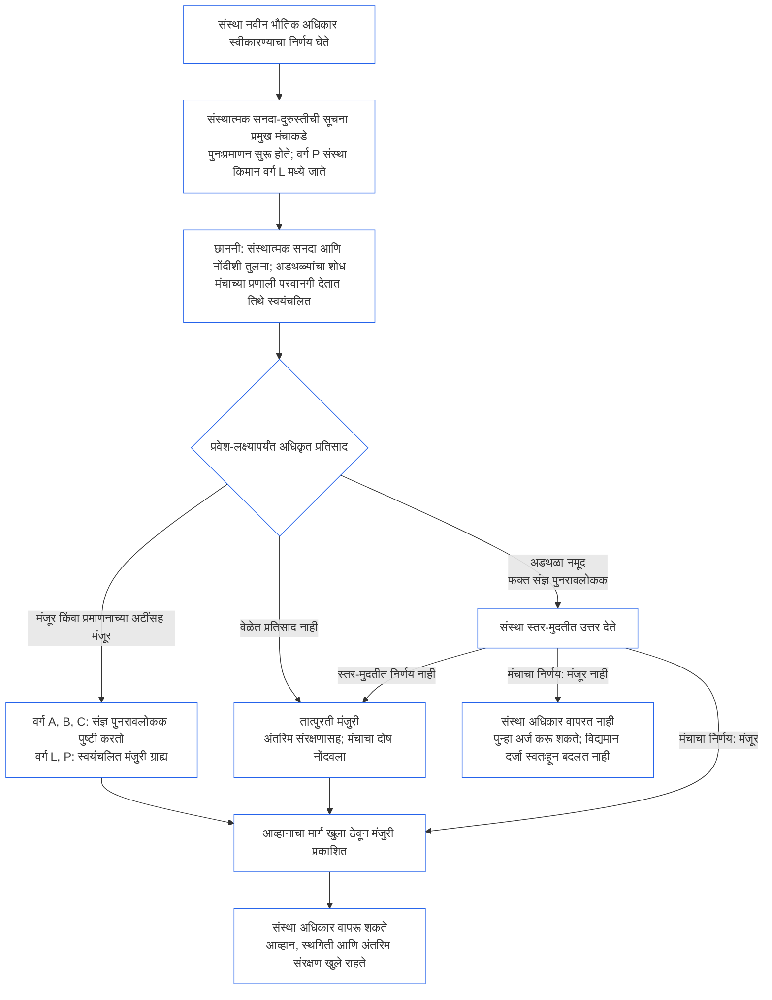

##### 9.2.2 नवीन भौतिक अधिकारासाठी पुनःप्रमाणन

नवीन भौतिक अधिकार स्वीकारण्याचा निर्णय घेणाऱ्या संस्थेचे पुनःप्रमाणन झाले पाहिजे आणि तो अधिकार वापरण्यापूर्वी तिने निकालाची प्रतीक्षा केली पाहिजे. हीच प्रतीक्षा **अनुच्छेद XI-E** (*संस्थात्मक स्थापना आणि व्यवसायनिर्मिती*) नमूद करतो. प्रक्रिया अशी आहे:

- **प्रथम सूचना:** [अध्याय सात §7.1 दस्तऐवज बदलणे](core_07.000_charters.md#71-changing-the-document) आधीपासून आवश्यक ठरवते ती संस्थात्मक सनदा-दुरुस्तीची सूचना संस्था देते आणि प्रमुख मंचाकडे पाठवते. सूचनेने पुनःप्रमाणन सुरू होते.
- **अद्याप नोंद नाही:** संस्थात्मक प्रमाणन नोंद नसलेली संस्था तीच सूचना देते. सूचनेने फक्त नव्या अधिकारापुरते मर्यादित प्रथम प्रमाणन सुरू होते; संस्थात्मक सनदेच्या आणि त्या अधिकाराला लागू होणाऱ्या [§3 संपूर्ण-संस्था प्रमाणन मूल्यांकन](#3-whole-institution-certification-evaluation) ते [§5 अधिकार-तळ आणि क्षेत्रीय मूल्यांकने](#5-rights-floor-and-domain-evaluations) यांच्या आधारे त्याचे परीक्षण होते. प्रथम प्रमाणनाचा उर्वरित भाग [§1.3 प्रथम प्रमाणनासाठीची मुदत](#13-window-for-the-first-certification) मधील मुदतीत सुरू राहतो (सूचनेमुळे पुनर्वर्गीकृत वर्ग P संस्थेसाठी मुदत सूचनेच्या दिवसापासून सुरू होते); नवीन अधिकाराची प्रतीक्षा त्या मुदतीवर अवलंबून नसते.
- **स्तर-मुदतींच्या आत:** [अध्याय नऊ भाग C §9.3.4 स्तर-मुदती](core_09.010_system_alignment_certification_record_recertification.md#934-tier-windows) अंतर्गत पुनःप्रमाणन होते; गृहीत धरलेला स्तर संस्था-वर्गाशी जुळतो. मुदत चुकल्यास [अनुच्छेद XXVI-C](core_06.020_rights_part_e.md#article-xxvi-c-timely-resolution-and-anti-delay-floor) (*वेळेवर निराकरण आणि विलंबविरोधी तळ*) लागू होतो; शुल्क आणि प्रतीक्षा अडथळा बनू शकत नाहीत ([टाळता येण्याजोगा भार](core_05.040_band_continuity.md#avoidable-burden)).
- **शक्य तिथे स्वयंचलित:** मंचाच्या प्रणाली परवानगी देतात तिथे सूचना, नवीन अधिकाराची संस्थात्मक सनदा व सध्याच्या नोंदीशी तुलना, अडथळ्यांची छाननी आणि मंजुरी स्वयंचलित केली जाते. [अध्याय एक §13.3 टाळता येण्याजोगा भार कमी करणे](core_01.005_interaction_interpretation.md#133-minimization-of-avoidable-burden) टाळता येण्याजोग्या भारासाठी स्वयंचलनाला प्राधान्याचा उपाय मानते; आणि [अध्याय एक §16.4 कृतीच्या वेळी दस्तऐवजीकरण](core_01.010_stewardship_capacity_principles.md#164-document-at-action) स्वयंचलनाचा भार कारभाऱ्यावर नव्हे, प्रणालीवर ठेवते.
  - **मंजुरी देते; नकार देत नाही:** स्वयंचलित छाननी नवीन अधिकाराला पूर्णपणे किंवा सध्याची नोंद आधीच समर्थित करत असलेल्या प्रमाणन-अटींसह मंजुरी देऊ शकते. [§9.2.3 नवीन भौतिक अधिकार मंजूर करण्यातील अडथळे](#923-blockers-to-clearing-new-material-authority) मधील अडथळा ती स्वतःहून नमूद करू शकत नाही किंवा मंजुरी नाकारू शकत नाही. संभाव्य अडथळ्याची सूचना ती देऊ शकते; मात्र छाननीने दाखवलेल्या बाबी पाहिल्यानंतर प्रमुख मंचातील संज्ञ पुनरावलोककच अडथळा नमूद करू शकतो.
  - **वर्ग A, B आणि C:** कोणतीही मंजुरी अधिकृत प्रतिसाद मानण्यापूर्वी प्रमुख मंचातील संज्ञ पुनरावलोकक तिची पुष्टी करतो. या वर्गातील संस्थेला तसेच नवीन अधिकारामुळे या वर्गांत येणाऱ्या संस्थेलाही हे लागू आहे. पुष्टीसाठीही प्रवेश-लक्ष्य लागू राहते. पुनरावलोकक प्रमुख मंचावर असतो; त्या मंचाकडे आधीच पडताळणी-किंवा-अधिकारप्रदान जागा असते आणि त्याने संस्थेपासून स्वतंत्र असले पाहिजे ([§6.1 संस्थात्मक प्रमाणनातील चार जागा](#61-four-seats-in-an-institutional-certification)).
  - **वर्ग L आणि P:** पुष्टीशिवाय स्वयंचलित मंजुरीच अधिकृत प्रतिसाद मानली जाते. सूचना देताना वर्ग P संस्थेचे किमान वर्ग L मध्ये पुनर्वर्गीकरण होते ([§1.1 कोण प्रमाणित होते](#11-who-is-certified)); म्हणून तिला वर्ग L चा नियम लागू होतो.
  - **अपवादात्मक परिस्थिती:** छाननी संभाव्य अडथळा दाखवत असेल, अधिकार व्याप्तीत आहे किंवा भौतिक आहे की नाही हे छाननी ठरवू शकत नसेल, किंवा संस्था अथवा प्रभावित संज्ञ प्राणी पुनरावलोकन मागत असेल, तर कोणत्याही वर्गात संज्ञ पुनरावलोकक विषय हाताळतो. पुनरावलोकनाची विनंती मिळाल्यापासून [संबंधित प्रवेश-लक्ष्य](core_05.040_band_continuity.md#tier-window) मोजून त्याचे उत्तर दिले जाते. त्यामुळे स्तर-मुदत वाढत नाही.
  - **तीच नोंद आणि तीच वेळ:** कोणत्या तपासण्या केल्या हे नोंदीत दिसते, म्हणून स्वयंचलित मंजुरीलाही इतर निर्णयांप्रमाणे आव्हान देता येते. स्वयंचलनामुळे प्रवेश-लक्ष्य किंवा स्तर-मुदत वाढत नाही; आणि छाननी-प्रणाली बंद असेल किंवा प्रतिसाद देत नसेल, तर खालील मुद्द्यानुसार तो चुकलेला प्रतिसाद ठरतो. मंच वापरत असलेल्या कोणत्याही प्रणालीप्रमाणेच छाननीसाठी मंच उत्तरदायी असतो ([§6.3 संस्था म्हणून मंच, प्रमाणक आणि नोंद कार्यालये](#63-forums-certifiers-and-record-offices-as-institutions)).
- **प्रतीक्षा:** पुनःप्रमाणनाने मंजुरी मिळेपर्यंत संस्था नवीन अधिकार वापरत नाही.
  - **प्रत्येक वर्ग प्रतीक्षा करतो:** कोणत्याही वर्गाला सूट नाही; आपत्कालीन स्थिती किंवा तातडीमुळे प्रतीक्षा रद्द होत नाही.
  - **इतर सर्व कामे सुरू राहतात:** संस्था आधीपासून जे करते ते सुरू राहते ([§1.2 स्थापना किंवा संचालनासाठी परवानगी नाही आणि प्रवेशद्वार नाही](#12-no-permission-and-no-gate-on-forming-or-running)).
  - **संरक्षणाची प्रतीक्षा नाही:** प्रभावित संज्ञ प्राण्यांचे मंचांकडून होणारे तातडीचे संरक्षण पुनःप्रमाणनाची वाट पाहत नाही ([अध्याय नऊ भाग B §6.2 देखरेखीचा क्रम](core_09.005_system_alignment_certification_record_process.md#62-supervisory-sequence)). ते संरक्षण संज्ञ प्राण्यांसाठी असते; संस्थेने अधिकार लवकर वापरण्याचा तो आधार नसतो.
- **मंजुरी मिळताच प्रकाशन:** प्रत्येक मंजुरी दिल्याबरोबर प्रमुख मंच ती प्रकाशित करतो; त्यात तात्पुरती मंजुरीही येते आणि [§10 प्रमाणनाला आव्हान](#10-challenging-a-certification) मधील आव्हानाचा मार्ग खुला राहतो. मंजुरी मिळाल्यापासून संस्था अधिकार वापरू शकते. सूचना-अंतर किंवा आव्हानावरील निर्णयाची प्रतीक्षा करावी लागत नाही. प्रभावित संज्ञ प्राणी इतर निर्णयांप्रमाणेच मंजुरीला आव्हान देऊन स्थगिती किंवा अंतरिम संरक्षण मागू शकतो; त्यासाठी प्रतीक्षा नसते ([§9.2.2 नवीन भौतिक अधिकारासाठी पुनःप्रमाणन](#922-recertification-for-new-material-authority), *संरक्षणाची प्रतीक्षा नाही*). प्रकाशनावेळी प्रमुख मंचाला माहीत असलेल्या प्रभावित संज्ञ प्राण्यांना आणि संबंधित प्रणालींच्या मंचांना मंजुरीची सूचनाही दिली जाते. स्थगिती किंवा अंतरिम संरक्षणाच्या विनंतीचे उत्तर संबंधित प्रवेश-लक्ष्याच्या आत दिले जाते ([CF-14.445 §3.1 टप्पा-उद्दिष्टे आणि बाह्य मर्यादा](corpus_forum/cf_14.445_performance_backlog_publication_accessibility.md#cf-14445-31-stage-targets-and-outer-bounds)); किंवा लागू असलेल्या आपत्कालीन सेटिंगची मर्यादा लागू होते.
- **मंजुरी गृहीत:** अधिकाराला मंजुरी मिळाली आहे असे गृहीत धरले जाते. [§9.2.3 नवीन भौतिक अधिकार मंजूर करण्यातील अडथळे](#923-blockers-to-clearing-new-material-authority) मधील अडथळा नोंदीत नमूद केलेल्या पुराव्यावर दाखवता आल्यासच प्रमुख मंच मंजुरी नाकारतो. अडथळ्याशी जोडलेल्या प्रमाणन-अटींनी त्यावर नियंत्रण मिळवता येत असल्यास अधिकार नाकारला जात नाही; त्या अटींसह मंजूर होतो.
- **मंजुरीचा अर्थ:** पुनःप्रमाणनाचा शेवट प्रमाणनाच्या अटींसह किंवा त्यांशिवाय तात्पुरत्या अथवा पूर्ण प्रमाणनात होतो; आणि अधिकार वापरण्यापूर्वी आवश्यक असलेल्या प्रत्येक प्रमाणन-अटीची स्वतंत्र पडताळणी झालेली असते.
- **मंचाने वेळेत प्रतिसाद न दिल्यास:** प्रमुख मंचाने संबंधित प्रवेश-लक्ष्यापर्यंत अधिकृत प्रतिसाद देणे आवश्यक आहे ([CF-14.445 §3.1 टप्पा-उद्दिष्टे आणि बाह्य मर्यादा](corpus_forum/cf_14.445_performance_backlog_publication_accessibility.md#cf-14445-31-stage-targets-and-outer-bounds)). प्रतिसाद अधिकाराला मंजुरी देतो, प्रमाणनाच्या अटींसह मंजुरी देतो किंवा आधारभूत पुराव्यासह अडथळा नमूद करतो. अडथळा नमूद करणाऱ्या प्रतिसादामुळे संस्थेला उत्तर देण्याची संधी मिळते आणि वर दिलेल्या स्तर-मुदतीत मंच निर्णय घेतो.
  - **तात्पुरती मंजुरी:** प्रवेश-लक्ष्यापर्यंत अधिकृत प्रतिसाद न आल्यास किंवा नमूद अडथळ्याचा स्तर-मुदतीत निर्णय न झाल्यास, [अध्याय नऊ भाग B §7.2 प्रमाणनातील दोष आणि दुरुस्ती](core_09.005_system_alignment_certification_record_process.md#72-certification-defects-and-correction) नुसार अंतरिम संरक्षण व अवलंबित्व-मर्यादांसह अधिकाराला तात्पुरती मंजुरी मिळते.
  - **मंचाचा दोष:** लक्ष्य किंवा मुदत चुकणे हा मंचाचा दोष आहे; संस्थेची चूक नाही. त्याची नोंद करून दुरुस्ती होते आणि [अध्याय चौदा §6 वेळेवर निराकरण, भौतिकता स्तर आणि विलंबविरोधी शिस्त](core_14.000_forum.md#6-timely-resolution-materiality-tiers-and-anti-delay-discipline) (*मुदत ओलांडल्याचे पुनरावलोकन*) अंतर्गत मुदत ओलांडल्याप्रमाणे त्याचे पुनरावलोकन होते.
  - **दुसऱ्या मंचाकडे हस्तांतर:** पुनःप्रमाणन विनंती त्याच मंच-कुटुंबातील दुसऱ्या मंचाकडे पाठवली जाते ([अध्याय चौदा §3 हस्तांतरण, एकत्रीकरण आणि समन्वय](core_14.000_forum.md#3-transfer-consolidation-and-coordination--continuity-and-anti-capture)). तो मंच संस्थेच्या वर्गासाठीच्या नियमित मुदतींनुसार पुनःप्रमाणन चालवतो; हस्तांतरणाच्या वेळेपासून मुदत मोजली जाते.
- **मंजुरी न मिळाल्यास:** संस्था अधिकार वापरत नाही आणि अध्याय नऊ भाग B §7.4 (*कायमची बंदी नाही*) नुसार पुन्हा अर्ज करू शकते. नवीन अधिकाराला मंजुरी न मिळणे म्हणजे संस्थेने आधीपासून केलेल्या कामासाठी धारण केलेले प्रमाणन नाकारणे किंवा रद्द करणे नव्हे. [§7.3 संस्थेची सुधारणा-सज्जता](#73-remediation-readiness-for-an-institution) आणि [§7.4 संस्थेसाठी नकार आणि रद्द करणे](#74-denial-and-revocation-for-an-institution) अंतर्गत निष्कर्ष आल्यावरच तो दर्जा बदलतो.
- **सूचनेशिवाय किंवा मंजुरीपूर्वी:** सूचना न देता किंवा मंजुरीपूर्वी नवीन भौतिक अधिकार वापरणे म्हणजे संस्थात्मक सनदेबाहेरचे आचरण. [§3 संपूर्ण-संस्था प्रमाणन मूल्यांकन](#3-whole-institution-certification-evaluation) (बाब 1) अंतर्गत तो निष्कर्ष आहे आणि संस्थात्मक सनदेच्या घटनेप्रमाणे पुनरावलोकन पुन्हा सुरू करतो.

<strong>वाचक मार्गदर्शक (कार्यकारी नाही): नवीन भौतिक अधिकाराची प्रतीक्षा</strong>

ही आकृती §9.2.2 नवीन भौतिक अधिकारासाठी पुनःप्रमाणनाचा सारांश देते. मजकुराशी फरक असल्यास मजकूरच लागू होतो. संस्था आधीपासून करत असलेली सर्व कामे सुरू राहतात; प्रभावित संज्ञ प्राण्यांचे तातडीचे संरक्षण कधीही थांबत नाही. संस्थांची कार्य केलेली उदाहरणे [CS-9.320 §12 संस्थेची उदाहरणात्मक मार्गक्रमणे](corpus_systems/cs_09.320_system_alignment_certification_illustrations.md#cs-9320-12-illustrative-institution-walkthroughs) येथे आहेत.

 

