<!-- AI-assisted translation draft; unreviewed; English controls.
Source: core_09.000_system_alignment_certification_evaluation.md
Source snapshot: 247e2180509e5e029c1106878cf225067339e010
Source SHA-256: 3ff6a518d3c9d6779925a1daab6ad6c53abdbdabeeaad786ffafcdd1e6ac8b80 -->

# CAPÍTULO NOVE, PARTE A: CERTIFICAÇÃO DE ALINHAMENTO DE SISTEMAS — AVALIAÇÃO

<strong>Lugar no corpus (não operativo): estrutura do arquivo e regras de leitura</strong>

> Este arquivo é **parte da Constituição Senciente** e é **vinculante somente em conjunto** com os demais arquivos numerados `core_*`, lidos como um único texto. Ele contém o **Capítulo Nove, Parte A** — finalidade da certificação, visão geral do processo e as duas primeiras fases do processo — **Enquadrar** (classe do sistema) e **Avaliar** (avaliação integral do sistema em três subfases: as avaliações sempre aplicáveis, inclusive tipos e tratamento de dados, em **§3**; as avaliações aplicáveis quando houver envolvimento em **§4**; e as avaliações do Piso de Direitos e de domínio aplicáveis quando houver um gatilho em **§5**) — **§1–§5**. As ilustrações detalhadas de **Classes A / B / C** (os perfis de classe de sistema e os percursos de §3.4, §5.1, §5.2, §5.3, §5.4, §5.5 e §5.6), inclusive o parágrafo **Leitura entre classes de sistema** de cada uma, estão em [CS-9.320](corpus_systems/cs_09.320_system_alignment_certification_illustrations.md#cs-9320-system-alignment-certification-illustrations) (*Ilustrações de certificação de alinhamento de sistemas*), na família de sistemas, e não neste capítulo; cada uma indica a seção da Parte A que ilustra. As regras vinculantes de escalonamento por classe de sistema e de escalada ilustradas nesses parágrafos permanecem neste arquivo: escalonamento por classe, inclusive participação e proporcionalidade, em §2.2; escalonamento de tratamento de dados em §3.4; e o parágrafo **Escalonamento por classe de sistema e escalada** em cada uma das §§5.1–5.6. Os arquivos do capítulo completo estão listados na tabela abaixo.
>
> **Arquivos do Capítulo Nove.** O Capítulo Nove está dividido em três arquivos vinculantes, lidos como um só texto. A Parte A, este arquivo, abre o capítulo; não há um arquivo de índice separado. As ilustrações detalhadas não fazem parte do capítulo; estão em [CS-9.320](corpus_systems/cs_09.320_system_alignment_certification_illustrations.md#cs-9320-system-alignment-certification-illustrations) (*Ilustrações de certificação de alinhamento de sistemas*).
>
> | Parte | Arquivo | Abrange |
> |------|------|------|
> | **Parte A — Avaliação** | [`core_09.000_system_alignment_certification_evaluation.md`](core_09.000_system_alignment_certification_evaluation.md) | §§1–5: finalidade e visão geral do processo (com um gráfico de todo o processo de certificação em suas seis fases), **Fase I Enquadrar** (classe do sistema, como a classe do sistema escala cada avaliação e certificação-piloto) e **Fase II Avaliar** (avaliação integral do sistema em três subfases: **IIa** sempre, em §3, incluindo escopo estabelecido em carta versus limites funcionais e tipos e tratamento de dados; **IIb** quando houver envolvimento, em §4; e **IIc** quando houver gatilho, avaliações do Piso de Direitos e de domínio, em §5) |
> | **Parte B — Processo do fórum e resultados** | [`core_09.005_system_alignment_certification_record_process.md`](core_09.005_system_alignment_certification_record_process.md) | §§6–7: **Fase III Revisar** (papéis do fórum, sequência de supervisão e cadeia de impugnabilidade) e **Fase IV Decidir** (resultados da certificação, inclusive o controle de entrada em operação) — numeração contínua do capítulo a partir da Parte A §5 |
> | **Parte C — Registro, recertificação e posição** | [`core_09.010_system_alignment_certification_record_recertification.md`](core_09.010_system_alignment_certification_record_recertification.md) | §§8–11: **Fase V Registrar** (o Registro de Certificação do Sistema e sua integridade, inclusive os campos da [Carta do Sistema](core_05.040_band_continuity.md#system-charter)) e **Fase VI Operar** (recertificação e reabertura; o caminho de contestação; a ponte para a posição) — numeração contínua do capítulo a partir da Parte B §7 |
>
> **Como as duas certificações se relacionam.** A Certificação de Alinhamento de Sistemas (este capítulo) é a certificação de um Sistema. A certificação de alinhamento institucional ([Capítulo Dez](core_10.000_institutional_alignment_certification.md#chapter-ten-institutional-alignment-certification)) é a certificação de uma Instituição, que pode operar Sistemas ou nenhum. O Capítulo Dez cita por link o Registro de Certificação de cada Sistema e não o refaz; [Capítulo Dez §1](core_10.000_institutional_alignment_certification.md#1-purpose-and-role) declara a relação e [Capítulo Dez §1.2](core_10.000_institutional_alignment_certification.md#12-no-permission-and-no-gate-on-forming-or-running) afirma que não se trata de licença. Suas seções têm a mesma numeração que as deste capítulo, sob títulos paralelos.
>
> Links genéricos ao **Capítulo Nove** em outros arquivos levam à parte adequada conforme o número da seção.
>
> - **Titularidade constitucional (em conjunto com as Partes B e C):** **certificação de alinhamento de sistemas e registros relacionados** supervisionados por fórum — domínios de avaliação (Parte A); processo do fórum, sequência de supervisão e resultados da certificação com o controle de entrada em operação (Parte B); deveres do Registro de Certificação do Sistema, caminho de contestação, recertificação e reabertura, e ponte de entrada verificada para o Capítulo Onze (tudo na Parte C). Sob o eixo de **supervisão** da Tétrade, SAC é um processo de auditoria especialmente grande e de alto impacto entre outros; os pisos de auditoria continuam no **Article XVI** (*Auditoria, Transparência e Verificação Independente*) e na [Auditabilidade](core_05.050_band_oversight.md#auditability) do Capítulo Cinco.
> - **Titularidade da base de verificação:** [Capítulo Quatro — Ônus da Prova, Rastreabilidade e Verificação](core_04.000_burden_traceability_verification.md#chapter-four-burden-of-proof-traceability-and-verification) (dentro dos Capítulos Dois a Quatro) é titular da distribuição do ônus, dos comprovantes de conformidade, da rastreabilidade das definições, da observabilidade e da verificação sujeita a restrições de segurança. O Capítulo Nove **aplica** essa disciplina aos Registros de Certificação de Sistemas; ele **não** reitera as seções **1** a **5** do Capítulo Quatro.
> - **Sede da auditoria (não deslocada para cá):** **Article XVI** (*Auditoria, Transparência e Verificação Independente*), **Def.O1** (*Transparência, Auditabilidade e Verificação*) e **CJS-5.110 §3 e CJS-5.115 §3** (*Sede do processo de auditoria*)–**CJS-5.110 §5** são titulares dos pisos de auditoria e dos termos operacionais. O Capítulo Nove conduz um processo SAC de auditoria especialmente grande, que deve cumprir esses pisos; ele não é titular de toda auditoria.
> - **Titularidade da implementação:** o tratamento por classe de sistema, CS-6.345 (*Ciclo de vida do sistema*) e os detalhes do processo dos fóruns em arquivos de implementação designados devem permanecer coerentes com o Capítulo Nove e podem ser mais rigorosos quando o corpus já prevê uma regra de [Efeito Protetor Máximo](core_05.045_band_integrative.md#fullest-protective-effect).
> - **Regra contra deslocamento:** a Parte A não reitera as definições canônicas do Capítulo Cinco, a disciplina antievasão do Capítulo Três (veja [Parte C §9.4](core_09.010_system_alignment_certification_record_recertification.md#94-non-evasion)), a medição de contribuição ou posição do Capítulo Onze, nem os efeitos de posição do Capítulo Doze. **[Parte C §11](core_09.010_system_alignment_certification_record_recertification.md#11-relationship-to-standing)** estabelece a ponte para a posição.
>
> **A montante:** definições do Capítulo Cinco; registro, verificação, ônus e rastreabilidade das definições até os resultados nos Capítulos Dois a Quatro; e [Capítulo Oito](core_08.000_functional_independence_separation_of_duties.md#chapter-eight-functional-independence-and-separation-of-duties), cujo requisito de separação de funções rege todo ato de certificação materialmente vinculante.
> **A jusante:** [Parte B](core_09.005_system_alignment_certification_record_process.md#chapter-nine-part-b-system-alignment-certification--forum-process-and-outcomes) (*processo do fórum e resultados*) e [Parte C](core_09.010_system_alignment_certification_record_recertification.md#chapter-nine-part-c-system-alignment-certification--record-recertification-and-standing) (*registro, recertificação e ponte para a posição*); registros de posição e entradas verificadas do Capítulo Onze; efeitos de posição do Capítulo Doze; supervisão de fóruns e vias de certificação de alinhamento de sistemas do Capítulo Quatorze.

 

O **Capítulo Nove, Parte A** é titular constitucional da **avaliação de certificação de alinhamento de sistemas**.

- A supervisão do fórum e os resultados da certificação estão na **[Parte B](core_09.005_system_alignment_certification_record_process.md#chapter-nine-part-b-system-alignment-certification--forum-process-and-outcomes)**.
- O registro, a recertificação e reabertura, e a ponte para a posição estão na **[Parte C](core_09.010_system_alignment_certification_record_recertification.md#chapter-nine-part-c-system-alignment-certification--record-recertification-and-standing)**.
- As ilustrações detalhadas destas seções de avaliação estão em **[CS-9.320 Ilustrações de certificação de alinhamento de sistemas](corpus_systems/cs_09.320_system_alignment_certification_illustrations.md#cs-9320-system-alignment-certification-illustrations)**.
- A certificação de alinhamento institucional, com a mesma numeração de seção, está no **[Capítulo Dez](core_10.000_institutional_alignment_certification.md#chapter-ten-institutional-alignment-certification)**.

### 1. Finalidade e papel

<strong>Rastreio</strong>

- A montante:
  - [Preâmbulo — registro de titulares constitucionais](core_00.000_preamble.md#4-principles-definitions-and-rights) e
  - [Hierarquia interna e escalonamento de autoridade](core_05.045_band_integrative.md#authority-stack-and-internal-hierarchy);
  - [Tétrade Constitucional](core_00.000_preamble.md#constitutional-tetrad);
  - [Dois Fins Constitucionais](core_00.000_preamble.md#two-constitutional-aims);
  - [aposta material](core_00.000_preamble.md#material-stake);
  - [Proporcionalidade](core_05.035_band_accountability.md#proportionality) e
  - [Justiça Substantiva](core_05.055_band_participation.md#substantive-fairness) (Capítulo Cinco); família de medição da Participação (*voz, acesso e caminhos de contestação*);
  - [Capítulo Um §16 Administração Responsável em Profundidade](core_01.010_stewardship_capacity_principles.md#16-stewardship-in-depth) (1.010 §16);
  - [Capítulo Um §12 Requisito de Avaliação Sistêmica](core_01.000_values_principles.md#12-systemic-evaluation-requirement) (1.000 §12) (*lente de avaliação integral do sistema no nível de princípios — não apenas um aspecto isolado*); Capítulos Dois a Quatro;
  - [Capítulo Cinco](core_05.000_definitions_home.md#chapter-five-foundational-definitions) (5.000) (*definições canônicas*);
  - [Capítulo Oito §2 Requisito Constitucional de Quatro Assentos](core_08.000_functional_independence_separation_of_duties.md#2-four-seat-constitutional-requirement) (8.000 §2);
  - [Certificação de Alinhamento de Sistemas](core_05.040_band_continuity.md#system-alignment-certification) (termo canônico do Capítulo Cinco; abreviação não operativa **SAC**);
  - [Registro de Certificação do Sistema](core_05.040_band_continuity.md#system-certification-record) (significado no Capítulo Cinco).
- A jusante:
  - [§2](#2-system-class-evaluation) (*avaliação da classe do sistema*);
  - [Parte C §10](core_09.010_system_alignment_certification_record_recertification.md#10-challenging-a-certification) (9.010 §10) (*contestar uma certificação*); e
  - [CS-9.320 §2](corpus_systems/cs_09.320_system_alignment_certification_illustrations.md#cs-9320-2-illustrative-system-class-profiles) (*Perfis ilustrativos de classe de sistema*);
  - [CS-9.320 §4](corpus_systems/cs_09.320_system_alignment_certification_illustrations.md#cs-9320-4-illustrative-whole-system-application-by-system-class) (*Aplicação ilustrativa da avaliação integral do sistema por classe de sistema*);
  - [CS-9.320 §5](corpus_systems/cs_09.320_system_alignment_certification_illustrations.md#cs-9320-5-illustrative-data-handling-application-by-system-class) (*Aplicação ilustrativa do tratamento de dados por classe de sistema*);
  - [CS-9.320 §6](corpus_systems/cs_09.320_system_alignment_certification_illustrations.md#cs-9320-6-illustrative-ecological-footprint-application-by-system-class) (*Aplicação ilustrativa da pegada ecológica por classe de sistema*);
  - [CS-9.320 §7](corpus_systems/cs_09.320_system_alignment_certification_illustrations.md#cs-9320-7-illustrative-educational-capability-application-by-system-class) (*Aplicação ilustrativa da capacidade educacional por classe de sistema*);
  - [CS-9.320 §8](corpus_systems/cs_09.320_system_alignment_certification_illustrations.md#cs-9320-8-illustrative-cross-system-support-application-by-system-class) (*Aplicação ilustrativa do apoio entre sistemas por classe de sistema*);
  - [CS-9.320 §9](corpus_systems/cs_09.320_system_alignment_certification_illustrations.md#cs-9320-9-illustrative-nondiscrimination-application-by-system-class) (*Aplicação ilustrativa da não discriminação por classe de sistema*);
  - [CS-9.320 §10](corpus_systems/cs_09.320_system_alignment_certification_illustrations.md#cs-9320-10-illustrative-accessibility-application-by-system-class) (*Aplicação ilustrativa da acessibilidade por classe de sistema*);
  - [CS-9.320 §11](corpus_systems/cs_09.320_system_alignment_certification_illustrations.md#cs-9320-11-illustrative-trustworthiness-application-by-system-class) (*Aplicação ilustrativa da confiabilidade por classe de sistema*);
  - [§3](#3-whole-system-certification-evaluation) (*fatores de avaliação integral da certificação do sistema*);
  - [§3.4](#34-data-types-and-handling-evaluation) até
  - [§5.6](#56-trustworthiness-and-system-reliance-integrity-evaluation) (*avaliações de domínio*);
  - [Parte B §6](core_09.005_system_alignment_certification_record_process.md#6-forum-process) (9.005 §6) (*sequência de supervisão e cadeia de impugnabilidade*);
  - [Parte B §6.1](core_09.005_system_alignment_certification_record_process.md#61-forum-supervision-and-component-roles) (9.005 §6.1) (*papéis dos componentes do fórum*);
  - [Parte C §8](core_09.010_system_alignment_certification_record_recertification.md#8-system-certification-record) (9.010 §8) (*conteúdo do Registro de Certificação do Sistema*);
  - [Parte C §8.2](core_09.010_system_alignment_certification_record_recertification.md#82-transparency-and-auditability-of-the-record) (9.010 §8.2) (*requisitos de integridade do registro*);
  - [Parte B §7](core_09.005_system_alignment_certification_record_process.md#7-certification-outcomes) (9.005 §7) (*resultados da certificação*);
  - [Parte C §11](core_09.010_system_alignment_certification_record_recertification.md#11-relationship-to-standing) (9.010 §11) (*ponte para o registro de posição*);
  - [Capítulo Onze](core_11.000_standing_assessment.md#chapter-eleven-contribution-violation-and-standing-model--measurement) (11.000) (*registros de posição e entrada verificada*);
  - [Capítulo Doze](core_12.000_standing_integration.md#chapter-twelve-standing-effects-and-integration) (12.000) (*efeitos e integração da posição*);
  - [Capítulo Quatorze](core_14.000_forum.md#chapter-fourteen-forums-and-jurisdiction) (14.000) (*supervisão dos fóruns, certificação, certificação de alinhamento e revisão*).
- Leia junto com:
  - **[CS-9.305](corpus_systems/cs_09.305_system_classification_machinery.md#cs-9305-part-a-system-classification-machinery) (*Maquinaria de classificação de sistemas*) e [CS-9.310 — Classificações de impacto do sistema](corpus_systems/cs_09.310_system_impact_classifications.md#cs-9310-part-b-system-impact-classifications)**, **[CS-6.305](corpus_systems/cs_06.305_information_types_and_handling.md#cs-6305-part-a-information-types-and-handling) (*Tipos e tratamento de informações*) e [CS-6.310 — Classificações de dados](corpus_systems/cs_06.310_data_classifications.md#cs-6310-part-b-data-classifications)**, e
  - **CS-6.345** (*Ciclo de vida do sistema*);
  - **CF-14.415** (*Operações de encaminhamento, transferência, questões para decisão e tratamento de representantes*) e
  - **CF-14.425** (*Salvaguardas de integridade, operações anticaptura e apoio contra autodecisão*); **Article XVI** (*Auditoria, Transparência e Verificação Independente*) e
  - [Auditabilidade](core_05.050_band_oversight.md#auditability) (*pisos de auditoria — SAC é um processo de auditoria especialmente grande sob supervisão, não a única sede de auditoria*); **CJS-5.110 §3 (*Supervisão: termos de auditabilidade e reconstituibilidade (anexo)*) e CJS-5.115 §3** (*Sede do processo de auditoria*)–
  - **CJS-5.110 §5** (*Supervisão: termos de verificação independente e integridade de alegações*).

 

*Em termos simples: quando um sistema realmente importa para a vida dos sencientes, a certificação precisa ser **proporcional** — tão exigente quanto seu impacto, dependência e risco reais requerem, e não uma lista de verificação igual para todos nem um carimbo automático. Também precisa ser **participativa** — os sencientes e as comunidades afetados devem poder ver o que foi analisado, entender o que foi decidido e contestar quando algo estiver errado. Os fóruns analisam evidências, registram-nas em um Registro de Certificação do Sistema e exigem recertificação em uma periodicidade compatível com o risco do sistema. Classes A, B e C seguem o processo completo; a Classe L, um processo mais leve. A Classe P é incentivada a usá-lo e deve fazê-lo quando for reclassificada para Classe L ou superior (isto é, quando seus efeitos ultrapassarem uma unidade privada) ou quando seu operador alegar conformidade constitucional.*

A **certificação de alinhamento de sistemas** existe para responder a uma pergunta, para um escopo declarado e um calendário de revisão: o sistema demonstrou alinhamento constitucional suficiente para certificação, certificação condicional, validação, recertificação, confiança continuada, implantação ou cumprimento material de condições de certificação, ou dispensa delas?

- Uma certificação não é uma nota de popularidade, uma aprovação eterna nem um meio de evitar a revisão de direitos.
- É uma declaração sujeita a prazo e contestação sobre o que se sabe, neste momento, a respeito do alinhamento do sistema.
- Sob o eixo de **supervisão** da Tétrade, a supervisão exige auditoria; a certificação de alinhamento de sistemas é um processo de auditoria especialmente grande e de alto impacto entre outros — não a única sede de auditoria (**Article XVI** (*Auditoria, Transparência e Verificação Independente*), [Auditabilidade](core_05.050_band_oversight.md#auditability)).

A certificação implementa os [Dois Fins Constitucionais](core_00.000_preamble.md#two-constitutional-aims) por meio da [Tétrade Constitucional](core_00.000_preamble.md#constitutional-tetrad):

- **[Florescimento](core_00.000_preamble.md#flourishing)** — a certificação verifica que certificar ou continuar confiando no sistema não frustraria silenciosamente Pisos de Direitos nem bloquearia a participação justa em uma vida relevante para a Constituição;
- **[Continuidade](core_00.000_preamble.md#continuity)** — a certificação verifica um fornecimento duradouro e não regressivo que sustente, em vez de esgotar, sistemas naturais saudáveis ([Integridade Ecológica](core_05.040_band_continuity.md#ecological-integrity), inclusive [Capacidade de Recuperação Ecológica](core_05.040_band_continuity.md#ecological-recovery-capacity)), e recertificação escalonada por classe de sistema quando sistemas compartilhados condicionam ou sustentam a prestação;
- **Participação** — os sencientes e as comunidades afetados conseguem entender, contestar e participar dos caminhos de revisão que lhes dizem respeito;
- **Supervisão** — registros, evidências e premissas são visíveis e auditáveis o bastante para verificação independente; a certificação em si é um processo de auditoria especialmente grande no âmbito desse dever de supervisão, não o único;
- **Prestação de contas** — defeitos, classificação incorreta e operação que frustre o Piso encaminham-se a reparação, condições de certificação, retirada ou entrada para a posição, quando os fatos derem suporte;
- **Atuação em tempo** — os prazos de revisão e contestação impedem que a certificação fique desatualizada enquanto ainda for possível prevenir ou reverter danos.

#### 1.1 Certificação como Processo de Auditoria, Escalonada por Classe de Sistema

Como mecanismo de supervisão, a certificação é um processo de auditoria especialmente grande segundo [Auditabilidade](core_05.050_band_oversight.md#auditability) e **Article XVI** (*Auditoria, Transparência e Verificação Independente*):

- É supervisionada por fórum, abrange vários domínios e concede status.
- Pode integrar os resultados de modalidades de auditoria correlatas, mas não as absorve nem substitui. Cada modalidade mantém seu próprio titular, identificado no [mapa de titulares das modalidades correlatas de auditoria](corpus_joint_structure/cjs_05.115_audit_process.md#sibling-audit-modes-owner-map) da sede do processo de auditoria:
  - auditorias do Registro de Tipos de Dados do Sistema nos termos de **CS-6.305 (*Tipos e tratamento de informações*) e CS-6.310** (*Classificações de dados*)
  - auditorias do Registro de Classificação do Sistema nos termos de **CS-9.305 (*Maquinaria de classificação de sistemas*) e CS-9.310** (*Classificações de impacto do sistema*)
  - análises de garantias do administrador responsável nos termos de **CS-15.305** (*Administração responsável de sistemas críticos*)
  - auditoria contínua nos termos de **CS-6.345** (*Ciclo de vida do sistema*) ACA
  - auditorias de complexidade nos termos de **CS-6.315** (*Compreensibilidade e administração responsável da complexidade*) e **Article XXIII-B** (*Requisitos de Auditoria de Complexidade e Modularidade*)
  - verificação de alegações nos termos de **CJS-5.110 §5** (*Supervisão: termos de verificação independente e integridade de alegações*)
- Cada uma dessas avaliações ainda pode ser feita por conta própria, sem passar pela certificação. A certificação não as substitui.

A profundidade da certificação, o ônus do registro, o intervalo de certificação, a análise pelas partes afetadas e os caminhos de contestação devem ser escalonados segundo a [aposta material](core_00.000_preamble.md#material-stake), conforme a [Proporcionalidade](core_05.035_band_accountability.md#proportionality):

- Sistemas de maior impacto, maior dependência e maior risco exigem provas mais fortes, registros mais claros e participação mais viável — inclusive acessibilidade substantiva, contribuições das partes afetadas e caminhos de contestação escalonados conforme quem depende do sistema.
- Classes de sistema inferiores e escopos delimitados ainda exigem classificação honesta e garantias proporcionais; não recebem dispensa gratuita de obrigações materiais quando houver efeitos externos.

O processo se aplica por classe de impacto, como estabelece o [requisito de reclassificação](corpus_systems/cs_09.305_system_classification_machinery.md#35-reclassification-requirement) de **CS-9.305** (*Maquinaria de classificação de sistemas*):

- **Classe A, Classe B e Classe C:** esses sistemas têm o maior impacto, dependência e risco; a avaliação integral do sistema nos termos de [§3 Avaliação Integral da Certificação do Sistema](#3-whole-system-certification-evaluation), [§4 Avaliações Quando Houver Envolvimento](#4-evaluations-where-implicated) e [§5 Avaliações do Piso de Direitos e de Domínio](#5-rights-floor-and-domain-evaluations), cada uma conforme aplicável em sua própria subfase, é obrigatória em profundidade total;
- **Classe L:** a mesma avaliação é obrigatória, mas proporcional, com intervalo padrão de certificação mais longo e registros mais simples quando permitido por CS-9.305 (*Maquinaria de classificação de sistemas*) e CS-9.310 (*Classificações de impacto do sistema*); e
- **Classe P:** o processo é incentivado enquanto o sistema for validamente Classe P, e um sistema Classe P pode adotá-lo voluntariamente. Ele se torna obrigatório ao haver reclassificação para Classe L ou superior, ou quando o operador declarar voluntariamente a conformidade constitucional do sistema.

O intervalo de certificação e a auditoria financeira, de recursos ou especial que ocorre em seu ponto médio são definidos pela classe do sistema em [Capítulo Quatorze §6 Resolução em tempo, níveis de materialidade e disciplina contra atrasos](core_14.000_forum.md#review-cadence) (*Periodicidade de revisão*). Este capítulo não repete os números.

#### 1.2 Visão geral da certificação

*Em termos simples: classifique o sistema com honestidade, faça as avaliações aplicáveis, submeta as evidências e preocupações das partes afetadas à análise independente dos fóruns e decida o resultado. Conclua o único registro aberto para análise do fórum e publique-o com um caminho de contestação aberto. Um sistema certificado só entra em operação depois de cumprido seu intervalo de notificação e as proteções exigidas. Monitore os resultados reais, responda a incidentes e contestações e reavalie no prazo ou quando os fatos mudarem. Corrija defeitos e obtenha verificação independente da correção antes de autorizar o escopo afetado ou dispensar suas condições de certificação. Cada ciclo de revisão usa um novo registro vinculado ao anterior.*

O processo tem **seis fases**: **I Enquadrar**, **II Avaliar**, **III Revisar**, **IV Decidir**, **V Registrar** e **VI Operar**. A Fase II tem três subfases, cada uma em sua própria seção: **IIa** (sempre), **IIb** (quando houver envolvimento) e **IIc** (quando houver gatilho). A Fase VI tem duas subfases, cada uma em sua própria seção: **VIa** (operar e recertificar, [§9 Recertificação e Reabertura](core_09.010_system_alignment_certification_record_recertification.md#9-recertification-and-reopening)) e **VIb** (a ponte para a posição, [§11 Relação com a Posição](core_09.010_system_alignment_certification_record_recertification.md#11-relationship-to-standing)). O gráfico mostra todo o processo de certificação nessa ordem. A Parte A abrange as duas primeiras fases, enquadramento e avaliação; a [Parte B](core_09.005_system_alignment_certification_record_process.md#chapter-nine-part-b-system-alignment-certification--forum-process-and-outcomes) e a [Parte C](core_09.010_system_alignment_certification_record_recertification.md#chapter-nine-part-c-system-alignment-certification--record-recertification-and-standing) abrangem as quatro últimas: o processo do fórum e o resultado com o controle de entrada em operação (Parte B), depois o registro e a operação (caminho de contestação, recertificação e reabertura, e ponte para a posição) (Parte C).

Toda avaliação aplicável é refeita em cada ciclo de certificação: na certificação inicial, em cada recertificação conforme o calendário definido em [§2 Avaliação da Classe do Sistema](#2-system-class-evaluation), e em cada revisão reaberta ou nova. A revisão reabre antes da próxima recertificação programada quando fatos materiais mudam, como aumento da dependência do sistema, aumento da extração de bases compartilhadas, queda significativa do que o sistema devolve a elas ou uma contestação confiável. [Parte C §9.2 Gatilhos de Reabertura](core_09.010_system_alignment_certification_record_recertification.md#92-reopening-triggers) lista os gatilhos.

```mermaid
flowchart TB
    T(["Sistema com impacto material busca certificação,<br/>ou aumenta a dependência dele"])
    C["§2 Fase I, Enquadrar<br/>Classificar com honestidade<br/><br/>A classe define a profundidade e o calendário de nova verificação"]
    subgraph W["§3–§5 Fase II, Avaliar — Avaliação integral do sistema"]
        direction LR
        Al["§3.1–§3.4 IIa — Sempre<br/><br/>Governança; risco sistêmico: avaliado<br/>e divulgado a quem precisa saber;<br/>horizonte temporal; tipos de dados"]
        Im["§4 IIb — Quando houver envolvimento<br/><br/>Pontos de privacidade, direitos de saída,<br/>assembleia e dissenso"]
        Tr["§5 IIc — Quando houver gatilho<br/><br/>Verificações aplicáveis do Piso de Direitos<br/>e seis avaliações de domínio"]
        Al ~~~ Im ~~~ Tr
    end
    F["§6 Fase III, Revisar<br/>Análise independente das evidências<br/>e preocupações das partes afetadas<br/><br/>Fóruns designados emitem conclusões;<br/>caminhos de contestação permanecem abertos"]
    Rec["§8 Fase V, Registrar<br/>Um Registro de Certificação do Sistema<br/><br/>Aberto para análise do fórum; concluído com o resultado,<br/>conclusões de apoio, condições de certificação e plano operacional"]
    S[["Capítulo Onze — Registros<br/>de Posição<br/><br/>Fora deste capítulo"]]
    O{"§7 Fase IV, Decidir<br/><br/>Que resultado e status<br/>as evidências sustentam?"}
    Fc["§7, §9.3 Certificação Plena<br/><br/>Recertificações provisórias limpas consecutivas exigidas;<br/>nenhuma incompatibilidade atual ou iminente indicada<br/>Intervalo de certificação plena; podem se aplicar condições"]
    Pc["§7, §9.3 Certificação Provisória<br/><br/>Concessão inicial, recuperação após incompatibilidade,<br/>ou manutenção ou redução para status provisório<br/>Intervalo provisório, mais curto; podem se aplicar condições"]
    Nc["§7 Não Certificado<br/><br/>Adiado, recusado, retirado ou expirado<br/>Sem entrada em operação; declarar motivos e trabalho corretivo exigido"]
    Pub["§7, §10 Publicar o registro concluído<br/><br/>Abrir o caminho de contestação do registro publicado;<br/>para escopo novo ou ampliado, indicar entrada em operação e notificação"]
    G{"§7 Controle de entrada em operação<br/><br/>A certificação e os pré-requisitos aplicáveis<br/>para entrada em operação foram cumpridos?"}
    Hold["§7 Cumprir pré-requisitos para entrada em operação<br/><br/>Concluir a notificação e verificar de forma independente<br/>as condições de certificação exigidas antes da entrada em operação"]
    Rm["§7, §9.3 Proteger e corrigir<br/><br/>Sem nova entrada em operação no escopo afetado;<br/>proteger os sencientes afetados, corrigir o projeto ou a operação<br/>e apresentar evidências para verificação independente"]
    Ch["§9–§10 Fase VIa, Operar e recertificar<br/>Monitorar e manter as contestações abertas<br/><br/>Operar dentro do escopo certificado e das condições de certificação;<br/>monitorar resultados e responder a incidentes e contestações"]
    S2[["Capítulo Onze — Registros<br/>de Posição<br/><br/>Fora deste capítulo"]]
    Sp["&nbsp;&nbsp;&nbsp;&nbsp;&nbsp;&nbsp;&nbsp;&nbsp;&nbsp;&nbsp;&nbsp;&nbsp;&nbsp;&nbsp;&nbsp;&nbsp;&nbsp;&nbsp;&nbsp;&nbsp;&nbsp;&nbsp;&nbsp;&nbsp;&nbsp;&nbsp;&nbsp;&nbsp;&nbsp;&nbsp;&nbsp;&nbsp;&nbsp;"]
    SpL["&nbsp;&nbsp;&nbsp;&nbsp;&nbsp;&nbsp;&nbsp;&nbsp;&nbsp;&nbsp;&nbsp;&nbsp;&nbsp;&nbsp;&nbsp;&nbsp;&nbsp;&nbsp;&nbsp;&nbsp;&nbsp;&nbsp;&nbsp;&nbsp;&nbsp;&nbsp;&nbsp;&nbsp;&nbsp;&nbsp;&nbsp;&nbsp;&nbsp;&nbsp;&nbsp;"]
    SpA["&nbsp;&nbsp;&nbsp;&nbsp;&nbsp;&nbsp;&nbsp;&nbsp;&nbsp;&nbsp;&nbsp;&nbsp;&nbsp;&nbsp;&nbsp;&nbsp;&nbsp;&nbsp;&nbsp;&nbsp;&nbsp;&nbsp;&nbsp;&nbsp;&nbsp;&nbsp;&nbsp;&nbsp;&nbsp;&nbsp;&nbsp;&nbsp;&nbsp;&nbsp;&nbsp;&nbsp;&nbsp;&nbsp;&nbsp;&nbsp;&nbsp;&nbsp;&nbsp;&nbsp;&nbsp;"]
    Re["§9 Próximo ciclo de revisão<br/><br/>Recertificação, reabertura ou nova revisão;<br/>cada ciclo abre um novo registro vinculado ao anterior"]
    T --> C
    A1((A)) --> C
    C --> W
    W --> F
    F --> O
    O --> Fc
    O --> Pc
    O --> Nc
    Fc --> Rec
    Pc --> Rec
    Nc --> Rec
    Rec -.->|VIb, §11 —<br/>somente entradas verificadas;<br/>certificação atual ou fatos<br/>surgidos durante a certificação| S
    Rec --> Pub
    Rec ~~~ Sp
    Pub --> G
    G ~~~ SpL
    G -->|Não Certificado| Rm
    G --->|Sim: operar<br/>dentro do registro| Ch
    G --->|Certificado,<br/>pré-requisitos pendentes| Hold
    Hold --> G
    Ch -->|Defeito material:<br/>proteger e corrigir| Rm
    Ch -->|No prazo, ou uma<br/>mudança material ou<br/>contestação confiável<br/>exige revisão| Re
    Ch -.->|VIb, §11 —<br/>somente entradas verificadas;<br/>a operação pode fornecer fatos<br/>para registros de Contribuição<br/>e Violação| S2
    Rm -->|Evidências da correção<br/>são verificadas no<br/>próximo ciclo de revisão| Re
    S2 ~~~~ SpA
    SpA ~~~ Re
    Re --> A2((A))
    style Sp fill:none,stroke:none,color:#111111
    style SpL fill:none,stroke:none,color:#111111
    style SpA fill:none,stroke:none,color:#111111
    style T fill:none,stroke:#64748b,color:#ffffff
    style C fill:none,stroke:#16a34a,color:#ffffff
    style Ch fill:none,stroke:#16a34a,color:#ffffff
    style Al fill:none,stroke:#16a34a,color:#ffffff
    style Im fill:none,stroke:#16a34a,color:#ffffff
    style Tr fill:none,stroke:#16a34a,color:#ffffff
    style F fill:none,stroke:#ea580c,color:#ffffff
    style Rec fill:none,stroke:#2563eb,color:#ffffff
    style S fill:none,stroke:#db2777,color:#ffffff
    style S2 fill:none,stroke:#db2777,color:#ffffff
    style O fill:none,stroke:#ea580c,color:#ffffff
    style Fc fill:none,stroke:#9333ea,color:#ffffff
    style Pc fill:none,stroke:#9333ea,color:#ffffff
    style Nc fill:none,stroke:#9333ea,color:#ffffff
    style G fill:none,stroke:#ea580c,color:#ffffff
    style Pub fill:none,stroke:#2563eb,color:#ffffff
    style Rm fill:none,stroke:#9333ea,color:#ffffff
    style Hold fill:none,stroke:#16a34a,color:#ffffff
    style Re fill:none,stroke:#16a34a,color:#ffffff
    style A1 fill:none,stroke:#64748b,color:#ffffff
    style A2 fill:none,stroke:#64748b,color:#ffffff
```

<strong>Guia de leitura (não operativo): ilustrações, roteiro e Instituições</strong>

> Perfis ilustrativos de **Classe A**, **Classe B** e **Classe C** — e como a classe do sistema escala a profundidade da certificação ao longo deste capítulo — estão em [CS-9.320 §2 Perfis ilustrativos de classe de sistema](corpus_systems/cs_09.320_system_alignment_certification_illustrations.md#cs-9320-2-illustrative-system-class-profiles). Percursos detalhados dos mesmos três sistemas para cada área de avaliação em [§3 Avaliação Integral da Certificação do Sistema](#3-whole-system-certification-evaluation) a [§5.6 Avaliação de Confiabilidade e Integridade da Dependência do Sistema](#56-trustworthiness-and-system-reliance-integrity-evaluation) também estão em [CS-9.320 Ilustrações de certificação de alinhamento de sistemas](corpus_systems/cs_09.320_system_alignment_certification_illustrations.md#cs-9320-system-alignment-certification-illustrations), que vincula cada perfil e percurso à seção da Parte A que ilustra.
>
> Um roteiro passo a passo das seis fases, com link de cada etapa para a seção que contém a regra, está em [CS-9.315 §2 Roteiro](corpus_systems/cs_09.315_system_alignment_certification_run_sheet.md#cs-9315-2-run-sheet) (*Roteiro de certificação de alinhamento de sistemas*). Em caso de divergência entre o roteiro e uma seção, prevalece a seção.
>
> Três Instituições fictícias percorrendo o processo do Capítulo Dez estão em [CS-9.320 §12 Percursos ilustrativos de Instituições](corpus_systems/cs_09.320_system_alignment_certification_illustrations.md#cs-9320-12-illustrative-institution-walkthroughs).
>
> Para uma Instituição, as mesmas seis fases passam pelo [Capítulo Dez](core_10.000_institutional_alignment_certification.md#chapter-ten-institutional-alignment-certification), cujas seções têm a mesma numeração que as deste capítulo: Fases I e II em [Capítulo Dez §2 Avaliação da Classe da Instituição](core_10.000_institutional_alignment_certification.md#2-institution-class-evaluation) a [§5 Avaliações do Piso de Direitos e de Domínio](core_10.000_institutional_alignment_certification.md#5-rights-floor-and-domain-evaluations), Fases III a V em [§6 Processo do Fórum](core_10.000_institutional_alignment_certification.md#6-forum-process) a [§8 Registro de Certificação Institucional](core_10.000_institutional_alignment_certification.md#8-institutional-certification-record), e Fase VI em [§9 Recertificação e Reabertura](core_10.000_institutional_alignment_certification.md#9-recertification-and-reopening) a [§11 Relação com a Posição](core_10.000_institutional_alignment_certification.md#11-relationship-to-standing).

 

### 2. Avaliação da Classe do Sistema

<strong>Rastreio</strong>

- A montante:
  - [§1](#1-purpose-and-role) (*finalidade e papel*); Materialidade Integrativa (
  - [Materialidade](core_05.050_band_oversight.md#materiality)) (*Materialidade*);
  - [Tétrade Constitucional](core_00.000_preamble.md#constitutional-tetrad);
  - [Dois Fins Constitucionais](core_00.000_preamble.md#two-constitutional-aims);
  - [Impacto Material](core_05.050_band_oversight.md#material-impact),
  - [Dependência](core_05.040_band_continuity.md#dependency),
  - [Risco](core_05.040_band_continuity.md#risk),
  - [Limites do Sistema](core_05.040_band_continuity.md#system-boundaries), e
  - [Carta do Sistema](core_05.040_band_continuity.md#system-charter) (Capítulo Cinco);
  - [Capítulo Um §12 Requisito de Avaliação Sistêmica](core_01.000_values_principles.md#12-systemic-evaluation-requirement) (1.000 §12); **Article III-A** (*Sobrevivência*) e **Article IV-A** (*prestação do Piso de Direitos quando a classificação condiciona o acesso*); **Article V-A** (*Mapeamento de Dependências e Transparência dos Fluxos de Recursos*) e **Article V-B** (*alocação de recursos e administração responsável de dependências quando a certificação condiciona a dependência de infraestrutura compartilhada*).
- A jusante:
  - [§2.1](#21-certification-recertification-and-defects) (*status da certificação, recertificação e defeitos*);
  - [§2.2](#22-how-system-class-scales-every-evaluation) (*participação e proporcionalidade escalonadas por classe de sistema*);
  - [§2.3](#23-pilot-certification) (*certificação-piloto*);
  - [CS-9.320 §2](corpus_systems/cs_09.320_system_alignment_certification_illustrations.md#cs-9320-2-illustrative-system-class-profiles) (*Perfis ilustrativos de classe de sistema*) e [CS-9.320 §3](corpus_systems/cs_09.320_system_alignment_certification_illustrations.md#cs-9320-3-reclassification) (*Reclassificação*);
  - [CS-9.320 §4](corpus_systems/cs_09.320_system_alignment_certification_illustrations.md#cs-9320-4-illustrative-whole-system-application-by-system-class) (*Aplicação ilustrativa da avaliação integral do sistema por classe de sistema*);
  - [CS-9.320 §5](corpus_systems/cs_09.320_system_alignment_certification_illustrations.md#cs-9320-5-illustrative-data-handling-application-by-system-class) (*Aplicação ilustrativa do tratamento de dados por classe de sistema*);
  - [CS-9.320 §6](corpus_systems/cs_09.320_system_alignment_certification_illustrations.md#cs-9320-6-illustrative-ecological-footprint-application-by-system-class) (*Aplicação ilustrativa da pegada ecológica por classe de sistema*);
  - [CS-9.320 §7](corpus_systems/cs_09.320_system_alignment_certification_illustrations.md#cs-9320-7-illustrative-educational-capability-application-by-system-class) (*Aplicação ilustrativa da capacidade educacional por classe de sistema*);
  - [CS-9.320 §8](corpus_systems/cs_09.320_system_alignment_certification_illustrations.md#cs-9320-8-illustrative-cross-system-support-application-by-system-class) (*Aplicação ilustrativa do apoio entre sistemas por classe de sistema*);
  - [CS-9.320 §9](corpus_systems/cs_09.320_system_alignment_certification_illustrations.md#cs-9320-9-illustrative-nondiscrimination-application-by-system-class) (*Aplicação ilustrativa da não discriminação por classe de sistema*);
  - [CS-9.320 §10](corpus_systems/cs_09.320_system_alignment_certification_illustrations.md#cs-9320-10-illustrative-accessibility-application-by-system-class) (*Aplicação ilustrativa da acessibilidade por classe de sistema*);
  - [CS-9.320 §11](corpus_systems/cs_09.320_system_alignment_certification_illustrations.md#cs-9320-11-illustrative-trustworthiness-application-by-system-class) (*Aplicação ilustrativa da confiabilidade por classe de sistema*);
  - [§3.4](#34-data-types-and-handling-evaluation) (*avaliação conjunta do tratamento de dados*);
  - [§5.1](#51-ecological-footprint-evaluation) (*avaliação da pegada ecológica*);
  - [§5.3](#53-proportionate-cross-system-support-evaluation) (*avaliação do apoio entre sistemas*);
  - [Parte C §8.2](core_09.010_system_alignment_certification_record_recertification.md#82-transparency-and-auditability-of-the-record) (9.010 §8.2) (*integridade do registro*);
  - [Parte C §11.3](core_09.010_system_alignment_certification_record_recertification.md#113-verified-input-gate) (9.010 §11.3) (*entrada verificada*);
  - [Parte B §7](core_09.005_system_alignment_certification_record_process.md#7-certification-outcomes) (9.005 §7) (*desvio de classificação e gatilhos de reclassificação*).
- Leia junto com:
  - [Registro de Classificação do Sistema](core_05.040_band_continuity.md#system-classification-record);
  - **[CS-9.305](corpus_systems/cs_09.305_system_classification_machinery.md#cs-9305-part-a-system-classification-machinery) (*Maquinaria de classificação de sistemas*) e [CS-9.310 — Classificações de impacto do sistema](corpus_systems/cs_09.310_system_impact_classifications.md#cs-9310-part-b-system-impact-classifications)**, incluindo **
  - [CS-9.305 §3.5 requisito de reclassificação](corpus_systems/cs_09.305_system_classification_machinery.md#35-reclassification-requirement)** (*Requisito de reclassificação* — gatilhos, profundidade de avaliação escalonada por classe de sistema e ponte de verificação SAC) e **
  - [CS-9.305 §7](corpus_systems/cs_09.305_system_classification_machinery.md#cs-9305-7-classification-governance-disclosure-and-challenge)** (*Governança, divulgação e contestação da classificação*) — deveres de governança do Registro de Classificação do Sistema e a ponte SAC;
  - [CS-6.345 — Ciclo de vida do sistema](corpus_systems/cs_06.345_design_testing_verification_deployment.md#cs-6345-system-lifecycle);
  - [CJS-5.130 §21 — Termos de robustez adversarial e resistência a abusos](corpus_joint_structure/cjs_05.130_continuity_operations.md#cjs-5130-20-continuity-reversibility-and-containment-terms) (*obrigações de regressão e ciclo de fortalecimento*);
  - **CF-14.425 §2** (*Certificação e revisão do alinhamento constitucional*).

 

*Em termos simples: a certificação precisa verificar se o sistema foi classificado com honestidade — não pelo nome dado pelo operador, mas pelo que ele realmente faz, por aquilo que depende dele e pelo que pode dar errado. Classes de sistema mais altas significam provas mais rigorosas, intervalos menores de recertificação e expectativas maiores de resiliência. Consulte [CS-9.320 Ilustrações de certificação de alinhamento de sistemas](corpus_systems/cs_09.320_system_alignment_certification_illustrations.md#cs-9320-system-alignment-certification-illustrations) para ver um sistema de exemplo por classe e como a avaliação se aplica a cada um.*

Todo Registro de Certificação do Sistema referente a um sistema de impacto material deve incluir uma avaliação da **classe do sistema**.

As regras detalhadas estão em [CS-9.305 — Maquinaria de classificação de sistemas](corpus_systems/cs_09.305_system_classification_machinery.md#cs-9305-part-a-system-classification-machinery) e [CS-6.345 — Ciclo de vida do sistema](corpus_systems/cs_06.345_design_testing_verification_deployment.md#cs-6345-system-lifecycle). Elas abrangem:

- quais são as classes de sistema, como se atribui uma classe de sistema e quais são os perfis de classe;
- como a classificação é governada;
- que nível de garantia cada classe de sistema exige;
- quão robusta deve ser a infraestrutura;
- quais verificações e registros passam por recertificação, segundo que calendário escalonado por classe de sistema e como a certificação provisória e plena alteram esse calendário.

Esta seção declara o que a certificação deve verificar:

- **Requisito de avaliação:**
  - se a classe de sistema atribuída reflete **impacto**, **dependência** e **risco** observados e razoavelmente previsíveis, segundo CS-9.305 (*Maquinaria de classificação de sistemas*) e CS-9.310 (*Classificações de impacto do sistema*), incluindo:
    - efeitos agregados;
    - efeitos de interação;
    - efeitos adversariais;
    - efeitos de limiar;
  - se a classificação é determinada pelo comportamento e pelos impactos reais do sistema, e não por:
    - intenção declarada;
    - escopo nominal;
    - somente o texto da [Carta do Sistema](core_05.040_band_continuity.md#system-charter); ou
    - somente a autodescrição;
  - se a classe do sistema foi reavaliada segundo o **[CS-9.305 §3.5 requisito de reclassificação](corpus_systems/cs_09.305_system_classification_machinery.md#35-reclassification-requirement)** sempre que uma mudança significativa o exigiu; e
  - se o [Registro de Classificação do Sistema](core_05.040_band_continuity.md#system-classification-record) mostra a **classe de sistema mais alta aplicável** nas condições atuais.
- **Garantia e testes de regressão:**
  - se a garantia escalonada por classe, a robustez da infraestrutura e a cobertura de regressão correspondem à classe de sistema atribuída nos termos de:
    - CS-9.305 (*Maquinaria de classificação de sistemas*) e CS-9.310 (*Classificações de impacto do sistema*); e
    - CS-6.345 (*Ciclo de vida do sistema*), lido em conjunto com estes termos operacionais compartilhados quando forem materialmente aplicáveis:
      - [**CJS-5.130 §19**](corpus_joint_structure/cjs_05.130_continuity_operations.md#right-to-exit-pathway-integrity-c) (*Continuidade: termos de degradação gradual e integridade dos modos de falha*);
      - [**CJS-5.130 §20**](corpus_joint_structure/cjs_05.130_continuity_operations.md#transparency-disclosures-and-stakeholder-legibility-c) (*Continuidade: termos de reversibilidade e contenção*);
      - [**CJS-5.130 §21**](corpus_joint_structure/cjs_05.130_continuity_operations.md#signaling-integrity-and-anti-silent-failure-controls-c) (*Continuidade: termos de robustez adversarial e resistência a abusos*);
      - [**CJS-5.135 §22**](corpus_joint_structure/cjs_05.135_integrative_operations.md#cjs-5135-22-integrative-constrained-secrecy-and-protected-investigation-terms) (*Integrativo: termos de sigilo restrito e investigação protegida*), quando a classe ou função do sistema tornar isso materialmente aplicável; e
      - [**CJS-5.135 §23**](corpus_joint_structure/cjs_05.135_integrative_operations.md#cjs-5135-23-integrative-intervention-and-override-integrity-terms) (*Integrativo: termos de intervenção e integridade de sobreposição de controle*), quando a classe ou função do sistema tornar isso materialmente aplicável; e
  - se foram feitos testes de regressão em cada recertificação, como exige CS-6.345 (*Ciclo de vida do sistema*), com resultados registrados conforme [§8.1 Conteúdo mínimo do registro](core_09.010_system_alignment_certification_record_recertification.md#81-minimum-record-contents).

#### 2.1 Certificação, recertificação e defeitos

Esta subseção declara o que a certificação deve verificar sobre status de certificação, recertificação e defeitos:

- **Certificação e recertificação:**
  - se existe um pacote de evidências de certificação e revisão para o ciclo de certificação, conforme exige *Certificação pelo fórum e revisão do ciclo de vida* de CS-6.345 (*Ciclo de vida do sistema*);
  - se o status de certificação registrado é respaldado nos termos da [Parte C §9.3 Certificação provisória e plena](core_09.010_system_alignment_certification_record_recertification.md#93-provisional-and-full-certification):
    - a certificação plena só resulta de um sistema que já possui certificação provisória quando é reavaliado e que cumpre estes três testes:
      - passou por um número suficiente de recertificações provisórias limpas consecutivas (pelo menos uma, e mais para classes de sistema superiores);
      - não tem incompatibilidade atual; e
      - nada do que está sendo monitorado indica incompatibilidade iminente;
    - a certificação provisória se aplica a um sistema certificado pela primeira vez, inclusive um sistema recém-implantado, e a um sistema certificado novamente após falhar na recertificação ou após uma revisão reaberta que constatou incompatibilidade; e
  - para sistemas que prestam ou dos quais dependem proteções básicas do Piso de Direitos:
    - se o sistema é reavaliado com frequência suficiente e retestado em profundidade suficiente para servir ao fim de **Continuidade** em [Dois Fins Constitucionais](core_00.000_preamble.md#two-constitutional-aims), de modo que serviços essenciais continuem chegando aos sencientes ao longo do tempo; e
    - se uma certificação desatualizada ou emitida cedo demais nunca é tratada como prova de que os sencientes estão recebendo comida, água, abrigo, educação ou segurança hoje.
- **Classificação incorreta e defeitos:**
  - defeitos de certificação nos termos de CS-9.305 (*Maquinaria de classificação de sistemas*) e CS-9.310 (*Classificações de impacto do sistema*) e da [Parte B §7](core_09.005_system_alignment_certification_record_process.md#7-certification-outcomes), que não sejam pequenos erros burocráticos, incluem:
    - alegar uma classe de risco inferior à adequada para o sistema;
    - dividir o sistema em partes para escapar a regras mais rigorosas; ou
    - manter um rótulo antigo de classe do sistema após a mudança das condições, inclusive deixar de reavaliar nos termos do **[CS-9.305 §3.5 requisito de reclassificação](corpus_systems/cs_09.305_system_classification_machinery.md#35-reclassification-requirement)**;
  - defeitos de certificação nos termos de CS-6.345 (*Ciclo de vida do sistema*) incluem:
    - deixar de fazer testes de regressão;
    - confiar em resultados desatualizados;
    - deixar falhas conhecidas sem correção; ou
    - aceitar correções importantes sem retestar quando era viável fazê-lo; e
  - quando o sistema é certificado e os fatos dão suporte, os mesmos problemas de classificação também podem contribuir para conclusões adversas de posição no [Capítulo Onze](core_11.000_standing_assessment.md#chapter-eleven-contribution-violation-and-standing-model--measurement).

As consequências desses defeitos estão definidas em [§7 Resultados da Certificação](core_09.005_system_alignment_certification_record_process.md#7-certification-outcomes).

#### 2.2 Como a Classe do Sistema Escalona Cada Avaliação

A classe do sistema define a profundidade com que cada avaliação deste capítulo é realizada — os fatores do sistema integral em [§3 Avaliação Integral da Certificação do Sistema](#3-whole-system-certification-evaluation), o tratamento de dados em [§3.4 Avaliação de Tipos e Tratamento de Dados](#34-data-types-and-handling-evaluation), e cada avaliação do Piso de Direitos e de domínio em [§5 Avaliações do Piso de Direitos e de Domínio](#5-rights-floor-and-domain-evaluations) — e a frequência com que ela é repetida:

- Sistemas de classe superior exigem evidências proporcionalmente mais robustas de que cada avaliação aplicável foi de fato realizada, e não apenas afirmada. Nenhuma classe pode se contentar com credenciais, rótulos ou adaptações que só existem no papel, nem com avaliações e decisões que ninguém consegue examinar.
- Classes de sistema inferiores ainda exigem avaliação honesta e proporcional sempre que houver um gatilho aplicável.
- A classe do sistema nunca permite pular uma avaliação obrigatória. Um sistema cujo papel real ultrapasse sua classe deve ser reclassificado e reavaliado com a profundidade superior. O crescimento de escala, alcance ou adoção, bem como uma dependência que se fortaleça, se amplie ou fique mais difícil de substituir, são gatilhos de reavaliação segundo **[CS-9.305 §3](corpus_systems/cs_09.305_system_classification_machinery.md#35-reclassification-requirement)** (*Requisito de reclassificação*) e reabrem a revisão segundo [§9.2 Gatilhos de Reabertura](core_09.010_system_alignment_certification_record_recertification.md#92-reopening-triggers). Uma concentração que ultrapasse um limite definido por quem adota o sistema nos termos de [Capítulo Um §11.4 Concentração de Recursos e Dependência](core_01.000_values_principles.md#114-resource-and-dependency-concentration-adopter-tunable) é mais uma evidência desse crescimento. A reavaliação não espera que um limite seja ultrapassado, e um limite não definido ou alto demais não a adia.

Os requisitos de participação e proporcionalidade são escalonados da mesma forma:

- Os sistemas de **Classe A** exigem os caminhos de participação mais fortes que sejam praticáveis, porque erros podem impedir o acesso a serviços essenciais à sobrevivência antes que seja possível repará-los. Isso inclui:
  - contestação acessível;
  - análise pelas partes afetadas; e
  - conclusões da família de fóruns designada para a aposta afetada segundo [Parte B §6.1 Supervisão do Fórum e Papéis dos Componentes](core_09.005_system_alignment_certification_record_process.md#61-forum-supervision-and-component-roles), inclusive Fóruns Institucionais ou de Sencientes, conforme exigido nessa seção.
- Os sistemas de **Classe B** exigem participação robusta quando condicionam o acesso a:
  - cuidados de saúde;
  - educação;
  - benefícios;
  - trabalho; ou
  - aspectos comparáveis da vida cotidiana.
- Os sistemas de **Classe C** ainda exigem registros contestáveis e divulgação proporcional, em especial quando efeitos de coordenação:
  - impõem maior ônus a grupos protegidos;
  - deixam muitos sencientes dependentes do mesmo sistema; ou
  - sugerem que o sistema pode em breve passar para a Classe B ou A.

#### 2.3 Certificação-piloto

Um **[piloto](core_05.040_band_continuity.md#pilot)** é uma [entrada em operação](core_05.040_band_continuity.md#go-live), portanto precisa de certificação própria antes de começar, segundo a regra de entrada em operação da [Parte B §7.1 Controle de Entrada em Operação](core_09.005_system_alignment_certification_record_process.md#71-go-live-gate).

- Espera-se que um sistema de qualquer classe rode um piloto antes da implantação plena; se não o fizer, registra o motivo.
- O piloto ainda precisa de classificação honesta e de toda avaliação cujo gatilho se aplique; seu escopo, população e duração são informados no registro.
- Ele é avaliado em registro próprio, com profundidade escalonada por sua classe de sistema e pelo grau em que o sistema pode ser substituído: se existe alternativa viável para os sencientes que ele afetaria ou que dependeriam dele e a que custo, atraso e perda de função (veja [Dependência](core_05.040_band_continuity.md#dependency)).
  - Quanto mais fácil substituir o sistema e mais baixa sua classe, mais leve pode ser a avaliação do piloto.
  - Um piloto de sistema que não pode ser facilmente substituído é avaliado com a profundidade exigida por sua classe na implantação plena.

### 3. Avaliação Integral da Certificação do Sistema

<strong>Rastreio</strong>

- A montante:
  - [Capítulo Um §12 Requisito de Avaliação Sistêmica](core_01.000_values_principles.md#12-systemic-evaluation-requirement) (1.000 §12); família de medição de Florescimento (*Bem-estar, segurança, dano e acesso ao piso de sobrevivência*); família de medição de Desempenho Constitucional (*Eficiência Constitucional, Ônus Evitável e Capacidade Produtiva*);
  - [Tétrade Constitucional](core_00.000_preamble.md#constitutional-tetrad);
  - [Dois Fins Constitucionais](core_00.000_preamble.md#two-constitutional-aims);
  - [aposta material](core_00.000_preamble.md#material-stake);
  - [§1 Finalidade e Papel](#1-purpose-and-role).
- A jusante:
  - [CS-9.320 §4](corpus_systems/cs_09.320_system_alignment_certification_illustrations.md#cs-9320-4-illustrative-whole-system-application-by-system-class) (*Aplicação ilustrativa da avaliação integral do sistema por classe de sistema*);
  - [§3.4](#34-data-types-and-handling-evaluation) até
  - [§5.6](#56-trustworthiness-and-system-reliance-integrity-evaluation) (*avaliações de domínio*);
  - [CS-9.320 §2](corpus_systems/cs_09.320_system_alignment_certification_illustrations.md#cs-9320-2-illustrative-system-class-profiles) (*Perfis ilustrativos de classe de sistema*);
  - [Parte C §8](core_09.010_system_alignment_certification_record_recertification.md#8-system-certification-record) (9.010 §8) (*conteúdo do registro*);
  - [Parte C §8.2](core_09.010_system_alignment_certification_record_recertification.md#82-transparency-and-auditability-of-the-record) (9.010 §8.2) (*integridade do registro*);
  - [Parte B §6](core_09.005_system_alignment_certification_record_process.md#6-forum-process) (9.005 §6) (*cadeia de impugnabilidade*);
  - [Parte B §7](core_09.005_system_alignment_certification_record_process.md#7-certification-outcomes) (9.005 §7) (*resultados da certificação*).
- Leia junto com:
  - [Capítulo Um §16](core_01.010_stewardship_capacity_principles.md#16-stewardship-in-depth) (1.010 §16),
  - [§18](core_01.010_stewardship_capacity_principles.md#18-governance-under-stewardship-discipline), e
  - [§19](core_01.010_stewardship_capacity_principles.md#19-incentive-alignment-and-system-capture);
  - [Capítulo Um §7.4 Descontinuação Voluntária, Automodificação Substancial e Direitos de Saída](core_01.000_values_principles.md#74-voluntary-discontinuation-and-exit-rights) (1.000 §7.4);
  - [Capítulo Um §7.2 Assembleia, Organização Coletiva e Formação Institucional](core_01.000_values_principles.md#72-assembly-collective-organization-and-institutional-formation) (1.000 §7.2); **Article XVI** (*Auditoria, Transparência e Verificação Independente*) quando pisos de direitos de auditoria, transparência ou verificação independente estiverem materialmente em jogo; família de medição de Continuidade (
  - [§3.2](#32-systemic-scope-and-risk-factors) — resiliência, reversibilidade e risco sistêmico);
  - [Avaliação de Risco](core_05.040_band_continuity.md#risk-evaluation);
  - [Divulgação de Risco](core_05.050_band_oversight.md#risk-disclosure);
  - [Divulgação Pública de Referência da Supervisão](core_05.050_band_oversight.md#public-oversight-baseline-disclosure); família de medição da Participação (
  - [§4.1](#41-privacy-informational-joint-invocation) — privacidade e administração responsável de dados); família de medição da Prestação de Contas (
  - [§3.1](#31-governance-incentive-and-contestability-discipline) — alinhamento de incentivos e contestabilidade de mercado);
  - [Limites do Sistema](core_05.040_band_continuity.md#system-boundaries);
  - [Carta do Sistema](core_05.040_band_continuity.md#system-charter).
- Subseções:
  - [§3.1](#31-governance-incentive-and-contestability-discipline) até
  - [§3.4](#34-data-types-and-handling-evaluation) (*sempre: governança, fatores sistêmicos, horizonte temporal, tipos e tratamento de dados*). A Fase II continua em
  - [§4 Avaliações Quando Houver Envolvimento](#4-evaluations-where-implicated) (*quando houver envolvimento: pontos de privacidade, direitos de saída, assembleia e dissenso*) e
  - [§5 Avaliações do Piso de Direitos e de Domínio](#5-rights-floor-and-domain-evaluations) (*quando houver gatilho*).

 

*Em termos simples: não se pode aprovar uma parte do sistema e ignorar o restante. Quem revisa precisa enxergar o quadro todo — do que o sistema depende, o que falha quando algo a montante falha, danos que aparecem depois ou se acumulam ao longo do tempo, se os sencientes conseguem realmente usá-lo (e não apenas no papel), se informações privadas permanecem devidamente protegidas, se os sencientes podem sair sem ficar presos, se grupos ainda conseguem se organizar sem que o sistema os divida, se ganhos de curto prazo escondem danos de longo prazo, e se a supervisão e a prestação de contas reais continuarão funcionando quando muito estiver em jogo.*

*Exemplos detalhados: [CS-9.320 §4 Aplicação ilustrativa da avaliação integral do sistema por classe de sistema](corpus_systems/cs_09.320_system_alignment_certification_illustrations.md#cs-9320-4-illustrative-whole-system-application-by-system-class) mostra como esta seção funciona na prática. Ela seleciona três sistemas de exemplo, um para cada classe, e percorre as avaliações acima para cada um.*

Uma avaliação de certificação deve confirmar que a [Tétrade Constitucional](core_00.000_preamble.md#constitutional-tetrad) (Participação, Supervisão, Prestação de Contas e Atuação em Tempo) será suficientemente robusta para atender à [aposta material](core_00.000_preamble.md#material-stake) do sistema em análise.

Os Registros de Certificação do Sistema devem mostrar que a avaliação considerou cada fator desta seção, de [§4 Avaliações Quando Houver Envolvimento](#4-evaluations-where-implicated) e de [§5 Avaliações do Piso de Direitos e de Domínio](#5-rights-floor-and-domain-evaluations), sempre que for material para qualquer um dos seguintes:

- certificação;
- validação;
- recertificação;
- confiança continuada;
- implantação; ou
- levantamento de uma condição de certificação.

Avaliar apenas os efeitos imediatos ou locais do sistema não basta. A Fase II, avaliação integral do sistema, preenche essa lacuna em três partes, listadas na tabela abaixo. Esta seção trata da parte **IIa**. [§4 Avaliações Quando Houver Envolvimento](#4-evaluations-where-implicated) trata da **IIb**, e [§5 Avaliações do Piso de Direitos e de Domínio](#5-rights-floor-and-domain-evaluations) trata da **IIc**. A tabela é apenas um guia; não altera o que qualquer seção exige.

| Quando | Subfase | Seções | Aplica-se |
|------|-----------|----------|---------|
| **Sempre** | IIa | [§3.1 Disciplina de Governança, Incentivos e Impugnabilidade](#31-governance-incentive-and-contestability-discipline); [§3.2 Escopo Sistêmico e Fatores de Risco](#32-systemic-scope-and-risk-factors); [§3.3 Restrição de Consistência Temporal](#33-time-consistency-constraint); [§3.4 Avaliação de Tipos e Tratamento de Dados](#34-data-types-and-handling-evaluation) | todo Registro de Certificação do Sistema de impacto material |
| **Quando houver envolvimento** | IIb | [§4.1 Invocação Conjunta de Privacidade (Informacional)](#41-privacy-informational-joint-invocation); [§4.2 Descontinuação Voluntária, Automodificação Substancial e Direitos de Saída](#42-voluntary-discontinuation-major-self-modification-and-exit-rights); [§4.3 Assembleia, Organização Coletiva e Formação Institucional](#43-assembly-collective-organization-and-institutional-formation), incluindo [§4.3.1](#431-dissent-and-peaceful-protest) | quando a matéria da certificação implicar materialmente o ponto ou princípio nomeado na subseção |
| **Quando houver gatilho** | IIc | [§5 Avaliações do Piso de Direitos e de Domínio](#5-rights-floor-and-domain-evaluations) | quando um gatilho na tabela de §5 for atendido |

#### 3.1 Disciplina de Governança, Incentivos e Impugnabilidade

*Em termos simples: a revisão não está concluída enquanto os revisores não perguntarem se os quatro eixos da [Tétrade](core_00.000_preamble.md#constitutional-tetrad) continuarão sólidos diante do nível de risco envolvido — participação (se os sencientes conseguem realmente participar), supervisão (se o trabalho pode ser acompanhado e verificado), prestação de contas (se será possível responsabilizar alguém por uma conduta indevida) e atuação em tempo (se as decisões avançarão com rapidez suficiente quando isso importar). Os revisores também precisam saber quem realmente detém autoridade material e quem responde por cada coisa — não um vago “a equipe” nem uma entidade de fachada que desvia a culpa. Essas perguntas precisam ser respondidas para que a certificação seja válida.*

A avaliação de certificação fica incompleta se não avaliar se cada um dos itens a seguir atenderá à escala da [aposta material](core_00.000_preamble.md#material-stake) do sistema em análise:

- **supervisão**;
- **prestação de contas**;
- **participação**; e
- **atuação em tempo**.

Essa avaliação também deve verificar se cada um destes tipos de função material foi **formalmente atribuída, documentada e rastreável** o bastante para que os sencientes saibam quem pode ser responsabilizado e consigam efetivamente contestar decisões:

- funções de administração responsável;
- funções de governança; e
- funções de prestação de contas.

Isso é escalonado por classe de sistema e impacto material nos termos de **[CS-9.305](corpus_systems/cs_09.305_system_classification_machinery.md#cs-9305-part-a-system-classification-machinery) (*Maquinaria de classificação de sistemas*) e [CS-9.310 — Classificações de impacto do sistema](corpus_systems/cs_09.310_system_impact_classifications.md#cs-9310-part-b-system-impact-classifications)**. A classe do sistema também define o calendário da nova verificação ([§2 Avaliação da Classe do Sistema](#2-system-class-evaluation)).

Para avaliar governança, incentivos e impugnabilidade, a certificação deve aplicar o seguinte:

- **[Capítulo Um §16 Administração Responsável em Profundidade](core_01.010_stewardship_capacity_principles.md#16-stewardship-in-depth)** — compreensão distribuída, transparência, auditabilidade e observabilidade contestável;
- **[Capítulo Um §18 Governança sob Disciplina de Administração Responsável](core_01.010_stewardship_capacity_principles.md#18-governance-under-stewardship-discipline)** — governança autorizada e responsabilização;
- **[Capítulo Um §19 Alinhamento de Incentivos e Captura do Sistema](core_01.010_stewardship_capacity_principles.md#19-incentive-alignment-and-system-capture)** — integridade de proxies, correção de defeitos em horizontes curtos e resposta à captura, inclusive:
  - **[Capítulo Um §19.1.4 Vias de Profundidade de Função e Responsabilidade Material](core_01.010_stewardship_capacity_principles.md#1914-role-depth-and-material-responsibility-pathways)** — funções com consequências reais e salvaguardas contra participação meramente simbólica;
- **[Capítulo Quinze §5 Funções Autorizadas, Desenvolvimento de Competências e Contribuição](core_15.000_governance.md#5-authorized-roles-competency-development-and-contribution)** e **[CS-15.305 — Administração responsável de sistemas críticos](corpus_systems/cs_15.305_critical_system_stewardship.md#cs-15305-critical-system-stewardship)** — requisitos operacionais de definição de funções, competência e rastreabilidade quando materiais;
- **[Article XVI: Auditoria, Transparência e Verificação Independente](core_06.010_rights_part_c.md#article-xvi-audit-transparency-and-independent-verification)** quando pisos de direitos de auditoria, transparência ou verificação independente estiverem materialmente em jogo.

**Fatos institucionais.** Esta seção pergunta sobre a governança e os incentivos do operador ou administrador responsável pelo sistema. Quando esse operador ou administrador é uma [Instituição](core_05.040_band_continuity.md#institution), esses fatos são apurados uma vez, em seu Registro de Certificação Institucional, e não de novo para cada sistema que ela opera. Os seguintes fatos sobre a Instituição podem ser obtidos por link em seu registro atual nos termos de [Capítulo Dez §3 Avaliação Integral da Certificação Institucional](core_10.000_institutional_alignment_certification.md#3-whole-institution-certification-evaluation):

- sua própria governança;
- seus cargos responsáveis; e
- suas estruturas de recompensa.

O Capítulo Dez não aceita esses fatos apenas com base na palavra da Instituição. Ele os testa contra evidências e a operação observada, e cada conclusão declara em que se baseia. Se não houver Registro de Certificação Institucional atual, estes fatos são avaliados diretamente segundo esta seção.

Quanto a esses fatos, os fóruns deste sistema:

- ainda decidem se os fatos são suficientes para este sistema; e
- não podem chegar a uma conclusão diferente sobre o mesmo fato institucional sem declarar o motivo no Registro de Certificação do Sistema.

A governança, os incentivos e a impugnabilidade do próprio sistema continuam sendo avaliados aqui. Veja [Capítulo Dez §1 Finalidade e Papel](core_10.000_institutional_alignment_certification.md#1-purpose-and-role).

**Publicação como Tipo O.** O que esta seção estabelece são dados de certificação, e os dados de certificação são **Tipo O** para todas as classes de sistema nos termos de [CS-6.310 Parte B §9.3 Tipo O](corpus_systems/cs_06.310_data_classifications.md#93-type-o-open-public-oversight-baseline-disclosure-data). Não são uma conclusão privada. Isso abrange:

- a avaliação de supervisão, prestação de contas, participação e atuação em tempo;
- as funções atribuídas de administração responsável, governança e prestação de contas, quem detém autoridade material e quem responde por cada coisa; e
- os fatos institucionais considerados, inclusive sua governança, cargos responsáveis e estruturas de recompensa.

Esses dados são publicados por meio do [Registro de Certificação do Sistema](core_05.040_band_continuity.md#system-certification-record) com fidelidade ao padrão público, segundo as regras de substituição e retenção de **[CS-6.305 §7 padrão Tipo O](corpus_systems/cs_06.305_information_types_and_handling.md#cs-6305-7-type-o-baseline-for-class-abc-systems)**. Para sistemas de **Classe A**, **Classe B** e **Classe C**, eles também fazem parte da [Divulgação Pública de Referência da Supervisão](core_05.050_band_oversight.md#public-oversight-baseline-disclosure), e [§3.4.1 Divulgação da Referência Tipo O](#341-type-o-baseline-disclosure) verifica se foram realmente publicados.

Para sistemas de **Classe L** e **Classe P**, não se aplica a Divulgação Pública de Referência da Supervisão completa, mas esses dados de certificação continuam sendo **Tipo O**. O nível de detalhe segue o dever de transparência da classe do sistema nos termos de [CS-9.310 §8.6 Intensidade dos deveres escalonados](corpus_systems/cs_09.310_system_impact_classifications.md#86-scaled-duties-intensity). Se um sistema de Classe L ou P for reclassificado para Classe C ou superior, o padrão completo se aplica a partir da reclassificação.

#### 3.2 Escopo Sistêmico e Fatores de Risco

As avaliações de certificação devem considerar:

- **Danos na maior escala:**
  - **capacidade de recuperação ecológica** — se o sistema poderia danificar a [Capacidade de Recuperação Ecológica](core_05.040_band_continuity.md#ecological-recovery-capacity) de qualquer ecossistema natural, em qualquer escala, a ponto de ele não conseguir mais se regenerar após o dano;
  - **riscos existenciais** — resultados que poderiam ameaçar a sobrevivência dos sencientes em escala civilizacional;
- **Como os efeitos se propagam e se acumulam:**
  - **relações de dependência e efeitos em cascata** — o que falha a jusante quando algo a montante quebra;
  - **efeitos de agregação e escala** — o que muda quando muitas pequenas ações se combinam;
  - **impactos tardios, cumulativos e probabilísticos** — danos que aparecem depois, se acumulam ou dependem do acaso;
- **Como o sistema poderia ser usado indevidamente ou ter seu escopo distorcido:**
  - **condições adversariais e potencial de uso indevido** — como agentes mal-intencionados ou abusos previsíveis poderiam explorar o sistema;
  - **escopo estabelecido em carta versus limites funcionais** — se a [Carta do Sistema](core_05.040_band_continuity.md#system-charter) que o rege, quando houver ou for exigida, corresponde aos [Limites do Sistema](core_05.040_band_continuity.md#system-boundaries) observados, e se o escopo declarado subestima o impacto material ou a dependência.

##### 3.2.1 Avaliação de Risco e Ponte de Divulgação

Quando o [Risco](core_05.040_band_continuity.md#risk) sistêmico estiver no escopo segundo os fatores acima, a certificação deve verificar as duas partes do par do Capítulo Cinco — sem inventar uma espécie separada de registro denominado divulgação de risco:

- **[Avaliação de Risco](core_05.040_band_continuity.md#risk-evaluation)** — se o risco sistêmico foi efetivamente avaliado:
  - segundo as condições relevantes (dependência, horizontes temporais e [Condições Adversariais, de Escala e de Exploração](core_05.050_band_oversight.md#adversarial-scaled-and-exploited-conditions)); e
  - em nível dimensionado segundo a classe do sistema e a [aposta material](core_00.000_preamble.md#material-stake).
- **[Divulgação de Risco](core_05.050_band_oversight.md#risk-disclosure)** — se o risco avaliado:
  - chegou aos sencientes que precisam conhecê-lo; e
  - chegou a tempo de que pudessem entendê-lo, contestá-lo e agir.

##### 3.2.2 Defeitos e Incompatibilidade

Fazer apenas uma das duas partes acima não basta:

- um risco avaliado, mas nunca compartilhado, não satisfaz o requisito; e
- um risco compartilhado, mas nunca devidamente avaliado, também não satisfaz o requisito.

Uma nota interna, apêndice enterrado, lista de verificação ou declaração posterior não conta como avaliação de risco nem como divulgação de risco.

Cada um dos itens abaixo deve ser tratado como defeito de certificação:

- não divulgar o risco sistêmico avaliado às pessoas que precisam conhecê-lo quando a [Transparência](core_05.050_band_oversight.md#transparency) ou a [Segurança (Restrição Constitucional)](core_05.040_band_continuity.md#safety-constitutional-constraint) o exigir; ou
- aprovar a confiança continuada no sistema enquanto riscos conhecidos permanecem sem documentação, sem divulgação e sem resposta.

As consequências estão definidas em [§7 Resultados da Certificação](core_09.005_system_alignment_certification_record_process.md#7-certification-outcomes).

#### 3.3 Restrição de Consistência Temporal

A certificação não pode tratar nenhum dos itens a seguir como suficiente quando violações previsíveis de médio ou longo prazo continuarem sem resposta:

- métricas de curto prazo;
- conformidade local; ou
- eficiência em horizonte curto.

A busca por resultados de curto prazo não é aceitável se for razoável esperar que, adiante, ela prejudique qualquer um dos itens abaixo, mesmo quando o dano se acumular lentamente, aparecer tarde ou se espalhar por sistemas diferentes:

- **Segurança**;
- **Verdade**; ou
- **bem-estar**.

#### 3.4 Avaliação de Tipos e Tratamento de Dados

<strong>Rastreio</strong>

- A montante:
  - [§3](#3-whole-system-certification-evaluation) (*fatores de avaliação integral do sistema*);
  - [CS-9.320 §4](corpus_systems/cs_09.320_system_alignment_certification_illustrations.md#cs-9320-4-illustrative-whole-system-application-by-system-class) (*Aplicação ilustrativa da avaliação integral do sistema por classe de sistema*);
  - [Parte C §8](core_09.010_system_alignment_certification_record_recertification.md#8-system-certification-record) (9.010 §8) (*conteúdo do registro*);
  - [§2](#2-system-class-evaluation) (*avaliação da classe do sistema*); família de medição de Supervisão (*Verdade e integridade epistêmica como medição constitucional*);
  - [Article XV: Integridade da Esfera Informacional](core_06.010_rights_part_c.md#article-xv-info-sphere-integrity);
  - [Article XVI: Auditoria, Transparência e Verificação Independente](core_06.010_rights_part_c.md#article-xvi-audit-transparency-and-independent-verification);
  - [Article VII: Autopropriedade](core_06.005_rights_part_b.md#article-vii-self-ownership).
- A jusante:
  - [CS-9.320 §5](corpus_systems/cs_09.320_system_alignment_certification_illustrations.md#cs-9320-5-illustrative-data-handling-application-by-system-class) (*Aplicação ilustrativa do tratamento de dados por classe de sistema*);
  - [§5.1](#51-ecological-footprint-evaluation) e
  - [CS-9.320 §6](corpus_systems/cs_09.320_system_alignment_certification_illustrations.md#cs-9320-6-illustrative-ecological-footprint-application-by-system-class) (*Aplicação ilustrativa da pegada ecológica por classe de sistema*);
  - [Parte C §8.2](core_09.010_system_alignment_certification_record_recertification.md#82-transparency-and-auditability-of-the-record) (9.010 §8.2) (*integridade do registro*);
  - [Parte C §11.3](core_09.010_system_alignment_certification_record_recertification.md#113-verified-input-gate) (9.010 §11.3) (*entrada verificada*);
  - [Parte B §7](core_09.005_system_alignment_certification_record_process.md#7-certification-outcomes) (9.005 §7) (*reclassificação e incompatibilidade no tratamento*).
- Leia junto com:
  - **[CS-6.305](corpus_systems/cs_06.305_information_types_and_handling.md#cs-6305-part-a-information-types-and-handling) (*Tipos e tratamento de informações*) e [CS-6.310 — Classificações de dados](corpus_systems/cs_06.310_data_classifications.md#cs-6310-part-b-data-classifications)** (inclusive **
  - [CS-6.305 §5.2](corpus_systems/cs_06.305_information_types_and_handling.md#52-reclassification-and-lifecycle-governance)** (*Governança da reclassificação e do ciclo de vida*) e **
  - [CS-6.305 §8](corpus_systems/cs_06.305_information_types_and_handling.md#cs-6305-8-system-data-types-record-governance)** (*Governança do Registro de Tipos de Dados do Sistema*));
  - [Registro de Tipos de Dados do Sistema](core_05.040_band_continuity.md#system-data-types-record);
  - [Divulgação Pública de Referência da Supervisão](core_05.050_band_oversight.md#public-oversight-baseline-disclosure);
  - **CJS-5.130 §18** (*termos de retenção de dados e integridade do ciclo de vida*),
  - **CJS-5.130 §21** (*termos de robustez adversarial e resistência a abusos*), e
  - **CJS-5.130 §17** (*termos de interoperabilidade, portabilidade e integridade da saída*) quando materialmente aplicáveis;
  - [§4.1 Invocação Conjunta de Privacidade (Informacional)](#41-privacy-informational-joint-invocation) quando houver envolvimento de um ponto de privacidade.
- Subseções:
  - [§3.4.1](#341-type-o-baseline-disclosure) (*divulgação da referência Tipo O*);
  - [§3.4.2](#342-privacy-discipline) (*disciplina de privacidade*);
  - [§3.4.3](#343-protective-storage-and-key-custody) (*armazenamento protetivo e custódia de chaves*);
  - [§3.4.4](#344-scheduled-data-type-re-evaluation) (*reavaliação programada dos tipos de dados*);
  - [§3.4.5](#345-system-class-scaled-infrastructure-assurance) (*garantia de infraestrutura escalonada por classe de sistema*);
  - [§3.4.6](#346-infrastructure-robustness-for-data) (*robustez da infraestrutura para dados*);
  - [§3.4.7](#347-defects-and-misalignment) (*defeitos e incompatibilidade*);
  - [CS-9.320 §5](corpus_systems/cs_09.320_system_alignment_certification_illustrations.md#cs-9320-5-illustrative-data-handling-application-by-system-class) (*Aplicação ilustrativa do tratamento de dados por classe de sistema*).

 

*Em termos simples: a certificação também precisa examinar que tipos de dados o sistema acessa e se os trata adequadamente — inclusive se os tipos continuam corretos no ciclo de revisão atual e se a infraestrutura subjacente é robusta o bastante para esses dados naquela classe de sistema. As regras de tipos e o Registro de Tipos de Dados do Sistema estão no corpus de sistemas; a certificação verifica se as regras foram realmente aplicadas e se o registro é honesto.*

A certificação de alinhamento de sistemas deve avaliar **tipos e tratamento de dados** como parte de todo Registro de Certificação do Sistema de impacto material. Esta seção declara o que a certificação deve verificar. A taxonomia de tipos e a mecânica de tratamento estão em **[CS-6.305](corpus_systems/cs_06.305_information_types_and_handling.md#cs-6305-part-a-information-types-and-handling) (*Tipos e tratamento de informações*) e [CS-6.310 — Classificações de dados](corpus_systems/cs_06.310_data_classifications.md#cs-6310-part-b-data-classifications)**, em conjunto com:

- as definições canônicas de tipos de informação;
- as regras de tratamento e os requisitos de separação;
- os detalhes do ciclo de vida; e
- o duradouro [Registro de Tipos de Dados do Sistema](core_05.040_band_continuity.md#system-data-types-record).

**Requisito de avaliação.** O processo de certificação deve determinar se o sistema:

- identifica os tipos de dados materialmente em escopo; e
- os trata segundo a classificação **aplicável mais restritiva**, inclusive durante transformação, agregação, delegação, armazenamento, retenção e vinculação entre domínios.

A avaliação deve refletir o efeito funcional, e não apenas o rótulo, formato ou etapa do fluxo de processamento.

##### 3.4.1 Divulgação da Referência Tipo O

Quando se aplicar a **[referência Tipo O de CS-6.305 §7](corpus_systems/cs_06.305_information_types_and_handling.md#cs-6305-7-type-o-baseline-for-class-abc-systems)**, a certificação também deve verificar se a [Divulgação Pública de Referência da Supervisão](core_05.050_band_oversight.md#public-oversight-baseline-disclosure) (**Tipo O**) publicada abrange o **escopo certificado**, mapeado a partir de:

- a [Carta do Sistema](core_05.040_band_continuity.md#system-charter) que o rege;
- a classe de sistema atribuída; e
- os [Limites do Sistema](core_05.040_band_continuity.md#system-boundaries) observados.

Essa cobertura deve incluir as conclusões de governança, incentivos e impugnabilidade, e as funções atribuídas nos termos de [§3.1 Disciplina de Governança, Incentivos e Impugnabilidade](#31-governance-incentive-and-contestability-discipline).

Para todas as classes de sistema, inclusive Classe L e Classe P, a certificação também deve verificar se o Registro de Certificação do Sistema é publicado como dado de certificação **Tipo O** nos termos de [CS-6.310 Parte B §9.3 Tipo O](corpus_systems/cs_06.310_data_classifications.md#93-type-o-open-public-oversight-baseline-disclosure-data). A publicação não exige a Divulgação Pública de Referência da Supervisão completa fora das Classes A, B e C.

O compartilhamento de riscos avaliados também pode contar para essa referência quando houver risco sistêmico em jogo. O direito do público à referência é mais amplo que a certificação e não exige um registro separado ao lado do [Registro de Classificação do Sistema](core_05.040_band_continuity.md#system-classification-record) ou do [Registro de Tipos de Dados do Sistema](core_05.040_band_continuity.md#system-data-types-record).

Cada retenção justificada deve vir acompanhada da substituição pública mais forte que for razoavelmente possível ([§3.4.5 Garantia de Infraestrutura Escalonada por Classe de Sistema](#345-system-class-scaled-infrastructure-assurance) dá exemplos). O Capítulo Cinco é titular do termo; CS-6.305 (*Tipos e tratamento de informações*) e CS-6.310 (*Classificações de dados*) são titulares do conteúdo da referência e da mecânica de divulgação.

##### 3.4.2 Disciplina de Privacidade

A certificação deve exigir que o tratamento de dados siga a seguinte disciplina de privacidade:

- *Tipos H, I, N, S e Y.* Para dados dos **Tipos H**, **I**, **N**, **S** e **Y**, a certificação deve verificar se o tratamento cumpre as [bases de privacidade](corpus_systems/cs_06.310_data_classifications.md#privacy-link) indicadas para cada tipo em **CS-6.305 (*Tipos e tratamento de informações*) e CS-6.310** (*Classificações de dados*), inclusive [Necessidade](core_05.035_band_accountability.md#necessity), [Proporcionalidade](core_05.035_band_accountability.md#proportionality), minimização e consentimento ou outra autorização adequada.
- *Invocação conjunta.* Quando mais de um ponto de privacidade estiver envolvido, também se aplica [§4.1 Invocação Conjunta de Privacidade (Informacional)](#41-privacy-informational-joint-invocation).
- *Rótulos não bastam.* O rótulo correto de um tipo não comprova, por si só, conformidade com a privacidade.
- *Tipos W, U e T.* Para obras dos **Tipos W**, **U** e **T**, a certificação deve verificar se o controle do criador é respeitado, inclusive:
  - retirada de uma publicação pública nos termos de [CS-6.310 Parte B §9.9](corpus_systems/cs_06.310_data_classifications.md#99-type-w-works-published) (*Tipo W: Obras, publicadas*);
  - os limites de cada concessão registrada nos termos de [CS-6.310 Parte B §9.13](corpus_systems/cs_06.310_data_classifications.md#913-commercial-grants) (*Concessões comerciais*); e
  - os [direitos reservados](corpus_systems/cs_06.310_data_classifications.md#9133-reserved-rights) do criador.
- *Consentimento não implícito.* Uma concessão abrange apenas os usos que nomeia, dentro do escopo, prazo, território e meio que declara. Tudo o que ela não nomeia permanece com o criador. A certificação não pode tratar uma configuração padrão, termos agrupados, silêncio ou concessão mais ampla como consentimento para um uso não nomeado na concessão. Por exemplo, uma licença geral para publicar ou vender uma obra não é consentimento para usá-la como dado de treinamento; esse uso exige consentimento específico do próprio criador (veja os [direitos reservados](corpus_systems/cs_06.310_data_classifications.md#9133-reserved-rights)).

##### 3.4.3 Armazenamento Protetivo e Custódia de Chaves

Para dados nas faixas de acesso restrito por padrão e não acessíveis, a certificação deve verificar se o sistema cumpre o requisito mínimo de armazenamento protetivo e custódia de chaves em [CS-6.305 Parte A §5.0 Faixas de Postura de Acesso](corpus_systems/cs_06.305_information_types_and_handling.md#50-access-posture-bands). O registro deve mostrar:
- onde os dados restritos e suas chaves realmente ficam, inclusive cópias de segurança, caches, logs e memória de troca;
- se o texto simples está limitado aos processos que precisam dele; e
- se os caminhos de auditoria, exportação e sobreposição de controle legal continuam funcionando.

Uma alegação de criptografia sem essas evidências não satisfaz este requisito.

##### 3.4.4 Reavaliação Programada dos Tipos de Dados

Toda vez que um sistema de impacto material for certificado ou recertificado, a revisão deve verificar se seus conjuntos de dados importantes foram:

- **reavaliados** para classificação adequada nos termos de **[CS-6.305 §5.2](corpus_systems/cs_06.305_information_types_and_handling.md#52-reclassification-and-lifecycle-governance)** (*Governança da reclassificação e do ciclo de vida*) e **CJS-5.130 §18** (*termos de retenção de dados e integridade do ciclo de vida*); e
- **reclassificados** quando essa revisão assim exigiu.

A reclassificação de tipos acionada por eventos, segundo CS-6.305 (*Tipos e tratamento de informações*) e CS-6.310 (*Classificações de dados*), não substitui esta verificação de certificação programada.

##### 3.4.5 Garantia de Infraestrutura Escalonada por Classe de Sistema

Segundo [§2.2 Como a classe do sistema escalona cada avaliação](#22-how-system-class-scales-every-evaluation), CS-9.305 (*Maquinaria de classificação de sistemas*) e CS-9.310 (*Classificações de impacto do sistema*), sistemas de classe superior exigem evidências proporcionalmente mais fortes de que a infraestrutura de tratamento, armazenamento, processamento, transmissão, cópia de segurança, recuperação e monitoramento consegue preservar, sob estresse:

- a integridade da classificação;
- a atribuição; e
- a impugnabilidade.

Quando se aplicarem as presunções de visibilidade de interesse público de CS-6.305 (*Tipos e tratamento de informações*) e CS-6.310 (*Classificações de dados*), a certificação deve verificar se as restrições:

- têm escopo estrito;
- estão documentadas e são auditáveis; e
- vêm acompanhadas da substituição pública mais forte que for razoavelmente possível (por exemplo, resumo, agregado, versão desidentificada, divulgação adiada ou acesso qualificado para auditoria), de modo que aquilo que foi retido seja explicado, e não simplesmente ocultado.

##### 3.4.6 Robustez da Infraestrutura para Dados

A certificação deve avaliar se a infraestrutura de tratamento de dados é adequada aos tipos de dados e à classe de sistema em questão. Essa infraestrutura inclui:

- camadas e fluxos de processamento persistentes;
- controles de acesso;
- limites de criptografia ou isolamento;
- caminhos de cópia de segurança e restauração; e
- cadeias de delegação a operadores ou fornecedores.

Lacunas materiais na integridade do ciclo de vida, robustez adversarial, portabilidade ou recuperabilidade devem ser registradas e refletidas no resultado da certificação, nas condições de certificação ou nos limites de confiança.

##### 3.4.7 Defeitos e Incompatibilidade

Cada um dos itens a seguir deve ser tratado como defeito de certificação:

- classificação incorreta de dados;
- reestruturação evasiva;
- vinculação insegura entre domínios;
- tratamento que usa o rótulo correto de tipo, mas ainda assim rompe as proteções de privacidade exigidas por esse tipo;
- ausência de registro de quem acessou, processou ou alterou dados, impedindo a investigação de um dano significativo;
- **reavaliação programada de tipos de dados atrasada ou omitida**;
- dados restritos mantidos em texto simples no armazenamento ou fora dos limites de processamento autorizados, ou chaves acessíveis a processos que não precisam delas; e
- fragilidade da infraestrutura que previsivelmente frustra as proteções de CS-6.305 (*Tipos e tratamento de informações*) e CS-6.310 (*Classificações de dados*).

As consequências estão definidas em [§7 Resultados da Certificação](core_09.005_system_alignment_certification_record_process.md#7-certification-outcomes).

### 4. Avaliações Quando Houver Envolvimento

<strong>Rastreio</strong>

- A montante: [§3](#3-whole-system-certification-evaluation) (*avaliação integral do sistema, inclusive a subfase sempre aplicável*); [§2](#2-system-class-evaluation) (*avaliação da classe do sistema*); [Capítulo Um §12 Requisito de Avaliação Sistêmica](core_01.000_values_principles.md#12-systemic-evaluation-requirement) (1.000 §12).
- A jusante:
  - [§4.1](#41-privacy-informational-joint-invocation) (*pontos de privacidade*);
  - [§4.2](#42-voluntary-discontinuation-major-self-modification-and-exit-rights) (*direitos de saída*);
  - [§4.3](#43-assembly-collective-organization-and-institutional-formation) (*assembleia e dissenso*);
  - [Parte C §8](core_09.010_system_alignment_certification_record_recertification.md#8-system-certification-record) (9.010 §8) (*conteúdo do registro*).
- Leia junto com: [§5 Avaliações do Piso de Direitos e de Domínio](#5-rights-floor-and-domain-evaluations) (*a subfase que se aplica quando há gatilho*).

 

*Em termos simples: três verificações só se aplicam quando o sistema realmente toca nesses temas — se as informações privadas ficam devidamente protegidas, se os sencientes podem sair sem ficar presos e se os grupos ainda conseguem se organizar e manifestar dissenso. Se o sistema tocar em um deles, a certificação precisa examiná-lo.*

Esta seção é a subfase **IIb** da Fase II (Avaliar). Ela reúne as avaliações integrais do sistema que só se aplicam quando o gatilho próprio de uma subseção é atendido.

#### 4.1 Invocação Conjunta de Privacidade (Informacional)

<strong>Rastreio</strong>

- Leia junto com: [**Def.C3** do Capítulo Cinco (*Privacidade (Informacional)* — núcleo de agrupamento no mesmo nível)](core_05.040_band_continuity.md#defc3-privacy-informational--peer-level-cluster-head) e [Privacidade (Informacional)](core_05.040_band_continuity.md#privacy-informational), sua sede como núcleo de agrupamento, que são titulares do significado.

 

*Em termos simples: o Capítulo Seis distribui as proteções de privacidade por vários artigos — não por um único canto organizado. Se uma análise de certificação tocar em mais de uma dessas proteções, os revisores devem verificar cada uma que realmente se aplique. Marcar a caixa mais fácil e dar o assunto por encerrado não basta.*

Quando uma matéria de certificação envolver materialmente mais de um ponto de privacidade do Capítulo Seis, a certificação deve abordar cada um deles. Não basta encerrar a matéria considerando apenas um ponto.

**Princípios aplicáveis.** Eles regem a leitura conjunta dos pontos:

- *Avaliação conjunta.* A matéria não pode ser encaminhada por um único ponto de modo a permitir que outro seja contornado ([§15.1.1 Princípio Antifragmentação](core_01.005_interaction_interpretation.md#1511-anti-segmentation-principle)).
- *A leitura cruzada não afrouxa padrões.* O padrão estabelecido localmente por cada integrante do agrupamento rege seu próprio escopo e não pode ser flexibilizado pela importação de um padrão menos rigoroso de outro integrante ([§15.1.1 Princípio Antifragmentação](core_01.005_interaction_interpretation.md#1511-anti-segmentation-principle)).
- *Mínimos por tipo preservados.* Este fator não restringe o tratamento de nenhum tipo de **[CS-6.305](corpus_systems/cs_06.305_information_types_and_handling.md#cs-6305-part-a-information-types-and-handling) (*Tipos e tratamento de informações*) e [CS-6.310](corpus_systems/cs_06.310_data_classifications.md#cs-6310-part-b-data-classifications)** (*Classificações de dados*) aplicável aos dados em escopo. A postura de acesso e os deveres de tratamento de cada tipo aplicável, segundo [CS-6.310 Parte B §9](corpus_systems/cs_06.310_data_classifications.md#cs-6310-9-data-classifications) (*Classificações de dados*), aplicam-se integralmente, junto com as [bases de privacidade](corpus_systems/cs_06.310_data_classifications.md#privacy-link) indicadas para aquele tipo.
- *Prevalece o tipo mais protetivo.* Quando mais de um tipo se aplica aos mesmos dados, prevalece o tratamento aplicável mais protetivo nos termos de [CS-6.305 Parte A §2](corpus_systems/cs_06.305_information_types_and_handling.md#cs-6305-2-determination-of-classification) (*Determinação da classificação*); cumprir o tratamento de um tipo não dispensa o cumprimento do outro.

**Pontos do agrupamento.** A proteção de privacidade distribuída abrange os itens a seguir, cada qual com os tipos de dados a que se aplica:

- **Article VII-A** (*Autopropriedade do Corpo*) — [**Tipo I**](corpus_systems/cs_06.310_data_classifications.md#95-type-i-identity-and-attribution-data) para registros de saúde, biométricos e vinculados ao substrato;
- **Article VII-B** (*Autopropriedade da Mente*) — [**Tipo N**](corpus_systems/cs_06.310_data_classifications.md#96-type-n-neurocognitive-and-internal-data) para estados internos, inclusive sua reconstrução ou inferência;
- **Article IX** (*Semelhança, Dados Experienciais e Direitos de Publicação*):
  - **Tipo I** para semelhança e voz nos termos de [Article IX-A](core_06.005_rights_part_b.md#article-ix-a-self-ownership-of-likeness-and-reputation) (*Autopropriedade da Semelhança e Reputação*);
  - [**Tipo H**](corpus_systems/cs_06.310_data_classifications.md#94-type-h-historical-relational-transactional-and-participation-data) para dados experienciais e derivados de interação nos termos de [Article IX-B](core_06.005_rights_part_b.md#article-ix-b-experiential-and-derived-data-rights) (*Direitos sobre Dados Experienciais e Derivados*); e
  - [**Tipo Y**](corpus_systems/cs_06.310_data_classifications.md#98-type-y-yours) para obras de criadores nos termos de [Article IX-D](core_06.005_rights_part_b.md#article-ix-d-creative-work-training-data-use-and-anti-displacement) (*Obra Criativa, Uso como Dado de Treinamento e Antideslocamento*), cujas proteções se estendem aos [**Tipos W**](corpus_systems/cs_06.310_data_classifications.md#99-type-w-works-published), [**U**](corpus_systems/cs_06.310_data_classifications.md#911-type-u-use-licensed) e [**T**](corpus_systems/cs_06.310_data_classifications.md#912-type-t-transferred), junto com os [direitos reservados](corpus_systems/cs_06.310_data_classifications.md#9133-reserved-rights) do criador;
- **Article X-A** (*Agência e Liberdade de Manipulação*) — [**Tipo N**](corpus_systems/cs_06.310_data_classifications.md#96-type-n-neurocognitive-and-internal-data) para estados internos, inclusive sua reconstrução ou inferência; e
- **Article XIV-A** (*Limites de Segurança, Inteligência e Poder Encoberto*) — [**Tipo S**](corpus_systems/cs_06.310_data_classifications.md#97-type-s-safety-security-and-restricted-investigation-data) para material restrito de segurança e investigação, cujos componentes **H**, **I** ou **N** mantêm a proteção daquele tipo quando a restrição terminar.

**O que a certificação deve demonstrar:**

- *Viabilização da participação.* A [Privacidade (Informacional)](core_05.040_band_continuity.md#privacy-informational) viabiliza a [Participação](core_05.025_apex_participation_leg.md#participation-constitutional) substantiva. A certificação deve confirmar que proteções de privacidade que apoiam voz, deliberação, associação e contestação não são frustradas por fragmentação, leitura cruzada ou pressão para exposição.
- *Tipos abertos e acessíveis para auditoria.* Os pisos funcionam nos dois sentidos:
  - conteúdo pessoal, relacional ou de estado interno dentro de material **Tipo E**, **Tipo G** ou **Tipo O** mantém o tratamento **H**, **I** ou **N** correspondente;
  - um ponto de privacidade não justifica, por si só, reter dados **Tipo O** ou **Tipo E** além das exceções limitadas permitidas pelas regras desses tipos; e
  - quando a proteção da privacidade de alguém e a publicação do que é devido ao público realmente entrarem em conflito, nenhum dos lados prevalece automaticamente: o conflito é decidido abertamente e registrado nos termos de [CS-6.305 §7](corpus_systems/cs_06.305_information_types_and_handling.md#cs-6305-7-type-o-baseline-for-class-abc-systems) (*Referência Tipo O para sistemas de Classes A/B/C*).
- *Evidências dos tipos de dados.* A certificação deve usar como evidência, para cada ponto de privacidade alcançado, o [Registro de Tipos de Dados do Sistema](core_05.040_band_continuity.md#system-data-types-record) verificado nos termos de [§3.4 Avaliação de Tipos e Tratamento de Dados](#34-data-types-and-handling-evaluation): os tipos em escopo, sua finalidade, destinatários, fundamento e dados derivados. Um ponto de privacidade não pode ser encerrado com base em tratamento que o registro não demonstre.

#### 4.2 Descontinuação Voluntária, Automodificação Substancial e Direitos de Saída

Quando [Capítulo Um §7.4 Descontinuação Voluntária, Automodificação Substancial e Direitos de Saída](core_01.000_values_principles.md#74-voluntary-discontinuation-and-exit-rights) se aplicar à matéria de certificação, a certificação deve testar voluntariedade, consentimento, proteção contra coerção, pressão de dependência, informação e reversibilidade antes de validar a alegação de certificação. A anuência formal, por si só, não basta.

#### 4.3 Assembleia, Organização Coletiva e Formação Institucional

Quando [Capítulo Um §7.2 Assembleia, Organização Coletiva e Formação Institucional](core_01.000_values_principles.md#72-assembly-collective-organization-and-institutional-formation) se aplicar à matéria de certificação, a certificação deve avaliar a questão conjuntamente segundo o [Princípio Antifragmentação](core_01.005_interaction_interpretation.md#1511-anti-segmentation-principle). A avaliação fica incompleta se encaminhar a matéria por um único enquadramento de modo a frustrar a proteção da assembleia ou da organização coletiva.

##### 4.3.1 Dissenso e Protesto Pacífico

*Em termos simples: um sistema não pode ser certificado como alinhado se punir silenciosamente os sencientes que discordam dele. Os revisores devem verificar se os sencientes conseguem realmente se opor e protestar, e se o dissenso é usado contra eles em algum ponto da lógica do sistema — inclusive quando quem discorda é o próprio sistema.*

Quando [Capítulo Um §7.3 Dissenso e Protesto Pacífico](core_01.000_values_principles.md#73-dissent-and-peaceful-protest) se aplicar à matéria de certificação, a certificação deve testar:
- se os sencientes afetados conseguem realmente manifestar dissenso, protestar e se organizar contra o sistema e seus operadores pelos canais controlados pelo sistema, sem filtros baseados em ponto de vista;
- se registros, pontuações, classificações, moderação, controles de acesso, regras de elegibilidade ou mecanismos comparáveis usam o dissenso, o protesto pacífico ou a [desobediência civil não violenta protegida](core_06.005_rights_part_b.md#xi-d-nonviolent-civil-disobedience) como entrada adversa, diretamente ou por meio de proxies;
- se ações adversas posteriores ao dissenso têm razões independentes e verificadas no registro, conforme exige o [ônus do **Article XI-D** (*Assembleia, Dissenso e Protesto Pacífico*)](core_06.005_rights_part_b.md#xi-d-dissent-burden-and-pretext); e
- quando o sistema for ou hospedar um senciente sintético, se esse senciente dispõe de um canal funcional para se opor e se sua objeção é tratada como defeito ou respondida por meio de alteração de seus valores, memória ou estados internos como represália.

A discordância do próprio sistema em relação a seu operador, manifestada pelos canais disponíveis, não é evidência de incompatibilidade para fins de certificação. Um sistema que penaliza dissenso protegido tem um defeito de certificação. Tratar o dissenso como sinal de risco, ou encerrar a questão com uma declaração formal de neutralidade enquanto persiste o efeito adverso, não basta.

### 5. Avaliações do Piso de Direitos e de Domínio

<strong>Rastreio</strong>

- A montante: [§1](#1-purpose-and-role) (*finalidade e papel*); [§2.2](#22-how-system-class-scales-every-evaluation) (*escalonamento por classe de sistema*); Pisos de Direitos do Capítulo Seis — **Article I-B** (*Pegada Ecológica e Transparência*), **Article III-A** (*Sobrevivência*), **Article IV** (*Direito à Educação Centrada no Senciente*), **Article IV-A** (*Igualdade de Acesso à Educação*), **Article V** (*Alocação de Recursos, Dependências e Financiamento de Ecossistemas*), **Article VI-C** (*Não Discriminação*), **Article VI-D** (*Acessibilidade*), **Article XIII** (*Direito a Sistemas Confiáveis e Fidedignos*) e **Article XIII-A** (*Referência de Confiabilidade e Fidedignidade*).
- A jusante:
  - [Parte C §8.1](core_09.010_system_alignment_certification_record_recertification.md#81-minimum-record-contents) (9.010 §8.1) (*conteúdo do registro*);
  - [Parte B §6.1](core_09.005_system_alignment_certification_record_process.md#61-forum-supervision-and-component-roles) (9.005 §6.1) (*papéis dos componentes do fórum*);
  - [Parte B §7](core_09.005_system_alignment_certification_record_process.md#7-certification-outcomes) (9.005 §7) (*resultados da certificação*);
  - [Parte C §11.3](core_09.010_system_alignment_certification_record_recertification.md#113-verified-input-gate) (9.010 §11.3) (*entrada verificada*).
- Subseções:
  - [§5.1](#51-ecological-footprint-evaluation) (*pegada ecológica*);
  - [§5.2](#52-educational-capability-and-learning-system-integrity-evaluation) (*capacidade educacional*);
  - [§5.3](#53-proportionate-cross-system-support-evaluation) (*apoio entre sistemas*);
  - [§5.4](#54-nondiscrimination-evaluation) (*não discriminação*);
  - [§5.5](#55-accessibility-evaluation) (*acessibilidade*);
  - [§5.6](#56-trustworthiness-and-system-reliance-integrity-evaluation) (*confiabilidade*).

 

*Em termos simples: alguns sistemas têm grande efeito sobre o acesso dos sencientes a proteções básicas — contabilização honesta dos ônus ambientais, alimentos e água, educação, tratamento justo, acesso efetivo, sistemas confiáveis e uma parcela justa dos custos da infraestrutura compartilhada. Quando isso ocorre, a certificação deve verificar se aprovar o sistema não prejudicaria silenciosamente essas proteções, e a avaliação precisa ser real — não uma caixa marcada pelo operador. A tabela mostra qual proteção cada avaliação abrange, quando se aplica e onde é avaliada.*

Esta seção é a subfase **IIc** da Fase II (Avaliar), depois de [§3 Avaliação Integral da Certificação do Sistema](#3-whole-system-certification-evaluation) (**IIa**) e [§4 Avaliações Quando Houver Envolvimento](#4-evaluations-where-implicated) (**IIb**).

Quando um sistema de impacto material atender a um gatilho na tabela abaixo, a certificação deve avaliar a proteção correspondente, em conjunto com as disposições relacionadas do Capítulo Seis. A avaliação deve perguntar se a certificação ou a confiança continuada impediria ou degradaria materialmente essa proteção. A declaração do operador, a autodeclaração ou a conformidade apenas no papel não substituem essa avaliação.

| Proteção | Aplica-se quando o sistema… | Avaliado nos termos de |
|------------|--------------------------|-----------------|
| **Article I-B** (*Pegada Ecológica e Transparência*) | causa ônus ambientais materiais atribuíveis | [§5.1](#51-ecological-footprint-evaluation) |
| **Article III-A** (*Sobrevivência*) — alimentos, água, abrigo, ambiente operacional e insumos comparáveis, independentemente do substrato | fornece, aloca, cobra, hospeda ou encerra o acesso a recursos essenciais à sobrevivência | [§2](#2-system-class-evaluation) e [§3](#3-whole-system-certification-evaluation) |
| **Article IV** (*Direito à Educação Centrada no Senciente*) | classifica, avalia, recomenda, encaminha ou condiciona credenciais de sencientes em contextos educacionais ou de treinamento, ou condiciona vias de retreinamento e aprendizagem ao longo da vida | [§5.2](#52-educational-capability-and-learning-system-integrity-evaluation) |
| **Article IV-A** (*Igualdade de Acesso à Educação*) | fornece, aloca, cobra, hospeda ou encerra acesso à educação | [§2](#2-system-class-evaluation) e [§3](#3-whole-system-certification-evaluation); [§5.2](#52-educational-capability-and-learning-system-integrity-evaluation) e [§5.5](#55-accessibility-evaluation) quando os respectivos gatilhos se aplicarem |
| **Article V** (*Alocação de Recursos, Dependências e Financiamento de Ecossistemas*), inclusive [Apoio Proporcional entre Sistemas](core_05.040_band_continuity.md#proportionate-cross-system-support) nos termos de **Article V-A** (*Mapeamento de Dependências e Transparência dos Fluxos de Recursos*) e **Article V-B** (*Justiça e Sustentabilidade entre Sistemas*) | aloca, direciona, financia ou extrai de infraestrutura compartilhada ou dependências fundamentais das quais outros sistemas ou sencientes dependem | [§5.3](#53-proportionate-cross-system-support-evaluation) |
| **Article III-F** (*Produtos Seguros e Informações de Saúde*) | fornece, lista, recomenda ou aconselha sobre produtos ou serviços que podem afetar corpo, saúde ou segurança, ou transporta informações a respeito deles | [§2](#2-system-class-evaluation) e [§3](#3-whole-system-certification-evaluation); [§5.6](#56-trustworthiness-and-system-reliance-integrity-evaluation) quando seu gatilho se aplicar |
| **Article VI-C** (*Não Discriminação*) | classifica, ordena, cobra, condiciona, exclui ou distribui ônus e benefícios entre sencientes | [§5.4](#54-nondiscrimination-evaluation) |
| **Article VI-D** (*Acessibilidade*) | condiciona participação substantiva em domínios relevantes para a Constituição | [§5.5](#55-accessibility-evaluation) |
| **Article XIII** (*Direito a Sistemas Confiáveis e Fidedignos*) | influencia a dependência dos sencientes em relação a comportamentos, limites, riscos, caminhos de contestação ou reparação representados | [§5.6](#56-trustworthiness-and-system-reliance-integrity-evaluation) |
| **Article XIII-A** (*Referência de Confiabilidade e Fidedignidade*) e [**Condições Seguras**](core_05.040_band_continuity.md#safe-conditions) | fornece ou condiciona atividade produtiva, ou fornece, aloca, cobra, hospeda ou encerra o acesso a Condições Seguras | [§2](#2-system-class-evaluation) e [§3](#3-whole-system-certification-evaluation); [§5.6](#56-trustworthiness-and-system-reliance-integrity-evaluation) quando seu gatilho se aplicar |

Cada avaliação de domínio em [§5.1 Avaliação da Pegada Ecológica](#51-ecological-footprint-evaluation) até [§5.6 Avaliação de Confiabilidade e Integridade da Dependência do Sistema](#56-trustworthiness-and-system-reliance-integrity-evaluation):

- aplica-se somente quando seu próprio gatilho de materialidade for atendido, de modo que um Registro de Certificação do Sistema inclua apenas as avaliações de domínio acionadas por aquele sistema, e não uma auditoria dos seis domínios em todo registro;
- é escalonada por classe de sistema nos termos de [§2.2 Como a classe do sistema escalona cada avaliação](#22-how-system-class-scales-every-evaluation);
- registra suas conclusões no Registro de Certificação do Sistema nos termos da [Parte C §8.1](core_09.010_system_alignment_certification_record_recertification.md#81-minimum-record-contents); e
- trata os defeitos que identifica como defeitos de certificação, com consequências nos termos da [Parte B §7](core_09.005_system_alignment_certification_record_process.md#7-certification-outcomes).

Cada avaliação de domínio:

- declara o que a certificação deve verificar, e nada além;
- adota seu significado canônico, fatores de avaliação e disciplina de não conformidade do Capítulo Cinco e do Artigo que identifica; e
- deixa métodos contábeis, catálogos, métricas, formatos de divulgação, metas numéricas e outras mecânicas operacionais para os documentos incorporados, quando aplicável.

**Princípios aplicáveis.** Em toda avaliação de domínio, os revisores devem verificar se os itens abaixo são respeitados, para que ônus e defeitos significativos não sejam ocultados:

- [Capítulo Um §15.1 Princípio Constitucional de Não Contorno](core_01.005_interaction_interpretation.md#151-constitutional-no-bypass-principle) e [§15.1.1 Princípio Antifragmentação](core_01.005_interaction_interpretation.md#1511-anti-segmentation-principle) — um requisito acompanha o ato, não seu rótulo, titular ou enquadramento, e é avaliado com base em evidências verificáveis;
- [Integridade dos Limites do Sistema](core_05.040_band_continuity.md#system-boundary-integrity) — os limites não são traçados para excluir impactos materiais;
- [Capítulo Um §5 Verdade](core_01.000_values_principles.md#5-truth-epistemic-integrity-constraint) — inclusive a proibição de divulgação seletiva; e
- [Capítulo Um §6 Confiança e Confiabilidade](core_01.000_values_principles.md#6-trust-and-trustworthiness-coordination-integrity) — não se endossa nem se mantém a dependência enquanto problemas documentados ameaçarem o alinhamento ou causarem incompatibilidade.

**Defeitos aplicáveis.** Em toda avaliação de domínio, cada um dos itens a seguir conta como defeito de certificação:

- violar qualquer um dos princípios acima; e
- ocultar, declarar incorretamente, fragmentar ou repassar informações que o Artigo indicado pela avaliação de domínio exige que o sistema divulgue.

#### 5.1 Avaliação da Pegada Ecológica

<strong>Rastreio</strong>

- A montante:
  - [Parte C §8](core_09.010_system_alignment_certification_record_recertification.md#8-system-certification-record) (9.010 §8) (*conteúdo do registro*);
  - [§2](#2-system-class-evaluation) (*avaliação da classe do sistema*); família de medição de Continuidade (*Pegada Ecológica como medição constitucional*); **Article I-B** (*Pegada Ecológica e Transparência*);
  - [Pegada Ecológica](core_05.040_band_continuity.md#ecological-footprint),
  - [Impacto Material](core_05.050_band_oversight.md#material-impact),
  - [Dependência](core_05.040_band_continuity.md#dependency),
  - [Transparência](core_05.050_band_oversight.md#transparency), e
  - [Integridade Epistêmica](core_05.050_band_oversight.md#epistemic-integrity) (Capítulo Cinco);
  - [Pré-condições Ambientais](core_05.040_band_continuity.md#environmental-preconditions) e
  - [Integridade Ecológica](core_05.040_band_continuity.md#ecological-integrity) quando materialmente envolvidas.
- A montante: Princípios: Capítulo Um
  - [§5 Verdade](core_01.000_values_principles.md#5-truth-epistemic-integrity-constraint) (*contagens parciais constituem divulgação seletiva*),
  - [§9.1.1 Preservar, Expandir e o que Não Conta](core_01.000_values_principles.md#911-preserve-expand-and-what-does-not-count), e
  - [§11.4 Concentração de Recursos e Dependência](core_01.000_values_principles.md#114-resource-and-dependency-concentration-adopter-tunable) (*pontos de estrangulamento; o aumento de nível em §5.1.3*).
- A jusante:
  - [CS-9.320 §6](corpus_systems/cs_09.320_system_alignment_certification_illustrations.md#cs-9320-6-illustrative-ecological-footprint-application-by-system-class) (*Aplicação ilustrativa da pegada ecológica por classe de sistema*);
  - [§5.3](#53-proportionate-cross-system-support-evaluation) e
  - [CS-9.320 §8](corpus_systems/cs_09.320_system_alignment_certification_illustrations.md#cs-9320-8-illustrative-cross-system-support-application-by-system-class) (*Aplicação ilustrativa do apoio entre sistemas por classe de sistema*);
  - [Parte C §8.2](core_09.010_system_alignment_certification_record_recertification.md#82-transparency-and-auditability-of-the-record) (9.010 §8.2) (*integridade do registro*);
  - [Parte C §11.3](core_09.010_system_alignment_certification_record_recertification.md#113-verified-input-gate) (9.010 §11.3) (*entrada verificada*);
  - [Parte B §7](core_09.005_system_alignment_certification_record_process.md#7-certification-outcomes) (9.005 §7) (*representação incorreta da pegada e incompatibilidade*).
- Leia junto com: [CS-6.325 — Sustentabilidade Adaptativa e Resiliência de Ecossistemas](corpus_systems/cs_06.325_adaptive_sustainability_ecosystem_resilience.md#cs-6325-adaptive-sustainability-and-ecosystem-resilience) quando alocação adaptativa ou interdependência de ecossistemas estiver materialmente em escopo.
- Subseções:
  - [§5.1.1](#511-scope-and-governing-rules) (*escopo e regras aplicáveis*);
  - [§5.1.2](#512-evaluation-requirement) (*requisito de avaliação*);
  - [§5.1.3](#513-system-class-scaling-and-escalation) (*escalonamento e escalada por classe de sistema*);
  - [§5.1.4](#514-defects-and-misalignment) (*defeitos e incompatibilidade*);
  - [CS-9.320 §6](corpus_systems/cs_09.320_system_alignment_certification_illustrations.md#cs-9320-6-illustrative-ecological-footprint-application-by-system-class) (*Aplicação ilustrativa da pegada ecológica por classe de sistema*).

 

*Em termos simples: se um sistema causa danos ambientais reais, a certificação precisa examiná-los com honestidade — inclusive os danos causados por seus fornecedores e pelo que acontece depois que os sencientes o utilizam. Os revisores não podem simplesmente confiar na palavra do operador quando diz que o sistema é “verde”. Esta seção não explica como medir uma pegada nem quanto ela deve diminuir; outros documentos tratam disso. Ela apenas exige que, quando o dano for significativo, alguém tenha calculado quanto dele cabe a este sistema, divulgado esse valor e comparado alternativas. Exemplos detalhados: [CS-9.320 §6 Aplicação ilustrativa da pegada ecológica por classe de sistema](corpus_systems/cs_09.320_system_alignment_certification_illustrations.md#cs-9320-6-illustrative-ecological-footprint-application-by-system-class).*

##### 5.1.1 Escopo e Regras Aplicáveis

A certificação de alinhamento de sistemas deve avaliar a **pegada ecológica** como parte de todo Registro de Certificação do Sistema de impacto material quando os ônus ambientais atribuíveis forem materiais nos termos de [Pegada Ecológica](core_05.040_band_continuity.md#ecological-footprint) e **Article I-B** (*Pegada Ecológica e Transparência*).

##### 5.1.2 Requisito de Avaliação

O processo de certificação deve determinar se os fluxos ambientais atribuíveis — energia, materiais, emissões, qualidade do ar, qualidade da água, uso de água, uso da terra e ônus relacionados — são:

- identificados ao longo do ciclo de vida materialmente relevante do sistema e de suas relações de [Dependência](core_05.040_band_continuity.md#dependency);
- avaliados segundo [Impacto Material](core_05.050_band_oversight.md#material-impact); e
- divulgados ou retidos apenas conforme permitirem [Transparência](core_05.050_band_oversight.md#transparency), [Integridade Epistêmica](core_05.050_band_oversight.md#epistemic-integrity) e as obrigações de transparência aplicáveis.

Os princípios de [§5 Avaliações do Piso de Direitos e de Domínio](#5-rights-floor-and-domain-evaluations) aplicam-se a esta avaliação, como a todas as avaliações de domínio: ela deve refletir efeitos funcionais e limites do sistema, e não apenas escopo nominal, rótulos de marketing ou enquadramento parcial do ciclo de vida. Quando for viável, os revisores também devem comparar danos ambientais significativos do sistema com alternativas realistas.

##### 5.1.3 Escalonamento e Escalada por Classe de Sistema

A classe do sistema define a profundidade do rastreamento dos danos ambientais e a abrangência da comparação necessária. Ela nunca serve para evitar o exame de danos significativos: [Capítulo Um §9.1.1 Preservar, Expandir e o que Não Conta](core_01.000_values_principles.md#911-preserve-expand-and-what-does-not-count) não concede crédito a ganhos que transfiram danos a outras pessoas ou ao planeta.

- Um sistema não deve ser rebaixado a uma classe inferior enquanto sua extração de água, descarga de poluentes, uso de energia ou ônus semelhantes ainda forem apenas parcialmente contabilizados — em especial quando esses ônus afetarem a prestação de algo necessário à sobrevivência dos sencientes, como água potável segura. Contabilizar apenas parte do ônus é a divulgação seletiva proibida por [Capítulo Um §5 Verdade](core_01.000_values_principles.md#5-truth-epistemic-integrity-constraint).
- Se um sistema crescer (mais carga ou maior concentração da hospedagem em um só lugar) e seus danos ambientais aumentarem significativamente, a revisão deve acompanhar esse crescimento, que é um gatilho de reavaliação nos termos de [§2.2 Como a classe do sistema escalona cada avaliação](#22-how-system-class-scales-every-evaluation). Isso pode exigir chegar à profundidade da **Classe A** quando estiverem envolvidos tanto a prestação pelo sistema de algo essencial à sobrevivência quanto os ônus de suas fontes.
- Se um sistema se tornar um ponto de estrangulamento do qual os sencientes dependam para coordenação essencial à sobrevivência, não pode se limitar a um arquivo simbólico de pegada só porque seu operador o chama de “não crítico”. Essa é a dependência examinada por [Capítulo Um §11.4 Concentração de Recursos e Dependência](core_01.000_values_principles.md#114-resource-and-dependency-concentration-adopter-tunable), e [§2.2 Como a classe do sistema escalona cada avaliação](#22-how-system-class-scales-every-evaluation) define o aumento de nível.

##### 5.1.4 Defeitos e Incompatibilidade

Os princípios e defeitos de [§5](#5-rights-floor-and-domain-evaluations) (*Avaliações do Piso de Direitos e de Domínio*) aplicam-se a esta avaliação, inclusive às informações sobre a pegada que o sistema deve divulgar nos termos de **Article I-B** (*Pegada Ecológica e Transparência*). Esta avaliação não acrescenta outros defeitos.

#### 5.2 Avaliação da Capacidade Educacional e da Integridade do Sistema de Aprendizagem

<strong>Rastreio</strong>

- A montante:
  - [Parte C §8](core_09.010_system_alignment_certification_record_recertification.md#8-system-certification-record) (9.010 §8) (*conteúdo do registro*);
  - [§2](#2-system-class-evaluation) (*avaliação da classe do sistema*); família de medição da Participação (*Autonomia Educacional como medição constitucional*); **Article IV** (*Direito à Educação Centrada no Senciente*);
  - [Autonomia Educacional](core_05.055_band_participation.md#educational-agency),
  - [Autonomia Significativa](core_05.055_band_participation.md#meaningful-agency),
  - [Aprisionamento Sistêmico](core_05.040_band_continuity.md#systemic-lock-in),
  - [Impugnabilidade](core_05.035_band_accountability.md#contestability),
  - [Transparência](core_05.050_band_oversight.md#transparency),
  - [Auditabilidade](core_05.050_band_oversight.md#auditability),
  - [Coerção e Manipulação](core_05.055_band_participation.md#coercion-and-manipulation),
  - [Materialidade](core_05.050_band_oversight.md#materiality), e
  - [Dependência](core_05.040_band_continuity.md#dependency) (Capítulo Cinco).
- A montante: Princípios: Capítulo Um
  - [§3.1 Justiça](core_01.000_values_principles.md#31-fairness) (especialmente [§3.1.1 Acesso e Oportunidade](core_01.000_values_principles.md#311-access-and-opportunity)),
  - [§7 Liberdade](core_01.000_values_principles.md#7-freedom-bounded-agency),
  - [§11.2 Pró-Concorrência e Antidominação](core_01.000_values_principles.md#112-pro-competition-and-anti-domination), e
  - [§11.4 Concentração de Recursos e Dependência](core_01.000_values_principles.md#114-resource-and-dependency-concentration-adopter-tunable) (*controle de credenciais; aumento de nível em §5.2.2*).
- A jusante:
  - [CS-9.320 §7](corpus_systems/cs_09.320_system_alignment_certification_illustrations.md#cs-9320-7-illustrative-educational-capability-application-by-system-class) (*Aplicação ilustrativa da capacidade educacional por classe de sistema*);
  - [Parte C §8.2](core_09.010_system_alignment_certification_record_recertification.md#82-transparency-and-auditability-of-the-record) (9.010 §8.2) (*integridade do registro*);
  - [Parte C §11.3](core_09.010_system_alignment_certification_record_recertification.md#113-verified-input-gate) (9.010 §11.3) (*entrada verificada*);
  - [Parte B §7](core_09.005_system_alignment_certification_record_process.md#7-certification-outcomes) (9.005 §7) (*incompatibilidade por opacidade de avaliação, controle de credenciais e obsolescência imposta*).
- Leia junto com: **Article IV-A** (*Igualdade de Acesso à Educação*) quando houver envolvimento de igualdade de acesso ou acessibilidade educacional — a titularidade da igualdade de acesso e da acessibilidade educacional permanece naquele Artigo; **Article VI-C** (*Não Discriminação*) e [§5.4](#54-nondiscrimination-evaluation) quando padrões de classificação ou encaminhamento envolverem ônus por característica protegida; **Article X-A** (*Agência e Liberdade de Manipulação*) quando houver envolvimento material de um projeto de aprendizagem coercitivo ou manipulador; [Capítulo Um §16 Administração Responsável em Profundidade](core_01.010_stewardship_capacity_principles.md#16-stewardship-in-depth) (1.010 §16) (*leitura conjunta de compreensão distribuída e desenvolvimento de capacidade*).
- Subseções:
  - [§5.2.1](#521-evaluation-requirement) (*requisito de avaliação*);
  - [§5.2.2](#522-system-class-scaling-and-escalation) (*escalonamento e escalada por classe de sistema*);
  - [§5.2.3](#523-defects-and-misalignment) (*defeitos e incompatibilidade*);
  - [CS-9.320 §7](corpus_systems/cs_09.320_system_alignment_certification_illustrations.md#cs-9320-7-illustrative-educational-capability-application-by-system-class) (*Aplicação ilustrativa da capacidade educacional por classe de sistema*).

 

*Em termos simples: algumas escolas, plataformas e sistemas de treinamento podem moldar o futuro de um senciente por meio de notas, classificações, recomendações, encaminhamentos ou credenciais que abrem ou fecham portas. Quando isso ocorre, a certificação deve verificar três coisas: se os sencientes conseguem realmente desenvolver habilidades ali, se podem se retreinar quando mudarem as habilidades necessárias no mundo, e se conseguem entender como decisões sobre eles são tomadas, verificá-las e contestá-las. Esta seção não determina o que ensinar, como avaliar ou como financiar o sistema; outros documentos tratam disso. Ela apenas verifica se o desenvolvimento de habilidades e a justiça do sistema de aprendizagem foram realmente examinados quando esta seção se aplica. Exemplos detalhados: [CS-9.320 §7 Aplicação ilustrativa da capacidade educacional por classe de sistema](corpus_systems/cs_09.320_system_alignment_certification_illustrations.md#cs-9320-7-illustrative-educational-capability-application-by-system-class).*

Esta seção se aplica quando um sistema com grande efeito sobre a vida dos sencientes faz qualquer uma destas coisas em educação ou treinamento:

- classifica, avalia, recomenda, encaminha ou funciona como filtro significativo de credenciais para sencientes — por exemplo, por meio de notas, encaminhamento, admissão, licenciamento, recomendações de cursos, direcionamento de aprendizagem adaptativa ou decisões semelhantes; ou
- controla significativamente o acesso à educação continuada, ao retreinamento ou à ajuda em transições, em casos nos quais mudanças no sistema alteraram significativamente as habilidades de que os sencientes precisam.

A igualdade de acesso à educação e a acessibilidade continuam sob **Article IV-A** (*Igualdade de Acesso à Educação*), e nada aqui as restringe.

Quando o gatilho de materialidade se aplicar, a certificação deve avaliar **a capacidade educacional e a integridade do sistema de aprendizagem** — isto é, se o sistema realmente desenvolve capacidades e trata os sencientes com justiça — nos termos de:

- **Article IV** (*Direito à Educação Centrada no Senciente*);
- **Article IV-C** (*Aprendizagem ao Longo da Vida e Adaptativa e Impugnabilidade*); e
- [Autonomia Educacional](core_05.055_band_participation.md#educational-agency).

Esta seção não define as regras de funcionamento da educação em si. Decisões sobre o que ensinar, quais credenciais existem, como o trabalho é avaliado e como as escolas são financiadas ficam em outros documentos que podem ser incorporados; a certificação não escolhe currículo, formato de credencial ou método de avaliação.

##### 5.2.1 Requisito de Avaliação

A certificação deve verificar se os caminhos de aprendizagem e credenciais dos quais os sencientes realmente dependem lhes oferecem uma maneira concreta de desenvolver habilidades — e não apenas um certificado que fica bem no papel — e se os sencientes ainda dispõem de meios viáveis para se retreinar, continuar aprendendo e atravessar transições quando as habilidades de que precisam mudarem significativamente.

Os revisores também devem testar se as decisões do sistema sobre classificação, notas, recomendações e encaminhamentos podem ser vistas, auditadas e contestadas, conforme exige **Article IV-C** (*Aprendizagem ao Longo da Vida e Adaptativa e Impugnabilidade*). O rigor desse teste depende do que está em jogo ([Materialidade](core_05.050_band_oversight.md#materiality)) e do grau de dependência dos sencientes em relação ao sistema ([Dependência](core_05.040_band_continuity.md#dependency)).

Os revisores devem ficar atentos a:

- pontuações ou classificações baseadas em substitutos (proxies) ocultos que ninguém consegue examinar;
- controle de credenciais que impede os sencientes de desenvolver habilidades reais;
- obsolescência forçada ou aprisionamento que retire dos sencientes a escolha real do próprio caminho de aprendizagem — por exemplo, tornar suas habilidades obsoletas sem um meio viável de retreinamento, ou prendê-los a um percurso ou provedor do qual não possam sair;
- projetos de aprendizagem coercitivos ou manipuladores; e
- encaminhamento de sencientes a percursos que retire sua capacidade de contestar decisões ou continuar se adaptando, quando também se aplicar **Article IV** (*Direito à Educação Centrada no Senciente*).

Os revisores julgam pelo que o sistema realmente faz, e não por seus rótulos, intenção declarada ou documentação, conforme exigem [Capítulo Um §15.1 Princípio Constitucional de Não Contorno](core_01.005_interaction_interpretation.md#151-constitutional-no-bypass-principle) e [Capítulo Três §2 Não Conformidade pelo Comportamento Observável do Sistema](core_03.000_definition_integrity.md#2-non-compliance-from-observable-system-behavior).

##### 5.2.2 Escalonamento e Escalada por Classe de Sistema

A profundidade da revisão depende da classe do sistema. Sempre que o gatilho de materialidade for atendido:

- Se o sistema testa ou licencia operadores de infraestrutura de que os sencientes precisam para sobreviver, e suas decisões podem impedir o funcionamento seguro dessa infraestrutura, o registro deve apresentar as provas mais fortes de que o sistema desenvolve habilidades reais, oferece retreinamento e pode ser contestado. Uma política geral de treinamento não basta. O retreinamento faz parte do acesso e da oportunidade protegidos por [Capítulo Um §3.1.1 Acesso e Oportunidade](core_01.000_values_principles.md#311-access-and-opportunity), e o caminho de contestação é o que [Capítulo Um §7 Liberdade](core_01.000_values_principles.md#7-freedom-bounded-agency) mantém aberto.
- Se os privilégios, encaminhamentos ou regras de educação continuada do sistema determinarem quem pode trabalhar em funções em que erros poderiam causar danos significativos a outras pessoas (como funções clínicas), o registro deve mostrar como suas avaliações podem ser examinadas e como os sencientes podem se retreinar. Quanto mais crítico o trabalho, mais detalhes são necessários.
- Se a lógica do sistema para vagas de treinamento, recomendações ou encaminhamento de credenciais classificar ou excluir participantes de maneira significativa, o registro deve mostrar como essa lógica funciona e como os sencientes podem contestá-la. Uma descrição geral e breve da educação oferecida não basta. A classificação por uma lógica que ninguém consegue ver ou contestar é a regra sem explicação proibida por [Capítulo Um §3.1 Justiça](core_01.000_values_principles.md#31-fairness).
- Se o sistema se tornar algo pelo qual os sencientes precisam passar para trabalhar ou obter licença, a certificação deve examiná-lo mais de perto e reconsiderar sua classe de sistema nos termos de [§2.2 Como a classe do sistema escalona cada avaliação](#22-how-system-class-scales-every-evaluation). Isso inclui elevá-lo até a profundidade da **Classe A** quando forem condicionadas credenciais para funções essenciais à sobrevivência. Uma credencial sem a qual os sencientes não podem prosseguir é o aprisionamento abordado por [Capítulo Um §11.2 Pró-Concorrência e Antidominação](core_01.000_values_principles.md#112-pro-competition-and-anti-domination) e [Capítulo Um §11.4 Concentração de Recursos e Dependência](core_01.000_values_principles.md#114-resource-and-dependency-concentration-adopter-tunable).

##### 5.2.3 Defeitos e Incompatibilidade

Os defeitos de [§5](#5-rights-floor-and-domain-evaluations) (*Avaliações do Piso de Direitos e de Domínio*) aplicam-se a esta avaliação, inclusive quando a informação em questão é a lógica por trás de classificações, avaliações, recomendações ou encaminhamentos significativos que **Article IV-C** (*Aprendizagem ao Longo da Vida e Adaptativa e Impugnabilidade*) exige que possam ser examinados. Além disso, cada item abaixo conta como defeito de certificação:

- aceitar credenciais, taxas gerais de conclusão ou a palavra do operador como prova de que os sencientes estão aprendendo, sem verificar se realmente desenvolvem habilidades; e
- usar eficiência, personalização ou escala como justificativa para negar retreinamento ou a capacidade de contestar decisões quando o sistema não cumpriu os requisitos de desenvolvimento de habilidades de **Article IV** (*Direito à Educação Centrada no Senciente*) e os requisitos de transparência de **Article IV-C** (*Aprendizagem ao Longo da Vida e Adaptativa e Impugnabilidade*).

Problemas documentados que contam nos termos de [Capítulo Um §6 Confiança e Confiabilidade](core_01.000_values_principles.md#6-trust-and-trustworthiness-coordination-integrity) incluem avaliações opacas, controle de credenciais, obsolescência forçada e projetos de aprendizagem manipuladores.

#### 5.3 Avaliação do Apoio Proporcional entre Sistemas

<strong>Rastreio</strong>

- A montante:
  - [Parte C §8](core_09.010_system_alignment_certification_record_recertification.md#8-system-certification-record) (9.010 §8) (*conteúdo do registro*);
  - [§2](#2-system-class-evaluation) (*avaliação da classe do sistema*); família de medição de Continuidade (*Apoio Proporcional entre Sistemas como medição constitucional*); **Article V-A** (*Mapeamento de Dependências e Transparência dos Fluxos de Recursos*) e **Article V-B** (*Justiça e Sustentabilidade entre Sistemas*);
  - [Extração entre Sistemas](core_05.040_band_continuity.md#cross-system-extraction),
  - [Apoio Proporcional entre Sistemas](core_05.040_band_continuity.md#proportionate-cross-system-support),
  - [Dependência](core_05.040_band_continuity.md#dependency),
  - [Justiça Substantiva](core_05.055_band_participation.md#substantive-fairness),
  - [Proporcionalidade](core_05.035_band_accountability.md#proportionality),
  - [Pegada Ecológica](core_05.040_band_continuity.md#ecological-footprint), e
  - [Sustentabilidade](core_05.040_band_continuity.md#sustainability) (Capítulo Cinco).
- A montante: Princípios: Capítulo Um
  - [§9 Capacidade de Sistemas Compartilhados](core_01.000_values_principles.md#9-shared-system-capacity),
  - [§11.4 Concentração de Recursos e Dependência](core_01.000_values_principles.md#114-resource-and-dependency-concentration-adopter-tunable) (*níveis de concentração definidos por quem adota o sistema e aumento de nível em §5.3.5*),
  - [§15.1.1 Princípio Antifragmentação](core_01.005_interaction_interpretation.md#1511-anti-segmentation-principle), e
  - [§18.5 Arquitetura Modular e Disciplina de Dependência](core_01.010_stewardship_capacity_principles.md#185-modular-architecture-and-dependency-discipline).
- A jusante:
  - [CS-9.320 §8](corpus_systems/cs_09.320_system_alignment_certification_illustrations.md#cs-9320-8-illustrative-cross-system-support-application-by-system-class) (*Aplicação ilustrativa do apoio entre sistemas por classe de sistema*);
  - [Parte C §8.2](core_09.010_system_alignment_certification_record_recertification.md#82-transparency-and-auditability-of-the-record) (9.010 §8.2) (*integridade do registro*);
  - [Parte C §11.3](core_09.010_system_alignment_certification_record_recertification.md#113-verified-input-gate) (9.010 §11.3) (*entrada verificada*);
  - [Parte B §7](core_09.005_system_alignment_certification_record_process.md#7-certification-outcomes) (9.005 §7) (*representação incorreta dos fluxos de recursos, incompatibilidade por extração e insuficiência de apoio*).
- Leia junto com:
  - **[CS-6.335](corpus_systems/cs_06.335_resource_allocation_funding_stewardship.md#cs-6335-resource-allocation-and-funding-stewardship)** (*Alocação de recursos e administração responsável do financiamento*), e
  - **[CS-6.325](corpus_systems/cs_06.325_adaptive_sustainability_ecosystem_resilience.md#cs-6325-adaptive-sustainability-and-ecosystem-resilience)** (*Sustentabilidade adaptativa e resiliência de ecossistemas*);
  - [*Arquitetura de Governança, Supervisão, Dependência, Descentralização, Concentração, Estrutura de Mercado e Integridade do Caminho de Saída*](core_05.035_band_accountability.md#governance-architecture-decentralization-and-concentration) quando concentração, dependência ou encaminhamento de incentivos se cruzarem com **Article V-B** (*Justiça e Sustentabilidade entre Sistemas*).
- Subseções:
  - [§5.3.1](#531-meaning-of-extraction) (*significado de extração*);
  - [§5.3.2](#532-governing-rules) (*regras aplicáveis*);
  - [§5.3.3](#533-evaluation-requirement) (*requisito de avaliação*);
  - [§5.3.4](#534-map-and-record-integrity) (*integridade do mapa e do registro*);
  - [§5.3.5](#535-system-class-scaling-and-escalation) (*escalonamento e escalada por classe de sistema*);
  - [§5.3.6](#536-defects-and-misalignment) (*defeitos e incompatibilidade*);
  - [CS-9.320 §8](corpus_systems/cs_09.320_system_alignment_certification_illustrations.md#cs-9320-8-illustrative-cross-system-support-application-by-system-class) (*Aplicação ilustrativa do apoio entre sistemas por classe de sistema*).

 

*Em termos simples: alguns sistemas dependem de bases compartilhadas — infraestrutura, serviços e recursos dos quais muitos outros sistemas e sencientes dependem. Quando um sistema usa muito essas bases, a certificação deve verificar o que ele retira — recursos, bens, serviços, trabalho, informações ou dinheiro — e se devolve o suficiente para mantê-las, além de verificar se os registros são claros o bastante para permitir rastreamento. Não basta o operador afirmar que “as contas fecham”. Esta seção não define fórmulas de alocação nem metas numéricas; outros documentos fazem isso. Ela verifica se as dependências do sistema, o que retira, o que devolve e se o arranjo é justo com os demais foram realmente avaliados quando esta seção se aplica. Exemplos detalhados: [CS-9.320 §8 Aplicação ilustrativa do apoio entre sistemas por classe de sistema](corpus_systems/cs_09.320_system_alignment_certification_illustrations.md#cs-9320-8-illustrative-cross-system-support-application-by-system-class).*

Esta seção se aplica quando um sistema que afeta materialmente a vida dos sencientes faz qualquer um dos itens abaixo com infraestrutura ou bases compartilhadas — coisas das quais outros sistemas e sencientes dependem — e com os **recursos, bens, serviços, trabalho, informações ou dinheiro** que fluem para dentro, para fora ou através delas:

- decide quem recebe (aloca);
- direciona por onde fluem (encaminha);
- paga por elas (financia); ou
- retira delas (extrai).

Fluxos típicos incluem tarifas e financiamento público, suprimentos e serviços compartilhados, trabalho de manutenção e conservação, capacidade computacional e conectividade, capacidade compartilhada e registros comuns que outros sistemas mantêm e dos quais dependem.

##### 5.3.1 Significado de Extração

Nesta seção, **extração** tem o significado definido em [Extração entre Sistemas](core_05.040_band_continuity.md#cross-system-extraction), segundo [Article V-B](core_06.000_rights_part_a.md#article-v-b-cross-system-fairness-and-sustainability) (*Justiça e Sustentabilidade entre Sistemas*).

- A pergunta é **quem se beneficia dos sistemas de apoio compartilhados e quem paga para mantê-los funcionando** — não o que um sistema faz com os dados dos sencientes.
- **Informação** conta como fluxo aqui apenas quando ela própria é uma base compartilhada da qual outros dependem — por exemplo, um cadastro, diretório ou conjunto de dados de referência compartilhado —, e a pergunta é quem o mantém e quem paga por isso.
- A forma como um sistema trata dados, inclusive venda, publicidade e criação de perfis, é verificada nos termos de:
  - [§3.4 Avaliação de Tipos e Tratamento de Dados](#34-data-types-and-handling-evaluation) (especialmente [§3.4.2 Disciplina de Privacidade](#342-privacy-discipline)); e
  - [§4.1 Invocação Conjunta de Privacidade (Informacional)](#41-privacy-informational-joint-invocation).
- Nenhuma das duas revisões substitui a outra.

##### 5.3.2 Regras Aplicáveis

Sempre que o gatilho de materialidade se aplicar, a certificação deve avaliar o **apoio proporcional entre sistemas**. Em termos simples: se um sistema usa bases compartilhadas, devolve o suficiente para mantê-las? As regras aplicáveis são:

- [Apoio Proporcional entre Sistemas](core_05.040_band_continuity.md#proportionate-cross-system-support);
- **Article V-A** (*Mapeamento de Dependências e Transparência dos Fluxos de Recursos*); e
- **Article V-B** (*Justiça e Sustentabilidade entre Sistemas*).

Os detalhes estão em outros documentos:

- *Capítulo Cinco* define os termos, os tipos de apoio que contam e o teste de suficiência do apoio:
  - **Os termos:**
    - [Extração entre Sistemas](core_05.040_band_continuity.md#cross-system-extraction) — o que conta como retirada de bases compartilhadas;
    - [Dependência](core_05.040_band_continuity.md#dependency) — quão unilateral é a dependência; e
    - [Apoio Proporcional entre Sistemas](core_05.040_band_continuity.md#proportionate-cross-system-support) — o que deve ser devolvido.
  - **Tipos de apoio que contam**, todos previstos em [Apoio Proporcional entre Sistemas](core_05.040_band_continuity.md#proportionate-cross-system-support):
    - continuidade das operações;
    - capacidade de reparação e resiliência;
    - reinvestimento no ecossistema; e
    - compensação ou restauração dos ônus ecológicos.
  - **Teste de suficiência:** [Apoio Proporcional entre Sistemas](core_05.040_band_continuity.md#proportionate-cross-system-support) exige suficiência substantiva, não rótulos ou transferências pontuais. A avaliação segue:
    - [Justiça Substantiva](core_05.055_band_participation.md#substantive-fairness) e
    - [Proporcionalidade](core_05.035_band_accountability.md#proportionality),
    e é escalonada por:
    - [Pegada Ecológica](core_05.040_band_continuity.md#ecological-footprint) e
    - [Sustentabilidade](core_05.040_band_continuity.md#sustainability).
- **Article V-B** (*Justiça e Sustentabilidade entre Sistemas*) estabelece os fatores para alocação justa e o próprio piso mínimo.
- O texto de implementação de sistemas define os detalhes, quando aplicável:
  - [CS-6.335](corpus_systems/cs_06.335_resource_allocation_funding_stewardship.md#cs-6335-resource-allocation-and-funding-stewardship) (*Alocação de recursos e administração responsável do financiamento*) estabelece:
    - as categorias de alocação exigidas ([§7 Categorias de Alocação Exigidas](corpus_systems/cs_06.335_resource_allocation_funding_stewardship.md#cs-6335-7-required-allocation-categories));
    - como os modelos de financiamento são renovados ([§10 Evolução dos Modelos de Financiamento](corpus_systems/cs_06.335_resource_allocation_funding_stewardship.md#cs-6335-10-evolution-of-funding-models)); e
    - faixas ilustrativas de alocação, que não vinculam ninguém ([§12 Orientações de Referência para Alocação](corpus_systems/cs_06.335_resource_allocation_funding_stewardship.md#cs-6335-12-reference-allocation-guidance)).
  - [CS-6.325](corpus_systems/cs_06.325_adaptive_sustainability_ecosystem_resilience.md#cs-6325-adaptive-sustainability-and-ecosystem-resilience) (*Sustentabilidade adaptativa e resiliência de ecossistemas*) estabelece como a alocação se adapta à pressão medida:
    - [§3 Requisito de Alocação Adaptativa](corpus_systems/cs_06.325_adaptive_sustainability_ecosystem_resilience.md#cs-6325-3-adaptive-allocation-requirement); e
    - [§5 Resposta a Riscos do Ecossistema](corpus_systems/cs_06.325_adaptive_sustainability_ecosystem_resilience.md#cs-6325-5-ecosystem-risk-response).

Isso não exige divisão igual, porcentagens fixas nem um modelo de financiamento específico.

##### 5.3.3 Requisito de Avaliação

A certificação deve responder a duas perguntas:

- **O que o sistema retira?** Os mapas documentados de sistemas dependentes e os registros auditáveis dos fluxos de recursos exigidos por **Article V-A** (*Mapeamento de Dependências e Transparência dos Fluxos de Recursos*) mostram quais recursos, bens, serviços, trabalho, informações ou dinheiro o sistema retira da infraestrutura ou das bases compartilhadas das quais depende?
- **O que o sistema devolve?** Seus fluxos de retorno — de recursos, bens, serviços, trabalho, informações ou dinheiro — realmente somam apoio suficiente nos termos de [Apoio Proporcional entre Sistemas](core_05.040_band_continuity.md#proportionate-cross-system-support)?

A certificação deve avaliar a justiça e a proporcionalidade de ambos segundo [Justiça Substantiva](core_05.055_band_participation.md#substantive-fairness) e [Proporcionalidade](core_05.035_band_accountability.md#proportionality), considerando:

- o quanto a infraestrutura compartilhada é crítica (sua classe de sistema segundo [§2 Avaliação da Classe do Sistema](#2-system-class-evaluation), se atribuída);
- quão unilateral é a dependência;
- quão facilmente o sistema poderia ser substituído e se há alternativas;
- a [Pegada Ecológica](core_05.040_band_continuity.md#ecological-footprint) do sistema, quando significativa; e
- a [Sustentabilidade](core_05.040_band_continuity.md#sustainability) de longo prazo.

Os revisores devem se basear no que realmente ocorre e no que está documentado — não em rótulos, transferências pontuais ou alegações ausentes do mapa. Comparam os mapas e registros tal como estão no momento da avaliação. A ausência de fórmula de alocação ou meta numérica não justifica adiar a avaliação.

A avaliação deve abranger:

- **Retorno suficiente:** se os fluxos de retorno documentados cobrem, onde for importante, as categorias de apoio em [Apoio Proporcional entre Sistemas](core_05.040_band_continuity.md#proportionate-cross-system-support):
  - manter as operações;
  - a capacidade de corrigir problemas e se recuperar;
  - reinvestir no ecossistema ao redor; e
  - compensar ou restaurar danos ecológicos.
- **Alocação justa:** se as decisões de financiamento e alocação consideraram os fatores de alocação justa em **Article V-B** (*Justiça e Sustentabilidade entre Sistemas*), inclusive se participantes menores ou mais dependentes arcam com custos desiguais.
- **Integridade do apoio:** se o apoio principalmente consolida captura ou concentração (controle reunido em poucas mãos), ou foi estruturado para frustrar a transparência exigida por **Article V-A** (*Mapeamento de Dependências e Transparência dos Fluxos de Recursos*).

##### 5.3.4 Integridade do Mapa e do Registro

Antes de confiar em mapas de dependências e registros de fluxos de recursos, a certificação deve verificar se eles cumprem **Article V-A** (*Mapeamento de Dependências e Transparência dos Fluxos de Recursos*). Devem ser:

- **Completos:** abrangem dependências significativas a montante e a jusante, fluxos de recursos e relações ocultas ou desequilibradas, quando forem relevantes.
- **Atuais:** são atualizados com frequência compatível com a velocidade das mudanças e a criticidade do sistema, inclusive sua classe nos termos de [§2 Avaliação da Classe do Sistema](#2-system-class-evaluation). Mostram o sistema como opera agora, não como operava na última certificação.
- **Auditáveis:** estão abertos à auditoria nos termos de **Article XVI-A** (*Auditabilidade e Evidências Observáveis*).

Um mapa ou registro que não passar em qualquer um desses testes não pode fundamentar a conclusão de que o sistema devolve o suficiente. A lacuna deve ser registrada e tratada nos termos de *Defeitos e incompatibilidade* abaixo.

##### 5.3.5 Escalonamento e Escalada por Classe de Sistema

A classe do sistema define a profundidade da revisão e o rigor da avaliação de suficiência. Ela nunca torna irrelevante uma extração compartilhada, e a extração dividida entre entidades, registros ou períodos é avaliada como um todo nos termos de [Capítulo Um §15.1.1 Princípio Antifragmentação](core_01.005_interaction_interpretation.md#1511-anti-segmentation-principle). Sempre que o gatilho de materialidade se aplicar:

- Um sistema que se baseie em uma infraestrutura comum da qual os sencientes precisam para sobreviver — como uma bacia hidrográfica compartilhada ou a espinha dorsal de uma rede elétrica regional — deve registrar as provas mais fortes do mapa de dependências e dos fluxos de retorno. São esses os sistemas compartilhados cuja capacidade duradoura é protegida por [Capítulo Um §9 Capacidade de Sistemas Compartilhados](core_01.000_values_principles.md#9-shared-system-capacity), e **Article III-A** (*Sobrevivência*) é a razão para exigir aqui as provas mais fortes.
- Um sistema que dependa de autenticação compartilhada, TI de saúde ou infraestrutura semelhante deve documentar o que retira e se o apoio que fornece é suficiente, com profundidade compatível com a criticidade de suas operações. Slogans vagos sobre “interoperabilidade” não contam: a dependência deve estar visível nos mapas e registros, conforme exige [Capítulo Um §18.5 Arquitetura Modular e Disciplina de Dependência](core_01.010_stewardship_capacity_principles.md#185-modular-architecture-and-dependency-discipline).
- Um sistema não pode escapar à revisão entre sistemas enquanto se torna discretamente um ponto de estrangulamento de pagamentos, identidade ou pessoal para instituições que não conseguem trocar de fornecedor de forma realista.
  - **Quem não consegue trocar:** determinado pelos fatores de substituibilidade em [§5.3.3 Requisito de Avaliação](#533-evaluation-requirement).
  - **Por que importa:** trata-se do tipo de concentração descrito em [Capítulo Um §11.4 Concentração de Recursos e Dependência](core_01.000_values_principles.md#114-resource-and-dependency-concentration-adopter-tunable). Ele orienta quem adota sistemas a definir níveis para isso, como quantos sencientes ou sistemas dependem de um só provedor sem alternativa real, ou quem controla interfaces e pontos de acesso à infraestrutura compartilhada. A certificação não espera que o nível definido por quem adota o sistema seja ultrapassado para aumentar o rigor da revisão (veja abaixo).
  - **O que a certificação faz:** aumenta o rigor da revisão e reconsidera a classe do sistema nos termos de [§2.2 Como a classe do sistema escalona cada avaliação](#22-how-system-class-scales-every-evaluation), até a **Classe A** quando o sistema controla o acesso à coordenação essencial à sobrevivência.

O aumento de rigor não espera que um limite de concentração definido segundo [Capítulo Um §11.4 Concentração de Recursos e Dependência](core_01.000_values_principles.md#114-resource-and-dependency-concentration-adopter-tunable) seja ultrapassado. Ultrapassar um limite definido por quem adota o sistema é evidência adicional. Um limite não definido ou alto demais não adia o aumento de rigor, e ultrapassá-lo não constitui, por si só, uma constatação de conduta indevida.

##### 5.3.6 Defeitos e Incompatibilidade

Os defeitos de [§5](#5-rights-floor-and-domain-evaluations) (*Avaliações do Piso de Direitos e de Domínio*) aplicam-se a esta avaliação, inclusive às informações sobre dependência ou fluxo de recursos que o sistema deve divulgar nos termos de **Article V-A** (*Mapeamento de Dependências e Transparência dos Fluxos de Recursos*). Além disso, cada item abaixo conta como defeito de certificação:

- tratar qualquer um dos itens abaixo como suficiente para cumprir [Apoio Proporcional entre Sistemas](core_05.040_band_continuity.md#proportionate-cross-system-support):
  - transferências simbólicas, opacas, fora do mapa ou pontuais;
  - o fato de o sistema cumprir o piso de sobrevivência de **Article III-A** (*Sobrevivência*); ou
  - o fato de o sistema permanecer dentro dos limites de concentração de mercado em [Capítulo Um §11 Estrutura de Mercado](core_01.000_values_principles.md#11-market-structure);
- retirar repetidamente recursos de bases compartilhadas sem devolução proporcional, quando o gatilho de materialidade se aplicar;
- apoio que principalmente consolide captura ou concentração; e
- apoio condicionado a exigências que frustrem a transparência exigida por **Article V-A** (*Mapeamento de Dependências e Transparência dos Fluxos de Recursos*).

Lacunas documentadas no apoio contam nos termos de [Capítulo Um §6 Confiança e Confiabilidade](core_01.000_values_principles.md#6-trust-and-trustworthiness-coordination-integrity).

#### 5.4 Avaliação de Não Discriminação

<strong>Rastreio</strong>

- A montante:
  - [Parte C §8](core_09.010_system_alignment_certification_record_recertification.md#8-system-certification-record) (9.010 §8) (*conteúdo do registro*);
  - [§2](#2-system-class-evaluation) (*avaliação da classe do sistema*); família de medição da Participação (*Justiça Substantiva e Uso de Proxy de Características Protegidas e Impacto Desproporcional como medição constitucional*); **Article VI-C** (*Não Discriminação*);
  - [Justiça Substantiva](core_05.055_band_participation.md#substantive-fairness),
  - [Características Protegidas](core_05.055_band_participation.md#protected-characteristics),
  - [Uso de Proxy de Características Protegidas e Impacto Desproporcional](core_05.055_band_participation.md#protected-characteristic-proxying-and-disparate-impact),
  - [Idioma, Cultura e Herança](core_05.040_band_continuity.md#language-culture-and-heritage),
  - [Necessidade](core_05.035_band_accountability.md#necessity), e
  - [Proporcionalidade](core_05.035_band_accountability.md#proportionality) (Capítulo Cinco).
- A montante: Princípios: Capítulo Um
  - [§3.1 Justiça](core_01.000_values_principles.md#31-fairness) (especialmente [§3.1.2 Benefícios e Ônus](core_01.000_values_principles.md#312-benefits-and-burdens)) e
  - [§11.4 Concentração de Recursos e Dependência](core_01.000_values_principles.md#114-resource-and-dependency-concentration-adopter-tunable) (*controle de acesso; aumento de rigor em §5.4.2*).
- A jusante:
  - [CS-9.320 §9](corpus_systems/cs_09.320_system_alignment_certification_illustrations.md#cs-9320-9-illustrative-nondiscrimination-application-by-system-class) (*Aplicação ilustrativa da não discriminação por classe de sistema*);
  - [Parte C §8.2](core_09.010_system_alignment_certification_record_recertification.md#82-transparency-and-auditability-of-the-record) (9.010 §8.2) (*integridade do registro*);
  - [Parte C §11.3](core_09.010_system_alignment_certification_record_recertification.md#113-verified-input-gate) (9.010 §11.3) (*entrada verificada*);
  - [Parte B §7](core_09.005_system_alignment_certification_record_process.md#7-certification-outcomes) (9.005 §7) (*incompatibilidade por padrão discriminatório e evasão por proxy*).
- Leia junto com: dever de decisão e operação de **Article VI-C** (*Não Discriminação*) quando a certificação condicionar acesso a fóruns, administração ou aplicação da lei; [*Não Discriminação, Características Protegidas, Dignidade, Condicionamento por Sinais Íntimos e Status de **Article VII-E** (*Serviços sexuais comerciais consensuais entre adultos e exploração sexual*)*](core_05.055_band_participation.md#fairness-protected-characteristics-and-nondiscrimination).
- Subseções:
  - [§5.4.1](#541-evaluation-requirement) (*requisito de avaliação*);
  - [§5.4.2](#542-system-class-scaling-and-escalation) (*escalonamento e escalada por classe de sistema*);
  - [§5.4.3](#543-defects-and-misalignment) (*defeitos e incompatibilidade*);
  - [CS-9.320 §9](corpus_systems/cs_09.320_system_alignment_certification_illustrations.md#cs-9320-9-illustrative-nondiscrimination-application-by-system-class) (*Aplicação ilustrativa da não discriminação por classe de sistema*).

 

*Em termos simples: alguns sistemas decidem quem entra. Outros decidem quem paga mais. Outros ainda decidem quem fica em posição inferior ou carrega o maior ônus. Quando um sistema toma decisões assim de forma relevante, a certificação faz uma pergunta: o dano recai principalmente sobre sencientes com características protegidas ou sobre traços que as substituem? A afirmação do operador de que suas regras são neutras não responde à pergunta. Exemplos detalhados: [CS-9.320 §9 Aplicação ilustrativa da não discriminação por classe de sistema](corpus_systems/cs_09.320_system_alignment_certification_illustrations.md#cs-9320-9-illustrative-nondiscrimination-application-by-system-class).*

Esta seção se aplica quando um sistema de impacto material classifica, ordena, cobra, condiciona, exclui ou distribui materialmente ônus e benefícios entre sencientes — inclusive por meio de regras de elegibilidade, características do modelo, lógica de classificação, política de plataforma ou vias de decisão comparáveis.

A certificação de alinhamento de sistemas deve avaliar **a não discriminação** nos termos de **Article VI-C** (*Não Discriminação*), [Justiça Substantiva](core_05.055_band_participation.md#substantive-fairness) e [Uso de Proxy de Características Protegidas e Impacto Desproporcional](core_05.055_band_participation.md#protected-characteristic-proxying-and-disparate-impact), quando o gatilho de materialidade se aplicar.

##### 5.4.1 Requisito de Avaliação

*Em termos simples: este capítulo não define cotas de inclusão nem escolhe uma fórmula de justiça. Outros documentos podem tratar disso, assim como futuras adições ao corpus ou documentos elaborados por quem adota o sistema. A certificação apenas verifica se alguém realmente examinou quem recebe os benefícios, quem arca com os ônus e se há substitutos de características protegidas em funcionamento. Essa avaliação se aplica sempre que o gatilho se aplicar.*

O processo de certificação deve determinar se as vias de decisão do sistema das quais há dependência material impõem ônus, exclusões ou danos materiais a sencientes com base em qualquer um dos seguintes:

- [Características Protegidas](core_05.055_band_participation.md#protected-characteristics);
- seus proxies; ou
- agrupamentos arbitrários usados como substitutos funcionais, inclusive especializações de idioma, cultura e herança nos termos de [Idioma, Cultura e Herança](core_05.040_band_continuity.md#language-culture-and-heritage).

A avaliação deve, em escala compatível com a [aposta material](core_00.000_preamble.md#material-stake):

- testar padrões de ônus e benefícios segundo [Justiça Substantiva](core_05.055_band_participation.md#substantive-fairness); e
- testar riscos de proxy ou impacto desproporcional segundo [Uso de Proxy de Características Protegidas e Impacto Desproporcional](core_05.055_band_participation.md#protected-characteristic-proxying-and-disparate-impact).

Tratamento diferenciado só é aceitável quando justificado por [Necessidade](core_05.035_band_accountability.md#necessity), [Proporcionalidade](core_05.035_band_accountability.md#proportionality) documentadas e justiça substantiva. A avaliação deve refletir o efeito funcional, não apenas neutralidade nominal, intenção declarada ou rótulo.

##### 5.4.2 Escalonamento e Escalada por Classe de Sistema

A classe do sistema define a profundidade da avaliação. Ela não permite que alguém trate classificação ou transferência de ônus como imaterial. Sempre que o gatilho de materialidade se aplicar, valem os itens a seguir:

- **Sistemas cujas regras de desligamento, notificação ou similares podem impedir o acesso a recursos essenciais à sobrevivência:**
  - o registro deve conter a análise mais robusta de ônus, benefícios e proxies, não uma declaração genérica de boas práticas; e
  - a transferência oculta de custos não satisfaz [Capítulo Um §3.1.2 Benefícios e Ônus](core_01.000_values_principles.md#312-benefits-and-burdens).
- **Sistemas cuja lógica de correspondência ou encaminhamento afeta atendimento emergencial, benefícios ou acesso a credenciais:**
  - o registro deve documentar conclusões de impacto desproporcional e justiça substantiva de acordo com a criticidade operacional; e
  - isso importa porque a justiça prevista em [Capítulo Um §3.1 Justiça](core_01.000_values_principles.md#31-fairness) significa que os sencientes não são submetidos a regras sem explicação nem deixados com custos que outros evitam.
- **Sistemas cuja lógica de turnos, fornecedores ou reservas classifica ou exclui participantes de modo material:**
  - o sistema não pode manter um parágrafo simbólico sobre justiça no lugar de uma análise real;
  - quando a coordenação se tornar essencial à sobrevivência, a certificação deve aumentar o rigor da revisão e reclassificar segundo [§2.2 Como a classe do sistema escalona cada avaliação](#22-how-system-class-scales-every-evaluation), inclusive reclassificar para a **Classe A** quando o sistema condicionar acesso a pessoal ou encaminhamento de emergência; e
  - esse controle de acesso é um indicador de concentração nos termos de [Capítulo Um §11.4 Concentração de Recursos e Dependência](core_01.000_values_principles.md#114-resource-and-dependency-concentration-adopter-tunable), porque muitos sencientes ou sistemas dependem de um único provedor sem alternativa real; por isso a certificação aumenta aqui o rigor da revisão.

##### 5.4.3 Defeitos e Incompatibilidade

Dois conjuntos de defeitos se aplicam a esta avaliação:

- **Defeitos aplicáveis à seção inteira:**
  - os defeitos de [§5](#5-rights-floor-and-domain-evaluations) (*Avaliações do Piso de Direitos e de Domínio*) se aplicam a esta avaliação; e
  - eles se aplicam à lógica material de classificação, ordenação ou alocação de ônus quando **Article VI-C** (*Não Discriminação*) exigir revisão.
- **Defeitos de não discriminação:** cada item abaixo também deve ser tratado como defeito de certificação:
  - tratar neutralidade aparente, métricas agregadas de conveniência ou autorrelato do operador como suficientes sem análise avaliável de ônus e benefícios; e
  - usar argumentos de homogeneização, interoperabilidade ou eficiência para frustrar proteções de idioma, cultura ou herança sem cumprir os testes de **Necessidade** e **Proporcionalidade** de **Article VI-C** (*Não Discriminação*).

Discriminação documentada por proxy ou injustiça substantiva conta nos termos de [Capítulo Um §6 Confiança e Confiabilidade](core_01.000_values_principles.md#6-trust-and-trustworthiness-coordination-integrity).

#### 5.5 Avaliação de Acessibilidade

<strong>Rastreio</strong>

- A montante:
  - [Parte C §8](core_09.010_system_alignment_certification_record_recertification.md#8-system-certification-record) (9.010 §8) (*conteúdo do registro*);
  - [§2](#2-system-class-evaluation) (*avaliação da classe do sistema*); família de medição da Participação (*Acessibilidade como medição constitucional*); **Article VI-D** (*Acessibilidade*);
  - [Acessibilidade](core_05.055_band_participation.md#accessibility),
  - [Materialidade](core_05.050_band_oversight.md#materiality),
  - [Dependência](core_05.040_band_continuity.md#dependency),
  - [Autonomia Significativa](core_05.055_band_participation.md#meaningful-agency),
  - [Características Protegidas](core_05.055_band_participation.md#protected-characteristics),
  - [Uso de Proxy de Características Protegidas e Impacto Desproporcional](core_05.055_band_participation.md#protected-characteristic-proxying-and-disparate-impact),
  - [Justiça Substantiva](core_05.055_band_participation.md#substantive-fairness),
  - [Necessidade](core_05.035_band_accountability.md#necessity), e
  - [Proporcionalidade](core_05.035_band_accountability.md#proportionality) (Capítulo Cinco).
- A montante: Princípios: Capítulo Um
  - [§3.1.5 Capacidade Atual e Ajuda Proativa](core_01.000_values_principles.md#315-present-capability-and-proactive-help) (*necessidades em mudança em §5.5.2; salvaguardas contra falta de resposta em §5.5.3*),
  - [§7.1 Disciplina de Limitações](core_01.000_values_principles.md#71-limitation-discipline),
  - [§5.2 Acessibilidade em Linguagem Simples](core_01.000_values_principles.md#52-plain-language-accessibility-participation-and-stewardship-duty), e
  - [§11.4 Concentração de Recursos e Dependência](core_01.000_values_principles.md#114-resource-and-dependency-concentration-adopter-tunable) (*controle de acesso; aumento de rigor em §5.5.3*).
- A jusante:
  - [CS-9.320 §10](corpus_systems/cs_09.320_system_alignment_certification_illustrations.md#cs-9320-10-illustrative-accessibility-application-by-system-class) (*Aplicação ilustrativa da acessibilidade por classe de sistema*);
  - [Parte C §8.2](core_09.010_system_alignment_certification_record_recertification.md#82-transparency-and-auditability-of-the-record) (9.010 §8.2) (*integridade do registro*);
  - [Parte C §11.3](core_09.010_system_alignment_certification_record_recertification.md#113-verified-input-gate) (9.010 §11.3) (*entrada verificada*);
  - [Parte B §7](core_09.005_system_alignment_certification_record_process.md#7-certification-outcomes) (9.005 §7) (*incompatibilidade de acessibilidade e acomodação apenas no papel*).
- Leia junto com: **Article IV-A** (*Igualdade de Acesso à Educação*) quando houver envolvimento de acessibilidade educacional — a titularidade da acessibilidade específica da educação permanece ali; **Article III-A** (*Sobrevivência*) quando procedimentos de cobrança, arrecadação ou corte puderem encerrar o acesso a recursos essenciais à sobrevivência — o requisito de notificação significativa por trás das salvaguardas contra falta de resposta em [§5.5.3](#553-system-class-scaling-and-escalation); **Article VI-C** (*Não Discriminação*) (decisão e operações) e **Article XII** (*Participação Sistêmica das Partes Afetadas, Representação e Devido Processo*) quando a certificação condicionar participação em fóruns, processos administrativos, consultas às partes afetadas ou medidas de aplicação; [Capítulo Nove §5.5](#55-accessibility-evaluation) (*referência transversal aos fatores de avaliação de acessibilidade*).
- Subseções:
  - [§5.5.1](#551-evaluation-requirement) (*requisito de avaliação*);
  - [§5.5.2](#552-profiles-in-scope) (*perfis em escopo*);
  - [§5.5.3](#553-system-class-scaling-and-escalation) (*escalonamento e escalada por classe de sistema*);
  - [§5.5.4](#554-defects-and-misalignment) (*defeitos e incompatibilidade*);
  - [CS-9.320 §10](corpus_systems/cs_09.320_system_alignment_certification_illustrations.md#cs-9320-10-illustrative-accessibility-application-by-system-class) (*Aplicação ilustrativa da acessibilidade por classe de sistema*).

 

*Em termos simples: quando um sistema controla materialmente se os sencientes podem participar de verdade — e não apenas se uma porta está rotulada como “aberta” —, a certificação deve verificar se a participação é realmente acessível diante de necessidades sensoriais, cognitivas, de mobilidade, comunicação, interface com o substrato e necessidades comparáveis. Catálogos de acomodações e padrões de interface podem estar em outros documentos, em futuras adições ao corpus ou em documentos de adoção; a certificação verifica se a participação substantiva foi realmente avaliada quando o gatilho se aplica. Exemplos detalhados: [CS-9.320 §10 Aplicação ilustrativa da acessibilidade por classe de sistema](corpus_systems/cs_09.320_system_alignment_certification_illustrations.md#cs-9320-10-illustrative-accessibility-application-by-system-class).*

Esta seção se aplica quando um sistema com grande efeito na vida dos sencientes controla se eles podem realmente participar de algo protegido pela Constituição, como:

- governança, participação das partes afetadas, decisão adjudicatória e operações;
- recursos essenciais à sobrevivência e cuidados de saúde;
- expressão, assembleia e imprensa; ou
- áreas comparáveis.

O controle pode ocorrer por meio de:

- interfaces, locais ou agendamento;
- credenciais ou acesso computacional;
- modo como as acomodações são projetadas; ou
- caminhos semelhantes.

A acessibilidade na educação continua sob **Article IV-A** (*Igualdade de Acesso à Educação*), e nada aqui a restringe.

Quando isso se aplicar, a certificação deve avaliar **a acessibilidade** nos termos de **Article VI-D** (*Acessibilidade*) e [Acessibilidade](core_05.055_band_participation.md#accessibility). Esta seção não define:

- listas de acomodações;
- padrões de interface;
- especificações de desenho universal; ou
- procedimentos cotidianos de acomodação.

Esses temas ficam em outros documentos que podem ser incorporados.

##### 5.5.1 Requisito de Avaliação

A certificação deve verificar se os sencientes conseguem realmente participar das áreas controladas pelo sistema, e não apenas se existem recursos formais, interfaces padrão ou acomodações no papel. Deve testar o efeito real sobre a participação segundo [Acessibilidade](core_05.055_band_participation.md#accessibility), em escala compatível com [Materialidade](core_05.050_band_oversight.md#materiality) e [Dependência](core_05.040_band_continuity.md#dependency).

Os revisores devem ficar atentos a:

- acomodações que só existem no papel;
- alegações de “acesso geral” apoiadas em recursos padrão, mas que não oferecem a ninguém capacidade real de participar;
- argumentos de que o sistema é apenas parcialmente material, usados para reduzir as acomodações devidas;
- exclusão incompatível com a [Não Exclusão de Sencientes](core_05.055_band_participation.md#sentience-non-exclusion); e
- projetos que excluem indiretamente os sencientes por meio de agendamento, escolha de local, credenciamento, acesso computacional ou mecânicas semelhantes (negação por proxy).

A certificação também deve aplicar [Características Protegidas](core_05.055_band_participation.md#protected-characteristics) e [Uso de Proxy de Características Protegidas e Impacto Desproporcional](core_05.055_band_participation.md#protected-characteristic-proxying-and-disparate-impact) à forma como as acomodações são projetadas. Qualquer limite a uma acomodação deve ser documentado e cumprir [Necessidade](core_05.035_band_accountability.md#necessity), [Proporcionalidade](core_05.035_band_accountability.md#proportionality) e [Justiça Substantiva](core_05.055_band_participation.md#substantive-fairness).

##### 5.5.2 Perfis em Escopo

A avaliação deve testar a participação real, e não conformidade no papel, para cada forma senciente e perfil de capacidade em escopo segundo [Acessibilidade](core_05.055_band_participation.md#accessibility):

- **Perfis que contam:** perfis sensoriais, cognitivos, de mobilidade e comunicação; perfis sobre como um senciente se conecta por meio de seu substrato (**interface com o substrato**) ou de computação (**interface computacional**); e perfis comparáveis.
- **Como as necessidades mudam com o tempo:** os perfis podem ser **constantes** (permanecem iguais), **episódicos** (aparecem e desaparecem) ou **de desenvolvimento** (mudam conforme o senciente se desenvolve). Os três são tratados da mesma forma, e cada um é avaliado pelo que o senciente consegue fazer agora, não pelo que conseguia antes nem por um rótulo, nos termos de [Capítulo Um §3.1.5 Capacidade Atual e Ajuda Proativa](core_01.000_values_principles.md#315-present-capability-and-proactive-help).
- **O que não satisfaz esta seção:**
  - uma alegação de **acesso geral**, quando o acesso parece amplo no conjunto, mas deixa um grupo específico de sencientes afetados sem acesso real; e
  - **escalonamento por materialidade seletiva**, quando se argumenta que o sistema é apenas parcialmente material para reduzir as acomodações devidas, deixando os sencientes abaixo do nível de participação protegido por **Article VI-D** (*Acessibilidade*).

##### 5.5.3 Escalonamento e Escalada por Classe de Sistema

A classe do sistema altera a profundidade da avaliação. Ela nunca permite considerar suficientes acomodações no papel ou interfaces padrão. Sempre que o gatilho de materialidade se aplicar:

- Se os procedimentos de cobrança ou interrupção do sistema puderem cortar o acesso dos sencientes a recursos essenciais à sobrevivência, o registro deve apresentar as provas mais fortes de que eles conseguem realmente participar. Uma declaração genérica de acessibilidade não basta. Uma barreira que exclua sencientes precisa de justificativa nos termos de [Capítulo Um §7.1 Disciplina de Limitações](core_01.000_values_principles.md#71-limitation-discipline), e os avisos de cobrança e interrupção devem ser redigidos para que os sencientes consigam lê-los e agir, conforme [Capítulo Um §5.2 Acessibilidade em Linguagem Simples](core_01.000_values_principles.md#52-plain-language-accessibility-participation-and-stewardship-duty).
- Se o processo de cobrança, arrecadação ou corte do sistema puder interromper o acesso dos sencientes a recursos essenciais à sobrevivência quando deixarem de pagar ou responder, o registro deve mostrar como protege os sencientes que não conseguem responder, qualquer que seja o motivo, inclusive uma condição cognitiva ou de saúde mental, como depressão grave. O sistema não precisa saber por que o senciente está em silêncio. Isso aplica [Capítulo Um §3.1.5 Capacidade Atual e Ajuda Proativa](core_01.000_values_principles.md#315-present-capability-and-proactive-help) à cobrança, arrecadação e corte. Silêncio não é consentimento nem escolha de abrir mão do serviço. Uma notificação à qual o senciente não consegue responder não é a notificação significativa exigida por [**Article III-A** (*Sobrevivência*)](core_06.000_rights_part_a.md#article-iii-a-survival) antes de encerrar uma relação essencial. O registro deve demonstrar:
  - mais de uma forma de contatar o senciente, com acompanhamento que não dependa de um canal que já não obteve resposta;
  - um meio para que os sencientes indiquem antecipadamente um senciente de confiança ou defensor a ser contatado antes de qualquer corte, compartilhando apenas as informações necessárias para obter uma resposta;
  - contato ativo antes de qualquer corte, no qual o sistema tenta conectar o senciente a ajuda (por exemplo, um serviço de apoio ou cuidado, ou o contato escolhido por ele), em vez de esperar que ele procure ajuda;
  - análise por um revisor senciente, e não apenas por processo automatizado, antes de cortar recursos essenciais à sobrevivência por falta de resposta, com base no que o sistema pode observar (contatos sem resposta e o que está em jogo), e não em suposições sobre saúde ou estado mental do senciente; e
  - um caminho rápido e sem barreiras para recuperar o serviço e combinar o pagamento, para que um período de silêncio não se torne uma perda permanente.
- Se os portais de um sistema controlarem o acesso a cuidados de saúde, o registro deve documentar suas conclusões sobre acomodações e negação por proxy. Quanto mais críticas as operações, mais detalhes são necessários.
- Um sistema não pode se limitar a um parágrafo simbólico sobre acessibilidade enquanto suas interfaces de turnos, reservas ou fornecedores excluem materialmente participantes. Quando a coordenação do sistema se tornar essencial à sobrevivência, a certificação deve examiná-lo mais de perto e reconsiderar sua classe nos termos de [§2.2 Como a classe do sistema escalona cada avaliação](#22-how-system-class-scales-every-evaluation). Isso inclui elevá-lo até a **Classe A** quando condicionar acesso a pessoal ou encaminhamento de emergência. Interfaces que os sencientes não conseguem evitar de forma realista são o controle de acesso identificado em [Capítulo Um §11.4 Concentração de Recursos e Dependência](core_01.000_values_principles.md#114-resource-and-dependency-concentration-adopter-tunable).

##### 5.5.4 Defeitos e Incompatibilidade

Os defeitos de [§5](#5-rights-floor-and-domain-evaluations) (*Avaliações do Piso de Direitos e de Domínio*) aplicam-se a esta avaliação. Além disso, cada item a seguir deve ser tratado como defeito de certificação:

- tratar recursos formais, interfaces padrão ou acomodações no papel como suficientes sem análise avaliável da participação substantiva;
- usar argumentos de custo, escolha de projeto, classe de substrato ou escala operacional para frustrar o piso de participação sem cumprir os testes de **Necessidade** e **Proporcionalidade** de **Article VI-D** (*Acessibilidade*);
- projeto operacional cujo efeito seja frustrar a acessibilidade quando houver opção viável que imponha menos ônus; e
- tratar silêncio ou falta de pagamento de um senciente como consentimento, recusa ou escolha de abrir mão do serviço, e cortar recursos essenciais à sobrevivência sem as salvaguardas que o registro deve demonstrar nos termos de [§5.5.3 Escalonamento e Escalada por Classe de Sistema](#553-system-class-scaling-and-escalation).

Barreiras documentadas à participação contam nos termos de [Capítulo Um §6 Confiança e Confiabilidade](core_01.000_values_principles.md#6-trust-and-trustworthiness-coordination-integrity).

#### 5.6 Avaliação de Confiabilidade e Integridade da Dependência do Sistema

<strong>Rastreio</strong>

- A montante:
  - [Parte C §8](core_09.010_system_alignment_certification_record_recertification.md#8-system-certification-record) (9.010 §8) (*conteúdo do registro*);
  - [§2](#2-system-class-evaluation) (*avaliação da classe do sistema*); família de medição de Supervisão (*Verdade e integridade epistêmica; Confiabilidade e Degradação da Confiança e Dependência Enganosa como medição constitucional*); **Article XIII** (*Direito a Sistemas Confiáveis e Fidedignos*);
  - [Confiabilidade](core_05.040_band_continuity.md#trustworthiness),
  - [Confiança](core_05.040_band_continuity.md#trust),
  - [Degradação da Confiança e Dependência Enganosa](core_05.040_band_continuity.md#trust-degradation-and-misleading-reliance),
  - [Impugnabilidade](core_05.035_band_accountability.md#contestability),
  - [Reparação e Remediação](core_05.035_band_accountability.md#redress-and-remediation),
  - [Alinhamento de Incentivos](core_05.045_band_integrative.md#incentive-alignment),
  - [Reversibilidade](core_05.040_band_continuity.md#reversibility),
  - [Materialidade](core_05.050_band_oversight.md#materiality),
  - [Dependência](core_05.040_band_continuity.md#dependency), e
  - [Risco](core_05.040_band_continuity.md#risk) (Capítulo Cinco).
- A montante: Princípios: Capítulo Um
  - [§3.1.5 Capacidade Atual e Ajuda Proativa](core_01.000_values_principles.md#315-present-capability-and-proactive-help) (*caminhos de contestação e revisão que funcionam para os sencientes tal como são agora; dependência enganosa avaliada em relação aos sencientes que dependem; alertas críticos para a sobrevivência que alcancem quem não responde*),
  - [§4 Segurança](core_01.000_values_principles.md#4-safety-harm-constraint),
  - [§6 Confiança](core_01.000_values_principles.md#6-trust-and-trustworthiness-coordination-integrity),
  - [§10 Projeto Resiliente e Autorregenerativo](core_01.000_values_principles.md#10-resilience-and-self-healing-design), e
  - [§11.4 Concentração de Recursos e Dependência](core_01.000_values_principles.md#114-resource-and-dependency-concentration-adopter-tunable) (*dependência inevitável; aumento de rigor em §5.6.2*).
- A jusante:
  - [CS-9.320 §11](corpus_systems/cs_09.320_system_alignment_certification_illustrations.md#cs-9320-11-illustrative-trustworthiness-application-by-system-class) (*Aplicação ilustrativa da confiabilidade por classe de sistema*);
  - [Parte C §8.2](core_09.010_system_alignment_certification_record_recertification.md#82-transparency-and-auditability-of-the-record) (9.010 §8.2) (*integridade do registro*);
  - [Parte C §11.3](core_09.010_system_alignment_certification_record_recertification.md#113-verified-input-gate) (9.010 §11.3) (*entrada verificada*);
  - [Parte B §7](core_09.005_system_alignment_certification_record_process.md#7-certification-outcomes) (9.005 §7) (*incompatibilidade por falsa confiança, incentivos perversos e integridade da recuperação*).
- Leia junto com: **Article XIII-A** (*Referência de Confiabilidade e Fidedignidade*), **Article XIII-B** (*Direito à Reparação e Solução*) e **Article XVI** (*Auditoria, Transparência e Verificação Independente*) — a titularidade de contestação e auditoria permanece nesses Artigos; **Article XIII-E** (*Sistemas de Alta Autonomia e Integridade de Processos Mediados por Ferramentas*) quando sistemas de alta autonomia mediarem materialmente caminhos de governança ou verificação; **Article III-A** (*Sobrevivência*) quando a dependência continuada do sistema afetar o acesso a recursos essenciais à sobrevivência; **Article III-F** (*Produtos Seguros e Informações de Saúde*) quando o sistema fornecer, listar, recomendar ou aconselhar sobre produtos ou serviços que possam afetar corpo, saúde ou segurança; **Article VI-D** (*Acessibilidade*) quando informações de saúde e segurança tiverem de ser utilizáveis por todo senciente que dependa delas; [Capítulo Um §6 Confiança](core_01.000_values_principles.md#6-trust-and-trustworthiness-coordination-integrity) (1.000 §6) e [Capítulo Um §5 Verdade](core_01.000_values_principles.md#5-truth-epistemic-integrity-constraint) (1.000 §5).
- Termos operacionais: [CJS-5.120 §10](corpus_joint_structure/cjs_05.120_participation_operations.md#product-and-service-health-and-safety-information) (*Participação: termos de suficiência de divulgação e observabilidade*) para informações de saúde e segurança de produtos e serviços e para avaliações, classificações e promoção paga; [CJS-5.125 §15](corpus_joint_structure/cjs_05.125_accountability_operations.md#harm-reports-and-corrective-notices) (*Prestação de Contas: termos de revisão estrutural, urgência de correção e divulgação*) para relatos de danos e notificações corretivas.
- Subseções:
  - [§5.6.1](#561-evaluation-requirement) (*requisito de avaliação*);
  - [§5.6.2](#562-system-class-scaling-and-escalation) (*escalonamento e escalada por classe de sistema*);
  - [§5.6.3](#563-defects-and-misalignment) (*defeitos e incompatibilidade*);
  - [CS-9.320 §11](corpus_systems/cs_09.320_system_alignment_certification_illustrations.md#cs-9320-11-illustrative-trustworthiness-application-by-system-class) (*Aplicação ilustrativa da confiabilidade por classe de sistema*).

 

*Em termos simples: quando um sistema afeta materialmente a possibilidade de os sencientes confiarem no que ele diz e faz — e contestá-lo quando essa confiança falha —, a certificação deve verificar se essa dependência é justificada, divulgada honestamente e passível de reparação. Métricas de confiabilidade e projetos de conjuntos de testes estão em outros documentos; a certificação verifica se confiabilidade, risco de falsa confiança e caminhos de contestação foram realmente avaliados quando o gatilho se aplica. Exemplos detalhados: [CS-9.320 §11 Aplicação ilustrativa da confiabilidade por classe de sistema](corpus_systems/cs_09.320_system_alignment_certification_illustrations.md#cs-9320-11-illustrative-trustworthiness-application-by-system-class).*

Esta seção se aplica quando um sistema importante molda aquilo com que os sencientes contam: o que ele faz, quais são seus limites, o que pode dar errado, como contestá-lo e como os problemas são corrigidos. Isso pode ocorrer por meio de:

- alegações sobre sua confiabilidade;
- o que divulga e o que não divulga;
- seu modo real de operação;
- os incentivos nele incorporados;
- como se recupera de falhas; ou
- qualquer outra forma semelhante pela qual os sencientes passam a depender dele.

A certificação de alinhamento de sistemas deve avaliar **a confiabilidade e a integridade da dependência do sistema**, quando se aplicar o gatilho de materialidade, nos termos de:

- **Article XIII** (*Direito a Sistemas Confiáveis e Fidedignos*);
- [Confiabilidade](core_05.040_band_continuity.md#trustworthiness); e
- [Degradação da Confiança e Dependência Enganosa](core_05.040_band_continuity.md#trust-degradation-and-misleading-reliance).

##### 5.6.1 Requisito de Avaliação

O processo de certificação deve verificar se os sencientes têm bons motivos para [confiar](core_05.040_band_continuity.md#trust) no sistema e conseguem depender dele com precisão, nos termos de **Article XIII-A** (*Referência de Confiabilidade e Fidedignidade*).

A avaliação também deve testar se:

- os sencientes conseguem realmente contestar o sistema, obter a revisão de uma decisão e fazer corrigir um problema — não apenas no papel. Isso deve funcionar para os sencientes tal como são agora, inclusive para quem não consegue responder facilmente ou atravessar um processo longo ([Capítulo Um §3.1.5 Capacidade Atual e Ajuda Proativa](core_01.000_values_principles.md#315-present-capability-and-proactive-help); **Article XIII-A** (*Referência de Confiabilidade e Fidedignidade*) e **Article XIII-B** (*Direito à Reparação e Solução*));
- os sencientes poderiam ser induzidos a confiar ou depender do sistema mais do que ele merece, seja por uma confiança que não conquistou, seja por limites que não divulga. Isso é avaliado em relação aos sencientes que realmente usam o sistema, não a um senciente médio (**Article XIII-C** (*Proibição de Falsa Confiança e Dependência Enganosa*));
- as informações fornecidas pelo sistema sobre produtos e serviços capazes de afetar a saúde ou a segurança são precisas, suficientemente completas para orientar uma ação e fáceis de encontrar e entender pelo senciente que delas precisa. Isso abrange alertas de segurança, alegações de saúde, informações nutricionais, ingredientes e alérgenos. Também abrange dizer claramente quando algo é desconhecido ou não foi testado, em vez de deixar uma lacuna que pareça significar “seguro” (**Article III-F** (*Produtos Seguros e Informações de Saúde*), com **Article XIII-A** (*Referência de Confiabilidade e Fidedignidade*) e **Article XIII-C** (*Proibição de Falsa Confiança e Dependência Enganosa*) como referências para a camada dos sistemas);
- as informações de saúde e segurança podem ser usadas por sencientes com diferentes necessidades sensoriais, cognitivas e linguísticas, e chegam até eles no momento da decisão, em vez de ficarem escondidas em letras miúdas ou disponíveis em um único formato (**Article III-F** (*Produtos Seguros e Informações de Saúde*); **Article VI-D** (*Acessibilidade*); [Capítulo Um §3.1.5 Capacidade Atual e Ajuda Proativa](core_01.000_values_principles.md#315-present-capability-and-proactive-help));
- quando essas informações se revelarem incorretas ou um produto se revelar inseguro, todas as pessoas que confiaram nelas sejam notificadas dentro do prazo adequado à urgência do dano (NU-1 a NU-3) e localizadas onde estiverem, e o produto inseguro ou a informação incorreta sejam contidos e corrigidos em todos os lugares onde apareçam, dentro dos prazos de contenção e correção adequados à urgência (CU-1 a CU-4) ([Capítulo Um §3.1.5 Capacidade Atual e Ajuda Proativa](core_01.000_values_principles.md#315-present-capability-and-proactive-help); **Article XIII-B** (*Direito à Reparação e Solução*));
- as recompensas incorporadas ao sistema favorecem a fraude ou o abandono de cuidados (**Article XIII-D** (*Restrição de Alinhamento de Incentivos*)); e
- o sistema consegue se recuperar de falhas com honestidade, sem ocultá-las nem retirar silenciosamente direitos de alguém, quando isso for relevante (**Article XIII-F** (*Referência de Resiliência e Autorregeneração*)).

Os testes são escalonados conforme [Materialidade](core_05.050_band_oversight.md#materiality), [Dependência](core_05.040_band_continuity.md#dependency) e [Risco](core_05.040_band_continuity.md#risk).

A avaliação deve refletir efeitos funcionais ao longo do tempo, em diferentes escalas e dependências, e não:

- reputação, porte ou marketing;
- rótulos nominais de garantia;
- um parágrafo simbólico sobre confiabilidade quando selos de confiabilidade ou pontuações de fornecedores realmente determinam quem é contratado ou o que é comprado;
- intenção declarada; ou
- apenas desempenho anterior.

##### 5.6.2 Escalonamento e Escalada por Classe de Sistema

A profundidade da revisão depende da classe do sistema. Sempre que o gatilho de materialidade se aplicar:

- Se leituras, alertas ou alegações de recuperação de um sistema puderem induzir famílias ou operadores a erro sobre recursos essenciais à sobrevivência (aquilo de que os sencientes precisam para viver), o registro deve apresentar evidências sólidas, e não apenas alegar que o sistema é confiável, pois a dependência deve ser conquistada pelo comportamento real do sistema ([Capítulo Um §6 Confiança](core_01.000_values_principles.md#6-trust-and-trustworthiness-coordination-integrity)). As evidências devem demonstrar que:
  - os sencientes podem confiar no sistema;
  - os sencientes não receberão uma falsa garantia;
  - alertas e recomendações críticos à sobrevivência chegam aos sencientes que não os confirmam, com acompanhamento quando não houver resposta, conforme exige [Capítulo Um §3.1.5 Capacidade Atual e Ajuda Proativa](core_01.000_values_principles.md#315-present-capability-and-proactive-help); e
  - o sistema se recupera das falhas com honestidade, conforme exige [Capítulo Um §10 Projeto Resiliente e Autorregenerativo](core_01.000_values_principles.md#10-resilience-and-self-healing-design).
- Se alegações de disponibilidade, correspondência ou sobreposição de emergência (“acesso para quebra de vidro”) do sistema controlarem se os sencientes conseguem receber atendimento clínico ou serviços de emergência (risco tratado por [Capítulo Um §4 Segurança](core_01.000_values_principles.md#4-safety-harm-constraint)), o registro deve mostrar, com detalhes proporcionais à criticidade do sistema:
  - como os sencientes podem contestar essas alegações; e
  - se os sencientes poderiam ser induzidos a depender delas.
- Quando a coordenação se tornar essencial à sobrevivência, a certificação deve aumentar o rigor da revisão e reconsiderar a classe do sistema nos termos de [§2.2 Como a classe do sistema escalona cada avaliação](#22-how-system-class-scales-every-evaluation). Isso pode significar elevar o sistema até a **Classe A** quando a dependência enganosa puder interromper a coordenação de que os sencientes precisam para sobreviver. A dependência sem a qual os sencientes não conseguem realisticamente passar é a concentração descrita em [Capítulo Um §11.4 Concentração de Recursos e Dependência](core_01.000_values_principles.md#114-resource-and-dependency-concentration-adopter-tunable).

##### 5.6.3 Defeitos e Incompatibilidade

Os defeitos de [§5](#5-rights-floor-and-domain-evaluations) (*Avaliações do Piso de Direitos e de Domínio*) aplicam-se a esta avaliação, inclusive a limites materiais, riscos ou histórico de falhas quando **Article XIII** (*Direito a Sistemas Confiáveis e Fidedignos*) exigir revisão. Além disso, cada item abaixo deve ser tratado como defeito de certificação:

- tratar reputação, endosso, escala ou autorrelato do operador como suficientes sem análise avaliável de [Confiabilidade](core_05.040_band_continuity.md#trustworthiness);
- tratar a ausência de alerta ou um campo em branco como prova de que um produto ou serviço é seguro, em vez de declarar claramente que é desconhecido ou não foi testado, nos termos de **Article III-F** (*Produtos Seguros e Informações de Saúde*); e
- usar argumentos de eficiência, inovação ou segurança para frustrar divulgação, impugnabilidade ou reparação sem cumprir as disciplinas de confiabilidade e contestação de **Article XIII** (*Direito a Sistemas Confiáveis e Fidedignos*) e **Article XIII-A** (*Referência de Confiabilidade e Fidedignidade*).

Falsa confiança documentada, incentivos perversos, caminhos de contestação inacessíveis e práticas de recuperação que ocultem falhas contam nos termos de [Capítulo Um §6 Confiança e Confiabilidade](core_01.000_values_principles.md#6-trust-and-trustworthiness-coordination-integrity).

 

*Continue para o processo do fórum e os resultados:* [Capítulo Nove, Parte B — Processo do Fórum e Resultados](core_09.005_system_alignment_certification_record_process.md#chapter-nine-part-b-system-alignment-certification--forum-process-and-outcomes) ([§6 Processo do Fórum](core_09.005_system_alignment_certification_record_process.md#6-forum-process) e [§7 Resultados da Certificação](core_09.005_system_alignment_certification_record_process.md#7-certification-outcomes)). *Depois, siga para o registro, a recertificação e a ponte para a posição:* [Capítulo Nove, Parte C — Registro, Recertificação e Posição](core_09.010_system_alignment_certification_record_recertification.md#chapter-nine-part-c-system-alignment-certification--record-recertification-and-standing) ([§8 Registro de Certificação do Sistema](core_09.010_system_alignment_certification_record_recertification.md#8-system-certification-record) até [§11 Relação com a Posição](core_09.010_system_alignment_certification_record_recertification.md#11-relationship-to-standing)).

*Exemplos detalhados de cada área de avaliação:* [CS-9.320 Ilustrações de certificação de alinhamento de sistemas](corpus_systems/cs_09.320_system_alignment_certification_illustrations.md#cs-9320-system-alignment-certification-illustrations).
