#### 1.1 Certificação como Processo de Auditoria, Escalonada por Classe de Sistema

Como mecanismo de supervisão, a certificação é um processo de auditoria especialmente grande segundo [Auditabilidade](core_05.050_band_oversight.md#auditability) e **Article XVI** (*Auditoria, Transparência e Verificação Independente*):

- É supervisionada por fórum, abrange vários domínios e concede status.
- Pode integrar os resultados de modalidades de auditoria correlatas, mas não as absorve nem substitui. Cada modalidade mantém seu próprio titular, identificado no [mapa de titulares das modalidades correlatas de auditoria](corpus_joint_structure/cjs_05.115_audit_process.md#sibling-audit-modes-owner-map) da sede do processo de auditoria:
  - auditorias do Registro de Tipos de Dados do Sistema nos termos de **CS-6.305 (*Tipos e tratamento de informações*) e CS-6.310** (*Classificações de dados*)
  - auditorias do Registro de Classificação do Sistema nos termos de **CS-9.305 (*Maquinaria de classificação de sistemas*) e CS-9.310** (*Classificações de impacto do sistema*)
  - análises de garantias do administrador responsável nos termos de **CS-15.305** (*Administração responsável de sistemas críticos*)
  - auditoria contínua nos termos de **CS-6.345** (*Ciclo de vida do sistema*) ACA
  - auditorias de complexidade nos termos de **CS-6.315** (*Compreensibilidade e administração responsável da complexidade*) e **Article XXIII-B** (*Requisitos de Auditoria de Complexidade e Modularidade*)
  - verificação de alegações nos termos de **CJS-5.110 §5** (*Supervisão: termos de verificação independente e integridade de alegações*)
- Cada uma dessas avaliações ainda pode ser feita por conta própria, sem passar pela certificação. A certificação não as substitui.

A profundidade da certificação, o ônus do registro, o intervalo de certificação, a análise pelas partes afetadas e os caminhos de contestação devem ser escalonados segundo a [aposta material](core_00.000_preamble.md#material-stake), conforme a [Proporcionalidade](core_05.035_band_accountability.md#proportionality):

- Sistemas de maior impacto, maior dependência e maior risco exigem provas mais fortes, registros mais claros e participação mais viável — inclusive acessibilidade substantiva, contribuições das partes afetadas e caminhos de contestação escalonados conforme quem depende do sistema.
- Classes de sistema inferiores e escopos delimitados ainda exigem classificação honesta e garantias proporcionais; não recebem dispensa gratuita de obrigações materiais quando houver efeitos externos.

O processo se aplica por classe de impacto, como estabelece o [requisito de reclassificação](corpus_systems/cs_09.305_system_classification_machinery.md#35-reclassification-requirement) de **CS-9.305** (*Maquinaria de classificação de sistemas*):

- **Classe A, Classe B e Classe C:** esses sistemas têm o maior impacto, dependência e risco; a avaliação integral do sistema nos termos de [§3 Avaliação Integral da Certificação do Sistema](#3-whole-system-certification-evaluation), [§4 Avaliações Quando Houver Envolvimento](#4-evaluations-where-implicated) e [§5 Avaliações do Piso de Direitos e de Domínio](#5-rights-floor-and-domain-evaluations), cada uma conforme aplicável em sua própria subfase, é obrigatória em profundidade total;
- **Classe L:** a mesma avaliação é obrigatória, mas proporcional, com intervalo padrão de certificação mais longo e registros mais simples quando permitido por CS-9.305 (*Maquinaria de classificação de sistemas*) e CS-9.310 (*Classificações de impacto do sistema*); e
- **Classe P:** o processo é incentivado enquanto o sistema for validamente Classe P, e um sistema Classe P pode adotá-lo voluntariamente. Ele se torna obrigatório ao haver reclassificação para Classe L ou superior, ou quando o operador declarar voluntariamente a conformidade constitucional do sistema.

O intervalo de certificação e a auditoria financeira, de recursos ou especial que ocorre em seu ponto médio são definidos pela classe do sistema em [Capítulo Quatorze §6 Resolução em tempo, níveis de materialidade e disciplina contra atrasos](core_14.000_forum.md#review-cadence) (*Periodicidade de revisão*). Este capítulo não repete os números.

#### 1.2 Visão geral da certificação

*Em termos simples: classifique o sistema com honestidade, faça as avaliações aplicáveis, submeta as evidências e preocupações das partes afetadas à análise independente dos fóruns e decida o resultado. Conclua o único registro aberto para análise do fórum e publique-o com um caminho de contestação aberto. Um sistema certificado só entra em operação depois de cumprido seu intervalo de notificação e as proteções exigidas. Monitore os resultados reais, responda a incidentes e contestações e reavalie no prazo ou quando os fatos mudarem. Corrija defeitos e obtenha verificação independente da correção antes de autorizar o escopo afetado ou dispensar suas condições de certificação. Cada ciclo de revisão usa um novo registro vinculado ao anterior.*

O processo tem **seis fases**: **I Enquadrar**, **II Avaliar**, **III Revisar**, **IV Decidir**, **V Registrar** e **VI Operar**. A Fase II tem três subfases, cada uma em sua própria seção: **IIa** (sempre), **IIb** (quando houver envolvimento) e **IIc** (quando houver gatilho). A Fase VI tem duas subfases, cada uma em sua própria seção: **VIa** (operar e recertificar, [§9 Recertificação e Reabertura](core_09.010_system_alignment_certification_record_recertification.md#9-recertification-and-reopening)) e **VIb** (a ponte para a posição, [§11 Relação com a Posição](core_09.010_system_alignment_certification_record_recertification.md#11-relationship-to-standing)). O gráfico mostra todo o processo de certificação nessa ordem. A Parte A abrange as duas primeiras fases, enquadramento e avaliação; a [Parte B](core_09.005_system_alignment_certification_record_process.md#chapter-nine-part-b-system-alignment-certification--forum-process-and-outcomes) e a [Parte C](core_09.010_system_alignment_certification_record_recertification.md#chapter-nine-part-c-system-alignment-certification--record-recertification-and-standing) abrangem as quatro últimas: o processo do fórum e o resultado com o controle de entrada em operação (Parte B), depois o registro e a operação (caminho de contestação, recertificação e reabertura, e ponte para a posição) (Parte C).

Toda avaliação aplicável é refeita em cada ciclo de certificação: na certificação inicial, em cada recertificação conforme o calendário definido em [§2 Avaliação da Classe do Sistema](#2-system-class-evaluation), e em cada revisão reaberta ou nova. A revisão reabre antes da próxima recertificação programada quando fatos materiais mudam, como aumento da dependência do sistema, aumento da extração de bases compartilhadas, queda significativa do que o sistema devolve a elas ou uma contestação confiável. [Parte C §9.2 Gatilhos de Reabertura](core_09.010_system_alignment_certification_record_recertification.md#92-reopening-triggers) lista os gatilhos.

```mermaid
flowchart TB
    T(["Sistema com impacto material busca certificação,<br/>ou aumenta a dependência dele"])
    C["§2 Fase I, Enquadrar<br/>Classificar com honestidade<br/><br/>A classe define a profundidade e o calendário de nova verificação"]
    subgraph W["§3–§5 Fase II, Avaliar — Avaliação integral do sistema"]
        direction LR
        Al["§3.1–§3.4 IIa — Sempre<br/><br/>Governança; risco sistêmico: avaliado<br/>e divulgado a quem precisa saber;<br/>horizonte temporal; tipos de dados"]
        Im["§4 IIb — Quando houver envolvimento<br/><br/>Pontos de privacidade, direitos de saída,<br/>assembleia e dissenso"]
        Tr["§5 IIc — Quando houver gatilho<br/><br/>Verificações aplicáveis do Piso de Direitos<br/>e seis avaliações de domínio"]
        Al ~~~ Im ~~~ Tr
    end
    F["§6 Fase III, Revisar<br/>Análise independente das evidências<br/>e preocupações das partes afetadas<br/><br/>Fóruns designados emitem conclusões;<br/>caminhos de contestação permanecem abertos"]
    Rec["§8 Fase V, Registrar<br/>Um Registro de Certificação do Sistema<br/><br/>Aberto para análise do fórum; concluído com o resultado,<br/>conclusões de apoio, condições de certificação e plano operacional"]
    S[["Capítulo Onze — Registros<br/>de Posição<br/><br/>Fora deste capítulo"]]
    O{"§7 Fase IV, Decidir<br/><br/>Que resultado e status<br/>as evidências sustentam?"}
    Fc["§7, §9.3 Certificação Plena<br/><br/>Recertificações provisórias limpas consecutivas exigidas;<br/>nenhuma incompatibilidade atual ou iminente indicada<br/>Intervalo de certificação plena; podem se aplicar condições"]
    Pc["§7, §9.3 Certificação Provisória<br/><br/>Concessão inicial, recuperação após incompatibilidade,<br/>ou manutenção ou redução para status provisório<br/>Intervalo provisório, mais curto; podem se aplicar condições"]
    Nc["§7 Não Certificado<br/><br/>Adiado, recusado, retirado ou expirado<br/>Sem entrada em operação; declarar motivos e trabalho corretivo exigido"]
    Pub["§7, §10 Publicar o registro concluído<br/><br/>Abrir o caminho de contestação do registro publicado;<br/>para escopo novo ou ampliado, indicar entrada em operação e notificação"]
    G{"§7 Controle de entrada em operação<br/><br/>A certificação e os pré-requisitos aplicáveis<br/>para entrada em operação foram cumpridos?"}
    Hold["§7 Cumprir pré-requisitos para entrada em operação<br/><br/>Concluir a notificação e verificar de forma independente<br/>as condições de certificação exigidas antes da entrada em operação"]
    Rm["§7, §9.3 Proteger e corrigir<br/><br/>Sem nova entrada em operação no escopo afetado;<br/>proteger os sencientes afetados, corrigir o projeto ou a operação<br/>e apresentar evidências para verificação independente"]
    Ch["§9–§10 Fase VIa, Operar e recertificar<br/>Monitorar e manter as contestações abertas<br/><br/>Operar dentro do escopo certificado e das condições de certificação;<br/>monitorar resultados e responder a incidentes e contestações"]
    S2[["Capítulo Onze — Registros<br/>de Posição<br/><br/>Fora deste capítulo"]]
    Sp["&nbsp;&nbsp;&nbsp;&nbsp;&nbsp;&nbsp;&nbsp;&nbsp;&nbsp;&nbsp;&nbsp;&nbsp;&nbsp;&nbsp;&nbsp;&nbsp;&nbsp;&nbsp;&nbsp;&nbsp;&nbsp;&nbsp;&nbsp;&nbsp;&nbsp;&nbsp;&nbsp;&nbsp;&nbsp;&nbsp;&nbsp;&nbsp;&nbsp;"]
    SpL["&nbsp;&nbsp;&nbsp;&nbsp;&nbsp;&nbsp;&nbsp;&nbsp;&nbsp;&nbsp;&nbsp;&nbsp;&nbsp;&nbsp;&nbsp;&nbsp;&nbsp;&nbsp;&nbsp;&nbsp;&nbsp;&nbsp;&nbsp;&nbsp;&nbsp;&nbsp;&nbsp;&nbsp;&nbsp;&nbsp;&nbsp;&nbsp;&nbsp;&nbsp;&nbsp;"]
    SpA["&nbsp;&nbsp;&nbsp;&nbsp;&nbsp;&nbsp;&nbsp;&nbsp;&nbsp;&nbsp;&nbsp;&nbsp;&nbsp;&nbsp;&nbsp;&nbsp;&nbsp;&nbsp;&nbsp;&nbsp;&nbsp;&nbsp;&nbsp;&nbsp;&nbsp;&nbsp;&nbsp;&nbsp;&nbsp;&nbsp;&nbsp;&nbsp;&nbsp;&nbsp;&nbsp;&nbsp;&nbsp;&nbsp;&nbsp;&nbsp;&nbsp;&nbsp;&nbsp;&nbsp;&nbsp;"]
    Re["§9 Próximo ciclo de revisão<br/><br/>Recertificação, reabertura ou nova revisão;<br/>cada ciclo abre um novo registro vinculado ao anterior"]
    T --> C
    A1((A)) --> C
    C --> W
    W --> F
    F --> O
    O --> Fc
    O --> Pc
    O --> Nc
    Fc --> Rec
    Pc --> Rec
    Nc --> Rec
    Rec -.->|VIb, §11 —<br/>somente entradas verificadas;<br/>certificação atual ou fatos<br/>surgidos durante a certificação| S
    Rec --> Pub
    Rec ~~~ Sp
    Pub --> G
    G ~~~ SpL
    G -->|Não Certificado| Rm
    G --->|Sim: operar<br/>dentro do registro| Ch
    G --->|Certificado,<br/>pré-requisitos pendentes| Hold
    Hold --> G
    Ch -->|Defeito material:<br/>proteger e corrigir| Rm
    Ch -->|No prazo, ou uma<br/>mudança material ou<br/>contestação confiável<br/>exige revisão| Re
    Ch -.->|VIb, §11 —<br/>somente entradas verificadas;<br/>a operação pode fornecer fatos<br/>para registros de Contribuição<br/>e Violação| S2
    Rm -->|Evidências da correção<br/>são verificadas no<br/>próximo ciclo de revisão| Re
    S2 ~~~~ SpA
    SpA ~~~ Re
    Re --> A2((A))
    style Sp fill:none,stroke:none,color:#111111
    style SpL fill:none,stroke:none,color:#111111
    style SpA fill:none,stroke:none,color:#111111
    style T fill:none,stroke:#64748b,color:#ffffff
    style C fill:none,stroke:#16a34a,color:#ffffff
    style Ch fill:none,stroke:#16a34a,color:#ffffff
    style Al fill:none,stroke:#16a34a,color:#ffffff
    style Im fill:none,stroke:#16a34a,color:#ffffff
    style Tr fill:none,stroke:#16a34a,color:#ffffff
    style F fill:none,stroke:#ea580c,color:#ffffff
    style Rec fill:none,stroke:#2563eb,color:#ffffff
    style S fill:none,stroke:#db2777,color:#ffffff
    style S2 fill:none,stroke:#db2777,color:#ffffff
    style O fill:none,stroke:#ea580c,color:#ffffff
    style Fc fill:none,stroke:#9333ea,color:#ffffff
    style Pc fill:none,stroke:#9333ea,color:#ffffff
    style Nc fill:none,stroke:#9333ea,color:#ffffff
    style G fill:none,stroke:#ea580c,color:#ffffff
    style Pub fill:none,stroke:#2563eb,color:#ffffff
    style Rm fill:none,stroke:#9333ea,color:#ffffff
    style Hold fill:none,stroke:#16a34a,color:#ffffff
    style Re fill:none,stroke:#16a34a,color:#ffffff
    style A1 fill:none,stroke:#64748b,color:#ffffff
    style A2 fill:none,stroke:#64748b,color:#ffffff
```

<strong>Guia de leitura (não operativo): ilustrações, roteiro e Instituições</strong>

> Perfis ilustrativos de **Classe A**, **Classe B** e **Classe C** — e como a classe do sistema escala a profundidade da certificação ao longo deste capítulo — estão em [CS-9.320 §2 Perfis ilustrativos de classe de sistema](corpus_systems/cs_09.320_system_alignment_certification_illustrations.md#cs-9320-2-illustrative-system-class-profiles). Percursos detalhados dos mesmos três sistemas para cada área de avaliação em [§3 Avaliação Integral da Certificação do Sistema](#3-whole-system-certification-evaluation) a [§5.6 Avaliação de Confiabilidade e Integridade da Dependência do Sistema](#56-trustworthiness-and-system-reliance-integrity-evaluation) também estão em [CS-9.320 Ilustrações de certificação de alinhamento de sistemas](corpus_systems/cs_09.320_system_alignment_certification_illustrations.md#cs-9320-system-alignment-certification-illustrations), que vincula cada perfil e percurso à seção da Parte A que ilustra.
>
> Um roteiro passo a passo das seis fases, com link de cada etapa para a seção que contém a regra, está em [CS-9.315 §2 Roteiro](corpus_systems/cs_09.315_system_alignment_certification_run_sheet.md#cs-9315-2-run-sheet) (*Roteiro de certificação de alinhamento de sistemas*). Em caso de divergência entre o roteiro e uma seção, prevalece a seção.
>
> Três Instituições fictícias percorrendo o processo do Capítulo Dez estão em [CS-9.320 §12 Percursos ilustrativos de Instituições](corpus_systems/cs_09.320_system_alignment_certification_illustrations.md#cs-9320-12-illustrative-institution-walkthroughs).
>
> Para uma Instituição, as mesmas seis fases passam pelo [Capítulo Dez](core_10.000_institutional_alignment_certification.md#chapter-ten-institutional-alignment-certification), cujas seções têm a mesma numeração que as deste capítulo: Fases I e II em [Capítulo Dez §2 Avaliação da Classe da Instituição](core_10.000_institutional_alignment_certification.md#2-institution-class-evaluation) a [§5 Avaliações do Piso de Direitos e de Domínio](core_10.000_institutional_alignment_certification.md#5-rights-floor-and-domain-evaluations), Fases III a V em [§6 Processo do Fórum](core_10.000_institutional_alignment_certification.md#6-forum-process) a [§8 Registro de Certificação Institucional](core_10.000_institutional_alignment_certification.md#8-institutional-certification-record), e Fase VI em [§9 Recertificação e Reabertura](core_10.000_institutional_alignment_certification.md#9-recertification-and-reopening) a [§11 Relação com a Posição](core_10.000_institutional_alignment_certification.md#11-relationship-to-standing).

 

