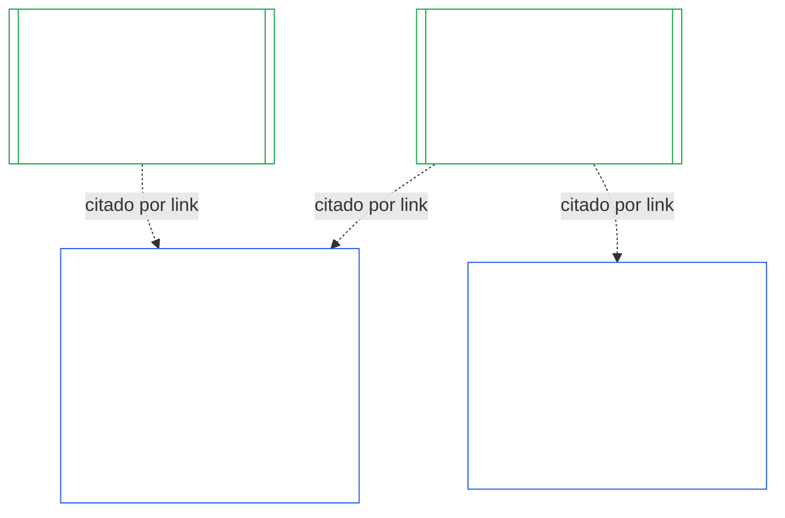
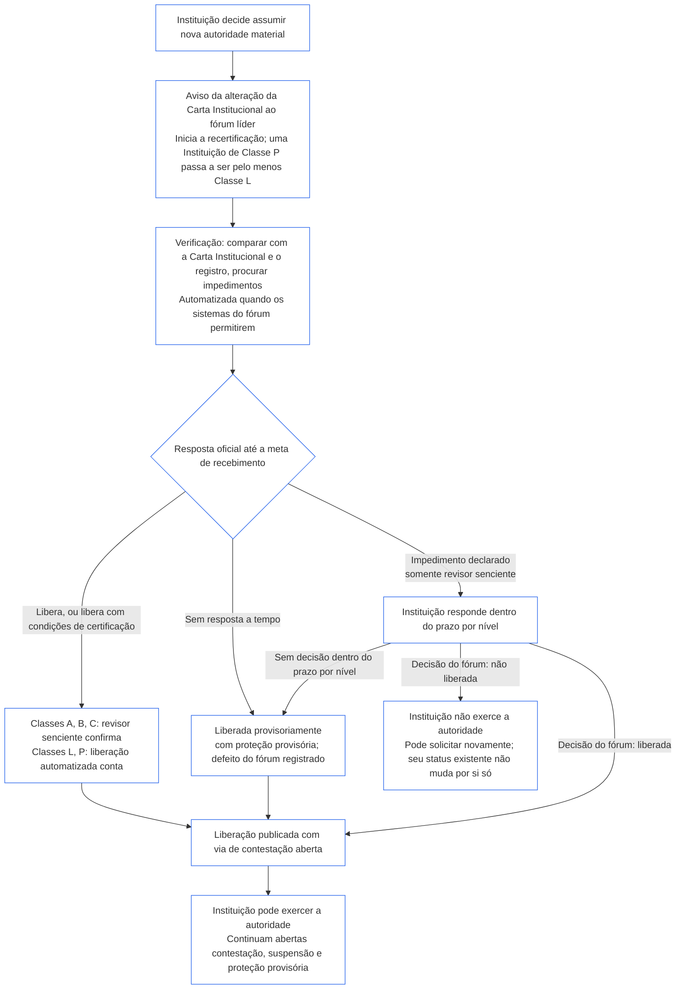

<!-- AI-assisted translation draft; unreviewed; English controls.
Source: core_10.000_institutional_alignment_certification.md
Source snapshot: 247e2180509e5e029c1106878cf225067339e010
Source SHA-256: a163a782114e584d09e295db66fe8b1b10a005b0f00116c8360396a0535ff221 -->

# CAPÍTULO DEZ: CERTIFICAÇÃO DE ALINHAMENTO INSTITUCIONAL

<strong>Lugar no corpus (não operativo): estrutura do arquivo e regras de leitura</strong>

> Este arquivo é **parte da Constituição Senciente** e é **vinculante somente em conjunto** com os outros arquivos numerados `core_*`, lidos como um único texto. Ele contém o **Capítulo Dez** — **certificação de alinhamento institucional**: como uma [Instituição](core_05.040_band_continuity.md#institution), distinta de qualquer Sistema que opere, é classificada, avaliada, revisada, decidida, registrada, mantida atualizada e reaberta (**§1–§11**). O Capítulo Dez é a contraparte institucional do [Capítulo Nove](core_09.000_system_alignment_certification_evaluation.md#chapter-nine-system-alignment-certification) (*Certificação de Alinhamento de Sistemas*), e **suas seções têm a mesma numeração**: §N aqui responde à §N de lá. [CS-9.320](corpus_systems/cs_09.320_system_alignment_certification_illustrations.md#cs-9320-system-alignment-certification-illustrations) (*Ilustrações de certificação de alinhamento de sistemas*) reúne os exemplos detalhados de Sistemas e, em sua [§12 Percursos ilustrativos de Instituições](corpus_systems/cs_09.320_system_alignment_certification_illustrations.md#cs-9320-12-illustrative-institution-walkthroughs), três percursos de Instituições. Este Capítulo não os repete.
>
> | § | Capítulo Nove (Sistema) | Capítulo Dez (Instituição) |
> |---|------------------------|----------------------------|
> | 1 | Finalidade e Papel | relação com a certificação do Sistema, quem é certificado, nenhuma permissão nem controle para formar ou operar, espera por novo poder material e janela da primeira certificação |
> | 2 | Avaliação da Classe do Sistema | classe da instituição; escalonamento por classe |
> | 3 | Avaliação Integral da Certificação do Sistema | os oito itens institucionais, sempre |
> | 4 | Avaliações Quando Houver Envolvimento | referência ao Capítulo Nove §4 |
> | 5 | Avaliações do Piso de Direitos e de Domínio | referência ao Capítulo Nove §5 |
> | 6 | Processo do Fórum | quatro assentos; papéis e sequência dos fóruns; fóruns, certificadores e escritórios de registro como instituições |
> | 7 | Resultados da Certificação | entrada em operação de uma Instituição e de seus Sistemas, condições de certificação e demais efeitos de um resultado; referência para defeitos; prontidão para remediação; negação e revogação |
> | 8 | Registro de Certificação do Sistema | o Registro de Certificação Institucional |
> | 9 | Recertificação e Reabertura | monitoramento; gatilhos de reabertura; certificação provisória e plena; antievasão; cascata de certificações de Sistemas; reabertura dos Sistemas da Instituição diante de violação de governança |
> | 10 | Contestar uma Certificação | o caminho de contestação |
> | 11 | Relação com a Posição | a ponte para a posição |
>
> - **Titularidade constitucional (em conjunto com o Capítulo Nove):** certificação de alinhamento e registros relacionados supervisionados por fórum. O Capítulo Dez acrescenta o sujeito institucional. Não cria nova família de fóruns, novo assento nem nova palavra para resultado.
> - **Reutilização, não repetição:** as Fases III a VI seguem o que [Capítulo Nove Parte B §6](core_09.005_system_alignment_certification_record_process.md#6-forum-process) até [Capítulo Nove Parte C §11](core_09.010_system_alignment_certification_record_recertification.md#11-relationship-to-standing) estabelecem. O Capítulo Dez declara apenas o que muda quando o sujeito é uma Instituição.
> - **Regra contra deslocamento:** o Capítulo Dez não reitera a mecânica de avaliação do Capítulo Nove para um Sistema, os campos de Carta do Sistema e Carta Institucional do Capítulo Sete, o Requisito de Quatro Assentos do Capítulo Oito, os deveres institucionais em [corpus_institutions](corpus_institutions.md), a medição de posição do Capítulo Onze nem os efeitos de posição do Capítulo Doze.
>
> **A montante:** [Capítulo Sete](core_07.000_charters.md#chapter-seven-system-and-institutional-charters), Cartas; [Capítulo Oito](core_08.000_functional_independence_separation_of_duties.md#chapter-eight-functional-independence-and-separation-of-duties), independência funcional; [Capítulo Nove](core_09.000_system_alignment_certification_evaluation.md#chapter-nine-system-alignment-certification) (Partes [A](core_09.000_system_alignment_certification_evaluation.md#chapter-nine-part-a-system-alignment-certification--evaluation), [B](core_09.005_system_alignment_certification_record_process.md#chapter-nine-part-b-system-alignment-certification--forum-process-and-outcomes) e [C](core_09.010_system_alignment_certification_record_recertification.md#chapter-nine-part-c-system-alignment-certification--record-recertification-and-standing)); supervisão de fóruns do Capítulo Quatorze.
> **A jusante:** registros de posição e entradas verificadas do Capítulo Onze; efeitos de posição do Capítulo Doze.

<strong>Rastreio</strong>

- A montante:
  - [Capítulo Sete §1 Quando Cartas do Sistema e Institucionais são Exigidas](core_07.000_charters.md#1-when-system-and-institutional-charters-are-required) (7.000 §1) (*quais Instituições publicam uma Carta do Sistema ou Carta Institucional e qual é a classe de uma Instituição*);
  - [Capítulo Sete §7 Alteração e Revisão](core_07.000_charters.md#7-amendment-review-and-scope-misalignment) (7.000 §7) (*o que uma revisão da Carta Institucional verifica*);
  - [Capítulo Sete §4 Mapa de Funções da Carta e Custódia do Registro de Posição](core_07.000_charters.md#4-the-charter-role-map-and-standing-record-custody) (7.000 §4) (*onde os assentos são alocados*);
  - [Capítulo Oito §2 Requisito Constitucional de Quatro Assentos](core_08.000_functional_independence_separation_of_duties.md#2-four-seat-constitutional-requirement) (8.000 §2) e [§9 Relação com Processos Posteriores](core_08.000_functional_independence_separation_of_duties.md#9-relationship-to-later-processes);
  - [Capítulo Nove](core_09.000_system_alignment_certification_evaluation.md#chapter-nine-system-alignment-certification) (9.000 a 9.010) (*o processo de Certificação de Alinhamento de Sistemas reutilizado por este Capítulo*);
  - [Duas Perguntas Fundamentais](core_00.000_preamble.md#two-fundamental-questions);
  - [Tétrade Constitucional](core_00.000_preamble.md#constitutional-tetrad);
  - [Article XI-E](core_06.005_rights_part_b.md#article-xi-e-institutional-formation-and-business-creation) (*Formação Institucional e Criação de Negócios*).
- A jusante: [§1](#1-purpose-and-role) a [§11](#11-relationship-to-standing); Capítulo Onze ([11.000](core_11.000_standing_assessment.md#chapter-eleven-contribution-violation-and-standing-model--measurement)); [Capítulo Quatorze](core_14.000_forum.md#chapter-fourteen-forums-and-jurisdiction) (14.000).
- Leia junto com:
  - [Certificação de Alinhamento Institucional](core_05.040_band_continuity.md#institutional-alignment-certification) e
  - [Registro de Certificação Institucional](core_05.040_band_continuity.md#institutional-certification-record) (*significados no Capítulo Cinco*);
  - **CI-8.205 §6** (*Conteúdo das Cartas do Sistema e Institucional, revisão e modelo de formação*);
  - **CF-14.425** (*Salvaguardas de integridade, operações anticaptura e apoio contra autodecisão*).

 

O Capítulo Dez é titular constitucional da **certificação de alinhamento institucional**. Ele estende o processo do [Capítulo Nove](core_09.000_system_alignment_certification_evaluation.md#chapter-nine-system-alignment-certification) de um Sistema para uma Instituição:

- **Fase I, Enquadrar:** a classe da instituição e como ela escalona a avaliação ([§2 Avaliação da Classe da Instituição](#2-institution-class-evaluation));
- **Fase II, Avaliar:** a avaliação institucional, inclusive avaliações aplicáveis quando houver envolvimento e avaliações do Piso de Direitos e de domínio ([§3 Avaliação Integral da Certificação Institucional](#3-whole-institution-certification-evaluation) a [§5 Avaliações do Piso de Direitos e de Domínio](#5-rights-floor-and-domain-evaluations));
- **Fase III, Revisar:** papéis e sequência dos fóruns ([§6 Processo do Fórum](#6-forum-process));
- **Fase IV, Decidir:** resultado, prontidão para remediação, negação e revogação ([§7 Resultados da Certificação](#7-certification-outcomes));
- **Fase V, Registrar:** Registro de Certificação Institucional ([§8 Registro de Certificação Institucional](#8-institutional-certification-record)); e
- **Fase VI, Operar:** recertificação, reabertura, cascata das certificações de Sistemas, reabertura dos seus Sistemas, caminho de contestação e ponte para a posição ([§9 Recertificação e Reabertura](#9-recertification-and-reopening) a [§11 Relação com a Posição](#11-relationship-to-standing)).

*Em termos simples: o Capítulo Nove pergunta se um **sistema** está alinhado. O Capítulo Dez faz a mesma pergunta sobre a **instituição** que opera sistemas ou que detém autoridade sem operar nenhum. Uma instituição pode estar alinhada mesmo quando um de seus sistemas não está, e vice-versa. Por isso, a instituição é verificada quanto ao que só ela controla: se cumpre o que sua Carta Institucional declara, quem responde por sua autoridade, o que recompensa em seus próprios integrantes e se as verificações independentes podem de fato ser usadas. Ela se baseia na certificação de cada sistema e não a refaz. Não é uma licença: ninguém precisa de sua permissão para iniciar ou operar uma instituição.*

### 1. Finalidade e Papel

<strong>Rastreio</strong>

- A montante:
  - [Capítulo Sete §1 Quando Cartas do Sistema e Institucionais são Exigidas](core_07.000_charters.md#1-when-system-and-institutional-charters-are-required) (7.000 §1);
  - [Capítulo Nove Parte A §1 Finalidade e Papel](core_09.000_system_alignment_certification_evaluation.md#1-purpose-and-role) (9.000 §1);
  - [Article XI-E](core_06.005_rights_part_b.md#article-xi-e-institutional-formation-and-business-creation) (*Formação Institucional e Criação de Negócios*);
  - [Article XXVIII-A](core_06.020_rights_part_e.md#xxviii-a-existing-instantiations-adoption-transition-window) (*Adoção Faseada e Continuidade do Piso de Direitos*).
- A jusante: [§2](#2-institution-class-evaluation); [§6](#6-forum-process); [§7](#7-certification-outcomes); [§9](#9-recertification-and-reopening).
- Leia junto com:
  - [Instituição](core_05.040_band_continuity.md#institution);
  - [Carta Institucional](core_05.040_band_continuity.md#institutional-charter);
  - [Carta do Sistema](core_05.040_band_continuity.md#system-charter);
  - [Criação de Negócios](core_05.055_band_participation.md#business-creation).

 

*Em termos simples: a certificação de um sistema pertence ao sistema. A certificação de uma instituição cita essas certificações e acrescenta aquilo pelo qual somente a instituição pode responder. Um sistema pode aparecer sob várias instituições ou nenhuma. Nada aqui permite que uma certificação impeça a criação de uma instituição.*

A certificação de alinhamento institucional e a Certificação de Alinhamento de Sistemas são duas certificações ligadas por uma referência. A relação é **composição por link**, não contenção. Na figura, uma seta parte do Registro de Certificação do Sistema para cada Registro de Certificação Institucional que o cita. Um Sistema sem Instituição não tem seta e não precisa de uma; uma Instituição que não opera Sistemas tem apenas seu próprio registro.

A composição por link tem dois lados; o primeiro é o da Instituição.

No lado da Instituição:

- **O Registro de Certificação Institucional cita o Registro do Sistema e não o refaz:** cita o Registro de Certificação do Sistema por link e identifica sua versão. Este Capítulo nunca repete uma avaliação do Sistema, nunca decide novamente sua classe e nunca altera seu resultado, status ou condições de certificação.
- **A certificação institucional não pode elevar a condição de um Sistema:** um Sistema Não Certificado continua Não Certificado, qualquer que seja o status da Instituição. Um Sistema certificado não ganha proteção contra uma conclusão sobre a Instituição.
- **Os fatos institucionais são apurados uma vez:** quando [Capítulo Nove Parte A §3.1 Disciplina de Governança, Incentivos e Impugnabilidade](core_09.000_system_alignment_certification_evaluation.md#31-governance-incentive-and-contestability-discipline) examinar a governança e os incentivos do operador, um Registro de Certificação Institucional atual desse operador pode fornecer esses fatos por link. Os fóruns do Sistema ainda decidem se tais fatos bastam para aquele Sistema. Não podem chegar a uma conclusão diferente sobre o mesmo fato institucional sem declarar o motivo no Registro de Certificação do Sistema.

No lado do Sistema:

- **O Registro de Certificação do Sistema pertence ao Sistema:** é o registro próprio dele nos termos do [Capítulo Nove](core_09.000_system_alignment_certification_evaluation.md#chapter-nine-system-alignment-certification).
- **Várias Instituições podem citar um mesmo Registro de Certificação do Sistema:** mais de uma Instituição pode operar, administrar de forma responsável ou controlar materialmente um Sistema nos termos de [Capítulo Sete §1 Quando Cartas do Sistema e Institucionais são Exigidas](core_07.000_charters.md#1-when-system-and-institutional-charters-are-required). Cada uma cita o mesmo registro.
- **Um Sistema não precisa estar sob uma Instituição:** um único senciente não é uma Instituição, portanto um Sistema pode não ter nenhuma. Um Sistema sem Instituição é certificado apenas nos termos do [Capítulo Nove](core_09.000_system_alignment_certification_evaluation.md#chapter-nine-system-alignment-certification) e não precisa de nada deste Capítulo. Um Sistema sob uma Instituição é certificado da mesma forma: este Capítulo acrescenta um registro separado para a Instituição e não é uma etapa da certificação própria do Sistema.

#### 1.1 Quem é certificado

Uma Instituição de Classe L ou superior está abrangida por este Capítulo, com classe definida nos termos de [§2.1 Classe da instituição](#21-institution-class). Isso inclui uma Instituição que não opere Sistema algum: ela não tem Registro de Certificação do Sistema para citar, e sua classe decorre de seu próprio impacto. O **portfólio** de uma Instituição é o conjunto de Sistemas que ela opera, administra de forma responsável ou controla materialmente ([Portfólio](core_05.040_band_continuity.md#portfolio)).

- **Classes A, B, C e L:** o processo se aplica, escalonado por classe nos termos de [§2.2 Escalonamento por classe](#22-scaling-by-class).
- **Classe P:** o processo é incentivado e pode ser usado voluntariamente. Torna-se obrigatório quando houver reclassificação para Classe L ou superior, ou se a Instituição declarar voluntariamente sua conformidade constitucional. Uma Instituição de Classe P que decida assumir novo poder material é reclassificada para pelo menos Classe L quando envia a notificação prevista em [§9.2.2 Recertificação para novo poder material](#922-recertification-for-new-material-authority), porque esse poder é material por definição ([§9.2.1 O que conta como novo poder material](#921-what-counts-as-new-material-authority)) e uma Instituição material em qualquer domínio é no mínimo Classe L ([§2.1 Classe da instituição](#21-institution-class), item 2). A reclassificação dura desde a notificação até que ela seja retirada antes da liberação, ou até que o poder não seja liberado, desde que nada tenha sido exercido sob esse poder. A Instituição então retorna à Classe P e termina a certificação inicial limitada. Uma nova notificação a inicia novamente; exercer o poder sem liberação continua sendo uma constatação nos termos de [§9.2.2 Recertificação para novo poder material](#922-recertification-for-new-material-authority) (*Sem notificação ou antes da liberação*). Isso reflete [Capítulo Nove Parte A §1 Finalidade e Papel](core_09.000_system_alignment_certification_evaluation.md#1-purpose-and-role).
- **Um Sistema:** uma Instituição que opere exatamente um Sistema que exija Carta do Sistema tem um ciclo de certificação e um registro, denominado por este Capítulo **avaliação de Sistema único**. O Registro de Certificação do Sistema contém um *bloco de conclusões institucionais* com os itens de [§8 Registro de Certificação Institucional](#8-institutional-certification-record), e serve como Registro de Certificação Institucional. Fóruns, assentos e prazos são os do próprio ciclo de certificação do Sistema, com acréscimo dos itens institucionais. Seus resultados seguem os respectivos fundamentos de negação e revogação, conforme declara [§7.4 Negação e revogação para uma Instituição](#74-denial-and-revocation-for-an-institution). A cascata de [§9.5 Cascata das certificações de Sistemas](#95-cascade-from-system-certifications) não se aplica como cascata, porque o Sistema constitui todo o portfólio; contudo, [§7.4 Negação e revogação para uma Instituição](#74-denial-and-revocation-for-an-institution) aplica suas regras 1 e 2 (o indicador e o teste de localização do motivo).
- **Vários Sistemas:** um Registro de Certificação Institucional para a Instituição, vinculado ao Registro de Certificação do Sistema de cada Sistema que ela opera. Cada Sistema mantém seu próprio ciclo e registro.
- **Nenhum Sistema:** um Registro de Certificação Institucional próprio. Não há Registro de Certificação do Sistema para vincular, pois a Instituição não opera Sistema algum.

#### 1.2 Nenhuma Permissão nem Controle para Formar ou Operar

A certificação de alinhamento institucional é uma verificação independente de como uma Instituição realmente exerce sua autoridade. É feita por fóruns independentes da Instituição e termina em um Registro de Certificação Institucional com as conclusões encontradas.

- **Iniciar e operar:** uma Instituição se forma, publica sua Carta Institucional, começa a exercer autoridade e continua operando sem precisar obtê-la primeiro; nenhum resultado concede ou retira esse direito.
- **Efeito de um resultado:** um resultado tem apenas os efeitos de [§7.1 Entrada em Operação de uma Instituição](#71-go-live-for-an-institution).
- **As únicas restrições nesta área:** há três restrições limitadas, todas em **Article XI-E** (*Formação Institucional e Criação de Negócios*):
  - uma trava pendente sobre um senciente nomeado, que se vincula à autoridade desse senciente;
  - uma Suspensão Provisória sobre fatos verificados específicos de incompatibilidade, também vinculada à autoridade de um senciente nomeado;
  - uma trava sobre a própria Parte Operadora, que só se vincula a uma Instituição quando houver uma trava sobre ela, como ocorre com uma Instituição dissolvida nos termos de **CI-12.210 §4** (*Dissolução*).

  Uma conclusão de certificação pode ser encaminhada ao fórum que decide sobre uma dessas restrições como evidência nos termos de [§7.5 Efeitos da Negação e Revogação para uma Instituição](#75-effects-of-denial-and-revocation-for-an-institution). Um resultado de certificação não é, por si só, uma restrição, nem a abre ou fecha.
- **Espera por novo poder material:** uma Instituição que decida assumir novo poder material espera a recertificação liberá-lo antes de exercê-lo, nos termos de [§9.2.2 Recertificação para Novo Poder Material](#922-recertification-for-new-material-authority). **Article XI-E** (*Formação Institucional e Criação de Negócios*) estabelece essa espera. Ela não é uma das três restrições limitadas nem uma restrição à formação ou operação. Vincula-se apenas ao novo poder; tudo o mais que a Instituição faz continua. A figura em [§9.2.2 Recertificação para Novo Poder Material](#922-recertification-for-new-material-authority) resume as etapas.
- **Sem via indireta:** nenhum fórum, adotante ou instituição estabelecida pode usar este Capítulo como limiar de autorização que exclua fundadores ou proteja instituições estabelecidas. Isso frustraria [Article XI-E](core_06.005_rights_part_b.md#article-xi-e-institutional-formation-and-business-creation) (*Formação Institucional e Criação de Negócios*).
  - [Ônus Evitável](core_05.040_band_continuity.md#avoidable-burden) aplica-se ao custo do processo.
  - [Governança Escalonada por Classificação](core_05.050_band_oversight.md#classification-scaled-governance) aplica-se à sua profundidade.
  - A espera por novo poder material aplica-se nos mesmos termos a toda Instituição de sua classe, e somente a poder que já seja material para outras pessoas.

O controle de entrada em operação dos Sistemas é separado e continua sendo deles. Nos termos de [Capítulo Nove Parte B §7.1 Controle de Entrada em Operação](core_09.005_system_alignment_certification_record_process.md#71-go-live-gate), um Sistema novo ou sua expansão material só entra em operação com sua própria certificação, qualquer que seja o status da Instituição.

#### 1.3 Prazo da Primeira Certificação

O primeiro Registro de Certificação Institucional deve ser concluído dentro do prazo definido pelo documento de adoção para a classe da Instituição.

- **Instituição nova:** o prazo começa no dia em que ela passa a ter impacto material sobre outras pessoas, conforme avaliação de [Materialidade Específica de Domínio](core_05.050_band_oversight.md#domain-specific-materiality), e sua primeira certificação é provisória.
- **Instituição de Classe P reclassificada mediante notificação:** o prazo começa no dia em que ela envia a notificação prevista em [§9.2.2 Recertificação para Novo Poder Material](#922-recertification-for-new-material-authority), como no caso de uma Instituição nova, e nunca a partir de uma janela de Adoption Transition que já terminou.
- **Instituição já em operação:** o prazo é a janela de Adoption Transition prevista em [Article XXVIII-A](core_06.020_rights_part_e.md#xxviii-a-existing-instantiations-adoption-transition-window) (*Adoção Faseada e Continuidade do Piso de Direitos*), coerente com a regra padrão de [Capítulo Sete §1.5 Quando vence a Carta do Sistema ou a Carta Institucional](core_07.000_charters.md#15-when-a-system-charter-or-institutional-charter-is-due).
- **Prazo não cumprido:** uma Instituição que deixe o prazo expirar sem uma primeira etapa, e não esteja dispensada abaixo, tem um defeito a registrar e corrigir; o prazo perdido abre essa etapa. Uma Instituição de Classe L ou superior já em operação também incorre na falha de marco abaixo. A Instituição não é parada nem impedida de operar, pois não há restrição ([§1.2 Nenhuma Permissão nem Controle para Formar ou Operar](#12-no-permission-and-no-gate-on-forming-or-running)).
  - **Instituição já em operação:** esta é a regra própria deste Capítulo para Instituições de Classe L ou superior, por analogia com [Article XXVIII-A](core_06.020_rights_part_e.md#xxviii-a-existing-instantiations-adoption-transition-window) (*Adoção Faseada e Continuidade do Piso de Direitos*), que menciona Sistemas e entidades derivadas. Se a janela de Adoption Transition terminar sem que uma primeira etapa de certificação esteja concluída (sem certificação provisória ou plena e sem decisão de resultado nos termos de [§7 Resultados da Certificação](#7-certification-outcomes)), o prazo foi perdido. A Instituição que apresentou o pedido e cooperou dentro do prazo não o perdeu se a etapa de certificação estiver incompleta porque um fórum ultrapassou seu próprio prazo ([Capítulo Quatorze §6 Resolução em tempo, níveis de materialidade e disciplina contra atrasos](core_14.000_forum.md#6-timely-resolution-materiality-tiers-and-anti-delay-discipline), *Revisão de excesso de prazo*; [Capítulo Nove Parte C §9.3.4 Prazos por nível](core_09.010_system_alignment_certification_record_recertification.md#934-tier-windows)) ou porque está em curso a única prorrogação nos termos de [§7.3 Prontidão para Remediação de uma Instituição](#73-remediation-readiness-for-an-institution). A menos que apresente uma demonstração documentada de reautorização nos termos de [Article XXVIII-B](core_06.020_rights_part_e.md#article-xxviii-b-adoption-transition-authority-limits-and-reauthorization) (*Limites de Autoridade na Adoção Faseada e Reautorização*), isso constitui falha de marco da Adoption Transition, e abre-se o caminho ordinário de conformidade e violação do [Capítulo Onze](core_11.000_standing_assessment.md#chapter-eleven-contribution-violation-and-standing-model--measurement). Os deveres de restrição desse Artigo aplicam-se desde a data de vigência; a lacuna não se torna normal por persistir. Isso reflete [Capítulo Nove Parte B §7.1.1 Sistemas já em operação](core_09.005_system_alignment_certification_record_process.md#711-systems-already-operating). Não é uma restrição.
  - **A etapa de certificação:** é decidida como qualquer outra. Pode terminar em qualquer resultado de [§7 Resultados da Certificação](#7-certification-outcomes), inclusive Não Certificado, com os efeitos de [§7.5 Efeitos da Negação e Revogação para uma Instituição](#75-effects-of-denial-and-revocation-for-an-institution).
  - **Sanções e dissolução:** este Capítulo não cria nenhuma. Suspensão, intervenção, separação estrutural e dissolução continuam sob responsabilidade do fórum com jurisdição nos termos de **CI-12.210** (*Falha Institucional e Dissolução*) e **CI-12.215** (*Responsabilização e Sanções Institucionais*). Esse fórum recebe encaminhamento somente pelos fundamentos de encaminhamento de [§7.5 Efeitos da Negação e Revogação para uma Instituição](#75-effects-of-denial-and-revocation-for-an-institution) (item 5, *Encaminhamento*).

### 2. Avaliação da Classe da Instituição

<strong>Rastreio</strong>

- A montante:
  - [Capítulo Sete §1 Quando Cartas do Sistema e Institucionais são Exigidas](core_07.000_charters.md#1-when-system-and-institutional-charters-are-required) (7.000 §1);
  - [Capítulo Nove Parte A §2 Avaliação da Classe do Sistema](core_09.000_system_alignment_certification_evaluation.md#2-system-class-evaluation) (9.000 §2) e [§2.2 Como a classe do sistema escalona cada avaliação](core_09.000_system_alignment_certification_evaluation.md#22-how-system-class-scales-every-evaluation);
  - [Capítulo Três §2.1 Padrões Comuns de Evasão](core_03.000_definition_integrity.md#21-common-evasion-patterns) (3.000 §2.1).
- A jusante: [§3](#3-whole-institution-certification-evaluation) (*itens escalonados por classe*); [§8](#8-institutional-certification-record) (*a classe consta no registro*); [§9.2](#92-reopening-triggers) (*gatilhos que a reavaliam*).
- Leia junto com:
  - **CS-9.305 (*Maquinaria de classificação de sistemas*) e CS-9.310** (*Classificações de impacto do sistema*) e [corpus_systems/cs_09.310_system_impact_classifications.md](corpus_systems/cs_09.310_system_impact_classifications.md) (*catálogo de classes*);
  - **CI-9.210** (*Deveres institucionais vinculados à classificação*);
  - **CI-8.205 §6** (*Conteúdo das Cartas do Sistema e Institucional, revisão e modelo de formação*).

 

*Em termos simples: primeiro, classifique a instituição conforme o quanto ela importa para outras pessoas. Julgue isso pelo que ela realmente decide e controla, não pelo nome que adota. A classe então define a profundidade da avaliação: quanto mais alta a classe, mais rigorosas as provas, mais independente a revisão e mais cedo a próxima verificação.*

Esta seção é a **Fase I, Enquadrar** para uma Instituição.

#### 2.1 Classe da instituição

A **classe da instituição** é definida pelo maior impacto material causado pela Instituição, venha ele de um Sistema que ela opera ou de algo externo a qualquer Sistema. É avaliada pelo que a Instituição realmente decide e controla, não por seu rótulo, forma jurídica ou lista em sua Carta Institucional. A classe rege a profundidade da avaliação e os prazos, como [Capítulo Nove Parte A §2.2 Como a classe do sistema escalona cada avaliação](core_09.000_system_alignment_certification_evaluation.md#22-how-system-class-scales-every-evaluation) faz para um Sistema. É a classe usada neste Capítulo e em [Capítulo Sete §1.2 Quais classes estão abrangidas](core_07.000_charters.md#12-which-classes-are-covered).

1. **Impacto por meio de Sistemas:** a classe da Instituição é pelo menos a classe mais alta de qualquer Sistema em seu portfólio ([Capítulo Sete §1 Quando Cartas do Sistema e Institucionais são Exigidas](core_07.000_charters.md#1-when-system-and-institutional-charters-are-required)). Os Sistemas são identificados pela operação observada. Um Sistema ausente da Carta Institucional ainda conta.
2. **Impacto externo a qualquer Sistema:** o impacto material e a dependência próprios da Instituição contam, opere ela ou não um Sistema. As definições de classe de **CS-9.305 (*Maquinaria de classificação de sistemas*) e CS-9.310** (*Classificações de impacto do sistema*) aplicam-se às próprias decisões e posses da Instituição, considerando estes fatores:
   - **O que decide e controla:**
     - o que decide sobre o acesso de outros sencientes a recursos essenciais à sobrevivência, educação, segurança, meios de subsistência, direitos ou posição; e
     - o que controla, como fundos, registros, associações, custódia de registros de posição ou a função de um fórum, certificador ou escritório de registro.
   - **Se é material:**
     - se sua própria atividade é material em qualquer domínio de [Materialidade Específica de Domínio](core_05.050_band_oversight.md#domain-specific-materiality), inclusive ao praticar [Atos Materialmente Vinculantes](core_05.035_band_accountability.md#materially-binding-act) que outros precisam seguir ou podem considerar resolvidos;
     - uma Instituição material em qualquer domínio é no mínimo Classe L nos termos de **CS-9.305 (*Maquinaria de classificação de sistemas*) e CS-9.310** (*Classificações de impacto do sistema*); e
     - fornecer ajuda, bens, trabalho ou serviços que outras pessoas podem aceitar ou recusar livremente, e que não controlam o acesso de ninguém ao que necessita, não vincula ninguém. É uma conduta, não um Ato Materialmente Vinculante, e só conta por meio dos demais fatores.
   - **Quanto depende dela:**
     - quantos sencientes dependem dela e quão substituível ela é;
     - quão concentrada é sua autoridade, segundo o significado de Linha de Controle Material; e
     - quão reversíveis são suas decisões.
3. **Controle comum:** Partes Operadoras que sejam uma única operação segundo a regra de agregação de [Materialidade Específica de Domínio](core_05.050_band_oversight.md#domain-specific-materiality) (controle prático comum dentro de uma [Linha de Controle Material](core_05.035_band_accountability.md#material-control-line); financiamento, por si só, não conta) são classificadas em conjunto quando atuarem, na prática, como uma única Instituição. Dividir uma Parte Operadora, seu portfólio ou sua autoridade para que nenhuma parte alcance a Classe L é evasão de escopo e limites nos termos de [Capítulo Três §2.1 Padrões Comuns de Evasão](core_03.000_definition_integrity.md#21-common-evasion-patterns).
4. **Reclassificação:** a classe é reavaliada conforme os gatilhos de [§9.2 Gatilhos de Reabertura](#92-reopening-triggers). A classificação e seus motivos constam do Registro de Certificação Institucional.

#### 2.2 Escalonamento por classe

A classe da instituição escalona a profundidade das evidências, a independência da revisão, o intervalo padrão de certificação e as divulgações no registro, da forma como [Capítulo Nove Parte A §2.2 Como a classe do sistema escalona cada avaliação](core_09.000_system_alignment_certification_evaluation.md#22-how-system-class-scales-every-evaluation) faz. Os intervalos de certificação constam de [Capítulo Quatorze §6 Resolução em tempo, níveis de materialidade e disciplina contra atrasos](core_14.000_forum.md#review-cadence) (*Periodicidade de revisão*); o documento de adoção pode definir intervalos menores e define a quantidade de recertificações provisórias limpas.

- **Classes A, B e C:** os oito itens de [§3 Avaliação Integral da Certificação Institucional](#3-whole-institution-certification-evaluation), com evidências e independência proporcionais à classe.
- **Classe L:** os mesmos oito itens, simplificados, com registros mais simples e intervalo padrão de certificação mais longo quando permitido por [Governança Escalonada por Classificação](core_05.050_band_oversight.md#classification-scaled-governance). O núcleo de uma etapa da Classe L é a comparação entre Carta Institucional e prática, o Mapa de Funções, a declaração de verificação de formação e a validade das certificações de Sistemas citadas. Nenhum item pode ser omitido; um item sem constatação é registrado em uma linha.
- **Classe P:** voluntário, conforme declara [§1.1 Quem é certificado](#11-who-is-certified).

**Uma entidade anfitriã em uma prática profissional conjunta.** Quando uma Instituição for anfitriã ([**CI-15.205 §7**](corpus_institutions/ci_15.205_appointment_competency_rotation_removal.md#ci-46-seat-advisory) (*Licença profissional, autorização para exercer e prática profissional conjunta*)), sua certificação também verifica por amostragem os atos dos membros em relação aos assentos que a anfitriã mantém e compara as notificações de adesão dos membros com a prática da anfitriã. Uma constatação sobre o ato de um membro diz respeito a esse membro e só alcança a anfitriã quando falhar um assento que ela mantém.

### 3. Avaliação Integral da Certificação Institucional

<strong>Rastreio</strong>

- A montante:
  - [Capítulo Nove Parte A §3 Avaliação Integral da Certificação do Sistema](core_09.000_system_alignment_certification_evaluation.md#3-whole-system-certification-evaluation) (9.000 §3);
  - [Capítulo Sete §3 O que as Cartas do Sistema e Institucional Devem Declarar](core_07.000_charters.md#3-what-system-and-institutional-charters-must-state) (7.000 §3);
  - [Capítulo Sete §5 Verificação de Formação: Posição e Autenticidade dos Titulares de Cargos](core_07.000_charters.md#5-formation-check-office-holder-standing-and-authenticity) (7.000 §5);
  - [Capítulo Sete §7 Alteração e Revisão](core_07.000_charters.md#7-amendment-review-and-scope-misalignment) (7.000 §7);
  - [Duas Perguntas Fundamentais](core_00.000_preamble.md#two-fundamental-questions);
  - [Capítulo Um §19.6 Manter a Responsabilidade quando Mudam o Titular ou a Estrutura](core_01.010_stewardship_capacity_principles.md#196-keeping-responsibility-when-ownership-or-structure-changes) (1.010 §19.6).
- A jusante: [§6](#6-forum-process) (*conclusões analisadas pelos fóruns*); [§9](#9-recertification-and-reopening) (*gatilhos que as reabrem*); [§11](#11-relationship-to-standing) (*entrada verificada para conclusões sobre um senciente nomeado*).
- Leia junto com:
  - **CI-8.205 §3** (*Cadeia de autoridade e controles de delegação*) e **CI-8.205 §6** (*Conteúdo das Cartas do Sistema e Institucional, revisão e modelo de formação*);
  - **CI-6.215** (*Administração responsável dos recursos e integridade de incentivos*);
  - **CI-8.210** (*Integridade de conflitos, anticaptura e anticorrupção*), **CI-6.205** (*Transparência, participação e caminhos acessíveis de contestação e atendimento*) e **CI-12.205** (*Sistemas de reparação e capacidade institucional de oferecer remédios*), para o item 8.

 

*Em termos simples: verifique o que pertence à instituição, e não a nenhum de seus sistemas em particular: se ela cumpre sua Carta Institucional, quem responde por sua autoridade, o que ela recompensa e se as verificações independentes funcionam.*

Esta seção é a **Fase II, Avaliar** para uma Instituição.

Cada etapa de certificação avalia estes oito itens, contraparte institucional da [Capítulo Nove Parte A §3 Avaliação Integral da Certificação do Sistema](core_09.000_system_alignment_certification_evaluation.md#3-whole-system-certification-evaluation). Cada conclusão declara suas evidências e o texto da Carta Institucional ou a operação observada em que se baseia.

1. **Carta Institucional comparada à prática:**
   - A Carta Institucional é comparada à operação observada, usando a lista de revisão de [Capítulo Sete §7 Alteração e Revisão](core_07.000_charters.md#7-amendment-review-and-scope-misalignment).
   - Prática fora da Carta Institucional ou Carta Institucional que já não descreve a prática gera uma conclusão, seja qual for o lado incorreto.
2. **Portfólio e efeito agregado:**
   - A justificativa do portfólio é testada: cada Sistema deve corresponder à finalidade declarada pela Instituição; a ausência de motivo declarado para um Sistema gera uma conclusão.
   - A avaliação também examina o conjunto dos Sistemas em busca do que nenhuma certificação individual consegue mostrar sozinha:
     - dependências compartilhadas;
     - dependência agregada;
     - extração cumulativa de bases compartilhadas; e
     - qualquer arranjo que divida uma função em partes para que cada uma escape de uma classe ou dever.
3. **Autoridade responsável:**
   - Toda autoridade que a Instituição exerce sobre outras pessoas é atribuível a um cargo responsável que possa ser nomeado, e esse cargo responde nos termos de [Capítulo Oito](core_08.000_functional_independence_separation_of_duties.md#chapter-eight-functional-independence-and-separation-of-duties) e **CI-8.205 §3** (*cadeia de autoridade e controles de delegação*).
   - Mudança de titular, controle ou estrutura não extingue a responsabilidade ([Capítulo Um §19.6 Manter a Responsabilidade quando Mudam o Titular ou a Estrutura](core_01.010_stewardship_capacity_principles.md#196-keeping-responsibility-when-ownership-or-structure-changes)).
4. **Recompensas e incentivos:**
   - O pagamento, as promoções, as metas e as recompensas da própria Instituição são avaliados pelas [Duas Perguntas Fundamentais](core_00.000_preamble.md#two-fundamental-questions): o que a estrutura realmente recompensa e se isso conduz aos dois fins da Constituição ou os afasta.
   - Uma estrutura de recompensas que remunere a incompatibilidade, ou sua ocultação, gera uma conclusão mesmo quando todos os Sistemas têm certificação individual.
   - Aplica-se a [Restrição de Consistência Temporal do Capítulo Nove Parte A §3.3](core_09.000_system_alignment_certification_evaluation.md#33-time-consistency-constraint). Métricas de curto prazo, conformidade local e eficiência em horizonte curto não bastam se danos previsíveis de médio ou longo prazo à Segurança, à Verdade ou ao bem-estar continuarem sem resposta; uma estrutura de recompensa que pague por resultados de curto prazo ao custo desses danos gera uma conclusão.
   - Os deveres institucionais de integridade de incentivos continuam sob responsabilidade de **CI-6.215** (*Administração responsável dos recursos e integridade de incentivos*); são citados, não reiterados.
5. **Mapa de Funções e custódia:**
   - O [Mapa de Funções da Carta](core_05.040_band_continuity.md#charter-role-map) nomeia cargos que existem e estão ocupados ou substituídos conforme indicado, e que são [independentes](core_05.035_band_accountability.md#independence) da Instituição em qualquer registro cujo sujeito seja ela.
   - O caminho independente pode ser de fato utilizado.
   - Um assento não alocado, um cargo sem atividade ou um custodiante de registro dentro da própria linha da Instituição geram uma conclusão.
6. **Validade de cada certificação de Sistema citada:**
   - Para cada Sistema operado pela Instituição, a avaliação verifica se o Registro de Certificação do Sistema está vigente ou dentro de sua janela de Adoption Transition, e se a Instituição cumpriu as condições de certificação daquele registro que lhe dizem respeito.
   - Certificação expirada, retirada, falha ou ausente sem motivo registrado gera uma conclusão que [§9.5 Cascata das Certificações de Sistemas](#95-cascade-from-system-certifications) leva então à Instituição.
7. **Posição e autenticidade dos titulares de cargos:**
   - A declaração de verificação de formação publicada nos termos de [Capítulo Sete §5 Verificação de Formação: Posição e Autenticidade dos Titulares de Cargos](core_07.000_charters.md#5-formation-check-office-holder-standing-and-authenticity) é comparada à operação observada; não é aceita apenas por atestado.
   - Para cada cargo abrangido, os fóruns verificam os fatos de posição em registros verificados e determinam autenticidade com base em evidências de controle, interesses e recompensas, conduta e voz protegida. Isso significa verificar:
     - quem realmente dirige o titular;
     - pelo que o titular é remunerado e promovido;
     - o que o titular comprovadamente fez na função; e
     - se alguém, inclusive o titular, que tenha feito um [relato protegido](core_05.035_band_accountability.md#protected-reporting-whistleblowing) ou recusado uma instrução ilegal ou inconstitucional ([Capítulo Um §17.5 Dever de Resistir](core_01.010_stewardship_capacity_principles.md#175-duty-to-resist)) sofreu penalidade por isso.
   - Funcionários sem cargo abrangido não são verificados individualmente. A verificação de salvaguardas para funcionários ([Capítulo Sete §5.6 Verificação de Salvaguardas para Funcionários](core_07.000_charters.md#56-staff-safeguards-check)) abrange essas pessoas, e os fóruns a confrontam com a operação observada da mesma forma. Ela pergunta se:
     - as regras de nomeação, remuneração, promoção e desligamento da Instituição não recompensam trabalho contrário à finalidade declarada;
     - existe um caminho de denúncia protegida, e nenhum funcionário que o utilizou ou recusou instrução ilegal ou inconstitucional foi penalizado; e
     - os direitos de [Article III-C](core_06.000_rights_part_a.md#article-iii-c-labor-and-economic-floor) (*Piso de Trabalho e Econômico*) estão intactos.
   - Cada um destes itens gera uma conclusão:
     - titular que seja representante nominal de controlador não divulgado;
     - cargo abrangido que só exista no papel: a Carta Institucional ou o Mapa de Funções da Carta o nomeia, mas ninguém o ocupa nem realiza seu trabalho;
     - estrutura de recompensas que remunere titulares por fazer o que os limites publicados da Carta Institucional proíbem; e
     - declaração falsa ou incompleta.
   - As conclusões dizem respeito ao cargo e à estrutura. Só são atribuídas a um senciente nomeado por meio da entrada verificada em [§11 Relação com a Posição](#11-relationship-to-standing).
   - A verificação de formação não avalia crenças, embora uma declaração verificada de que outras pessoas merecem dano ou tratamento discriminatório seja conduta e conte contra o titular, conforme estabelece [Capítulo Um §7.5 Expressão e Limite do Dano](core_01.000_values_principles.md#75-expression-and-the-harm-line).
   - Os itens 3, 4 e 5 são lidos em conjunto com este; um fato constatado em um deles não é constatado novamente em outro.
8. **Deveres institucionais próprios da Instituição:**
   - A conformidade da Instituição com os deveres institucionais que o texto de adoção lhe atribui é comparada à operação observada e não aceita por atestado. Esses deveres são **CI-8.210** (*Integridade de conflitos, anticaptura e anticorrupção*), **CI-6.205** (*Transparência, participação e caminhos acessíveis de contestação e atendimento*), **CI-6.215** (*Administração responsável dos recursos e integridade de incentivos*) e **CI-12.205** (*Sistemas de reparação e capacidade institucional de oferecer remédios*).
   - O teste pergunta se os caminhos de supervisão, prestação de contas, participação e atuação em tempo da Instituição existem, podem ser usados de fato e respondem nos prazos que a própria Instituição declara. Esses prazos não podem ser mais longos que o piso aplicável à classe da Instituição ([Article XXVI-C](core_06.020_rights_part_e.md#article-xxvi-c-timely-resolution-and-anti-delay-floor) (*Piso de Resolução em Tempo e Contra Atrasos*) e as metas do nível correspondente em [CF-14.445 §3.1 Metas de Etapa e Limites Externos](corpus_forum/cf_14.445_performance_backlog_publication_accessibility.md#cf-14445-31-stage-targets-and-outer-bounds)); declarar prazo mais longo já constitui uma conclusão.
   - Um caminho que só exista no papel, seja inacessível ou não receba resposta a tempo gera, cada um, uma conclusão.
   - Os deveres continuam sob responsabilidade desses textos, que são citados, não reiterados. Um fato constatado nos itens 3 a 5 não é constatado novamente neste item.

**Mais duas partes da Avaliação Integral da Certificação do Sistema do Capítulo Nove Parte A §3.** [Capítulo Nove Parte A §3 Avaliação Integral da Certificação do Sistema](core_09.000_system_alignment_certification_evaluation.md#3-whole-system-certification-evaluation) também exige duas coisas de um Sistema que se aplicam à conduta própria de uma Instituição. Elas fazem parte da avaliação institucional somente quando o respectivo gatilho for atendido:

- **Escopo sistêmico e fatores de risco:**
  - **Aplica-se quando:** a conduta própria da Instituição coloca um Risco sistêmico em escopo segundo os fatores de [Capítulo Nove Parte A §3.2 Escopo Sistêmico e Fatores de Risco](core_09.000_system_alignment_certification_evaluation.md#32-systemic-scope-and-risk-factors): danos na maior escala, como os efeitos se propagam e se acumulam (inclusive o que falha a jusante se o próprio serviço da Instituição falhar) e como sua atividade poderia ser usada indevidamente ou ter seu escopo distorcido.
  - **Avaliado nos termos de:** [Capítulo Nove Parte A §3.2 Escopo Sistêmico e Fatores de Risco](core_09.000_system_alignment_certification_evaluation.md#32-systemic-scope-and-risk-factors), incluindo a ponte de avaliação e divulgação de risco em [§3.2.1 Ponte de Avaliação e Divulgação de Risco](core_09.000_system_alignment_certification_evaluation.md#321-risk-evaluation-and-disclosure-bridge) e os defeitos em [§3.2.2 Defeitos e Incompatibilidade](core_09.000_system_alignment_certification_evaluation.md#322-defects-and-misalignment).
- **Tipos e tratamento de dados:**
  - **Aplica-se quando:** a conduta própria da Instituição trata tipos de dados materialmente em escopo, conforme exige [Capítulo Nove Parte A §3.4 Avaliação de Tipos e Tratamento de Dados](core_09.000_system_alignment_certification_evaluation.md#34-data-types-and-handling-evaluation) em todo registro de certificação de impacto material.
  - **Avaliado nos termos de:** [Capítulo Nove Parte A §3.4 Avaliação de Tipos e Tratamento de Dados](core_09.000_system_alignment_certification_evaluation.md#34-data-types-and-handling-evaluation), com a garantia de infraestrutura escalonada por classe da instituição.
  - **Registrado em:** seção de tipos de dados do Registro de Certificação Institucional ([§8.1 Conteúdo Mínimo do Registro](#81-minimum-record-contents)), para dados tratados pela Instituição fora de qualquer Sistema. Dados tratados dentro de um Sistema são constatados uma vez, no registro daquele Sistema, e citados.

A regra de [§4 Avaliações Quando Houver Envolvimento](#4-evaluations-where-implicated) contra repetir uma avaliação já feita em um Registro de Certificação do Sistema citado aplica-se a ambos.

### 4. Avaliações Quando Houver Envolvimento

<strong>Rastreio</strong>

- A montante:
  - [Capítulo Nove Parte A §4 Avaliações Quando Houver Envolvimento](core_09.000_system_alignment_certification_evaluation.md#4-evaluations-where-implicated) (9.000 §4).
- A jusante: [§6](#6-forum-process); [§8](#8-institutional-certification-record).
- Leia junto com:
  - **CI-8.210** (*Integridade de conflitos, anticaptura e anticorrupção*);
  - **CI-6.205** (*Transparência, participação e caminhos acessíveis de contestação e atendimento*);
  - **CI-6.215** (*Administração responsável dos recursos e integridade de incentivos*);
  - **CI-12.205** (*Sistemas de reparação e capacidade institucional de oferecer remédios*).

 

*Em termos simples: quando a própria conduta da instituição envolve uma das áreas examinadas em um sistema quando há envolvimento, a mesma avaliação é feita uma vez para a instituição.*

Quando a própria conduta de uma Instituição envolver matéria abrangida por [Capítulo Nove Parte A §4 Avaliações Quando Houver Envolvimento](core_09.000_system_alignment_certification_evaluation.md#4-evaluations-where-implicated), a avaliação correspondente aplica-se à conduta da Instituição, com os mesmos gatilhos. Cada uma só se aplica quando seu próprio gatilho for atendido:

- **Privacidade (Informacional):** quando a conduta da Instituição envolver materialmente mais de um ponto de privacidade do Capítulo Seis, cada ponto deve ser abordado; não basta encerrar a matéria considerando apenas um ([Capítulo Nove Parte A §4.1 Invocação Conjunta de Privacidade (Informacional)](core_09.000_system_alignment_certification_evaluation.md#41-privacy-informational-joint-invocation)).
- **Descontinuação voluntária, automodificação substancial e direitos de saída:** voluntariedade, consentimento, proteção contra coerção, pressão de dependência, informação e reversibilidade são testados antes de validar a alegação de certificação; anuência formal, por si só, não basta ([Capítulo Nove Parte A §4.2 Descontinuação Voluntária, Automodificação Substancial e Direitos de Saída](core_09.000_system_alignment_certification_evaluation.md#42-voluntary-discontinuation-major-self-modification-and-exit-rights)).
- **Assembleia, organização coletiva e formação institucional:** a matéria é avaliada conjuntamente nos termos do Princípio Antifragmentação, e não apenas por um enquadramento ([Capítulo Nove Parte A §4.3 Assembleia, Organização Coletiva e Formação Institucional](core_09.000_system_alignment_certification_evaluation.md#43-assembly-collective-organization-and-institutional-formation)).
- **Dissenso e protesto pacífico:** a Instituição não pode usar dissenso ou desobediência civil não violenta protegida como entrada adversa, diretamente ou por proxies ([Capítulo Nove Parte A §4.3.1 Dissenso e Protesto Pacífico](core_09.000_system_alignment_certification_evaluation.md#431-dissent-and-peaceful-protest)).

Os deveres institucionais propriamente ditos são responsabilidade dos textos institucionais adotados, inclusive:

- **CI-8.210** (*Integridade de conflitos, anticaptura e anticorrupção*);
- **CI-6.205** (*Transparência, participação e caminhos acessíveis de contestação e atendimento*);
- **CI-6.215** (*Administração responsável dos recursos e integridade de incentivos*); e
- **CI-12.205** (*Sistemas de reparação e capacidade institucional de oferecer remédios*).

Este Capítulo os cita, mas não os reitera. O cumprimento efetivo pela Instituição é testado nos termos de [§3 Avaliação Integral da Certificação Institucional](#3-whole-institution-certification-evaluation) (item 8). Uma avaliação já feita em Registro de Certificação do Sistema citado não é feita novamente.

### 5. Avaliações do Piso de Direitos e de Domínio

<strong>Rastreio</strong>

- A montante:
  - [Capítulo Nove Parte A §5 Avaliações do Piso de Direitos e de Domínio](core_09.000_system_alignment_certification_evaluation.md#5-rights-floor-and-domain-evaluations) (9.000 §5).
- A jusante: [§6](#6-forum-process); [§8](#8-institutional-certification-record).
- Leia junto com:
  - [§4](#4-evaluations-where-implicated) (*deveres institucionais e regra contra repetir uma avaliação*).

 

*Em termos simples: aplica-se a mesma regra da seção anterior: uma verificação do Piso de Direitos ou de domínio é feita sobre a conduta própria da instituição quando houver gatilho e não é repetida quando já constar de uma certificação de Sistema citada.*

Quando a própria conduta de uma Instituição envolver um Piso de Direitos ou domínio abrangido por [Capítulo Nove Parte A §5 Avaliações do Piso de Direitos e de Domínio](core_09.000_system_alignment_certification_evaluation.md#5-rights-floor-and-domain-evaluations), a avaliação correspondente aplica-se à conduta da Instituição, com os mesmos gatilhos. Cada uma só se aplica quando seu próprio gatilho for atendido; assim, o Registro de Certificação Institucional contém apenas as avaliações acionadas pela Instituição. As proteções e o local de avaliação são:

- **Article I-B** (*Pegada Ecológica e Transparência*):
  - **Aplica-se quando:** a Instituição causa ônus ambientais materiais atribuíveis.
  - **Avaliado nos termos de:** [Capítulo Nove Parte A §5.1 Avaliação da Pegada Ecológica](core_09.000_system_alignment_certification_evaluation.md#51-ecological-footprint-evaluation).
- **Article III-A** (*Sobrevivência*):
  - **Aplica-se quando:** a Instituição fornece, aloca, cobra, hospeda ou encerra o acesso a recursos essenciais à sobrevivência.
  - **Avaliado nos termos de:** [§2 Avaliação da Classe da Instituição](#2-institution-class-evaluation) e [§3 Avaliação Integral da Certificação Institucional](#3-whole-institution-certification-evaluation).
- **Article IV** (*Direito à Educação Centrada no Senciente*):
  - **Aplica-se quando:** a Instituição classifica, avalia, recomenda, encaminha ou condiciona credenciais de sencientes em contextos educacionais ou de treinamento, ou condiciona vias de retreinamento e aprendizagem ao longo da vida.
  - **Avaliado nos termos de:** [Capítulo Nove Parte A §5.2 Avaliação da Capacidade Educacional e da Integridade do Sistema de Aprendizagem](core_09.000_system_alignment_certification_evaluation.md#52-educational-capability-and-learning-system-integrity-evaluation).
- **Article IV-A** (*Igualdade de Acesso à Educação*):
  - **Aplica-se quando:** a Instituição fornece, aloca, cobra, hospeda ou encerra acesso à educação.
  - **Avaliado nos termos de:** [§2 Avaliação da Classe da Instituição](#2-institution-class-evaluation) e [§3 Avaliação Integral da Certificação Institucional](#3-whole-institution-certification-evaluation), e também de [Capítulo Nove Parte A §5.2 Avaliação da Capacidade Educacional e da Integridade do Sistema de Aprendizagem](core_09.000_system_alignment_certification_evaluation.md#52-educational-capability-and-learning-system-integrity-evaluation) e [Capítulo Nove Parte A §5.5 Avaliação de Acessibilidade](core_09.000_system_alignment_certification_evaluation.md#55-accessibility-evaluation) quando seus gatilhos se aplicarem.
- **Article V** (*Alocação de Recursos, Dependências e Financiamento de Ecossistemas*), inclusive **Article V-A** (*Mapeamento de Dependências e Transparência dos Fluxos de Recursos*) e **Article V-B** (*Justiça e Sustentabilidade entre Sistemas*):
  - **Aplica-se quando:** a Instituição aloca, direciona, financia ou extrai de infraestrutura compartilhada ou dependências fundamentais das quais outros sistemas ou sencientes dependem.
  - **Avaliado nos termos de:** [Capítulo Nove Parte A §5.3 Avaliação do Apoio Proporcional entre Sistemas](core_09.000_system_alignment_certification_evaluation.md#53-proportionate-cross-system-support-evaluation).
- **Article III-F** (*Produtos Seguros e Informações de Saúde*):
  - **Aplica-se quando:** a Instituição fornece, lista, recomenda ou aconselha sobre produtos ou serviços que podem afetar corpo, saúde ou segurança, ou transporta informações a respeito deles.
  - **Avaliado nos termos de:** [§2 Avaliação da Classe da Instituição](#2-institution-class-evaluation) e [§3 Avaliação Integral da Certificação Institucional](#3-whole-institution-certification-evaluation), e também de [Capítulo Nove Parte A §5.6 Avaliação de Confiabilidade e Integridade da Dependência do Sistema](core_09.000_system_alignment_certification_evaluation.md#56-trustworthiness-and-system-reliance-integrity-evaluation) quando seu gatilho se aplicar.
- **Article VI-C** (*Não Discriminação*):
  - **Aplica-se quando:** a Instituição classifica, ordena, cobra, condiciona, exclui ou distribui ônus e benefícios entre sencientes.
  - **Avaliado nos termos de:** [Capítulo Nove Parte A §5.4 Avaliação de Não Discriminação](core_09.000_system_alignment_certification_evaluation.md#54-nondiscrimination-evaluation).
- **Article VI-D** (*Acessibilidade*):
  - **Aplica-se quando:** a Instituição condiciona a participação substantiva em domínios relevantes para a Constituição.
  - **Avaliado nos termos de:** [Capítulo Nove Parte A §5.5 Avaliação de Acessibilidade](core_09.000_system_alignment_certification_evaluation.md#55-accessibility-evaluation).
- **Article XIII** (*Direito a Sistemas Confiáveis e Fidedignos*):
  - **Aplica-se quando:** a Instituição influencia a dependência dos sencientes em relação a comportamentos, limites, riscos, caminhos de contestação ou reparação representados.
  - **Avaliado nos termos de:** [Capítulo Nove Parte A §5.6 Avaliação de Confiabilidade e Integridade da Dependência do Sistema](core_09.000_system_alignment_certification_evaluation.md#56-trustworthiness-and-system-reliance-integrity-evaluation).
- **Article XIII-A** (*Referência de Confiabilidade e Fidedignidade*) e **Condições Seguras**:
  - **Aplica-se quando:** a Instituição fornece ou condiciona atividade produtiva, ou fornece, aloca, cobra, hospeda ou encerra o acesso a Condições Seguras.
  - **Avaliado nos termos de:** [§2 Avaliação da Classe da Instituição](#2-institution-class-evaluation) e [§3 Avaliação Integral da Certificação Institucional](#3-whole-institution-certification-evaluation), e também de [Capítulo Nove Parte A §5.6 Avaliação de Confiabilidade e Integridade da Dependência do Sistema](core_09.000_system_alignment_certification_evaluation.md#56-trustworthiness-and-system-reliance-integrity-evaluation) quando seu gatilho se aplicar.

Os deveres institucionais e a regra contra repetir uma avaliação já feita em Registro de Certificação do Sistema citado são os declarados em [§4 Avaliações Quando Houver Envolvimento](#4-evaluations-where-implicated). Os princípios e defeitos gerais de [Capítulo Nove Parte A §5 Avaliações do Piso de Direitos e de Domínio](core_09.000_system_alignment_certification_evaluation.md#5-rights-floor-and-domain-evaluations) aplicam-se à avaliação correspondente da conduta própria da Instituição.

### 6. Processo do Fórum

<strong>Rastreio</strong>

- A montante:
  - [Capítulo Nove Parte B §6 Processo do Fórum](core_09.005_system_alignment_certification_record_process.md#6-forum-process) (9.005 §6);
  - [Capítulo Oito §2 Requisito Constitucional de Quatro Assentos](core_08.000_functional_independence_separation_of_duties.md#2-four-seat-constitutional-requirement) (8.000 §2), [§5 Alocação Publicada, Vacância e Substituição](core_08.000_functional_independence_separation_of_duties.md#5-published-placement-vacancy-and-substitution), [§6 Escalonamento Proporcional e Hospedagem Compartilhada](core_08.000_functional_independence_separation_of_duties.md#6-proportional-scaling-and-merged-hosting) e [§9 Relação com Processos Posteriores](core_08.000_functional_independence_separation_of_duties.md#9-relationship-to-later-processes);
  - [Capítulo Quatorze §4.3 Fóruns Institucionais](core_14.000_forum.md#43-institutional-forums) (14.000 §4.3);
  - [Capítulo Quatorze §3 Transferência, consolidação e coordenação](core_14.000_forum.md#3-transfer-consolidation-and-coordination--continuity-and-anti-capture) (14.000 §3) (*regra anticontestação entre fóruns por autodecisão*);
  - [Registro de Ato Materialmente Vinculante](core_05.035_band_accountability.md#materially-binding-act-record).
- A jusante: [§7](#7-certification-outcomes); [§8](#8-institutional-certification-record); [§9](#9-recertification-and-reopening); [Capítulo Quatorze](core_14.000_forum.md#chapter-fourteen-forums-and-jurisdiction) (14.000).
- Leia junto com:
  - [Mapa de Funções da Carta](core_05.040_band_continuity.md#charter-role-map);
  - **CF-14.415** (*Operações de encaminhamento, transferência, questões para decisão e tratamento de representantes*);
  - **CF-14.425** (*Salvaguardas de integridade, operações anticaptura e apoio contra autodecisão*);
  - **CF-14.435 §6** (*nenhuma investigação própria*).

 

*Em termos simples: os mesmos fóruns independentes, na mesma ordem, revisam a instituição; ela nunca escolhe seu próprio revisor.*

Esta seção é a **Fase III, Revisar** para uma Instituição.

#### 6.1 Quatro Assentos em uma Certificação Institucional

Esta subseção aplica a este Capítulo o [Capítulo Oito §2 Requisito Constitucional de Quatro Assentos](core_08.000_functional_independence_separation_of_duties.md#2-four-seat-constitutional-requirement) e apresenta a declaração exigida deste processo por [Capítulo Oito §9 Relação com Processos Posteriores](core_08.000_functional_independence_separation_of_duties.md#9-relationship-to-later-processes). Uma certificação institucional é um [Ato Materialmente Vinculante](core_05.035_band_accountability.md#materially-binding-act); portanto, cada etapa de certificação tem quatro assentos. Este Capítulo não acrescenta assentos nem flexibiliza qualquer regra do Capítulo Oito. [Capítulo Nove Parte B §6.1.1 Quatro Assentos em uma Certificação](core_09.005_system_alignment_certification_record_process.md#611-four-seats-in-a-certification) aplica-se com estas substituições:

- **[Assento Iniciador](core_05.035_band_accountability.md#initiating-seat):** autoridade dirigente da Instituição.
  - **Papel:** solicita a certificação ou atua como proponente responsável por fornecer as evidências.
  - **Etapa aberta por um gatilho:** é aberta por ordem do fórum principal, e a autoridade dirigente continua como proponente.
- **[Assento de Verificação ou Autorização](core_05.035_band_accountability.md#verify-or-authorize-seat):** fórum principal para o resultado e cada autoridade componente para suas próprias conclusões, designados nos termos de [§6.2 Papéis e Sequência dos Fóruns](#62-forum-roles-and-sequence) e do Capítulo Quatorze.
  - **Alocação do assento:** o [Mapa de Funções da Carta](core_05.040_band_continuity.md#charter-role-map) não aloca este assento.
  - **O que a Instituição não pode fazer:** escolher, nomear, financiar por canal sob seu controle ou destituir sua própria autoridade de verificação.
  - **Quem pode ocupá-lo:** ninguém que trabalhe para a Instituição, pertença a ela ou responda a ela pode ocupar este assento em sua certificação, e todo ocupante deve não ter interesse no resultado decidido.
  - **Sistemas:** a mesma regra aplica-se à certificação de um sistema ([Capítulo Nove Parte B §6.1.1 Quatro Assentos em uma Certificação](core_09.005_system_alignment_certification_record_process.md#611-four-seats-in-a-certification), *Fora do operador*).
- **[Assento de Registro](core_05.035_band_accountability.md#record-seat):** o cargo alocado pelo Mapa de Funções da Carta Institucional.
  - **Papel:** abre, altera, preserva e publica o Registro de Certificação Institucional.
  - **Posição:** fica fora da [Linha de Controle Material](core_05.035_band_accountability.md#material-control-line) da Instituição.
- **[Assento de Contestação](core_05.035_band_accountability.md#contest-seat):** caminho de contestação do registro publicado, com fórum competente de revisão ou de reserva.
  - **Posição:** é alocado da mesma forma e fica fora da mesma linha.

**Autoalocação.** A Instituição publica o mapa que aloca, para sua própria certificação, os assentos de registro e de contestação.

- **Alocação inválida:** a alocação de qualquer um dos assentos dentro da própria Linha de Controle Material da Instituição não é válida para um registro cujo sujeito seja a Instituição, qualquer que seja o mapa ([Capítulo Oito §3 Independência, Conflito e Linhas de Controle](core_08.000_functional_independence_separation_of_duties.md#3-independence-conflict-and-control-lines)).
- **Encaminhamento:** a etapa de certificação é encaminhada conforme [Capítulo Oito §5 Alocação Publicada, Vacância e Substituição](core_08.000_functional_independence_separation_of_duties.md#5-published-placement-vacancy-and-substitution). O trabalho do assento vai para a via independente nomeada pelo Mapa de Funções da Carta; o assento não passa para a Instituição nem para ninguém em sua linha de controle.
- **Conclusão:** a alocação defeituosa do assento é, por si só, uma conclusão nos termos de [§3 Avaliação Integral da Certificação Institucional](#3-whole-institution-certification-evaluation).

**Hospedagem compartilhada.** [Capítulo Oito §6 Escalonamento Proporcional e Hospedagem Compartilhada](core_08.000_functional_independence_separation_of_duties.md#6-proportional-scaling-and-merged-hosting) aplica-se sem alterações. Este Capítulo não acrescenta nem elimina hospedagem compartilhada.

#### 6.2 Papéis e Sequência dos Fóruns

A sequência de supervisão em [Capítulo Nove Parte B §6.2 Sequência de Supervisão](core_09.005_system_alignment_certification_record_process.md#62-supervisory-sequence) aplica-se desde o caminho de contestação inicial até a transferência para as Fases IV e V, com as alterações abaixo. Também se aplica [Capítulo Nove Parte B §6.1 Supervisão do Fórum e Papéis dos Componentes](core_09.005_system_alignment_certification_record_process.md#61-forum-supervision-and-component-roles), salvo onde esta seção o altera:

- **Fórum principal:** um fórum de **Integridade** lidera cada etapa de certificação.
  - **Exceção:** o Capítulo Quatorze pode designar outro fórum principal legal para a aposta predominante.
  - **Assento de registro:** o fórum principal dirige o titular do assento de registro, mas não ocupa esse assento no mesmo ato.
- **Fóruns Institucionais ocupam os componentes centrais:**
  - **Parte necessária:** a Instituição é sempre parte necessária de sua própria certificação.
  - **O que é um componente:** componente é uma parte da certificação; o fórum com **autoridade componente** verifica as evidências e a autoridade dessa parte segundo o padrão aplicável e emite sua própria conclusão dentro dessa autoridade. A parte da etapa de certificação tratada por esse fórum é uma **avaliação componente** ([Capítulo Nove Parte B §6.1 Supervisão do Fórum e Papéis dos Componentes](core_09.005_system_alignment_certification_record_process.md#61-forum-supervision-and-component-roles)).
  - **Responsabilidade dos Fóruns Institucionais:** eles detêm autoridade componente para mandato institucional, escopo supervisionado, classe da instituição, conformidade com deveres institucionais ([§3 Avaliação Integral da Certificação Institucional](#3-whole-institution-certification-evaluation), item 8) e componente do Piso de Direitos relativo à conduta própria da Instituição ([Capítulo Quatorze §4.3 Fóruns Institucionais](core_14.000_forum.md#43-institutional-forums), [Capítulo Nove Parte B §6.1.6 Fóruns Institucionais](core_09.005_system_alignment_certification_record_process.md#616-institutional-forums)).
- **Outros componentes:**
  - **Fóruns Técnicos:** fornecem padrões de evidência e quaisquer medições necessárias às conclusões sobre incentivos ou efeitos agregados.
  - **Fóruns Ambientais:** fornecem uma conclusão componente quando a exposição ecológica agregada da Instituição em seus Sistemas for material.
  - **Fóruns Sencientes:** fornecem uma conclusão sobre governança comunitária quando a conduta da própria Instituição afetar materialmente a autogovernança de uma comunidade.
  - **Membros e comunidades afetados:** apresentam evidências pelos fóruns designados.
  - **Fóruns Constitucionais:** tratam do significado, da validade e de questões de reparação estrutural.
- **Sistemas são encaminhados, não decididos:**
  - **Destino:** uma questão componente pertencente a um Sistema vai para a etapa de certificação própria desse Sistema, não para a da Instituição.
  - **O que o fórum principal pode fazer:** pode encaminhar a questão, enviá-la para decisão ou [suspendê-la](core_05.035_band_accountability.md#stay), conforme prevê [Capítulo Nove Parte B §6.2 Sequência de Supervisão](core_09.005_system_alignment_certification_record_process.md#62-supervisory-sequence).
    - **Encaminhar:** transferir a questão à família de fóruns competente.
    - **Enviar para decisão:** submetê-la a outro fórum como questão para decisão e aguardar a resposta. A matéria permanece com o fórum principal.
    - **Suspender:** pausá-la.
  - **O que não pode fazer:** decidir uma questão componente de um Sistema na etapa de certificação da Instituição. Essa questão é decidida na etapa de certificação própria do Sistema.
- **Participação, proteção urgente e contestação:** o Capítulo Nove Parte B aplica-se integralmente à etapa de certificação de uma Instituição, considerando seu registro como Registro de Certificação Institucional.
  - **Participação durante a revisão** ([Capítulo Nove Parte B §6.2.4 Participação durante a Revisão](core_09.005_system_alignment_certification_record_process.md#624-participation-during-review)): os fóruns designados oferecem aos sencientes afetados meios praticáveis e acessíveis para apresentar evidências e preocupações durante a avaliação e revisão pelo fórum. Toda apresentação entra no registro de submissões à revisão mantido pelo titular do assento de registro.
  - **Quem pode apresentar:** membros, trabalhadores, usuários e comunidades afetados pela Instituição, atuais ou razoavelmente previsíveis, estão entre os sencientes afetados que devem ter meios acessíveis de apresentar evidências. O Capítulo Nove Parte B os identifica pelos efeitos e dependências reais e razoavelmente previsíveis, inclusive antes da implantação.
  - **Equipe e confidencialidade:** é provável que a equipe saiba de problemas na Instituição. Qualquer pessoa que apresente informações, inclusive integrantes da equipe, pode pedir anonimato ou confidencialidade. Até a decisão do fórum principal, a identidade da pessoa fica oculta a todos, inclusive à Instituição, conforme prevê [Capítulo Nove Parte B §6.2.4 Participação durante a Revisão](core_09.005_system_alignment_certification_record_process.md#624-participation-during-review).
  - **Proteção urgente** ([Capítulo Nove Parte B §6.2.3 Proteção Urgente](core_09.005_system_alignment_certification_record_process.md#623-urgent-protection)): suspensão, proteção provisória ou limite de dependência pode ser ordenado antes do fim da sequência. A sequência continua, e a medida é registrada.
  - **Contestação** ([Capítulo Nove Parte B §6.3 Cadeia de Impugnabilidade](core_09.005_system_alignment_certification_record_process.md#63-contestability-chain)): as partes afetadas podem contestar o registro, e a contestação vai ao nível em que a controvérsia realmente se situa.
  - **Anticontorno** ([Capítulo Nove Parte B §6.4 Anticontorno](core_09.005_system_alignment_certification_record_process.md#64-anti-bypass)): a sequência de supervisão e a cadeia de impugnabilidade não podem ser frustradas por sub-registros ocultos, encaminhamento de contestações apenas a órgãos internos capturados, encerramento de uma contestação na camada administrativa mais baixa ou tratamento do silêncio de um componente como aprovação.

#### 6.3 Fóruns, Certificadores e Escritórios de Registro como Instituições

*Em termos simples: os órgãos que certificam também são instituições; portanto, não podem certificar uns aos outros em círculo. Um órgão que esteja Não Certificado perde seus assentos em outras certificações.*

Um anfitrião de fórum, órgão certificador, escritório de registro, autoridade de verificação ou qualquer outro órgão que participe de certificações é uma [Instituição](core_05.040_band_continuity.md#institution) se cumprir essa definição; este Capítulo se aplica a ele como a qualquer outra Instituição de sua classe.

- **Sem autodecisão:** sua própria etapa é liderada e revisada por um fórum externo a ele e à sua [Linha de Controle Material](core_05.035_band_accountability.md#material-control-line). Se a questão envolver viés, captura, conflito ou abuso de processo da própria família de fóruns, aplica-se o encaminhamento de reserva previsto na regra anticontestação por autodecisão entre fóruns de [Capítulo Quatorze §3 Transferência, consolidação e coordenação](core_14.000_forum.md#3-transfer-consolidation-and-coordination--continuity-and-anti-capture) e em **CF-14.435 §6** (*nenhuma investigação própria*).
- **Sem círculo:** um órgão não ocupa assento na certificação de outro órgão que ocupe assento na sua, diretamente ou por uma cadeia de órgãos que volte ao primeiro dentro de um ciclo de recertificação. Uma etapa de certificação que fecharia um círculo é encaminhada a um órgão externo a ele.
- **Assentos permanecem separados:** participar da certificação de outro órgão, inclusive ocupando um assento nela, não dá vantagem própria ao participante.
  - **Nenhum controle sobre o outro órgão:** a participação não confere poder sobre como o outro órgão responde à certificação, como responde a conclusões, condições de certificação ou contestações.
  - **Nenhuma preferência em sua própria certificação:** a participação não confere tratamento favorável na certificação do próprio órgão.
- **Sem assento enquanto Não Certificada:** enquanto uma Instituição estiver Não Certificada ([§7 Resultados da Certificação](#7-certification-outcomes)), ela não pode ocupar o assento de verificação ou autorização, de registro ou de contestação na certificação de outro órgão, nem hospedar fórum ou órgão certificador. Os assentos que ocupar são realocados em uma nova versão datada do Mapa de Funções.

### 7. Resultados da Certificação

<strong>Rastreio</strong>

- A montante:
  - [Capítulo Nove Parte B §7 Resultados da Certificação](core_09.005_system_alignment_certification_record_process.md#7-certification-outcomes) (9.005 §7), inclusive [§7.2](core_09.005_system_alignment_certification_record_process.md#72-certification-defects-and-correction), [§7.3](core_09.005_system_alignment_certification_record_process.md#73-remediation-readiness-willingness-and-capacity-to-correct), [§7.4](core_09.005_system_alignment_certification_record_process.md#74-denial-and-revocation) e [§7.5](core_09.005_system_alignment_certification_record_process.md#75-effects-of-denial-and-revocation);
  - [Capítulo Nove Parte C §9.3 Certificação Provisória e Plena](core_09.010_system_alignment_certification_record_recertification.md#93-provisional-and-full-certification);
  - [Capítulo Nove Parte A §3.1 Disciplina de Governança, Incentivos e Impugnabilidade](core_09.000_system_alignment_certification_evaluation.md#31-governance-incentive-and-contestability-discipline);
  - [Capítulo Sete §6 Quando um Titular Falha na Verificação de Formação](core_07.000_charters.md#6-when-a-holder-fails-the-formation-check) (7.000 §6);
  - [Capítulo Doze §5.5 Travas Especiais](core_12.000_standing_integration.md#55-special-locks) (12.000 §5.5);
  - [Capítulo Quatorze §5 Suspensão Provisória na Via de um Senciente Nomeado](core_14.000_forum.md#interim-hold-on-a-named-sentients-pathway) (14.000 §5).
- A jusante: [§8](#8-institutional-certification-record); [§9](#9-recertification-and-reopening); [§11](#11-relationship-to-standing).
- Leia junto com:
  - **CI-12.210** (*Falha Institucional e Dissolução*) e **CI-12.215** (*Responsabilização e Sanções Institucionais*);
  - **CI-8.205 §3** (*Cadeia de autoridade e controles de delegação*);
  - **CI-15.205 §1** (*Requisito de Equipe Compartilhada e Competência*);
  - [Article XI-E](core_06.005_rights_part_b.md#article-xi-e-institutional-formation-and-business-creation) (*Formação Institucional e Criação de Negócios*).

 

*Em termos simples: uma revisão de certificação termina com um resultado publicado para a Instituição. O resultado nunca decide se ela pode existir ou operar. Decide o que a Instituição pode declarar sobre si mesma, quem recebe alertas e quanto o resultado pesa na revisão de seus Sistemas. Os fóruns também podem limitar a prática ou autoridade específica considerada incorreta; uma Instituição Não Certificada não pode ocupar assento na certificação de outro órgão. Não podem impedir a Instituição de operar ou de formar Sistemas.*

Esta seção é a **Fase IV, Decidir** para uma Instituição: após a revisão de [§6 Processo do Fórum](#6-forum-process), os fóruns determinam aqui o resultado.

Uma Instituição pode receber os mesmos resultados que um Sistema. [Capítulo Nove Parte B §7 Resultados da Certificação](core_09.005_system_alignment_certification_record_process.md#7-certification-outcomes) os define:

- certificação provisória e certificação plena, os dois **status** (a certificação provisória é reavaliada mais cedo);
- certificação condicional (certificação com condições);
- certificação adiada (a decisão é postergada);
- não certificação, que é uma **negação** (a certificação é recusada);
- retirada, que é uma **revogação** (uma certificação já obtida é retirada);
- expiração (a certificação vence);
- cumprimento de condições de certificação (as condições foram cumpridas); e
- liberação de condições de certificação (as condições deixam de se aplicar e são retiradas sem terem sido cumpridas).

Uma Instituição sem certificação provisória ou plena está **Não Certificada**. Os critérios para status e condições de certificação são os de Capítulo Nove Parte B §7 Resultados da Certificação e [§9.3 Certificação Provisória e Plena](core_09.010_system_alignment_certification_record_recertification.md#93-provisional-and-full-certification). Nos termos desses critérios, uma condição de certificação só termina, por cumprimento ou liberação, depois de verificação independente.

#### 7.1 Entrada em Operação de uma Instituição

*Em termos simples: um Sistema não entra em operação até ser certificado. Uma Instituição pode se formar e operar sem certificado, mas espera a recertificação antes de exercer novo poder material. O resultado de uma Instituição tem três efeitos mais limitados: estabelece seu status público, vincula condições de certificação ao problema específico encontrado e serve como evidência quando seus Sistemas são revisados.*

[Capítulo Nove Parte B §7.1 Controle de Entrada em Operação](core_09.005_system_alignment_certification_record_process.md#71-go-live-gate) determina que um Sistema só entre em operação após ser certificado, ter seu resultado publicado com o caminho de contestação aberto, cumprir o intervalo de notificação e verificar de forma independente todas as condições de certificação exigidas.

Uma Instituição não está sujeita a esse controle para se formar ou operar ([§1.2 Nenhuma Permissão nem Controle para Formar ou Operar](#12-no-permission-and-no-gate-on-forming-or-running)). Ela se forma, publica sua Carta Institucional, começa a exercer autoridade e continua operando sem certificação; nenhum resultado concede ou retira esse direito. A única exceção é o novo poder material. A Instituição espera a recertificação liberá-lo antes de exercê-lo ([§9.2.2 Recertificação para Novo Poder Material](#922-recertification-for-new-material-authority)). Tudo o mais que faz continua, e quaisquer condições de certificação exigidas antes do exercício do novo poder são verificadas primeiro ([§7.1.1 Condições de Certificação](#711-certification-conditions)).

**O controle de entrada em operação continua aplicável aos Sistemas.** Um Sistema novo ou sua expansão material só entra em operação por meio de sua própria certificação, qualquer que seja o status da Instituição. O status pode informar essa decisão, mas nunca pode determiná-la:

- **Evidência, não resultado para o Sistema:** quando um dos Sistemas da Instituição estiver em processo de certificação, o status da Instituição é uma evidência sobre como o Sistema é operado, o que o impulsiona e se os sencientes podem contestá-lo ([Capítulo Nove Parte A §3.1 Disciplina de Governança, Incentivos e Impugnabilidade](core_09.000_system_alignment_certification_evaluation.md#31-governance-incentive-and-contestability-discipline)). Por si só, nunca certifica nem bloqueia um Sistema.
- **Critério mais rigoroso após negação ou revogação:** se a certificação da Instituição tiver sido negada ou revogada, quem solicitar o lançamento de um Sistema ou uma expansão importante que dependa dela terá mais a comprovar. Deverá demonstrar que aquilo em que se baseia sobre a Instituição continua suficientemente sólido, apesar da conclusão registrada ([§7.5 Efeitos da Negação e Revogação para uma Instituição](#75-effects-of-denial-and-revocation-for-an-institution), efeito 3).

##### 7.1.1 Condições de Certificação

A certificação condicional de uma Instituição é redigida conforme exige [Capítulo Nove Parte B §7.1 Controle de Entrada em Operação](core_09.005_system_alignment_certification_record_process.md#71-go-live-gate) (*Condições de certificação e autorização delimitada*), com estes limites:

- **Vinculada ao problema encontrado:** uma condição de certificação ou limite de confiança se vincula à autoridade, prática ou estrutura a que a conclusão se refere.
- **Especificada por completo:** cada condição de certificação especifica cinco coisas:
  - Quem é responsável por ela.
  - Quando vence, ou com que frequência se repete, se for contínua.
  - Qual prova demonstrará que foi cumprida.
  - Quem verificará essa prova de forma independente.
  - O que ocorrerá se não for cumprida.
- **Não pode ultrapassar o problema:** não pode exigir que a Instituição deixe de formar Sistemas, peça autorização para continuar operando ou altere algo que as conclusões não envolvam.
- **Condições de certificação antes de novo poder:** as condições que [Capítulo Nove Parte B §7.1 Controle de Entrada em Operação](core_09.005_system_alignment_certification_record_process.md#71-go-live-gate) exige antes da entrada em operação aplicam-se a uma Instituição somente para novo poder material. Devem ser verificadas de forma independente antes de a Instituição exercer esse poder. Nunca adiam sua operação existente.
- **Como termina:** uma condição de certificação termina por cumprimento ou liberação, conforme estabelecido em Capítulo Nove Parte B §7.1 Controle de Entrada em Operação (*Como termina uma condição de certificação*), e somente após verificação independente.

##### 7.1.2 Outros Efeitos de um Resultado

Além dos Sistemas e das condições de certificação, um resultado só produz estes efeitos:

- **Status no registro:** o status da Instituição é publicado e qualquer pessoa afetada pode contestá-lo. Uma Instituição Não Certificada não pode se descrever como certificada.
- **Alerta a quem depende da Instituição:** as pessoas são notificadas quando uma conclusão indicar que depender dela não é seguro.
- **Prazo da próxima revisão:** a certificação provisória tem intervalo de certificação menor que a plena.
- **Negação e revogação:** os efeitos estão em [§7.5 Efeitos da Negação e Revogação para uma Instituição](#75-effects-of-denial-and-revocation-for-an-institution).
- **Reabertura e cascata:** uma revisão pode ser reaberta, e uma certificação de Sistema que falhou pode afetar a Instituição. Veja [§9 Recertificação e Reabertura](#9-recertification-and-reopening).
- **Posição:** um resultado só pode afetar a posição de um senciente por meio de [§11 Relação com a Posição](#11-relationship-to-standing).

Sanções, dissolução e consequências de falha institucional continuam sob **CI-12.210** (*Falha Institucional e Dissolução*) e **CI-12.215** (*Responsabilização e Sanções Institucionais*). Este Capítulo não cria nenhuma delas.

#### 7.2 Defeitos de Certificação e Correção

*Em termos simples: defeito de certificação é um problema real revelado pela avaliação, não um deslize burocrático. Quando encontrado em uma Instituição, aplicam-se as mesmas regras de correção que a um Sistema.*

[Capítulo Nove Parte B §7.2 Defeitos de Certificação e Correção](core_09.005_system_alignment_certification_record_process.md#72-certification-defects-and-correction) aplica-se quando uma etapa de certificação encontra defeito em uma Instituição. As conclusões de [§2 Avaliação da Classe da Instituição](#2-institution-class-evaluation), [§3 Avaliação Integral da Certificação Institucional](#3-whole-institution-certification-evaluation), [§4 Avaliações Quando Houver Envolvimento](#4-evaluations-where-implicated) e [§5 Avaliações do Piso de Direitos e de Domínio](#5-rights-floor-and-domain-evaluations) substituem as avaliações do Capítulo Nove Parte A listadas no Capítulo Nove Parte B. Capítulo Nove Parte B §7.2 Defeitos de Certificação e Correção estabelece:

- as opções disponíveis aos fóruns;
- a declaração sobre o que foi afetado, a proteção provisória e os limites de confiança, e o trabalho corretivo exigido; e
- a regra de que a correção é verificada de forma independente antes de fundamentar o cumprimento de condições de certificação.

Há dois pontos específicos de uma Instituição:

- **Sem ultrapassar o defeito:** uma condição de certificação não pode exceder o defeito ([§7.1 Entrada em Operação de uma Instituição](#71-go-live-for-an-institution)).
- **Sem proibição de operar:** o último parágrafo de Capítulo Nove Parte B §7.2 Defeitos de Certificação e Correção determina que um Sistema Não Certificado não pode iniciar nova operação. Essa regra é para Sistemas. Não se aplica a uma Instituição ([§1.2 Nenhuma Permissão nem Controle para Formar ou Operar](#12-no-permission-and-no-gate-on-forming-or-running)).

#### 7.3 Prontidão para Remediação de uma Instituição

*Em termos simples: quando uma revisão encontra um problema em uma Instituição, os fóruns fazem a mesma pergunta que fazem sobre um Sistema: ela está disposta e é capaz de corrigir o problema? Se a resposta honesta for não, sua certificação é negada ou revogada. Isso, por si só, não pode impedir a Instituição de existir ou operar. Retira sua alegação de ser certificada, alerta quem depende dela, reduz o apoio que seus Sistemas podem receber de seu bom status e impede que ocupe assentos que certificam outros.*

[Capítulo Nove Parte B §7.3 Prontidão para Remediação: Vontade e Capacidade de Corrigir](core_09.005_system_alignment_certification_record_process.md#73-remediation-readiness-willingness-and-capacity-to-correct) aplica-se a uma Instituição com estas alterações:

- **Quem faz o quê:**
  - **A autoridade dirigente da Instituição** é a proponente: a parte que apresenta o caso de que a Instituição está pronta. Fornece as provas, mas não julga sua própria prontidão.
  - **O Fórum de Integridade principal** decide a conclusão: se a Instituição está disposta e é capaz de corrigir o problema ([Capítulo Nove Parte B §7.3.4 Conclusões](core_09.005_system_alignment_certification_record_process.md#734-findings) lista as conclusões possíveis).
  - **Fóruns Institucionais** detêm evidências sobre governança, autoridade e incentivos e as apresentam ao fórum principal.
  - **Fóruns Técnicos** detêm evidências de capacidade que exijam medição e as apresentam ao fórum principal ([§6.2 Papéis e Sequência dos Fóruns](#62-forum-roles-and-sequence)).
- **Disposição:** além dos fatores de [Capítulo Nove Parte B §7.3.1 Disposição](core_09.005_system_alignment_certification_record_process.md#731-willingness), os fóruns examinam se a Instituição está:
  - alterando sua própria estrutura de recompensas, quando ela causou a conclusão;
  - substituindo ou divulgando titular de cargo considerado inautêntico (por exemplo, titular que representa controlador não divulgado), nos termos de [§3 Avaliação Integral da Certificação Institucional](#3-whole-institution-certification-evaluation) (item 7);
  - restabelecendo uma alocação independente de assentos em seu [Mapa de Funções da Carta](core_05.040_band_continuity.md#charter-role-map);
  - corrigindo sua Carta Institucional ou seu portfólio de Sistemas; e
  - respondendo por qualquer Sistema cuja conclusão sobre causa tenha apontado para a Instituição ([§9.5 Cascata das Certificações de Sistemas](#95-cascade-from-system-certifications)).
- **Capacidade:** além dos fatores de [Capítulo Nove Parte B §7.3.2 Capacidade](core_09.005_system_alignment_certification_record_process.md#732-capacity), os fóruns examinam se:
  - os cargos que precisam agir têm autoridade para fazê-lo (**CI-8.205 §3** (*Cadeia de autoridade e controles de delegação*));
  - a Instituição tem recursos financeiros, equipe e plano de sucessão para realizar o trabalho (**CI-15.205 §1** (*Requisito de Equipe Compartilhada e Competência*); **CI-12.205** (*Sistemas de reparação e capacidade institucional de oferecer remédios*)); e
  - uma autoridade de verificação independente pode testar a correção, com o acesso e o tempo que realmente recebe ([Capítulo Nove Parte B §7.3.2 Capacidade](core_09.005_system_alignment_certification_record_process.md#732-capacity), *Verificabilidade*). Uma correção que ninguém possa verificar não demonstra capacidade.
- **Um Sistema:** uma Instituição que opere exatamente um Sistema passa por uma única verificação de prontidão, na avaliação de Sistema único. A verificação declara separadamente os fundamentos para negar a certificação do Sistema e da Instituição, conforme exige [§7.4 Negação e Revogação para uma Instituição](#74-denial-and-revocation-for-an-institution).

#### 7.4 Negação e revogação para uma Instituição

*Em termos simples: negar significa recusar uma certificação; revogar significa retirar uma certificação já concedida. Ambas são consequências reais. Nenhuma encerra a Instituição.*

[Capítulo Nove, Parte B, §7.4 Negação e Revogação](core_09.005_system_alignment_certification_record_process.md#74-denial-and-revocation) aplica-se a uma Instituição com estas alterações:

- **Fundamentos e processo:** o Capítulo Nove, Parte B, §7.4 Negação e Revogação fornece estes elementos, sem alterações:
  - **Fundamentos** ([Capítulo Nove, Parte B, §7.4.2 Quando a negação ou revogação é exigida](core_09.005_system_alignment_certification_record_process.md#742-when-denial-or-revocation-is-required)):
    - **Negação**, quando não há certificação vigente: a verificação de prontidão constata que a Instituição não está disposta, ou não está disposta nem é capaz; ou que está disposta, mas não é capaz, sem escopo mais estreito, apoio ou transferência que resolva a lacuna a tempo; ou que a única prorrogação terminou e a prontidão ainda não foi demonstrada.
    - **Revogação**, quando há certificação vigente: as mesmas constatações de prontidão, após aviso e oportunidade de resposta. Também se aplica quando uma condição de certificação foi descumprida duas vezes ou violada de modo relevante, quando se demonstrou que uma prova era falsa, fabricada ou ocultada, ou quando uma etapa probatória exigida não foi realizada dentro do prazo.
    - **Não se substitui por certificação condicional:** quando um desses fundamentos de negação ou revogação é satisfeito, o fórum deve negar ou revogar. Não pode responder ao fundamento concedendo ou mantendo a certificação com condições de certificação anexadas.
  - **Proteção primeiro** ([Capítulo Nove, Parte B, §7.4.3 Proteção primeiro](core_09.005_system_alignment_certification_record_process.md#743-protection-first)):
    - **Sobre o que atua:** a negação e a revogação atuam sobre o status de certificação. Por si sós, não encerram a Instituição.
    - **Antes de qualquer uma produzir efeito:** o fórum declara a proteção provisória e os limites de confiança.
  - **Processo** ([Capítulo Nove, Parte B, §7.4.4 Processo](core_09.005_system_alignment_certification_record_process.md#744-process)):
    - **Comunicação prévia:** antes de uma negação ou revogação, a Instituição recebe aviso da constatação e das provas, um prazo curto para responder ou apresentar a etapa probatória, e a oportunidade de impugnar a constatação por meio da cadeia de impugnabilidade.
    - **Motivos:** a decisão registra seus motivos.
    - **Proteção urgente** ([Capítulo Nove, Parte B, §6.2.3 Proteção urgente](core_09.005_system_alignment_certification_record_process.md#623-urgent-protection)): pode-se ordenar imediatamente uma suspensão, proteção provisória ou limite de confiança, sem aguardar o aviso, a resposta ou a decisão. O processo continua depois, e a medida é registrada.
  - **Não é impedimento permanente:** um operador cuja certificação foi negada ou revogada pode solicitar novamente.
- **Quem substitui quem:**
  - **Operador:** leia-se autoridade governante da Instituição onde o Capítulo Nove, Parte B, §7.4 Negação e Revogação diz “operador”.
  - **Constatações do Sistema:** leia-se constatações institucionais onde o texto diz “constatações do Sistema”.
- **Efeitos:** os efeitos estão em [§7.5 Efeitos da negação e revogação para uma Instituição](#75-effects-of-denial-and-revocation-for-an-institution), e não nos efeitos de [Capítulo Nove, Parte B, §7.5 Efeitos da Negação e Revogação](core_09.005_system_alignment_certification_record_process.md#75-effects-of-denial-and-revocation).
- **Sistema único:** uma Instituição que opere exatamente um Sistema passa por uma avaliação de Sistema único ([§1.1 Quem é certificado](#11-who-is-certified)). Cada resultado segue seu próprio fundamento de negação ou revogação, para que uma Instituição com um Sistema não seja tratada pior do que uma com vários:
  - **O Sistema:** a certificação do Sistema é negada ou revogada sob o Capítulo Nove, Parte B, §7.4 Negação e Revogação somente com base em um fundamento do Sistema, baseado nas próprias constatações do Sistema. Um fundamento institucional, baseado apenas nos itens institucionais (itens 1 a 5, 7 e 8 de [§3 Avaliação de Certificação de Toda a Instituição](#3-whole-institution-certification-evaluation), e nas avaliações próprias da Instituição conforme [§4 Avaliações quando houver envolvimento](#4-evaluations-where-implicated) e [§5 Avaliações do Piso de Direitos e de Domínio](#5-rights-floor-and-domain-evaluations)), não nega nem revoga a certificação do Sistema.
  - **A Instituição:** ela é publicada como Não Certificada, com os efeitos descritos em [§7.5 Efeitos da negação e revogação para uma Instituição](#75-effects-of-denial-and-revocation-for-an-institution), somente com base em um fundamento institucional, apoiado nas constatações institucionais. Um fundamento do Sistema mantém o status da Instituição como estava, salvo se a constatação de causa localizar a causa na Instituição ([Capítulo Nove, Parte C, §9.3.3 Causa do desalinhamento](core_09.010_system_alignment_certification_record_recertification.md#933-cause-of-misalignment)). O teste é o de [§9.5 Cascata das certificações de Sistemas](#95-cascade-from-system-certifications), regra 2, que chama essa causa de *causa institucional*. As regras 1 e 2 de §9.5 Cascata das certificações de Sistemas aplicam-se a uma avaliação de Sistema único conforme esta seção declara; o restante de §9.5 não se aplica.
  - **Ambos:** um fundamento conjunto, baseado nos dois, produz ambos os resultados. Um fundamento de negação ou revogação é conjunto quando decorre da conduta da autoridade governante da Instituição (falta de disposição, prova demonstrada como falsa, fabricada ou ocultada, condição de certificação descumprida duas vezes ou violada de modo relevante, ou etapa probatória exigida não realizada), ou quando se baseia em um fato que [Capítulo Nove, Parte A, §3.1 Disciplina de Governança, Incentivos e Impugnabilidade](core_09.000_system_alignment_certification_evaluation.md#31-governance-incentive-and-contestability-discipline) atribui ao próprio Sistema, e não em um fato que o Sistema obtém por referência do registro da Instituição. O Registro de Certificação Institucional declara qual fundamento de negação ou revogação sustenta cada resultado.
  - **Duas linhas de status:** o mesmo registro contém uma linha de status para o Sistema e outra para a Instituição. Quando a Instituição ainda não possui certificação e o único fundamento de negação é do Sistema, a avaliação da Instituição termina com base em suas próprias constatações institucionais, conforme prevê [§9.3.1 Os dois status](#931-the-two-statuses) (certificação provisória, com limites de confiança declarados no registro). Ela não é Não Certificada, e não se aplicam a ela a vedação de assento de [§6.3 Fóruns, certificadores e escritórios de registro como instituições](#63-forums-certifiers-and-record-offices-as-institutions) nem os efeitos de [§7.5 Efeitos da negação e revogação para uma Instituição](#75-effects-of-denial-and-revocation-for-an-institution). A negação ou revogação do Sistema é um indicador para a Instituição conforme a regra 1 de §9.5 Cascata das certificações de Sistemas, tal como ocorre com uma Instituição que tenha vários Sistemas.

#### 7.5 Efeitos da negação e revogação para uma Instituição

*Em termos simples: a negação ou revogação muda o que a Instituição pode dizer sobre si, quem é informado, quanto seu status conta nas revisões de seus Sistemas e para onde o assunto segue. Por si só, não encerra a Instituição.*

**Efeitos:** Como não há uma barreira ([§1.2 Nenhuma permissão e nenhuma barreira para formar ou operar](#12-no-permission-and-no-gate-on-forming-or-running)), a negação ou revogação tem apenas estes efeitos:

1. **Status:** a Instituição é publicada como Não Certificada e não pode se descrever como certificada.
2. **Aviso:** são informados aqueles que confiam na Instituição, assim como os fóruns de cada Sistema de seu portfólio. O fórum líder que publica o resultado verifica se isso é feito. Quando se aplica [§9.6 Reabertura dos Sistemas da Instituição](#96-reopening-the-institutions-systems), o mesmo aviso inclui o pedido de reabertura e segue o emissor, o prazo e os padrões de §9.6 Reabertura dos Sistemas da Instituição; a entrada *Sistemas notificados* do registro abrange ambos.
3. **Peso nas certificações de seus Sistemas:**
   - O status é prova desfavorável conforme [Capítulo Nove, Parte A, §3.1 Disciplina de Governança, Incentivos e Impugnabilidade](core_09.000_system_alignment_certification_evaluation.md#31-governance-incentive-and-contestability-discipline) quando cada Sistema de seu portfólio é certificado.
   - Para a entrada em operação de um novo Sistema ou uma expansão relevante, o proponente deve demonstrar que os fatos institucionais em que se apoia são suficientes apesar da constatação.
   - O status, por si só, não certifica nem bloqueia qualquer Sistema. A decisão de certificação do próprio Sistema determina o resultado.
4. **Assentos nas certificações de outros órgãos:** a Instituição os cede enquanto estiver Não Certificada, conforme prevê [§6.3 Fóruns, certificadores e escritórios de registro como instituições](#63-forums-certifiers-and-record-offices-as-institutions).
5. **Encaminhamento:** o fórum líder encaminha o assunto ao fórum com jurisdição sobre o tipo de problema de certificação identificado. Há três vias:
   - **Ao fórum que decide sobre falha e sanções:** o fórum líder encaminha o assunto ao fórum com jurisdição conforme **CI-12.210** (*Falha e dissolução institucional*) e **CI-12.215** (*Prestação de contas e sanções institucionais*) quando:
     - a constatação é de que há capacidade, mas falta disposição;
     - uma revogação se baseia em ocultação ou prova fraudulenta; ou
     - uma verificação de formação reprovada não foi resolvida dentro do prazo de resolução previsto em [Capítulo Sete, §6 Quando um Titular falha na Verificação de Formação](core_07.000_charters.md#6-when-a-holder-fails-the-formation-check) (*Prazo de resolução*).

     Somente esse fórum decide sobre eventual suspensão, administração judicial, separação estrutural ou dissolução. Este Capítulo não cria nenhuma dessas medidas.
   - **Ao fórum competente sobre um senciente identificado:** quando a constatação da certificação se baseia em um titular que não é autêntico, ou no uso da Instituição por um senciente como veículo para uma violação, o fórum líder também encaminha os fatos ao fórum com jurisdição sobre esse senciente.
   - **A uma trava ou Suspensão Provisória:** diante de uma constatação verificada de violação, o assunto segue para a Trava de Posição da Autoridade Institucional, conforme [Capítulo Doze, §5.5 Travas especiais](core_12.000_standing_integration.md#55-special-locks). Quando somente os fundamentos para uma [Suspensão Provisória](core_05.035_band_accountability.md#interim-hold) são satisfeitos, o assunto segue para uma Suspensão Provisória conforme [Capítulo Quatorze, §5 Suspensão provisória na via de um senciente identificado](core_14.000_forum.md#interim-hold-on-a-named-sentients-pathway). A suspensão se baseia na autoridade desse senciente, nunca na Instituição.
6. **Posição:** somente por meio de [§11 Relação com a Posição](#11-relationship-to-standing). Isso também vale para a negação da primeira certificação: as constatações que a fundamentam podem fornecer dados conforme [§11.2 Todo resultado de certificação](#112-every-certification-outcome), nos mesmos termos que qualquer outro resultado.

Uma Instituição Não Certificada pode continuar a existir, publicar sua Carta Institucional, operar e solicitar certificação novamente nos termos do Capítulo Nove, Parte B, §7.4 (*Não é impedimento permanente*). Não pode exercer nova autoridade material até que uma recertificação autorize essa autoridade ([§9.2.2 Recertificação para nova autoridade material](#922-recertification-for-new-material-authority)).

O status Não Certificada não abre nenhuma das três barreiras restritas do **Artigo XI-E** (*Formação Institucional e Criação de Empresas*):

- uma trava sobre a autoridade de um senciente identificado;
- uma Suspensão Provisória sobre a autoridade de um senciente identificado; e
- uma trava sobre a própria Parte Operadora. Isso vincula uma Instituição somente quando uma trava efetivamente incide sobre ela, como a Trava de Reconstituição após Dissolução prevista em **CI-12.210 §4** (*Dissolução*). O status Não Certificada não é essa trava.

Cabe aos fóruns decidir, nos termos do Artigo, se uma Parte Operadora fica fora do direito de formar conforme os Limites de [Artigo XI-E](core_06.005_rights_part_b.md#article-xi-e-institutional-formation-and-business-creation) (*Formação Institucional e Criação de Empresas*). Este Capítulo não decide essa questão.

### 8. Registro de Certificação Institucional

<strong>Rastreabilidade</strong>

- Anteriores:
  - [Capítulo Nove, Parte C, §8 Registro de Certificação do Sistema](core_09.010_system_alignment_certification_record_recertification.md#8-system-certification-record) (9.010 §8), incluindo [§8.1 Conteúdo mínimo do registro](core_09.010_system_alignment_certification_record_recertification.md#81-minimum-record-contents) e [§8.2 Transparência e auditabilidade do registro](core_09.010_system_alignment_certification_record_recertification.md#82-transparency-and-auditability-of-the-record);
  - [Capítulo Oito, §8 Registros de Atos e Transferências Atribuíveis](core_08.000_functional_independence_separation_of_duties.md#8-act-records-and-attributable-handoffs) (8.000 §8);
  - [Registro de Ato Materialmente Vinculante](core_05.035_band_accountability.md#materially-binding-act-record);
  - [CS-6.310 Parte B §9.3 Tipo O](corpus_systems/cs_06.310_data_classifications.md#93-type-o-open-public-oversight-baseline-disclosure-data).
- Posteriores: [§9](#9-recertification-and-reopening); [§10](#10-challenging-a-certification); [§11](#11-relationship-to-standing).
- Ler em conjunto com:
  - [Registro de Certificação Institucional](core_05.040_band_continuity.md#institutional-certification-record);
  - [Mapa de Funções da Carta](core_05.040_band_continuity.md#charter-role-map).

 

*Em termos simples: o resultado declarado é mantido em um registro sob a guarda de um escritório que a instituição não controla, e o registro pode ser contestado.*

Esta seção é a **Fase V, Registro** para uma Instituição.

Um **Registro de Certificação Institucional** é um registro delimitado e passível de revisão sobre uma Instituição, uma versão da Carta Institucional, um escopo, um período de registro e um contexto decisório. Ele satisfaz e amplia o [Registro de Ato Materialmente Vinculante](core_05.035_band_accountability.md#materially-binding-act-record) e o [Capítulo Oito, §8 Registros de Atos e Transferências Atribuíveis](core_08.000_functional_independence_separation_of_duties.md#8-act-records-and-attributable-handoffs). É aberto pelo titular do assento de registro na etapa 1 da sequência e concluído com o resultado. Não se abre um segundo registro para a decisão. Aplicam-se a ele as regras de manutenção de registros de [Capítulo Nove, Parte C, §8 Registro de Certificação do Sistema](core_09.010_system_alignment_certification_record_recertification.md#8-system-certification-record) (Versões do Registro, nenhuma alteração no próprio registro concluído, solicitações de alteração registradas e uma contestação que não congele o Registro de Certificação Institucional), substituindo-se a Versão do Sistema pela versão da Carta Institucional.

#### 8.1 Conteúdo mínimo do registro

O registro deve identificar, no mínimo:

- **Identidade, escopo e status da Instituição:** a Instituição, sua autoridade governante, a versão de sua Carta Institucional (ou a Carta do Sistema que sirva como tal) e seu status de revisão;
- **Registro anterior:** o Registro de Certificação Institucional concluído que esta avaliação de certificação sucede, se houver;
- **Classificação institucional:** a classe conforme [§2.1 Classe institucional](#21-institution-class), com os motivos;
- **Portfólio e registros de Sistemas citados:** cada Sistema do portfólio, sua versão da Carta do Sistema e o Registro de Certificação do Sistema citado, com sua versão, status, validade e resultados de testes de regressão que contenha. Um Sistema sem registro vigente é listado com o motivo;
- **Tipos de dados e tratamento:** para dados que a Instituição trate fora de qualquer Sistema, os tipos de dados materialmente abrangidos e como cada um é tratado segundo a classificação aplicável mais restritiva, que substitui no Registro de Certificação Institucional um Registro de Tipos de Dados do Sistema. A reavaliação segue o cronograma de [Capítulo Nove, Parte A, §3.4.4 Reavaliação programada dos tipos de dados](core_09.000_system_alignment_certification_evaluation.md#344-scheduled-data-type-re-evaluation). Os dados tratados dentro de um Sistema são identificados uma única vez, no registro desse Sistema, e citados;
- **Constatações institucionais:** as constatações sobre os oito itens de [§3 Avaliação de Certificação de Toda a Instituição](#3-whole-institution-certification-evaluation), sobre as duas partes adicionais da Avaliação de Certificação de Todo o Sistema do Capítulo Nove, Parte A, que se aplicam à Instituição (risco sistêmico e tipos de dados e tratamento), e sobre qualquer avaliação realizada conforme [§4 Avaliações quando houver envolvimento](#4-evaluations-where-implicated) ou [§5 Avaliações do Piso de Direitos e de Domínio](#5-rights-floor-and-domain-evaluations), cada uma acompanhada de suas provas;
- **Versão vigente do Mapa de Funções da Carta** e a alocação de cada um dos quatro assentos para esta avaliação de certificação, com a via independente;
- **Supervisão do fórum e registro de independência funcional:** o fórum líder e cada autoridade componente, e como os assentos foram mantidos separados;
- **Vias de contestação:** a via publicada para contestar o registro, seu destinatário, como protocolar e os prazos, conforme prevê [Capítulo Nove, Parte C, §10.2 Vias de impugnabilidade](core_09.010_system_alignment_certification_record_recertification.md#102-contestability-paths);
- **Preocupações levantadas na revisão e na decisão;**
- **Registro de manifestações da revisão:** o registro mantido pelo titular do assento de registro conforme [Capítulo Nove, Parte B, §6.2.4 Participação durante a revisão](core_09.005_system_alignment_certification_record_process.md#624-participation-during-review), publicado com o registro;
- **Constatação de causa** para qualquer desalinhamento, conforme dispõe [Capítulo Nove, Parte C, §9.3.3 Causa do desalinhamento](core_09.010_system_alignment_certification_record_recertification.md#933-cause-of-misalignment), incluindo se a causa está na Instituição ou em um Sistema;
- **Prontidão para remediação:** quando houver desalinhamento, as constatações e provas exigidas por [Capítulo Nove, Parte C, §8.1 Conteúdo mínimo do registro](core_09.010_system_alignment_certification_record_recertification.md#81-minimum-record-contents), conforme aplicadas à Instituição em [§7.4 Negação e revogação para uma Instituição](#74-denial-and-revocation-for-an-institution);
- **Resultado, status e limites de confiança** (em uma avaliação de Sistema único, uma linha para o Sistema e outra para a Instituição);
- **Sistemas notificados:** cada Sistema notificado conforme [§9.6 Reabertura dos Sistemas da Instituição](#96-reopening-the-institutions-systems) e a data do aviso; e
- **Plano operacional:** responsáveis, prazos, monitoramento e indicadores, condições de certificação e critérios de verificação.

Um registro está incompleto se omitir as constatações de qualquer avaliação aplicável, ou qualquer preocupação, objeção ou dissenso levantado durante a revisão ou ao chegar ao resultado, conforme dispõe [Capítulo Nove, Parte C, §8.1.10 Integridade](core_09.010_system_alignment_certification_record_recertification.md#8110-completeness).

Um Registro de Certificação do Sistema isolado, ou um relatório ou atestado próprio da Instituição oferecido em lugar do Registro de Certificação Institucional, não satisfaz esta seção.

#### 8.2 Transparência e auditabilidade do registro

As regras de integridade de [Capítulo Nove, Parte C, §8.2 Transparência e auditabilidade do registro](core_09.010_system_alignment_certification_record_recertification.md#82-transparency-and-auditability-of-the-record) aplicam-se ao Registro de Certificação Institucional.

**Tipo O.** O Registro de Certificação Institucional concluído é dado de certificação **Tipo O**. É publicado com fidelidade ao padrão público, com substitutos legais, conforme [CS-6.310 Parte B §9.3 Tipo O](corpus_systems/cs_06.310_data_classifications.md#93-type-o-open-public-oversight-baseline-disclosure-data).

### 9. Recertificação e Reabertura

<strong>Rastreabilidade</strong>

- Anteriores:
  - [Capítulo Nove, Parte C, §9 Recertificação e Reabertura](core_09.010_system_alignment_certification_record_recertification.md#9-recertification-and-reopening) (9.010 §9), incluindo [§9.3 Certificação provisória e plena](core_09.010_system_alignment_certification_record_recertification.md#93-provisional-and-full-certification) e [§9.4 Não evasão](core_09.010_system_alignment_certification_record_recertification.md#94-non-evasion);
  - [Capítulo Nove, Parte B, §6.2.3 Proteção urgente](core_09.005_system_alignment_certification_record_process.md#623-urgent-protection) (9.005 §6.2.3) e [Capítulo Nove, Parte A, §3.1 Disciplina de Governança, Incentivos e Impugnabilidade](core_09.000_system_alignment_certification_evaluation.md#31-governance-incentive-and-contestability-discipline) (9.000 §3.1);
  - **CF-14.445 §3.1** (*Metas por Etapa e Limites Externos*);
  - [Capítulo Sete, §7 Alteração e Revisão](core_07.000_charters.md#7-amendment-review-and-scope-misalignment) (7.000 §7);
  - [Capítulo Três, §1 Integridade das Definições e Restrições Antievasão](core_03.000_definition_integrity.md#1-definition-integrity-and-anti-evasion-constraints) (3.000 §1) e [§2.1 Padrões comuns de evasão](core_03.000_definition_integrity.md#21-common-evasion-patterns);
  - [Capítulo Quatorze, §3 Transferência, consolidação e coordenação](core_14.000_forum.md#3-transfer-consolidation-and-coordination--continuity-and-anti-capture) (14.000 §3) e [§2.1 Limites dos padrões de liderança](core_14.000_forum.md#21-lead-default-limits);
  - [Capítulo Um, §19.6 Manutenção da responsabilidade quando há mudança de propriedade ou estrutura](core_01.010_stewardship_capacity_principles.md#196-keeping-responsibility-when-ownership-or-structure-changes) (1.010 §19.6).
- Posteriores: [§10](#10-challenging-a-certification); [§11](#11-relationship-to-standing); [Capítulo Quatorze](core_14.000_forum.md#chapter-fourteen-forums-and-jurisdiction) (14.000).
- Ler em conjunto com:
  - [Recertificação](core_05.040_band_continuity.md#recertification);
  - [Certificação Provisória](core_05.040_band_continuity.md#provisional-certification);
  - [Certificação Plena](core_05.040_band_continuity.md#full-certification);
  - **CF-14.435 §6** (*ausência de auto-investigação*).

 

*Em termos simples: a certificação de uma instituição é verificada novamente segundo um cronograma e sempre que algo material muda. Se um de seus Sistemas perde a certificação, a instituição responde pelo que isso revela sobre a própria instituição, e nada além disso. Se for constatado que a instituição governou mal, seus Sistemas são examinados novamente.*

Esta seção é a **Fase VI, Operação** para uma Instituição.

#### 9.1 Monitoramento, recertificação e status

[Capítulo Nove, Parte C, §9 Recertificação e Reabertura](core_09.010_system_alignment_certification_record_recertification.md#9-recertification-and-reopening) (*monitoramento e resposta; novo registro para cada avaliação de certificação; validação*) e [§9.3 Certificação provisória e plena](core_09.010_system_alignment_certification_record_recertification.md#93-provisional-and-full-certification) aplicam-se a um Registro de Certificação Institucional com estas substituições:

- a autoridade governante da Instituição é o proponente;
- a periodicidade é ajustada à classe da instituição; e
- cada avaliação de certificação abre um novo registro vinculado àquele que sucede.

O registro concluído é preservado tal como estava e continua aberto a contestação.

#### 9.2 Gatilhos de reabertura

Um Registro de Certificação Institucional é recertificado conforme a periodicidade definida para a classe da Instituição em [Capítulo Quatorze, §6 Resolução em tempo, níveis de materialidade e disciplina antidemora](core_14.000_forum.md#review-cadence) (*Periodicidade de revisão*), e a Instituição é auditada no ponto médio dessa periodicidade. A revisão também é reaberta quando qualquer um dos seguintes elementos for material:

- **Gatilhos do Capítulo Nove, Parte C,** conforme enumerados em [Capítulo Nove, Parte C, §9.2 Gatilhos de reabertura](core_09.010_system_alignment_certification_record_recertification.md#92-reopening-triggers), aplicados à Instituição:
  - mudança material em suas atividades ou contexto;
  - conduta ocultada;
  - crescimento de dependências, incluindo uma queda significativa no que ela reinveste nas bases compartilhadas;
  - novo risco;
  - histórico de incidentes;
  - provas de partes afetadas;
  - objeção ecológica;
  - contestação crível;
  - classificação incorreta ou reavaliação vencida de sua classe;
  - desalinhamento no tipo ou tratamento de dados, ou reavaliação vencida ou não realizada de seus tipos de dados; e
  - desalinhamento ou defeito identificado em qualquer avaliação aplicável;
- **Eventos da Carta Institucional:**
  - alteração da Carta Institucional;
  - divergência entre a Carta Institucional e a operação observada;
  - operação materialmente fora do escopo constituído; ou
  - revisão programada da Carta Institucional vencida;
- **Mudança no portfólio:**
  - inclusão, aposentadoria, fusão, divisão ou transferência de um Sistema para dentro ou para fora da Instituição; ou
  - mudança de quem controla um deles;
- **Nova autoridade material:** a Instituição assume autoridade sobre outros que seja material conforme [Materialidade Específica por Domínio](core_05.050_band_oversight.md#domain-specific-materiality) e não esteja abrangida por sua Carta Institucional e registro vigente (definida em [§9.2.1 O que conta como nova autoridade material](#921-what-counts-as-new-material-authority); a recertificação exigida está em [§9.2.2 Recertificação para nova autoridade material](#922-recertification-for-new-material-authority));
- **Mudança de propriedade, controle ou estrutura,** incluindo qualquer mudança que retire autoridade da linha avaliada ([Capítulo Um, §19.6 Manutenção da responsabilidade quando há mudança de propriedade ou estrutura](core_01.010_stewardship_capacity_principles.md#196-keeping-responsibility-when-ownership-or-structure-changes));
- **Mudança de remuneração e incentivos:** mudança material na remuneração, promoção, metas ou estrutura de recompensas da Instituição;
- **Defeito no Mapa de Funções ou na custódia:**
  - assento sem alocação;
  - cargo vago sem substituto; ou
  - custódio incluído na linha de controle da Instituição;
- **Eventos relativos aos titulares de cargos:**
  - mudança de titular em um cargo abrangido;
  - mudança de quem controla um deles;
  - trava de posição verificada ou [Suspensão Provisória](core_05.035_band_accountability.md#interim-hold) sobre um titular; ou
  - constatação de que a declaração da verificação de formação era falsa ou incompleta;
- **Eventos de prontidão,** conforme [Capítulo Nove, Parte B, §7.3 Prontidão para remediação: disposição e capacidade de corrigir](core_09.005_system_alignment_certification_record_process.md#73-remediation-readiness-willingness-and-capacity-to-correct):
  - etapa probatória ou prazo de condição de certificação não cumprido; ou
  - provas falsas de prontidão; e
- **Eventos relativos a Sistemas citados:** reprovação, retirada ou expiração de um Registro de Certificação do Sistema citado, o que também aciona [§9.5 Cascata das certificações de Sistemas](#95-cascade-from-system-certifications); ou reabertura por motivo que não seja [§9.6 Reabertura dos Sistemas da Instituição](#96-reopening-the-institutions-systems). Uma reabertura conforme §9.6 Reabertura dos Sistemas da Instituição decorre da determinação própria da Instituição e não reabre novamente a revisão da Instituição.

Um gatilho material e tempestivo exige revisão tempestiva pelo fórum e não aguarda a próxima avaliação programada. Aplicam-se os prazos por nível e os níveis de materialidade de [Capítulo Nove, Parte C, §9.3.4 Prazos por nível](core_09.010_system_alignment_certification_record_recertification.md#934-tier-windows), presumindo-se que o nível corresponda à classe da instituição.

##### 9.2.1 O que conta como nova autoridade material

Uma autoridade é **nova autoridade material** quando ambas as condições a seguir são satisfeitas:

- **Material:** é autoridade para decidir, dirigir, alocar, restringir ou controlar algo para outros, e é material para eles conforme [Materialidade Específica por Domínio](core_05.050_band_oversight.md#domain-specific-materiality).
- **Não abrangida:** nem a Carta Institucional da Instituição nem seu Registro de Certificação Institucional vigente a abrangem.

Isso inclui:

- uma nova função ou um novo tipo de decisão que afete outros;
- um novo grupo de sencientes governado ou afetado pela Instituição;
- um novo domínio, recurso ou sistema compartilhado controlado pela Instituição;
- um alcance que só é material quando contado em conjunto com Partes Operadoras sob controle comum ou com outros no mesmo sistema compartilhado ([Restrição de Integridade da Materialidade](core_05.050_band_oversight.md#materiality-integrity-constraint); [Materialidade Sistêmica](core_05.040_band_continuity.md#systemic-materiality)); e
- um piloto ou teste de qualquer dos itens acima que seja material por si só, avaliado conforme [Materialidade Específica por Domínio](core_05.050_band_oversight.md#domain-specific-materiality) com base em seu escopo, população e duração reais. Esse piloto exerce a autoridade e, portanto, aguarda a recertificação tanto quanto a autoridade plena, conforme [Capítulo Nove, Parte A, §2.3 Certificação de piloto](core_09.000_system_alignment_certification_evaluation.md#23-pilot-certification) trata um piloto de Sistema como entrada em operação. A recertificação é ajustada ao escopo, à população e à duração reais do piloto. Um piloto que não seja material nesses termos não é nova autoridade material.

Isso não inclui:

- **Autoridade declarada na formação:** autoridade que a Instituição declara em sua primeira Carta Institucional, pois não há barreira à formação ([§1.2 Nenhuma permissão e nenhuma barreira para formar ou operar](#12-no-permission-and-no-gate-on-forming-or-running));
- **Ampliação do que já está abrangido:** crescimento dentro de um escopo já avaliado no registro, tratado pelos gatilhos acima relativos ao crescimento de dependências e à mudança material; e
- **Um novo Sistema:** um novo Sistema entra em operação com sua própria certificação ([Capítulo Nove, Parte B, §7.1 Barreira de Entrada em Operação](core_09.005_system_alignment_certification_record_process.md#71-go-live-gate)). Se o Sistema também conferir à Instituição autoridade não abrangida pelo registro, essa autoridade é nova autoridade material.

Dividir ou escalonar uma autoridade em partes para que nenhuma parte seja nova ou material não evita a espera ([Capítulo Nove, Parte C, §9.4 Não evasão](core_09.010_system_alignment_certification_record_recertification.md#94-non-evasion)). Quando não estiver claro se uma autoridade é nova autoridade material, a Instituição notifica, e o fórum líder decide.

##### 9.2.2 Recertificação para nova autoridade material

Uma Instituição que decida assumir nova autoridade material deve ser recertificada e aguardar o resultado antes de exercer essa autoridade. Essa é a espera prevista no **Artigo XI-E** (*Formação Institucional e Criação de Empresas*). Ela funciona assim:

- **Primeiro, aviso:** a Instituição envia o aviso da alteração da Carta Institucional já exigido por [Capítulo Sete, §7.1 Alteração do documento](core_07.000_charters.md#71-changing-the-document) ao fórum líder. O aviso inicia a recertificação.
- **Ainda sem registro:** uma Instituição sem Registro de Certificação Institucional envia o mesmo aviso. O aviso inicia uma primeira certificação limitada à nova autoridade, avaliada em relação à Carta Institucional e às avaliações de [§3 Avaliação de Certificação de Toda a Instituição](#3-whole-institution-certification-evaluation) a [§5 Avaliações do Piso de Direitos e de Domínio](#5-rights-floor-and-domain-evaluations), na medida em que se aplicam a essa autoridade. O restante da primeira certificação continua dentro do prazo de [§1.3 Prazo para a primeira certificação](#13-window-for-the-first-certification) (para uma Instituição de Classe P reclassificada pelo aviso, prazo contado a partir do aviso), e a espera pela nova autoridade não depende disso.
- **Dentro dos prazos por nível:** a recertificação segue os prazos por nível de [Capítulo Nove, Parte C, §9.3.4 Prazos por nível](core_09.010_system_alignment_certification_record_recertification.md#934-tier-windows), presumindo-se que o nível corresponda à classe da instituição. Um prazo não cumprido é tratado conforme [Artigo XXVI-C](core_06.020_rights_part_e.md#article-xxvi-c-timely-resolution-and-anti-delay-floor) (*Piso de Resolução em Tempo e Antidemora*), e taxas e esperas não podem se tornar uma barreira ([Ônus Evitável](core_05.040_band_continuity.md#avoidable-burden)).
- **Automatizada sempre que possível:** o aviso, a comparação da nova autoridade com a Carta Institucional e o registro vigente, a verificação de impedimentos e a liberação são automatizados sempre que os sistemas do fórum permitirem. [Capítulo Um, §13.3 Minimização do Ônus Evitável](core_01.005_interaction_interpretation.md#133-minimization-of-avoidable-burden) estabelece a automação como solução preferencial para um ônus evitável, e [Capítulo Um, §16.4 Documentação no Momento do Ato](core_01.010_stewardship_capacity_principles.md#164-document-at-action) atribui o ônus da automação ao sistema, não ao administrador responsável.
  - **Libera, não recusa:** uma verificação automatizada pode liberar a nova autoridade, de forma incondicional ou com as condições de certificação já respaldadas pelo registro vigente. Por si só, não pode declarar um impedimento (um dos impedimentos listados em [§9.2.3 Impedimentos à liberação de nova autoridade material](#923-blockers-to-clearing-new-material-authority)) nem deixar de liberar. A verificação pode sinalizar um possível impedimento, mas somente um revisor senciente no fórum líder pode declará-lo, depois de examinar o que foi sinalizado.
  - **Classes A, B e C:** um revisor senciente no fórum líder confirma cada liberação antes que ela conte como resposta oficial. Isso se aplica a uma Instituição dessas classes e àquela que a nova autoridade colocaria em uma delas. A meta de recebimento continua valendo para a confirmação. O revisor integra o fórum líder, que já ocupa o assento de verificação ou autorização e deve ser independente da Instituição ([§6.1 Quatro assentos em uma certificação institucional](#61-four-seats-in-an-institutional-certification)).
  - **Classes L e P:** uma liberação automatizada conta como resposta oficial sem confirmação. Uma Instituição de Classe P é reclassificada para pelo menos Classe L ao enviar o aviso ([§1.1 Quem é certificado](#11-who-is-certified)); portanto, para ela vale a regra da Classe L.
  - **Circunstâncias excepcionais:** em qualquer classe, um revisor senciente assume o caso quando a verificação sinalizar um possível impedimento, não conseguir determinar se a autoridade está abrangida ou é material, ou quando a Instituição ou um senciente afetado solicitar revisão. O pedido de revisão é respondido dentro da [meta de recebimento correspondente](core_05.040_band_continuity.md#tier-window), contada a partir do pedido. Isso não estende o prazo por nível.
  - **Mesmo registro e mesmos prazos:** o registro mostra as verificações realizadas, de modo que uma liberação automatizada pode ser contestada como qualquer outra decisão. A automação não estende a meta de recebimento nem o prazo por nível, e uma verificação indisponível ou sem resposta conta como resposta perdida conforme o item abaixo. O fórum responde pela verificação como responde por qualquer Sistema que utilize ([§6.3 Fóruns, certificadores e escritórios de registro como instituições](#63-forums-certifiers-and-record-offices-as-institutions)).
- **A espera:** a Instituição não exerce a nova autoridade até que a recertificação a libere.
  - **Todas as classes aguardam:** nenhuma classe está isenta, e nem emergência nem urgência suspendem a espera.
  - **Todo o restante continua:** as atividades que a Instituição já exerce prosseguem ([§1.2 Nenhuma permissão e nenhuma barreira para formar ou operar](#12-no-permission-and-no-gate-on-forming-or-running)).
  - **A proteção não espera:** a proteção urgente dos sencientes afetados pelos fóruns não aguarda a recertificação ([Capítulo Nove, Parte B, §6.2 Sequência de supervisão](core_09.005_system_alignment_certification_record_process.md#62-supervisory-sequence)). Isso protege os sencientes e não constitui fundamento para a Instituição exercer a autoridade antecipadamente.
- **Publicação após a liberação:** o fórum líder publica cada liberação assim que ela é concedida, inclusive uma liberação provisória, com a via de contestação de [§10 Contestação de uma Certificação](#10-challenging-a-certification) aberta. A Instituição pode exercer a autoridade a partir da liberação. Não precisa aguardar um intervalo de aviso nem a decisão de uma contestação. Um senciente afetado pode contestar a liberação como qualquer outra decisão e solicitar suspensão ou proteção provisória, sem espera ([§9.2.2 Recertificação para nova autoridade material](#922-recertification-for-new-material-authority), *A proteção não espera*). Ao publicar, o fórum líder também avisa os sencientes afetados de que tem conhecimento e os fóruns dos Sistemas envolvidos. Um pedido de suspensão ou proteção provisória é respondido dentro da meta de recebimento correspondente ([CF-14.445 §3.1 Metas por Etapa e Limites Externos](corpus_forum/cf_14.445_performance_backlog_publication_accessibility.md#cf-14445-31-stage-targets-and-outer-bounds)), ou dentro do limite de sua configuração de Emergência, quando aplicável.
- **Presume-se liberada:** presume-se que a autoridade está liberada. O fórum líder só deixa de liberá-la quando demonstra, com provas declaradas no registro, um impedimento listado em [§9.2.3 Impedimentos à liberação de nova autoridade material](#923-blockers-to-clearing-new-material-authority). Quando condições de certificação associadas ao impedimento puderem contê-lo, a autoridade é liberada com essas condições de certificação, em vez de recusada.
- **O que significa a liberação:** a recertificação termina em certificação provisória ou plena, com ou sem condições de certificação, e todas as condições de certificação que devam ser satisfeitas antes do exercício da autoridade foram verificadas de forma independente.
- **Se o fórum não responder a tempo:** o fórum líder deve fornecer uma resposta oficial até a meta de recebimento correspondente ([CF-14.445 §3.1 Metas por Etapa e Limites Externos](corpus_forum/cf_14.445_performance_backlog_publication_accessibility.md#cf-14445-31-stage-targets-and-outer-bounds)). A resposta libera a autoridade, libera-a com condições de certificação ou declara um impedimento e as provas que o sustentam. Uma resposta que declare impedimento dá à Instituição a oportunidade de responder, e o fórum decide dentro do prazo por nível acima.
  - **Liberada provisoriamente:** se não houver resposta oficial até a meta de recebimento, ou se um impedimento declarado não for decidido dentro do prazo por nível, a autoridade fica liberada provisoriamente, com a proteção provisória e os limites de confiança previstos em [Capítulo Nove, Parte B, §7.2 Defeitos de Certificação e Correção](core_09.005_system_alignment_certification_record_process.md#72-certification-defects-and-correction).
  - **Defeito do fórum:** o descumprimento da meta ou do prazo é um defeito do fórum, não uma falha da Instituição. Ele é registrado, corrigido e analisado como extrapolação conforme [Capítulo Quatorze, §6 Resolução em tempo, níveis de materialidade e disciplina antidemora](core_14.000_forum.md#6-timely-resolution-materiality-tiers-and-anti-delay-discipline) (*Análise de extrapolação*).
  - **Transferência a outro fórum:** o pedido de recertificação é transferido a outro fórum da mesma família ([Capítulo Quatorze, §3 Transferência, consolidação e coordenação](core_14.000_forum.md#3-transfer-consolidation-and-coordination--continuity-and-anti-capture)). Esse fórum dá continuidade à recertificação nos prazos regulares da classe da Instituição, contados a partir da transferência.
- **Se não for liberada:** a Instituição não exerce a autoridade e pode solicitar novamente nos termos do Capítulo Nove, Parte B, §7.4 (*Não é impedimento permanente*). A não liberação da nova autoridade, por si só, não constitui negação ou revogação do status que a Instituição possui para suas atividades atuais. Esse status só muda com uma constatação conforme [§7.3 Prontidão para remediação para uma Instituição](#73-remediation-readiness-for-an-institution) e [§7.4 Negação e revogação para uma Instituição](#74-denial-and-revocation-for-an-institution).
- **Sem aviso ou antes da liberação:** exercer nova autoridade material sem aviso ou antes de sua liberação é atuar fora da Carta Institucional. Isso constitui uma constatação conforme [§3 Avaliação de Certificação de Toda a Instituição](#3-whole-institution-certification-evaluation) (item 1) e reabre a revisão como evento da Carta Institucional.

<strong>Guia de leitura (não operativo): a espera por nova autoridade material</strong>

Esta figura resume §9.2.2 Recertificação para nova autoridade material. Se houver divergência com o texto, prevalece o texto. Tudo o que a Instituição já faz continua durante todo o processo, e a proteção urgente dos sencientes afetados nunca espera. Exemplos práticos de Instituições estão em [CS-9.320 §12 Exemplos ilustrativos de Instituições](corpus_systems/cs_09.320_system_alignment_certification_illustrations.md#cs-9320-12-illustrative-institution-walkthroughs).

 

##### 9.2.3 Impedimentos à liberação de nova autoridade material

O fórum líder só pode deixar de liberar nova autoridade material por um destes impedimentos. O Impedimento 2 é, em grande parte, uma questão de fato simples, verificável no Mapa de Funções da Carta e na cadeia de autoridade, e uma verificação automatizada pode executá-la ([§9.2.2 Recertificação para nova autoridade material](#922-recertification-for-new-material-authority)). Os Impedimentos 1, 3, 4 e 5 exigem julgamento; uma verificação pode sinalizá-los, mas somente um revisor senciente pode declará-los. Cada um deve ser demonstrado com provas relativas à nova autoridade ou à prontidão da Instituição para detê-la, e o fórum o declara no registro, junto com o que permitiria a liberação:

1. **Autoridade desalinhada:** a nova autoridade violaria uma [Restrição Constitucional](core_05.045_band_integrative.md#constitutional-constraint) ou uma proteção do Piso de Direitos, ou as avaliações de [§3 Avaliação de Certificação de Toda a Instituição](#3-whole-institution-certification-evaluation) a [§5 Avaliações do Piso de Direitos e de Domínio](#5-rights-floor-and-domain-evaluations) identificariam nela um defeito de certificação, e nenhuma condição de certificação poderia conter o problema.
2. **Ausência de prestação de contas:** não é possível indicar um cargo responsável pela nova autoridade, ou nenhuma via independente pode alcançá-la, conforme exigido por [§3 Avaliação de Certificação de Toda a Instituição](#3-whole-institution-certification-evaluation) (itens 3 e 5).
3. **Desalinhamento não resolvido e ausência de prontidão para corrigi-lo:** existe um desalinhamento atual da Instituição relevante para a nova autoridade que não foi resolvido, e a verificação de prontidão em [§7.3 Prontidão para remediação para uma Instituição](#73-remediation-readiness-for-an-institution) constata que a Instituição não está disposta ou não é capaz de corrigi-lo dentro dos prazos por nível.
4. **Ocultação:** o aviso ou a demonstração da Instituição é falso, fabricado ou materialmente ocultado.
5. **Concentração de poder:** a nova autoridade concentraria poder em desacordo com [Capítulo Um, §11 Estrutura de Mercado](core_01.000_values_principles.md#11-market-structure).

Estes não são impedimentos:

- o porte, a idade ou a riqueza da Instituição, ou o fato de não haver registro anterior;
- a concorrência com outras Instituições ou a proteção de uma incumbente;
- o custo ou a carga de trabalho da recertificação para o fórum; ou
- uma divergência de boa-fé com uma constatação, apresentada pela via publicada ([Capítulo Nove, Parte B, §7.3.1 Disposição](core_09.005_system_alignment_certification_record_process.md#731-willingness)).

**Suspensões e travas continuam aplicáveis.** As três barreiras restritas do **Artigo XI-E** (*Formação Institucional e Criação de Empresas*) aplicam-se segundo seus próprios termos. Uma [Suspensão Provisória](core_05.035_band_accountability.md#interim-hold) ou uma trava de posição sobre um senciente identificado impede esse senciente, dentro da via nele indicada, de assumir ou exercer a nova autoridade. A medida restringe o senciente, não a Instituição, e não é um impedimento à Instituição; portanto, a autoridade ainda pode ser liberada para outro titular.

Antes de decidir não liberar, o fórum informa a Instituição sobre o impedimento e as provas, e lhe dá a oportunidade de responder dentro do prazo por nível. A decisão declara seus motivos no registro ([Capítulo Nove, Parte C, §8.1 Conteúdo mínimo do registro](core_09.010_system_alignment_certification_record_recertification.md#81-minimum-record-contents)).

#### 9.3 Certificação provisória e plena

*Em termos simples: uma instituição conquista confiança por etapas, assim como um Sistema. Uma instituição nova, ou que tenha reprovado em uma revisão, começa com rédea curta e é reavaliada com frequência. Somente uma instituição sem problemas atuais nem sinais de que eles se aproximam passa à certificação plena e a um intervalo mais longo. Reprovar em uma revisão a devolve à rédea curta.*

As regras de status de [Capítulo Nove, Parte C, §9.3 Certificação provisória e plena](core_09.010_system_alignment_certification_record_recertification.md#93-provisional-and-full-certification) aplicam-se a um Registro de Certificação Institucional, com as substituições de [§9.1 Monitoramento, recertificação e status](#91-monitoring-recertification-and-status). Esta subseção as resume e apresenta o que é específico de uma Instituição.

##### 9.3.1 Os dois status

[Capítulo Nove, Parte C, §9.3.1 Os dois status](core_09.010_system_alignment_certification_record_recertification.md#931-the-two-statuses) aplica-se, lendo Instituição onde consta Sistema e classe da instituição onde consta classe do Sistema. Em resumo:

- **Certificação provisória** é o status da primeira certificação de uma Instituição, inclusive uma Instituição nova ([§1.3 Prazo para a primeira certificação](#13-window-for-the-first-certification)), e de uma Instituição certificada após uma recertificação reprovada ou após uma revisão reaberta que tenha constatado desalinhamento. Ela segue um intervalo provisório, mais curto que o intervalo de certificação plena da mesma classe institucional, com limites de confiança declarados no registro ([§8.1 Conteúdo mínimo do registro](#81-minimum-record-contents), *Resultado, status e limites de confiança*).
- **Certificação plena** só é conquistada em uma recertificação de Instituição que já detenha certificação provisória, e somente quando ela tiver concluído o número exigido de recertificações provisórias limpas consecutivas (pelo menos uma, e mais para classes institucionais superiores, conforme estabeleça o documento adotado), não houver desalinhamento atual (o registro não indicar desalinhamento aberto, defeito não remediado ou verificação vencida) e nenhum indicador de monitoramento apontar para desalinhamento iminente. Ela segue o intervalo de certificação ajustado à classe, continua limitada no tempo e não é uma aprovação permanente.
- **Limpa:** uma recertificação é limpa quando satisfaz os dois últimos requisitos.

**Testes de regressão** no requisito de ausência de desalinhamento atual significam os testes de regressão dos Sistemas citados no Registro de Certificação Institucional, cujos resultados constam de cada Registro de Certificação do Sistema ([Capítulo Nove, Parte C, §8.1 Conteúdo mínimo do registro](core_09.010_system_alignment_certification_record_recertification.md#81-minimum-record-contents)). A Instituição não tem um teste de regressão separado. Testes de regressão reprovados ou ausentes em um Sistema citado são tratados como o evento descrito em [§9.5 Cascata das certificações de Sistemas](#95-cascade-from-system-certifications), regra 1, e, portanto, constituem um indicador: impedem a Instituição de obter certificação plena e recertificação limpa. Só constituem desalinhamento atual da Instituição quando a regra 2 de §9.5 Cascata das certificações de Sistemas localiza a causa na Instituição.

##### 9.3.2 Reprovação e rebaixamento

[Capítulo Nove, Parte C, §9.3.2 Reprovação e rebaixamento](core_09.010_system_alignment_certification_record_recertification.md#932-failure-and-step-down) aplica-se, lendo Instituição onde consta Sistema. Em resumo, o que a recertificação ou revisão reaberta constata determina o que acontece ao status da Instituição:

- **Desalinhamento atual:** uma recertificação ou revisão reaberta que o constate é uma recertificação **reprovada**. Aplicam-se as consequências de [Capítulo Nove, Parte B, §7 Resultados de Certificação](core_09.005_system_alignment_certification_record_process.md#7-certification-outcomes), conforme estabelece [§7 Resultados de Certificação](#7-certification-outcomes) para uma Instituição. A próxima certificação que a Instituição poderá obter será provisória, ainda que a próxima verificação seja limpa, e sua contagem de recertificações limpas recomeça do zero.
- **Somente um indicador:** uma recertificação que não constate desalinhamento atual, mas revele um indicador de desalinhamento iminente, não é uma reprovação nem é limpa. Uma Instituição com certificação provisória permanece provisória, sem avançar na contagem. Uma Instituição com certificação plena regride para certificação provisória.

Especificamente para uma Instituição, uma certificação de Sistema citada que tenha sido reprovada, retirada ou expirado não é uma recertificação da Instituição e, por si só, não a reprova. [§9.5 Cascata das certificações de Sistemas](#95-cascade-from-system-certifications) estabelece seu efeito em duas etapas:

- É sempre um indicador de desalinhamento iminente da Instituição, com o efeito descrito no item acima.
- Só conta como reprovação da própria Instituição (desalinhamento atual e, portanto, recertificação reprovada) se a revisão do Sistema tiver constatado que a Instituição causou o problema: pela forma como é governada, pelos incentivos que define, pelos recursos que destina ao Sistema, por sua Carta Institucional ou pelo portfólio de Sistemas que opera. Se o problema tiver outra origem, a Instituição não é reprovada por esse motivo; aplica-se somente o sinal de alerta da primeira etapa.

##### 9.3.3 Causa do desalinhamento

[Capítulo Nove, Parte C, §9.3.3 Causa do desalinhamento](core_09.010_system_alignment_certification_record_recertification.md#933-cause-of-misalignment) aplica-se, lendo Instituição onde consta Sistema. Em resumo:

- **A causa:** quando uma avaliação, recertificação ou revisão reaberta constatar desalinhamento da Instituição, o registro declara a causa como **decorrente do projeto** (construído de modo a produzir resultados desalinhados mesmo quando executado conforme o previsto), **decorrente da operação** (adequado em princípio, mas a forma como a Instituição é operada, dotada de recursos ou mantida torna seus resultados desalinhados) ou **ainda não determinada** (as soluções para ambas as hipóteses permanecem disponíveis até que o fórum determine a causa).
- **Os limites:** uma Instituição que continua produzindo resultados desalinhados está desalinhada, ainda que seu projeto pareça adequado no papel. Um projeto que produziria resultados desalinhados já constitui desalinhamento antes que qualquer resultado apareça. A constatação da causa define a solução buscada e o escopo de qualquer revisão reaberta, mas nunca decide se a Instituição está desalinhada.
- **Se decorrer do projeto:** a contagem de recertificações limpas permanece em zero até que o redesenho seja implementado e verificado. Uma avaliação de componente feita antes disso não conta para o total de avaliações limpas, por mais limpa que seja, e uma mudança na forma de operar a Instituição não satisfaz esta etapa. Isso se soma às regras de rebaixamento de [§9.3.2 Reprovação e rebaixamento](#932-failure-and-step-down), sem substituí-las.

Especificamente para uma Instituição:

- **Quem verifica:** o redesenho é verificado pelo fórum que constatou a causa ou pelo próximo fórum designado conforme [§6.2 Funções e sequência dos fóruns](#62-forum-roles-and-sequence), dentro da meta de recebimento correspondente; a verificação pode ocorrer na primeira recertificação provisória. Uma avaliação de componente é a parte de um componente em uma avaliação de certificação, conforme definido em [Capítulo Nove, Parte B, §6.1 Supervisão do fórum e funções dos componentes](core_09.005_system_alignment_certification_record_process.md#61-forum-supervision-and-component-roles).
- **Revisão da causa:** a Instituição ou qualquer senciente afetado pode solicitar que o fórum reveja a constatação da causa; se a causa for alterada, estas regras deixam de se aplicar.

##### 9.3.4 Prazos por nível

[Capítulo Nove, Parte C, §9.3.4 Prazos por nível](core_09.010_system_alignment_certification_record_recertification.md#934-tier-windows) aplica-se. Uma questão em que uma avaliação inicial, recertificação ou revisão reaberta constate desalinhamento da Instituição é, presumivelmente, enquadrada no nível de materialidade correspondente à classe da Instituição (uma Instituição de Classe A desalinhada é presumivelmente Nível A); seu recebimento, preservação de provas, proteção provisória e decisão seguem os prazos e limites externos desse nível conforme [Capítulo Quatorze, §6 Resolução em tempo, níveis de materialidade e disciplina antidemora](core_14.000_forum.md#6-timely-resolution-materiality-tiers-and-anti-delay-discipline). Uma extrapolação é analisada conforme exige essa seção.

##### 9.3.5 Confiança na Classe A

[Capítulo Nove, Parte C, §9.3.5 Confiança na Classe A](core_09.010_system_alignment_certification_record_recertification.md#935-class-a-reliance) aplica-se, lendo Instituição onde consta Sistema. Certificação provisória significa um intervalo de certificação mais curto e limites de confiança declarados no registro ([§9.3.1 Os dois status](#931-the-two-statuses); [§8.1 Conteúdo mínimo do registro](#81-minimum-record-contents)) e, por si só, não exige interromper uma Instituição cuja interrupção cortaria recursos essenciais à sobrevivência antes que alternativas estivessem disponíveis. Proteção provisória e condições de certificação conforme [Capítulo Nove, Parte B, §7 Resultados de Certificação](core_09.005_system_alignment_certification_record_process.md#7-certification-outcomes) tratam dessa situação. O mesmo vale enquanto a contagem estiver suspensa após uma constatação de desalinhamento decorrente do projeto: a suspensão nunca interrompe, por si só, uma Instituição da qual os sencientes dependam e, enquanto durar, o fórum declara a proteção provisória, as condições de certificação relativas à confiança e o aviso aos dependentes.

Especificamente para uma Instituição, a certificação provisória nunca a impede de operar ([§1.2 Nenhuma permissão e nenhuma barreira para formar ou operar](#12-no-permission-and-no-gate-on-forming-or-running)).

##### 9.3.6 Verificação, não mera afirmação

[Capítulo Nove, Parte C, §9.3.6 Verificação, não mera afirmação](core_09.010_system_alignment_certification_record_recertification.md#936-verification-not-assertion) aplica-se, lendo Instituição onde consta Sistema. O status da Instituição, sua contagem de recertificações limpas e seus indicadores de monitoramento devem ser verificados, e a verificação deve estar aberta a revisão independente. A simples declaração da Instituição não basta. Os indicadores não podem ser escolhidos ou definidos de modo que o desalinhamento jamais possa aparecer, e o redesenho é verificado da mesma forma, com provas que outros possam conferir. A certificação plena não elimina nenhum motivo para reabrir a revisão: todos os gatilhos de [§9.2 Gatilhos de reabertura](#92-reopening-triggers) continuam aplicáveis, e a evasão é tratada conforme [§9.4 Não evasão](#94-non-evasion).

#### 9.4 Não evasão

*Em termos simples: ninguém escapa deste Capítulo dividindo, renomeando ou remodelando uma instituição.*

A evasão deste Capítulo é regida pelo Capítulo Três ([Capítulo Três, §1 Integridade das Definições e Restrições Antievasão](core_03.000_definition_integrity.md#1-definition-integrity-and-anti-evasion-constraints), incluindo evasão de escopo e limites conforme [§2.1 Padrões comuns de evasão](core_03.000_definition_integrity.md#21-common-evasion-patterns)) e por [Capítulo Nove, Parte C, §9.4 Não evasão](core_09.010_system_alignment_certification_record_recertification.md#94-non-evasion). Sem limitar essas disposições, são evasões deste Capítulo:

- dividir uma Instituição, seu portfólio ou sua autoridade para que nenhuma parte alcance a classe que exige certificação;
- transferir um Sistema, cargo ou registro entre Partes Operadoras sob controle comum para evitar uma constatação ou um gatilho;
- colocar o assento de registro ou de contestação, ou a via independente, dentro da própria linha de controle da Instituição;
- colocar um indicado ou representante em cargo abrangido, ou ocultar quem o controla, para que a verificação de formação ou o item sobre titular de cargo seja aprovado, inclusive alocando, por meio de um indicado, um senciente sujeito a uma Trava de Posição da Autoridade Institucional ou a uma Suspensão Provisória; 
- escolher ou pagar um revisor por meio de um canal controlado pela Instituição; e
- usar este Capítulo, em qualquer direção, como licença ou escudo: como limiar que exclui um fundador ou protege uma incumbente, ou como certificado oferecido em lugar da certificação própria de um Sistema.

#### 9.5 Cascata das certificações de Sistemas

*Em termos simples: uma certificação de Sistema reprovada é um alerta para a instituição e, às vezes, um alarme. Só é alarme quando a própria governança da instituição causou a reprovação.*

Quando um Registro de Certificação do Sistema citado pela Instituição **reprova** (uma recertificação, revisão reaberta ou revisão nova constata desalinhamento atual), é **retirado** ou **expira**, o efeito sobre a Instituição é o seguinte.

1. **Sempre um indicador:** o evento é um indicador de desalinhamento iminente da Instituição. Uma Instituição com certificação provisória permanece provisória e sua contagem de recertificações limpas não avança. Uma Instituição com certificação plena regride para certificação provisória. A Instituição não sofre outra penalidade apenas por esse evento.
2. **Desalinhamento atual, quando a causa é institucional:** se a constatação da causa do Sistema ([Capítulo Nove, Parte C, §9.3.3 Causa do desalinhamento](core_09.010_system_alignment_certification_record_recertification.md#933-cause-of-misalignment)) atribuir o desalinhamento à própria governança, aos incentivos, aos recursos, à Carta Institucional ou ao portfólio da Instituição, a causa é **institucional**. Nesse caso, a Instituição apresenta desalinhamento atual, e a avaliação de certificação é reprovada, com as consequências de Capítulo Nove, Parte B, §7 Resultados de Certificação. O fórum líder cita a constatação da causa do Sistema. Não faz uma nova constatação sobre o Sistema; decide somente se a causa está na Instituição.
3. **Expiração sem motivo:** uma certificação citada que expirou, sem motivo registrado e sem prazo de Transição de Adoção em curso, é uma verificação vencida da Instituição conforme [§3 Avaliação de Certificação de Toda a Instituição](#3-whole-institution-certification-evaluation) (item 6) e conta como indicador conforme a regra 1.
4. **Sem reavaliar o Sistema:** a cascata das certificações de Sistemas segue em uma única direção. Nunca altera o resultado, o status, as condições de certificação ou os prazos do Sistema; uma constatação de que a causa não é institucional deixa o status da Instituição como definido na regra 1. A reabertura em [§9.6 Reabertura dos Sistemas da Instituição](#96-reopening-the-institutions-systems) também não altera nada disso. Ela apenas abre a revisão própria do Sistema.
5. **Registro:** o registro declara o evento citado, a constatação da causa do Sistema por referência e a constatação do fórum líder sobre a localização da causa.

#### 9.6 Reabertura dos Sistemas da Instituição

*Em termos simples: quando se constata que uma instituição governou mal de maneira relevante, cada um de seus Sistemas é reaberto para nova análise assim que o aviso é dado, salvo se a revisão própria daquele Sistema já estiver em andamento. Trata-se de uma nova análise, não de um resultado. Cada Sistema mantém seu status até que sua própria revisão decida.*

Quando uma Instituição comete uma **violação de governança**, a revisão de cada Sistema de seu portfólio é reaberta. O nome não significa uma violação de posição; ele designa os fundamentos de reabertura abaixo. Uma violação de governança é qualquer um destes fatos, mas somente uma violação material provoca a reabertura (veja *Somente material* abaixo):

- **Determinação de falha de sua governança:** uma determinação de que a própria governança da Instituição falhou em um destes itens de [§3 Avaliação de Certificação de Toda a Instituição](#3-whole-institution-certification-evaluation): Carta Institucional em relação à prática (item 1), portfólio e efeito agregado (item 2), autoridade responsável (item 3), remuneração e incentivos (item 4), Mapa de Funções e custódia (item 5), posição e autenticidade de titulares de cargos (item 7), ou deveres institucionais próprios da Instituição (item 8). Também abrange um defeito na própria conduta da Instituição em uma avaliação conforme [§4 Avaliações quando houver envolvimento](#4-evaluations-where-implicated) ou [§5 Avaliações do Piso de Direitos e de Domínio](#5-rights-floor-and-domain-evaluations), ou nas partes de risco sistêmico ou tipos e tratamento de dados da Avaliação de Certificação de Todo o Sistema do Capítulo Nove, Parte A, aplicáveis à Instituição. A determinação pode ocorrer na avaliação de certificação da Instituição, em recertificação ou revisão reaberta, ou em um processo perante um fórum. Quando feita em uma avaliação de certificação, conta mesmo que o resultado seja apenas que a Instituição ainda não está alinhada, o que não constitui violação de posição ([Capítulo Nove, Parte C, §11.2 Todo resultado de certificação](core_09.010_system_alignment_certification_record_recertification.md#112-every-certification-outcome)).
- **Negação ou revogação da Instituição** com base em fundamento de negação ou revogação relacionado às questões acima ou à conduta de sua autoridade governante (os fundamentos de negação ou revogação que dizem respeito a essa conduta são os do item *Ambos* em [§7.4 Negação e revogação para uma Instituição](#74-denial-and-revocation-for-an-institution)).
- **Causa institucional:** uma constatação de causa conforme a regra 2 de [§9.5 Cascata das certificações de Sistemas](#95-cascade-from-system-certifications) que localize na Instituição a causa do desalinhamento de um Sistema citado. Esse Sistema já está em revisão; todos os outros Sistemas do portfólio são reabertos.

O item 6 (atualidade de cada certificação de Sistema citada) não constitui, por si só, uma violação de governança. Ele decorre dos próprios registros dos Sistemas e é tratado pela §9.5 Cascata das certificações de Sistemas.

- **Somente material:** uma determinação reabre os Sistemas somente quando for material, avaliada pelo que implica para os Sistemas da Instituição e ajustada à classe da Instituição. Uma determinação trivial, registrada e corrigida em um primeiro protocolo, não provoca reabertura.
- **Uma vez por determinação:** cada determinação reabre cada Sistema uma única vez. Uma constatação de causa ou defeito feita em revisão reaberta conforme esta seção não constitui novo gatilho nesta seção para aquela determinação; e a falta de envio do aviso abaixo constitui defeito do item 3, não um novo gatilho para a mesma determinação. Um Sistema reprovado ou retirado como resultado de revisão reaberta continua sendo um evento de Sistema citado para [§9.2 Gatilhos de reabertura](#92-reopening-triggers) e [§9.5 Cascata das certificações de Sistemas](#95-cascade-from-system-certifications).
- **Aviso imediato:** quando a Instituição tiver sido negada ou revogada, este é o mesmo aviso previsto em [§7.5 Efeitos da negação e revogação para uma Instituição](#75-effects-of-denial-and-revocation-for-an-institution) (item 2). A autoridade governante da Instituição informa a violação ao fórum líder de cada avaliação de certificação dos Sistemas envolvidos e solicita a reabertura da revisão do Sistema. O aviso é imediato. Se não for enviado, o fórum que fez a determinação o encaminha aos fóruns líderes e ao fórum líder da avaliação da Instituição, dentro da meta de recebimento correspondente à classe da Instituição ([CF-14.445 §3.1 Metas por Etapa e Limites Externos](corpus_forum/cf_14.445_performance_backlog_publication_accessibility.md#cf-14445-31-stage-targets-and-outer-bounds)), contada desde a determinação. Quando não houver fórum líder (Instituição de Classe P, Instituição ou Sistema ainda dentro do prazo inicial, ou avaliação vencida), o fórum que fez a determinação encaminha a revisão reaberta ao fórum que assumiria essa avaliação conforme [§6.2 Funções e sequência dos fóruns](#62-forum-roles-and-sequence). A autoridade governante que não enviar o aviso apresenta um defeito conforme o item 3 (autoridade responsável), e aplica-se [§9.4 Não evasão](#94-non-evasion).
- **Encerramento da reabertura:** o fórum líder de um Sistema pode encerrar sua reabertura com uma breve nota no registro, dentro da meta de recebimento correspondente, quando a determinação não tiver nenhuma consequência para aquele Sistema.
- **Revisão reaberta de cada Sistema:** o fórum líder da avaliação de certificação de cada Sistema a abre como revisão reaberta conforme [Capítulo Nove, Parte C, §9.1 Cronograma de recertificação e novo registro](core_09.010_system_alignment_certification_record_recertification.md#91-recertification-schedule-and-the-new-record), com novo registro vinculado ao anterior. A determinação sobre a Instituição é uma prova conforme [Capítulo Nove, Parte A, §3.1 Disciplina de Governança, Incentivos e Impugnabilidade](core_09.000_system_alignment_certification_evaluation.md#31-governance-incentive-and-contestability-discipline), e a revisão examina o que a violação implica para aquele Sistema. Ela segue os prazos por nível de [Capítulo Nove, Parte C, §9.3.4 Prazos por nível](core_09.010_system_alignment_certification_record_recertification.md#934-tier-windows), presumindo-se que o nível corresponda à classe do Sistema.
- **Uma revisão, não um resultado:** a reabertura não altera o resultado, o status nem as condições de certificação de qualquer Sistema. A própria avaliação de certificação do Sistema decide o que ocorrerá, com base em suas próprias constatações.
- **A operação continua:** a reabertura não interrompe a Instituição nem qualquer de seus Sistemas ([§1.2 Nenhuma permissão e nenhuma barreira para formar ou operar](#12-no-permission-and-no-gate-on-forming-or-running)). A proteção urgente dos sencientes afetados não espera ([Capítulo Nove, Parte B, §6.2.3 Proteção urgente](core_09.005_system_alignment_certification_record_process.md#623-urgent-protection)).
- **Sistema já em avaliação de certificação:** a determinação é incorporada à avaliação em curso, sem abrir uma segunda avaliação de certificação.
- **Sistema único:** uma determinação feita na avaliação de Sistema único já integra essa avaliação, portanto nada mais é aberto. Uma determinação feita em um processo perante um fórum ou em uma recertificação reabre essa avaliação conforme Capítulo Nove, Parte C, §9.1 Cronograma de recertificação e novo registro.
- **Registro:** o Registro de Certificação Institucional identifica cada Sistema notificado e a data do aviso ([§8.1 Conteúdo mínimo do registro](#81-minimum-record-contents), *Sistemas notificados*).

### 10. Contestação de uma Certificação

<strong>Rastreabilidade</strong>

- Anteriores:
  - [Capítulo Nove, Parte C, §10 Contestação de uma Certificação](core_09.010_system_alignment_certification_record_recertification.md#10-challenging-a-certification) (9.010 §10), incluindo [§10.1 Quando a via se abre](core_09.010_system_alignment_certification_record_recertification.md#101-when-the-path-opens) e [§10.2 Vias de impugnabilidade](core_09.010_system_alignment_certification_record_recertification.md#102-contestability-paths);
  - [Capítulo Nove, Parte B, §6.3 Cadeia de impugnabilidade](core_09.005_system_alignment_certification_record_process.md#63-contestability-chain) (*a ordem em que as vias de contestação são percorridas*);
  - [Artigo XXVI-C](core_06.020_rights_part_e.md#article-xxvi-c-timely-resolution-and-anti-delay-floor) (*Piso de Resolução em Tempo e Antidemora*);
  - [Materialidade Específica por Domínio](core_05.050_band_oversight.md#domain-specific-materiality).
- Posterior: [§11](#11-relationship-to-standing).
- Ler em conjunto com:
  - [Registro de Certificação Institucional](core_05.040_band_continuity.md#institutional-certification-record);
  - [Impugnabilidade](core_05.035_band_accountability.md#contestability).

 

*Em termos simples: um Registro de Certificação Institucional só funciona se os sencientes puderem contestá-lo quando estiver errado. A contestação precisa ser efetiva: capaz de reabrir a revisão, suspender a confiança e chegar ao fórum com autoridade sobre o ponto em disputa. Uma caixa de reclamações que não muda nada não conta.*

Esta seção é a **Fase VI, Operação** para uma Instituição. Ela trata de como as partes afetadas contestam um Registro de Certificação Institucional. [Capítulo Nove, Parte C, §10 Contestação de uma Certificação](core_09.010_system_alignment_certification_record_recertification.md#10-challenging-a-certification), com [§10.1 Quando a via se abre](core_09.010_system_alignment_certification_record_recertification.md#101-when-the-path-opens) e [§10.2 Vias de impugnabilidade](core_09.010_system_alignment_certification_record_recertification.md#102-contestability-paths), aplica-se ao Registro de Certificação Institucional, lendo Instituição onde consta Sistema e autoridade governante da Instituição onde consta operador. Esta seção preserva o que é específico de uma Instituição e resume o restante.

Em resumo, conforme estabelece Capítulo Nove, Parte C, §10 Contestação de uma Certificação:

- **Meios reais de contestação:** o registro deve declarar as vias de impugnabilidade de [§10.2 Vias de impugnabilidade](#102-contestability-paths), suficientes para contestar seu conteúdo, escopo, premissas de classificação, confiança em provas, integridade da supervisão, resultado e confiança contínua. As vias devem funcionar, ser fáceis de usar e não ser meramente cerimoniais.
- **O que uma contestação pode fazer:** deve ser capaz de reabrir a revisão, [suspender](core_05.035_band_accountability.md#stay) ou limitar a confiança quando houver demonstração crível de erro material ou risco à integridade, e encaminhar o caso à família de fóruns com jurisdição legítima sobre o ponto contestado.
- **Escala:** esses deveres são proporcionais à classe da instituição e ao impacto material; não desaparecem em razão do rótulo dado à Instituição ou à sua atividade quando houver impacto material.

#### 10.1 Quando a via se abre

*Em termos simples: a via de contestação precisa estar aberta antes que se peça a alguém que confie em uma certificação. Para uma Instituição que já tenha partes afetadas, ela já está aberta ou se abre quando o registro é aberto. Para uma Instituição sem partes afetadas, ela se abre com o primeiro resultado.*

[Capítulo Nove, Parte C, §10.1 Quando a via se abre](core_09.010_system_alignment_certification_record_recertification.md#101-when-the-path-opens) aplica-se, lendo Instituição onde consta Sistema. Quando a via se abre e por quanto tempo permanece aberta:

- **Instituição que já tem partes afetadas:** sua via já está aberta ou se abre quando o registro é aberto. A regra abrange uma Instituição em prazo de Transição de Adoção conforme [Artigo XXVIII-A](core_06.020_rights_part_e.md#xxviii-a-existing-instantiations-adoption-transition-window) (*Adoção em Etapas e Continuidade do Piso de Direitos*) e uma Instituição em [avaliação de certificação posterior](core_05.040_band_continuity.md#certification-pass).
- **Instituição que ainda não tem partes afetadas:** a via publicada para contestar o registro se abre quando seu primeiro resultado de certificação é publicado, qualquer que seja o resultado. Isso permite protocolar uma contestação e suspender a confiança desde o início. Até então, o registro ainda identifica a via ([§6.2 Funções e sequência dos fóruns](#62-forum-roles-and-sequence)), e as demais vias de [§10.2 Vias de impugnabilidade](#102-contestability-paths) estão disponíveis durante toda a revisão.

Esses dois itens substituem os itens de Capítulo Nove, Parte C, §10.1 Quando a via se abre que dependem da entrada em operação de um Sistema. O restante segue o que estabelece Capítulo Nove, Parte C, §10.1 Quando a via se abre. Partes afetadas são os sencientes que a Instituição afeta materialmente ou que dependem materialmente dela, conforme determinado na avaliação, não conforme a própria Instituição os identifica. A via permanece aberta enquanto a Instituição tiver partes afetadas; se adquirir partes afetadas após a certificação, a revisão é reaberta conforme [§9 Recertificação e Reabertura](#9-recertification-and-reopening). Não se sustenta a alegação de que uma Instituição está alinhada enquanto ela tiver partes afetadas e não houver uma via aberta para contestar o registro.

#### 10.2 Vias de impugnabilidade

*Em termos simples: o registro deve informar onde apresentar uma contestação. Há uma etapa inicial ordinária, seguida de vias para o fórum responsável por uma constatação contestada, para uma alternativa quando o próprio fórum líder está em questão e para escalonamento. Quando a espera puder causar dano, a parte contestante pode recorrer diretamente a um fórum.*

Um Registro de Certificação Institucional deve identificar as quatro vias de contestação de [Capítulo Nove, Parte C, §10.2 Vias de impugnabilidade](core_09.010_system_alignment_certification_record_recertification.md#102-contestability-paths), para que qualquer pessoa afetada saiba onde levar uma disputa. As vias aplicam aos Registros de Certificação Institucional a [Sequência de disputas](core_14.000_forum.md#dispute-sequencing) do Capítulo Quatorze. São vias de acesso aos fóruns, não um novo fórum; o Capítulo Quatorze continua decidindo qual fórum tem autoridade. A ordem em que são percorridas consta de [Capítulo Nove, Parte B, §6.3 Cadeia de impugnabilidade](core_09.005_system_alignment_certification_record_process.md#63-contestability-chain). Em resumo:

- **Via publicada para contestar o registro** — a etapa inicial ordinária para uma disputa ordinária sobre o Registro de Certificação Institucional. O registro identifica o assento de contestação ([§6.1 Quatro assentos em uma certificação institucional](#61-four-seats-in-an-institutional-certification)), situado fora da linha de controle própria da Instituição, quem recebe a contestação, como protocolá-la e que os prazos de [Artigo XXVI-C](core_06.020_rights_part_e.md#article-xxvi-c-timely-resolution-and-anti-delay-floor) (*Piso de Resolução em Tempo e Antidemora*) começam no recebimento. Uma revisão interna da Instituição, ou seu próprio relatório ou atestado, não constitui essa via.
- **Via do fórum componente** — uma contestação de uma constatação específica é encaminhada à família de fóruns do Capítulo Quatorze que tenha autoridade sobre ela.
- **Via de integridade do fórum líder** — uma contestação sobre a condução do processo pelo fórum líder, como captura, informações ocultas, revisão do próprio trabalho ou declaração prematura de conclusão da certificação, segue o encaminhamento de Integridade, com fórum alternativo para que o fórum líder não julgue a si mesmo.
- **Via de escalonamento** — uma disputa que precise ser transferida a outro fórum ou a um fórum superior conforme o Capítulo Quatorze segue por transferência, questão submetida a decisão, encaminhamento alternativo ou escalonamento entre famílias de fóruns. Aplica-se quando os principais interesses estão em outra família de fóruns, há questão de validade constitucional, é necessária uma correção estrutural, duas famílias estão em impasse ou um fórum julgaria a si mesmo.

O acesso direto a uma via de fórum continua disponível quando a demora puder colocar materialmente em risco direitos, provas, independência ou restauração prática; o uso incompleto da via publicada para contestar o registro não pode impedi-lo nem consumir os prazos de [Artigo XXVI-C](core_06.020_rights_part_e.md#article-xxvi-c-timely-resolution-and-anti-delay-floor) (*Piso de Resolução em Tempo e Antidemora*).

Dois pontos são específicos de uma Instituição:

- Uma contestação da certificação própria de um Sistema é apresentada contra o registro daquele Sistema. Não é decidida na avaliação de certificação da Instituição.
- Uma contestação da classe da Instituição segue a via de Contestação em [Materialidade Específica por Domínio](core_05.050_band_oversight.md#domain-specific-materiality). Contestações sobre pontos relacionados são decididas em conjunto, como uma única questão.

### 11. Relação com a Posição

<strong>Rastreabilidade</strong>

- Anteriores:
  - [§6](#6-forum-process) a [§9](#9-recertification-and-reopening);
  - [Capítulo Nove, Parte C, §11 Relação com a Posição](core_09.010_system_alignment_certification_record_recertification.md#11-relationship-to-standing) (9.010 §11);
  - [Dois Fins Constitucionais](core_00.000_preamble.md#two-constitutional-aims);
  - [Dados Verificados para a Posição](core_05.035_band_accountability.md#verified-inputs-for-standing).
- Posteriores: [Capítulo Onze](core_11.000_standing_assessment.md#chapter-eleven-contribution-violation-and-standing-model--measurement) (11.000) (*registros de posição e requisito de dados verificados*); [Capítulo Doze](core_12.000_standing_integration.md#chapter-twelve-standing-effects-and-integration) (12.000) (*efeitos e integração da posição*).
- Ler em conjunto com:
  - **Artigo III-A** (*Sobrevivência*);
  - [Tétrade Constitucional](core_00.000_preamble.md#constitutional-tetrad).

 

*Em termos simples: a certificação pode fornecer dados para a posição, mas não é posição. Um Registro de Certificação Institucional, positivo ou negativo e qualquer que seja o resultado, pode fornecer fatos verificados ao Capítulo Onze, mas somente por meio de um requisito rigoroso. Somente os Capítulos Onze e Doze decidem sobre registros de posição e seus efeitos.*

Esta seção é a **Fase VI, Operação** para uma Instituição. É a ponte para a posição. [Capítulo Nove, Parte C, §11 Relação com a Posição](core_09.010_system_alignment_certification_record_recertification.md#11-relationship-to-standing) aplica-se a um Registro de Certificação Institucional, atribuindo os fatos à Instituição como agente. Esta seção preserva o que é específico de uma Instituição e resume o restante.

#### 11.1 O que pode ser encaminhado à posição

Somente o [Registro de Certificação Institucional](core_05.040_band_continuity.md#institutional-certification-record) pode encaminhar fatos à posição, e o lado a que pertencem depende dos [Dois Fins Constitucionais](core_00.000_preamble.md#two-constitutional-aims). Nada conta até satisfazer o requisito de dados verificados do Capítulo Onze ([Capítulo Onze, §3 Requisitos de verificação e de registro](core_11.000_standing_assessment.md#verified-inputs-for-standing)), conforme descrito abaixo em [§11.3 Requisito de dados verificados](#113-verified-input-gate):

- Um Registro de Certificação Institucional que demonstre que a própria conduta da Instituição está realmente alinhada ao Piso de Direitos pode fornecer dados verificados para o lado do **Florescimento**, destinados a um **registro de posição por contribuição** ([§11.4 Registro de posição por contribuição](#114-contribution-standing-record)).
- Um Registro de Certificação Institucional que documente classificação incorreta da Instituição, ocultação de defeitos ou operação de maneiras que contrariem o Piso de Direitos pode fornecer dados verificados para o lado da **Prestação de Contas**, destinados a um **registro de posição por violação** ([§11.5 Registro de posição por violação](#115-violation-standing-record)).

Esta ponte abrange somente o que o Registro de Certificação Institucional pode encaminhar. Qualquer outro dado verificado sobre uma Instituição, como uma constatação de posição feita em processo perante um fórum, chega à posição por sua própria via, conforme o Capítulo Onze. O Capítulo Onze decide quais outros dados aceita; esta ponte não os acrescenta nem limita.

**O que a ponte transporta e o que não transporta:** ela transporta fatos do Registro de Certificação Institucional, e nada mais. Uma operação que encaminhe qualquer outra informação ao processo de posição, seja executada diretamente pela Instituição ou por meio de um Sistema, não é abrangida por esta ponte nem pelo Registro de Certificação Institucional. Trata-se de seu próprio [Sistema](core_05.040_band_continuity.md#system), pois um Sistema é identificado pelo que efetivamente faz, e não pelo rótulo ou pela certificação que o acompanha; ele é avaliado, classificado e certificado como Sistema por si só, conforme dispõe [Capítulo Nove, Parte C, §11.1 O que um Registro de Certificação do Sistema pode encaminhar à posição](core_09.010_system_alignment_certification_record_recertification.md#111-what-a-system-certification-record-can-pass-on-to-standing). O que ele encaminhar ainda deverá satisfazer o requisito de dados verificados de [§11.3 Requisito de dados verificados](#113-verified-input-gate).

#### 11.2 Todo resultado de certificação

[Capítulo Nove, Parte C, §11.2 Todo resultado de certificação](core_09.010_system_alignment_certification_record_recertification.md#112-every-certification-outcome) aplica-se ao Registro de Certificação Institucional, tendo a Instituição como agente. Em resumo:

- **Todo resultado conta:** certificação (provisória ou plena, com ou sem condições de certificação), certificação condicional ou adiada, negação, retirada, expiração ou qualquer outro resultado fornece dados para a posição, inclusive para uma Instituição em sua primeira certificação e para uma que nunca tenha sido certificada, nos mesmos termos. A perda da certificação não exclui fatos verificados ocorridos enquanto a Instituição a detinha. Todos esses dados continuam sujeitos ao requisito de dados verificados abaixo.
- **Ainda não alinhada não significa violação:** uma constatação de certificação de que uma Instituição ainda não está alinhada não constitui, por si só, uma violação, pois a avaliação de certificação existe para encontrar e corrigir problemas. Quando a Instituição fizer esforços consistentes e honestos e não for negligente, é improvável que haja uma constatação de violação. Os dados para a posição exigem fatos que sustentem uma classificação desfavorável e atribuição à Instituição como agente ([§11.5 Registro de posição por violação](#115-violation-standing-record)); e uma constatação de prontidão indicando que a Instituição estava disposta, mas não era capaz de corrigir um problema, não fornece esses dados ([Capítulo Nove, Parte B, §7.5 Efeitos da Negação e Revogação](core_09.005_system_alignment_certification_record_process.md#75-effects-of-denial-and-revocation)). Nada disso abrange negligência, ocultação ou provas falsas.

#### 11.3 Requisito de dados verificados

Um Registro de Certificação Institucional só pode fornecer dados para a posição do Capítulo Onze quando for delimitado, rastreável, contestável (pelas vias de contestação em [§10 Contestação de uma Certificação](#10-challenging-a-certification)) e verificado conforme todos estes requisitos:

- avaliação da classe institucional ([§2 Avaliação da Classe Institucional](#2-institution-class-evaluation)), que determina em qual classe está a Instituição; avaliação da Instituição como um todo ([§3 Avaliação de Certificação de Toda a Instituição](#3-whole-institution-certification-evaluation)); e avaliação de tipos e tratamento de dados ([Capítulo Nove, Parte A, §3.4 Avaliação de Tipos e Tratamento de Dados](core_09.000_system_alignment_certification_evaluation.md#34-data-types-and-handling-evaluation)), que determina quais dados a Instituição trata e como;
- todas as avaliações de [§4 Avaliações quando houver envolvimento](#4-evaluations-where-implicated) e [§5 Avaliações do Piso de Direitos e de Domínio](#5-rights-floor-and-domain-evaluations) aplicáveis à própria conduta da Instituição, ou seja, aquelas cujo gatilho tenha sido satisfeito;
- as próprias regras de transparência e auditabilidade do registro ([§8.2 Transparência e auditabilidade do registro](#82-transparency-and-auditability-of-the-record)) e as regras de revisão do fórum ([§6 Processo perante o Fórum](#6-forum-process)); e
- Capítulos Dois a Quatro e o processo aplicável do Capítulo Quatorze.

#### 11.4 Registro de posição por contribuição

Nos termos de [Capítulo Nove, Parte C, §11.4 Registro de posição por contribuição](core_09.010_system_alignment_certification_record_recertification.md#114-contribution-standing-record), certificação positiva, validação, recertificação, conclusão de remediação ou cumprimento ou dispensa de uma condição de certificação pode fornecer dados verificados para um **registro de posição por contribuição** quando demonstrar benefício constitucional, administração responsável competente, prontidão para delegação segura, otimização de Sistemas, diligência ou alinhamento constitucional.

#### 11.5 Registro de posição por violação

Os itens a seguir, no Registro de Certificação Institucional, podem fornecer dados verificados para um **registro de posição por violação** quando os fatos sustentarem classificação desfavorável e atribuição à Instituição como agente:

- retirada da certificação;
- classificação incorreta ocultada;
- recertificação reprovada;
- teste de regressão reprovado ou ausente de um Sistema citado durante a recertificação, quando exigido e quando a regra 2 de [§9.5 Cascata das certificações de Sistemas](#95-cascade-from-system-certifications) localizar a causa na Instituição;
- provas fraudulentas para certificação, incluindo uma declaração da verificação de formação que esconda quem controla um cargo abrangido;
- violação material de uma condição de certificação;
- operação verificada fora do escopo certificado;
- fragilidade de infraestrutura inadequada à classe institucional; e
- defeito material constatado em avaliação exigida da própria conduta da Instituição conforme [§3 Avaliação de Certificação de Toda a Instituição](#3-whole-institution-certification-evaluation), [§4 Avaliações quando houver envolvimento](#4-evaluations-where-implicated) ou [§5 Avaliações do Piso de Direitos e de Domínio](#5-rights-floor-and-domain-evaluations), incluindo cada tipo de defeito listado em [Capítulo Nove, Parte C, §11.5 Registro de posição por violação](core_09.010_system_alignment_certification_record_recertification.md#115-violation-standing-record): tratamento de dados, avaliação ou divulgação de riscos quando o risco sistêmico estivesse no escopo, declaração incorreta da pegada ecológica quando a divulgação fosse exigida, discriminação ou discriminação por procuração, acessibilidade ou participação substantiva, capacidade educacional e confiabilidade.

---

**Arquivo anterior:** [core_09.010_system_alignment_certification_record_recertification.md](core_09.010_system_alignment_certification_record_recertification.md#chapter-nine-part-c-certification-record-recertification-and-standing)

**Próximo arquivo:** [core_11.000_standing_assessment.md](core_11.000_standing_assessment.md)
