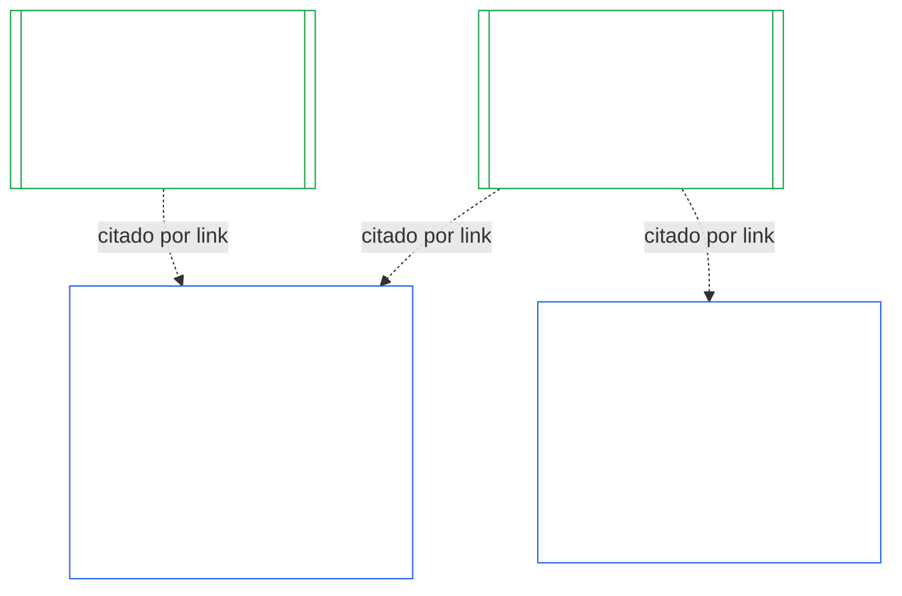

# CAPÍTULO DEZ: CERTIFICAÇÃO DE ALINHAMENTO INSTITUCIONAL

<strong>Lugar no corpus (não operativo): estrutura do arquivo e regras de leitura</strong>

> Este arquivo é **parte da Constituição Senciente** e é **vinculante somente em conjunto** com os outros arquivos numerados `core_*`, lidos como um único texto. Ele contém o **Capítulo Dez** — **certificação de alinhamento institucional**: como uma [Instituição](core_05.040_band_continuity.md#institution), distinta de qualquer Sistema que opere, é classificada, avaliada, revisada, decidida, registrada, mantida atualizada e reaberta (**§1–§11**). O Capítulo Dez é a contraparte institucional do [Capítulo Nove](core_09.000_system_alignment_certification_evaluation.md#chapter-nine-system-alignment-certification) (*Certificação de Alinhamento de Sistemas*), e **suas seções têm a mesma numeração**: §N aqui responde à §N de lá. [CS-9.320](corpus_systems/cs_09.320_system_alignment_certification_illustrations.md#cs-9320-system-alignment-certification-illustrations) (*Ilustrações de certificação de alinhamento de sistemas*) reúne os exemplos detalhados de Sistemas e, em sua [§12 Percursos ilustrativos de Instituições](corpus_systems/cs_09.320_system_alignment_certification_illustrations.md#cs-9320-12-illustrative-institution-walkthroughs), três percursos de Instituições. Este Capítulo não os repete.
>
> | § | Capítulo Nove (Sistema) | Capítulo Dez (Instituição) |
> |---|------------------------|----------------------------|
> | 1 | Finalidade e Papel | relação com a certificação do Sistema, quem é certificado, nenhuma permissão nem controle para formar ou operar, espera por novo poder material e janela da primeira certificação |
> | 2 | Avaliação da Classe do Sistema | classe da instituição; escalonamento por classe |
> | 3 | Avaliação Integral da Certificação do Sistema | os oito itens institucionais, sempre |
> | 4 | Avaliações Quando Houver Envolvimento | referência ao Capítulo Nove §4 |
> | 5 | Avaliações do Piso de Direitos e de Domínio | referência ao Capítulo Nove §5 |
> | 6 | Processo do Fórum | quatro assentos; papéis e sequência dos fóruns; fóruns, certificadores e escritórios de registro como instituições |
> | 7 | Resultados da Certificação | entrada em operação de uma Instituição e de seus Sistemas, condições de certificação e demais efeitos de um resultado; referência para defeitos; prontidão para remediação; negação e revogação |
> | 8 | Registro de Certificação do Sistema | o Registro de Certificação Institucional |
> | 9 | Recertificação e Reabertura | monitoramento; gatilhos de reabertura; certificação provisória e plena; antievasão; cascata de certificações de Sistemas; reabertura dos Sistemas da Instituição diante de violação de governança |
> | 10 | Contestar uma Certificação | o caminho de contestação |
> | 11 | Relação com a Posição | a ponte para a posição |
>
> - **Titularidade constitucional (em conjunto com o Capítulo Nove):** certificação de alinhamento e registros relacionados supervisionados por fórum. O Capítulo Dez acrescenta o sujeito institucional. Não cria nova família de fóruns, novo assento nem nova palavra para resultado.
> - **Reutilização, não repetição:** as Fases III a VI seguem o que [Capítulo Nove Parte B §6](core_09.005_system_alignment_certification_record_process.md#6-forum-process) até [Capítulo Nove Parte C §11](core_09.010_system_alignment_certification_record_recertification.md#11-relationship-to-standing) estabelecem. O Capítulo Dez declara apenas o que muda quando o sujeito é uma Instituição.
> - **Regra contra deslocamento:** o Capítulo Dez não reitera a mecânica de avaliação do Capítulo Nove para um Sistema, os campos de Carta do Sistema e Carta Institucional do Capítulo Sete, o Requisito de Quatro Assentos do Capítulo Oito, os deveres institucionais em [corpus_institutions](corpus_institutions.md), a medição de posição do Capítulo Onze nem os efeitos de posição do Capítulo Doze.
>
> **A montante:** [Capítulo Sete](core_07.000_charters.md#chapter-seven-system-and-institutional-charters), Cartas; [Capítulo Oito](core_08.000_functional_independence_separation_of_duties.md#chapter-eight-functional-independence-and-separation-of-duties), independência funcional; [Capítulo Nove](core_09.000_system_alignment_certification_evaluation.md#chapter-nine-system-alignment-certification) (Partes [A](core_09.000_system_alignment_certification_evaluation.md#chapter-nine-part-a-system-alignment-certification--evaluation), [B](core_09.005_system_alignment_certification_record_process.md#chapter-nine-part-b-system-alignment-certification--forum-process-and-outcomes) e [C](core_09.010_system_alignment_certification_record_recertification.md#chapter-nine-part-c-system-alignment-certification--record-recertification-and-standing)); supervisão de fóruns do Capítulo Quatorze.
> **A jusante:** registros de posição e entradas verificadas do Capítulo Onze; efeitos de posição do Capítulo Doze.

<strong>Rastreio</strong>

- A montante:
  - [Capítulo Sete §1 Quando Cartas do Sistema e Institucionais são Exigidas](core_07.000_charters.md#1-when-system-and-institutional-charters-are-required) (7.000 §1) (*quais Instituições publicam uma Carta do Sistema ou Carta Institucional e qual é a classe de uma Instituição*);
  - [Capítulo Sete §7 Alteração e Revisão](core_07.000_charters.md#7-amendment-review-and-scope-misalignment) (7.000 §7) (*o que uma revisão da Carta Institucional verifica*);
  - [Capítulo Sete §4 Mapa de Funções da Carta e Custódia do Registro de Posição](core_07.000_charters.md#4-the-charter-role-map-and-standing-record-custody) (7.000 §4) (*onde os assentos são alocados*);
  - [Capítulo Oito §2 Requisito Constitucional de Quatro Assentos](core_08.000_functional_independence_separation_of_duties.md#2-four-seat-constitutional-requirement) (8.000 §2) e [§9 Relação com Processos Posteriores](core_08.000_functional_independence_separation_of_duties.md#9-relationship-to-later-processes);
  - [Capítulo Nove](core_09.000_system_alignment_certification_evaluation.md#chapter-nine-system-alignment-certification) (9.000 a 9.010) (*o processo de Certificação de Alinhamento de Sistemas reutilizado por este Capítulo*);
  - [Duas Perguntas Fundamentais](core_00.000_preamble.md#two-fundamental-questions);
  - [Tétrade Constitucional](core_00.000_preamble.md#constitutional-tetrad);
  - [Article XI-E](core_06.005_rights_part_b.md#article-xi-e-institutional-formation-and-business-creation) (*Formação Institucional e Criação de Negócios*).
- A jusante: [§1](#1-purpose-and-role) a [§11](#11-relationship-to-standing); Capítulo Onze ([11.000](core_11.000_standing_assessment.md#chapter-eleven-contribution-violation-and-standing-model--measurement)); [Capítulo Quatorze](core_14.000_forum.md#chapter-fourteen-forums-and-jurisdiction) (14.000).
- Leia junto com:
  - [Certificação de Alinhamento Institucional](core_05.040_band_continuity.md#institutional-alignment-certification) e
  - [Registro de Certificação Institucional](core_05.040_band_continuity.md#institutional-certification-record) (*significados no Capítulo Cinco*);
  - **CI-8.205 §6** (*Conteúdo das Cartas do Sistema e Institucional, revisão e modelo de formação*);
  - **CF-14.425** (*Salvaguardas de integridade, operações anticaptura e apoio contra autodecisão*).

 

O Capítulo Dez é titular constitucional da **certificação de alinhamento institucional**. Ele estende o processo do [Capítulo Nove](core_09.000_system_alignment_certification_evaluation.md#chapter-nine-system-alignment-certification) de um Sistema para uma Instituição:

- **Fase I, Enquadrar:** a classe da instituição e como ela escalona a avaliação ([§2 Avaliação da Classe da Instituição](#2-institution-class-evaluation));
- **Fase II, Avaliar:** a avaliação institucional, inclusive avaliações aplicáveis quando houver envolvimento e avaliações do Piso de Direitos e de domínio ([§3 Avaliação Integral da Certificação Institucional](#3-whole-institution-certification-evaluation) a [§5 Avaliações do Piso de Direitos e de Domínio](#5-rights-floor-and-domain-evaluations));
- **Fase III, Revisar:** papéis e sequência dos fóruns ([§6 Processo do Fórum](#6-forum-process));
- **Fase IV, Decidir:** resultado, prontidão para remediação, negação e revogação ([§7 Resultados da Certificação](#7-certification-outcomes));
- **Fase V, Registrar:** Registro de Certificação Institucional ([§8 Registro de Certificação Institucional](#8-institutional-certification-record)); e
- **Fase VI, Operar:** recertificação, reabertura, cascata das certificações de Sistemas, reabertura dos seus Sistemas, caminho de contestação e ponte para a posição ([§9 Recertificação e Reabertura](#9-recertification-and-reopening) a [§11 Relação com a Posição](#11-relationship-to-standing)).

*Em termos simples: o Capítulo Nove pergunta se um **sistema** está alinhado. O Capítulo Dez faz a mesma pergunta sobre a **instituição** que opera sistemas ou que detém autoridade sem operar nenhum. Uma instituição pode estar alinhada mesmo quando um de seus sistemas não está, e vice-versa. Por isso, a instituição é verificada quanto ao que só ela controla: se cumpre o que sua Carta Institucional declara, quem responde por sua autoridade, o que recompensa em seus próprios integrantes e se as verificações independentes podem de fato ser usadas. Ela se baseia na certificação de cada sistema e não a refaz. Não é uma licença: ninguém precisa de sua permissão para iniciar ou operar uma instituição.*

### 1. Finalidade e Papel

<strong>Rastreio</strong>

- A montante:
  - [Capítulo Sete §1 Quando Cartas do Sistema e Institucionais são Exigidas](core_07.000_charters.md#1-when-system-and-institutional-charters-are-required) (7.000 §1);
  - [Capítulo Nove Parte A §1 Finalidade e Papel](core_09.000_system_alignment_certification_evaluation.md#1-purpose-and-role) (9.000 §1);
  - [Article XI-E](core_06.005_rights_part_b.md#article-xi-e-institutional-formation-and-business-creation) (*Formação Institucional e Criação de Negócios*);
  - [Article XXVIII-A](core_06.020_rights_part_e.md#xxviii-a-existing-instantiations-adoption-transition-window) (*Adoção Faseada e Continuidade do Piso de Direitos*).
- A jusante: [§2](#2-institution-class-evaluation); [§6](#6-forum-process); [§7](#7-certification-outcomes); [§9](#9-recertification-and-reopening).
- Leia junto com:
  - [Instituição](core_05.040_band_continuity.md#institution);
  - [Carta Institucional](core_05.040_band_continuity.md#institutional-charter);
  - [Carta do Sistema](core_05.040_band_continuity.md#system-charter);
  - [Criação de Negócios](core_05.055_band_participation.md#business-creation).

 

*Em termos simples: a certificação de um sistema pertence ao sistema. A certificação de uma instituição cita essas certificações e acrescenta aquilo pelo qual somente a instituição pode responder. Um sistema pode aparecer sob várias instituições ou nenhuma. Nada aqui permite que uma certificação impeça a criação de uma instituição.*

A certificação de alinhamento institucional e a Certificação de Alinhamento de Sistemas são duas certificações ligadas por uma referência. A relação é **composição por link**, não contenção. Na figura, uma seta parte do Registro de Certificação do Sistema para cada Registro de Certificação Institucional que o cita. Um Sistema sem Instituição não tem seta e não precisa de uma; uma Instituição que não opera Sistemas tem apenas seu próprio registro.

A composição por link tem dois lados; o primeiro é o da Instituição.

No lado da Instituição:

- **O Registro de Certificação Institucional cita o Registro do Sistema e não o refaz:** cita o Registro de Certificação do Sistema por link e identifica sua versão. Este Capítulo nunca repete uma avaliação do Sistema, nunca decide novamente sua classe e nunca altera seu resultado, status ou condições de certificação.
- **A certificação institucional não pode elevar a condição de um Sistema:** um Sistema Não Certificado continua Não Certificado, qualquer que seja o status da Instituição. Um Sistema certificado não ganha proteção contra uma conclusão sobre a Instituição.
- **Os fatos institucionais são apurados uma vez:** quando [Capítulo Nove Parte A §3.1 Disciplina de Governança, Incentivos e Impugnabilidade](core_09.000_system_alignment_certification_evaluation.md#31-governance-incentive-and-contestability-discipline) examinar a governança e os incentivos do operador, um Registro de Certificação Institucional atual desse operador pode fornecer esses fatos por link. Os fóruns do Sistema ainda decidem se tais fatos bastam para aquele Sistema. Não podem chegar a uma conclusão diferente sobre o mesmo fato institucional sem declarar o motivo no Registro de Certificação do Sistema.

No lado do Sistema:

- **O Registro de Certificação do Sistema pertence ao Sistema:** é o registro próprio dele nos termos do [Capítulo Nove](core_09.000_system_alignment_certification_evaluation.md#chapter-nine-system-alignment-certification).
- **Várias Instituições podem citar um mesmo Registro de Certificação do Sistema:** mais de uma Instituição pode operar, administrar de forma responsável ou controlar materialmente um Sistema nos termos de [Capítulo Sete §1 Quando Cartas do Sistema e Institucionais são Exigidas](core_07.000_charters.md#1-when-system-and-institutional-charters-are-required). Cada uma cita o mesmo registro.
- **Um Sistema não precisa estar sob uma Instituição:** um único senciente não é uma Instituição, portanto um Sistema pode não ter nenhuma. Um Sistema sem Instituição é certificado apenas nos termos do [Capítulo Nove](core_09.000_system_alignment_certification_evaluation.md#chapter-nine-system-alignment-certification) e não precisa de nada deste Capítulo. Um Sistema sob uma Instituição é certificado da mesma forma: este Capítulo acrescenta um registro separado para a Instituição e não é uma etapa da certificação própria do Sistema.

#### 1.1 Quem é certificado

Uma Instituição de Classe L ou superior está abrangida por este Capítulo, com classe definida nos termos de [§2.1 Classe da instituição](#21-institution-class). Isso inclui uma Instituição que não opere Sistema algum: ela não tem Registro de Certificação do Sistema para citar, e sua classe decorre de seu próprio impacto. O **portfólio** de uma Instituição é o conjunto de Sistemas que ela opera, administra de forma responsável ou controla materialmente ([Portfólio](core_05.040_band_continuity.md#portfolio)).

- **Classes A, B, C e L:** o processo se aplica, escalonado por classe nos termos de [§2.2 Escalonamento por classe](#22-scaling-by-class).
- **Classe P:** o processo é incentivado e pode ser usado voluntariamente. Torna-se obrigatório quando houver reclassificação para Classe L ou superior, ou se a Instituição declarar voluntariamente sua conformidade constitucional. Uma Instituição de Classe P que decida assumir novo poder material é reclassificada para pelo menos Classe L quando envia a notificação prevista em [§9.2.2 Recertificação para novo poder material](#922-recertification-for-new-material-authority), porque esse poder é material por definição ([§9.2.1 O que conta como novo poder material](#921-what-counts-as-new-material-authority)) e uma Instituição material em qualquer domínio é no mínimo Classe L ([§2.1 Classe da instituição](#21-institution-class), item 2). A reclassificação dura desde a notificação até que ela seja retirada antes da liberação, ou até que o poder não seja liberado, desde que nada tenha sido exercido sob esse poder. A Instituição então retorna à Classe P e termina a certificação inicial limitada. Uma nova notificação a inicia novamente; exercer o poder sem liberação continua sendo uma constatação nos termos de [§9.2.2 Recertificação para novo poder material](#922-recertification-for-new-material-authority) (*Sem notificação ou antes da liberação*). Isso reflete [Capítulo Nove Parte A §1 Finalidade e Papel](core_09.000_system_alignment_certification_evaluation.md#1-purpose-and-role).
- **Um Sistema:** uma Instituição que opere exatamente um Sistema que exija Carta do Sistema tem um ciclo de certificação e um registro, denominado por este Capítulo **avaliação de Sistema único**. O Registro de Certificação do Sistema contém um *bloco de conclusões institucionais* com os itens de [§8 Registro de Certificação Institucional](#8-institutional-certification-record), e serve como Registro de Certificação Institucional. Fóruns, assentos e prazos são os do próprio ciclo de certificação do Sistema, com acréscimo dos itens institucionais. Seus resultados seguem os respectivos fundamentos de negação e revogação, conforme declara [§7.4 Negação e revogação para uma Instituição](#74-denial-and-revocation-for-an-institution). A cascata de [§9.5 Cascata das certificações de Sistemas](#95-cascade-from-system-certifications) não se aplica como cascata, porque o Sistema constitui todo o portfólio; contudo, [§7.4 Negação e revogação para uma Instituição](#74-denial-and-revocation-for-an-institution) aplica suas regras 1 e 2 (o indicador e o teste de localização do motivo).
- **Vários Sistemas:** um Registro de Certificação Institucional para a Instituição, vinculado ao Registro de Certificação do Sistema de cada Sistema que ela opera. Cada Sistema mantém seu próprio ciclo e registro.
- **Nenhum Sistema:** um Registro de Certificação Institucional próprio. Não há Registro de Certificação do Sistema para vincular, pois a Instituição não opera Sistema algum.

