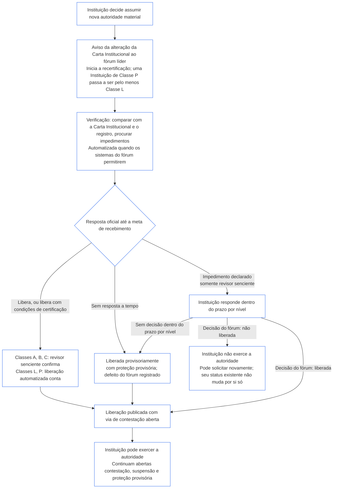

##### 9.2.2 Recertificação para nova autoridade material

Uma Instituição que decida assumir nova autoridade material deve ser recertificada e aguardar o resultado antes de exercer essa autoridade. Essa é a espera prevista no **Artigo XI-E** (*Formação Institucional e Criação de Empresas*). Ela funciona assim:

- **Primeiro, aviso:** a Instituição envia o aviso da alteração da Carta Institucional já exigido por [Capítulo Sete, §7.1 Alteração do documento](core_07.000_charters.md#71-changing-the-document) ao fórum líder. O aviso inicia a recertificação.
- **Ainda sem registro:** uma Instituição sem Registro de Certificação Institucional envia o mesmo aviso. O aviso inicia uma primeira certificação limitada à nova autoridade, avaliada em relação à Carta Institucional e às avaliações de [§3 Avaliação de Certificação de Toda a Instituição](#3-whole-institution-certification-evaluation) a [§5 Avaliações do Piso de Direitos e de Domínio](#5-rights-floor-and-domain-evaluations), na medida em que se aplicam a essa autoridade. O restante da primeira certificação continua dentro do prazo de [§1.3 Prazo para a primeira certificação](#13-window-for-the-first-certification) (para uma Instituição de Classe P reclassificada pelo aviso, prazo contado a partir do aviso), e a espera pela nova autoridade não depende disso.
- **Dentro dos prazos por nível:** a recertificação segue os prazos por nível de [Capítulo Nove, Parte C, §9.3.4 Prazos por nível](core_09.010_system_alignment_certification_record_recertification.md#934-tier-windows), presumindo-se que o nível corresponda à classe da instituição. Um prazo não cumprido é tratado conforme [Artigo XXVI-C](core_06.020_rights_part_e.md#article-xxvi-c-timely-resolution-and-anti-delay-floor) (*Piso de Resolução em Tempo e Antidemora*), e taxas e esperas não podem se tornar uma barreira ([Ônus Evitável](core_05.040_band_continuity.md#avoidable-burden)).
- **Automatizada sempre que possível:** o aviso, a comparação da nova autoridade com a Carta Institucional e o registro vigente, a verificação de impedimentos e a liberação são automatizados sempre que os sistemas do fórum permitirem. [Capítulo Um, §13.3 Minimização do Ônus Evitável](core_01.005_interaction_interpretation.md#133-minimization-of-avoidable-burden) estabelece a automação como solução preferencial para um ônus evitável, e [Capítulo Um, §16.4 Documentação no Momento do Ato](core_01.010_stewardship_capacity_principles.md#164-document-at-action) atribui o ônus da automação ao sistema, não ao administrador responsável.
  - **Libera, não recusa:** uma verificação automatizada pode liberar a nova autoridade, de forma incondicional ou com as condições de certificação já respaldadas pelo registro vigente. Por si só, não pode declarar um impedimento (um dos impedimentos listados em [§9.2.3 Impedimentos à liberação de nova autoridade material](#923-blockers-to-clearing-new-material-authority)) nem deixar de liberar. A verificação pode sinalizar um possível impedimento, mas somente um revisor senciente no fórum líder pode declará-lo, depois de examinar o que foi sinalizado.
  - **Classes A, B e C:** um revisor senciente no fórum líder confirma cada liberação antes que ela conte como resposta oficial. Isso se aplica a uma Instituição dessas classes e àquela que a nova autoridade colocaria em uma delas. A meta de recebimento continua valendo para a confirmação. O revisor integra o fórum líder, que já ocupa o assento de verificação ou autorização e deve ser independente da Instituição ([§6.1 Quatro assentos em uma certificação institucional](#61-four-seats-in-an-institutional-certification)).
  - **Classes L e P:** uma liberação automatizada conta como resposta oficial sem confirmação. Uma Instituição de Classe P é reclassificada para pelo menos Classe L ao enviar o aviso ([§1.1 Quem é certificado](#11-who-is-certified)); portanto, para ela vale a regra da Classe L.
  - **Circunstâncias excepcionais:** em qualquer classe, um revisor senciente assume o caso quando a verificação sinalizar um possível impedimento, não conseguir determinar se a autoridade está abrangida ou é material, ou quando a Instituição ou um senciente afetado solicitar revisão. O pedido de revisão é respondido dentro da [meta de recebimento correspondente](core_05.040_band_continuity.md#tier-window), contada a partir do pedido. Isso não estende o prazo por nível.
  - **Mesmo registro e mesmos prazos:** o registro mostra as verificações realizadas, de modo que uma liberação automatizada pode ser contestada como qualquer outra decisão. A automação não estende a meta de recebimento nem o prazo por nível, e uma verificação indisponível ou sem resposta conta como resposta perdida conforme o item abaixo. O fórum responde pela verificação como responde por qualquer Sistema que utilize ([§6.3 Fóruns, certificadores e escritórios de registro como instituições](#63-forums-certifiers-and-record-offices-as-institutions)).
- **A espera:** a Instituição não exerce a nova autoridade até que a recertificação a libere.
  - **Todas as classes aguardam:** nenhuma classe está isenta, e nem emergência nem urgência suspendem a espera.
  - **Todo o restante continua:** as atividades que a Instituição já exerce prosseguem ([§1.2 Nenhuma permissão e nenhuma barreira para formar ou operar](#12-no-permission-and-no-gate-on-forming-or-running)).
  - **A proteção não espera:** a proteção urgente dos sencientes afetados pelos fóruns não aguarda a recertificação ([Capítulo Nove, Parte B, §6.2 Sequência de supervisão](core_09.005_system_alignment_certification_record_process.md#62-supervisory-sequence)). Isso protege os sencientes e não constitui fundamento para a Instituição exercer a autoridade antecipadamente.
- **Publicação após a liberação:** o fórum líder publica cada liberação assim que ela é concedida, inclusive uma liberação provisória, com a via de contestação de [§10 Contestação de uma Certificação](#10-challenging-a-certification) aberta. A Instituição pode exercer a autoridade a partir da liberação. Não precisa aguardar um intervalo de aviso nem a decisão de uma contestação. Um senciente afetado pode contestar a liberação como qualquer outra decisão e solicitar suspensão ou proteção provisória, sem espera ([§9.2.2 Recertificação para nova autoridade material](#922-recertification-for-new-material-authority), *A proteção não espera*). Ao publicar, o fórum líder também avisa os sencientes afetados de que tem conhecimento e os fóruns dos Sistemas envolvidos. Um pedido de suspensão ou proteção provisória é respondido dentro da meta de recebimento correspondente ([CF-14.445 §3.1 Metas por Etapa e Limites Externos](corpus_forum/cf_14.445_performance_backlog_publication_accessibility.md#cf-14445-31-stage-targets-and-outer-bounds)), ou dentro do limite de sua configuração de Emergência, quando aplicável.
- **Presume-se liberada:** presume-se que a autoridade está liberada. O fórum líder só deixa de liberá-la quando demonstra, com provas declaradas no registro, um impedimento listado em [§9.2.3 Impedimentos à liberação de nova autoridade material](#923-blockers-to-clearing-new-material-authority). Quando condições de certificação associadas ao impedimento puderem contê-lo, a autoridade é liberada com essas condições de certificação, em vez de recusada.
- **O que significa a liberação:** a recertificação termina em certificação provisória ou plena, com ou sem condições de certificação, e todas as condições de certificação que devam ser satisfeitas antes do exercício da autoridade foram verificadas de forma independente.
- **Se o fórum não responder a tempo:** o fórum líder deve fornecer uma resposta oficial até a meta de recebimento correspondente ([CF-14.445 §3.1 Metas por Etapa e Limites Externos](corpus_forum/cf_14.445_performance_backlog_publication_accessibility.md#cf-14445-31-stage-targets-and-outer-bounds)). A resposta libera a autoridade, libera-a com condições de certificação ou declara um impedimento e as provas que o sustentam. Uma resposta que declare impedimento dá à Instituição a oportunidade de responder, e o fórum decide dentro do prazo por nível acima.
  - **Liberada provisoriamente:** se não houver resposta oficial até a meta de recebimento, ou se um impedimento declarado não for decidido dentro do prazo por nível, a autoridade fica liberada provisoriamente, com a proteção provisória e os limites de confiança previstos em [Capítulo Nove, Parte B, §7.2 Defeitos de Certificação e Correção](core_09.005_system_alignment_certification_record_process.md#72-certification-defects-and-correction).
  - **Defeito do fórum:** o descumprimento da meta ou do prazo é um defeito do fórum, não uma falha da Instituição. Ele é registrado, corrigido e analisado como extrapolação conforme [Capítulo Quatorze, §6 Resolução em tempo, níveis de materialidade e disciplina antidemora](core_14.000_forum.md#6-timely-resolution-materiality-tiers-and-anti-delay-discipline) (*Análise de extrapolação*).
  - **Transferência a outro fórum:** o pedido de recertificação é transferido a outro fórum da mesma família ([Capítulo Quatorze, §3 Transferência, consolidação e coordenação](core_14.000_forum.md#3-transfer-consolidation-and-coordination--continuity-and-anti-capture)). Esse fórum dá continuidade à recertificação nos prazos regulares da classe da Instituição, contados a partir da transferência.
- **Se não for liberada:** a Instituição não exerce a autoridade e pode solicitar novamente nos termos do Capítulo Nove, Parte B, §7.4 (*Não é impedimento permanente*). A não liberação da nova autoridade, por si só, não constitui negação ou revogação do status que a Instituição possui para suas atividades atuais. Esse status só muda com uma constatação conforme [§7.3 Prontidão para remediação para uma Instituição](#73-remediation-readiness-for-an-institution) e [§7.4 Negação e revogação para uma Instituição](#74-denial-and-revocation-for-an-institution).
- **Sem aviso ou antes da liberação:** exercer nova autoridade material sem aviso ou antes de sua liberação é atuar fora da Carta Institucional. Isso constitui uma constatação conforme [§3 Avaliação de Certificação de Toda a Instituição](#3-whole-institution-certification-evaluation) (item 1) e reabre a revisão como evento da Carta Institucional.

<strong>Guia de leitura (não operativo): a espera por nova autoridade material</strong>

Esta figura resume §9.2.2 Recertificação para nova autoridade material. Se houver divergência com o texto, prevalece o texto. Tudo o que a Instituição já faz continua durante todo o processo, e a proteção urgente dos sencientes afetados nunca espera. Exemplos práticos de Instituições estão em [CS-9.320 §12 Exemplos ilustrativos de Instituições](corpus_systems/cs_09.320_system_alignment_certification_illustrations.md#cs-9320-12-illustrative-institution-walkthroughs).

 

