<!-- AI-assisted translation draft; unreviewed; English controls.
Source: core_09.000_system_alignment_certification_evaluation.md
Source snapshot: 247e2180509e5e029c1106878cf225067339e010
Source SHA-256: 3ff6a518d3c9d6779925a1daab6ad6c53abdbdabeeaad786ffafcdd1e6ac8b80 -->

# ГЛАВА ДЕВЯТАЯ, ЧАСТЬ A: СЕРТИФИКАЦИЯ СИСТЕМНОГО СООТВЕТСТВИЯ — ОЦЕНКА

<strong>Место в корпусе (неоперативное): структура файла и правила чтения</strong>

> Этот файл **является частью Конституции сентентов** и **обязателен только вместе** с другими нумерованными файлами `core_*`, прочитанными как единый текст. Он содержит **Главу девятую, Часть A** — цель сертификации, обзор процесса и первые две фазы процесса — **Определение рамок** (класс системы) и **Оценка** (оценка системы в целом в трёх подфазах: всегда применимые оценки, включая типы данных и обращение с ними, в **§3**; оценки, применимые при наличии соответствующих обстоятельств, в **§4**; оценки Пола прав и областей, применимые при наступлении соответствующих условий, в **§5**) — **§1–§5**. Практические **иллюстрации для классов A / B / C** (профили классов систем и пошаговые примеры для §3.4, §5.1, §5.2, §5.3, §5.4, §5.5 и §5.6), включая абзац **«Сопоставление классов систем»** для каждого примера, находятся в [CS-9.320](corpus_systems/cs_09.320_system_alignment_certification_illustrations.md#cs-9320-system-alignment-certification-illustrations) (*Иллюстрации сертификации системного соответствия*) семейства систем, а не в этой главе; в каждой указано, какой раздел Части A она иллюстрирует. Обязательные правила масштабирования по классу системы и эскалации, иллюстрируемые этими абзацами, остаются в этом файле: масштабирование по классу системы, включая участие и пропорциональность, в §2.2; масштабирование обращения с данными в §3.4; и абзац **«Масштабирование по классу системы и эскалация»** в каждом из §5.1–§5.6. Файлы всей главы перечислены в таблице ниже.
>
> **Файлы Главы девятой.** Глава девятая разделена на три обязательных файла, которые читаются как единый текст. Часть A, этот файл, открывает главу; отдельного файла-указателя нет. Практические иллюстрации не входят в главу; они находятся в [CS-9.320](corpus_systems/cs_09.320_system_alignment_certification_illustrations.md#cs-9320-system-alignment-certification-illustrations) (*Иллюстрации сертификации системного соответствия*).
>
> | Часть | Файл | За что отвечает |
> |------|------|------|
> | **Часть A — Оценка** | [`core_09.000_system_alignment_certification_evaluation.md`](core_09.000_system_alignment_certification_evaluation.md) | §1–§5: цель и обзор процесса (с диаграммой всего процесса сертификации в шести фазах), **Фаза I — Определение рамок** (класс системы, масштабирование каждой оценки по классу системы и пилотная сертификация) и **Фаза II — Оценка** (оценка системы в целом в трёх подфазах: **IIa** всегда применимые оценки в §3, включая уставный охват и функциональные границы, а также типы данных и обращение с ними; **IIb** при наличии соответствующих обстоятельств, в §4; **IIc** при наступлении соответствующих условий, оценки Пола прав и областей, в §5) |
> | **Часть B — Процесс в форумах и результаты** | [`core_09.005_system_alignment_certification_record_process.md`](core_09.005_system_alignment_certification_record_process.md) | §6–§7: **Фаза III — Рассмотрение** (роли форумов, последовательность надзора и цепочка оспоримости) и **Фаза IV — Решение** (результаты сертификации, включая условие допуска к запуску) — нумерация главы продолжается после §5 Части A |
> | **Часть C — Запись, повторная сертификация и траектория** | [`core_09.010_system_alignment_certification_record_recertification.md`](core_09.010_system_alignment_certification_record_recertification.md) | §8–§11: **Фаза V — Запись** (Запись о сертификации системы и её целостность, включая определяющие поля [Хартии системы](core_05.040_band_continuity.md#system-charter)) и **Фаза VI — Эксплуатация** (повторная сертификация и повторное открытие; путь обжалования; связь с траекторией) — нумерация главы продолжается после §7 Части B |
>
> **Как связаны две сертификации.** Сертификация системного соответствия (эта глава) — сертификация системы. Сертификация соответствия учреждения ([Глава десятая](core_10.000_institutional_alignment_certification.md#chapter-ten-institutional-alignment-certification)) — сертификация учреждения, которое может управлять системами или не управлять ни одной. Глава десятая ссылается на Запись о сертификации системы каждой системы и не проводит её заново; [§1 Главы десятой](core_10.000_institutional_alignment_certification.md#1-purpose-and-role) устанавливает эту связь, а [§1.2 Главы десятой](core_10.000_institutional_alignment_certification.md#12-no-permission-and-no-gate-on-forming-or-running) указывает, что это не лицензия. Разделы имеют те же номера, что и параллельные разделы этой главы.
>
> Общие ссылки на **Главу девятую** в других файлах направляют к соответствующей части по номеру раздела.
>
> - **Конституционный владелец (совместно с Частями B и C):** сертификация **системного соответствия под надзором форума и связанные записи** — области оценки (Часть A); процесс в форумах, последовательность надзора и результаты сертификации с условием допуска к запуску (Часть B); обязанности по Записи о сертификации системы, путь обжалования, повторная сертификация и повторное открытие, а также мост проверенных входных данных к Главе одиннадцатой (всё в Части C). В рамках ноги Тетрады **надзора** SAC — один особенно крупный процесс аудита с высокими ставками среди прочих; минимальные требования к аудиту остаются в **Статье XVI** (*Аудит, прозрачность и независимая проверка*) и Главе пятой [Аудируемость](core_05.050_band_oversight.md#auditability).
> - **Владелец основы проверки:** [Глава четвёртая — Бремя доказывания, прослеживаемость и проверка](core_04.000_burden_traceability_verification.md#chapter-four-burden-of-proof-traceability-and-verification) (в рамках Глав со второй по четвёртую) отвечает за распределение бремени, доказательства соблюдения, прослеживаемость определений, наблюдаемость и проверку с учётом ограничений безопасности. Глава девятая **применяет** эту дисциплину к Записям о сертификации системы; она **не** повторяет §§**1–5** Главы четвёртой.
> - **Место аудита (не перенесено сюда):** **Статья XVI** (*Аудит, прозрачность и независимая проверка*), **Def.O1** (*Прозрачность, аудируемость и проверка*) и **CJS-5.110 §3 и CJS-5.115 §3** (*Место аудиторского процесса*)–**CJS-5.110 §5** отвечают за минимальные требования к аудиту и операционные условия. Глава девятая проводит один особенно крупный аудиторский процесс SAC, который обязан соблюдать эти требования; она не отвечает за весь аудит.
> - **Владелец реализации:** правила обращения с системами разных классов, CS-6.345 (*Жизненный цикл системы*) и подробности процессов форумов в определённых файлах реализации должны соответствовать Главе девятой и могут быть строже, если в корпусе уже предусмотрено правило [Наиболее полного защитного эффекта](core_05.045_band_integrative.md#fullest-protective-effect).
> - **Правило против переноса:** Часть A не повторяет канонические определения Главы пятой, дисциплину против уклонения Главы третьей (см. [Часть C §9.4](core_09.010_system_alignment_certification_record_recertification.md#94-non-evasion)), измерение вклада или траектории Главы одиннадцатой либо эффекты траектории Главы двенадцатой. **[Часть C §11](core_09.010_system_alignment_certification_record_recertification.md#11-relationship-to-standing)** устанавливает связь с траекторией.
>
> **Вышестоящие материалы:** определения Главы пятой; запись, проверка, бремя и прослеживаемость определений до результатов в Главах со второй по четвёртую; а также [Глава восьмая](core_08.000_functional_independence_separation_of_duties.md#chapter-eight-functional-independence-and-separation-of-duties), чьё требование разделения обязанностей регулирует каждое материально обязывающее действие по сертификации.
> **Последующие материалы:** [Часть B](core_09.005_system_alignment_certification_record_process.md#chapter-nine-part-b-system-alignment-certification--forum-process-and-outcomes) (*процесс в форумах и результаты*) и [Часть C](core_09.010_system_alignment_certification_record_recertification.md#chapter-nine-part-c-system-alignment-certification--record-recertification-and-standing) (*запись, повторная сертификация и мост к траектории*); записи о траектории и проверенные входные данные Главы одиннадцатой; эффекты траектории Главы двенадцатой; надзор форумов и пути сертификации системного соответствия Главы четырнадцатой.

 

Глава девятая, **Часть A**, является конституционным владельцем **оценки сертификации системного соответствия**.

- Надзор форумов и результаты сертификации находятся в **[Части B](core_09.005_system_alignment_certification_record_process.md#chapter-nine-part-b-system-alignment-certification--forum-process-and-outcomes)**.
- Запись, повторная сертификация и повторное открытие, а также связь с траекторией находятся в **[Части C](core_09.010_system_alignment_certification_record_recertification.md#chapter-nine-part-c-system-alignment-certification--record-recertification-and-standing)**.
- Практические иллюстрации разделов оценки находятся в **[CS-9.320 Иллюстрации сертификации системного соответствия](corpus_systems/cs_09.320_system_alignment_certification_illustrations.md#cs-9320-system-alignment-certification-illustrations)**.
- Сертификация соответствия учреждения с теми же номерами разделов находится в **[Главе десятой](core_10.000_institutional_alignment_certification.md#chapter-ten-institutional-alignment-certification)**.

### 1. Цель и роль

<strong>Трассировка</strong>

- Вышестоящие материалы:
  - [Преамбула — реестр конституционных владельцев](core_00.000_preamble.md#4-principles-definitions-and-rights) и
  - [Стек полномочий и внутренняя иерархия](core_05.045_band_integrative.md#authority-stack-and-internal-hierarchy);
  - [Конституционная тетрада](core_00.000_preamble.md#constitutional-tetrad);
  - [Две конституционные цели](core_00.000_preamble.md#two-constitutional-aims);
  - [материальная ставка](core_00.000_preamble.md#material-stake);
  - [Пропорциональность](core_05.035_band_accountability.md#proportionality) и
  - [Содержательная справедливость](core_05.055_band_participation.md#substantive-fairness) (Глава пятая); семейство измерения участия (*голос, доступ и пути оспаривания*);
  - [Глава первая §16 Ответственное управление в глубине](core_01.010_stewardship_capacity_principles.md#16-stewardship-in-depth) (1.010 §16);
  - [Глава первая §12 Требование системной оценки](core_01.000_values_principles.md#12-systemic-evaluation-requirement) (1.000 §12) (*принципиальный подход к оценке системы в целом — не рассмотрение одного угла*); Главы со второй по четвёртую;
  - [Глава пятая](core_05.000_definitions_home.md#chapter-five-foundational-definitions) (5.000) (*канонические определения*);
  - [Глава восьмая §2 Конституционное требование четырёх мест](core_08.000_functional_independence_separation_of_duties.md#2-four-seat-constitutional-requirement) (8.000 §2);
  - [Сертификация системного соответствия](core_05.040_band_continuity.md#system-alignment-certification) (канонический термин Главы пятой; необязательное сокращение **SAC**);
  - [Запись о сертификации системы](core_05.040_band_continuity.md#system-certification-record) (значение термина в Главе пятой).
- Последующие материалы:
  - [§2](#2-system-class-evaluation) (*оценка класса системы*);
  - [Часть C §10](core_09.010_system_alignment_certification_record_recertification.md#10-challenging-a-certification) (9.010 §10) (*обжалование сертификации*); и
  - [CS-9.320 §2](corpus_systems/cs_09.320_system_alignment_certification_illustrations.md#cs-9320-2-illustrative-system-class-profiles) (*Иллюстративные профили классов систем*);
  - [CS-9.320 §4](corpus_systems/cs_09.320_system_alignment_certification_illustrations.md#cs-9320-4-illustrative-whole-system-application-by-system-class) (*Иллюстративное применение оценки системы в целом по классу системы*);
  - [CS-9.320 §5](corpus_systems/cs_09.320_system_alignment_certification_illustrations.md#cs-9320-5-illustrative-data-handling-application-by-system-class) (*Иллюстративное применение правил обращения с данными по классу системы*);
  - [CS-9.320 §6](corpus_systems/cs_09.320_system_alignment_certification_illustrations.md#cs-9320-6-illustrative-ecological-footprint-application-by-system-class) (*Иллюстративное применение оценки экологического следа по классу системы*);
  - [CS-9.320 §7](corpus_systems/cs_09.320_system_alignment_certification_illustrations.md#cs-9320-7-illustrative-educational-capability-application-by-system-class) (*Иллюстративное применение оценки образовательных возможностей по классу системы*);
  - [CS-9.320 §8](corpus_systems/cs_09.320_system_alignment_certification_illustrations.md#cs-9320-8-illustrative-cross-system-support-application-by-system-class) (*Иллюстративное применение оценки межсистемной поддержки по классу системы*);
  - [CS-9.320 §9](corpus_systems/cs_09.320_system_alignment_certification_illustrations.md#cs-9320-9-illustrative-nondiscrimination-application-by-system-class) (*Иллюстративное применение оценки недискриминации по классу системы*);
  - [CS-9.320 §10](corpus_systems/cs_09.320_system_alignment_certification_illustrations.md#cs-9320-10-illustrative-accessibility-application-by-system-class) (*Иллюстративное применение оценки доступности по классу системы*);
  - [CS-9.320 §11](corpus_systems/cs_09.320_system_alignment_certification_illustrations.md#cs-9320-11-illustrative-trustworthiness-application-by-system-class) (*Иллюстративное применение оценки надёжности по классу системы*);
  - [§3](#3-whole-system-certification-evaluation) (*факторы оценки системы в целом*);
  - [§3.4](#34-data-types-and-handling-evaluation)–[§5.6](#56-trustworthiness-and-system-reliance-integrity-evaluation) (*оценки областей*);
  - [Часть B §6](core_09.005_system_alignment_certification_record_process.md#6-forum-process) (9.005 §6) (*последовательность надзора и цепочка оспоримости*);
  - [Часть B §6.1](core_09.005_system_alignment_certification_record_process.md#61-forum-supervision-and-component-roles) (9.005 §6.1) (*роли форумов в компонентах*);
  - [Часть C §8](core_09.010_system_alignment_certification_record_recertification.md#8-system-certification-record) (9.010 §8) (*содержание Записи о сертификации системы*);
  - [Часть C §8.2](core_09.010_system_alignment_certification_record_recertification.md#82-transparency-and-auditability-of-the-record) (9.010 §8.2) (*требования к целостности записи*);
  - [Часть B §7](core_09.005_system_alignment_certification_record_process.md#7-certification-outcomes) (9.005 §7) (*результаты сертификации*);
  - [Часть C §11](core_09.010_system_alignment_certification_record_recertification.md#11-relationship-to-standing) (9.010 §11) (*мост к записям о траектории*);
  - [Глава одиннадцатая](core_11.000_standing_assessment.md#chapter-eleven-contribution-violation-and-standing-model--measurement) (11.000) (*записи о траектории и шлюз проверенных входных данных*);
  - [Глава двенадцатая](core_12.000_standing_integration.md#chapter-twelve-standing-effects-and-integration) (12.000) (*эффекты траектории и интеграция*);
  - [Глава четырнадцатая](core_14.000_forum.md#chapter-fourteen-forums-and-jurisdiction) (14.000) (*надзор форумов, сертификация, сертификация соответствия и пересмотр*).
- Читать вместе с:
  - **[CS-9.305](corpus_systems/cs_09.305_system_classification_machinery.md#cs-9305-part-a-system-classification-machinery) (*Механизм классификации систем*) и [CS-9.310 — Классификации воздействия систем](corpus_systems/cs_09.310_system_impact_classifications.md#cs-9310-part-b-system-impact-classifications)**, **[CS-6.305](corpus_systems/cs_06.305_information_types_and_handling.md#cs-6305-part-a-information-types-and-handling) (*Типы информации и обращение с ней*) и [CS-6.310 — Классификации данных](corpus_systems/cs_06.310_data_classifications.md#cs-6310-part-b-data-classifications)**, а также
  - **CS-6.345** (*Жизненный цикл системы*);
  - **CF-14.415** (*Операции маршрутизации, передача, вопросы для вынесения решения и порядок представительства*) и
  - **CF-14.425** (*Защита целостности, операции против захвата и поддержка против самооценки*); **Статья XVI** (*Аудит, прозрачность и независимая проверка*) и
  - [Аудируемость](core_05.050_band_oversight.md#auditability) (*минимальные требования к аудиту — SAC является одним особенно крупным аудиторским процессом под надзором, но не единственным местом аудита*); **CJS-5.110 §3 (*Надзор: условия аудируемости и реконструируемости (приложение)*) и CJS-5.115 §3** (*Место аудиторского процесса*)–
  - **CJS-5.110 §5** (*Надзор: условия независимой проверки и целостности утверждений*).

 

*Простыми словами: если система по-настоящему важна для жизни сентентов, сертификация должна быть **пропорциональной** — настолько требовательной, насколько требуют её реальное воздействие, зависимость от неё и риск, а не единым контрольным списком или формальным одобрением. Она также должна быть **основанной на участии**: затрагиваемые сентенты и сообщества должны видеть, что проверялось, понимать принятое решение и оспаривать его, когда что-то не так. Форумы рассматривают доказательства, фиксируют их в Записи о сертификации системы и требуют повторной сертификации по графику, соответствующему риску системы. Для классов A, B и C действует полный процесс, для класса L — облегчённый. Классу P рекомендуется его применять, а обязанность возникает после переклассификации в класс L или выше (то есть когда последствия выходят за пределы частного подразделения) либо если оператор заявляет о конституционном соответствии.*

**Сертификация системного соответствия** предназначена для ответа на один вопрос в рамках указанной области и графика проверки: показала ли система достаточное конституционное соответствие для сертификации, условной сертификации, подтверждения, повторной сертификации, дальнейшего доверия, развёртывания, существенного выполнения или снятия условий сертификации?

- Сертификация — не оценка популярности, не вечной силы и не способ обойти проверку прав.
- Это ограниченное по времени и допускающее оспаривание утверждение о том, что сейчас известно о соответствии системы.
- В рамках ноги Тетрады **надзора** надзор требует аудита; сертификация системного соответствия — один особенно крупный и значимый аудиторский процесс среди прочих, а не единственное место аудита (**Статья XVI** (*Аудит, прозрачность и независимая проверка*), [Аудируемость](core_05.050_band_oversight.md#auditability)).

Сертификация реализует [Две конституционные цели](core_00.000_preamble.md#two-constitutional-aims) через [Конституционную тетраду](core_00.000_preamble.md#constitutional-tetrad):

- **[Расцвет](core_00.000_preamble.md#flourishing)** — сертификация проверяет, что сертификация или дальнейшее доверие не будет незаметно подрывать Полы прав или закрывать путь к справедливому участию в конституционно значимой жизни;
- **[Преемственность](core_00.000_preamble.md#continuity)** — сертификация проверяет устойчивое, не регрессирующее обеспечение, которое поддерживает, а не истощает здоровые природные системы ([Экологическая целостность](core_05.040_band_continuity.md#ecological-integrity), включая [Способность к экологическому восстановлению](core_05.040_band_continuity.md#ecological-recovery-capacity)), а также повторную сертификацию с учётом класса системы, если общие системы обеспечивают или поддерживают предоставление услуг;
- **Участие** — затрагиваемые сентенты и сообщества могут понять, оспорить и использовать значимые для них пути рассмотрения;
- **Надзор** — записи, доказательства и допущения достаточно прозрачны и поддаются аудиту для независимой проверки; сама сертификация является одним особенно крупным аудиторским процессом в рамках этой обязанности надзора, но не единственным;
- **Подотчётность** — дефекты, ошибочная классификация и работа, подрывающая минимальные права, направляются на устранение, условия сертификации, отзыв или используются как входные данные для траектории, если факты это обосновывают;
- **Своевременность** — сроки рассмотрения и оспаривания не позволяют сертификации устареть, пока вред ещё можно предотвратить или обратить.

#### 1.1 Сертификация как аудиторский процесс, масштабируемый по классу системы

Как механизм надзора, сертификация — один особенно крупный аудиторский процесс в рамках [Аудируемости](core_05.050_band_oversight.md#auditability) и **Статьи XVI** (*Аудит, прозрачность и независимая проверка*):

- Она проходит под надзором форумов, охватывает несколько областей и присваивает статус.
- Она может объединять результаты смежных режимов аудита, но не поглощает и не заменяет их. Каждый сохраняет собственное ответственное лицо, указанное на [карте владельцев смежных режимов аудита](corpus_joint_structure/cjs_05.115_audit_process.md#sibling-audit-modes-owner-map) в документе о месте аудиторского процесса:
  - аудит Записи о типах данных системы в рамках **CS-6.305 (*Типы информации и обращение с ней*) и CS-6.310** (*Классификации данных*);
  - аудит Записи о классификации системы в рамках **CS-9.305 (*Механизм классификации систем*) и CS-9.310** (*Классификации воздействия систем*);
  - проверки гарантий ответственного управляющего в рамках **CS-15.305** (*Ответственное управление критическими системами*);
  - непрерывный аудит в рамках **CS-6.345** (*Жизненный цикл системы*) ACA;
  - аудит сложности в рамках **CS-6.315** (*Понятность и ответственное управление сложностью*) и **Статьи XXIII-B** (*Требования к аудиту сложности и модульности*);
  - проверка утверждений в рамках **CJS-5.110 §5** (*Надзор: условия независимой проверки и целостности утверждений*).
- Каждую из этих оценок по-прежнему можно проводить отдельно, не проходя сертификацию. Сертификация их не заменяет.

Глубина сертификации, бремя ведения записей, интервал сертификации, рассмотрение заинтересованных сторон и пути оспаривания должны масштабироваться с учётом [материальной ставки](core_00.000_preamble.md#material-stake) согласно [Пропорциональности](core_05.035_band_accountability.md#proportionality):

- Для систем с более значительным воздействием, большей зависимостью от них и более высоким риском требуются более сильные доказательства, более ясные записи и более практически доступное участие — включая содержательную доступность, мнения заинтересованных сторон и пути обжалования, соразмерные тому, кто зависит от системы.
- Для систем низших классов и ограниченного охвата также требуются честная классификация и пропорциональное подтверждение; при наличии внешних последствий они не освобождаются от материальных обязанностей.

Процесс применяется по классу воздействия, как предусматривает [требование переклассификации](corpus_systems/cs_09.305_system_classification_machinery.md#35-reclassification-requirement) **CS-9.305** (*Механизм классификации систем*):

- **Классы A, B и C:** эти системы имеют наивысшие воздействие, зависимость и риск. Оценка системы в целом по [§3 Оценка сертификации системы в целом](#3-whole-system-certification-evaluation), [§4 Оценки при наличии соответствующих обстоятельств](#4-evaluations-where-implicated) и [§5 Оценки Пола прав и областей](#5-rights-floor-and-domain-evaluations), каждая в своей применимой подфазе, обязательна в полном объёме;
- **Класс L:** та же оценка обязательна, но проводится пропорционально, с более длительным стандартным интервалом сертификации и упрощёнными записями, где это допускают CS-9.305 (*Механизм классификации систем*) и CS-9.310 (*Классификации воздействия систем*); и
- **Класс P:** пока система правомерно относится к классу P, процесс рекомендуется, и система класса P может применять его добровольно. Он становится обязательным после переклассификации в класс L или выше либо если оператор добровольно заявляет о конституционном соответствии системы.

Интервал сертификации и финансовый, ресурсный или специальный аудит в его середине устанавливаются по классу системы в [Главе четырнадцатой §6 Своевременное разрешение, уровни материальности и дисциплина против задержек](core_14.000_forum.md#review-cadence) (*Периодичность проверки*). Эта глава не повторяет числовые значения.

#### 1.2 Сертификация вкратце

*Простыми словами: честно классифицируйте систему, проведите применимые оценки, поручите форумам независимо рассмотреть доказательства и опасения заинтересованных сторон и принять решение. Завершите одну запись, открытую для рассмотрения форумом, и опубликуйте её с открытым путём обжалования. Сертифицированная система запускается только после выполнения требования о сроке уведомления и необходимых защитных мер. Отслеживайте реальные результаты, реагируйте на инциденты и обжалования, проверяйте систему вновь по графику или при изменении фактов. Устраняйте дефекты, а до разрешения затронутого охвата или снятия условий сертификации добивайтесь независимой проверки исправления. В каждом цикле проверки используется новая запись, связанная с предыдущей.*

Процесс состоит из **шести фаз**: **I Определение рамок**, **II Оценка**, **III Рассмотрение**, **IV Решение**, **V Запись** и **VI Эксплуатация**. Фаза II проводится в трёх подфазах, каждая из которых образует отдельный раздел: **IIa** (всегда), **IIb** (при наличии соответствующих обстоятельств) и **IIc** (при наступлении соответствующих условий). Фаза VI проводится в двух подфазах, каждая в отдельном разделе: **VIa** (эксплуатация и повторная сертификация, [§9 Повторная сертификация и повторное открытие](core_09.010_system_alignment_certification_record_recertification.md#9-recertification-and-reopening)) и **VIb** (мост к траектории, [§11 Связь с траекторией](core_09.010_system_alignment_certification_record_recertification.md#11-relationship-to-standing)). На диаграмме показан весь процесс сертификации в этом порядке. Часть A охватывает первые две фазы — определение рамок и оценку; [Часть B](core_09.005_system_alignment_certification_record_process.md#chapter-nine-part-b-system-alignment-certification--forum-process-and-outcomes) и [Часть C](core_09.010_system_alignment_certification_record_recertification.md#chapter-nine-part-c-system-alignment-certification--record-recertification-and-standing) охватывают остальные четыре: процесс в форумах и результат с условием допуска к запуску (Часть B), затем запись и эксплуатацию (путь обжалования, повторную сертификацию и повторное открытие, а также мост к траектории) (Часть C).

Каждая применимая оценка проводится заново при каждом цикле сертификации: при первой сертификации, при каждой повторной сертификации по графику, установленному в [§2 Оценка класса системы](#2-system-class-evaluation), а также при каждом повторно открытом или новом рассмотрении. Проверка вновь открывается до следующей запланированной повторной сертификации, если изменяются материальные факты, например растёт зависимость от системы, увеличивается извлечение общих ресурсов, существенно уменьшается вклад системы в общую основу или поступает заслуживающее внимания обжалование. Триггеры перечислены в [Части C §9.2 Триггеры повторного открытия](core_09.010_system_alignment_certification_record_recertification.md#92-reopening-triggers).

```mermaid
flowchart TB
    T(["System with material impact seeks certification,<br/>or reliance on it grows"])
    C["§2 Phase I, Frame<br/>Classify honestly<br/><br/>Class sets depth and re-check schedule"]
    subgraph W["§3–§5 Phase II, Evaluate — Whole-system evaluation"]
        direction LR
        Al["§3.1–§3.4 IIa — Always<br/><br/>Governance; systemic risk: evaluated,<br/>and disclosed to those who need it;<br/>time horizon; data types"]
        Im["§4 IIb — When implicated<br/><br/>Privacy loci, exit rights,<br/>assembly and dissent"]
        Tr["§5 IIc — When triggered<br/><br/>Applicable Rights-Floor checks<br/>and six domain evaluations"]
        Al ~~~ Im ~~~ Tr
    end
    F["§6 Phase III, Review<br/>Independent review of evidence<br/>and stakeholder concerns<br/><br/>Assigned forums issue findings;<br/>challenge paths stay open"]
    Rec["§8 Phase V, Record<br/>One System Certification Record<br/><br/>Opened for forum review; completed with the outcome,<br/>supporting findings, certification conditions, and operating plan"]
    S[["Chapter Eleven — Standing<br/>records<br/><br/>Outside this chapter"]]
    O{"§7 Phase IV, Decide<br/><br/>What outcome and status<br/>does the evidence support?"}
    Fc["§7, §9.3 Full Certification<br/><br/>Required consecutive clean provisional recertifications;<br/>no current or indicated impending misalignment<br/>Full certification interval; certification conditions may apply"]
    Pc["§7, §9.3 Provisional Certification<br/><br/>First grant, recovery after misalignment,<br/>or continued or stepped-down provisional status<br/>Provisional interval, shorter; certification conditions may apply"]
    Nc["§7 Not Certified<br/><br/>Deferred, refused, withdrawn, or expired<br/>No go-live; state reasons and required corrective work"]
    Pub["§7, §10 Publish the completed record<br/><br/>Open the published record challenge path;<br/>for new or expanded scope, state go-live and notice"]
    G{"§7 Go-live gate<br/><br/>Certification and applicable<br/>go-live prerequisites satisfied?"}
    Hold["§7 Meet go-live prerequisites<br/><br/>Complete notice and independently verify<br/>certification conditions required before go-live"]
    Rm["§7, §9.3 Protect and correct<br/><br/>No new go-live in the affected scope;<br/>protect affected sentients, correct design or operation,<br/>and submit evidence for independent verification"]
    Ch["§9–§10 Phase VIa, Operate and recertify<br/>Monitor and keep challenges open<br/><br/>Operate within certified scope and certification conditions;<br/>monitor outcomes and respond to incidents and challenges"]
    S2[["Chapter Eleven — Standing<br/>records<br/><br/>Outside this chapter"]]
    Sp["&nbsp;&nbsp;&nbsp;&nbsp;&nbsp;&nbsp;&nbsp;&nbsp;&nbsp;&nbsp;&nbsp;&nbsp;&nbsp;&nbsp;&nbsp;&nbsp;&nbsp;&nbsp;&nbsp;&nbsp;&nbsp;&nbsp;&nbsp;&nbsp;&nbsp;&nbsp;&nbsp;&nbsp;&nbsp;&nbsp;&nbsp;&nbsp;&nbsp;"]
    SpL["&nbsp;&nbsp;&nbsp;&nbsp;&nbsp;&nbsp;&nbsp;&nbsp;&nbsp;&nbsp;&nbsp;&nbsp;&nbsp;&nbsp;&nbsp;&nbsp;&nbsp;&nbsp;&nbsp;&nbsp;&nbsp;&nbsp;&nbsp;&nbsp;&nbsp;&nbsp;&nbsp;&nbsp;&nbsp;&nbsp;&nbsp;&nbsp;&nbsp;&nbsp;&nbsp;"]
    SpA["&nbsp;&nbsp;&nbsp;&nbsp;&nbsp;&nbsp;&nbsp;&nbsp;&nbsp;&nbsp;&nbsp;&nbsp;&nbsp;&nbsp;&nbsp;&nbsp;&nbsp;&nbsp;&nbsp;&nbsp;&nbsp;&nbsp;&nbsp;&nbsp;&nbsp;&nbsp;&nbsp;&nbsp;&nbsp;&nbsp;&nbsp;&nbsp;&nbsp;&nbsp;&nbsp;&nbsp;&nbsp;&nbsp;&nbsp;&nbsp;&nbsp;&nbsp;&nbsp;&nbsp;&nbsp;"]
    Re["§9 Next review pass<br/><br/>Recertification, reopening, or fresh review;<br/>each pass opens a new record linked to the last"]
    T --> C
    A1((A)) --> C
    C --> W
    W --> F
    F --> O
    O --> Fc
    O --> Pc
    O --> Nc
    Fc --> Rec
    Pc --> Rec
    Nc --> Rec
    Rec -.->|VIb, §11 —<br/>verified inputs only;<br/>current certification or facts<br/>arising during certification| S
    Rec --> Pub
    Rec ~~~ Sp
    Pub --> G
    G ~~~ SpL
    G -->|Not Certified| Rm
    G --->|Yes: operate<br/>within the record| Ch
    G --->|Certified,<br/>prerequisites pending| Hold
    Hold --> G
    Ch -->|Material defect:<br/>protect and correct| Rm
    Ch -->|On schedule, or<br/>material change or<br/>credible challenge<br/>requires review| Re
    Ch -.->|VIb, §11 —<br/>verified inputs only;<br/>operation may supply facts<br/>for Contribution and<br/>Violation records| S2
    Rm -->|Correction evidence<br/>is checked in the<br/>next review pass| Re
    S2 ~~~~ SpA
    SpA ~~~ Re
    Re --> A2((A))
    style Sp fill:none,stroke:none,color:#111111
    style SpL fill:none,stroke:none,color:#111111
    style SpA fill:none,stroke:none,color:#111111
    style T fill:none,stroke:#64748b,color:#ffffff
    style C fill:none,stroke:#16a34a,color:#ffffff
    style Ch fill:none,stroke:#16a34a,color:#ffffff
    style Al fill:none,stroke:#16a34a,color:#ffffff
    style Im fill:none,stroke:#16a34a,color:#ffffff
    style Tr fill:none,stroke:#16a34a,color:#ffffff
    style F fill:none,stroke:#ea580c,color:#ffffff
    style Rec fill:none,stroke:#2563eb,color:#ffffff
    style S fill:none,stroke:#db2777,color:#ffffff
    style S2 fill:none,stroke:#db2777,color:#ffffff
    style O fill:none,stroke:#ea580c,color:#ffffff
    style Fc fill:none,stroke:#9333ea,color:#ffffff
    style Pc fill:none,stroke:#9333ea,color:#ffffff
    style Nc fill:none,stroke:#9333ea,color:#ffffff
    style G fill:none,stroke:#ea580c,color:#ffffff
    style Pub fill:none,stroke:#2563eb,color:#ffffff
    style Rm fill:none,stroke:#9333ea,color:#ffffff
    style Hold fill:none,stroke:#16a34a,color:#ffffff
    style Re fill:none,stroke:#16a34a,color:#ffffff
    style A1 fill:none,stroke:#64748b,color:#ffffff
    style A2 fill:none,stroke:#64748b,color:#ffffff
```

<strong>Руководство для читателя (неоперативное): иллюстрации, маршрутный лист и учреждения</strong>

> Иллюстративные профили **классов A**, **B** и **C** — и то, как класс системы масштабирует глубину сертификации по всей главе, — находятся в [CS-9.320 §2 Иллюстративные профили классов систем](corpus_systems/cs_09.320_system_alignment_certification_illustrations.md#cs-9320-2-illustrative-system-class-profiles). Пошаговые примеры тех же трёх систем для каждой области оценки от [§3 Оценка сертификации системы в целом](#3-whole-system-certification-evaluation) до [§5.6 Оценка надёжности и целостности доверия к системе](#56-trustworthiness-and-system-reliance-integrity-evaluation) приведены далее в [CS-9.320 Иллюстрации сертификации системного соответствия](corpus_systems/cs_09.320_system_alignment_certification_illustrations.md#cs-9320-system-alignment-certification-illustrations), где каждый профиль и пример связан с иллюстрируемым разделом Части A.
>
> Пошаговый маршрутный лист шести фаз, где каждый шаг связан с разделом, содержащим соответствующее правило, находится в [CS-9.315 §2 Маршрутный лист](corpus_systems/cs_09.315_system_alignment_certification_run_sheet.md#cs-9315-2-run-sheet) (*Маршрутный лист сертификации системного соответствия*). Если маршрутный лист расходится с разделом, применяется раздел.
>
> Три вымышленных учреждения, прошедших процедуру Главы десятой, описаны в [CS-9.320 §12 Иллюстративные разборы случаев учреждений](corpus_systems/cs_09.320_system_alignment_certification_illustrations.md#cs-9320-12-illustrative-institution-walkthroughs).
>
> Для учреждения те же шесть фаз проходят по [Главе десятой](core_10.000_institutional_alignment_certification.md#chapter-ten-institutional-alignment-certification), разделы которой имеют те же номера, что и в этой главе: Фазы I и II — от [Главы десятой §2 Оценка класса учреждения](core_10.000_institutional_alignment_certification.md#2-institution-class-evaluation) до [§5 Оценки Пола прав и областей](core_10.000_institutional_alignment_certification.md#5-rights-floor-and-domain-evaluations); Фазы III–V — от [§6 Процесс в форумах](core_10.000_institutional_alignment_certification.md#6-forum-process) до [§8 Запись о сертификации учреждения](core_10.000_institutional_alignment_certification.md#8-institutional-certification-record); Фаза VI — от [§9 Повторная сертификация и повторное открытие](core_10.000_institutional_alignment_certification.md#9-recertification-and-reopening) до [§11 Связь с траекторией](core_10.000_institutional_alignment_certification.md#11-relationship-to-standing).

 

### 2. Оценка класса системы

<strong>Трассировка</strong>

- Вышестоящие материалы:
  - [§1](#1-purpose-and-role) (*цель и роль*); интегративная материальность (
  - [Материальность](core_05.050_band_oversight.md#materiality)) (*Материальность*);
  - [Конституционная тетрада](core_00.000_preamble.md#constitutional-tetrad);
  - [Две конституционные цели](core_00.000_preamble.md#two-constitutional-aims);
  - [Материальное воздействие](core_05.050_band_oversight.md#material-impact),
  - [Зависимость](core_05.040_band_continuity.md#dependency),
  - [Риск](core_05.040_band_continuity.md#risk),
  - [Границы системы](core_05.040_band_continuity.md#system-boundaries) и
  - [Хартия системы](core_05.040_band_continuity.md#system-charter) (Глава пятая);
  - [Глава первая §12 Требование системной оценки](core_01.000_values_principles.md#12-systemic-evaluation-requirement) (1.000 §12); **Статья III-A** (*Выживание*) и **Статья IV-A** (*предоставление Пола прав, когда классификация ограничивает доступ*); **Статья V-A** (*Картирование зависимостей и прозрачность потоков ресурсов*) и **Статья V-B** (*распределение ресурсов и ответственное управление зависимостями, когда сертификация определяет доступ к общей инфраструктуре*).
- Последующие материалы:
  - [§2.1](#21-certification-recertification-and-defects) (*статус сертификации, повторная сертификация и дефекты*);
  - [§2.2](#22-how-system-class-scales-every-evaluation) (*участие и пропорциональность с учётом класса системы*);
  - [§2.3](#23-pilot-certification) (*пилотная сертификация*);
  - [CS-9.320 §2](corpus_systems/cs_09.320_system_alignment_certification_illustrations.md#cs-9320-2-illustrative-system-class-profiles) (*Иллюстративные профили классов систем*) и [CS-9.320 §3](corpus_systems/cs_09.320_system_alignment_certification_illustrations.md#cs-9320-3-reclassification) (*Переклассификация*);
  - [CS-9.320 §4](corpus_systems/cs_09.320_system_alignment_certification_illustrations.md#cs-9320-4-illustrative-whole-system-application-by-system-class) (*Иллюстративное применение оценки системы в целом по классу системы*);
  - [CS-9.320 §5](corpus_systems/cs_09.320_system_alignment_certification_illustrations.md#cs-9320-5-illustrative-data-handling-application-by-system-class) (*Иллюстративное применение правил обращения с данными по классу системы*);
  - [CS-9.320 §6](corpus_systems/cs_09.320_system_alignment_certification_illustrations.md#cs-9320-6-illustrative-ecological-footprint-application-by-system-class) (*Иллюстративное применение оценки экологического следа по классу системы*);
  - [CS-9.320 §7](corpus_systems/cs_09.320_system_alignment_certification_illustrations.md#cs-9320-7-illustrative-educational-capability-application-by-system-class) (*Иллюстративное применение оценки образовательных возможностей по классу системы*);
  - [CS-9.320 §8](corpus_systems/cs_09.320_system_alignment_certification_illustrations.md#cs-9320-8-illustrative-cross-system-support-application-by-system-class) (*Иллюстративное применение оценки межсистемной поддержки по классу системы*);
  - [CS-9.320 §9](corpus_systems/cs_09.320_system_alignment_certification_illustrations.md#cs-9320-9-illustrative-nondiscrimination-application-by-system-class) (*Иллюстративное применение оценки недискриминации по классу системы*);
  - [CS-9.320 §10](corpus_systems/cs_09.320_system_alignment_certification_illustrations.md#cs-9320-10-illustrative-accessibility-application-by-system-class) (*Иллюстративное применение оценки доступности по классу системы*);
  - [CS-9.320 §11](corpus_systems/cs_09.320_system_alignment_certification_illustrations.md#cs-9320-11-illustrative-trustworthiness-application-by-system-class) (*Иллюстративное применение оценки надёжности по классу системы*);
  - [§3.4](#34-data-types-and-handling-evaluation) (*совместная оценка обращения с данными*);
  - [§5.1](#51-ecological-footprint-evaluation) (*оценка экологического следа*);
  - [§5.3](#53-proportionate-cross-system-support-evaluation) (*оценка межсистемной поддержки*);
  - [Часть C §8.2](core_09.010_system_alignment_certification_record_recertification.md#82-transparency-and-auditability-of-the-record) (9.010 §8.2) (*целостность записи*);
  - [Часть C §11.3](core_09.010_system_alignment_certification_record_recertification.md#113-verified-input-gate) (9.010 §11.3) (*шлюз проверенных входных данных*);
  - [Часть B §7](core_09.005_system_alignment_certification_record_process.md#7-certification-outcomes) (9.005 §7) (*дрейф классификации и триггеры переклассификации*).
- Читать вместе с:
  - [Запись о классификации системы](core_05.040_band_continuity.md#system-classification-record);
  - **[CS-9.305](corpus_systems/cs_09.305_system_classification_machinery.md#cs-9305-part-a-system-classification-machinery) (*Механизм классификации систем*) и [CS-9.310 — Классификации воздействия систем](corpus_systems/cs_09.310_system_impact_classifications.md#cs-9310-part-b-system-impact-classifications)**, в том числе **
  - [CS-9.305 §3.5 Требование переклассификации](corpus_systems/cs_09.305_system_classification_machinery.md#35-reclassification-requirement)** (*триггеры, глубина оценки с учётом класса системы и мост проверки SAC*) и **
  - [CS-9.305 §7](corpus_systems/cs_09.305_system_classification_machinery.md#cs-9305-7-classification-governance-disclosure-and-challenge)** (*Управление классификацией, раскрытие информации и оспаривание*) — обязанности по управлению Записью о классификации системы и мост к SAC;
  - [CS-6.345 — Жизненный цикл системы](corpus_systems/cs_06.345_design_testing_verification_deployment.md#cs-6345-system-lifecycle);
  - [CJS-5.130 §21 — Условия устойчивости к атакам и злоупотреблениям](corpus_joint_structure/cjs_05.130_continuity_operations.md#cjs-5130-20-continuity-reversibility-and-containment-terms) (*обязанности по регрессионному циклу и укреплению защиты*);
  - **CF-14.425 §2** (*Сертификация и проверка конституционного соответствия*).

 

*Простыми словами: сертификация должна проверять, честно ли классифицирована система — не по названию, данному оператором, а по тому, что система действительно делает, от чего зависят другие и что может пойти не так. Более высокий класс системы означает более строгие требования к доказательствам, более короткие интервалы повторной сертификации и более высокие ожидания устойчивости. См. [CS-9.320 Иллюстрации сертификации системного соответствия](corpus_systems/cs_09.320_system_alignment_certification_illustrations.md#cs-9320-system-alignment-certification-illustrations): там приведён пример для каждого класса системы и показано применение оценки.*

Каждая Запись о сертификации системы с материально значимым воздействием должна включать оценку **класса системы**.

Подробные правила находятся в [CS-9.305 — Механизм классификации систем](corpus_systems/cs_09.305_system_classification_machinery.md#cs-9305-part-a-system-classification-machinery) и [CS-6.345 — Жизненный цикл системы](corpus_systems/cs_06.345_design_testing_verification_deployment.md#cs-6345-system-lifecycle). Они определяют:

- какие существуют классы систем, как присваивается класс и каковы профили классов систем;
- как управляется классификация;
- какой уровень подтверждения требуется для каждого класса систем;
- насколько устойчивой должна быть инфраструктура;
- какие проверки и записи проходят повторную сертификацию, по какому графику, учитывающему класс системы, и как этот график меняется при условной и полной сертификации.

В этом разделе изложено, что должна подтвердить сертификация:

- **Требования к оценке:**
  - соответствует ли назначенный класс системы наблюдаемым и разумно предвидимым **воздействию**, **зависимости** и **риску** согласно CS-9.305 (*Механизм классификации систем*) и CS-9.310 (*Классификации воздействия систем*), включая:
    - совокупные эффекты;
    - эффекты взаимодействия;
    - эффекты противодействия;
    - пороговые эффекты;
  - определяется ли классификация фактическим поведением и воздействием системы, а не:
    - заявленным намерением;
    - номинальным охватом;
    - только текстом [Хартии системы](core_05.040_band_continuity.md#system-charter); или
    - только самоописанием;
  - была ли переклассификация системы проведена согласно **[требованию CS-9.305 §3.5 о переклассификации](corpus_systems/cs_09.305_system_classification_machinery.md#35-reclassification-requirement)** при каждом существенном изменении, которое её требовало; и
  - показывает ли [Запись о классификации системы](core_05.040_band_continuity.md#system-classification-record) **наивысший применимый класс системы** в текущих условиях.
- **Подтверждение и регрессионное тестирование:**
  - соответствуют ли подтверждение с учётом класса системы, устойчивость инфраструктуры и охват регрессионного тестирования назначенному классу согласно:
    - CS-9.305 (*Механизм классификации систем*) и CS-9.310 (*Классификации воздействия систем*); и
    - CS-6.345 (*Жизненный цикл системы*), рассматриваемому вместе со следующими общими операционными условиями, когда они имеют материальное значение:
      - [**CJS-5.130 §19**](corpus_joint_structure/cjs_05.130_continuity_operations.md#right-to-exit-pathway-integrity-c) (*Преемственность: постепенное ухудшение и целостность режимов отказа*);
      - [**CJS-5.130 §20**](corpus_joint_structure/cjs_05.130_continuity_operations.md#transparency-disclosures-and-stakeholder-legibility-c) (*Преемственность: условия обратимости и сдерживания*);
      - [**CJS-5.130 §21**](corpus_joint_structure/cjs_05.130_continuity_operations.md#signaling-integrity-and-anti-silent-failure-controls-c) (*Преемственность: условия устойчивости к атакам и злоупотреблениям*);
      - [**CJS-5.135 §22**](corpus_joint_structure/cjs_05.135_integrative_operations.md#cjs-5135-22-integrative-constrained-secrecy-and-protected-investigation-terms) (*Интегративные условия ограниченной секретности и защищённого расследования*), если класс или функция системы делают это материально применимым; и
      - [**CJS-5.135 §23**](corpus_joint_structure/cjs_05.135_integrative_operations.md#cjs-5135-23-integrative-intervention-and-override-integrity-terms) (*Интегративные условия целостности вмешательства и переопределения*), если класс или функция системы делают это материально применимым; и
  - проводилось ли регрессионное тестирование при каждой повторной сертификации, как требует CS-6.345 (*Жизненный цикл системы*), и внесены ли его результаты в запись согласно [§8.1 Минимальное содержание записи](core_09.010_system_alignment_certification_record_recertification.md#81-minimum-record-contents).

#### 2.1 Сертификация, повторная сертификация и дефекты

В этой части изложено, что должна подтвердить сертификация в отношении статуса, повторной сертификации и дефектов:

- **Сертификация и повторная сертификация:**
  - существует ли пакет доказательств сертификации и проверки для цикла сертификации, как того требует раздел *Форумная сертификация и проверка жизненного цикла* CS-6.345 (*Жизненный цикл системы*);
  - подтверждается ли зафиксированный статус согласно [Части C §9.3 Условная и полная сертификация](core_09.010_system_alignment_certification_record_recertification.md#93-provisional-and-full-certification):
    - полная сертификация возможна только для системы, которая уже имела условную сертификацию на момент повторной проверки и выполняет все три требования:
      - она прошла достаточное число последовательных чистых повторных сертификаций с условным статусом (не менее одной, а для более высоких классов систем — больше);
      - у неё нет текущего несоответствия; и
      - наблюдаемые показатели не указывают на надвигающееся несоответствие;
    - условная сертификация применяется к системе, сертифицированной впервые, включая новую развёрнутую систему, а также к системе, сертифицированной повторно после неудачной повторной сертификации или повторно открытого рассмотрения, выявившего несоответствие; и
  - для систем, предоставляющих или обеспечивающих соблюдение базовых гарантий Пола прав:
    - система перепроверяется и повторно тестируется достаточно часто и тщательно, чтобы служить цели **Преемственности** из [Двух конституционных целей](core_00.000_preamble.md#two-constitutional-aims) и обеспечивать длительное предоставление сентентам необходимого; и
    - устаревшая или выданная слишком рано сертификация никогда не считается доказательством того, что сентенты сегодня получают пищу, воду, жильё, образование или безопасность.
- **Ошибочная классификация и дефекты:**
  - дефекты сертификации согласно CS-9.305 (*Механизм классификации систем*), CS-9.310 (*Классификации воздействия систем*) и [Части B §7](core_09.005_system_alignment_certification_record_process.md#7-certification-outcomes), а не мелкие ошибки в документах, включают:
    - отнесение системы к классу риска ниже заслуженного;
    - разделение системы на части, чтобы обойти более строгие правила; или
    - сохранение устаревшей отметки о классе системы после изменения условий, включая отсутствие повторной оценки согласно **[требованию CS-9.305 §3.5 о переклассификации](corpus_systems/cs_09.305_system_classification_machinery.md#35-reclassification-requirement)**;
  - дефекты сертификации согласно CS-6.345 (*Жизненный цикл системы*) включают:
    - пропуск регрессионных тестов;
    - опору на устаревшие результаты;
    - отсутствие исправления известных нарушений; или
    - принятие существенных исправлений без повторного тестирования, если оно было практически осуществимо; и
  - если система сертифицирована и факты это подтверждают, те же проблемы классификации могут также учитываться при неблагоприятных выводах о траектории в [Главе одиннадцатой](core_11.000_standing_assessment.md#chapter-eleven-contribution-violation-and-standing-model--measurement).

Последствия этих дефектов установлены в [§7 Результаты сертификации](core_09.005_system_alignment_certification_record_process.md#7-certification-outcomes).

#### 2.2 Как класс системы масштабирует каждую оценку

Класс системы определяет глубину каждой оценки в этой главе — факторов оценки системы в целом в [§3 Оценка сертификации системы в целом](#3-whole-system-certification-evaluation), обращения с данными в [§3.4 Оценка типов данных и обращения с ними](#34-data-types-and-handling-evaluation), каждой оценки Пола прав и областей в [§5 Оценки Пола прав и областей](#5-rights-floor-and-domain-evaluations), — а также частоту повторения:

- Для систем более высокого класса требуются соразмерно более убедительные доказательства того, что каждая применимая оценка действительно проведена, а не просто заявлена. Ни один класс системы не может ограничиваться удостоверениями, ярлыками или мерами приспособления, существующими лишь на бумаге, либо оценками и решениями, которые невозможно проверить.
- Для систем низших классов также требуется честная, соразмерная оценка при каждом применимом триггере.
- Класс системы никогда не позволяет пропускать обязательную оценку. Систему, чья реальная роль превысила её класс, необходимо переклассифицировать и оценить на более высоком уровне глубины. Рост масштаба, охвата или внедрения, а также усиление, расширение или усложнение замены зависимости являются триггерами пересмотра согласно **[CS-9.305 §3](corpus_systems/cs_09.305_system_classification_machinery.md#35-reclassification-requirement)** (*Требование переклассификации*) и приводят к повторному открытию проверки по [§9.2 Триггеры повторного открытия](core_09.010_system_alignment_certification_record_recertification.md#92-reopening-triggers). Концентрация выше порога, установленного принимающим документом по [Главе первой §11.4 Концентрация ресурсов и зависимостей](core_01.000_values_principles.md#114-resource-and-dependency-concentration-adopter-tunable), служит дополнительным доказательством такого роста. Повторная оценка не ждёт превышения порога, а неустановленный или завышенный порог её не задерживает.

Требования к участию и пропорциональности масштабируются так же:

- Для систем **класса A** необходимы максимально эффективные на практике пути участия, поскольку ошибки могут лишить доступа к предметам первой необходимости до того, как станет возможным средство защиты. Они включают:
  - доступное обжалование;
  - рассмотрение заинтересованными сторонами; и
  - выводы семейства форумов, назначенного для затронутой материальной ставки согласно [Части B §6.1 Надзор форумов и роли компонентов](core_09.005_system_alignment_certification_record_process.md#61-forum-supervision-and-component-roles), включая институциональные или сентент-форумы, как требует этот раздел.
- Для систем **класса B** требуется надёжное участие, если система контролирует доступ к:
  - медицинской помощи;
  - образованию;
  - пособиям;
  - работе; или
  - сопоставимым аспектам повседневной жизни.
- Для систем **класса C** по-прежнему требуются оспоримые записи и пропорциональное раскрытие информации, особенно если последствия координации:
  - создают более тяжёлое бремя для защищённых групп;
  - приводят к зависимости множества сентентов от одной системы; или
  - указывают на возможный скорый переход системы в класс B или A.

#### 2.3 Пилотная сертификация

**[Пилот](core_05.040_band_continuity.md#pilot)** является [запуском](core_05.040_band_continuity.md#go-live), поэтому перед началом ему нужна собственная сертификация согласно правилу запуска в [Части B §7.1 Условие допуска к запуску](core_09.005_system_alignment_certification_record_process.md#71-go-live-gate).

- Ожидается, что система любого класса проведёт пилот до полного развёртывания; система, не прошедшая его, документирует причину.
- Пилот также требует честной классификации и каждой оценки, для которой наступил триггер; его охват, совокупность участников и срок указываются в записи.
- Он оценивается по собственной записи, на глубине, соответствующей классу системы и возможности её замены: существует ли для затрагиваемых сентентов или тех, кто будет от неё зависеть, жизнеспособная альтернатива и какой ценой, задержкой и потерей функциональности (см. [Зависимость](core_05.040_band_continuity.md#dependency)).
  - Чем проще заменить систему и чем ниже её класс, тем легче может быть оценка пилота.
  - Пилот системы, которую трудно заменить, оценивается на глубине, требуемой её классом при полном развёртывании.

### 3. Оценка сертификации системы в целом

<strong>Трассировка</strong>

- Вышестоящие материалы:
  - [Глава первая §12 Требование системной оценки](core_01.000_values_principles.md#12-systemic-evaluation-requirement) (1.000 §12); семейство измерения Расцвета (*благополучие, безопасность, вред и доступ к минимуму для выживания*); семейство измерения конституционных показателей (*конституционная эффективность, предотвращаемое бремя и производственная способность*);
  - [Конституционная тетрада](core_00.000_preamble.md#constitutional-tetrad);
  - [Две конституционные цели](core_00.000_preamble.md#two-constitutional-aims);
  - [материальная ставка](core_00.000_preamble.md#material-stake);
  - [§1 Цель и роль](#1-purpose-and-role).
- Последующие материалы:
  - [CS-9.320 §4](corpus_systems/cs_09.320_system_alignment_certification_illustrations.md#cs-9320-4-illustrative-whole-system-application-by-system-class) (*Иллюстративное применение оценки системы в целом по классу системы*);
  - [§3.4](#34-data-types-and-handling-evaluation)–
  - [§5.6](#56-trustworthiness-and-system-reliance-integrity-evaluation) (*оценки областей*);
  - [CS-9.320 §2](corpus_systems/cs_09.320_system_alignment_certification_illustrations.md#cs-9320-2-illustrative-system-class-profiles) (*Иллюстративные профили классов систем*);
  - [Часть C §8](core_09.010_system_alignment_certification_record_recertification.md#8-system-certification-record) (9.010 §8) (*содержание записи*);
  - [Часть C §8.2](core_09.010_system_alignment_certification_record_recertification.md#82-transparency-and-auditability-of-the-record) (9.010 §8.2) (*целостность записи*);
  - [Часть B §6](core_09.005_system_alignment_certification_record_process.md#6-forum-process) (9.005 §6) (*цепочка оспоримости*);
  - [Часть B §7](core_09.005_system_alignment_certification_record_process.md#7-certification-outcomes) (9.005 §7) (*результаты сертификации*).
- Читать вместе с:
  - [Глава первая §16](core_01.010_stewardship_capacity_principles.md#16-stewardship-in-depth) (1.010 §16),
  - [§18](core_01.010_stewardship_capacity_principles.md#18-governance-under-stewardship-discipline) и
  - [§19](core_01.010_stewardship_capacity_principles.md#19-incentive-alignment-and-system-capture);
  - [Глава первая §7.4 Добровольное прекращение, серьёзное самоизменение и право выхода](core_01.000_values_principles.md#74-voluntary-discontinuation-and-exit-rights) (1.000 §7.4);
  - [Глава первая §7.2 Собрания, коллективная организация и создание учреждений](core_01.000_values_principles.md#72-assembly-collective-organization-and-institutional-formation) (1.000 §7.2); **Статья XVI** (*Аудит, прозрачность и независимая проверка*), если минимальные требования к аудиту, прозрачности или независимой проверке материально затронуты; семейство измерения Преемственности (
  - [§3.2](#32-systemic-scope-and-risk-factors) — устойчивость, обратимость и системный риск);
  - [Оценка риска](core_05.040_band_continuity.md#risk-evaluation);
  - [Раскрытие риска](core_05.050_band_oversight.md#risk-disclosure);
  - [Минимальный уровень раскрытия для общественного надзора](core_05.050_band_oversight.md#public-oversight-baseline-disclosure); семейство измерения Участия (
  - [§4.1](#41-privacy-informational-joint-invocation) — конфиденциальность и ответственное управление данными); семейство измерения Подотчётности (
  - [§3.1](#31-governance-incentive-and-contestability-discipline) — согласование стимулов и рыночная оспоримость);
  - [Границы системы](core_05.040_band_continuity.md#system-boundaries);
  - [Хартия системы](core_05.040_band_continuity.md#system-charter).
- Подразделы:
  - [§3.1](#31-governance-incentive-and-contestability-discipline)–[§3.4](#34-data-types-and-handling-evaluation) (*всегда применимо: управление, системные факторы, временной горизонт, типы данных и обращение с ними*). Фаза II продолжается в
  - [§4 Оценки при наличии соответствующих обстоятельств](#4-evaluations-where-implicated) (*когда применимы: аспекты конфиденциальности, право выхода, собрания и несогласие*) и
  - [§5 Оценки Пола прав и областей](#5-rights-floor-and-domain-evaluations) (*при наступлении триггера*).

 

*Простыми словами: нельзя одобрить одну часть системы и проигнорировать остальное. Проверяющим нужна полная картина: от чего система зависит, что сломается при отказе вышестоящего компонента, какой вред проявится позже или накопится со временем, могут ли сентенты действительно ею пользоваться (а не только на бумаге), надёжно ли изолирована личная информация, могут ли сентенты уйти, не оказавшись в ловушке, могут ли группы продолжать самоорганизацию без раскола со стороны системы, не скрывают ли краткосрочные успехи долгосрочный ущерб и будут ли надзор и подотчётность работать, когда на кону многое.*

*Практические примеры: [CS-9.320 §4 Иллюстративное применение оценки системы в целом по классу системы](corpus_systems/cs_09.320_system_alignment_certification_illustrations.md#cs-9320-4-illustrative-whole-system-application-by-system-class) показывает применение этого раздела. В нём рассматриваются три системы-примера, по одной для каждого класса, и показано, как каждая проходит приведённые выше оценки.*

Оценка сертификации должна подтвердить, что [Конституционная тетрада](core_00.000_preamble.md#constitutional-tetrad) (Участие, Надзор, Подотчётность и Своевременность) достаточно сильна, чтобы соответствовать [материальной ставке](core_00.000_preamble.md#material-stake) рассматриваемой системы.

Записи о сертификации системы должны показывать, что оценка учитывала каждый фактор этого раздела, [§4 Оценок при наличии соответствующих обстоятельств](#4-evaluations-where-implicated) и [§5 Оценок Пола прав и областей](#5-rights-floor-and-domain-evaluations), если он материально важен для любого из следующего:

- сертификации;
- подтверждения;
- повторной сертификации;
- дальнейшего доверия;
- развёртывания; или
- снятия условия сертификации.

Оценки только непосредственных или локальных последствий системы недостаточно. Фаза II — оценка системы в целом — закрывает этот пробел в трёх частях, указанных в таблице ниже. Этот раздел охватывает **IIa**. [§4 Оценки при наличии соответствующих обстоятельств](#4-evaluations-where-implicated) охватывает **IIb**, а [§5 Оценки Пола прав и областей](#5-rights-floor-and-domain-evaluations) — **IIc**. Таблица служит только ориентиром и не меняет требований разделов.

| Когда | Подфаза | Разделы | Применимость |
|------|-----------|----------|---------|
| **Всегда** | IIa | [§3.1 Управление, стимулы и дисциплина оспоримости](#31-governance-incentive-and-contestability-discipline); [§3.2 Системный охват и факторы риска](#32-systemic-scope-and-risk-factors); [§3.3 Ограничение временной согласованности](#33-time-consistency-constraint); [§3.4 Оценка типов данных и обращения с ними](#34-data-types-and-handling-evaluation) | каждая запись о сертификации системы с материальным воздействием |
| **При наличии соответствующих обстоятельств** | IIb | [§4.1 Совместное применение конфиденциальности (информационной)](#41-privacy-informational-joint-invocation); [§4.2 Добровольное прекращение, серьёзное самоизменение и право выхода](#42-voluntary-discontinuation-major-self-modification-and-exit-rights); [§4.3 Собрания, коллективная организация и создание учреждений](#43-assembly-collective-organization-and-institutional-formation), включая [§4.3.1](#431-dissent-and-peaceful-protest) | если предмет сертификации материально затрагивает названную в подразделе область или принцип |
| **При наступлении триггера** | IIc | [§5 Оценки Пола прав и областей](#5-rights-floor-and-domain-evaluations) | если выполнен триггер из таблицы §5 |

#### 3.1 Дисциплина управления, стимулов и оспоримости

*Простыми словами: рассмотрение не завершено, пока проверяющие не выяснят, выдержат ли четыре ноги [Тетрады](core_00.000_preamble.md#constitutional-tetrad) уровень сопряжённого риска: участие (могут ли сентенты действительно участвовать), надзор (можно ли наблюдать за работой и проверять её), подотчётность (можно ли привлечь к ответу за нарушения) и своевременность (достаточно ли быстро принимаются важные решения). Проверяющим также нужно знать, кто фактически обладает материальными полномочиями и кто за что отвечает, — а не слышать расплывчатое «команда» или видеть оболочку, перекладывающую вину. Для действительной сертификации на эти вопросы необходимо ответить.*

Оценка сертификации неполна, если не проверяет, будут ли каждый из следующих элементов соответствовать масштабированию по [материальной ставке](core_00.000_preamble.md#material-stake) рассматриваемой системы:

- **надзор**;
- **подотчётность**;
- **участие**; и
- **своевременность**.

Оценка также должна проверять, достаточно ли **формально назначены, задокументированы и прослеживаемы** следующие виды материально значимых ролей, чтобы сентенты могли понять, кто отвечает, и действительно оспаривать решения:

- роли ответственного управления;
- роли управления; и
- роли подотчётности.

Эти требования масштабируются с учётом класса системы и материального воздействия согласно **[CS-9.305](corpus_systems/cs_09.305_system_classification_machinery.md#cs-9305-part-a-system-classification-machinery) (*Механизм классификации систем*) и [CS-9.310 — Классификации воздействия систем](corpus_systems/cs_09.310_system_impact_classifications.md#cs-9310-part-b-system-impact-classifications)**. Класс системы также задаёт график повторной проверки ([§2 Оценка класса системы](#2-system-class-evaluation)).

Для оценки управления, стимулов и оспоримости сертификация должна применять следующее:

- **[Глава первая §16 Ответственное управление в глубине](core_01.010_stewardship_capacity_principles.md#16-stewardship-in-depth)** — распределённое понимание, прозрачность, аудируемость и наблюдаемость, допускающая оспаривание;
- **[Глава первая §18 Управление в рамках дисциплины ответственного управления](core_01.010_stewardship_capacity_principles.md#18-governance-under-stewardship-discipline)** — уполномоченное управление и обязанность отвечать;
- **[Глава первая §19 Согласование стимулов и захват системы](core_01.010_stewardship_capacity_principles.md#19-incentive-alignment-and-system-capture)** — целостность прокси-показателей, исправление дефектов краткосрочного горизонта и противодействие захвату, включая:
  - **[Глава первая §19.1.4 Пути глубины роли и материальной ответственности](core_01.010_stewardship_capacity_principles.md#1914-role-depth-and-material-responsibility-pathways)** — роли с реальными последствиями и меры защиты от символического участия;
- **[Глава пятнадцатая §5 Уполномоченные роли, развитие компетенций и вклад](core_15.000_governance.md#5-authorized-roles-competency-development-and-contribution)** и **[CS-15.305 — Ответственное управление критическими системами](corpus_systems/cs_15.305_critical_system_stewardship.md#cs-15305-critical-system-stewardship)** — применимые требования к определениям рабочих ролей, компетентности и прослеживаемости;
- **[Статья XVI: Аудит, прозрачность и независимая проверка](core_06.010_rights_part_c.md#article-xvi-audit-transparency-and-independent-verification)**, если минимальные требования Пола прав к аудиту, прозрачности или независимой проверке материально затронуты.

**Факты об учреждении.** В этом разделе рассматриваются управление и стимулы оператора или ответственного управляющего системой. Если оператор или управляющий является [учреждением](core_05.040_band_continuity.md#institution), эти факты устанавливаются один раз в его Записи о сертификации учреждения, а не заново для каждой системы, которой оно управляет. Следующие факты об учреждении можно принять по ссылке из его действующей записи согласно [Главе десятой §3 Оценка сертификации учреждения в целом](core_10.000_institutional_alignment_certification.md#3-whole-institution-certification-evaluation):

- его собственное управление;
- должности, несущие подотчётность; и
- системы вознаграждения.

Глава десятая не принимает эти факты на слово учреждения. Она проверяет их по доказательствам и наблюдаемой работе, а каждый вывод указывает, на чём основан. Если действующей Записи о сертификации учреждения нет, эти факты оцениваются непосредственно в этом разделе.

По этим фактам форумы данной системы:

- по-прежнему решают, достаточны ли они для этой системы; и
- не вправе по-разному устанавливать один и тот же факт об учреждении, не указав причину в Записи о сертификации системы.

Управление, стимулы и оспоримость самой системы по-прежнему оцениваются здесь. См. [Главу десятую §1 Цель и роль](core_10.000_institutional_alignment_certification.md#1-purpose-and-role).

**Публикация как данные типа O.** Информация, установленная этим разделом, является данными сертификации и для всех классов систем относится к **типу O** согласно [CS-6.310 Часть B §9.3 Тип O](corpus_systems/cs_06.310_data_classifications.md#93-type-o-open-public-oversight-baseline-disclosure-data). Это не закрытый вывод. К таким данным относятся:

- оценка надзора, подотчётности, участия и своевременности;
- назначенные роли ответственного управления, управления и подотчётности, а также сведения о том, кто обладает материальными полномочиями и за что отвечает; и
- использованные факты об учреждении, включая его управление, должности, несущие подотчётность, и системы вознаграждения.

Данные публикуются через [Запись о сертификации системы](core_05.040_band_continuity.md#system-certification-record) с точностью, достаточной для общественного базового уровня, с учётом правил замены и удержания информации из **[CS-6.305 §7 Базовый уровень типа O](corpus_systems/cs_06.305_information_types_and_handling.md#cs-6305-7-type-o-baseline-for-class-abc-systems)**. Для систем **классов A, B и C** они также входят в [Минимальный уровень раскрытия для общественного надзора](core_05.050_band_oversight.md#public-oversight-baseline-disclosure), а [§3.4.1 Базовое раскрытие типа O](#341-type-o-baseline-disclosure) проверяет, что публикация действительно состоялась.

Для систем **классов L и P** полный Минимальный уровень раскрытия для общественного надзора не применяется, однако эти данные сертификации всё равно относятся к **типу O**. Уровень детализации определяется обязанностью прозрачности для класса системы согласно [CS-9.310 §8.6 Интенсивность обязанностей с учётом масштаба](corpus_systems/cs_09.310_system_impact_classifications.md#86-scaled-duties-intensity). Если систему класса L или P переклассифицируют в класс C или выше, полный базовый уровень применяется с момента переклассификации.

#### 3.2 Системный охват и факторы риска

При оценке сертификации необходимо учитывать:

- **Вред в наибольших масштабах:**
  - **способность к экологическому восстановлению** — может ли система повредить [Способность к экологическому восстановлению](core_05.040_band_continuity.md#ecological-recovery-capacity) любой естественной экосистемы в любом масштабе так, что она перестанет восстанавливаться после ущерба;
  - **экзистенциальные риски** — последствия, способные угрожать выживанию сентентов на уровне цивилизации;
- **Распространение и накопление эффектов:**
  - **отношения зависимости и каскадные эффекты** — что откажет на нижних уровнях при поломке чего-либо выше;
  - **эффекты агрегирования и масштаба** — что меняется при объединении множества мелких действий;
  - **отсроченные, совокупные и вероятностные воздействия** — вред, который проявляется позднее, накапливается или зависит от случайности;
- **Возможность неправильного использования системы или неверного определения её охвата:**
  - **условия противодействия и потенциал неправильного использования** — как злоумышленники или предсказуемое злоупотребление могут использовать систему;
  - **уставный охват и функциональные границы** — соответствует ли определяющая [Хартия системы](core_05.040_band_continuity.md#system-charter), если она существует или обязательна, наблюдаемым [Границам системы](core_05.040_band_continuity.md#system-boundaries), и не занижает ли заявленный охват материальное воздействие или зависимость.

##### 3.2.1 Оценка риска и мост к раскрытию

Если системный [Риск](core_05.040_band_continuity.md#risk) входит в охват по указанным выше факторам, сертификация должна проверять обе части пары из Главы пятой — не создавать отдельный вид записи с названием «раскрытие рисков»:

- **[Оценка риска](core_05.040_band_continuity.md#risk-evaluation)** — была ли системная оценка риска действительно проведена:
  - в значимых условиях (зависимости, временные горизонты и [условия противодействия, масштаба и эксплуатации](core_05.050_band_oversight.md#adversarial-scaled-and-exploited-conditions)); и
  - на уровне, соразмерном классу системы и [материальной ставке](core_00.000_preamble.md#material-stake).
- **[Раскрытие риска](core_05.050_band_oversight.md#risk-disclosure)** — дошёл ли оценённый риск:
  - до сентентов, которым он необходим; и
  - вовремя, чтобы они могли понять его, оспорить и принять меры.

##### 3.2.2 Дефекты и несоответствие

Выполнение только одной из двух перечисленных частей означает провал:

- оценённый, но не раскрытый риск не проходит проверку; и
- раскрытый, но не оценённый должным образом риск не проходит проверку.

Внутренняя записка, спрятанное приложение, контрольный список или заявление задним числом не считаются ни оценкой риска, ни его раскрытием.

Каждое из следующего должно считаться дефектом сертификации:

- нераскрытие оценённого системного риска тем, кому он необходим, если этого требует [Прозрачность](core_05.050_band_oversight.md#transparency) или [Безопасность (конституционное ограничение)](core_05.040_band_continuity.md#safety-constitutional-constraint); или
- одобрение дальнейшего доверия к системе при том, что известные риски не задокументированы, не раскрыты и не устранены.

Последствия установлены в [§7 Результаты сертификации](core_09.005_system_alignment_certification_record_process.md#7-certification-outcomes).

#### 3.3 Ограничение временной согласованности

Сертификация не может считать достаточным что-либо из следующего, если предвидимые нарушения в среднесрочной или долгосрочной перспективе остаются без внимания:

- краткосрочные показатели;
- соблюдение требований на локальном уровне; или
- эффективность на коротком горизонте.

Стремление к краткосрочному результату неприемлемо, если можно обоснованно ожидать, что впоследствии оно разрушит что-либо из следующего, даже если ущерб накапливается медленно, проявляется поздно или распространяется между разными системами:

- **Безопасность**;
- **Истина**; или
- **благополучие**.

#### 3.4 Оценка типов данных и обращения с ними

<strong>Трассировка</strong>

- Вышестоящие материалы:
  - [§3](#3-whole-system-certification-evaluation) (*факторы оценки системы в целом*);
  - [CS-9.320 §4](corpus_systems/cs_09.320_system_alignment_certification_illustrations.md#cs-9320-4-illustrative-whole-system-application-by-system-class) (*Иллюстративное применение оценки системы в целом по классу системы*);
  - [Часть C §8](core_09.010_system_alignment_certification_record_recertification.md#8-system-certification-record) (9.010 §8) (*содержание записи*);
  - [§2](#2-system-class-evaluation) (*оценка класса системы*); семейство измерения надзора (*Истина и эпистемическая целостность как конституционное измерение*);
  - [Статья XV: Целостность инфосферы](core_06.010_rights_part_c.md#article-xv-info-sphere-integrity);
  - [Статья XVI: Аудит, прозрачность и независимая проверка](core_06.010_rights_part_c.md#article-xvi-audit-transparency-and-independent-verification);
  - [Статья VII: Самовладение](core_06.005_rights_part_b.md#article-vii-self-ownership).
- Последующие материалы:
  - [CS-9.320 §5](corpus_systems/cs_09.320_system_alignment_certification_illustrations.md#cs-9320-5-illustrative-data-handling-application-by-system-class) (*Иллюстративное применение правил обращения с данными по классу системы*);
  - [§5.1](#51-ecological-footprint-evaluation) и
  - [CS-9.320 §6](corpus_systems/cs_09.320_system_alignment_certification_illustrations.md#cs-9320-6-illustrative-ecological-footprint-application-by-system-class) (*Иллюстративное применение оценки экологического следа по классу системы*);
  - [Часть C §8.2](core_09.010_system_alignment_certification_record_recertification.md#82-transparency-and-auditability-of-the-record) (9.010 §8.2) (*целостность записи*);
  - [Часть C §11.3](core_09.010_system_alignment_certification_record_recertification.md#113-verified-input-gate) (9.010 §11.3) (*шлюз проверенных входных данных*);
  - [Часть B §7](core_09.005_system_alignment_certification_record_process.md#7-certification-outcomes) (9.005 §7) (*переклассификация и несоответствие в обращении с данными*).
- Читать вместе с:
  - **[CS-6.305](corpus_systems/cs_06.305_information_types_and_handling.md#cs-6305-part-a-information-types-and-handling) (*Типы информации и обращение с ней*) и [CS-6.310 — Классификации данных](corpus_systems/cs_06.310_data_classifications.md#cs-6310-part-b-data-classifications)** (включая **
  - [CS-6.305 §5.2](corpus_systems/cs_06.305_information_types_and_handling.md#52-reclassification-and-lifecycle-governance)** (*Переклассификация и управление жизненным циклом*) и **
  - [CS-6.305 §8](corpus_systems/cs_06.305_information_types_and_handling.md#cs-6305-8-system-data-types-record-governance)** (*Управление Записью о типах данных системы*));
  - [Запись о типах данных системы](core_05.040_band_continuity.md#system-data-types-record);
  - [Минимальный уровень раскрытия для общественного надзора](core_05.050_band_oversight.md#public-oversight-baseline-disclosure);
  - **CJS-5.130 §18** (*условия хранения данных и целостности жизненного цикла*),
  - **CJS-5.130 §21** (*условия устойчивости к атакам и злоупотреблениям*) и
  - **CJS-5.130 §17** (*условия совместимости, переносимости и целостности выхода*), если они имеют материальное значение;
  - [§4.1 Совместное применение конфиденциальности (информационной)](#41-privacy-informational-joint-invocation), если затронут аспект конфиденциальности.
- Подразделы:
  - [§3.4.1](#341-type-o-baseline-disclosure) (*базовое раскрытие типа O*);
  - [§3.4.2](#342-privacy-discipline) (*дисциплина конфиденциальности*);
  - [§3.4.3](#343-protective-storage-and-key-custody) (*защитное хранение и контроль ключей*);
  - [§3.4.4](#344-scheduled-data-type-re-evaluation) (*плановая повторная оценка типов данных*);
  - [§3.4.5](#345-system-class-scaled-infrastructure-assurance) (*подтверждение инфраструктуры с учётом класса системы*);
  - [§3.4.6](#346-infrastructure-robustness-for-data) (*устойчивость инфраструктуры для данных*);
  - [§3.4.7](#347-defects-and-misalignment) (*дефекты и несоответствие*);
  - [CS-9.320 §5](corpus_systems/cs_09.320_system_alignment_certification_illustrations.md#cs-9320-5-illustrative-data-handling-application-by-system-class) (*Иллюстративное применение правил обращения с данными по классу системы*).

 

*Простыми словами: сертификация должна также проверять, с какими типами данных соприкасается система и обращается ли с ними должным образом, в том числе правильно ли они классифицированы в текущем цикле проверки и достаточно ли надёжна базовая инфраструктура для этих данных и класса системы. Правила типов и Запись о типах данных системы находятся в корпусе систем; сертификация проверяет, были ли правила действительно применены и является ли запись достоверной.*

Сертификация системного соответствия должна оценивать **типы данных и обращение с ними** в каждой Записи о сертификации системы с материальным воздействием. В этом разделе указано, что обязана проверить сертификация. Таксономия типов и механизмы обращения находятся в **[CS-6.305](corpus_systems/cs_06.305_information_types_and_handling.md#cs-6305-part-a-information-types-and-handling) (*Типы информации и обращение с ней*) и [CS-6.310 — Классификации данных](corpus_systems/cs_06.310_data_classifications.md#cs-6310-part-b-data-classifications)**, вместе со следующими материалами:

- канонические определения типов информации;
- правила обращения и требования к разделению;
- подробности жизненного цикла; и
- долговременная [Запись о типах данных системы](core_05.040_band_continuity.md#system-data-types-record).

**Требование к оценке.** Процесс сертификации должен определить, делает ли система следующее:

- выявляет ли типы данных, материально входящие в её охват; и
- обращается ли с ними согласно **наиболее строгой применимой** классификации, в том числе при преобразовании, агрегировании, делегировании, хранении, удержании и междоменном связывании.

Оценка должна отражать функциональные последствия, а не только метку, формат или стадию конвейера.

##### 3.4.1 Базовое раскрытие типа O

Когда применяется **[Базовый уровень типа O по CS-6.305 §7](corpus_systems/cs_06.305_information_types_and_handling.md#cs-6305-7-type-o-baseline-for-class-abc-systems)**, сертификация должна также проверить, что опубликованный [Минимальный уровень раскрытия для общественного надзора](core_05.050_band_oversight.md#public-oversight-baseline-disclosure) (**тип O**) охватывает **сертифицируемый охват**, определённый на основе:

- определяющей [Хартии системы](core_05.040_band_continuity.md#system-charter);
- назначенного класса системы; и
- наблюдаемых [Границ системы](core_05.040_band_continuity.md#system-boundaries).

Это покрытие должно включать выводы об управлении, стимулах и оспоримости, а также назначенные роли, установленные в [§3.1 Дисциплина управления, стимулов и оспоримости](#31-governance-incentive-and-contestability-discipline).

Для каждого класса системы, включая классы L и P, сертификация должна также проверить, что Запись о сертификации системы опубликована как данные сертификации **типа O** согласно [CS-6.310 Часть B §9.3 Тип O](corpus_systems/cs_06.310_data_classifications.md#93-type-o-open-public-oversight-baseline-disclosure-data). Публикация не требует полного Минимального уровня раскрытия для общественного надзора для систем вне классов A, B и C.

Раскрытие оценённого риска также может учитываться в этом базовом уровне, если рассматривается системный риск. Базовое право общественности шире сертификации и не требует отдельной записи рядом с [Записью о классификации системы](core_05.040_band_continuity.md#system-classification-record) или [Записью о типах данных системы](core_05.040_band_continuity.md#system-data-types-record).

К каждому обоснованному удержанию информации необходимо добавить максимально полную публичную замену, разумно возможную в обстоятельствах (примеры приведены в [§3.4.5 Подтверждение инфраструктуры с учётом класса системы](#345-system-class-scaled-infrastructure-assurance)). Термин определяется Главой пятой; CS-6.305 (*Типы информации и обращение с ней*) и CS-6.310 (*Классификации данных*) определяют содержание базового уровня и порядок раскрытия.

##### 3.4.2 Дисциплина конфиденциальности

Сертификация должна обеспечивать соблюдение следующих правил обращения с данными в отношении конфиденциальности:

- *Типы H, I, N, S и Y.* Для данных **типов H, I, N, S и Y** необходимо проверить, соответствует ли обращение с ними [местам, посвящённым конфиденциальности](corpus_systems/cs_06.310_data_classifications.md#privacy-link), указанным для каждого типа в **CS-6.305 (*Типы информации и обращение с ней*) и CS-6.310** (*Классификации данных*), включая [Необходимость](core_05.035_band_accountability.md#necessity), [Пропорциональность](core_05.035_band_accountability.md#proportionality), минимизацию и согласие либо иные достаточные полномочия.
- *Совместное применение.* Если затронуто несколько аспектов конфиденциальности, применяется также [§4.1 Совместное применение конфиденциальности (информационной)](#41-privacy-informational-joint-invocation).
- *Одних ярлыков недостаточно.* Правильная метка типа сама по себе не доказывает соблюдение требований конфиденциальности.
- *Типы W, U и T.* Для произведений **типов W, U и T** необходимо проверить соблюдение контроля создателя, включая:
  - отзыв публичной публикации согласно [CS-6.310 Часть B §9.9](corpus_systems/cs_06.310_data_classifications.md#99-type-w-works-published) (*Тип W: опубликованные произведения*);
  - ограничения каждого зафиксированного разрешения согласно [CS-6.310 Часть B §9.13](corpus_systems/cs_06.310_data_classifications.md#913-commercial-grants) (*Коммерческие разрешения*); и
  - [сохранённые права](corpus_systems/cs_06.310_data_classifications.md#9133-reserved-rights) создателя.
- *Согласие не подразумевается.* Разрешение охватывает только названные в нём способы использования, в установленном объёме, на срок, территории и носителе, которые оно указывает. Всё, что в нём не указано, остаётся за создателем. Сертификация не должна считать настройку по умолчанию, пакетные условия, молчание или более широкое разрешение согласием на способ использования, который в нём не назван. Например, общая лицензия на публикацию или продажу произведения не является согласием на его использование в качестве обучающих данных; для этого требуется отдельное конкретное согласие создателя (см. [сохранённые права](corpus_systems/cs_06.310_data_classifications.md#9133-reserved-rights)).

##### 3.4.3 Защитное хранение и контроль ключей

Для данных в полосах с ограниченным доступом по умолчанию и в недоступных полосах сертификация должна проверить, соответствует ли система минимальным требованиям защитного хранения и контроля ключей из [CS-6.305 Часть A §5.0 Полосы режима доступа](corpus_systems/cs_06.305_information_types_and_handling.md#50-access-posture-bands). В записи должно быть указано:

- где фактически находятся данные ограниченного доступа и их ключи, включая резервные копии, кэши, журналы и область подкачки;
- ограничен ли открытый текст процессами, которым он необходим; и
- продолжают ли работать пути аудита, экспорта и законного переопределения.

Заявления о шифровании без таких доказательств не выполняют это требование.

##### 3.4.4 Плановая повторная оценка типов данных

При каждой сертификации или повторной сертификации системы с материальным воздействием проверяется, были ли её важные наборы данных:

- **повторно оценены** на предмет соответствующей классификации согласно **[CS-6.305 §5.2](corpus_systems/cs_06.305_information_types_and_handling.md#52-reclassification-and-lifecycle-governance)** (*Переклассификация и управление жизненным циклом*) и **CJS-5.130 §18** (*условия хранения данных и целостности жизненного цикла*); и
- **переклассифицированы**, если такая проверка этого требовала.

Повторная классификация по событию согласно CS-6.305 (*Типы информации и обращение с ней*) и CS-6.310 (*Классификации данных*) не заменяет эту плановую проверку при сертификации.

##### 3.4.5 Подтверждение инфраструктуры с учётом класса системы

Согласно [§2.2 Как класс системы масштабирует каждую оценку](#22-how-system-class-scales-every-evaluation), CS-9.305 (*Механизм классификации систем*) и CS-9.310 (*Классификации воздействия систем*), для систем более высоких классов требуются соразмерно более убедительные доказательства того, что инфраструктура обращения, хранения, обработки, передачи, резервного копирования, восстановления и мониторинга способна в стрессовых условиях сохранять:

- целостность классификации;
- атрибуцию; и
- оспоримость.

Если применяются значения по умолчанию для видимости общественно значимой информации из CS-6.305 (*Типы информации и обращение с ней*) и CS-6.310 (*Классификации данных*), сертификация должна проверить, что ограничения:

- имеют узкий охват;
- задокументированы и поддаются аудиту; и
- сопровождаются максимально полным публичным заменителем, разумно возможным в обстоятельствах (например, сводкой, агрегированными данными, обезличенной версией, публикацией с задержкой или доступом для уполномоченного аудита), чтобы объяснять удержание информации, а не просто скрывать её.

##### 3.4.6 Устойчивость инфраструктуры для данных

Сертификация должна оценить, соответствует ли инфраструктура обработки данных их типам и классу рассматриваемой системы. Инфраструктура включает:

- уровни постоянного хранения и конвейеры;
- средства контроля доступа;
- границы шифрования или изоляции;
- пути резервного копирования и восстановления; и
- цепочки делегирования оператору или поставщику.

Существенные пробелы в целостности жизненного цикла, устойчивости к атакам, переносимости или возможности восстановления должны быть указаны в записи и отражены в результате сертификации, условиях сертификации или ограничениях доверия.

##### 3.4.7 Дефекты и несоответствие

Каждое из следующего должно считаться дефектом сертификации:

- ошибочная классификация данных;
- уклончивое изменение структуры;
- небезопасное междоменное связывание;
- обращение с данными, при котором указан правильный тип, но нарушены требуемые для него меры защиты конфиденциальности;
- отсутствие записи о том, кто получал доступ к данным, обрабатывал или изменял их, из-за чего значительный вред нельзя расследовать;
- **просроченная или пропущенная плановая повторная оценка типов данных**;
- хранение данных ограниченного доступа в открытом виде или за пределами разрешённой границы обработки, либо доступность ключей процессам, которым они не нужны; и
- хрупкость инфраструктуры, которая, как можно предвидеть, подрывает меры защиты CS-6.305 (*Типы информации и обращение с ней*) и CS-6.310 (*Классификации данных*).

Последствия установлены в [§7 Результаты сертификации](core_09.005_system_alignment_certification_record_process.md#7-certification-outcomes).

### 4. Оценки при наличии соответствующих обстоятельств

<strong>Трассировка</strong>

- Вышестоящие материалы: [§3](#3-whole-system-certification-evaluation) (*оценка системы в целом, включая всегда применимую подфазу*); [§2](#2-system-class-evaluation) (*оценка класса системы*); [Глава первая §12 Требование системной оценки](core_01.000_values_principles.md#12-systemic-evaluation-requirement) (1.000 §12).
- Последующие материалы:
  - [§4.1](#41-privacy-informational-joint-invocation) (*аспекты конфиденциальности*);
  - [§4.2](#42-voluntary-discontinuation-major-self-modification-and-exit-rights) (*право выхода*);
  - [§4.3](#43-assembly-collective-organization-and-institutional-formation) (*собрания и несогласие*);
  - [Часть C §8](core_09.010_system_alignment_certification_record_recertification.md#8-system-certification-record) (9.010 §8) (*содержание записи*).
- Читать вместе с: [§5 Оценки Пола прав и областей](#5-rights-floor-and-domain-evaluations) (*подфаза, применяемая при наступлении триггера*).

 

*Простыми словами: три проверки применяются только тогда, когда система действительно затрагивает соответствующую область: надёжно ли изолирована личная информация, могут ли сентенты уйти, не оказавшись в ловушке, и могут ли группы продолжать самоорганизацию и выражать несогласие. Если система затрагивает одну из этих областей, сертификация должна её проверить.*

Этот раздел — подфаза **IIb** Фазы II (Оценка). В нём собраны оценки системы в целом, которые применяются только при выполнении собственного триггера подраздела.

#### 4.1 Совместное применение конфиденциальности (информационной)

<strong>Трассировка</strong>

- Читать вместе с Главой пятой: [**Def.C3** (*Конфиденциальность (информационная)* — заголовок кластера равного уровня)](core_05.040_band_continuity.md#defc3-privacy-informational--peer-level-cluster-head) и [Конфиденциальность (информационная)](core_05.040_band_continuity.md#privacy-informational), основной раздел кластера, где определяется значение.

 

*Простыми словами: в Главе шестой защита конфиденциальности распределена между несколькими статьями, а не сосредоточена в одном разделе. Если проверка сертификации затрагивает больше одной такой защиты, проверяющие должны проверить каждую применимую. Нельзя отметить самый простой пункт и считать, что работа завершена.*

Если предмет сертификации материально затрагивает несколько аспектов конфиденциальности из Главы шестой, сертификация должна рассмотреть каждый из них. Рассмотреть вопрос только в рамках одного аспекта недостаточно.

**Применимые принципы.** Они регулируют совместное прочтение этих аспектов:

- *Совместная оценка.* Вопрос нельзя направить через один аспект так, чтобы это позволяло обойти другой ([§15.1.1 Принцип против сегментации](core_01.005_interaction_interpretation.md#1511-anti-segmentation-principle)).
- *Нельзя смягчать стандарты путём сопоставления.* Локально сформулированное правило каждого участника кластера применяется в его собственном охвате; его нельзя ослаблять, заимствуя более мягкий стандарт другого участника ([§15.1.1 Принцип против сегментации](core_01.005_interaction_interpretation.md#1511-anti-segmentation-principle)).
- *Минимальные требования типа сохраняются.* Этот фактор не сужает порядок обращения с любым применимым к данным в охвате типом **[CS-6.305](corpus_systems/cs_06.305_information_types_and_handling.md#cs-6305-part-a-information-types-and-handling) (*Типы информации и обращение с ней*) и [CS-6.310](corpus_systems/cs_06.310_data_classifications.md#cs-6310-part-b-data-classifications)** (*Классификации данных*). Полностью применяются режимы доступа и обязанности по обращению с данными для каждого применимого типа согласно [CS-6.310 Часть B §9](corpus_systems/cs_06.310_data_classifications.md#cs-6310-9-data-classifications) (*Классификации данных*), вместе с [разделами о конфиденциальности](corpus_systems/cs_06.310_data_classifications.md#privacy-link), указанными для этого типа.
- *Применяется наиболее защищающий тип.* Если к одним данным подходят несколько типов, действует наиболее защищающий применимый порядок обращения согласно [CS-6.305 Часть A §2](corpus_systems/cs_06.305_information_types_and_handling.md#cs-6305-2-determination-of-classification) (*Определение классификации*); соблюдение требований одного типа не снимает требований другого.

**Аспекты кластера.** Распределённая защита конфиденциальности содержится в перечисленных ниже источниках, каждый из которых охватывает свои типы данных:

- **Статья VII-A** (*Самовладение телом*) — [**Тип I**](corpus_systems/cs_06.310_data_classifications.md#95-type-i-identity-and-attribution-data) для медицинских, биометрических и связанных с субстратом записей;
- **Статья VII-B** (*Самовладение разумом*) — [**Тип N**](corpus_systems/cs_06.310_data_classifications.md#96-type-n-neurocognitive-and-internal-data) для внутренних состояний, включая их реконструкцию или вывод по косвенным данным;
- **Статья IX** (*Сходство, данные об опыте и права на публикацию*):
  - **Тип I** для сходства и голоса согласно [Статье IX-A](core_06.005_rights_part_b.md#article-ix-a-self-ownership-of-likeness-and-reputation) (*Самовладение сходством и репутацией*);
  - [**Тип H**](corpus_systems/cs_06.310_data_classifications.md#94-type-h-historical-relational-transactional-and-participation-data) для данных об опыте и данных, полученных из взаимодействий, согласно [Статье IX-B](core_06.005_rights_part_b.md#article-ix-b-experiential-and-derived-data-rights) (*Права на данные об опыте и производные данные*); и
  - [**Тип Y**](corpus_systems/cs_06.310_data_classifications.md#98-type-y-yours) для произведений создателя согласно [Статье IX-D](core_06.005_rights_part_b.md#article-ix-d-creative-work-training-data-use-and-anti-displacement) (*Творческие произведения, использование в обучающих данных и защита от вытеснения*). Эти меры защиты распространяются на [**Тип W**](corpus_systems/cs_06.310_data_classifications.md#99-type-w-works-published), [**Тип U**](corpus_systems/cs_06.310_data_classifications.md#911-type-u-use-licensed) и [**Тип T**](corpus_systems/cs_06.310_data_classifications.md#912-type-t-transferred), наряду с [сохранёнными правами](corpus_systems/cs_06.310_data_classifications.md#9133-reserved-rights) создателя;
- **Статья X-A** (*Агентность и свобода от манипуляций*) — [**Тип N**](corpus_systems/cs_06.310_data_classifications.md#96-type-n-neurocognitive-and-internal-data) для внутренних состояний, включая их реконструкцию или вывод по косвенным данным; и
- **Статья XIV-A** (*Безопасность, разведка и ограничения скрытой власти*) — [**Тип S**](corpus_systems/cs_06.310_data_classifications.md#97-type-s-safety-security-and-restricted-investigation-data) для ограниченных в доступе сведений о безопасности и расследованиях; его компоненты **H**, **I** или **N** сохраняют защиту своего типа после снятия ограничения.

**Что должна показать сертификация:**

- *Обеспечение участия.* [Конфиденциальность (информационная)](core_05.040_band_continuity.md#privacy-informational) обеспечивает содержательное [Участие](core_05.025_apex_participation_leg.md#participation-constitutional). Сертификация должна подтвердить, что меры конфиденциальности, поддерживающие высказывание мнений, обсуждение, объединение и обжалование, не подрываются сегментацией, сопоставлением стандартов или давлением ради раскрытия.
- *Открытые типы и доступ к аудиту.* Минимальные требования действуют в обоих направлениях:
  - личное, связанное с отношениями или внутренними состояниями содержание внутри материалов **типа E**, **G** или **O** сохраняет правила обращения типов **H**, **I** или **N**;
  - сам факт наличия аспекта конфиденциальности не оправдывает удержание данных **типа O** или **E** сверх узких исключений, разрешённых собственными правилами этих типов; и
  - если защита конфиденциальности кого-либо действительно вступает в противоречие с публикацией информации, на которую имеет право общественность, ни одна сторона не побеждает автоматически: конфликт разрешается открыто и с фиксацией в записи согласно [CS-6.305 §7](corpus_systems/cs_06.305_information_types_and_handling.md#cs-6305-7-type-o-baseline-for-class-abc-systems) (*Базовый уровень типа O для систем классов A/B/C*).
- *Доказательства о типах данных.* В качестве доказательств для каждого затронутого аспекта конфиденциальности сертификация должна использовать [Запись о типах данных системы](core_05.040_band_continuity.md#system-data-types-record), проверенную согласно [§3.4 Оценка типов данных и обращения с ними](#34-data-types-and-handling-evaluation): применимые типы, их цель, получатели, основание и производные данные. Нельзя закрыть вопрос о конфиденциальности на основании порядка обращения, который не показан в этой записи.

#### 4.2 Добровольное прекращение, серьёзное самоизменение и право выхода

Если [Глава первая §7.4 Добровольное прекращение, серьёзное самоизменение и право выхода](core_01.000_values_principles.md#74-voluntary-discontinuation-and-exit-rights) применима к предмету сертификации, до подтверждения заявления о сертификации необходимо проверить добровольность, согласие, защиту от принуждения, давление зависимости, информированность и обратимость. Формального согласия недостаточно.

#### 4.3 Собрания, коллективная организация и создание учреждений

Если [Глава первая §7.2 Собрания, коллективная организация и создание учреждений](core_01.000_values_principles.md#72-assembly-collective-organization-and-institutional-formation) применима к предмету сертификации, сертификация должна совместно проверить вопрос согласно [Принципу против сегментации](core_01.005_interaction_interpretation.md#1511-anti-segmentation-principle). Оценка неполна, если вопрос рассматривается только в одной рамке так, что это подрывает защиту права на собрания или коллективную организацию.

##### 4.3.1 Несогласие и мирный протест

*Простыми словами: нельзя сертифицировать систему как соответствующую, если она незаметно наказывает несогласных с ней сентентов. Проверяющие должны выяснить, могут ли сентенты действительно возражать и протестовать, а также не учитывается ли несогласие против них где-либо в логике системы, в том числе когда сама система не согласна.*

Если [Глава первая §7.3 Несогласие и мирный протест](core_01.000_values_principles.md#73-dissent-and-peaceful-protest) применима к предмету сертификации, сертификация должна проверить:

- могут ли затрагиваемые сентенты действительно выражать несогласие, протестовать и организовываться против системы и её операторов через контролируемые системой каналы, без ограничений по точке зрения;
- используют ли записи, баллы, рейтинги, модерация, контроль доступа, логика допуска или сопоставимые механизмы несогласие, мирный протест или [защищённое ненасильственное гражданское неповиновение](core_06.005_rights_part_b.md#xi-d-nonviolent-civil-disobedience) как неблагоприятный входной фактор — напрямую или через прокси-показатели;
- подкреплены ли последующие неблагоприятные действия независимыми, проверенными основаниями, зафиксированными в записи, как требует бремя по [**Статье XI-D** (*Собрания, несогласие и мирный протест*)](core_06.005_rights_part_b.md#xi-d-dissent-burden-and-pretext); и
- если система является синтетическим сентентом или размещает его, существует ли у него работающий канал для возражений и не считается ли возражение дефектом или поводом для изменения его ценностей, памяти или внутренних состояний в качестве репрессии.

Несогласие системы с её оператором, выраженное через доступные каналы, не является доказательством несоответствия для целей сертификации. Система, наказывающая за защищённое несогласие, имеет дефект сертификации. Недостаточно считать несогласие сигналом риска или закрыть вопрос формальным заявлением о нейтралитете, пока неблагоприятный эффект сохраняется.

### 5. Оценки Пола прав и областей

<strong>Трассировка</strong>

- Вышестоящие материалы: [§1](#1-purpose-and-role) (*цель и роль*); [§2.2](#22-how-system-class-scales-every-evaluation) (*масштабирование по классу системы*); минимальные требования Главы шестой — **Статья I-B** (*Экологический след и прозрачность*), **Статья III-A** (*Выживание*), **Статья IV** (*Право на образование, ориентированное на сентента*), **Статья IV-A** (*Равный доступ к образованию*), **Статья V** (*Распределение ресурсов, зависимости и финансирование экосистем*), **Статья VI-C** (*Недискриминация*), **Статья VI-D** (*Доступность*), **Статья XIII** (*Право на надёжные системы, которым можно доверять*) и **Статья XIII-A** (*Минимальный уровень надёжности и заслуживающего доверия*).
- Последующие материалы:
  - [Часть C §8.1](core_09.010_system_alignment_certification_record_recertification.md#81-minimum-record-contents) (9.010 §8.1) (*содержание записи*);
  - [Часть B §6.1](core_09.005_system_alignment_certification_record_process.md#61-forum-supervision-and-component-roles) (9.005 §6.1) (*роли форумов в компонентах*);
  - [Часть B §7](core_09.005_system_alignment_certification_record_process.md#7-certification-outcomes) (9.005 §7) (*результаты сертификации*);
  - [Часть C §11.3](core_09.010_system_alignment_certification_record_recertification.md#113-verified-input-gate) (9.010 §11.3) (*шлюз проверенных входных данных*).
- Подразделы:
  - [§5.1](#51-ecological-footprint-evaluation) (*экологический след*);
  - [§5.2](#52-educational-capability-and-learning-system-integrity-evaluation) (*образовательные возможности*);
  - [§5.3](#53-proportionate-cross-system-support-evaluation) (*межсистемная поддержка*);
  - [§5.4](#54-nondiscrimination-evaluation) (*недискриминация*);
  - [§5.5](#55-accessibility-evaluation) (*доступность*);
  - [§5.6](#56-trustworthiness-and-system-reliance-integrity-evaluation) (*надёжность*).

 

*Простыми словами: некоторые системы существенно влияют на то, получают ли сентенты базовые гарантии — честный учёт экологического бремени, пищу и воду, образование, справедливое обращение, реальный доступ, системы, которым можно доверять, и справедливую долю расходов на общую инфраструктуру. В таких случаях сертификация должна проверить, не подорвёт ли одобрение эти гарантии незаметно, а оценка должна быть настоящей, а не просто галочкой оператора. Таблица показывает, какую гарантию охватывает каждая оценка, когда она применяется и где проводится.*

Этот раздел — подфаза **IIc** Фазы II (Оценка), после [§3 Оценка сертификации системы в целом](#3-whole-system-certification-evaluation) (**IIa**) и [§4 Оценки при наличии соответствующих обстоятельств](#4-evaluations-where-implicated) (**IIb**).

Когда материально воздействующая система соответствует триггеру в таблице ниже, сертификация должна оценить соответствующую гарантию вместе со связанными положениями Главы шестой. Оценка должна выяснить, приведут ли сертификация или дальнейшее доверие к утрате этой гарантии либо к её существенному ухудшению. Заявление оператора, самоаттестация или соблюдение требований только на бумаге не заменяют оценку.

| Гарантия | Применяется, если система… | Оценивается по |
|------------|--------------------------|-----------------|
| **Статья I-B** (*Экологический след и прозрачность*) | создаёт материально значимое экологическое бремя, которое можно ей приписать | [§5.1](#51-ecological-footprint-evaluation) |
| **Статья III-A** (*Выживание*) — пища, вода, жильё, среда эксплуатации и сопоставимые, не зависящие от субстрата входные ресурсы | предоставляет, распределяет, устанавливает цену, размещает или прекращает доступ к необходимому для выживания | [§2](#2-system-class-evaluation) и [§3](#3-whole-system-certification-evaluation) |
| **Статья IV** (*Право на образование, ориентированное на сентента*) | ранжирует, оценивает, рекомендует, размещает сентентов или контролирует их доступ к квалификационным документам в контексте образования или обучения либо контролирует пути переобучения и обучения на протяжении всей жизни | [§5.2](#52-educational-capability-and-learning-system-integrity-evaluation) |
| **Статья IV-A** (*Равный доступ к образованию*) | предоставляет, распределяет, устанавливает цену, размещает или прекращает доступ к образованию | [§2](#2-system-class-evaluation) и [§3](#3-whole-system-certification-evaluation); [§5.2](#52-educational-capability-and-learning-system-integrity-evaluation) и [§5.5](#55-accessibility-evaluation), если срабатывают их триггеры |
| **Статья V** (*Распределение ресурсов, зависимости и финансирование экосистем*), включая [Пропорциональную межсистемную поддержку](core_05.040_band_continuity.md#proportionate-cross-system-support) по **Статье V-A** (*Картирование зависимостей и прозрачность потоков ресурсов*) и **Статье V-B** (*Межсистемная справедливость и устойчивость*) | распределяет, направляет, финансирует или извлекает ресурсы из общей инфраструктуры или базовых зависимостей, на которые полагаются другие системы или сентенты | [§5.3](#53-proportionate-cross-system-support-evaluation) |
| **Статья III-F** (*Безопасные продукты и информация о здоровье*) | поставляет, включает в перечень, рекомендует продукты или услуги, влияющие на тело, здоровье или безопасность, консультирует по ним либо располагает информацией о них | [§2](#2-system-class-evaluation) и [§3](#3-whole-system-certification-evaluation); [§5.6](#56-trustworthiness-and-system-reliance-integrity-evaluation), если срабатывает его триггер |
| **Статья VI-C** (*Недискриминация*) | классифицирует, ранжирует, назначает цену, ограничивает доступ, исключает сентентов или распределяет между ними бремя и преимущества | [§5.4](#54-nondiscrimination-evaluation) |
| **Статья VI-D** (*Доступность*) | ограничивает содержательное участие в конституционно значимых областях | [§5.5](#55-accessibility-evaluation) |
| **Статья XIII** (*Право на надёжные системы, которым можно доверять*) | формирует зависимость сентентов от заявленных поведения, ограничений, рисков, путей обжалования или исправления | [§5.6](#56-trustworthiness-and-system-reliance-integrity-evaluation) |
| **Статья XIII-A** (*Минимальный уровень надёжности и заслуживающего доверия*) и [**Безопасные условия**](core_05.040_band_continuity.md#safe-conditions) | предоставляет или ограничивает производственную деятельность либо предоставляет, распределяет, устанавливает цену, размещает или прекращает доступ к Безопасным условиям | [§2](#2-system-class-evaluation) и [§3](#3-whole-system-certification-evaluation); [§5.6](#56-trustworthiness-and-system-reliance-integrity-evaluation), если срабатывает его триггер |

Каждая оценка области от [§5.1 Оценка экологического следа](#51-ecological-footprint-evaluation) до [§5.6 Оценка надёжности и целостности доверия к системе](#56-trustworthiness-and-system-reliance-integrity-evaluation):

- применяется только при выполнении собственного триггера материальности. Поэтому Запись о сертификации системы включает только те оценки областей, триггеры которых сработали для этой системы, а не аудит всех шести областей в каждой записи;
- масштабируется с учётом класса системы согласно [§2.2 Как класс системы масштабирует каждую оценку](#22-how-system-class-scales-every-evaluation);
- вносит выводы в Запись о сертификации системы по [Части C §8.1](core_09.010_system_alignment_certification_record_recertification.md#81-minimum-record-contents); и
- рассматривает названные в ней дефекты как дефекты сертификации с последствиями по [Части B §7](core_09.005_system_alignment_certification_record_process.md#7-certification-outcomes).

Каждая оценка области:

- указывает, что должна проверить сертификация, и не более того;
- опирается на каноническое значение, факторы оценки и дисциплину несоблюдения из Главы пятой и названной в ней Статьи; и
- оставляет методы расчёта, каталоги, показатели, форматы раскрытия, числовые цели и другие операционные механизмы включённым документам, если применимо.

**Применимые принципы.** При оценке каждой области проверяющие должны установить, что соблюдается следующее, чтобы существенное бремя и дефекты не скрывались:

- [Глава первая §15.1 Конституционный принцип запрета обхода](core_01.005_interaction_interpretation.md#151-constitutional-no-bypass-principle) и [§15.1.1 Принцип против сегментации](core_01.005_interaction_interpretation.md#1511-anti-segmentation-principle) — требование следует за действием, а не за его ярлыком, владельцем или рамкой; оценка опирается на проверяемые доказательства;
- [Целостность границ системы](core_05.040_band_continuity.md#system-boundary-integrity) — границы не устанавливаются так, чтобы исключить материальное воздействие;
- [Глава первая §5 Истина](core_01.000_values_principles.md#5-truth-epistemic-integrity-constraint) — включая запрет избирательной отчётности; и
- [Глава первая §6 Доверие и надёжность](core_01.000_values_principles.md#6-trust-and-trustworthiness-coordination-integrity) — доверие не одобряется и не продолжается, пока задокументированные проблемы угрожают соответствию или вызывают несоответствие.

**Применимые дефекты.** При оценке каждой области дефектом сертификации считается:

- нарушение любого из перечисленных выше принципов; и
- сокрытие, искажение, разделение или передача другому лицу информации, раскрытия которой требует названная в оценке области Статья.

#### 5.1 Оценка экологического следа

<strong>Трассировка</strong>

- Вышестоящие материалы:
  - [Часть C §8](core_09.010_system_alignment_certification_record_recertification.md#8-system-certification-record) (9.010 §8) (*содержание записи*);
  - [§2](#2-system-class-evaluation) (*оценка класса системы*); семейство измерения Преемственности (*Экологический след как конституционное измерение*); **Статья I-B** (*Экологический след и прозрачность*);
  - [Экологический след](core_05.040_band_continuity.md#ecological-footprint),
  - [Материальное воздействие](core_05.050_band_oversight.md#material-impact),
  - [Зависимость](core_05.040_band_continuity.md#dependency),
  - [Прозрачность](core_05.050_band_oversight.md#transparency) и
  - [Эпистемическая целостность](core_05.050_band_oversight.md#epistemic-integrity) (Глава пятая);
  - [Экологические предпосылки](core_05.040_band_continuity.md#environmental-preconditions) и
  - [Экологическая целостность](core_05.040_band_continuity.md#ecological-integrity), если они материально затронуты.
- Вышестоящие принципы: Глава первая:
  - [§5 Истина](core_01.000_values_principles.md#5-truth-epistemic-integrity-constraint) (*частичный подсчёт является избирательной отчётностью*),
  - [§9.1.1 Сохранять, расширять и что не считается](core_01.000_values_principles.md#911-preserve-expand-and-what-does-not-count) и
  - [§11.4 Концентрация ресурсов и зависимостей](core_01.000_values_principles.md#114-resource-and-dependency-concentration-adopter-tunable) (*узкие места; переход на более строгий режим в §5.1.3*).
- Последующие материалы:
  - [CS-9.320 §6](corpus_systems/cs_09.320_system_alignment_certification_illustrations.md#cs-9320-6-illustrative-ecological-footprint-application-by-system-class) (*Иллюстративное применение оценки экологического следа по классу системы*);
  - [§5.3](#53-proportionate-cross-system-support-evaluation) и
  - [CS-9.320 §8](corpus_systems/cs_09.320_system_alignment_certification_illustrations.md#cs-9320-8-illustrative-cross-system-support-application-by-system-class) (*Иллюстративное применение оценки межсистемной поддержки по классу системы*);
  - [Часть C §8.2](core_09.010_system_alignment_certification_record_recertification.md#82-transparency-and-auditability-of-the-record) (9.010 §8.2) (*целостность записи*);
  - [Часть C §11.3](core_09.010_system_alignment_certification_record_recertification.md#113-verified-input-gate) (9.010 §11.3) (*шлюз проверенных входных данных*);
  - [Часть B §7](core_09.005_system_alignment_certification_record_process.md#7-certification-outcomes) (9.005 §7) (*искажение экологического следа и несоответствие*).
- Читать вместе с: [CS-6.325 — Адаптивная устойчивость и жизнестойкость экосистем](corpus_systems/cs_06.325_adaptive_sustainability_ecosystem_resilience.md#cs-6325-adaptive-sustainability-and-ecosystem-resilience), если адаптивное распределение или взаимозависимость экосистем материально входят в охват.
- Подразделы:
  - [§5.1.1](#511-scope-and-governing-rules) (*охват и определяющие правила*);
  - [§5.1.2](#512-evaluation-requirement) (*требование к оценке*);
  - [§5.1.3](#513-system-class-scaling-and-escalation) (*масштабирование по классу системы и эскалация*);
  - [§5.1.4](#514-defects-and-misalignment) (*дефекты и несоответствие*);
  - [CS-9.320 §6](corpus_systems/cs_09.320_system_alignment_certification_illustrations.md#cs-9320-6-illustrative-ecological-footprint-application-by-system-class) (*Иллюстративное применение оценки экологического следа по классу системы*).

 

*Простыми словами: если система наносит реальный ущерб окружающей среде, сертификация должна честно его оценить, включая ущерб от поставщиков и последствий использования системы сентентами. Нельзя просто принять на слово утверждение оператора, что система «экологична». В этом разделе не объясняется, как измерять экологический след или насколько его надо сократить; это регулируют другие документы. Здесь требуется лишь, чтобы при значительном ущербе кто-то действительно установил, какая его доля приходится на систему, раскрыл её и сравнил с альтернативами. Практические примеры: [CS-9.320 §6 Иллюстративное применение оценки экологического следа по классу системы](corpus_systems/cs_09.320_system_alignment_certification_illustrations.md#cs-9320-6-illustrative-ecological-footprint-application-by-system-class).* 

##### 5.1.1 Охват и определяющие правила

Сертификация системного соответствия должна оценивать **экологический след** в каждой Записи о сертификации системы с материальным воздействием, если экологическое бремя, которое можно отнести к системе, имеет материальное значение согласно [Экологическому следу](core_05.040_band_continuity.md#ecological-footprint) и **Статье I-B** (*Экологический след и прозрачность*).

##### 5.1.2 Требование к оценке

Процесс сертификации должен определить, были ли потоки воздействия на окружающую среду, которые можно отнести к системе, — энергия, материалы, выбросы, качество воздуха, качество воды, водопользование, землепользование и сопутствующее бремя —

- выявлены на протяжении материально значимых этапов жизненного цикла системы и связанных с ними отношений [Зависимости](core_05.040_band_continuity.md#dependency);
- оценены согласно [Материальному воздействию](core_05.050_band_oversight.md#material-impact); и
- раскрыты либо удержаны только в пределах, разрешённых [Прозрачностью](core_05.050_band_oversight.md#transparency), [Эпистемической целостностью](core_05.050_band_oversight.md#epistemic-integrity) и применимыми обязанностями по прозрачности.

К этой оценке, как и к каждой оценке области, применяются принципы из [§5 Оценки Пола прав и областей](#5-rights-floor-and-domain-evaluations): она должна отражать функциональные последствия и границы системы, а не только номинальный охват, маркетинговые ярлыки или частичное описание жизненного цикла. Если это практически осуществимо, проверяющие должны также сравнить значительный экологический вред системы с реалистичными альтернативами.

##### 5.1.3 Масштабирование по классу системы и эскалация

Класс системы определяет, насколько подробно необходимо прослеживать её экологический вред и насколько широкое сравнение требуется. Это никогда не служит способом избежать рассмотрения значительного вреда: [Глава первая §9.1.1 Сохранять, расширять и что не считается](core_01.000_values_principles.md#911-preserve-expand-and-what-does-not-count) не засчитывает выгоды, если вред перекладывается на других или на планету.

- Систему нельзя понижать до более низкого класса, пока её водозабор, сброс загрязняющих веществ, энергопотребление или сходное бремя учитываются лишь частично, особенно если они влияют на предоставление необходимого сентентам для выживания, например безопасной воды. Подсчёт только части бремени — это избирательная отчётность, исключённая [Главой первой §5 Истина](core_01.000_values_principles.md#5-truth-epistemic-integrity-constraint).
- Если система растёт (увеличивается нагрузка или размещение всё сильнее концентрируется в одном месте) и её экологический вред существенно повышается, объём проверки тоже должен расти; такой рост является триггером повторной оценки согласно [§2.2 Как класс системы масштабирует каждую оценку](#22-how-system-class-scales-every-evaluation). Это может потребовать углублённой оценки до уровня **класса A**, если одновременно затронуты предоставление необходимого для выживания и бремя источников системы.
- Если система становится узким местом для координации, необходимой сентентам для выживания, нельзя ограничиться формальным файлом об экологическом следе только потому, что оператор называет её «некритической». Именно такую зависимость рассматривает [Глава первая §11.4 Концентрация ресурсов и зависимостей](core_01.000_values_principles.md#114-resource-and-dependency-concentration-adopter-tunable), а [§2.2 Как класс системы масштабирует каждую оценку](#22-how-system-class-scales-every-evaluation) устанавливает повышение глубины проверки.

##### 5.1.4 Дефекты и несоответствие

Принципы и дефекты из [§5](#5-rights-floor-and-domain-evaluations) (*Оценки Пола прав и областей*) применяются к этой оценке, в том числе к сведениям об экологическом следе, раскрытия которых требует от системы **Статья I-B** (*Экологический след и прозрачность*). Эта оценка не добавляет других дефектов.

#### 5.2 Оценка образовательных возможностей и целостности системы обучения

<strong>Трассировка</strong>

- Вышестоящие материалы:
  - [Часть C §8](core_09.010_system_alignment_certification_record_recertification.md#8-system-certification-record) (9.010 §8) (*содержание записи*);
  - [§2](#2-system-class-evaluation) (*оценка класса системы*); семейство измерения Участия (*Образовательная агентность как конституционное измерение*); **Статья IV** (*Право на образование, ориентированное на сентента*);
  - [Образовательная агентность](core_05.055_band_participation.md#educational-agency),
  - [Значимая агентность](core_05.055_band_participation.md#meaningful-agency),
  - [Системная зависимость от одного поставщика](core_05.040_band_continuity.md#systemic-lock-in),
  - [Оспоримость](core_05.035_band_accountability.md#contestability),
  - [Прозрачность](core_05.050_band_oversight.md#transparency),
  - [Аудируемость](core_05.050_band_oversight.md#auditability),
  - [Принуждение и манипуляция](core_05.055_band_participation.md#coercion-and-manipulation),
  - [Материальность](core_05.050_band_oversight.md#materiality) и
  - [Зависимость](core_05.040_band_continuity.md#dependency) (Глава пятая).
- Вышестоящие принципы: Глава первая:
  - [§3.1 Справедливость](core_01.000_values_principles.md#31-fairness) (особенно [§3.1.1 Доступ и возможность](core_01.000_values_principles.md#311-access-and-opportunity)),
  - [§7 Свобода](core_01.000_values_principles.md#7-freedom-bounded-agency),
  - [§11.2 Поддержка конкуренции и противодействие доминированию](core_01.000_values_principles.md#112-pro-competition-and-anti-domination) и
  - [§11.4 Концентрация ресурсов и зависимостей](core_01.000_values_principles.md#114-resource-and-dependency-concentration-adopter-tunable) (*контроль доступа к квалификационным документам; повышение уровня проверки в §5.2.2*).
- Последующие материалы:
  - [CS-9.320 §7](corpus_systems/cs_09.320_system_alignment_certification_illustrations.md#cs-9320-7-illustrative-educational-capability-application-by-system-class) (*Иллюстративное применение оценки образовательных возможностей по классу системы*);
  - [Часть C §8.2](core_09.010_system_alignment_certification_record_recertification.md#82-transparency-and-auditability-of-the-record) (9.010 §8.2) (*целостность записи*);
  - [Часть C §11.3](core_09.010_system_alignment_certification_record_recertification.md#113-verified-input-gate) (9.010 §11.3) (*шлюз проверенных входных данных*);
  - [Часть B §7](core_09.005_system_alignment_certification_record_process.md#7-certification-outcomes) (9.005 §7) (*несоответствие из-за непрозрачности оценки, контроля доступа к квалификационным документам и навязываемого устаревания*).
- Читать вместе с: **Статьёй IV-A** (*Равный доступ к образованию*), если затронут равный доступ или доступность образования; за равный доступ и доступность образования по-прежнему отвечает она; **Статьёй VI-C** (*Недискриминация*) и [§5.4](#54-nondiscrimination-evaluation), если шаблоны ранжирования или распределения затрагивают группы с защищёнными признаками; **Статьёй X-A** (*Агентность и свобода от манипуляций*), если существенно затронуты принудительный или манипулятивный дизайн обучения; [Главой первой §16 Ответственное управление в глубине](core_01.010_stewardship_capacity_principles.md#16-stewardship-in-depth) (1.010 §16) (*учёт распределённого понимания и развития способностей*).
- Подразделы:
  - [§5.2.1](#521-evaluation-requirement) (*требование к оценке*);
  - [§5.2.2](#522-system-class-scaling-and-escalation) (*масштабирование по классу системы и эскалация*);
  - [§5.2.3](#523-defects-and-misalignment) (*дефекты и несоответствие*);
  - [CS-9.320 §7](corpus_systems/cs_09.320_system_alignment_certification_illustrations.md#cs-9320-7-illustrative-educational-capability-application-by-system-class) (*Иллюстративное применение оценки образовательных возможностей по классу системы*).

 

*Простыми словами: некоторые школы, платформы и системы обучения могут влиять на будущее сентента через оценки, рейтинги, рекомендации, распределение или квалификационные документы, открывающие или закрывающие возможности. В таких случаях сертификация должна проверить три вещи: могут ли сентенты действительно развивать навыки, могут ли они переобучаться при изменении востребованных навыков и могут ли они понять, как принимаются решения о них, проверить эти решения и возразить. Этот раздел не определяет, чему учить, как выставлять оценки или как финансировать обучение; это регулируют другие документы. Он только проверяет, рассматривались ли фактически развитие навыков и справедливость системы обучения, если данный раздел применим. Практические примеры: [CS-9.320 §7 Иллюстративное применение оценки образовательных возможностей по классу системы](corpus_systems/cs_09.320_system_alignment_certification_illustrations.md#cs-9320-7-illustrative-educational-capability-application-by-system-class).* 

Этот раздел применяется, если система, существенно влияющая на жизнь сентентов, делает одно из следующего в области образования или обучения:

- существенно ранжирует, оценивает, рекомендует, распределяет сентентов или контролирует их доступ к квалификационным документам — например, через выставление оценок, распределение, приём, лицензирование, рекомендации курсов, маршрутизацию адаптивного обучения или сходные решения; либо
- существенно контролирует доступ к продолжению образования, переобучению или помощи при переходе, если изменения системы существенно изменили навыки, необходимые сентентам.

Равный доступ к образованию и доступность образования остаются в ведении **Статьи IV-A** (*Равный доступ к образованию*), и ничто в этом разделе не сужает их.

Если выполнен триггер материальности, сертификация должна оценить **образовательные возможности и целостность системы обучения**, то есть действительно ли система развивает способности и справедливо обращается с сентентами, согласно:

- **Статье IV** (*Право на образование, ориентированное на сентента*);
- **Статье IV-C** (*Обучение на протяжении всей жизни и адаптивное обучение, право на оспаривание*); и
- [Образовательной агентности](core_05.055_band_participation.md#educational-agency).

Этот раздел не устанавливает правил работы самого образования. Решения о том, чему учить, какие квалификационные документы существуют, как оценивается работа и как финансируются школы, принимаются в других документах, на которые можно ссылаться; сертификация не выбирает учебную программу, формат квалификационного документа или метод выставления оценок.

##### 5.2.1 Требование к оценке

Сертификация должна проверять, дают ли учебные траектории и пути получения квалификационных документов, на которые сентенты действительно полагаются, реальную возможность развивать навыки, а не только получать сертификат, хорошо выглядящий на бумаге; а также сохраняют ли сентенты работоспособные способы переобучаться, продолжать обучение и проходить переходные этапы, когда необходимые им навыки существенно меняются.

Проверяющие также должны удостовериться, что решения системы о ранжировании, выставлении оценок, рекомендациях и распределении можно видеть, проверять и оспаривать, как того требует **Статья IV-C** (*Обучение на протяжении всей жизни и адаптивное обучение, право на оспаривание*). Строгость этой проверки зависит от значимости последствий ([Материальность](core_05.050_band_oversight.md#materiality)) и степени зависимости сентентов от системы ([Зависимость](core_05.040_band_continuity.md#dependency)).

Проверяющие должны обращать внимание на:

- баллы или рейтинги, построенные на скрытых заменителях (прокси), которые никто не может проверить;
- контроль доступа к квалификационным документам, мешающий сентентам развивать реальные навыки;
- принудительное устаревание навыков или блокировку, лишающие сентентов реального выбора собственного учебного пути, например, когда навыки делают устаревшими без работоспособной возможности переобучения либо запирают сентентов на траектории или у поставщика, от которого нельзя уйти;
- принудительный или манипулятивный дизайн обучения; и
- распределение сентентов по траекториям способами, которые лишают их возможности оспаривать решения или продолжать адаптацию, когда применима также **Статья IV** (*Право на образование, ориентированное на сентента*).

Проверяющие оценивают фактическую работу системы, а не её названия, заявленные намерения или документы, как того требуют [Глава первая §15.1 Конституционный принцип запрета обхода](core_01.005_interaction_interpretation.md#151-constitutional-no-bypass-principle) и [Глава третья §2 Несоблюдение требований по наблюдаемому поведению системы](core_03.000_definition_integrity.md#2-non-compliance-from-observable-system-behavior).

##### 5.2.2 Масштабирование и эскалация по классу системы

Глубина проверки зависит от класса системы. При каждом срабатывании порога материальности:

- Если система проверяет или лицензирует операторов инфраструктуры, необходимой сентентам для выживания, и её решения могут помешать безопасной работе этой инфраструктуры, запись должна содержать наиболее убедительные доказательства того, что система развивает реальные навыки, предлагает переобучение и допускает оспаривание. Общей политики обучения недостаточно. Переобучение является частью доступа и возможностей, защищённых [Главой первой §3.1.1 Доступ и возможности](core_01.000_values_principles.md#311-access-and-opportunity), а путь оспаривания сохраняет открытым [Глава первая §7 Свобода](core_01.000_values_principles.md#7-freedom-bounded-agency).
- Если привилегии, распределение или правила непрерывного образования системы определяют, кто может работать на должностях, где ошибки способны причинить другим значительный вред (например, в клинической практике), запись должна показывать, как можно проверять оценки и как сентенты могут переобучаться. Чем критичнее работа, тем больше подробностей требуется.
- Если логика распределения учебных мест, рекомендаций или маршрутизации квалификационных документов существенно ранжирует участников или исключает их, запись должна показывать, как работает эта логика и как сентенты могут её оспорить. Краткого общего описания предлагаемого образования недостаточно. Ранжирование по логике, которую никто не может увидеть или оспорить, является необъяснённым правилом, исключённым [Главой первой §3.1 Справедливость](core_01.000_values_principles.md#31-fairness).
- Если система становится обязательным условием для выполнения работы или получения лицензии сентентами, сертификация должна проверять её тщательнее и пересмотреть её класс согласно [§2.2 Как класс системы масштабирует каждую оценку](#22-how-system-class-scales-every-evaluation). Это включает повышение класса в сторону **Класса A**, когда квалификационные документы для укомплектования персоналом, необходимым для выживания, выдаются под контролем системы. Квалификационный документ, без которого сентенты не могут обойтись, создаёт блокировку, о которой говорится в [Главе первой §11.2 Содействие конкуренции и противодействие доминированию](core_01.000_values_principles.md#112-pro-competition-and-anti-domination) и [Главе первой §11.4 Концентрация ресурсов и зависимости](core_01.000_values_principles.md#114-resource-and-dependency-concentration-adopter-tunable).

##### 5.2.3 Дефекты и несогласованность

Дефекты, указанные в [§5](#5-rights-floor-and-domain-evaluations) (*Оценки Пола прав и по предметным областям*), применяются и к этой оценке, в том числе когда рассматриваемая информация представляет собой логику значимых рейтингов, оценок, рекомендаций или распределения, которые **Статья IV-C** (*Обучение на протяжении всей жизни и адаптивное обучение, право на оспаривание*) требует сделать доступными для проверки. Кроме того, каждый из следующих случаев считается дефектом сертификации:

- принятие квалификационных документов, общего показателя завершения обучения или слов оператора за доказательство того, что сентенты учатся, без проверки того, действительно ли они развивают навыки; и
- использование эффективности, персонализации или масштаба как оправдания для отказа в переобучении или возможности оспаривать решения, когда система не выполнила требования к развитию навыков из **Статьи IV** (*Право на образование, ориентированное на сентента*) и требования прозрачности из **Статьи IV-C** (*Обучение на протяжении всей жизни и адаптивное обучение, право на оспаривание*).

К документированным проблемам, учитываемым по [Главе первой §6 Доверие и заслуживающее доверия поведение](core_01.000_values_principles.md#6-trust-and-trustworthiness-coordination-integrity), относятся непрозрачные оценки, контроль доступа к квалификационным документам, принудительное устаревание навыков и манипулятивный дизайн обучения.

#### 5.3 Оценка пропорциональной межсистемной поддержки

<strong>Трассировка</strong>

- Предшествующие положения:
  - [Часть C §8](core_09.010_system_alignment_certification_record_recertification.md#8-system-certification-record) (9.010 §8) (*содержание записи*);
  - [§2](#2-system-class-evaluation) (*оценка класса системы*); семейство измерений Преемственности (*Пропорциональная межсистемная поддержка как конституционное измерение*); **Статья V-A** (*Картирование зависимостей и прозрачность потоков ресурсов*) и **Статья V-B** (*Межсистемная справедливость и устойчивость*);
  - [Межсистемное извлечение](core_05.040_band_continuity.md#cross-system-extraction),
  - [Пропорциональная межсистемная поддержка](core_05.040_band_continuity.md#proportionate-cross-system-support),
  - [Зависимость](core_05.040_band_continuity.md#dependency),
  - [Содержательная справедливость](core_05.055_band_participation.md#substantive-fairness),
  - [Пропорциональность](core_05.035_band_accountability.md#proportionality),
  - [Экологический след](core_05.040_band_continuity.md#ecological-footprint) и
  - [Устойчивость](core_05.040_band_continuity.md#sustainability) (Глава пятая).
- Предшествующие положения: принципы Главы первой:
  - [§9 Потенциал общих систем](core_01.000_values_principles.md#9-shared-system-capacity),
  - [§11.4 Концентрация ресурсов и зависимости](core_01.000_values_principles.md#114-resource-and-dependency-concentration-adopter-tunable) (*уровни концентрации, задаваемые внедряющей стороной, и повышение уровня в §5.3.5*),
  - [§15.1.1 Принцип противодействия сегментации](core_01.005_interaction_interpretation.md#1511-anti-segmentation-principle) и
  - [§18.5 Модульная архитектура и дисциплина зависимостей](core_01.010_stewardship_capacity_principles.md#185-modular-architecture-and-dependency-discipline).
- Последующие положения:
  - [CS-9.320 §8](corpus_systems/cs_09.320_system_alignment_certification_illustrations.md#cs-9320-8-illustrative-cross-system-support-application-by-system-class) (*Иллюстративное применение межсистемной поддержки по классу системы*);
  - [Часть C §8.2](core_09.010_system_alignment_certification_record_recertification.md#82-transparency-and-auditability-of-the-record) (9.010 §8.2) (*целостность записи*);
  - [Часть C §11.3](core_09.010_system_alignment_certification_record_recertification.md#113-verified-input-gate) (9.010 §11.3) (*контроль подтверждённых входных данных*);
  - [Часть B §7](core_09.005_system_alignment_certification_record_process.md#7-certification-outcomes) (9.005 §7) (*искажение данных о потоках ресурсов, несогласованность извлечения и недостаточная поддержка*).
- Читать вместе с:
  - **[CS-6.335](corpus_systems/cs_06.335_resource_allocation_funding_stewardship.md#cs-6335-resource-allocation-and-funding-stewardship)** (*Распределение ресурсов и ответственное управление финансированием*) и
  - **[CS-6.325](corpus_systems/cs_06.325_adaptive_sustainability_ecosystem_resilience.md#cs-6325-adaptive-sustainability-and-ecosystem-resilience)** (*Адаптивная устойчивость и резильентность экосистемы*);
  - [*Архитектура управления, надзор, зависимость, децентрализация, концентрация, структура рынка и целостность путей выхода*](core_05.035_band_accountability.md#governance-architecture-decentralization-and-concentration), когда концентрация, зависимость или маршрутизация стимулов пересекаются с **Статьёй V-B** (*Межсистемная справедливость и устойчивость*).
- Подразделы:
  - [§5.3.1](#531-meaning-of-extraction) (*значение извлечения*);
  - [§5.3.2](#532-governing-rules) (*регулирующие правила*);
  - [§5.3.3](#533-evaluation-requirement) (*требование к оценке*);
  - [§5.3.4](#534-map-and-record-integrity) (*целостность карт и записей*);
  - [§5.3.5](#535-system-class-scaling-and-escalation) (*масштабирование и эскалация по классу системы*);
  - [§5.3.6](#536-defects-and-misalignment) (*дефекты и несогласованность*);
  - [CS-9.320 §8](corpus_systems/cs_09.320_system_alignment_certification_illustrations.md#cs-9320-8-illustrative-cross-system-support-application-by-system-class) (*Иллюстративное применение межсистемной поддержки по классу системы*).

 

*Простыми словами: некоторые системы зависят от общих основ — инфраструктуры, услуг и ресурсов, на которые полагаются многие другие системы и сентенты. Когда система активно использует эти основы, сертификация должна проверить, что именно она получает — ресурсы, товары, услуги, труд, информацию или деньги, — достаточно ли она возвращает для их поддержания и достаточно ли ясно ведутся записи, чтобы любой мог проследить эти потоки. Слов оператора о том, что «баланс сходится», недостаточно. Этот раздел не устанавливает формулы распределения или числовые целевые показатели; это делают другие документы. Если раздел применим, он проверяет, оценивались ли фактически зависимости системы, получаемое ею, её вклад и справедливость такого порядка для других. Примеры: [CS-9.320 §8 Иллюстративное применение межсистемной поддержки по классу системы](corpus_systems/cs_09.320_system_alignment_certification_illustrations.md#cs-9320-8-illustrative-cross-system-support-application-by-system-class).*

Этот раздел применяется, когда система, оказывающая материальное воздействие на жизнь сентентов, совершает с общей инфраструктурой или общими основами — тем, от чего зависят другие системы и сентенты, — а также с **ресурсами, товарами, услугами, трудом, информацией или деньгами**, поступающими в них, выходящими из них или проходящими через них, любое из следующего:

- решает, кому они достанутся (распределяет их);
- направляет их потоки (маршрутизирует их);
- оплачивает их (финансирует их); или
- получает их за счёт этих основ (извлекает их).

Типичные потоки — это сборы и государственное финансирование, общие запасы и услуги, труд по техническому обслуживанию и поддержанию, вычислительные ресурсы и связь, общая мощность, а также общие записи, которые другие системы поддерживают и используют.

##### 5.3.1 Значение извлечения

В этом разделе **извлечение** имеет значение, данное в положении [Межсистемное извлечение](core_05.040_band_continuity.md#cross-system-extraction) в рамках [Статьи V-B](core_06.000_rights_part_a.md#article-v-b-cross-system-fairness-and-sustainability) (*Межсистемная справедливость и устойчивость*).

- Вопрос состоит в том, **кто получает выгоду от общих базовых ресурсов и кто оплачивает их работу**, а не в том, что система делает с данными сентентов.
- **Информация** считается здесь потоком только тогда, когда сама является общей основой, на которую полагаются другие, например общим реестром, каталогом или справочным набором данных; тогда вопрос заключается в том, кто её поддерживает и кто за это платит.
- Обращение системы с данными, включая их продажу, рекламу и профилирование, проверяется в рамках:
  - [§3.4 Оценка типов данных и обращения с ними](#34-data-types-and-handling-evaluation) (особенно [§3.4.2 Дисциплина конфиденциальности](#342-privacy-discipline)); и
  - [§4.1 Совместное применение требований о конфиденциальности (информационной)](#41-privacy-informational-joint-invocation).
- Ни одна из этих проверок не заменяет другую.

##### 5.3.2 Регулирующие правила

При каждом срабатывании порога материальности сертификация должна оценивать **пропорциональную межсистемную поддержку**. Проще говоря: если система использует общие основы, возвращает ли она достаточно для их поддержания? Применяются следующие правила:

- [Пропорциональная межсистемная поддержка](core_05.040_band_continuity.md#proportionate-cross-system-support);
- **Статья V-A** (*Картирование зависимостей и прозрачность потоков ресурсов*); и
- **Статья V-B** (*Межсистемная справедливость и устойчивость*).

Подробности содержатся в других местах:

- *Глава пятая* определяет термины, виды учитываемой поддержки и критерий её достаточности:
  - **Термины:**
    - [Межсистемное извлечение](core_05.040_band_continuity.md#cross-system-extraction) — что считается получением ресурсов из общих основ;
    - [Зависимость](core_05.040_band_continuity.md#dependency) — насколько односторонней является опора; и
    - [Пропорциональная межсистемная поддержка](core_05.040_band_continuity.md#proportionate-cross-system-support) — что должно возвращаться.
  - **Учитываемые виды поддержки**, все перечисленные в положении [Пропорциональная межсистемная поддержка](core_05.040_band_continuity.md#proportionate-cross-system-support):
    - непрерывность операций;
    - потенциал для исправления вреда и повышения устойчивости;
    - реинвестирование в экосистему; и
    - компенсация или восстановление экологического ущерба.
  - **Критерий достаточности:** [Пропорциональная межсистемная поддержка](core_05.040_band_continuity.md#proportionate-cross-system-support) требует содержательной достаточности, а не ярлыков или разовых переводов. Она оценивается с учётом:
    - [Содержательной справедливости](core_05.055_band_participation.md#substantive-fairness) и
    - [Пропорциональности](core_05.035_band_accountability.md#proportionality),
    а её масштаб определяется:
    - [Экологическим следом](core_05.040_band_continuity.md#ecological-footprint) и
    - [Устойчивостью](core_05.040_band_continuity.md#sustainability).
- **Статья V-B** (*Межсистемная справедливость и устойчивость*) устанавливает факторы справедливого распределения и сам минимальный порог.
- Текст о реализации в системах устанавливает соответствующие подробности там, где он применим:
  - [CS-6.335](corpus_systems/cs_06.335_resource_allocation_funding_stewardship.md#cs-6335-resource-allocation-and-funding-stewardship) (*Распределение ресурсов и ответственное управление финансированием*) устанавливает:
    - обязательные категории распределения ([§7 Обязательные категории распределения](corpus_systems/cs_06.335_resource_allocation_funding_stewardship.md#cs-6335-7-required-allocation-categories));
    - порядок обновления моделей финансирования ([§10 Развитие моделей финансирования](corpus_systems/cs_06.335_resource_allocation_funding_stewardship.md#cs-6335-10-evolution-of-funding-models)); и
    - иллюстративные диапазоны распределения, которые ни для кого не обязательны ([§12 Справочные рекомендации по распределению](corpus_systems/cs_06.335_resource_allocation_funding_stewardship.md#cs-6335-12-reference-allocation-guidance)).
  - [CS-6.325](corpus_systems/cs_06.325_adaptive_sustainability_ecosystem_resilience.md#cs-6325-adaptive-sustainability-and-ecosystem-resilience) (*Адаптивная устойчивость и резильентность экосистемы*) устанавливает, как распределение адаптируется к измеренной нагрузке:
    - [§3 Требование к адаптивному распределению](corpus_systems/cs_06.325_adaptive_sustainability_ecosystem_resilience.md#cs-6325-3-adaptive-allocation-requirement); и
    - [§5 Реагирование на риски экосистемы](corpus_systems/cs_06.325_adaptive_sustainability_ecosystem_resilience.md#cs-6325-5-ecosystem-risk-response).

Это не требует равного разделения, фиксированных процентов или какой-либо одной модели финансирования.

##### 5.3.3 Требование к оценке

Сертификация должна ответить на два вопроса:

- **Что система получает?** Показывают ли документированные карты зависимых систем и проверяемые записи о потоках ресурсов, требуемые **Статьёй V-A** (*Картирование зависимостей и прозрачность потоков ресурсов*), какие ресурсы, товары, услуги, труд, информацию или деньги система получает от общей инфраструктуры или общих основ, от которых зависит?
- **Что система возвращает?** Обеспечивают ли её встречные потоки — ресурсов, товаров, услуг, труда, информации или денег — достаточную поддержку согласно положению [Пропорциональная межсистемная поддержка](core_05.040_band_continuity.md#proportionate-cross-system-support)?

Сертификация должна оценивать обе стороны с точки зрения справедливости и пропорциональности, согласно [Содержательной справедливости](core_05.055_band_participation.md#substantive-fairness) и [Пропорциональности](core_05.035_band_accountability.md#proportionality), учитывая:

- критичность общей инфраструктуры (её класс системы согласно [§2 Оценка класса системы](#2-system-class-evaluation), если он присвоен);
- насколько односторонней является зависимость;
- насколько легко заменить систему и имеются ли альтернативы;
- [Экологический след](core_05.040_band_continuity.md#ecological-footprint) системы, если он существенен; и
- долгосрочную [Устойчивость](core_05.040_band_continuity.md#sustainability).

Проверяющие должны исходить из фактических событий и документированных сведений, а не из ярлыков, разовых переводов или заявлений, отсутствующих на карте. Они сопоставляют карты и записи в том виде, в каком те существуют на момент оценки. Отсутствие формулы распределения или числового целевого показателя не является основанием откладывать оценку.

Оценка должна охватывать:

- **Достаточный возврат:** покрывают ли документированные встречные потоки, где это важно, категории поддержки, предусмотренные [Пропорциональной межсистемной поддержкой](core_05.040_band_continuity.md#proportionate-cross-system-support):
  - поддержание непрерывной работы;
  - способность устранять проблемы и восстанавливаться;
  - реинвестирование в окружающую экосистему; и
  - компенсацию или восстановление экологического ущерба.
- **Справедливое распределение:** учитывали ли решения о финансировании и распределении факторы справедливого распределения, предусмотренные **Статьёй V-B** (*Межсистемная справедливость и устойчивость*), включая то, несут ли меньшие или более зависимые участники непропорциональные расходы.
- **Целостность поддержки:** не укрепляет ли поддержка преимущественно присвоение или концентрацию (сосредоточение контроля в немногих руках) и не устроена ли она так, чтобы обходить требования прозрачности **Статьи V-A** (*Картирование зависимостей и прозрачность потоков ресурсов*).

##### 5.3.4 Целостность карт и записей

Прежде чем полагаться на карты зависимостей и записи потоков ресурсов, сертификация должна проверить их соответствие **Статье V-A** (*Картирование зависимостей и прозрачность потоков ресурсов*). Они должны быть:

- **Полными:** охватывать существенные зависимости от предшествующих и последующих систем, потоки ресурсов и любые скрытые или неравноправные отношения, если они имеют значение.
- **Актуальными:** обновляться достаточно часто с учётом скорости изменений и критичности системы, включая её класс согласно [§2 Оценка класса системы](#2-system-class-evaluation). Они должны показывать систему в её нынешнем состоянии, а не в том, в котором она находилась при последней сертификации.
- **Поддающимися аудиту:** быть открытыми для аудита согласно **Статье XVI-A** (*Возможность аудита и наблюдаемые доказательства*).

Карта или запись, не прошедшая любую из этих проверок, не может служить основанием для вывода о достаточности вклада системы. Пробел необходимо зафиксировать и устранить в соответствии с приведённым ниже подразделом *Дефекты и несогласованность*.

##### 5.3.5 Масштабирование и эскалация по классу системы

Класс системы определяет глубину проверки и строгость оценки достаточности. Он никогда не делает общее извлечение слишком малым, чтобы учитывать его; извлечение, распределённое между организациями, записями или периодами, оценивается как единое целое согласно [Главе первой §15.1.1 Принцип противодействия сегментации](core_01.005_interaction_interpretation.md#1511-anti-segmentation-principle). При каждом срабатывании порога материальности:

- Система, использующая общую основу, необходимую сентентам для выживания, например общий водосборный бассейн или магистраль региональной электросети, должна внести в запись наиболее убедительные доказательства зависимостей и встречных потоков. Это общие системы, чью долговременную способность защищает [Глава первая §9 Потенциал общих систем](core_01.000_values_principles.md#9-shared-system-capacity); поэтому именно здесь **Статья III-A** (*Выживание*) требует наиболее убедительных доказательств.
- Система, зависящая от общей аутентификации, ИТ-инфраструктуры здравоохранения или подобной инфраструктуры, должна документировать, что она получает и достаточна ли её поддержка, с глубиной, соответствующей критичности её работы. Расплывчатые лозунги об «интероперабельности» не учитываются: зависимость должна быть видна на картах и в записях, как требует [Глава первая §18.5 Модульная архитектура и дисциплина зависимостей](core_01.010_stewardship_capacity_principles.md#185-modular-architecture-and-dependency-discipline).
- Система не должна уклоняться от межсистемной проверки и одновременно незаметно становиться узким местом платежей, идентификации или кадрового обеспечения для учреждений, которые фактически не могут перейти на другую систему.
  - **Кто не может перейти:** определяется по факторам заменяемости из [§5.3.3 Требование к оценке](#533-evaluation-requirement).
  - **Почему это важно:** это тип концентрации, описанный в [Главе первой §11.4 Концентрация ресурсов и зависимости](core_01.000_values_principles.md#114-resource-and-dependency-concentration-adopter-tunable). Она предписывает внедряющим сторонам устанавливать для неё пороговые уровни, например число сентентов или систем, зависящих от одного поставщика без реальной альтернативы, либо определять, кто контролирует интерфейсы и точки доступа к общей инфраструктуре. Сертификация не ждёт превышения порога внедряющей стороны, прежде чем усилить проверку (см. ниже).
  - **Действия сертификации:** усилить проверку и пересмотреть класс системы согласно [§2.2 Как класс системы масштабирует каждую оценку](#22-how-system-class-scales-every-evaluation), вплоть до **Класса A**, если система контролирует доступ к координации, необходимой для выживания.

Повышение строгости проверки не зависит от пересечения порога концентрации, установленного согласно [Главе первой §11.4 Концентрация ресурсов и зависимости](core_01.000_values_principles.md#114-resource-and-dependency-concentration-adopter-tunable). Пересечение установленного внедряющей стороной порога служит дополнительным доказательством. Отсутствующий или слишком высокий порог не задерживает усиление проверки; само по себе пересечение порога также не означает вывода о неправомерном поведении.

##### 5.3.6 Дефекты и несогласованность

Дефекты, указанные в [§5](#5-rights-floor-and-domain-evaluations) (*Оценки Пола прав и по предметным областям*), применяются к этой оценке, в том числе к информации о зависимостях или потоках ресурсов, раскрытия которой требует **Статья V-A** (*Картирование зависимостей и прозрачность потоков ресурсов*). Кроме того, каждый из следующих случаев считается дефектом сертификации:

- признание любого из следующих обстоятельств достаточным для выполнения требования [Пропорциональной межсистемной поддержки](core_05.040_band_continuity.md#proportionate-cross-system-support):
  - символические, непрозрачные, отсутствующие на карте или разовые переводы;
  - факт соответствия системы минимальному уровню выживания по **Статье III-A** (*Выживание*); или
  - факт соблюдения системой пределов рыночной концентрации из [Главы первой §11 Структура рынка](core_01.000_values_principles.md#11-market-structure);
- неоднократное извлечение ресурсов из общих основ без соразмерного возврата при срабатывании порога материальности;
- поддержка, преимущественно укрепляющая присвоение ресурсов или концентрацию; и
- поддержка с условиями, подрывающими прозрачность, требуемую **Статьёй V-A** (*Картирование зависимостей и прозрачность потоков ресурсов*).

Документированные пробелы в поддержке учитываются по [Главе первой §6 Доверие и заслуживающее доверия поведение](core_01.000_values_principles.md#6-trust-and-trustworthiness-coordination-integrity).

#### 5.4 Оценка недискриминации

<strong>Трассировка</strong>

- Предшествующие положения:
  - [Часть C §8](core_09.010_system_alignment_certification_record_recertification.md#8-system-certification-record) (9.010 §8) (*содержание записи*);
  - [§2](#2-system-class-evaluation) (*оценка класса системы*); семейство измерений участия (*Содержательная справедливость, использование защищённых характеристик в качестве прокси и неравноправное воздействие как конституционные измерения*); **Статья VI-C** (*Недискриминация*);
  - [Содержательная справедливость](core_05.055_band_participation.md#substantive-fairness),
  - [Защищённые характеристики](core_05.055_band_participation.md#protected-characteristics),
  - [Использование защищённых характеристик в качестве прокси и неравноправное воздействие](core_05.055_band_participation.md#protected-characteristic-proxying-and-disparate-impact),
  - [Язык, культура и наследие](core_05.040_band_continuity.md#language-culture-and-heritage),
  - [Необходимость](core_05.035_band_accountability.md#necessity) и
  - [Пропорциональность](core_05.035_band_accountability.md#proportionality) (Глава пятая).
- Предшествующие положения: принципы Главы первой:
  - [§3.1 Справедливость](core_01.000_values_principles.md#31-fairness) (особенно [§3.1.2 Выгоды и бремя](core_01.000_values_principles.md#312-benefits-and-burdens)) и
  - [§11.4 Концентрация ресурсов и зависимости](core_01.000_values_principles.md#114-resource-and-dependency-concentration-adopter-tunable) (*контроль доступа; усиление проверки в §5.4.2*).
- Последующие положения:
  - [CS-9.320 §9](corpus_systems/cs_09.320_system_alignment_certification_illustrations.md#cs-9320-9-illustrative-nondiscrimination-application-by-system-class) (*Иллюстративное применение недискриминации по классу системы*);
  - [Часть C §8.2](core_09.010_system_alignment_certification_record_recertification.md#82-transparency-and-auditability-of-the-record) (9.010 §8.2) (*целостность записи*);
  - [Часть C §11.3](core_09.010_system_alignment_certification_record_recertification.md#113-verified-input-gate) (9.010 §11.3) (*контроль подтверждённых входных данных*);
  - [Часть B §7](core_09.005_system_alignment_certification_record_process.md#7-certification-outcomes) (9.005 §7) (*несогласованность, связанная с дискриминационными закономерностями, и обход посредством прокси*).
- Читать вместе с: обязанностью по рассмотрению дел и работе согласно **Статье VI-C** (*Недискриминация*), если сертификация контролирует доступ к форумам, административным процедурам или правоприменению; [*Недискриминация, защищённые характеристики, достоинство, контроль доступа по интимным сигналам и статус **Статьи VII-E** (*Взрослые сексуальные услуги по взаимному согласию и сексуальная эксплуатация*)*](core_05.055_band_participation.md#fairness-protected-characteristics-and-nondiscrimination).
- Подразделы:
  - [§5.4.1](#541-evaluation-requirement) (*требование к оценке*);
  - [§5.4.2](#542-system-class-scaling-and-escalation) (*масштабирование и эскалация по классу системы*);
  - [§5.4.3](#543-defects-and-misalignment) (*дефекты и несогласованность*);
  - [CS-9.320 §9](corpus_systems/cs_09.320_system_alignment_certification_illustrations.md#cs-9320-9-illustrative-nondiscrimination-application-by-system-class) (*Иллюстративное применение недискриминации по классу системы*).

 

*Простыми словами: некоторые системы решают, кого допустить. Некоторые определяют, кто платит больше. Некоторые решают, кого понизить в рейтинге или на кого возложить более тяжёлое бремя. Когда система принимает подобные значимые решения, сертификация задаёт один вопрос: ложится ли вред преимущественно на сентентов с защищёнными характеристиками или на признаки, служащие их заменителями? Заявление оператора о нейтральности правил не отвечает на этот вопрос. Примеры: [CS-9.320 §9 Иллюстративное применение недискриминации по классу системы](corpus_systems/cs_09.320_system_alignment_certification_illustrations.md#cs-9320-9-illustrative-nondiscrimination-application-by-system-class).*

Этот раздел применяется, когда система, оказывающая материальное воздействие, существенно классифицирует, ранжирует, устанавливает цены, контролирует доступ, исключает сентентов или распределяет между ними бремя и выгоды, в том числе посредством правил допуска, характеристик модели, логики ранжирования, политики платформы или сопоставимых путей принятия решений.

Если срабатывает порог материальности, сертификация согласованности системы должна оценивать **недискриминацию** согласно **Статье VI-C** (*Недискриминация*), [Содержательной справедливости](core_05.055_band_participation.md#substantive-fairness) и [Использованию защищённых характеристик в качестве прокси и неравноправному воздействию](core_05.055_band_participation.md#protected-characteristic-proxying-and-disparate-impact).

##### 5.4.1 Требование к оценке

*Простыми словами: эта глава не устанавливает квоты на включение. Она не выбирает формулу справедливости. Этому могут посвящаться другие документы, последующие дополнения к корпусу или документы, составленные внедряющей стороной. Сертификация лишь проверяет, оценил ли кто-либо фактически, кто получает выгоды, кто несёт бремя и используются ли признаки-заменители защищённых характеристик. Эта оценка проводится везде, где срабатывает порог.*

В рамках сертификации необходимо определить, возлагают ли значимые используемые системой пути принятия решений материальное бремя на сентентов, исключают ли их или причиняют им вред по любой из следующих причин:

- [Защищённые характеристики](core_05.055_band_participation.md#protected-characteristics);
- их прокси; или
- произвольные группы, используемые как функциональные заменители, включая языковые, культурные и связанные с наследием особенности, согласно положению [Язык, культура и наследие](core_05.040_band_continuity.md#language-culture-and-heritage).

Оценка, масштабируемая с учётом [материальной ставки](core_00.000_preamble.md#material-stake), должна:

- проверять закономерности распределения бремени и выгод согласно [Содержательной справедливости](core_05.055_band_participation.md#substantive-fairness); и
- проверять риск использования прокси или неравноправного воздействия согласно [Использованию защищённых характеристик в качестве прокси и неравноправному воздействию](core_05.055_band_participation.md#protected-characteristic-proxying-and-disparate-impact).

Дифференцированное обращение допустимо только при наличии документально подтверждённых [Необходимости](core_05.035_band_accountability.md#necessity), [Пропорциональности](core_05.035_band_accountability.md#proportionality) и содержательной справедливости, которые его оправдывают. Оценка должна учитывать фактическое действие, а не номинальную нейтральность, заявленное намерение или один лишь ярлык.

##### 5.4.2 Масштабирование и эскалация по классу системы

Класс системы определяет глубину её оценки. Он не позволяет считать ранжирование или перенос бремени нематериальными. Везде, где срабатывает порог материальности, применяются следующие положения:

- **Системы, чьи правила отключения, уведомления или аналогичные правила могут закрыть доступ к жизненно необходимым благам:**
  - запись должна содержать наиболее полный анализ распределения бремени и выгод и использования прокси, а не общее заявление о передовой практике; и
  - скрытый перенос расходов не соответствует [Главе первой §3.1.2 Выгоды и бремя](core_01.000_values_principles.md#312-benefits-and-burdens).
- **Системы, логика сопоставления или маршрутизации которых влияет на экстренную помощь, льготы или доступ к квалификационным документам:**
  - в записи должны быть документированы выводы о неравноправном воздействии и содержательной справедливости с учётом критичности работы; и
  - причина в том, что справедливость согласно [Главе первой §3.1 Справедливость](core_01.000_values_principles.md#31-fairness) означает, что к сентентам не применяют необъяснённые правила и не возлагают на них расходы, которых избегают другие.
- **Системы, логика распределения смен, поставщиков или заказов которых существенно ранжирует участников либо исключает их:**
  - система не должна подменять реальный анализ формальным абзацем о справедливости;
  - когда координация становится необходимой для выживания, сертификация должна усилить проверку и изменить классификацию согласно [§2.2 Как класс системы масштабирует каждую оценку](#22-how-system-class-scales-every-evaluation), включая присвоение **Класса A**, если система контролирует кадровое обеспечение или маршрутизацию экстренной помощи; и
  - такой контроль доступа служит признаком концентрации согласно [Главе первой §11.4 Концентрация ресурсов и зависимости](core_01.000_values_principles.md#114-resource-and-dependency-concentration-adopter-tunable), поскольку многие сентенты или системы зависят от одного поставщика без реальной альтернативы; поэтому сертификация усиливает проверку.

##### 5.4.3 Дефекты и несогласованность

К этой оценке применяются два набора дефектов:

- **Дефекты, применимые ко всему разделу:**
  - дефекты, указанные в [§5](#5-rights-floor-and-domain-evaluations) (*Оценки Пола прав и по предметным областям*), применяются к этой оценке; и
  - они применяются к значимой логике классификации, ранжирования или распределения бремени, когда **Статья VI-C** (*Недискриминация*) требует её проверки.
- **Дефекты недискриминации:** каждый из следующих случаев также считается дефектом сертификации:
  - признание формальной нейтральности, сводных показателей удобства или самоотчёта оператора достаточными без поддающегося оценке анализа бремени и выгод; и
  - использование подходов к унификации, интероперабельности или эффективности для подрыва защиты языка, культуры или наследия без выполнения проверок **Необходимости** и **Пропорциональности** по **Статье VI-C** (*Недискриминация*).

Документированная дискриминация посредством прокси или содержательная несправедливость учитываются по [Главе первой §6 Доверие и заслуживающее доверия поведение](core_01.000_values_principles.md#6-trust-and-trustworthiness-coordination-integrity).

#### 5.5 Оценка доступности

<strong>Трассировка</strong>

- Предшествующие положения:
  - [Часть C §8](core_09.010_system_alignment_certification_record_recertification.md#8-system-certification-record) (9.010 §8) (*содержание записи*);
  - [§2](#2-system-class-evaluation) (*оценка класса системы*); семейство измерений участия (*Доступность как конституционное измерение*); **Статья VI-D** (*Доступность*);
  - [Доступность](core_05.055_band_participation.md#accessibility),
  - [Материальность](core_05.050_band_oversight.md#materiality),
  - [Зависимость](core_05.040_band_continuity.md#dependency),
  - [Содержательная агентность](core_05.055_band_participation.md#meaningful-agency),
  - [Защищённые характеристики](core_05.055_band_participation.md#protected-characteristics),
  - [Использование защищённых характеристик в качестве прокси и неравноправное воздействие](core_05.055_band_participation.md#protected-characteristic-proxying-and-disparate-impact),
  - [Содержательная справедливость](core_05.055_band_participation.md#substantive-fairness),
  - [Необходимость](core_05.035_band_accountability.md#necessity) и
  - [Пропорциональность](core_05.035_band_accountability.md#proportionality) (Глава пятая).
- Предшествующие положения: принципы Главы первой:
  - [§3.1.5 Текущие способности и упреждающая помощь](core_01.000_values_principles.md#315-present-capability-and-proactive-help) (*меняющиеся потребности в §5.5.2; гарантии на случай отсутствия ответа в §5.5.3*),
  - [§7.1 Дисциплина ограничений](core_01.000_values_principles.md#71-limitation-discipline),
  - [§5.2 Доступность простого языка](core_01.000_values_principles.md#52-plain-language-accessibility-participation-and-stewardship-duty) и
  - [§11.4 Концентрация ресурсов и зависимости](core_01.000_values_principles.md#114-resource-and-dependency-concentration-adopter-tunable) (*контроль доступа; усиление проверки в §5.5.3*).
- Последующие положения:
  - [CS-9.320 §10](corpus_systems/cs_09.320_system_alignment_certification_illustrations.md#cs-9320-10-illustrative-accessibility-application-by-system-class) (*Иллюстративное применение доступности по классу системы*);
  - [Часть C §8.2](core_09.010_system_alignment_certification_record_recertification.md#82-transparency-and-auditability-of-the-record) (9.010 §8.2) (*целостность записи*);
  - [Часть C §11.3](core_09.010_system_alignment_certification_record_recertification.md#113-verified-input-gate) (9.010 §11.3) (*контроль подтверждённых входных данных*);
  - [Часть B §7](core_09.005_system_alignment_certification_record_process.md#7-certification-outcomes) (9.005 §7) (*несогласованность в вопросах доступности и приспособление лишь на бумаге*).
- Читать вместе с: **Статья IV-A** (*Равный доступ к образованию*), когда затрагивается доступность образования: ответственность за доступность в сфере образования остаётся за ней; **Статья III-A** (*Выживание*), когда выставление счетов, взыскание или отключение могут прекратить доступ к жизненно необходимым благам: требование содержательного уведомления, лежащее в основе гарантий на случай отсутствия ответа из [§5.5.3](#553-system-class-scaling-and-escalation); **Статья VI-C** (*Недискриминация*) (рассмотрение дел и работа) и **Статья XII** (*Системное участие затрагиваемых сторон, представительство и надлежащая процедура*), когда сертификация контролирует участие в форуме, административных процедурах, участии затрагиваемых сторон или правоприменении; [Глава девятая §5.5](#55-accessibility-evaluation) (*сквозной фактор оценки доступности*).
- Подразделы:
  - [§5.5.1](#551-evaluation-requirement) (*требование к оценке*);
  - [§5.5.2](#552-profiles-in-scope) (*охватываемые профили*);
  - [§5.5.3](#553-system-class-scaling-and-escalation) (*масштабирование и эскалация по классу системы*);
  - [§5.5.4](#554-defects-and-misalignment) (*дефекты и несогласованность*);
  - [CS-9.320 §10](corpus_systems/cs_09.320_system_alignment_certification_illustrations.md#cs-9320-10-illustrative-accessibility-application-by-system-class) (*Иллюстративное применение доступности по классу системы*).

 

*Простыми словами: когда система существенно контролирует, могут ли сентенты действительно участвовать, а не только обозначен ли вход как «открытый», сертификация должна проверить, доступно ли участие в действительности с учётом сенсорных, когнитивных, двигательных, коммуникационных и связанных с интерфейсом субстрата потребностей и сопоставимых потребностей. Каталоги приспособлений и стандарты интерфейсов могут содержаться в других документах, будущих дополнениях корпуса или документах по внедрению; сертификация проверяет, оценивалось ли фактическое содержательное участие там, где срабатывает порог. Примеры: [CS-9.320 §10 Иллюстративное применение доступности по классу системы](corpus_systems/cs_09.320_system_alignment_certification_illustrations.md#cs-9320-10-illustrative-accessibility-application-by-system-class).*

Этот раздел применяется, когда система, оказывающая существенное воздействие на жизнь сентентов, контролирует, могут ли они действительно участвовать в защищённой Конституцией сфере, например:

- управлении, участии затрагиваемых сторон, рассмотрении дел и работе;
- жизненно необходимых благах и здравоохранении;
- выражении мнений, собраниях и прессе; или
- сопоставимых сферах.

Контроль может осуществляться через:

- интерфейсы, места проведения или расписания;
- квалификационные документы или доступ к вычислительным ресурсам;
- способы разработки приспособлений; или
- аналогичные механизмы.

Доступность образования регулируется **Статьёй IV-A** (*Равный доступ к образованию*), и ничто в этом разделе не ограничивает её действие.

В соответствующих случаях сертификация должна оценивать **доступность** согласно **Статье VI-D** (*Доступность*) и положению [Доступность](core_05.055_band_participation.md#accessibility). Этот раздел не устанавливает:

- перечни приспособлений;
- стандарты интерфейсов;
- спецификации универсального дизайна; или
- повседневные процедуры предоставления приспособлений.

Они содержатся в других документах, которые могут быть включены посредством ссылки.

##### 5.5.1 Требование к оценке

Сертификация должна проверить, могут ли сентенты действительно участвовать в контролируемых системой сферах, а не только существуют ли формальные функции, интерфейсы по умолчанию или приспособления на бумаге. Она должна проверить фактическое влияние на участие согласно положению [Доступность](core_05.055_band_participation.md#accessibility), соразмерно [Материальности](core_05.050_band_oversight.md#materiality) и [Зависимости](core_05.040_band_continuity.md#dependency).

Проверяющие должны обращать внимание на:

- приспособления, существующие лишь на бумаге;
- заявления об «общей доступности», основанные на функциях по умолчанию, но не дающие никому реальной возможности участвовать;
- ссылки на лишь частичную материальность системы, используемые для сокращения причитающихся приспособлений;
- исключение, противоречащее принципу [Недопущения исключения сентентов](core_05.055_band_participation.md#sentience-non-exclusion); и
- дизайн, косвенно исключающий сентентов посредством расписаний, выбора места, требований к квалификационным документам, доступа к вычислительным ресурсам или подобных механизмов (отказ через прокси).

Сертификация также должна применять положения [Защищённые характеристики](core_05.055_band_participation.md#protected-characteristics) и [Использование защищённых характеристик в качестве прокси и неравноправное воздействие](core_05.055_band_participation.md#protected-characteristic-proxying-and-disparate-impact) к разработке приспособлений. Любое ограничение на приспособления должно быть задокументировано и удовлетворять требованиям [Необходимости](core_05.035_band_accountability.md#necessity), [Пропорциональности](core_05.035_band_accountability.md#proportionality) и [Содержательной справедливости](core_05.055_band_participation.md#substantive-fairness).

##### 5.5.2 Охватываемые профили

Оценка должна проверять реальное участие, а не формальное соблюдение требований, для всех форм сентентов и профилей способностей, охватываемых положением [Доступность](core_05.055_band_participation.md#accessibility):

- **Учитываемые профили:** сенсорные, когнитивные, двигательные и коммуникационные профили; профили, связанные со способом подключения сентента через его субстрат (**интерфейс субстрата**) или посредством вычислительных средств (**вычислительный интерфейс**); а также сопоставимые профили.
- **Изменение потребностей со временем:** профили могут быть **постоянными** (не меняются), **эпизодическими** (возникают и исчезают) или **развивающимися** (меняются по мере развития сентента). Все три типа охватываются одинаково, и каждый оценивается по тому, что сентент способен делать сейчас, а не по прежним возможностям или ярлыку, согласно [Главе первой §3.1.5 Текущие способности и упреждающая помощь](core_01.000_values_principles.md#315-present-capability-and-proactive-help).
- **Что не соответствует требованиям этого раздела:**
  - заявление об **общей доступности**, когда в целом доступ кажется широким, но конкретная затрагиваемая группа сентентов фактически лишена доступа; и
  - **масштабирование по выборочной материальности**, когда систему объявляют лишь частично материальной, чтобы сократить причитающиеся приспособления и опустить участие сентентов ниже уровня, защищённого **Статьёй VI-D** (*Доступность*).

##### 5.5.3 Масштабирование и эскалация по классу системы

Класс системы влияет на глубину оценки. Он никогда не позволяет считать достаточными приспособления на бумаге или интерфейсы по умолчанию. Везде, где срабатывает порог материальности:

- Если выставление счетов или отключение системы может лишить сентентов жизненно необходимых благ, запись должна содержать наиболее убедительные доказательства того, что сентенты действительно могут участвовать. Общего заявления о доступности недостаточно. Барьер, исключающий сентентов, должен быть оправдан согласно [Главе первой §7.1 Дисциплина ограничений](core_01.000_values_principles.md#71-limitation-discipline), а уведомления о счетах и отключениях должны быть написаны так, чтобы сентенты могли их прочитать и выполнить необходимые действия, согласно [Главе первой §5.2 Доступность простого языка](core_01.000_values_principles.md#52-plain-language-accessibility-participation-and-stewardship-duty).
- Если выставление счетов, взыскание или отключение системы может лишить сентентов жизненно необходимых благ из-за прекращения платежей или отсутствия ответа, запись должна показывать, как система защищает сентентов, которые не могут ответить, независимо от причины, включая когнитивное состояние или психическое расстройство, например тяжёлую депрессию. Система не должна нуждаться в знании причины молчания сентента. Это применение [Главы первой §3.1.5 Текущие способности и упреждающая помощь](core_01.000_values_principles.md#315-present-capability-and-proactive-help) к выставлению счетов, взысканию и отключению. Молчание не является согласием или выбором отказаться от услуги. Уведомление, на которое сентент не может отреагировать, не является содержательным уведомлением, требуемым [**Статьёй III-A** (*Выживание*)](core_06.000_rights_part_a.md#article-iii-a-survival) до прекращения жизненно важной связи. Запись должна показывать:
  - наличие нескольких способов связаться с сентентом, а последующие попытки не должны зависеть от канала, по которому уже не удалось получить ответ;
  - возможность заранее назначить доверенного сентента или представителя, с которым нужно связаться до любого отключения, передавая только информацию, необходимую для получения ответа;
  - активные попытки связаться до отключения, при которых система старается соединить сентента с помощью (например, со службой поддержки или ухода либо с выбранным им контактным лицом), а не ждёт, пока он сам обратится;
  - проверку сентентом-рецензентом, а не только автоматическим процессом, до отключения жизненно необходимых благ из-за отсутствия ответа; проверка должна основываться на наблюдаемых системой фактах (неотвеченные обращения и значимость последствий), а не на предположении о здоровье сентента или его психическом состоянии; и
  - быстрый и простой способ восстановить доступ (возобновить услугу и договориться об оплате), чтобы один период молчания не приводил к постоянной утрате услуги.
- Если порталы системы контролируют доступ к здравоохранению, она должна документировать выводы о приспособлениях и отказе через прокси. Чем критичнее работа системы, тем больше подробностей требуется.
- Система не может ограничиться формальным абзацем о доступности, если её интерфейсы смен, бронирования или поставщиков существенно исключают участников. Когда координация системы становится необходимой для выживания, сертификация должна проверить её тщательнее и пересмотреть класс согласно [§2.2 Как класс системы масштабирует каждую оценку](#22-how-system-class-scales-every-evaluation). Это включает повышение класса в сторону **Класса A**, если система контролирует кадровое обеспечение или маршрутизацию экстренных случаев. Интерфейсы, которых сентенты фактически не могут избежать, представляют собой контроль доступа, описанный в [Главе первой §11.4 Концентрация ресурсов и зависимости](core_01.000_values_principles.md#114-resource-and-dependency-concentration-adopter-tunable).

##### 5.5.4 Дефекты и несогласованность

Дефекты, указанные в [§5](#5-rights-floor-and-domain-evaluations) (*Оценки Пола прав и по предметным областям*), применяются к этой оценке. Кроме того, каждый из следующих случаев считается дефектом сертификации:

- признание формальных возможностей, интерфейсов по умолчанию или приспособлений на бумаге достаточными без поддающегося оценке анализа содержательного участия;
- использование аргументов о затратах, выборе дизайна, классе субстрата или масштабе операций для подрыва минимального уровня участия без прохождения проверок **Необходимости** и **Пропорциональности** по **Статье VI-D** (*Доступность*);
- организация работы, фактически подрывающая доступность, когда существует менее обременительный вариант; и
- трактовка молчания сентента или неуплаты как согласия, отказа либо выбора отказаться от услуги, а также отключение жизненно необходимых благ без гарантий, которые должны быть отражены в записи согласно [§5.5.3 Масштабирование и эскалация по классу системы](#553-system-class-scaling-and-escalation).

Документированные препятствия участию учитываются по [Главе первой §6 Доверие и заслуживающее доверия поведение](core_01.000_values_principles.md#6-trust-and-trustworthiness-coordination-integrity).

#### 5.6 Оценка заслуживающего доверия поведения и целостности зависимости от системы

<strong>Трассировка</strong>

- Предшествующие положения:
  - [Часть C §8](core_09.010_system_alignment_certification_record_recertification.md#8-system-certification-record) (9.010 §8) (*содержание записи*);
  - [§2](#2-system-class-evaluation) (*оценка класса системы*); семейство измерений надзора (*Истина и эпистемическая целостность; заслуживающее доверия поведение, деградация доверия и вводящая в заблуждение зависимость как конституционное измерение*); **Статья XIII** (*Право на надёжные и заслуживающие доверия системы*);
  - [Заслуживающее доверия поведение](core_05.040_band_continuity.md#trustworthiness),
  - [Доверие](core_05.040_band_continuity.md#trust),
  - [Деградация доверия и вводящая в заблуждение зависимость](core_05.040_band_continuity.md#trust-degradation-and-misleading-reliance),
  - [Оспоримость](core_05.035_band_accountability.md#contestability),
  - [Возмещение и устранение вреда](core_05.035_band_accountability.md#redress-and-remediation),
  - [Согласованность стимулов](core_05.045_band_integrative.md#incentive-alignment),
  - [Обратимость](core_05.040_band_continuity.md#reversibility),
  - [Материальность](core_05.050_band_oversight.md#materiality),
  - [Зависимость](core_05.040_band_continuity.md#dependency) и
  - [Риск](core_05.040_band_continuity.md#risk) (Глава пятая).
- Предшествующие положения: принципы Главы первой:
  - [§3.1.5 Текущие способности и упреждающая помощь](core_01.000_values_principles.md#315-present-capability-and-proactive-help) (*пути оспаривания и проверки, работающие с учётом нынешних возможностей сентентов; вводящая в заблуждение зависимость оценивается с позиции полагающихся на систему сентентов; оповещения о критических для выживания событиях должны достигать тех, кто не отвечает*),
  - [§4 Безопасность](core_01.000_values_principles.md#4-safety-harm-constraint),
  - [§6 Доверие](core_01.000_values_principles.md#6-trust-and-trustworthiness-coordination-integrity),
  - [§10 Резильентный и самовосстанавливающийся дизайн](core_01.000_values_principles.md#10-resilience-and-self-healing-design) и
  - [§11.4 Концентрация ресурсов и зависимости](core_01.000_values_principles.md#114-resource-and-dependency-concentration-adopter-tunable) (*зависимость, которой нельзя избежать; усиление проверки в §5.6.2*).
- Последующие положения:
  - [CS-9.320 §11](corpus_systems/cs_09.320_system_alignment_certification_illustrations.md#cs-9320-11-illustrative-trustworthiness-application-by-system-class) (*Иллюстративное применение заслуживающего доверия поведения по классу системы*);
  - [Часть C §8.2](core_09.010_system_alignment_certification_record_recertification.md#82-transparency-and-auditability-of-the-record) (9.010 §8.2) (*целостность записи*);
  - [Часть C §11.3](core_09.010_system_alignment_certification_record_recertification.md#113-verified-input-gate) (9.010 §11.3) (*контроль подтверждённых входных данных*);
  - [Часть B §7](core_09.005_system_alignment_certification_record_process.md#7-certification-outcomes) (9.005 §7) (*несогласованность из-за ложного доверия, извращённых стимулов и нарушения целостности восстановления*).
- Читать вместе с: **Статья XIII-A** (*Базовый уровень надёжности и заслуживающего доверия поведения*), **Статья XIII-B** (*Право на возмещение и средство правовой защиты*) и **Статья XVI** (*Аудит, прозрачность и независимая проверка*) — права на оспаривание и аудит остаются в сфере их регулирования; **Статья XIII-E** (*Высокоавтономные системы и целостность процессов с посредничеством инструментов*), когда высокоавтономные системы существенно опосредуют управление или пути проверки; **Статья III-A** (*Выживание*), когда продолжающаяся зависимость от системы влияет на доступ к жизненно необходимым благам; **Статья III-F** (*Безопасные продукты и информация о здоровье*), когда система предоставляет, перечисляет, рекомендует продукты или услуги либо даёт о них советы, способные повлиять на состояние организма, здоровье или безопасность; **Статья VI-D** (*Доступность*), когда информация о здоровье и безопасности должна быть пригодна для использования каждым полагающимся на неё сентентом; [Глава первая §6 Доверие](core_01.000_values_principles.md#6-trust-and-trustworthiness-coordination-integrity) (1.000 §6) и [Глава первая §5 Истина](core_01.000_values_principles.md#5-truth-epistemic-integrity-constraint) (1.000 §5).
- Рабочие термины: [CJS-5.120 §10](corpus_joint_structure/cjs_05.120_participation_operations.md#product-and-service-health-and-safety-information) (*Участие: условия достаточности раскрытия и наблюдаемости*) для информации о здоровье и безопасности продуктов и услуг, а также рейтингов, ранжирования и платного продвижения; [CJS-5.125 §15](corpus_joint_structure/cjs_05.125_accountability_operations.md#harm-reports-and-corrective-notices) (*Подотчётность: структурная проверка, срочность исправления и условия раскрытия*) для сообщений о вреде и корректирующих уведомлений.
- Подразделы:
  - [§5.6.1](#561-evaluation-requirement) (*требование к оценке*);
  - [§5.6.2](#562-system-class-scaling-and-escalation) (*масштабирование и эскалация по классу системы*);
  - [§5.6.3](#563-defects-and-misalignment) (*дефекты и несогласованность*);
  - [CS-9.320 §11](corpus_systems/cs_09.320_system_alignment_certification_illustrations.md#cs-9320-11-illustrative-trustworthiness-application-by-system-class) (*Иллюстративное применение заслуживающего доверия поведения по классу системы*).

 

*Простыми словами: когда система существенно влияет на то, могут ли сентенты доверять её словам и действиям и возражать, если доверие оказывается неоправданным, сертификация должна проверить, действительно ли зависимость обоснована, честно раскрыта и допускает исправление. Показатели надёжности и дизайн наборов тестов описаны в других документах; сертификация проверяет, оценивались ли заслуживающее доверия поведение, риск ложного доверия и пути оспаривания там, где срабатывает порог. Примеры: [CS-9.320 §11 Иллюстративное применение заслуживающего доверия поведения по классу системы](corpus_systems/cs_09.320_system_alignment_certification_illustrations.md#cs-9320-11-illustrative-trustworthiness-application-by-system-class).*

Этот раздел применяется, когда крупная система формирует то, на что сентенты полагаются в её отношении: что она делает, где проходят её пределы, что может пойти не так, как её оспорить и как исправляются проблемы. Это может происходить через:

- заявления о её надёжности;
- то, что она раскрывает и не раскрывает;
- её фактическую работу;
- встроенные в неё стимулы;
- способы восстановления после сбоев; или
- любые аналогичные механизмы, порождающие зависимость сентентов.

Если срабатывает порог материальности, сертификация согласованности системы должна оценить **заслуживающее доверия поведение и целостность зависимости от системы** согласно:

- **Статье XIII** (*Право на надёжные и заслуживающие доверия системы*);
- положению [Заслуживающее доверия поведение](core_05.040_band_continuity.md#trustworthiness); и
- положению [Деградация доверия и вводящая в заблуждение зависимость](core_05.040_band_continuity.md#trust-degradation-and-misleading-reliance).

##### 5.6.1 Требование к оценке

В рамках сертификации необходимо проверить, есть ли у сентентов основания [доверять](core_05.040_band_continuity.md#trust) системе и могут ли они точно на неё полагаться согласно **Статье XIII-A** (*Базовый уровень надёжности и заслуживающего доверия поведения*).

Оценка также должна проверить, могут ли сентенты:

- действительно оспорить систему, добиться пересмотра решения и исправления проблемы, а не только формально. Это должно работать с учётом нынешних возможностей сентентов, в том числе тех, кому трудно ответить или пройти длительную процедуру ([Глава первая §3.1.5 Текущие способности и упреждающая помощь](core_01.000_values_principles.md#315-present-capability-and-proactive-help); **Статья XIII-A** (*Базовый уровень надёжности и заслуживающего доверия поведения*) и **Статья XIII-B** (*Право на возмещение и средство правовой защиты*));
- избежать риска введения в заблуждение, из-за которого они будут доверять системе или полагаться на неё больше, чем она заслуживает, будь то вследствие не заслуженного ею доверия или нераскрытых ограничений. Это оценивается с позиции фактических пользователей системы, а не условного среднего сентента (**Статья XIII-C** (*Запрет ложного доверия и вводящей в заблуждение зависимости*));
- получить точную, достаточно полную для принятия мер информацию о продуктах и услугах, способных повлиять на здоровье или безопасность, которую нуждающийся сентент может легко найти и понять. Это охватывает предупреждения о безопасности, заявления о влиянии на здоровье, сведения о пищевой ценности, ингредиентах и аллергенах. Система также должна ясно указывать, когда что-либо неизвестно или не проверено, а не оставлять пробел, который воспринимается как подтверждение безопасности (**Статья III-F** (*Безопасные продукты и информация о здоровье*), а также **Статья XIII-A** (*Базовый уровень надёжности и заслуживающего доверия поведения*) и **Статья XIII-C** (*Запрет ложного доверия и вводящей в заблуждение зависимости*) как положения системного уровня);
- использовать информацию о безопасности и здоровье с учётом различных сенсорных, когнитивных и языковых потребностей сентентов и получать её в момент принятия решения, а не находить её лишь в мелком шрифте или в единственном формате (**Статья III-F** (*Безопасные продукты и информация о здоровье*); **Статья VI-D** (*Доступность*); [Глава первая §3.1.5 Текущие способности и упреждающая помощь](core_01.000_values_principles.md#315-present-capability-and-proactive-help));
- при обнаружении ошибки в этой информации или небезопасности продукта уведомить всех, кто на неё полагался, в пределах окна уведомления, соответствующего срочности вреда (NU-1–NU-3), и обеспечить получение уведомления по месту нахождения этих лиц; а также изъять небезопасный продукт или исправить неверную информацию повсюду, где они представлены, в пределах окон сдерживания и исправления для соответствующего уровня срочности (CU-1–CU-4) ([Глава первая §3.1.5 Текущие способности и упреждающая помощь](core_01.000_values_principles.md#315-present-capability-and-proactive-help); **Статья XIII-B** (*Право на возмещение и средство правовой защиты*));
- определить, поощряют ли встроенные в систему вознаграждения обман или пренебрежение обязанностями (**Статья XIII-D** (*Ограничение согласованности стимулов*)); и
- установить, способна ли система честно восстанавливаться после сбоев, не скрывая их и незаметно не лишая кого-либо прав, если это имеет значение (**Статья XIII-F** (*Базовый уровень резильентности и самовосстановления*)).

Строгость проверки соразмеряется с [Материальностью](core_05.050_band_oversight.md#materiality), [Зависимостью](core_05.040_band_continuity.md#dependency) и [Риском](core_05.040_band_continuity.md#risk).

При оценке необходимо учитывать фактический результат во времени, в разном масштабе и при разной степени зависимости, а не:

- репутацию, размер или маркетинг;
- формальные ярлыки заверений;
- формальный абзац о заслуживающем доверия поведении, когда фактически кадровые решения или закупки определяются знаками надёжности или оценками поставщиков;
- заявленное намерение; или
- только прежние результаты.

##### 5.6.2 Масштабирование и эскалация по классу системы

Глубина проверки зависит от класса системы. Везде, где срабатывает порог материальности:

- Если показания, оповещения или заявления системы о восстановлении могут ввести домохозяйства или операторов в заблуждение относительно жизненно необходимых благ, запись должна содержать убедительные доказательства, а не только утверждение о надёжности системы, поскольку зависимость должна быть заслужена её фактическим поведением ([Глава первая §6 Доверие](core_01.000_values_principles.md#6-trust-and-trustworthiness-coordination-integrity)). Доказательства должны показывать, что:
  - сентенты могут доверять системе;
  - сентенты не будут ложно успокоены;
  - оповещения и рекомендации о критических для выживания событиях достигают сентентов, которые не подтверждают их получение, и после отсутствия ответа предпринимаются последующие действия, как требует [Глава первая §3.1.5 Текущие способности и упреждающая помощь](core_01.000_values_principles.md#315-present-capability-and-proactive-help); и
  - система честно восстанавливается после сбоев согласно [Главе первой §10 Резильентный и самовосстанавливающийся дизайн](core_01.000_values_principles.md#10-resilience-and-self-healing-design).
- Если заявления системы о времени бесперебойной работы, сопоставлении или экстренном обходе обычного режима («аварийный доступ») определяют, могут ли сентенты получить клиническую или экстренную помощь (риск, рассматриваемый в [Главе первой §4 Безопасность](core_01.000_values_principles.md#4-safety-harm-constraint)), запись должна подробно, с учётом критичности системы, показывать:
  - как сентенты могут оспорить эти заявления; и
  - могут ли сентенты быть введены в заблуждение и начать полагаться на них.
- Когда координация становится необходимой для выживания, сертификация должна усилить проверку и пересмотреть класс системы согласно [§2.2 Как класс системы масштабирует каждую оценку](#22-how-system-class-scales-every-evaluation). Это может означать повышение класса в сторону **Класса A**, если вводящая в заблуждение зависимость может лишить сентентов необходимой для выживания координации. Зависимость, без которой сентенты фактически не могут обойтись, — это зависимость, описанная в [Главе первой §11.4 Концентрация ресурсов и зависимости](core_01.000_values_principles.md#114-resource-and-dependency-concentration-adopter-tunable).

##### 5.6.3 Дефекты и несогласованность

Дефекты, указанные в [§5](#5-rights-floor-and-domain-evaluations) (*Оценки Пола прав и по предметным областям*), применяются к этой оценке, в том числе к материальным ограничениям, рискам или истории сбоев, которые согласно **Статье XIII** (*Право на надёжные и заслуживающие доверия системы*) подлежат проверке. Кроме того, каждый из следующих случаев считается дефектом сертификации:

- признание репутации, одобрения, масштаба или самоотчёта оператора достаточными без поддающегося оценке анализа [Заслуживающего доверия поведения](core_05.040_band_continuity.md#trustworthiness);
- трактовка отсутствия предупреждения или пустого поля как свидетельства безопасности продукта или услуги вместо ясного указания на неизвестность или отсутствие проверки согласно **Статье III-F** (*Безопасные продукты и информация о здоровье*); и
- использование доводов об эффективности, инновациях или безопасности для подрыва раскрытия информации, оспоримости или возмещения без соблюдения требований к надёжности из **Статьи XIII** (*Право на надёжные и заслуживающие доверия системы*) и требований к оспариванию из **Статьи XIII-A** (*Базовый уровень надёжности и заслуживающего доверия поведения*).

Документированные случаи ложного доверия, извращённых стимулов, недоступных путей оспаривания и практик восстановления, скрывающих сбои, учитываются по [Главе первой §6 Доверие и заслуживающее доверия поведение](core_01.000_values_principles.md#6-trust-and-trustworthiness-coordination-integrity).

 

*Перейти к процедурам и результатам рассмотрения в форуме:* [Глава девятая, Часть B — Процедуры и результаты в форуме](core_09.005_system_alignment_certification_record_process.md#chapter-nine-part-b-system-alignment-certification--forum-process-and-outcomes) ([§6 Процедуры в форуме](core_09.005_system_alignment_certification_record_process.md#6-forum-process) и [§7 Результаты сертификации](core_09.005_system_alignment_certification_record_process.md#7-certification-outcomes)). *Затем к записи, повторной сертификации и связи с правоспособностью:* [Глава девятая, Часть C — Запись, повторная сертификация и правоспособность](core_09.010_system_alignment_certification_record_recertification.md#chapter-nine-part-c-system-alignment-certification--record-recertification-and-standing) ([§8 Запись о сертификации системы](core_09.010_system_alignment_certification_record_recertification.md#8-system-certification-record) — [§11 Связь с правоспособностью](core_09.010_system_alignment_certification_record_recertification.md#11-relationship-to-standing)).

*Примеры для каждой области оценки:* [CS-9.320 Иллюстрации сертификации согласованности систем](corpus_systems/cs_09.320_system_alignment_certification_illustrations.md#cs-9320-system-alignment-certification-illustrations).
