#### 1.1 Сертификация как аудиторский процесс, масштабируемый по классу системы

Как механизм надзора, сертификация — один особенно крупный аудиторский процесс в рамках [Аудируемости](core_05.050_band_oversight.md#auditability) и **Статьи XVI** (*Аудит, прозрачность и независимая проверка*):

- Она проходит под надзором форумов, охватывает несколько областей и присваивает статус.
- Она может объединять результаты смежных режимов аудита, но не поглощает и не заменяет их. Каждый сохраняет собственное ответственное лицо, указанное на [карте владельцев смежных режимов аудита](corpus_joint_structure/cjs_05.115_audit_process.md#sibling-audit-modes-owner-map) в документе о месте аудиторского процесса:
  - аудит Записи о типах данных системы в рамках **CS-6.305 (*Типы информации и обращение с ней*) и CS-6.310** (*Классификации данных*);
  - аудит Записи о классификации системы в рамках **CS-9.305 (*Механизм классификации систем*) и CS-9.310** (*Классификации воздействия систем*);
  - проверки гарантий ответственного управляющего в рамках **CS-15.305** (*Ответственное управление критическими системами*);
  - непрерывный аудит в рамках **CS-6.345** (*Жизненный цикл системы*) ACA;
  - аудит сложности в рамках **CS-6.315** (*Понятность и ответственное управление сложностью*) и **Статьи XXIII-B** (*Требования к аудиту сложности и модульности*);
  - проверка утверждений в рамках **CJS-5.110 §5** (*Надзор: условия независимой проверки и целостности утверждений*).
- Каждую из этих оценок по-прежнему можно проводить отдельно, не проходя сертификацию. Сертификация их не заменяет.

Глубина сертификации, бремя ведения записей, интервал сертификации, рассмотрение заинтересованных сторон и пути оспаривания должны масштабироваться с учётом [материальной ставки](core_00.000_preamble.md#material-stake) согласно [Пропорциональности](core_05.035_band_accountability.md#proportionality):

- Для систем с более значительным воздействием, большей зависимостью от них и более высоким риском требуются более сильные доказательства, более ясные записи и более практически доступное участие — включая содержательную доступность, мнения заинтересованных сторон и пути обжалования, соразмерные тому, кто зависит от системы.
- Для систем низших классов и ограниченного охвата также требуются честная классификация и пропорциональное подтверждение; при наличии внешних последствий они не освобождаются от материальных обязанностей.

Процесс применяется по классу воздействия, как предусматривает [требование переклассификации](corpus_systems/cs_09.305_system_classification_machinery.md#35-reclassification-requirement) **CS-9.305** (*Механизм классификации систем*):

- **Классы A, B и C:** эти системы имеют наивысшие воздействие, зависимость и риск. Оценка системы в целом по [§3 Оценка сертификации системы в целом](#3-whole-system-certification-evaluation), [§4 Оценки при наличии соответствующих обстоятельств](#4-evaluations-where-implicated) и [§5 Оценки Пола прав и областей](#5-rights-floor-and-domain-evaluations), каждая в своей применимой подфазе, обязательна в полном объёме;
- **Класс L:** та же оценка обязательна, но проводится пропорционально, с более длительным стандартным интервалом сертификации и упрощёнными записями, где это допускают CS-9.305 (*Механизм классификации систем*) и CS-9.310 (*Классификации воздействия систем*); и
- **Класс P:** пока система правомерно относится к классу P, процесс рекомендуется, и система класса P может применять его добровольно. Он становится обязательным после переклассификации в класс L или выше либо если оператор добровольно заявляет о конституционном соответствии системы.

Интервал сертификации и финансовый, ресурсный или специальный аудит в его середине устанавливаются по классу системы в [Главе четырнадцатой §6 Своевременное разрешение, уровни материальности и дисциплина против задержек](core_14.000_forum.md#review-cadence) (*Периодичность проверки*). Эта глава не повторяет числовые значения.

#### 1.2 Сертификация вкратце

*Простыми словами: честно классифицируйте систему, проведите применимые оценки, поручите форумам независимо рассмотреть доказательства и опасения заинтересованных сторон и принять решение. Завершите одну запись, открытую для рассмотрения форумом, и опубликуйте её с открытым путём обжалования. Сертифицированная система запускается только после выполнения требования о сроке уведомления и необходимых защитных мер. Отслеживайте реальные результаты, реагируйте на инциденты и обжалования, проверяйте систему вновь по графику или при изменении фактов. Устраняйте дефекты, а до разрешения затронутого охвата или снятия условий сертификации добивайтесь независимой проверки исправления. В каждом цикле проверки используется новая запись, связанная с предыдущей.*

Процесс состоит из **шести фаз**: **I Определение рамок**, **II Оценка**, **III Рассмотрение**, **IV Решение**, **V Запись** и **VI Эксплуатация**. Фаза II проводится в трёх подфазах, каждая из которых образует отдельный раздел: **IIa** (всегда), **IIb** (при наличии соответствующих обстоятельств) и **IIc** (при наступлении соответствующих условий). Фаза VI проводится в двух подфазах, каждая в отдельном разделе: **VIa** (эксплуатация и повторная сертификация, [§9 Повторная сертификация и повторное открытие](core_09.010_system_alignment_certification_record_recertification.md#9-recertification-and-reopening)) и **VIb** (мост к траектории, [§11 Связь с траекторией](core_09.010_system_alignment_certification_record_recertification.md#11-relationship-to-standing)). На диаграмме показан весь процесс сертификации в этом порядке. Часть A охватывает первые две фазы — определение рамок и оценку; [Часть B](core_09.005_system_alignment_certification_record_process.md#chapter-nine-part-b-system-alignment-certification--forum-process-and-outcomes) и [Часть C](core_09.010_system_alignment_certification_record_recertification.md#chapter-nine-part-c-system-alignment-certification--record-recertification-and-standing) охватывают остальные четыре: процесс в форумах и результат с условием допуска к запуску (Часть B), затем запись и эксплуатацию (путь обжалования, повторную сертификацию и повторное открытие, а также мост к траектории) (Часть C).

Каждая применимая оценка проводится заново при каждом цикле сертификации: при первой сертификации, при каждой повторной сертификации по графику, установленному в [§2 Оценка класса системы](#2-system-class-evaluation), а также при каждом повторно открытом или новом рассмотрении. Проверка вновь открывается до следующей запланированной повторной сертификации, если изменяются материальные факты, например растёт зависимость от системы, увеличивается извлечение общих ресурсов, существенно уменьшается вклад системы в общую основу или поступает заслуживающее внимания обжалование. Триггеры перечислены в [Части C §9.2 Триггеры повторного открытия](core_09.010_system_alignment_certification_record_recertification.md#92-reopening-triggers).

```mermaid
flowchart TB
    T(["System with material impact seeks certification,<br/>or reliance on it grows"])
    C["§2 Phase I, Frame<br/>Classify honestly<br/><br/>Class sets depth and re-check schedule"]
    subgraph W["§3–§5 Phase II, Evaluate — Whole-system evaluation"]
        direction LR
        Al["§3.1–§3.4 IIa — Always<br/><br/>Governance; systemic risk: evaluated,<br/>and disclosed to those who need it;<br/>time horizon; data types"]
        Im["§4 IIb — When implicated<br/><br/>Privacy loci, exit rights,<br/>assembly and dissent"]
        Tr["§5 IIc — When triggered<br/><br/>Applicable Rights-Floor checks<br/>and six domain evaluations"]
        Al ~~~ Im ~~~ Tr
    end
    F["§6 Phase III, Review<br/>Independent review of evidence<br/>and stakeholder concerns<br/><br/>Assigned forums issue findings;<br/>challenge paths stay open"]
    Rec["§8 Phase V, Record<br/>One System Certification Record<br/><br/>Opened for forum review; completed with the outcome,<br/>supporting findings, certification conditions, and operating plan"]
    S[["Chapter Eleven — Standing<br/>records<br/><br/>Outside this chapter"]]
    O{"§7 Phase IV, Decide<br/><br/>What outcome and status<br/>does the evidence support?"}
    Fc["§7, §9.3 Full Certification<br/><br/>Required consecutive clean provisional recertifications;<br/>no current or indicated impending misalignment<br/>Full certification interval; certification conditions may apply"]
    Pc["§7, §9.3 Provisional Certification<br/><br/>First grant, recovery after misalignment,<br/>or continued or stepped-down provisional status<br/>Provisional interval, shorter; certification conditions may apply"]
    Nc["§7 Not Certified<br/><br/>Deferred, refused, withdrawn, or expired<br/>No go-live; state reasons and required corrective work"]
    Pub["§7, §10 Publish the completed record<br/><br/>Open the published record challenge path;<br/>for new or expanded scope, state go-live and notice"]
    G{"§7 Go-live gate<br/><br/>Certification and applicable<br/>go-live prerequisites satisfied?"}
    Hold["§7 Meet go-live prerequisites<br/><br/>Complete notice and independently verify<br/>certification conditions required before go-live"]
    Rm["§7, §9.3 Protect and correct<br/><br/>No new go-live in the affected scope;<br/>protect affected sentients, correct design or operation,<br/>and submit evidence for independent verification"]
    Ch["§9–§10 Phase VIa, Operate and recertify<br/>Monitor and keep challenges open<br/><br/>Operate within certified scope and certification conditions;<br/>monitor outcomes and respond to incidents and challenges"]
    S2[["Chapter Eleven — Standing<br/>records<br/><br/>Outside this chapter"]]
    Sp["&nbsp;&nbsp;&nbsp;&nbsp;&nbsp;&nbsp;&nbsp;&nbsp;&nbsp;&nbsp;&nbsp;&nbsp;&nbsp;&nbsp;&nbsp;&nbsp;&nbsp;&nbsp;&nbsp;&nbsp;&nbsp;&nbsp;&nbsp;&nbsp;&nbsp;&nbsp;&nbsp;&nbsp;&nbsp;&nbsp;&nbsp;&nbsp;&nbsp;"]
    SpL["&nbsp;&nbsp;&nbsp;&nbsp;&nbsp;&nbsp;&nbsp;&nbsp;&nbsp;&nbsp;&nbsp;&nbsp;&nbsp;&nbsp;&nbsp;&nbsp;&nbsp;&nbsp;&nbsp;&nbsp;&nbsp;&nbsp;&nbsp;&nbsp;&nbsp;&nbsp;&nbsp;&nbsp;&nbsp;&nbsp;&nbsp;&nbsp;&nbsp;&nbsp;&nbsp;"]
    SpA["&nbsp;&nbsp;&nbsp;&nbsp;&nbsp;&nbsp;&nbsp;&nbsp;&nbsp;&nbsp;&nbsp;&nbsp;&nbsp;&nbsp;&nbsp;&nbsp;&nbsp;&nbsp;&nbsp;&nbsp;&nbsp;&nbsp;&nbsp;&nbsp;&nbsp;&nbsp;&nbsp;&nbsp;&nbsp;&nbsp;&nbsp;&nbsp;&nbsp;&nbsp;&nbsp;&nbsp;&nbsp;&nbsp;&nbsp;&nbsp;&nbsp;&nbsp;&nbsp;&nbsp;&nbsp;"]
    Re["§9 Next review pass<br/><br/>Recertification, reopening, or fresh review;<br/>each pass opens a new record linked to the last"]
    T --> C
    A1((A)) --> C
    C --> W
    W --> F
    F --> O
    O --> Fc
    O --> Pc
    O --> Nc
    Fc --> Rec
    Pc --> Rec
    Nc --> Rec
    Rec -.->|VIb, §11 —<br/>verified inputs only;<br/>current certification or facts<br/>arising during certification| S
    Rec --> Pub
    Rec ~~~ Sp
    Pub --> G
    G ~~~ SpL
    G -->|Not Certified| Rm
    G --->|Yes: operate<br/>within the record| Ch
    G --->|Certified,<br/>prerequisites pending| Hold
    Hold --> G
    Ch -->|Material defect:<br/>protect and correct| Rm
    Ch -->|On schedule, or<br/>material change or<br/>credible challenge<br/>requires review| Re
    Ch -.->|VIb, §11 —<br/>verified inputs only;<br/>operation may supply facts<br/>for Contribution and<br/>Violation records| S2
    Rm -->|Correction evidence<br/>is checked in the<br/>next review pass| Re
    S2 ~~~~ SpA
    SpA ~~~ Re
    Re --> A2((A))
    style Sp fill:none,stroke:none,color:#111111
    style SpL fill:none,stroke:none,color:#111111
    style SpA fill:none,stroke:none,color:#111111
    style T fill:none,stroke:#64748b,color:#ffffff
    style C fill:none,stroke:#16a34a,color:#ffffff
    style Ch fill:none,stroke:#16a34a,color:#ffffff
    style Al fill:none,stroke:#16a34a,color:#ffffff
    style Im fill:none,stroke:#16a34a,color:#ffffff
    style Tr fill:none,stroke:#16a34a,color:#ffffff
    style F fill:none,stroke:#ea580c,color:#ffffff
    style Rec fill:none,stroke:#2563eb,color:#ffffff
    style S fill:none,stroke:#db2777,color:#ffffff
    style S2 fill:none,stroke:#db2777,color:#ffffff
    style O fill:none,stroke:#ea580c,color:#ffffff
    style Fc fill:none,stroke:#9333ea,color:#ffffff
    style Pc fill:none,stroke:#9333ea,color:#ffffff
    style Nc fill:none,stroke:#9333ea,color:#ffffff
    style G fill:none,stroke:#ea580c,color:#ffffff
    style Pub fill:none,stroke:#2563eb,color:#ffffff
    style Rm fill:none,stroke:#9333ea,color:#ffffff
    style Hold fill:none,stroke:#16a34a,color:#ffffff
    style Re fill:none,stroke:#16a34a,color:#ffffff
    style A1 fill:none,stroke:#64748b,color:#ffffff
    style A2 fill:none,stroke:#64748b,color:#ffffff
```

<strong>Руководство для читателя (неоперативное): иллюстрации, маршрутный лист и учреждения</strong>

> Иллюстративные профили **классов A**, **B** и **C** — и то, как класс системы масштабирует глубину сертификации по всей главе, — находятся в [CS-9.320 §2 Иллюстративные профили классов систем](corpus_systems/cs_09.320_system_alignment_certification_illustrations.md#cs-9320-2-illustrative-system-class-profiles). Пошаговые примеры тех же трёх систем для каждой области оценки от [§3 Оценка сертификации системы в целом](#3-whole-system-certification-evaluation) до [§5.6 Оценка надёжности и целостности доверия к системе](#56-trustworthiness-and-system-reliance-integrity-evaluation) приведены далее в [CS-9.320 Иллюстрации сертификации системного соответствия](corpus_systems/cs_09.320_system_alignment_certification_illustrations.md#cs-9320-system-alignment-certification-illustrations), где каждый профиль и пример связан с иллюстрируемым разделом Части A.
>
> Пошаговый маршрутный лист шести фаз, где каждый шаг связан с разделом, содержащим соответствующее правило, находится в [CS-9.315 §2 Маршрутный лист](corpus_systems/cs_09.315_system_alignment_certification_run_sheet.md#cs-9315-2-run-sheet) (*Маршрутный лист сертификации системного соответствия*). Если маршрутный лист расходится с разделом, применяется раздел.
>
> Три вымышленных учреждения, прошедших процедуру Главы десятой, описаны в [CS-9.320 §12 Иллюстративные разборы случаев учреждений](corpus_systems/cs_09.320_system_alignment_certification_illustrations.md#cs-9320-12-illustrative-institution-walkthroughs).
>
> Для учреждения те же шесть фаз проходят по [Главе десятой](core_10.000_institutional_alignment_certification.md#chapter-ten-institutional-alignment-certification), разделы которой имеют те же номера, что и в этой главе: Фазы I и II — от [Главы десятой §2 Оценка класса учреждения](core_10.000_institutional_alignment_certification.md#2-institution-class-evaluation) до [§5 Оценки Пола прав и областей](core_10.000_institutional_alignment_certification.md#5-rights-floor-and-domain-evaluations); Фазы III–V — от [§6 Процесс в форумах](core_10.000_institutional_alignment_certification.md#6-forum-process) до [§8 Запись о сертификации учреждения](core_10.000_institutional_alignment_certification.md#8-institutional-certification-record); Фаза VI — от [§9 Повторная сертификация и повторное открытие](core_10.000_institutional_alignment_certification.md#9-recertification-and-reopening) до [§11 Связь с траекторией](core_10.000_institutional_alignment_certification.md#11-relationship-to-standing).

 

