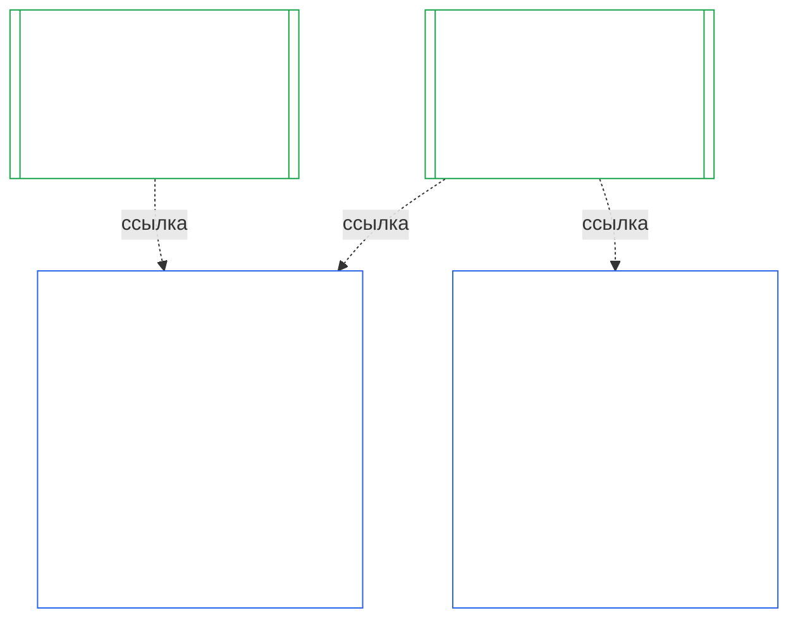

### 1. Цель и роль

<strong>Трассировка</strong>

- Предшествующие положения:
  - [Глава седьмая §1 Когда требуются Хартии системы и учреждения](core_07.000_charters.md#1-when-system-and-institutional-charters-are-required) (7.000 §1);
  - [Глава девятая, Часть A §1 Цель и роль](core_09.000_system_alignment_certification_evaluation.md#1-purpose-and-role) (9.000 §1);
  - [Статья XI-E](core_06.005_rights_part_b.md#article-xi-e-institutional-formation-and-business-creation) (*Создание учреждений и бизнеса*);
  - [Статья XXVIII-A](core_06.020_rights_part_e.md#xxviii-a-existing-instantiations-adoption-transition-window) (*Поэтапное внедрение и непрерывность Пола прав*).
- Последующие положения: [§2](#2-institution-class-evaluation); [§6](#6-forum-process); [§7](#7-certification-outcomes); [§9](#9-recertification-and-reopening).
- Читать вместе с:
  - [Учреждение](core_05.040_band_continuity.md#institution);
  - [Хартия учреждения](core_05.040_band_continuity.md#institutional-charter);
  - [Хартия системы](core_05.040_band_continuity.md#system-charter);
  - [Создание бизнеса](core_05.055_band_participation.md#business-creation).

 

*Простыми словами: сертификация системы относится к самой системе. Сертификация учреждения ссылается на эти сертификации и добавляет то, за что может отвечать только учреждение. Одна система может числиться у нескольких учреждений или ни у одного. Ничто в этом тексте не позволяет сертификации мешать созданию учреждения.*

Сертификация институциональной согласованности и сертификация системной согласованности — это две сертификации, соединённые ссылкой. Связь представляет собой **композицию посредством ссылки**, а не включение. На схеме стрелка ведёт от Записи о сертификации системы к каждой Записи об институциональной сертификации, в которой на неё ссылаются. У Системы, не относящейся ни к одному Учреждению, стрелки нет и она не нужна; у Учреждения, не управляющего Системой, есть только собственная запись.

У композиции посредством ссылки есть две стороны; сначала рассмотрим сторону Учреждения.

На стороне Учреждения:

- **Запись об институциональной сертификации ссылается на запись Системы и не повторяет оценку:** в ней указываются ссылка на Запись о сертификации системы и её версия. Эта Глава не проводит повторную оценку Системы, не пересматривает её класс и не меняет результат, статус или условия сертификации Системы.
- **Сертификация Учреждения не может повысить статус Системы:** статус Системы «Не сертифицирована» сохраняется независимо от статуса Учреждения. Наличие у Системы сертификации не защищает Учреждение от вывода о его несогласованности.
- **Институциональные факты устанавливаются один раз:** если [Глава девятая, Часть A §3.1 Дисциплина управления, стимулов и оспоримости](core_09.000_system_alignment_certification_evaluation.md#31-governance-incentive-and-contestability-discipline) рассматривает управление и стимулы оператора, актуальная Запись об институциональной сертификации оператора может предоставить эти факты посредством ссылки. Форумы Системы всё равно решают, достаточны ли эти факты для данной Системы. Они не должны устанавливать тот же институциональный факт иначе, не объяснив причину в Записи о сертификации системы.

На стороне Системы:

- **Запись о сертификации системы принадлежит Системе:** это собственная запись Системы согласно [Главе девятой](core_09.000_system_alignment_certification_evaluation.md#chapter-nine-system-alignment-certification).
- **На одну Запись о сертификации системы могут ссылаться несколько Учреждений:** Системой могут управлять, ответственно распоряжаться или осуществлять над ней существенный контроль несколько Учреждений согласно [Главе седьмой §1 Когда требуются Хартии системы и учреждения](core_07.000_charters.md#1-when-system-and-institutional-charters-are-required). Каждое из них ссылается на одну и ту же запись.
- **Система может не относиться ни к одному Учреждению:** отдельный сентент не является Учреждением, поэтому у Системы может не быть Учреждения. Система без Учреждения сертифицируется только по [Главе девятой](core_09.000_system_alignment_certification_evaluation.md#chapter-nine-system-alignment-certification), и эта Глава к ней не применяется. Система, относящаяся к Учреждению, сертифицируется так же: эта Глава добавляет отдельную запись для Учреждения и не является этапом собственной сертификации Системы.

#### 1.1 Кто проходит сертификацию

Учреждение класса L или выше подпадает под действие этой Главы; класс определяется согласно [§2.1 Класс учреждения](#21-institution-class). Это включает Учреждение, вообще не управляющее Системами: ему не на что ссылаться в Записи о сертификации системы, а его класс определяется по собственному воздействию. **Портфель** Учреждения — это совокупность Систем, которыми оно управляет, ответственно распоряжается или над которыми осуществляет существенный контроль ([Портфель](core_05.040_band_continuity.md#portfolio)).

- **Классы A, B, C и L:** процесс обязателен и масштабируется по классу согласно [§2.2 Масштабирование по классу](#22-scaling-by-class).
- **Класс P:** применение процесса рекомендуется и может быть добровольным. Он становится обязательным при переклассификации в класс L или выше либо когда Учреждение добровольно заявляет о соблюдении Конституции. Учреждение класса P, принимающее решение получить новые существенные полномочия, переклассифицируется как минимум в класс L при подаче уведомления согласно [§9.2.2 Повторная сертификация при получении новых существенных полномочий](#922-recertification-for-new-material-authority), поскольку такие полномочия по определению являются существенными ([§9.2.1 Что считается новыми существенными полномочиями](#921-what-counts-as-new-material-authority)), а Учреждение, существенное в любой предметной области, относится как минимум к классу L ([§2.1 Класс учреждения](#21-institution-class), пункт 2). Переклассификация действует с момента уведомления до его отзыва до получения разрешения либо до отказа в разрешении полномочий, при условии, что ни одно из них не было осуществлено. Затем Учреждение возвращается к классу P, а ограниченный срок первой сертификации завершается. Новое уведомление запускает его снова; осуществление полномочий без разрешения остаётся основанием для вывода согласно [§9.2.2 Повторная сертификация при получении новых существенных полномочий](#922-recertification-for-new-material-authority) (*Без уведомления или до его одобрения*). Это соответствует [Главе девятой, Части A §1 Цель и роль](core_09.000_system_alignment_certification_evaluation.md#1-purpose-and-role).
- **Одна Система:** Учреждение, управляющее ровно одной Системой, для которой требуется Хартия системы, проходит одну сертификацию и получает одну запись; эта Глава называет её **оценкой учреждения с одной Системой**. Запись о сертификации системы содержит *блок институциональных выводов* с пунктами из [§8 Запись об институциональной сертификации](#8-institutional-certification-record) и служит Записью об институциональной сертификации. Используются форумы, места и сроки соответствующей сертификации Системы с добавлением институциональных пунктов. Результаты следуют собственным основаниям для отказа и отзыва, изложенным в [§7.4 Отказ и отзыв сертификации Учреждения](#74-denial-and-revocation-for-an-institution). Каскадирование по [§9.5 Каскадирование от сертификаций Систем](#95-cascade-from-system-certifications) не применяется, поскольку Система составляет весь портфель; однако [§7.4 Отказ и отзыв сертификации Учреждения](#74-denial-and-revocation-for-an-institution) применяет правила 1 и 2 (признак и проверка того, где находится причина).
- **Несколько Систем:** для Учреждения ведётся одна Запись об институциональной сертификации, содержащая ссылки на Запись о сертификации системы каждой Системы, которой оно управляет. Каждая Система сохраняет собственный процесс и собственную запись.
- **Нет Систем:** для Учреждения ведётся отдельная Запись об институциональной сертификации. Ссылаться на Запись о сертификации системы не требуется, поскольку Учреждение не управляет Системами.

