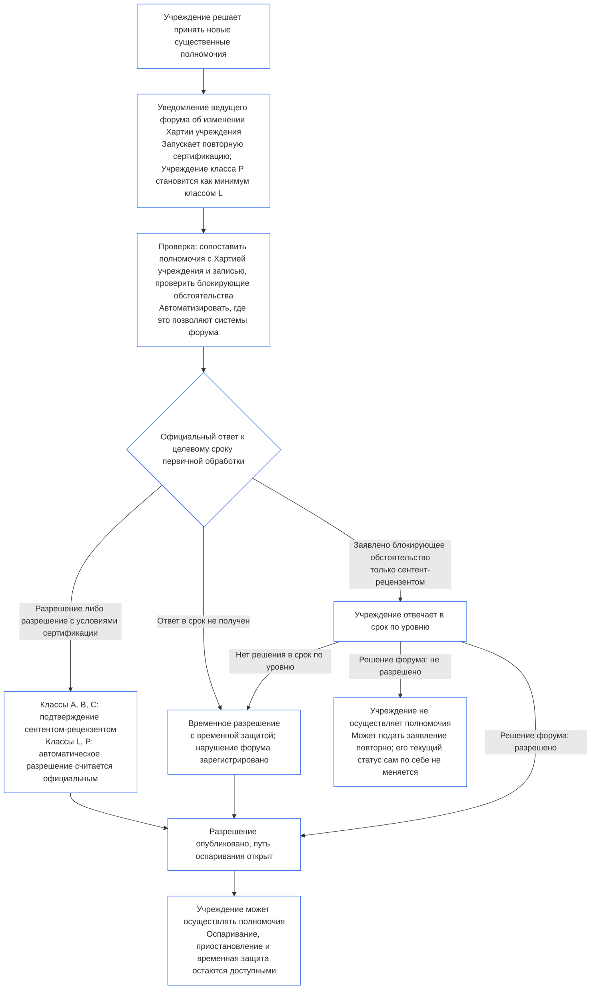

##### 9.2.2 Повторная сертификация при получении новых существенных полномочий

Учреждение, решившее получить новые существенные полномочия, должно пройти повторную сертификацию и дождаться результата, прежде чем их осуществлять. Такое ожидание установлено **Статьёй XI-E** (*Создание учреждений и бизнеса*). Процесс проходит следующим образом:

- **Сначала уведомление:** Учреждение подаёт уведомление об изменении Хартии учреждения, уже требуемое [Главой седьмой §7.1 Изменение документа](core_07.000_charters.md#71-changing-the-document), и направляет его ведущему форуму. Уведомление запускает повторную сертификацию.
- **Если записи ещё нет:** Учреждение, у которого отсутствует Запись об институциональной сертификации, подаёт такое же уведомление. Оно запускает первую сертификацию, ограниченную новыми полномочиями. Они оцениваются с учётом Хартии учреждения и оценок по [§3 Оценка сертификации всего учреждения](#3-whole-institution-certification-evaluation) — [§5 Оценки Пола прав и по предметным областям](#5-rights-floor-and-domain-evaluations) в той мере, в какой те относятся к этим полномочиям. Остальная часть первой сертификации проходит в срок, предусмотренный [§1.3 Срок первой сертификации](#13-window-for-the-first-certification) (для Учреждения класса P, переклассифицированного после уведомления, срок начинается с подачи уведомления); ожидание разрешения новых полномочий от него не зависит.
- **В пределах окон по уровню:** повторная сертификация проводится в сроки из [Главы девятой, Части C §9.3.4 Окна по уровням](core_09.010_system_alignment_certification_record_recertification.md#934-tier-windows); предполагается, что уровень соответствует классу учреждения. Пропуск срока рассматривается согласно [Статье XXVI-C](core_06.020_rights_part_e.md#article-xxvi-c-timely-resolution-and-anti-delay-floor) (*Своевременное разрешение и минимальные гарантии против задержек*); сборы и ожидание не должны становиться препятствием ([Предотвратимое бремя](core_05.040_band_continuity.md#avoidable-burden)).
- **Автоматизация, где это возможно:** уведомление, сопоставление новых полномочий с Хартией учреждения и текущей записью, проверка блокирующих обстоятельств и выдача разрешения автоматизируются, если это позволяют системы форума. [Глава первая §13.3 Минимизация предотвратимого бремени](core_01.005_interaction_interpretation.md#133-minimization-of-avoidable-burden) устанавливает, что автоматизация является предпочтительным средством устранения предотвратимого бремени; [Глава первая §16.4 Документирование при совершении действия](core_01.010_stewardship_capacity_principles.md#164-document-at-action) возлагает обязанность по автоматизации на систему, а не на ответственного за управление.
  - **Разрешает, а не отказывает:** автоматическая проверка может одобрить новые полномочия как безусловно, так и на основании условий сертификации, уже подтверждённых текущей записью. Она не может самостоятельно заявить о блокирующем обстоятельстве (из перечисленных в [§9.2.3 Блокирующие обстоятельства для разрешения новых существенных полномочий](#923-blockers-to-clearing-new-material-authority)) или отказать в разрешении. Проверка может отметить возможное блокирующее обстоятельство, но заявить о нём вправе только сентент-рецензент ведущего форума после рассмотрения отмеченного обстоятельства.
  - **Классы A, B и C:** каждое разрешение подтверждает сентент-рецензент ведущего форума, прежде чем оно станет официальным ответом. Это относится к Учреждению такого класса, а также к Учреждению, которое получает этот класс вследствие новых полномочий. Целевой срок первичной обработки остаётся обязательным и для подтверждения. Рецензент входит в ведущий форум, который уже занимает место проверки или разрешения и должен быть независим от Учреждения ([§6.1 Четыре места при институциональной сертификации](#61-four-seats-in-an-institutional-certification)).
  - **Классы L и P:** автоматическое разрешение является официальным ответом без подтверждения. Учреждение класса P переклассифицируется как минимум в класс L при подаче уведомления ([§1.1 Кто проходит сертификацию](#11-who-is-certified)); поэтому к нему применяется правило класса L.
  - **Исключительные обстоятельства:** независимо от класса дело передаётся сентенту-рецензенту, если проверка отмечает возможное блокирующее обстоятельство, не может установить, охвачены ли полномочия или являются ли они материальными, либо Учреждение или затронутый сентент просит о проверке. На запрос о проверке отвечают в пределах [соответствующего целевого срока первичной обработки](core_05.040_band_continuity.md#tier-window), отсчитываемого от запроса. Это не продлевает срок по уровню.
  - **Та же запись и те же сроки:** в записи указываются проведённые проверки, поэтому автоматическое разрешение можно оспорить как любое другое решение. Автоматизация не продлевает целевой срок первичной обработки или срок по уровню; отказ системы или отсутствие ответа влечёт пропуск срока согласно пункту ниже. За работу используемой системы форум отвечает так же, как за любую Систему ([§6.3 Форумы, органы сертификации и офисы ведения записей как учреждения](#63-forums-certifiers-and-record-offices-as-institutions)).
- **Ожидание:** Учреждение не осуществляет новые полномочия до их разрешения при повторной сертификации.
  - **Ожидают все классы:** исключений по классу нет; чрезвычайные обстоятельства и срочность также не отменяют ожидание.
  - **Остальная деятельность продолжается:** Учреждение продолжает уже существующую деятельность ([§1.2 Отсутствие разрешения и запрета на создание или работу](#12-no-permission-and-no-gate-on-forming-or-running)).
  - **Срочная защита не ждёт:** форумы немедленно обеспечивают срочную защиту затронутых сентентов, не дожидаясь повторной сертификации ([Глава девятая, Часть B §6.2 Последовательность надзора](core_09.005_system_alignment_certification_record_process.md#62-supervisory-sequence)). Эта мера защищает сентентов и не даёт Учреждению оснований раньше осуществлять полномочия.
- **Публикация после разрешения:** ведущий форум публикует каждое разрешение сразу после его выдачи, включая временное разрешение, и открывает путь оспаривания по [§10 Оспаривание сертификации](#10-challenging-a-certification). Учреждение может осуществлять полномочия сразу после разрешения. Оно не ждёт срока уведомления или решения по оспариванию. Затронутый сентент может оспорить разрешение как любое другое решение и потребовать приостановления или временной защиты; это также не откладывается ([§9.2.2 Повторная сертификация при получении новых существенных полномочий](#922-recertification-for-new-material-authority), *Срочная защита не ждёт*). При публикации ведущий форум уведомляет известных ему затронутых сентентов и форумы соответствующих Систем. На запрос о приостановлении или временной защите отвечают в пределах соответствующего целевого срока первичной обработки ([CF-14.445 §3.1 Целевые сроки этапов и предельные рамки](corpus_forum/cf_14.445_performance_backlog_publication_accessibility.md#cf-14445-31-stage-targets-and-outer-bounds)) или срока для чрезвычайного режима, если он применяется.
- **Презумпция разрешения:** полномочия считаются разрешёнными. Ведущий форум отказывает в разрешении только при наличии доказательств блокирующего обстоятельства из [§9.2.3 Блокирующие обстоятельства для разрешения новых существенных полномочий](#923-blockers-to-clearing-new-material-authority), указанных в записи. Если связанное с блокирующим обстоятельством условие сертификации позволяет устранить его, полномочия разрешаются с этим условием, а не отклоняются.
- **Значение разрешения:** повторная сертификация завершается предварительной или полной сертификацией, с условиями или без них; каждое условие сертификации, обязательное до осуществления полномочий, проходит независимую проверку.
- **Если форум не отвечает в срок:** ведущий форум обязан дать официальный ответ в пределах соответствующего целевого срока первичной обработки ([CF-14.445 §3.1 Целевые сроки этапов и предельные рамки](corpus_forum/cf_14.445_performance_backlog_publication_accessibility.md#cf-14445-31-stage-targets-and-outer-bounds)). Ответ разрешает полномочия, разрешает их с условиями сертификации либо указывает блокирующее обстоятельство и доказательства, на которых оно основано. Указав блокирующее обстоятельство, форум предоставляет Учреждению возможность ответить, после чего принимает решение в пределах указанного выше срока по уровню.
  - **Временное разрешение:** если официальный ответ не поступил в целевой срок первичной обработки либо заявленное блокирующее обстоятельство не рассмотрено в срок по уровню, полномочия считаются временно разрешёнными с временной защитой и ограничениями зависимости по [Главе девятой, Части B §7.2 Дефекты сертификации и их исправление](core_09.005_system_alignment_certification_record_process.md#72-certification-defects-and-correction).
  - **Нарушение со стороны форума:** пропуск целевого срока или срока по уровню является дефектом форума, а не виной Учреждения. Дефект регистрируется, исправляется и рассматривается как просрочка по [Главе четырнадцатой §6 Своевременное разрешение, уровни материальности и дисциплина против задержек](core_14.000_forum.md#6-timely-resolution-materiality-tiers-and-anti-delay-discipline) (*Проверка просрочки*).
  - **Передача другому форуму:** запрос на повторную сертификацию передаётся другому форуму того же семейства ([Глава четырнадцатая §3 Передача, консолидация и координация](core_14.000_forum.md#3-transfer-consolidation-and-coordination--continuity-and-anti-capture)). Этот форум проводит повторную сертификацию в обычные сроки для класса Учреждения, отсчитываемые от передачи.
- **Если разрешение не выдано:** Учреждение не осуществляет полномочия и может подать заявление повторно на условиях Главы девятой, Части B §7.4 (*Не является постоянным запретом*). Сам по себе отказ разрешить новые полномочия не означает отказа или отзыва уже имеющегося статуса Учреждения применительно к его текущей деятельности. Этот статус меняется только после вывода согласно [§7.3 Готовность Учреждения к устранению проблем](#73-remediation-readiness-for-an-institution) и [§7.4 Отказ и отзыв сертификации Учреждения](#74-denial-and-revocation-for-an-institution).
- **Без уведомления или до разрешения:** осуществление новых существенных полномочий без уведомления или до их разрешения является деятельностью за пределами Хартии учреждения. Это основание для вывода по [§3 Оценка сертификации всего учреждения](#3-whole-institution-certification-evaluation) (пункт 1) и возобновления проверки как события, связанного с Хартией учреждения.

<strong>Руководство для читателя (неоперативное): ожидание новых существенных полномочий</strong>

На этой схеме кратко изложен §9.2.2 «Повторная сертификация при получении новых существенных полномочий». При расхождении схемы с текстом применяется текст. Вся уже осуществляемая Учреждением деятельность продолжается, а срочная защита затронутых сентентов никогда не откладывается. Примеры для Учреждений приведены в [CS-9.320 §12 Иллюстративные разборы Учреждений](corpus_systems/cs_09.320_system_alignment_certification_illustrations.md#cs-9320-12-illustrative-institution-walkthroughs).

 

