#### 1.1 அமைப்பு வகுப்பால் அளவாக்கப்படும் தணிக்கைச் செயல்முறையாகச் சான்றளிப்பு

மேற்பார்வை முறையாக, சான்றளிப்பு என்பது [தணிக்கைத் தகுதி](core_05.050_band_oversight.md#auditability) மற்றும் **கட்டுரை XVI** (*தணிக்கை, வெளிப்படைத்தன்மை, சுயாதீனச் சரிபார்ப்பு*) ஆகியவற்றின் கீழ் வரும் பெரிய தணிக்கைச் செயல்முறைகளில் ஒன்றாகும்:

- இது மன்ற மேற்பார்வையுடன், பல துறைகளை உள்ளடக்கி, நிலைப்பாட்டை வழங்குகிறது.
- இது தொடர்புடைய பிற தணிக்கை முறைகளின் முடிவுகளை ஒருங்கிணைக்கலாம்; அவற்றை உள்ளிழுக்கவோ மாற்றீடு செய்யவோ செய்யாது. தணிக்கைச் செயல்முறை மையத்தின் [தொடர்புடைய தணிக்கை முறைகளின் உரிமையாளர் வரைபடத்தில்](corpus_joint_structure/cjs_05.115_audit_process.md#sibling-audit-modes-owner-map) குறிப்பிடப்பட்டுள்ளபடி ஒவ்வொன்றுக்கும் தனி உரிமையாளர் உண்டு:
  - **CS-6.305 (*தகவல் வகைகளும் கையாளுதலும்*) மற்றும் CS-6.310** (*தரவு வகைப்பாடுகள்*) இன் கீழ் அமைப்பு தரவு வகைப் பதிவுத் தணிக்கைகள்
  - **CS-9.305 (*அமைப்பு வகைப்பாட்டு இயந்திரம்*) மற்றும் CS-9.310** (*அமைப்பு தாக்க வகைப்பாடுகள்*) இன் கீழ் அமைப்பு வகைப்பாட்டுப் பதிவுத் தணிக்கைகள்
  - **CS-15.305** (*முக்கிய அமைப்புகளுக்கான பொறுப்பான நிர்வாகம்*) இன் கீழ் பொறுப்பான நிர்வாக உறுதிப்பாட்டு மதிப்பாய்வுகள்
  - **CS-6.345** (*அமைப்பு வாழ்க்கைச் சுழற்சி*) ACA இன் கீழ் தொடர்ச்சியான தணிக்கை
  - **CS-6.315** (*புரிந்துகொள்ளத்தக்க தன்மை மற்றும் சிக்கல்தன்மை பொறுப்பான நிர்வாகம்*) மற்றும் **கட்டுரை XXIII-B** (*சிக்கல்தன்மைத் தணிக்கை மற்றும் மாடுலார் தேவைகள்*) இன் கீழ் சிக்கல்தன்மைத் தணிக்கைகள்
  - **CJS-5.110 §5** (*மேற்பார்வை: சுயாதீனச் சரிபார்ப்பு மற்றும் கூற்று-முழுமை விதிகள்*) இன் கீழ் கூற்று சரிபார்ப்பு
- சான்றளிப்பு வழியாகச் செல்லாமல், இம்மதிப்பீடுகள் ஒவ்வொன்றையும் தனித்தனியாக நடத்தலாம். சான்றளிப்பு அவற்றை மாற்றுவதில்லை.

சான்றளிப்பின் ஆழம், பதிவுச் சுமை, சான்றளிப்பு இடைவெளி, பங்குதாரர் மதிப்பாய்வு, சவால் பாதைகள் ஆகியவை [பொருள் பங்குக்கு](core_00.000_preamble.md#material-stake) ஏற்ப, [விகிதாச்சாரத்தின்](core_05.035_band_accountability.md#proportionality) கீழ் அளவாக்கப்பட வேண்டும்:

- அதிக தாக்கம், அதிக சார்பு, அதிக இடர் கொண்ட அமைப்புகளுக்கு வலுவான ஆதாரம், தெளிவான பதிவுகள், நடைமுறையில் சாத்தியமான அதிக பங்கேற்பு தேவை — அமைப்பைச் சார்ந்திருப்போருக்கு ஏற்றவாறு பொருளுள்ள அணுகல்தகுதி, பங்குதாரர் உள்ளீடு, சவால் பாதைகள் உட்பட.
- குறைந்த அமைப்பு வகுப்புகளும் வரையறுக்கப்பட்ட வரம்புகளும் நேர்மையான வகைப்பாடும் விகிதாச்சார உறுதிப்பாடும் தேவைப்படுத்துகின்றன; வெளிப்புற விளைவுகள் இருக்கும்போது அவை பொருண்மைக் கடமைகளிலிருந்து விலக்கு பெறுவதில்லை.

**CS-9.305** (*அமைப்பு வகைப்பாட்டு இயந்திரம்*) இன் [மறுவகைப்பாட்டுத் தேவை](corpus_systems/cs_09.305_system_classification_machinery.md#35-reclassification-requirement) அமைக்கும் தாக்க வகுப்பின்படி செயல்முறை பொருந்தும்:

- **வகுப்பு A, வகுப்பு B, வகுப்பு C:** இவ்வமைப்புகள் அதிகபட்ச தாக்கம், சார்பு, இடர் கொண்டவை. [§3 முழு-அமைப்பு சான்றளிப்பு மதிப்பீடு](#3-whole-system-certification-evaluation), [§4 தொடர்புடைய இடங்களில் பொருந்தும் மதிப்பீடுகள்](#4-evaluations-where-implicated), [§5 உரிமைத் தள மற்றும் துறை மதிப்பீடுகள்](#5-rights-floor-and-domain-evaluations) ஆகியவற்றின் கீழ் ஒவ்வொன்றின் துணைக் கட்டத்திற்கேற்ப முழு ஆழத்தில் முழு-அமைப்பு மதிப்பீடு கட்டாயம்;
- **வகுப்பு L:** அதே மதிப்பீடு கட்டாயமானது, ஆனால் விகிதாச்சாரமாக இருக்கும்; **CS-9.305** (*அமைப்பு வகைப்பாட்டு இயந்திரம்*) மற்றும் CS-9.310 (*அமைப்பு தாக்க வகைப்பாடுகள்*) அனுமதிக்கும் இடங்களில் இயல்புநிலை சான்றளிப்பு இடைவெளி நீளமாகவும் பதிவுகள் எளிமையாகவும் இருக்கும்; மற்றும்
- **வகுப்பு P:** அமைப்பு செல்லத்தக்க வகுப்பு P ஆக இருக்கும் வரை செயல்முறை ஊக்குவிக்கப்படுகிறது; வகுப்பு P அமைப்பு விருப்பப்படி இதைப் பயன்படுத்தலாம். வகுப்பு L அல்லது அதற்கு மேல் மறுவகைப்படுத்தப்பட்டாலோ, இயக்குநர் அந்த அமைப்பு அரசியலமைப்புடன் இணங்குவதாகத் தன்னார்வமாகக் கூறினாலோ இது கட்டாயமாகிறது.

சான்றளிப்பு இடைவெளியும், அதன் நடுப்பகுதியில் நிகழும் நிதி, வள அல்லது சிறப்புத் தணிக்கையும் [அத்தியாயம் பதினான்கு §6 காலத்திற்குள் தீர்வு, பொருண்மைத்தன்மை நிலைகள், தாமத எதிர்ப்பு ஒழுங்கு](core_14.000_forum.md#review-cadence) (*மதிப்பாய்வு இடைவெளி*) இல் அமைப்பு வகுப்பின்படி நிர்ணயிக்கப்படுகின்றன. இந்த அத்தியாயம் எண்களை மீண்டும் கூறுவதில்லை.

#### 1.2 சான்றளிப்பு — ஒரு பார்வையில்

*எளிய சொற்களில்: அமைப்பை நேர்மையாக வகைப்படுத்தி, பொருந்தும் மதிப்பீடுகளை நடத்தி, ஆதாரங்களையும் பங்குதாரர் கவலைகளையும் மன்றங்கள் சுயாதீனமாக மதிப்பாய்வு செய்ய வைத்து, முடிவெடுக்கவும். மன்ற மதிப்பாய்வுக்காகத் திறக்கப்பட்ட ஒரே பதிவை நிறைவு செய்து, திறந்த சவால் பாதையுடன் வெளியிடவும். அறிவிப்பு இடைவெளியும் தேவையான பாதுகாப்புகளும் பூர்த்தியான பின்பே சான்றளிக்கப்பட்ட அமைப்பு நேரடி செயல்பாட்டுக்குச் செல்லும். உண்மையான விளைவுகளைக் கண்காணித்து, சம்பவங்களுக்கும் சவால்களுக்கும் பதிலளித்து, அட்டவணைப்படியோ உண்மைகள் மாறும்போதோ மீண்டும் சரிபார்க்கவும். குறைகளைச் சரிசெய்து, பாதிக்கப்பட்ட வரம்பை அங்கீகரிப்பதற்கோ சான்றளிப்பு நிபந்தனைகளிலிருந்து விடுவிப்பதற்கோ முன் திருத்தத்தைச் சுயாதீனமாகச் சரிபார்க்கவும். ஒவ்வொரு மதிப்பாய்வுச் சுற்றிலும் முந்தைய பதிவுடன் இணைக்கப்பட்ட புதிய பதிவு பயன்படுத்தப்படும்.*

செயல்முறை **ஆறு கட்டங்களாக** நடைபெறுகிறது: **I வரையறு**, **II மதிப்பிடு**, **III மதிப்பாய்வு**, **IV முடிவெடு**, **V பதிவு செய்**, **VI செயல்படுத்து**. கட்டம் II தனித்தனிப் பிரிவுகளைக் கொண்ட மூன்று துணைக் கட்டங்களாக நடைபெறுகிறது: **IIa** (எப்போதும்), **IIb** (தொடர்புடைய இடங்களில்), **IIc** (தூண்டுதல் நிபந்தனை நிறைவேறும்போது). கட்டம் VI, ஒவ்வொன்றும் தனிப் பிரிவான இரண்டு துணைக் கட்டங்களாக நடைபெறுகிறது: **VIa** (செயல்பாடும் மறுசான்றளிப்பும், [§9 மறுசான்றளிப்பும் மீண்டும் திறத்தலும்](core_09.010_system_alignment_certification_record_recertification.md#9-recertification-and-reopening)) மற்றும் **VIb** (நிலைப்பாட்டுப் பாலம், [§11 நிலைப்பாட்டுடனான தொடர்பு](core_09.010_system_alignment_certification_record_recertification.md#11-relationship-to-standing)). முழுச் சான்றளிப்பு செயல்முறையை அட்டவணைப்படி வரைபடம் காட்டுகிறது. பகுதி அ முதல் இரு கட்டங்களான வரையறுத்தல் மற்றும் மதிப்பீட்டை உள்ளடக்குகிறது; [பகுதி ஆ](core_09.005_system_alignment_certification_record_process.md#chapter-nine-part-b-system-alignment-certification--forum-process-and-outcomes), [பகுதி இ](core_09.010_system_alignment_certification_record_recertification.md#chapter-nine-part-c-system-alignment-certification--record-recertification-and-standing) ஆகியவை கடைசி நான்கு கட்டங்களை உள்ளடக்குகின்றன: மன்றச் செயல்முறையும் நேரடி-செயலாக்க அனுமதியுடனான முடிவும் (பகுதி ஆ), பிறகு பதிவும் செயல்பாடும் (சவால் பாதை, மறுசான்றளிப்பும் மீண்டும் திறத்தலும், நிலைப்பாட்டுப் பாலம்) (பகுதி இ).

பொருந்தும் ஒவ்வொரு மதிப்பீடும் ஒவ்வொரு சான்றளிப்புச் சுற்றிலும் மீண்டும் நடத்தப்படும்: முதல் சான்றளிப்பில், [§2 அமைப்பு வகுப்பு மதிப்பீடு](#2-system-class-evaluation) அமைக்கும் அட்டவணையிலான ஒவ்வொரு மறுசான்றளிப்பிலும், மீண்டும் திறக்கப்பட்ட அல்லது புதிய ஒவ்வொரு மதிப்பாய்விலும். அமைப்பின் மீதான சார்பு அதிகரித்தல், பகிரப்பட்ட அடித்தளங்களிலிருந்து எடுப்பது அதிகரித்தல், அவற்றுக்கு அமைப்பு திருப்பித் தருவது குறிப்பிடத்தக்க அளவு குறைதல், நம்பகமான சவால் எழுதல் போன்ற பொருண்மையான உண்மைகள் மாறினால் அடுத்த அட்டவணை மறுசான்றளிப்புக்கு முன்பே மதிப்பாய்வு மீண்டும் திறக்கப்படும். [பகுதி இ §9.2 மீண்டும் திறப்பதற்கான தூண்டுதல்கள்](core_09.010_system_alignment_certification_record_recertification.md#92-reopening-triggers) அவற்றைப் பட்டியலிடுகிறது.

```mermaid
flowchart TB
    T(["System with material impact seeks certification,<br/>or reliance on it grows"])
    C["§2 Phase I, Frame<br/>Classify honestly<br/><br/>Class sets depth and re-check schedule"]
    subgraph W["§3–§5 Phase II, Evaluate — Whole-system evaluation"]
        direction LR
        Al["§3.1–§3.4 IIa — Always<br/><br/>Governance; systemic risk: evaluated,<br/>and disclosed to those who need it;<br/>time horizon; data types"]
        Im["§4 IIb — When implicated<br/><br/>Privacy loci, exit rights,<br/>assembly and dissent"]
        Tr["§5 IIc — When triggered<br/><br/>Applicable Rights-Floor checks<br/>and six domain evaluations"]
        Al ~~~ Im ~~~ Tr
    end
    F["§6 Phase III, Review<br/>Independent review of evidence<br/>and stakeholder concerns<br/><br/>Assigned forums issue findings;<br/>challenge paths stay open"]
    Rec["§8 Phase V, Record<br/>One System Certification Record<br/><br/>Opened for forum review; completed with the outcome,<br/>supporting findings, certification conditions, and operating plan"]
    S[["Chapter Eleven — Standing<br/>records<br/><br/>Outside this chapter"]]
    O{"§7 Phase IV, Decide<br/><br/>What outcome and status<br/>does the evidence support?"}
    Fc["§7, §9.3 Full Certification<br/><br/>Required consecutive clean provisional recertifications;<br/>no current or indicated impending misalignment<br/>Full certification interval; certification conditions may apply"]
    Pc["§7, §9.3 Provisional Certification<br/><br/>First grant, recovery after misalignment,<br/>or continued or stepped-down provisional status<br/>Provisional interval, shorter; certification conditions may apply"]
    Nc["§7 Not Certified<br/><br/>Deferred, refused, withdrawn, or expired<br/>No go-live; state reasons and required corrective work"]
    Pub["§7, §10 Publish the completed record<br/><br/>Open the published record challenge path;<br/>for new or expanded scope, state go-live and notice"]
    G{"§7 Go-live gate<br/><br/>Certification and applicable<br/>go-live prerequisites satisfied?"}
    Hold["§7 Meet go-live prerequisites<br/><br/>Complete notice and independently verify<br/>certification conditions required before go-live"]
    Rm["§7, §9.3 Protect and correct<br/><br/>No new go-live in the affected scope;<br/>protect affected sentients, correct design or operation,<br/>and submit evidence for independent verification"]
    Ch["§9–§10 Phase VIa, Operate and recertify<br/>Monitor and keep challenges open<br/><br/>Operate within certified scope and certification conditions;<br/>monitor outcomes and respond to incidents and challenges"]
    S2[["Chapter Eleven — Standing<br/>records<br/><br/>Outside this chapter"]]
    Sp["&nbsp;&nbsp;&nbsp;&nbsp;&nbsp;&nbsp;&nbsp;&nbsp;&nbsp;&nbsp;&nbsp;&nbsp;&nbsp;&nbsp;&nbsp;&nbsp;&nbsp;&nbsp;&nbsp;&nbsp;&nbsp;&nbsp;&nbsp;&nbsp;&nbsp;&nbsp;&nbsp;&nbsp;&nbsp;&nbsp;&nbsp;&nbsp;&nbsp;"]
    SpL["&nbsp;&nbsp;&nbsp;&nbsp;&nbsp;&nbsp;&nbsp;&nbsp;&nbsp;&nbsp;&nbsp;&nbsp;&nbsp;&nbsp;&nbsp;&nbsp;&nbsp;&nbsp;&nbsp;&nbsp;&nbsp;&nbsp;&nbsp;&nbsp;&nbsp;&nbsp;&nbsp;&nbsp;&nbsp;&nbsp;&nbsp;&nbsp;&nbsp;&nbsp;&nbsp;"]
    SpA["&nbsp;&nbsp;&nbsp;&nbsp;&nbsp;&nbsp;&nbsp;&nbsp;&nbsp;&nbsp;&nbsp;&nbsp;&nbsp;&nbsp;&nbsp;&nbsp;&nbsp;&nbsp;&nbsp;&nbsp;&nbsp;&nbsp;&nbsp;&nbsp;&nbsp;&nbsp;&nbsp;&nbsp;&nbsp;&nbsp;&nbsp;&nbsp;&nbsp;&nbsp;&nbsp;&nbsp;&nbsp;&nbsp;&nbsp;&nbsp;&nbsp;&nbsp;&nbsp;&nbsp;&nbsp;"]
    Re["§9 Next review pass<br/><br/>Recertification, reopening, or fresh review;<br/>each pass opens a new record linked to the last"]
    T --> C
    A1((A)) --> C
    C --> W
    W --> F
    F --> O
    O --> Fc
    O --> Pc
    O --> Nc
    Fc --> Rec
    Pc --> Rec
    Nc --> Rec
    Rec -.->|VIb, §11 —<br/>verified inputs only;<br/>current certification or facts<br/>arising during certification| S
    Rec --> Pub
    Rec ~~~ Sp
    Pub --> G
    G ~~~ SpL
    G -->|Not Certified| Rm
    G --->|Yes: operate<br/>within the record| Ch
    G --->|Certified,<br/>prerequisites pending| Hold
    Hold --> G
    Ch -->|Material defect:<br/>protect and correct| Rm
    Ch -->|On schedule, or<br/>material change or<br/>credible challenge<br/>requires review| Re
    Ch -.->|VIb, §11 —<br/>verified inputs only;<br/>operation may supply facts<br/>for Contribution and<br/>Violation records| S2
    Rm -->|Correction evidence<br/>is checked in the<br/>next review pass| Re
    S2 ~~~~ SpA
    SpA ~~~ Re
    Re --> A2((A))
    style Sp fill:none,stroke:none,color:#111111
    style SpL fill:none,stroke:none,color:#111111
    style SpA fill:none,stroke:none,color:#111111
    style T fill:none,stroke:#64748b,color:#ffffff
    style C fill:none,stroke:#16a34a,color:#ffffff
    style Ch fill:none,stroke:#16a34a,color:#ffffff
    style Al fill:none,stroke:#16a34a,color:#ffffff
    style Im fill:none,stroke:#16a34a,color:#ffffff
    style Tr fill:none,stroke:#16a34a,color:#ffffff
    style F fill:none,stroke:#ea580c,color:#ffffff
    style Rec fill:none,stroke:#2563eb,color:#ffffff
    style S fill:none,stroke:#db2777,color:#ffffff
    style S2 fill:none,stroke:#db2777,color:#ffffff
    style O fill:none,stroke:#ea580c,color:#ffffff
    style Fc fill:none,stroke:#9333ea,color:#ffffff
    style Pc fill:none,stroke:#9333ea,color:#ffffff
    style Nc fill:none,stroke:#9333ea,color:#ffffff
    style G fill:none,stroke:#ea580c,color:#ffffff
    style Pub fill:none,stroke:#2563eb,color:#ffffff
    style Rm fill:none,stroke:#9333ea,color:#ffffff
    style Hold fill:none,stroke:#16a34a,color:#ffffff
    style Re fill:none,stroke:#16a34a,color:#ffffff
    style A1 fill:none,stroke:#64748b,color:#ffffff
    style A2 fill:none,stroke:#64748b,color:#ffffff
```

<strong>வாசகர் வழிகாட்டி (செயல்படாதது): விளக்கங்கள், படிப்படியான செயற்பட்டியல், நிறுவனங்கள்</strong>

> செய்யப்பட்ட **வகுப்பு A**, **வகுப்பு B**, **வகுப்பு C** விவரங்களும் — இந்த அத்தியாயம் முழுவதும் அமைப்பு வகுப்பு சான்றளிப்பு ஆழத்தை எவ்வாறு அளவாக்குகிறது என்பதும் — [CS-9.320 §2 அமைப்பு வகுப்புகளின் எடுத்துக்காட்டு விவரங்கள்](corpus_systems/cs_09.320_system_alignment_certification_illustrations.md#cs-9320-2-illustrative-system-class-profiles) இல் உள்ளன. [§3 முழு-அமைப்பு சான்றளிப்பு மதிப்பீடு](#3-whole-system-certification-evaluation) முதல் [§5.6 நம்பகத்தன்மை மற்றும் அமைப்பு-சார்பு முழுமை மதிப்பீடு](#56-trustworthiness-and-system-reliance-integrity-evaluation) வரையிலான ஒவ்வொரு மதிப்பீட்டுப் பகுதிக்கும் அதே மூன்று அமைப்புகளைப் படிப்படியாகக் காட்டும் வழிநடத்தல்கள் [CS-9.320 அமைப்பு ஒத்திசைவு சான்றளிப்பு விளக்கங்கள்](corpus_systems/cs_09.320_system_alignment_certification_illustrations.md#cs-9320-system-alignment-certification-illustrations) இல் உள்ளன; ஒவ்வொரு விவரத்தையும் வழிநடத்தலையும் அது விளக்கும் பகுதி அ பிரிவுடன் இணைக்கிறது.
>
> ஆறு கட்டங்களுக்கான படிப்படியான செயற்பட்டியலும், ஒவ்வொரு படியிலிருந்தும் அந்த விதி உள்ள பிரிவுக்கான இணைப்பும் [CS-9.315 §2 செயற்பட்டியல்](corpus_systems/cs_09.315_system_alignment_certification_run_sheet.md#cs-9315-2-run-sheet) (*அமைப்பு ஒத்திசைவு சான்றளிப்பு செயற்பட்டியல்*) இல் உள்ளன. செயற்பட்டியலுக்கும் பிரிவுக்கும் வேறுபாடு இருந்தால், பிரிவே கட்டுப்படுத்தும்.
>
> அத்தியாயம் பத்தின் செயல்முறையில் படிப்படியாகக் காட்டப்படும் கற்பனையான மூன்று நிறுவனங்கள் [CS-9.320 §12 நிறுவன வழிநடத்தல் எடுத்துக்காட்டுகள்](corpus_systems/cs_09.320_system_alignment_certification_illustrations.md#cs-9320-12-illustrative-institution-walkthroughs) இல் உள்ளன.
>
> ஒரு நிறுவனத்துக்கு இதே ஆறு கட்டங்களும் [அத்தியாயம் பத்து](core_10.000_institutional_alignment_certification.md#chapter-ten-institutional-alignment-certification) வழியாக நடைபெறும்; அதன் பிரிவுகளும் இந்த அத்தியாயத்தின் பிரிவுகளுக்கு இணையான எண்களைக் கொண்டுள்ளன: [அத்தியாயம் பத்து §2 நிறுவன வகுப்பு மதிப்பீடு](core_10.000_institutional_alignment_certification.md#2-institution-class-evaluation) முதல் [§5 உரிமைத் தள மற்றும் துறை மதிப்பீடுகள்](core_10.000_institutional_alignment_certification.md#5-rights-floor-and-domain-evaluations) வரை கட்டங்கள் I, II; [§6 மன்றச் செயல்முறை](core_10.000_institutional_alignment_certification.md#6-forum-process) முதல் [§8 நிறுவன சான்றளிப்புப் பதிவு](core_10.000_institutional_alignment_certification.md#8-institutional-certification-record) வரை கட்டங்கள் III–V; [§9 மறுசான்றளிப்பும் மீண்டும் திறத்தலும்](core_10.000_institutional_alignment_certification.md#9-recertification-and-reopening) முதல் [§11 நிலைப்பாட்டுடனான தொடர்பு](core_10.000_institutional_alignment_certification.md#11-relationship-to-standing) வரை கட்டம் VI.

 

