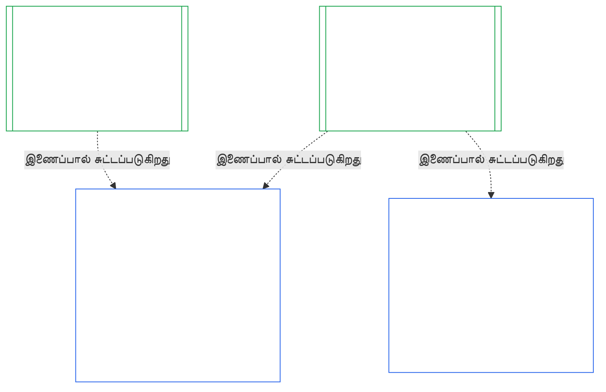

### 1. நோக்கமும் பங்கும்

<strong>தடமறிதல்</strong>

- மேல்நிலை:
  - [அத்தியாயம் ஏழு §1 அமைப்பு மற்றும் நிறுவன சாசனங்கள் எப்போது தேவை](core_07.000_charters.md#1-when-system-and-institutional-charters-are-required) (7.000 §1);
  - [அத்தியாயம் ஒன்பது பகுதி A §1 நோக்கமும் பங்கும்](core_09.000_system_alignment_certification_evaluation.md#1-purpose-and-role) (9.000 §1);
  - [Article XI-E](core_06.005_rights_part_b.md#article-xi-e-institutional-formation-and-business-creation) (*நிறுவன உருவாக்கமும் வணிகத் தொடக்கமும்*);
  - [Article XXVIII-A](core_06.020_rights_part_e.md#xxviii-a-existing-instantiations-adoption-transition-window) (*கட்டங்கட்டமான ஏற்பும் உரிமைத் தளத் தொடர்ச்சியும்*).
- கீழ்நிலை: [§2](#2-institution-class-evaluation); [§6](#6-forum-process); [§7](#7-certification-outcomes); [§9](#9-recertification-and-reopening).
- இதனுடன் வாசிக்க:
  - [நிறுவனம்](core_05.040_band_continuity.md#institution);
  - [நிறுவன சாசனம்](core_05.040_band_continuity.md#institutional-charter);
  - [அமைப்பு சாசனம்](core_05.040_band_continuity.md#system-charter);
  - [வணிகத் தொடக்கம்](core_05.055_band_participation.md#business-creation).

 

*எளிய சொற்களில்: ஓர் அமைப்பின் சான்றளிப்பு அந்த அமைப்புக்குரியது. ஓர் நிறுவனத்தின் சான்றளிப்பு, அந்த அமைப்புகளின் சான்றளிப்புகளைச் சுட்டி, நிறுவனம் மட்டுமே பதிலளிக்கக்கூடியவற்றைச் சேர்க்கிறது. ஓர் அமைப்பு பல நிறுவனங்களின் கீழ் இருக்கலாம்; அல்லது எதன் கீழும் இல்லாமல் இருக்கலாம். இங்குள்ள எதுவும் நிறுவனத்தைத் தொடங்குவதற்குத் தடையாக சான்றளிப்பை நிறுத்திவைக்க அனுமதிப்பதில்லை.*

நிறுவன ஒத்திசைவு சான்றளிப்பும் அமைப்பு ஒத்திசைவு சான்றளிப்பும் இணைப்பால் இணைக்கப்பட்ட இரண்டு சான்றளிப்புகள். அவற்றின் உறவு **இணைப்பின் வழியான கூட்டமைப்பு**; உள்ளடக்கம் அல்ல. படத்தில், ஓர் அமைப்பு சான்றளிப்புப் பதிவிலிருந்து அதைச் சுட்டும் ஒவ்வொரு நிறுவன சான்றளிப்புப் பதிவுக்கும் அம்பு செல்கிறது. எந்த நிறுவனத்திற்கும் உட்படாத அமைப்புக்கு அம்பு தேவையில்லை; எந்த அமைப்பையும் இயக்காத நிறுவனத்திற்குத் தனிப்பதிவு இருக்கும்.

இணைப்பின் வழியான கூட்டமைப்புக்கு இரண்டு தரப்புகள் உள்ளன; முதலில் நிறுவனத்தின் தரப்பு.

நிறுவனத்தின் தரப்பில்:

- **நிறுவன சான்றளிப்புப் பதிவு, அமைப்பின் பதிவை மீண்டும் செய்யாமல் அதனைச் சுட்டும்:** அது அமைப்பு சான்றளிப்புப் பதிவை இணைப்பால் சுட்டி, அதன் பதிப்பைக் குறிப்பிடும். இந்த அத்தியாயம் அமைப்பு மதிப்பீட்டை மீண்டும் நடத்தாது; அமைப்பின் வகுப்பை மீண்டும் தீர்மானிக்காது; அதன் முடிவு, நிலை அல்லது சான்றளிப்பு நிபந்தனைகளை மாற்றாது.
- **நிறுவனத்தின் சான்றளிப்பு அமைப்பின் நிலையை உயர்த்தாது:** சான்றளிக்கப்படாத அமைப்பு, நிறுவனத்தின் நிலை எதுவாக இருந்தாலும் சான்றளிக்கப்படாததாகவே இருக்கும். சான்றளிப்பு பெற்ற அமைப்புக்கு நிறுவனத்தின் கண்டறிதலிலிருந்து பாதுகாப்பு கிடையாது.
- **நிறுவன உண்மைகள் ஒருமுறை மட்டுமே கண்டறியப்படும்:** [அத்தியாயம் ஒன்பது பகுதி A §3.1 ஆளுகை, ஊக்கம், சவால் ஒழுங்கு](core_09.000_system_alignment_certification_evaluation.md#31-governance-incentive-and-contestability-discipline) இயக்குநரின் ஆளுகை மற்றும் ஊக்கங்கள் பற்றிக் கேட்கும் இடத்தில், அந்த இயக்குநருக்கான நடப்பிலுள்ள நிறுவன சான்றளிப்புப் பதிவு இணைப்பின் மூலம் அந்த உண்மைகளை வழங்கலாம். அந்த அமைப்புக்கு அந்த உண்மைகள் போதுமா என்பதை அமைப்பின் மன்றங்களே தீர்மானிக்கும். அதே நிறுவன உண்மையை வேறுவிதமாகக் கண்டறிந்தால், அமைப்பு சான்றளிப்புப் பதிவில் அதற்கான காரணத்தைக் கூற வேண்டும்.

அமைப்பின் தரப்பில்:

- **அமைப்பு சான்றளிப்புப் பதிவு அமைப்புக்குரியது:** [அத்தியாயம் ஒன்பது](core_09.000_system_alignment_certification_evaluation.md#chapter-nine-system-alignment-certification) இன் கீழ் அது அந்த அமைப்பின் சொந்தப் பதிவாகும்.
- **ஒரே அமைப்பு சான்றளிப்புப் பதிவை பல நிறுவனங்கள் சுட்டலாம்:** [அத்தியாயம் ஏழு §1 அமைப்பு மற்றும் நிறுவன சாசனங்கள் எப்போது தேவை](core_07.000_charters.md#1-when-system-and-institutional-charters-are-required) இன் கீழ் ஒன்றுக்கு மேற்பட்ட நிறுவனங்கள் ஓர் அமைப்பை இயக்கவோ, பொறுப்புடன் நிர்வகிக்கவோ, பொருண்மையாகக் கட்டுப்படுத்தவோ முடியும். ஒவ்வொன்றும் அதே பதிவைச் சுட்டும்.
- **ஓர் அமைப்பு எந்த நிறுவனத்தின் கீழும் இருக்க வேண்டியதில்லை:** தனி உணர்வுள்ளவர் நிறுவனம் அல்ல; ஆகவே அமைப்புக்கு நிறுவனம் இல்லாமலும் இருக்கலாம். நிறுவனமற்ற அமைப்பு [அத்தியாயம் ஒன்பது](core_09.000_system_alignment_certification_evaluation.md#chapter-nine-system-alignment-certification) இன் கீழ் மட்டுமே சான்றளிக்கப்படுகிறது; இந்த அத்தியாயத்திடமிருந்து எதுவும் தேவையில்லை. நிறுவனத்தின் கீழ் இருக்கும் அமைப்பும் அதே முறையில் சான்றளிக்கப்படுகிறது: இந்த அத்தியாயம் நிறுவனத்திற்குத் தனிப் பதிவைச் சேர்க்கிறது; அது அமைப்பின் சொந்தச் சான்றளிப்பின் படி அல்ல.

#### 1.1 யாருக்கு சான்றளிக்கப்படுகிறது

Class L அல்லது அதற்கு மேலான நிறுவனம் இந்த அத்தியாயத்தின் வரம்புக்குள் வரும்; அதன் வகுப்பு [§2.1 நிறுவன வகுப்பு](#21-institution-class) இன் கீழ் தீர்மானிக்கப்படுகிறது. எந்த அமைப்பையும் இயக்காத நிறுவனமும் இதில் அடங்கும்: அதற்குச் சுட்டுவதற்கு அமைப்பு சான்றளிப்புப் பதிவு இல்லை; அதன் வகுப்பு அதன் சொந்தத் தாக்கத்திலிருந்து வருகிறது. ஓர் நிறுவனத்தின் **தொகுப்பு** என்பது அது இயக்கும், பொறுப்புடன் நிர்வகிக்கும் அல்லது பொருண்மையாகக் கட்டுப்படுத்தும் அமைப்புகளின் தொகுப்பாகும் ([தொகுப்பு](core_05.040_band_continuity.md#portfolio)).

- **Class A, B, C, L:** செயல்முறை பொருந்தும்; [§2.2 வகுப்பின்படி அளவிடல்](#22-scaling-by-class) இன் கீழ் வகுப்புக்கு ஏற்ப அளவிடப்படும்.
- **Class P:** செயல்முறை ஊக்குவிக்கப்படுகிறது; விருப்பப்படி பயன்படுத்தலாம். Class L அல்லது அதற்கு மேல் மறுவகைப்படுத்தப்பட்டால், அல்லது நிறுவனம் அரசியலமைப்பு இணக்கத்தை விருப்பப்படி உரிமைகோரினால், அது கட்டாயமாகிறது. புதிய பொருண்மையான அதிகாரத்தை ஏற்க முடிவெடுக்கும் Class P நிறுவனம், [§9.2.2 புதிய பொருண்மையான அதிகாரத்திற்கான மறுசான்றளிப்பு](#922-recertification-for-new-material-authority) இல் கூறிய அறிவிப்பை வழங்கும்போது குறைந்தது Class L ஆக மறுவகைப்படுத்தப்படும். ஏனெனில் அந்த அதிகாரம் வரையறையின்படி பொருண்மையானது ([§9.2.1 புதிய பொருண்மையான அதிகாரமாக எது கணக்கில் வரும்](#921-what-counts-as-new-material-authority)); எந்தத் துறையிலாவது பொருண்மையான நிறுவனம் குறைந்தது Class L ஆகும் ([§2.1 நிறுவன வகுப்பு](#21-institution-class), உருப்படி 2). அனுமதிக்கு முன் அறிவிப்பு திரும்பப்பெறப்படும் வரை, அல்லது அதிகாரம் அனுமதிக்கப்படாமல் இருக்கும் வரை — அதன் கீழ் எதுவும் பயன்படுத்தப்படாத நிபந்தனையில் — மறுவகைப்படுத்தல் நீடிக்கும். பின்னர் நிறுவனம் Class P க்குத் திரும்பும்; வரையறுக்கப்பட்ட முதல் சான்றளிப்பு முடிவடையும். புதிய அறிவிப்பு அதை மீண்டும் தொடங்கும்; அனுமதியின்றி அதிகாரத்தைப் பயன்படுத்துவது [§9.2.2 புதிய பொருண்மையான அதிகாரத்திற்கான மறுசான்றளிப்பு](#922-recertification-for-new-material-authority) (*அறிவிப்பின்றி அல்லது அனுமதிக்கு முன்*) இன் கீழ் கண்டறிதலாகவே இருக்கும். இது [அத்தியாயம் ஒன்பது பகுதி A §1 நோக்கமும் பங்கும்](core_09.000_system_alignment_certification_evaluation.md#1-purpose-and-role) உடன் ஒத்துள்ளது.
- **ஒரு அமைப்பு:** அமைப்பு சாசனம் தேவைப்படும் சரியாக ஓர் அமைப்பை இயக்கும் நிறுவனம், ஒரே சான்றளிப்பு சுற்றையும் ஒரே பதிவையும் கொண்டிருக்கும்; இதை இந்த அத்தியாயம் **ஒரு-அமைப்பு மதிப்பீடு** என அழைக்கிறது. அமைப்பு சான்றளிப்புப் பதிவில் [§8 நிறுவன சான்றளிப்புப் பதிவு](#8-institutional-certification-record) இல் கூறிய உருப்படிகளைக் கொண்ட *நிறுவனக் கண்டறிதல் தொகுதி* இருக்கும்; அதுவே நிறுவன சான்றளிப்புப் பதிவாகவும் செயல்படும். மன்றங்கள், இருக்கைகள், காலக்கெடுக்கள் ஆகியவை நிறுவன உருப்படிகள் சேர்க்கப்பட்ட அந்த அமைப்பின் சொந்தச் சான்றளிப்பு சுற்றின்படியே இருக்கும். [§7.4 நிறுவனத்திற்கான மறுப்பும் திரும்பப்பெறுதலும்](#74-denial-and-revocation-for-an-institution) கூறும் தனித்த காரணங்களே அதன் முடிவுகளுக்குப் பொருந்தும். அமைப்பே முழுத் தொகுப்பாக இருப்பதால் [§9.5 அமைப்பு சான்றளிப்புகளிலிருந்து தொடர்விளைவு](#95-cascade-from-system-certifications) தொடர்விளைவாகப் பொருந்தாது; ஆனால் [§7.4 நிறுவனத்திற்கான மறுப்பும் திரும்பப்பெறுதலும்](#74-denial-and-revocation-for-an-institution) இன் விதிகள் 1 மற்றும் 2 (குறியீடும் காரணம் எங்கு உள்ளது என்பதற்கான சோதனையும்) பொருந்தும்.
- **பல அமைப்புகள்:** அந்த நிறுவனம் இயக்கும் ஒவ்வொரு அமைப்பின் சான்றளிப்புப் பதிவையும் இணைக்கும் ஒரு நிறுவன சான்றளிப்புப் பதிவு. ஒவ்வொரு அமைப்பும் தன் சொந்தச் சான்றளிப்பு சுற்றையும் பதிவையும் வைத்திருக்கும்.
- **அமைப்பு இல்லை:** நிறுவனத்திற்கென ஒரு தனி நிறுவன சான்றளிப்புப் பதிவு. நிறுவனம் எந்த அமைப்பையும் இயக்காததால் இணைப்பதற்கு அமைப்பு சான்றளிப்புப் பதிவு இருக்காது.

