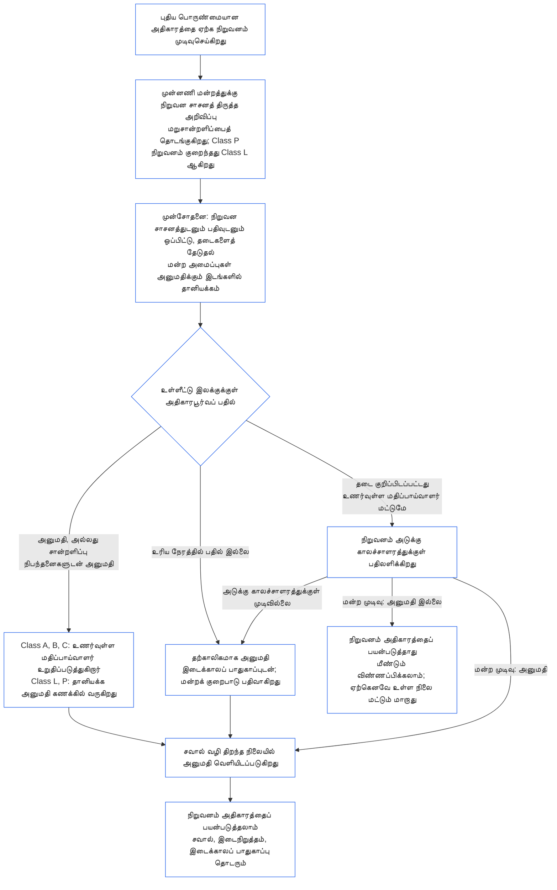

##### 9.2.2 புதிய பொருண்மையான அதிகாரத்திற்கான மறுசான்றளிப்பு

புதிய பொருண்மையான அதிகாரத்தை ஏற்க முடிவுசெய்யும் நிறுவனம் மறுசான்றளிக்கப்பட வேண்டும்; அந்த அதிகாரத்தைப் பயன்படுத்துவதற்கு முன் முடிவுக்காகக் காத்திருக்க வேண்டும். இதுவே **Article XI-E** (*நிறுவன உருவாக்கமும் வணிகத் தொடக்கமும்*) குறிப்பிடும் காத்திருப்பு. இது பின்வருமாறு நடைபெறும்:

- **முதலில் அறிவிப்பு:** [அத்தியாயம் ஏழு §7.1 ஆவணத்தை மாற்றுதல்](core_07.000_charters.md#71-changing-the-document) ஏற்கெனவே கோரும் நிறுவன சாசனத் திருத்த அறிவிப்பை நிறுவனம் வழங்கி, முன்னணி மன்றத்துக்கு அனுப்பும். அந்த அறிவிப்பு மறுசான்றளிப்பைத் தொடங்கும்.
- **இன்னும் பதிவு இல்லை:** நிறுவன சான்றளிப்புப் பதிவு இல்லாத நிறுவனம் அதே அறிவிப்பை வழங்கும். அந்த அறிவிப்பு, புதிய அதிகாரத்துக்கு மட்டும் வரம்பிட்ட முதல் சான்றளிப்பைத் தொடங்கும்; அந்த அதிகாரத்துடன் தொடர்புடைய நிறுவன சாசனத்தையும் [§3 முழு நிறுவன சான்றளிப்பு மதிப்பீடு](#3-whole-institution-certification-evaluation) முதல் [§5 உரிமைத் தள மற்றும் துறை மதிப்பீடுகள்](#5-rights-floor-and-domain-evaluations) வரையிலான மதிப்பீடுகளையும் ஒப்பிட்டு அது தீர்மானிக்கப்படும். [§1.3 முதல் சான்றளிப்புக்கான காலச்சாளரம்](#13-window-for-the-first-certification) இல் உள்ள காலச்சாளரத்தின்படி முதல் சான்றளிப்பின் எஞ்சிய பகுதி தொடரும் (அறிவிப்பால் மறுவகைப்படுத்தப்படும் Class P நிறுவனத்துக்கு, அறிவிப்பு நாளிலிருந்து காலச்சாளரம் தொடங்கும்); புதிய அதிகாரத்திற்கான காத்திருப்பு அதைப் பொறுத்ததல்ல.
- **அடுக்கு காலச்சாளரங்களுக்குள்:** [அத்தியாயம் ஒன்பது பகுதி C §9.3.4 அடுக்கு காலச்சாளரங்கள்](core_09.010_system_alignment_certification_record_recertification.md#934-tier-windows) இன் காலச்சாளரங்களின்படி மறுசான்றளிப்பு நடைபெறும்; இயல்புநிலையாக அடுக்கு நிறுவன வகுப்புடன் பொருந்தும். தவறிய காலச்சாளரம் [Article XXVI-C](core_06.020_rights_part_e.md#article-xxvi-c-timely-resolution-and-anti-delay-floor) (*காலத்திற்குள் தீர்வும் தாமத எதிர்ப்பு அடித்தளமும்*) இன் கீழ் கையாளப்படும்; கட்டணங்களும் காத்திருப்புகளும் தடையாக மாறக்கூடாது ([தவிர்க்கக்கூடிய சுமை](core_05.040_band_continuity.md#avoidable-burden)).
- **முடிந்த இடங்களில் தானியக்கமாக:** அறிவிப்பு, புதிய அதிகாரத்தை நிறுவன சாசனத்துடனும் நடப்புப் பதிவுடனும் ஒப்பிடுதல், தடைகளுக்கான முன்சோதனை, அனுமதி ஆகியவை மன்றத்தின் அமைப்புகள் அனுமதிக்கும் இடமெல்லாம் தானியக்கமாக்கப்படும். தவிர்க்கக்கூடிய சுமைக்கு தானியக்கமே விரும்பத்தக்க தீர்வு என [அத்தியாயம் ஒன்று §13.3 தவிர்க்கக்கூடிய சுமையைக் குறைத்தல்](core_01.005_interaction_interpretation.md#133-minimization-of-avoidable-burden) கூறுகிறது; தானியக்கத்தின் சுமை பொறுப்பாளர்மீது அல்ல அமைப்பின்மீது வைக்கப்படுவதாக [அத்தியாயம் ஒன்று §16.4 நடவடிக்கையின்போது ஆவணப்படுத்தல்](core_01.010_stewardship_capacity_principles.md#164-document-at-action) கூறுகிறது.
  - **அனுமதிக்கும்; மறுப்பதில்லை:** தானியக்க முன்சோதனை புதிய அதிகாரத்தை நேரடியாகவோ, நடப்புப் பதிவு ஏற்கெனவே ஆதரிக்கும் சான்றளிப்பு நிபந்தனைகளுடனோ அனுமதிக்கலாம். ஆனால் [§9.2.3 புதிய பொருண்மையான அதிகாரத்தை அனுமதிப்பதற்கான தடைகள்](#923-blockers-to-clearing-new-material-authority) இல் உள்ள தடையைத் தானாகக் குறிப்பிடவோ, அனுமதி மறுக்கவோ முடியாது. சாத்தியமான தடையை முன்சோதனை சுட்டலாம்; ஆனால் அது சுட்டியவற்றைப் பார்த்த பிறகே முன்னணி மன்றத்தின் உணர்வுள்ள மதிப்பாய்வாளர் தடையைக் குறிப்பிடலாம்.
  - **Class A, B, C:** அனுமதி அதிகாரபூர்வப் பதிலாகக் கணக்கில் வருவதற்கு முன், முன்னணி மன்றத்தின் உணர்வுள்ள மதிப்பாய்வாளர் ஒவ்வொரு அனுமதியையும் உறுதிப்படுத்துவார். இந்த வகுப்புகளில் உள்ள நிறுவனத்துக்கும், புதிய அதிகாரத்தால் இவற்றில் ஒன்றுக்குள் வரும் நிறுவனத்துக்கும் இது பொருந்தும். உறுதிப்படுத்தலுக்கும் உள்ளீட்டு இலக்கு காலம் பொருந்தும். மதிப்பாய்வாளர் முன்னணி மன்றத்தில் இருப்பார்; அந்த மன்றம் ஏற்கெனவே சரிபார்ப்பு அல்லது அங்கீகார இருக்கையைக் கொண்டிருக்கும், நிறுவனத்திலிருந்து சுயாதீனமாகவும் இருக்க வேண்டும் ([§6.1 நிறுவன சான்றளிப்பில் நான்கு இருக்கைகள்](#61-four-seats-in-an-institutional-certification)).
  - **Class L, P:** உறுதிப்படுத்தல் இன்றியே தானியக்க அனுமதி அதிகாரபூர்வப் பதிலாகக் கணக்கில் வரும். அறிவிப்பளிக்கும்போது Class P நிறுவனம் குறைந்தது Class L ஆக மறுவகைப்படுத்தப்படும் ([§1.1 யாருக்கு சான்றளிக்கப்படுகிறது](#11-who-is-certified)); எனவே அதற்கு Class L விதியே பொருந்தும்.
  - **விதிவிலக்குச் சூழல்கள்:** முன்சோதனை சாத்தியமான தடையைக் காட்டினால், அதிகாரம் உள்ளடக்கப்பட்டுள்ளதா அல்லது பொருண்மையானதா என்பதை முன்சோதனையால் தீர்மானிக்க முடியாவிட்டால், அல்லது நிறுவனமோ பாதிக்கப்படும் உணர்வுள்ளவரோ மதிப்பாய்வு கோரினால், எந்த வகுப்பிலும் உணர்வுள்ள மதிப்பாய்வாளர் விவகாரத்தை ஏற்றுக்கொள்வார். மதிப்பாய்வுக் கோரிக்கைக்கு [பொருந்தும் உள்ளீட்டு இலக்கு காலத்திற்குள்](core_05.040_band_continuity.md#tier-window), கோரிக்கை அளித்த நேரத்திலிருந்து கணக்கிட்டு பதிலளிக்கப்படும். அது அடுக்கு காலச்சாளரத்தை நீட்டிக்காது.
  - **அதே பதிவும் அதே காலக்கெடுக்களும்:** செய்யப்பட்ட சோதனைகளைப் பதிவு காட்டும்; எனவே பிற முடிவுகளைப் போலவே தானியக்க அனுமதியையும் சவால் செய்யலாம். தானியக்கம் உள்ளீட்டு இலக்கையோ அடுக்கு காலச்சாளரத்தையோ நீட்டிக்காது; முன்சோதனைச் சேவை முடங்கியிருந்தாலோ பதிலளிக்கத் தவறினாலோ கீழுள்ள புள்ளியின்படி பதில் தவறியதாகும். பயன்படுத்தும் எந்த அமைப்பிற்கும் பதிலளிப்பதைப் போலவே மன்றம் இதற்கும் பதிலளிக்கும் ([§6.3 மன்றங்கள், சான்றளிப்போர், பதிவகங்கள் நிறுவனங்களாக](#63-forums-certifiers-and-record-offices-as-institutions)).
- **காத்திருப்பு:** மறுசான்றளிப்பு அனுமதிக்கும் வரை நிறுவனம் புதிய அதிகாரத்தைப் பயன்படுத்தாது.
  - **எல்லா வகுப்புகளும் காத்திருக்கும்:** எந்த வகுப்புக்கும் விலக்கு இல்லை; அவசரமோ அவசரநிலையோ காத்திருப்பை நீக்காது.
  - **மற்ற அனைத்தும் தொடரும்:** நிறுவனம் ஏற்கெனவே செய்வது தொடரும் ([§1.2 உருவாக்க அல்லது இயக்க அனுமதியும் வாயிற்காப்பும் இல்லை](#12-no-permission-and-no-gate-on-forming-or-running)).
  - **பாதுகாப்பு காத்திருக்காது:** பாதிக்கப்படும் உணர்வுள்ளோருக்கான மன்றங்களின் அவசரப் பாதுகாப்பு மறுசான்றளிப்புக்காகக் காத்திருக்காது ([அத்தியாயம் ஒன்பது பகுதி B §6.2 மேற்பார்வை வரிசை](core_09.005_system_alignment_certification_record_process.md#62-supervisory-sequence)). அது உணர்வுள்ளோரைப் பாதுகாக்கிறது; அதிகாரத்தை முன்கூட்டியே பயன்படுத்த நிறுவனத்துக்கான காரணமல்ல.
- **அனுமதிக்கும்போது வெளியிடுதல்:** முன்னணி மன்றம் ஒவ்வொரு அனுமதியையும் வழங்கியவுடன் வெளியிடும்; தற்காலிகமான அனுமதியும் இதில் அடங்கும்; [§10 சான்றளிப்பைச் சவால் செய்தல்](#10-challenging-a-certification) இன் சவால் வழி திறந்திருக்கும். அனுமதி கிடைத்தவுடன் நிறுவனம் அதிகாரத்தைப் பயன்படுத்தலாம். அறிவிப்பு இடைவெளிக்காகவோ சவால் தீர்மானிக்கப்படுவதற்காகவோ அது காத்திருக்காது. பாதிக்கப்படும் உணர்வுள்ளவர் பிற முடிவுகளைப் போலவே அனுமதியைச் சவால் செய்யலாம்; இடைநிறுத்தமோ இடைக்காலப் பாதுகாப்போ கோரலாம்; அவற்றுக்கு காத்திருப்பு இல்லை ([§9.2.2 புதிய பொருண்மையான அதிகாரத்திற்கான மறுசான்றளிப்பு](#922-recertification-for-new-material-authority), *பாதுகாப்பு காத்திருக்காது*). வெளியிடும்போது, தனக்குத் தெரிந்த பாதிக்கப்படும் உணர்வுள்ளோருக்கும் சம்பந்தப்பட்ட அமைப்புகளின் மன்றங்களுக்கும் முன்னணி மன்றம் அனுமதி அறிவிப்பை வழங்கும். இடைநிறுத்தம் அல்லது இடைக்காலப் பாதுகாப்புக் கோரிக்கைக்கு [CF-14.445 §3.1 கட்ட இலக்குகளும் வெளிப்புற எல்லைகளும்](corpus_forum/cf_14.445_performance_backlog_publication_accessibility.md#cf-14445-31-stage-targets-and-outer-bounds) இன் பொருந்தும் உள்ளீட்டு இலக்கிற்குள், அல்லது அவசர அமைப்பு பொருந்தும் இடத்தில் அதன் வரம்பிற்குள் பதிலளிக்கப்படும்.
- **அனுமதிக்கப்பட்டதாகக் கருதுதல்:** அதிகாரம் அனுமதிக்கப்பட்டதாகக் கருதப்படும். [§9.2.3 புதிய பொருண்மையான அதிகாரத்தை அனுமதிப்பதற்கான தடைகள்](#923-blockers-to-clearing-new-material-authority) இல் உள்ள தடையை, பதிவில் குறிப்பிட்ட சான்றின் அடிப்படையில் முன்னணி மன்றம் காட்டும் இடத்தில் மட்டுமே அது அனுமதியை மறுக்கும். தடையுடன் இணைந்த சான்றளிப்பு நிபந்தனைகள் அதைக் கட்டுப்படுத்தக்கூடியதாக இருந்தால், அதிகாரம் மறுக்கப்படாமல் அந்த நிபந்தனைகளுடன் அனுமதிக்கப்படும்.
- **அனுமதிக்கப்பட்டதன் பொருள்:** மறுசான்றளிப்பு, சான்றளிப்பு நிபந்தனைகளுடன் அல்லது இல்லாமல், தற்காலிக அல்லது முழுச் சான்றளிப்பில் முடிவடையும்; அதிகாரம் பயன்படுத்தப்படுவதற்கு முன் தேவைப்படும் ஒவ்வொரு சான்றளிப்பு நிபந்தனையும் சுயாதீனமாகச் சரிபார்க்கப்பட்டிருக்கும்.
- **மன்றம் உரிய நேரத்தில் பதிலளிக்காவிட்டால்:** [CF-14.445 §3.1 கட்ட இலக்குகளும் வெளிப்புற எல்லைகளும்](corpus_forum/cf_14.445_performance_backlog_publication_accessibility.md#cf-14445-31-stage-targets-and-outer-bounds) இன் பொருந்தும் உள்ளீட்டு இலக்கிற்குள் முன்னணி மன்றம் அதிகாரபூர்வப் பதில் அளிக்க வேண்டும். அந்தப் பதில் அதிகாரத்தை அனுமதிக்கும், சான்றளிப்பு நிபந்தனைகளுடன் அனுமதிக்கும், அல்லது சார்ந்திருக்கும் சான்றுடன் தடையைக் குறிப்பிடும். தடையைக் குறிப்பிடும் பதில் நிறுவனத்துக்குப் பதிலளிக்கும் வாய்ப்பளிக்கும்; மேலுள்ள அடுக்கு காலச்சாளரத்திற்குள் மன்றம் முடிவெடுக்கும்.
  - **தற்காலிகமாக அனுமதிக்கப்பட்டது:** உள்ளீட்டு இலக்கிற்குள் அதிகாரபூர்வப் பதில் வராவிட்டாலோ, குறிப்பிடப்பட்ட தடை அடுக்கு காலச்சாளரத்திற்குள் தீர்மானிக்கப்படாவிட்டாலோ, [அத்தியாயம் ஒன்பது பகுதி B §7.2 சான்றளிப்புக் குறைபாடுகளும் திருத்தமும்](core_09.005_system_alignment_certification_record_process.md#72-certification-defects-and-correction) வழங்கும் இடைக்காலப் பாதுகாப்பும் சார்பு வரம்புகளும் உடன் அதிகாரம் தற்காலிகமாக அனுமதிக்கப்படும்.
  - **மன்றக் குறைபாடு:** தவறிய இலக்கு அல்லது காலச்சாளரம் மன்றத்தின் குறைபாடு; நிறுவனத்தின் தவறல்ல. அதை [அத்தியாயம் பதினான்கு §6 காலத்திற்குள் தீர்வு, பொருண்மை அடுக்குகள், தாமத எதிர்ப்பு ஒழுங்கு](core_14.000_forum.md#6-timely-resolution-materiality-tiers-and-anti-delay-discipline) (*காலமீறல் மதிப்பாய்வு*) இன் கீழ் பதிவு செய்து, சரிசெய்து, காலமீறலாக மதிப்பாய்வு செய்ய வேண்டும்.
  - **வேறொரு மன்றத்துக்கு மாற்றுதல்:** மறுசான்றளிப்புக் கோரிக்கை அதே குடும்பத்திலுள்ள வேறொரு மன்றத்துக்கு மாற்றப்படும் ([அத்தியாயம் பதினான்கு §3 மாற்றம், ஒருங்கிணைப்பு, ஒருங்கிணைந்து செயல்படுதல்](core_14.000_forum.md#3-transfer-consolidation-and-coordination--continuity-and-anti-capture)). மாற்றம் செய்யப்பட்டதிலிருந்து கணக்கிட்டு, அந்த மன்றம் நிறுவன வகுப்புக்குரிய வழக்கமான காலச்சாளரங்களில் மறுசான்றளிப்பைத் தொடரும்.
- **அனுமதிக்கப்படாவிட்டால்:** நிறுவனம் அதிகாரத்தைப் பயன்படுத்தாது; அத்தியாயம் ஒன்பது பகுதி B §7.4 (*நிரந்தரத் தடை அல்ல*) நிபந்தனைகளின்படி மீண்டும் விண்ணப்பிக்கலாம். புதிய அதிகாரத்தை அனுமதிக்காதது மட்டும், நிறுவனம் ஏற்கெனவே செய்யும் செயல்களுக்காக வைத்திருக்கும் நிலையின் மறுப்பு அல்லது திரும்பப்பெறுதல் ஆகாது. [§7.3 நிறுவனத்திற்கான தீர்வுத் தயார்நிலை](#73-remediation-readiness-for-an-institution) மற்றும் [§7.4 நிறுவனத்திற்கான மறுப்பும் திரும்பப்பெறுதலும்](#74-denial-and-revocation-for-an-institution) இன் கீழ் கண்டறிதல் ஏற்பட்டால்தான் அந்த நிலை மாறும்.
- **அறிவிப்பின்றி அல்லது அனுமதிக்கு முன்:** அறிவிப்பின்றி அல்லது அனுமதிக்கு முன் புதிய பொருண்மையான அதிகாரத்தைப் பயன்படுத்துவது நிறுவன சாசனத்திற்கு வெளியேயான நடைமுறையாகும். அது [§3 முழு நிறுவன சான்றளிப்பு மதிப்பீடு](#3-whole-institution-certification-evaluation) (உருப்படி 1) இன் கீழ் கண்டறிதலாகி, நிறுவன சாசன நிகழ்வாக மதிப்பாய்வை மீண்டும் திறக்கும்.

<strong>வாசகர் வழிகாட்டி (செயல்படாதது): புதிய பொருண்மையான அதிகாரத்திற்கான காத்திருப்பு</strong>

இந்தப் படம் §9.2.2 புதிய பொருண்மையான அதிகாரத்திற்கான மறுசான்றளிப்பைச் சுருக்குகிறது. படத்துக்கும் உரைக்கும் வேறுபாடு இருந்தால் உரையே கட்டுப்படுத்தும். நிறுவனம் ஏற்கெனவே செய்யும் அனைத்தும் முழுவதும் தொடரும்; பாதிக்கப்படும் உணர்வுள்ளோருக்கான அவசரப் பாதுகாப்பு ஒருபோதும் காத்திருக்காது. நிறுவனங்களுக்கான விளக்க எடுத்துக்காட்டுகள் [CS-9.320 §12 நிறுவன விளக்க நடைப்பயணங்கள்](corpus_systems/cs_09.320_system_alignment_certification_illustrations.md#cs-9320-12-illustrative-institution-walkthroughs) இல் உள்ளன.

 

