#### 1.1 వ్యవస్థ వర్గానుగుణంగా ప్రమాణబద్ధమైన ఆడిట్ ప్రక్రియగా ధృవీకరణ

పర్యవేక్షణ యంత్రాంగంగా, ధృవీకరణ [ఆడిట్ చేయదగినత](core_05.050_band_oversight.md#auditability) మరియు **అనుచ్ఛేదం XVI** (*ఆడిట్, పారదర్శకత మరియు స్వతంత్ర ధృవీకరణ*) కింద ఒక ముఖ్యంగా పెద్ద ఆడిట్ ప్రక్రియ:

- ఇది వేదిక పర్యవేక్షణలో, అనేక రంగాలను కవర్ చేస్తూ, స్థితిని ప్రదానం చేసే ప్రక్రియ.
- ఇది తోడుగా ఉండే ఇతర ఆడిట్ విధానాల ఫలితాలను సమీకరించవచ్చు; కానీ వాటిని తనలో కలిపేసుకోదు లేదా వాటి స్థానాన్ని ఆక్రమించదు. ఆడిట్ ప్రక్రియ కేంద్రంలోని [తోడ్పాటు ఆడిట్ విధానాల పటం](corpus_joint_structure/cjs_05.115_audit_process.md#sibling-audit-modes-owner-map)లో పేరుతో పేర్కొన్న స్వంత యజమాని ప్రతి దానికి ఉంటాడు:
  - **CS-6.305 (*సమాచార రకాలు మరియు నిర్వహణ*) మరియు CS-6.310** (*సమాచార వర్గీకరణలు*) కింద వ్యవస్థ సమాచార-రకాల రికార్డు ఆడిట్లు
  - **CS-9.305 (*వ్యవస్థ వర్గీకరణ యంత్రాంగం*) మరియు CS-9.310** (*వ్యవస్థ ప్రభావ వర్గీకరణలు*) కింద వ్యవస్థ వర్గీకరణ రికార్డు ఆడిట్లు
  - **CS-15.305** (*ముఖ్యమైన వ్యవస్థ బాధ్యతాయుత నిర్వహణ*) కింద నిర్వాహకుల హామీ సమీక్షలు
  - **CS-6.345** (*వ్యవస్థ జీవితచక్రం*) ACA కింద నిరంతర ఆడిట్
  - **CS-6.315** (*అర్థగ్రాహ్యత మరియు సంక్లిష్టత బాధ్యతాయుత నిర్వహణ*) మరియు **అనుచ్ఛేదం XXIII-B** (*సంక్లిష్టత ఆడిట్ మరియు మాడ్యులారిటీ అవసరాలు*) కింద సంక్లిష్టత ఆడిట్లు
  - **CJS-5.110 §5** (*పర్యవేక్షణ: స్వతంత్ర ధృవీకరణ మరియు దావా-సమగ్రత నిబంధనలు*) కింద దావా ధృవీకరణ
- ధృవీకరణ ప్రక్రియ గుండా వెళ్లకుండానే వీటిలో ఏ మూల్యాంకనాన్నైనా విడిగా నిర్వహించవచ్చు. ధృవీకరణ వాటి స్థానాన్ని భర్తీ చేయదు.

ధృవీకరణ లోతు, రికార్డు భారం, ధృవీకరణ వ్యవధి, ప్రభావిత పక్షాల సమీక్ష, సవాలు మార్గాలు [అనుపాతికత](core_05.035_band_accountability.md#proportionality) ప్రకారం [భౌతిక పందెం](core_00.000_preamble.md#material-stake)కు అనుగుణంగా ప్రమాణబద్ధం కావాలి:

- అధిక ప్రభావం, అధిక ఆధారపడటం, అధిక ప్రమాదం గల వ్యవస్థలకు బలమైన సాక్ష్యం, స్పష్టమైన రికార్డులు, ఆచరణలో సాధ్యమైన మరింత భాగస్వామ్యం అవసరం — వ్యవస్థపై ఆధారపడే వారి మేరకు ఆశయపూర్వక అందుబాటు, ప్రభావిత పక్షాల సమాచారం, సవాలు మార్గాలు సహా.
- తక్కువ వ్యవస్థ వర్గాలు, పరిమిత పరిధులకూ నిజాయితీగల వర్గీకరణ, అనుపాతిక హామీ అవసరం; బాహ్య ప్రభావాలున్న చోట భౌతిక కర్తవ్యాల నుంచి ఉచిత మినహాయింపు లభించదు.

**CS-9.305** (*వ్యవస్థ వర్గీకరణ యంత్రాంగం*) లోని [పునర్వర్గీకరణ అవసరం](corpus_systems/cs_09.305_system_classification_machinery.md#35-reclassification-requirement) ప్రకారం ప్రభావ వర్గాన్ని బట్టి ప్రక్రియ వర్తిస్తుంది:

- **వర్గం A, వర్గం B, వర్గం C:** ఈ వ్యవస్థలకు అత్యధిక ప్రభావం, ఆధారపడటం, ప్రమాదం ఉంటాయి. [§3 సంపూర్ణ-వ్యవస్థ ధృవీకరణ మూల్యాంకనం](#3-whole-system-certification-evaluation), [§4 ప్రభావితమైన చోట మూల్యాంకనాలు](#4-evaluations-where-implicated), [§5 హక్కుల నేల మరియు రంగాల మూల్యాంకనాలు](#5-rights-floor-and-domain-evaluations) కింద సంపూర్ణ లోతుతో, ప్రతి దాని స్వంత ఉపదశ వర్తించేలా సంపూర్ణ-వ్యవస్థ మూల్యాంకనం తప్పనిసరి;
- **వర్గం L:** అదే మూల్యాంకనం తప్పనిసరి, కానీ అనుపాతికంగా ఉంటుంది; **CS-9.305** (*వ్యవస్థ వర్గీకరణ యంత్రాంగం*) మరియు **CS-9.310** (*వ్యవస్థ ప్రభావ వర్గీకరణలు*) అనుమతించిన చోట డిఫాల్ట్ ధృవీకరణ వ్యవధి ఎక్కువగా, రికార్డులు సరళంగా ఉంటాయి; మరియు
- **వర్గం P:** వ్యవస్థ చెల్లుబాటుగా వర్గం Pలో ఉన్నంతవరకు ప్రక్రియను ఉపయోగించమని ప్రోత్సహిస్తారు; వర్గం P వ్యవస్థ స్వచ్ఛందంగా ఉపయోగించవచ్చు. వర్గం L లేదా అంతకంటే పైకి పునర్వర్గీకరించినప్పుడు లేదా నిర్వాహకుడు వ్యవస్థకు రాజ్యాంగ అనుపాలన ఉందని స్వచ్ఛందంగా ప్రకటించినప్పుడు ఇది తప్పనిసరి అవుతుంది.

ధృవీకరణ వ్యవధి, అలాగే దాని మధ్యకాలంలో జరిగే ఆర్థిక, వనరుల లేదా ప్రత్యేక ఆడిట్‌ను [అధ్యాయం పద్నాలుగు §6 సమయానుకూల పరిష్కారం, భౌతికత స్థాయులు మరియు ఆలస్య-నిరోధ క్రమశిక్షణ](core_14.000_forum.md#review-cadence) (*సమీక్ష వ్యవధి*)లో వ్యవస్థ వర్గాన్ని బట్టి నిర్ణయిస్తారు. ఈ అధ్యాయం సంఖ్యలను మళ్ళీ చెప్పదు.

#### 1.2 ఒక చూపులో ధృవీకరణ

*సాధారణ మాటల్లో: వ్యవస్థను నిజాయితీగా వర్గీకరించండి, వర్తించే మూల్యాంకనాలను నిర్వహించండి, వేదికలు సాక్ష్యాన్ని, ప్రభావిత పక్షాల ఆందోళనలను స్వతంత్రంగా సమీక్షించి ఫలితం నిర్ణయించాలి. వేదిక సమీక్ష కోసం ప్రారంభించిన ఒకే రికార్డును పూర్తి చేసి, సవాలు మార్గం తెరిచి ఉంచి ప్రచురించండి. ధృవీకరించిన వ్యవస్థ, దాని నోటీసు వ్యవధి మరియు అవసరమైన రక్షణలు నెరవేరిన తరువాతే ప్రారంభమవుతుంది. వాస్తవ ఫలితాలను పర్యవేక్షించండి, ఘటనలు మరియు సవాళ్లకు స్పందించండి, షెడ్యూల్ ప్రకారం లేదా వాస్తవాలు మారినప్పుడు మళ్ళీ తనిఖీ చేయండి. లోపాలను సరిదిద్దండి; ప్రభావిత పరిధిని అనుమతించే ముందు లేదా ధృవీకరణ షరతుల నుంచి విడుదల చేసే ముందు దిద్దుబాటును స్వతంత్రంగా ధృవీకరించండి. ప్రతి సమీక్ష ఫేరీలో గత రికార్డుకు లింకు చేసిన కొత్త రికార్డు వాడబడుతుంది.*

ఈ ప్రక్రియ **ఆరు దశల్లో** సాగుతుంది: **I చట్రం**, **II మూల్యాంకనం**, **III సమీక్ష**, **IV నిర్ణయం**, **V రికార్డు**, **VI నిర్వహణ**. దశ IIలో మూడు ఉపదశలు ఉంటాయి; ఒక్కొక్కటి తనదైన విభాగం: **IIa** (ఎల్లప్పుడూ), **IIb** (ప్రభావితమైనప్పుడు), **IIc** (అటు వర్తించినప్పుడు). దశ VIలో రెండు ఉపదశలు ఉంటాయి; ఒక్కొక్కటి తనదైన విభాగం: **VIa** (నిర్వహణ, పునర్ధృవీకరణ, [§9 పునర్ధృవీకరణ మరియు తిరిగి తెరవడం](core_09.010_system_alignment_certification_record_recertification.md#9-recertification-and-reopening)) మరియు **VIb** (స్థితి అనుసంధానం, [§11 స్థితితో సంబంధం](core_09.010_system_alignment_certification_record_recertification.md#11-relationship-to-standing)). మొత్తం ధృవీకరణ ప్రక్రియను ఈ క్రమంలో చార్ట్ చూపుతుంది. భాగం ఎ మొదటి రెండు దశలైన చట్ర నిర్ధారణ, మూల్యాంకనాన్ని కవర్ చేస్తుంది; [భాగం B](core_09.005_system_alignment_certification_record_process.md#chapter-nine-part-b-system-alignment-certification--forum-process-and-outcomes), [భాగం C](core_09.010_system_alignment_certification_record_recertification.md#chapter-nine-part-c-system-alignment-certification--record-recertification-and-standing) చివరి నాలుగు దశలను కవర్ చేస్తాయి: వేదిక ప్రక్రియ, ప్రారంభ అనుమతి ప్రవేశద్వారంతో ఫలితం (భాగం B); ఆపై రికార్డు, నిర్వహణ (సవాలు మార్గం, పునర్ధృవీకరణ, తిరిగి తెరవడం, స్థితి అనుసంధానం) (భాగం C).

వర్తించే ప్రతి మూల్యాంకనం ప్రతి ధృవీకరణ ఫేరిలో మళ్ళీ నిర్వహించబడుతుంది: మొదటి ధృవీకరణలో, [§2 వ్యవస్థ వర్గ మూల్యాంకనం](#2-system-class-evaluation) నిర్ణయించిన షెడ్యూల్‌లో జరిగే ప్రతి పునర్ధృవీకరణలో, తిరిగి ప్రారంభించిన లేదా కొత్త సమీక్షలో. వ్యవస్థపై ఆధారపడటం పెరగడం, భాగస్వామ్య పునాదుల నుంచి వెలికితీత పెరగడం, వ్యవస్థ వాటికి తిరిగి అందించే భాగం గణనీయంగా తగ్గడం, లేదా విశ్వసనీయ సవాలు రావడం వంటి భౌతిక వాస్తవాలు మారితే తదుపరి షెడ్యూల్ పునర్ధృవీకరణకు ముందే సమీక్ష మళ్ళీ ప్రారంభమవుతుంది. [భాగం C §9.2 తిరిగి తెరవడానికి సంకేతాలు](core_09.010_system_alignment_certification_record_recertification.md#92-reopening-triggers) ఆ సంకేతాలను జాబితా చేస్తుంది.

```mermaid
flowchart TB
    T(["భౌతిక ప్రభావమున్న వ్యవస్థ ధృవీకరణ కోరుతుంది,<br/>లేదా దానిపై ఆధారపడటం పెరుగుతుంది"])
    C["§2 దశ I, చట్రం<br/>నిజాయితీగా వర్గీకరించండి<br/><br/>వర్గం లోతు, తిరిగి తనిఖీ షెడ్యూల్‌ను నిర్దేశిస్తుంది"]
    subgraph W["§3–§5 దశ II, మూల్యాంకనం — సంపూర్ణ-వ్యవస్థ మూల్యాంకనం"]
        direction LR
        Al["§3.1–§3.4 IIa — ఎల్లప్పుడూ<br/><br/>పాలన; వ్యవస్థాగత ప్రమాదం: మూల్యాంకనం,<br/>అవసరమైన వారికి వెల్లడింపు;<br/>కాల పరిధి; సమాచార రకాలు"]
        Im["§4 IIb — ప్రభావితమైనప్పుడు<br/><br/>గోప్యత కేంద్రాలు, నిష్క్రమణ హక్కులు,<br/>సభ మరియు భిన్నాభిప్రాయం"]
        Tr["§5 IIc — అటు వర్తించినప్పుడు<br/><br/>వర్తించే హక్కుల నేల తనిఖీలు<br/>మరియు ఆరు రంగాల మూల్యాంకనాలు"]
        Al ~~~ Im ~~~ Tr
    end
    F["§6 దశ III, సమీక్ష<br/>సాక్ష్యం, ప్రభావిత పక్షాల ఆందోళనల<br/>స్వతంత్ర సమీక్ష<br/><br/>నియమించిన వేదికలు నిర్ధారణలు ఇస్తాయి;<br/>సవాలు మార్గాలు తెరిచి ఉంటాయి"]
    Rec["§8 దశ V, రికార్డు<br/>ఒక వ్యవస్థ ధృవీకరణ రికార్డు<br/><br/>వేదిక సమీక్ష కోసం ప్రారంభించి; ఫలితం,<br/>ఆధార నిర్ధారణలు, ధృవీకరణ షరతులు,<br/>నిర్వహణ ప్రణాళికతో పూర్తి చేస్తారు"]
    S[["అధ్యాయం పదకొండు — స్థితి<br/>రికార్డులు<br/><br/>ఈ అధ్యాయానికి వెలుపల"]]
    O{"§7 దశ IV, నిర్ణయం<br/><br/>సాక్ష్యం ఏ ఫలితం, స్థితికి<br/>మద్దతిస్తుంది?"}
    Fc["§7, §9.3 పూర్తి ధృవీకరణ<br/><br/>అవసరమైన వరుస స్వచ్ఛ తాత్కాలిక పునర్ధృవీకరణలు;<br/>ప్రస్తుత లేదా సూచిత రాబోయే విసంరేఖనం లేదు<br/>పూర్తి ధృవీకరణ వ్యవధి; షరతులు వర్తించవచ్చు"]
    Pc["§7, §9.3 తాత్కాలిక ధృవీకరణ<br/><br/>మొదటి మంజూరు, విసంరేఖనం తర్వాత పునరుద్ధరణ,<br/>లేదా కొనసాగుతున్న/దిగజారిన తాత్కాలిక స్థితి<br/>తక్కువ తాత్కాలిక వ్యవధి; షరతులు వర్తించవచ్చు"]
    Nc["§7 ధృవీకరించబడలేదు<br/><br/>వాయిదా, నిరాకరణ, ఉపసంహరణ లేదా గడువు ముగింపు<br/>ప్రారంభం లేదు; కారణాలు, అవసరమైన దిద్దుబాటు పని పేర్కొనండి"]
    Pub["§7, §10 పూర్తి రికార్డు ప్రచురణ<br/><br/>ప్రచురిత రికార్డు సవాలు మార్గం తెరవండి;<br/>కొత్త లేదా విస్తరించిన పరిధికి ప్రారంభ అనుమతి, నోటీసు పేర్కొనండి"]
    G{"§7 ప్రారంభ అనుమతి ప్రవేశద్వారం<br/><br/>ధృవీకరణ, వర్తించే ప్రారంభ<br/>ముందస్తు షరతులు తీరాయా?"}
    Hold["§7 ప్రారంభ ముందస్తు షరతులు నెరవేర్చండి<br/><br/>నోటీసు పూర్తి చేసి, ప్రారంభానికి ముందు అవసరమైన<br/>ధృవీకరణ షరతులను స్వతంత్రంగా ధృవీకరించండి"]
    Rm["§7 రక్షణ, దిద్దుబాటు<br/><br/>ప్రభావిత పరిధిలో కొత్త ప్రారంభం లేదు;<br/>ప్రభావిత సంజ్ఞ ప్రాణులను రక్షించి, రూపకల్పన లేదా<br/>నిర్వహణ సరిచేసి, స్వతంత్ర ధృవీకరణకు సాక్ష్యం సమర్పించండి"]
    Ch["§9–§10 దశ VIa, నిర్వహణ మరియు పునర్ధృవీకరణ<br/>పర్యవేక్షణ; సవాళ్లు తెరిచి ఉంచడం<br/><br/>ధృవీకరించిన పరిధి, షరతులలో నిర్వహణ;<br/>ఫలితాలను పర్యవేక్షించి ఘటనలు, సవాళ్లకు స్పందన"]
    S2[["అధ్యాయం పదకొండు — స్థితి<br/>రికార్డులు<br/><br/>ఈ అధ్యాయానికి వెలుపల"]]
    Sp["&nbsp;&nbsp;&nbsp;&nbsp;&nbsp;&nbsp;&nbsp;&nbsp;&nbsp;&nbsp;&nbsp;&nbsp;&nbsp;&nbsp;&nbsp;&nbsp;&nbsp;&nbsp;&nbsp;&nbsp;&nbsp;&nbsp;&nbsp;&nbsp;&nbsp;&nbsp;&nbsp;&nbsp;&nbsp;&nbsp;&nbsp;&nbsp;&nbsp;"]
    SpL["&nbsp;&nbsp;&nbsp;&nbsp;&nbsp;&nbsp;&nbsp;&nbsp;&nbsp;&nbsp;&nbsp;&nbsp;&nbsp;&nbsp;&nbsp;&nbsp;&nbsp;&nbsp;&nbsp;&nbsp;&nbsp;&nbsp;&nbsp;&nbsp;&nbsp;&nbsp;&nbsp;&nbsp;&nbsp;&nbsp;&nbsp;&nbsp;&nbsp;&nbsp;&nbsp;"]
    SpA["&nbsp;&nbsp;&nbsp;&nbsp;&nbsp;&nbsp;&nbsp;&nbsp;&nbsp;&nbsp;&nbsp;&nbsp;&nbsp;&nbsp;&nbsp;&nbsp;&nbsp;&nbsp;&nbsp;&nbsp;&nbsp;&nbsp;&nbsp;&nbsp;&nbsp;&nbsp;&nbsp;&nbsp;&nbsp;&nbsp;&nbsp;&nbsp;&nbsp;&nbsp;&nbsp;&nbsp;&nbsp;&nbsp;&nbsp;&nbsp;&nbsp;&nbsp;&nbsp;&nbsp;&nbsp;"]
    Re["§9 తదుపరి సమీక్ష ఫేరు<br/><br/>పునర్ధృవీకరణ, తిరిగి తెరవడం లేదా కొత్త సమీక్ష;<br/>ప్రతి ఫేరీలో గత రికార్డుకు లింకుతో కొత్త రికార్డు"]
    T --> C
    A1((A)) --> C
    C --> W
    W --> F
    F --> O
    O --> Fc
    O --> Pc
    O --> Nc
    Fc --> Rec
    Pc --> Rec
    Nc --> Rec
    Rec -.->|VIb, §11 —<br/>ధృవీకరించిన ఇన్‌పుట్లు మాత్రమే;<br/>ప్రస్తుత ధృవీకరణ లేదా ధృవీకరణ సమయంలో<br/>పుట్టిన వాస్తవాలు| S
    Rec --> Pub
    Rec ~~~ Sp
    Pub --> G
    G ~~~ SpL
    G -->|ధృవీకరించబడలేదు| Rm
    G --->|అవును: రికార్డు పరిధిలో<br/>నిర్వహించండి| Ch
    G --->|ధృవీకరించబడింది,<br/>ముందస్తు షరతులు మిగిలి ఉన్నాయి| Hold
    Hold --> G
    Ch -->|భౌతిక లోపం:<br/>రక్షించండి, సరిచేయండి| Rm
    Ch -->|షెడ్యూల్ ప్రకారం, లేదా<br/>భౌతిక మార్పు లేదా<br/>విశ్వసనీయ సవాలుతో<br/>సమీక్ష అవసరం| Re
    Ch -.->|VIb, §11 —<br/>ధృవీకరించిన ఇన్‌పుట్లు మాత్రమే;<br/>నిర్వహణ వల్ల సహకార, ఉల్లంఘన<br/>రికార్డులకు వాస్తవాలు లభించవచ్చు| S2
    Rm -->|దిద్దుబాటు సాక్ష్యాన్ని<br/>తదుపరి సమీక్ష ఫేరిలో<br/>తనిఖీ చేస్తారు| Re
    S2 ~~~~ SpA
    SpA ~~~ Re
    Re --> A2((A))
    style Sp fill:none,stroke:none,color:#111111
    style SpL fill:none,stroke:none,color:#111111
    style SpA fill:none,stroke:none,color:#111111
    style T fill:none,stroke:#64748b,color:#ffffff
    style C fill:none,stroke:#16a34a,color:#ffffff
    style Ch fill:none,stroke:#16a34a,color:#ffffff
    style Al fill:none,stroke:#16a34a,color:#ffffff
    style Im fill:none,stroke:#16a34a,color:#ffffff
    style Tr fill:none,stroke:#16a34a,color:#ffffff
    style F fill:none,stroke:#ea580c,color:#ffffff
    style Rec fill:none,stroke:#2563eb,color:#ffffff
    style S fill:none,stroke:#db2777,color:#ffffff
    style S2 fill:none,stroke:#db2777,color:#ffffff
    style O fill:none,stroke:#ea580c,color:#ffffff
    style Fc fill:none,stroke:#9333ea,color:#ffffff
    style Pc fill:none,stroke:#9333ea,color:#ffffff
    style Nc fill:none,stroke:#9333ea,color:#ffffff
    style G fill:none,stroke:#ea580c,color:#ffffff
    style Pub fill:none,stroke:#2563eb,color:#ffffff
    style Rm fill:none,stroke:#9333ea,color:#ffffff
    style Hold fill:none,stroke:#16a34a,color:#ffffff
    style Re fill:none,stroke:#16a34a,color:#ffffff
    style A1 fill:none,stroke:#64748b,color:#ffffff
    style A2 fill:none,stroke:#64748b,color:#ffffff
```

<strong>పాఠక మార్గదర్శకం (అసంచాలకం): ఉదాహరణలు, ప్రక్రియా షీట్, సంస్థలు</strong>

> **వర్గం A**, **వర్గం B**, **వర్గం C** ఉదాహరణ ప్రొఫైళ్ళు — ఈ అధ్యాయం అంతటా ధృవీకరణ లోతును వ్యవస్థ వర్గం ఎలా ప్రమాణబద్ధం చేస్తుందో సహా — [CS-9.320 §2 వ్యవస్థ వర్గ ప్రొఫైళ్ళ ఉదాహరణలు](corpus_systems/cs_09.320_system_alignment_certification_illustrations.md#cs-9320-2-illustrative-system-class-profiles)లో ఉన్నాయి. [§3 సంపూర్ణ-వ్యవస్థ ధృవీకరణ మూల్యాంకనం](#3-whole-system-certification-evaluation) నుంచి [§5.6 విశ్వసనీయత మరియు వ్యవస్థ-ఆధారపడటం సమగ్రత మూల్యాంకనం](#56-trustworthiness-and-system-reliance-integrity-evaluation) వరకు ప్రతి మూల్యాంకన రంగానికి అదే మూడు వ్యవస్థలపై పనిచేసిన మార్గదర్శక వివరణలు [CS-9.320 వ్యవస్థ సమన్వయ ధృవీకరణ ఉదాహరణలు](corpus_systems/cs_09.320_system_alignment_certification_illustrations.md#cs-9320-system-alignment-certification-illustrations)లో అనుసరిస్తాయి; అక్కడ ప్రతి ప్రొఫైల్, మార్గదర్శక వివరణ తాను వివరించే భాగం ఎ విభాగానికి లింకు ఇస్తుంది.
>
> ఆరు దశల దశలవారీ ప్రక్రియా షీట్‌లో ప్రతి దశకు నియమం ఉన్న విభాగపు లింకు [CS-9.315 §2 ప్రక్రియా షీట్](corpus_systems/cs_09.315_system_alignment_certification_run_sheet.md#cs-9315-2-run-sheet) (*వ్యవస్థ సమన్వయ ధృవీకరణ ప్రక్రియా షీట్*)లో ఉంది. ప్రక్రియా షీట్, విభాగం మధ్య తేడా ఉంటే విభాగమే నియంత్రిస్తుంది.
>
> అధ్యాయం పది ప్రక్రియ గుండా నడిపిన కల్పితమైన మూడు సంస్థల ఉదాహరణలు [CS-9.320 §12 సంస్థల ఉదాహరణాత్మక మార్గదర్శకాలు](corpus_systems/cs_09.320_system_alignment_certification_illustrations.md#cs-9320-12-illustrative-institution-walkthroughs)లో ఉన్నాయి.
>
> సంస్థకూ ఆరు దశలు ఇదే విధంగా [అధ్యాయం పది](core_10.000_institutional_alignment_certification.md#chapter-ten-institutional-alignment-certification) గుండా సాగుతాయి; దాని విభాగ సంఖ్యలు ఈ అధ్యాయపు సంఖ్యలతో సమానంగా ఉంటాయి: [అధ్యాయం పది §2 సంస్థ వర్గ మూల్యాంకనం](core_10.000_institutional_alignment_certification.md#2-institution-class-evaluation) నుంచి [§5 హక్కుల నేల మరియు రంగాల మూల్యాంకనాలు](core_10.000_institutional_alignment_certification.md#5-rights-floor-and-domain-evaluations) వరకు దశలు I, II; [§6 వేదిక ప్రక్రియ](core_10.000_institutional_alignment_certification.md#6-forum-process) నుంచి [§8 సంస్థాగత ధృవీకరణ రికార్డు](core_10.000_institutional_alignment_certification.md#8-institutional-certification-record) వరకు దశలు III నుంచి V; [§9 పునర్ధృవీకరణ మరియు తిరిగి తెరవడం](core_10.000_institutional_alignment_certification.md#9-recertification-and-reopening) నుంచి [§11 స్థితితో సంబంధం](core_10.000_institutional_alignment_certification.md#11-relationship-to-standing) వరకు దశ VI.

 

