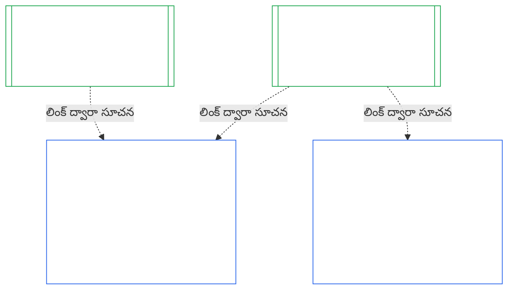
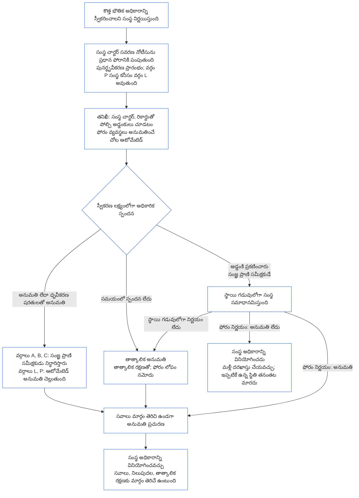

<!-- AI-assisted translation draft; unreviewed; English controls.
Source: core_10.000_institutional_alignment_certification.md
Source snapshot: 247e2180509e5e029c1106878cf225067339e010
Source SHA-256: a163a782114e584d09e295db66fe8b1b10a005b0f00116c8360396a0535ff221 -->

# అధ్యాయం పది: సంస్థాగత అనుసరణ ధృవీకరణ

<strong>కార్పస్‌లో స్థానం (కార్యాచరణాత్మకం కాదు): ఫైల్ నిర్మాణం, చదివే నియమాలు</strong>

> ఈ ఫైల్ **సంజ్ఞ రాజ్యాంగంలో భాగం**; ఇతర సంఖ్యాత్మక `core_*` ఫైళ్లతో కలిపి ఒకే పాఠ్యంగా చదివినప్పుడు మాత్రమే బంధనీయమవుతుంది. ఇందులో **అధ్యాయం పది** ఉంది — **సంస్థాగత అనుసరణ ధృవీకరణ**: ఒక [సంస్థ](core_05.040_band_continuity.md#institution), అది నడిపే ఏ వ్యవస్థతోనూ సమానం కానిది, ఎలా వర్గీకరించబడుతుంది, మూల్యాంకనం చేయబడుతుంది, సమీక్షించబడుతుంది, నిర్ణయించబడుతుంది, నమోదు చేయబడుతుంది, ప్రస్తుతంగా ఉంచబడుతుంది, తిరిగి తెరవబడుతుంది (**§1–§11**). [అధ్యాయం తొమ్మిది](core_09.000_system_alignment_certification_evaluation.md#chapter-nine-system-alignment-certification) (*వ్యవస్థ అనుసరణ ధృవీకరణ*)కు అధ్యాయం పది సంస్థాగత సమాంతరం; **దాని విభాగాలకు ఇవే సంఖ్యలు**: ఇక్కడి §N అక్కడి §Nకు సమాధానం ఇస్తుంది. [CS-9.320](corpus_systems/cs_09.320_system_alignment_certification_illustrations.md#cs-9320-system-alignment-certification-illustrations) (*వ్యవస్థ అనుసరణ ధృవీకరణ ఉదాహరణలు*)లో వ్యవస్థల కోసం పని చేసిన ఉదాహరణలు, దాని [§12 సంస్థ ఉదాహరణ నడకలు](corpus_systems/cs_09.320_system_alignment_certification_illustrations.md#cs-9320-12-illustrative-institution-walkthroughs)లో మూడు సంస్థల నడకలు ఉన్నాయి. ఈ అధ్యాయం వాటిని మళ్లీ చెప్పదు.
>
> | § | అధ్యాయం తొమ్మిది (వ్యవస్థ) | అధ్యాయం పది (సంస్థ) |
> |---|------------------------|----------------------------|
> | 1 | ఉద్దేశ్యం, పాత్ర | వ్యవస్థ ధృవీకరణతో సంబంధం, ఎవరికి ధృవీకరణ, అనుమతి లేకపోవడం, ఏర్పాటు లేదా నిర్వహణపై అడ్డంకి లేకపోవడం, కొత్త భౌతిక అధికారానికి వేచి ఉండటం, తొలి ధృవీకరణ గడువు |
> | 2 | వ్యవస్థ వర్గ మూల్యాంకనం | సంస్థ వర్గం; వర్గానుసార స్థాయి నిర్ణయం |
> | 3 | సంపూర్ణ-వ్యవస్థ ధృవీకరణ మూల్యాంకనం | ఎనిమిది సంస్థాగత అంశాలు; ఎల్లప్పుడూ |
> | 4 | ప్రభావితమైన చోట మూల్యాంకనాలు | అధ్యాయం తొమ్మిది §4కు సూచన |
> | 5 | హక్కుల కనీస ప్రమాణం, రంగాల మూల్యాంకనాలు | అధ్యాయం తొమ్మిది §5కు సూచన |
> | 6 | ఫోరం ప్రక్రియ | నాలుగు స్థానాలు; ఫోరం పాత్రలు, క్రమం; ఫోరాలు, ధృవీకర్తలు, రికార్డు కార్యాలయాలు సంస్థలుగా |
> | 7 | ధృవీకరణ ఫలితాలు | సంస్థ, దాని వ్యవస్థల కార్యకలాప ప్రారంభం; ధృవీకరణ షరతులు, ఫలితం వల్ల ఇతర ప్రభావాలు; లోపాలకు సూచన; పరిష్కార సిద్ధత; నిరాకరణ, రద్దు |
> | 8 | వ్యవస్థ ధృవీకరణ రికార్డు | సంస్థ ధృవీకరణ రికార్డు |
> | 9 | పునర్ధృవీకరణ, తిరిగి తెరవడం | పర్యవేక్షణ; తిరిగి తెరవడానికి సంకేతాలు; తాత్కాలిక, పూర్తి ధృవీకరణ; తప్పించుకోలేకపోవడం; వ్యవస్థ ధృవీకరణల నుంచి శ్రేణి ప్రభావం; పాలనా ఉల్లంఘనపై దాని వ్యవస్థలను తిరిగి తెరవడం |
> | 10 | ధృవీకరణను సవాలు చేయడం | సవాలు మార్గం |
> | 11 | స్టాండింగ్‌తో సంబంధం | స్టాండింగ్ అనుసంధానం |
>
> - **రాజ్యాంగ పరిధి యజమాని (అధ్యాయం తొమ్మిదితో సంయుక్తం):** ఫోరం పర్యవేక్షణలోని అనుసరణ ధృవీకరణ, సంబంధిత రికార్డులు. అధ్యాయం పది సంస్థను అంశంగా జోడిస్తుంది. కొత్త ఫోరం కుటుంబం, కొత్త స్థానం లేదా కొత్త ఫలిత పదం ఏదీ జోడించదు.
> - **పునరావృతం కాదు, పునర్వినియోగం:** [అధ్యాయం తొమ్మిది భాగం B §6](core_09.005_system_alignment_certification_record_process.md#6-forum-process) నుంచి [అధ్యాయం తొమ్మిది భాగం C §11](core_09.010_system_alignment_certification_record_recertification.md#11-relationship-to-standing) వరకు పేర్కొన్నట్లుగా III నుంచి VI దశలు అమలవుతాయి. అంశం సంస్థ అయినప్పుడు ఏమి మారుతుందో మాత్రమే అధ్యాయం పది చెబుతుంది.
> - **స్థానభ్రంశం-నిషేధ నియమం:** వ్యవస్థకు సంబంధించిన అధ్యాయం తొమ్మిది మూల్యాంకన పద్ధతులు, అధ్యాయం ఏడు వ్యవస్థ చార్టర్, సంస్థ చార్టర్ అంశాలు, అధ్యాయం ఎనిమిది నాలుగు-స్థానాల అవసరం, [corpus_institutions](corpus_institutions.md)లోని సంస్థాగత కర్తవ్యాలు, అధ్యాయం పదకొండు స్టాండింగ్ కొలత, అధ్యాయం పన్నెండు స్టాండింగ్ ప్రభావాలను అధ్యాయం పది మళ్లీ వివరించదు.
>
> **పూర్వస్రోతాలు:** [అధ్యాయం ఏడు](core_07.000_charters.md#chapter-seven-system-and-institutional-charters) చార్టర్లు; [అధ్యాయం ఎనిమిది](core_08.000_functional_independence_separation_of_duties.md#chapter-eight-functional-independence-and-separation-of-duties) కార్యాచరణ స్వాతంత్ర్యం; [అధ్యాయం తొమ్మిది](core_09.000_system_alignment_certification_evaluation.md#chapter-nine-system-alignment-certification) (భాగాలు [A](core_09.000_system_alignment_certification_evaluation.md#chapter-nine-part-a-system-alignment-certification--evaluation), [B](core_09.005_system_alignment_certification_record_process.md#chapter-nine-part-b-system-alignment-certification--forum-process-and-outcomes), [C](core_09.010_system_alignment_certification_record_recertification.md#chapter-nine-part-c-system-alignment-certification--record-recertification-and-standing)); అధ్యాయం పద్నాలుగు ఫోరం పర్యవేక్షణ.
> **అధఃస్రోతాలు:** అధ్యాయం పదకొండు స్టాండింగ్ రికార్డులు, ధృవీకరించిన ఇన్‌పుట్లు; అధ్యాయం పన్నెండు స్టాండింగ్ ప్రభావాలు.

<strong>Trace</strong>

- పూర్వస్రోతాలు:
  - [అధ్యాయం ఏడు §1 వ్యవస్థ, సంస్థ చార్టర్లు ఎప్పుడు అవసరం](core_07.000_charters.md#1-when-system-and-institutional-charters-are-required) (7.000 §1) (*ఏ సంస్థలు వ్యవస్థ చార్టర్ లేదా సంస్థ చార్టర్ ప్రచురిస్తాయి, సంస్థ వర్గం ఏమిటి*);
  - [అధ్యాయం ఏడు §7 సవరణ, సమీక్ష](core_07.000_charters.md#7-amendment-review-and-scope-misalignment) (7.000 §7) (*సంస్థ చార్టర్ సమీక్ష ఏమి పరీక్షిస్తుంది*);
  - [అధ్యాయం ఏడు §4 చార్టర్ పాత్ర మ్యాప్, స్టాండింగ్-రికార్డు సంరక్షణ](core_07.000_charters.md#4-the-charter-role-map-and-standing-record-custody) (7.000 §4) (*స్థానాలు ఎక్కడ ఉంటాయి*);
  - [అధ్యాయం ఎనిమిది §2 నాలుగు-స్థానాల రాజ్యాంగ అవసరం](core_08.000_functional_independence_separation_of_duties.md#2-four-seat-constitutional-requirement) (8.000 §2), [§9 తరువాతి ప్రక్రియలతో సంబంధం](core_08.000_functional_independence_separation_of_duties.md#9-relationship-to-later-processes);
  - [అధ్యాయం తొమ్మిది](core_09.000_system_alignment_certification_evaluation.md#chapter-nine-system-alignment-certification) (9.000 నుంచి 9.010) (*ఈ అధ్యాయం పునర్వినియోగించే వ్యవస్థ అనుసరణ ధృవీకరణ ప్రక్రియ*);
  - [రెండు ప్రాథమిక ప్రశ్నలు](core_00.000_preamble.md#two-fundamental-questions);
  - [రాజ్యాంగ చతుష్టయం](core_00.000_preamble.md#constitutional-tetrad);
  - [అనుచ్ఛేదం XI-E](core_06.005_rights_part_b.md#article-xi-e-institutional-formation-and-business-creation) (*సంస్థ ఏర్పాటు, వ్యాపార సృష్టి*).
- అధఃస్రోతాలు: [§1](#1-purpose-and-role) నుంచి [§11](#11-relationship-to-standing) వరకు; అధ్యాయం పదకొండు ([11.000](core_11.000_standing_assessment.md#chapter-eleven-contribution-violation-and-standing-model--measurement)); [అధ్యాయం పద్నాలుగు](core_14.000_forum.md#chapter-fourteen-forums-and-jurisdiction) (14.000).
- వీటితో చదవండి:
  - [సంస్థాగత అనుసరణ ధృవీకరణ](core_05.040_band_continuity.md#institutional-alignment-certification), మరియు
  - [సంస్థ ధృవీకరణ రికార్డు](core_05.040_band_continuity.md#institutional-certification-record) (*అధ్యాయం ఐదు అర్థాలు*);
  - **CI-8.205 §6** (*వ్యవస్థ, సంస్థ చార్టర్ విషయాలు, సమీక్ష, ఏర్పాటు నమూనా*);
  - **CF-14.425** (*సమగ్రత రక్షణలు, స్వాధీనత-నిరోధ కార్యాచరణ, స్వీయ-తీర్పు నిరోధ మద్దతు*).

 

అధ్యాయం పది **సంస్థాగత అనుసరణ ధృవీకరణకు** రాజ్యాంగ పరిధి యజమాని. ఇది [అధ్యాయం తొమ్మిది](core_09.000_system_alignment_certification_evaluation.md#chapter-nine-system-alignment-certification) ప్రక్రియను వ్యవస్థ నుంచి సంస్థకు విస్తరిస్తుంది:

- **దశ I, రూపకల్పన:** సంస్థ వర్గం, అది మూల్యాంకన స్థాయిని ఎలా నిర్ణయిస్తుంది ([§2 సంస్థ వర్గ మూల్యాంకనం](#2-institution-class-evaluation));
- **దశ II, మూల్యాంకనం:** సంస్థాగత మూల్యాంకనం; ప్రభావితమైన చోట వర్తించే మూల్యాంకనాలు, హక్కుల కనీస ప్రమాణం, రంగాల మూల్యాంకనాలు సహా ([§3 సంపూర్ణ-సంస్థ ధృవీకరణ మూల్యాంకనం](#3-whole-institution-certification-evaluation) నుంచి [§5 హక్కుల కనీస ప్రమాణం, రంగాల మూల్యాంకనాలు](#5-rights-floor-and-domain-evaluations) వరకు);
- **దశ III, సమీక్ష:** ఫోరం పాత్రలు, క్రమం ([§6 ఫోరం ప్రక్రియ](#6-forum-process));
- **దశ IV, నిర్ణయం:** ఫలితం, పరిష్కార సిద్ధత, నిరాకరణ, రద్దు ([§7 ధృవీకరణ ఫలితాలు](#7-certification-outcomes));
- **దశ V, రికార్డు:** సంస్థ ధృవీకరణ రికార్డు ([§8 సంస్థ ధృవీకరణ రికార్డు](#8-institutional-certification-record)); మరియు
- **దశ VI, నిర్వహణ:** పునర్ధృవీకరణ, తిరిగి తెరవడం, వ్యవస్థ ధృవీకరణల నుంచి శ్రేణి ప్రభావం, దాని వ్యవస్థలను తిరిగి తెరవడం, సవాలు మార్గం, స్టాండింగ్ అనుసంధానం ([§9 పునర్ధృవీకరణ, తిరిగి తెరవడం](#9-recertification-and-reopening) నుంచి [§11 స్టాండింగ్‌తో సంబంధం](#11-relationship-to-standing) వరకు).

*సాధారణ మాటల్లో: అధ్యాయం తొమ్మిది **వ్యవస్థ** అనుసరణలో ఉందా అని అడుగుతుంది. వ్యవస్థలను నడిపే లేదా వ్యవస్థ నడపకుండానే అధికారం కలిగిన **సంస్థ** గురించి అధ్యాయం పది అదే ప్రశ్న అడుగుతుంది. ఒక సంస్థ అనుసరణలో ఉండి, దాని వ్యవస్థల్లో ఒకటి లేకపోవచ్చు; దీనికి విరుద్ధంగానూ ఉండవచ్చు. అందువల్ల సంస్థ తనకే చెందిన నియంత్రణలపై తనిఖీకి లోనవుతుంది: తన సంస్థ చార్టర్ ప్రకారం పనిచేస్తుందా, తన అధికారానికి ఎవరు జవాబుదారీ, తన సభ్యుల్లో దేనికి ప్రోత్సాహం ఇస్తుంది, తనపై ఉన్న స్వతంత్ర తనిఖీలను వాస్తవంగా ఉపయోగించగలరా. ప్రతి వ్యవస్థ ధృవీకరణపై ఇది ఆధారపడుతుంది; దానిని మళ్లీ చేయదు. ఇది లైసెన్స్ కాదు: సంస్థను ప్రారంభించడానికి లేదా నడపడానికి ఎవరికీ దాని అనుమతి అవసరం లేదు.*

### 1. ఉద్దేశ్యం, పాత్ర

<strong>Trace</strong>

- పూర్వస్రోతాలు:
  - [అధ్యాయం ఏడు §1 వ్యవస్థ, సంస్థ చార్టర్లు ఎప్పుడు అవసరం](core_07.000_charters.md#1-when-system-and-institutional-charters-are-required) (7.000 §1);
  - [అధ్యాయం తొమ్మిది భాగం A §1 ఉద్దేశ్యం, పాత్ర](core_09.000_system_alignment_certification_evaluation.md#1-purpose-and-role) (9.000 §1);
  - [అనుచ్ఛేదం XI-E](core_06.005_rights_part_b.md#article-xi-e-institutional-formation-and-business-creation) (*సంస్థ ఏర్పాటు, వ్యాపార సృష్టి*);
  - [అనుచ్ఛేదం XXVIII-A](core_06.020_rights_part_e.md#xxviii-a-existing-instantiations-adoption-transition-window) (*దశలవారీ స్వీకరణ, హక్కుల కనీస ప్రమాణం కొనసాగింపు*).
- అధఃస్రోతాలు: [§2](#2-institution-class-evaluation); [§6](#6-forum-process); [§7](#7-certification-outcomes); [§9](#9-recertification-and-reopening).
- వీటితో చదవండి:
  - [సంస్థ](core_05.040_band_continuity.md#institution);
  - [సంస్థ చార్టర్](core_05.040_band_continuity.md#institutional-charter);
  - [వ్యవస్థ చార్టర్](core_05.040_band_continuity.md#system-charter);
  - [వ్యాపార సృష్టి](core_05.055_band_participation.md#business-creation).

 

*సాధారణ మాటల్లో: వ్యవస్థ ధృవీకరణ వ్యవస్థకే చెందుతుంది. సంస్థ ధృవీకరణ ఆ ధృవీకరణలను సూచించి, సంస్థ మాత్రమే జవాబుదారీగా ఉండగల అంశాలను జోడిస్తుంది. ఒకే వ్యవస్థ అనేక సంస్థల కింద కనిపించవచ్చు, లేదా ఏ సంస్థ కిందా ఉండకపోవచ్చు. సంస్థను ప్రారంభించడానికి అడ్డుగా నిలిచే అధికారం ఏదీ ఇక్కడి నుంచి రాదు.*

సంస్థాగత అనుసరణ ధృవీకరణ, వ్యవస్థ అనుసరణ ధృవీకరణలు లింక్ ద్వారా అనుసంధానమైన రెండు ధృవీకరణలు. ఈ సంబంధం **లింక్ ద్వారా కలయిక**; ఒకదానిలో మరొకటి అంతర్భాగం కావడం కాదు. చిత్రంలో, వ్యవస్థ ధృవీకరణ రికార్డు నుంచి దాన్ని సూచించే ప్రతి సంస్థ ధృవీకరణ రికార్డుకు బాణం వెళ్తుంది. ఏ సంస్థ కిందా లేని వ్యవస్థకు బాణం ఉండదు, అవసరమూ లేదు; వ్యవస్థ ఏదీ నడపని సంస్థకు తన రికార్డు ఒక్కటే ఉంటుంది.

లింక్ ద్వారా కలపడంలో రెండు వైపులున్నాయి; మొదటిది సంస్థ వైపు.

సంస్థ వైపు:

- **సంస్థ ధృవీకరణ రికార్డు వ్యవస్థ రికార్డును సూచిస్తుంది; దాని మూల్యాంకనాన్ని మళ్లీ చేయదు:** అది లింక్ ద్వారా వ్యవస్థ ధృవీకరణ రికార్డును సూచించి, దాని సంచికను పేర్కొంటుంది. ఈ అధ్యాయం వ్యవస్థ మూల్యాంకనాన్ని మళ్లీ నడపదు, వ్యవస్థ వర్గాన్ని మళ్లీ నిర్ణయించదు, వ్యవస్థ ఫలితం, స్థితి లేదా ధృవీకరణ షరతులను మార్చదు.
- **సంస్థ ధృవీకరణ వ్యవస్థ ధృవీకరణను ఎత్తివేయలేదు:** సంస్థ స్థితి ఏదైనా, ధృవీకరించబడని వ్యవస్థ ధృవీకరించబడనిదిగానే ఉంటుంది. ధృవీకరణ పొందిన వ్యవస్థకు సంస్థపై వచ్చిన నిర్ధారణ నుంచి రక్షణ లభించదు.
- **సంస్థాగత వాస్తవాలు ఒక్కసారే నిర్ధారిస్తారు:** [అధ్యాయం తొమ్మిది భాగం A §3.1 పాలన, ప్రోత్సాహకాలు, సవాలు క్రమశిక్షణ](core_09.000_system_alignment_certification_evaluation.md#31-governance-incentive-and-contestability-discipline) నిర్వాహకుడి పాలన, ప్రోత్సాహకాల గురించి అడిగిన చోట, నిర్వాహకుడికి సంబంధించిన ప్రస్తుత సంస్థ ధృవీకరణ రికార్డు ఆ వాస్తవాలను లింక్ ద్వారా అందించవచ్చు. ఆ వాస్తవాలు ఆ వ్యవస్థకు సరిపోతాయా అన్నది వ్యవస్థ ఫోరాలే నిర్ణయిస్తాయి. ఎందుకు అలా చేస్తున్నారో వ్యవస్థ ధృవీకరణ రికార్డులో చెప్పకుండా, అదే సంస్థాగత వాస్తవంపై భిన్న నిర్ధారణకు రాకూడదు.

వ్యవస్థ వైపు:

- **వ్యవస్థ ధృవీకరణ రికార్డు వ్యవస్థకే చెందుతుంది:** [అధ్యాయం తొమ్మిది](core_09.000_system_alignment_certification_evaluation.md#chapter-nine-system-alignment-certification) కింద అది వ్యవస్థ స్వంత రికార్డు.
- **ఒక వ్యవస్థ ధృవీకరణ రికార్డును అనేక సంస్థలు సూచించవచ్చు:** [అధ్యాయం ఏడు §1 వ్యవస్థ, సంస్థ చార్టర్లు ఎప్పుడు అవసరం](core_07.000_charters.md#1-when-system-and-institutional-charters-are-required) కింద ఒకటి కంటే ఎక్కువ సంస్థలు వ్యవస్థను నిర్వహించవచ్చు, బాధ్యతగా చూడవచ్చు లేదా భౌతికంగా నియంత్రించవచ్చు. ప్రతి సంస్థ అదే రికార్డును సూచిస్తుంది.
- **వ్యవస్థ ఏ సంస్థ కిందా ఉండాల్సిన అవసరం లేదు:** ఒక సంజ్ఞ ప్రాణి సంస్థ కాదు; కాబట్టి వ్యవస్థకు సంస్థ ఏదీ లేకపోవచ్చు. సంస్థ లేని వ్యవస్థ [అధ్యాయం తొమ్మిది](core_09.000_system_alignment_certification_evaluation.md#chapter-nine-system-alignment-certification) కింద మాత్రమే ధృవీకరించబడుతుంది; ఈ అధ్యాయం నుంచి దానికి ఏదీ అవసరం లేదు. సంస్థ కింద ఉండే వ్యవస్థ కూడా అదే విధంగా ధృవీకరించబడుతుంది: ఈ అధ్యాయం సంస్థకు ప్రత్యేక రికార్డును జోడిస్తుంది; వ్యవస్థ స్వంత ధృవీకరణలో ఇది ఒక దశ కాదు.

#### 1.1 ఎవరికి ధృవీకరణ

వర్గం L లేదా అంతకంటే ఎక్కువ వర్గంలోని సంస్థ ఈ అధ్యాయం పరిధిలోకి వస్తుంది; దాని వర్గాన్ని [§2.1 సంస్థ వర్గం](#21-institution-class) కింద నిర్ణయిస్తారు. ఇందులో ఏ వ్యవస్థా నడపని సంస్థ కూడా ఉంటుంది: దానికి సూచించడానికి వ్యవస్థ ధృవీకరణ రికార్డు ఉండదు; దాని స్వంత ప్రభావం ఆధారంగా దాని వర్గం నిర్ణయించబడుతుంది. సంస్థ యొక్క **పోర్ట్‌ఫోలియో** అంటే అది నిర్వహించే, బాధ్యతగా చూసే లేదా భౌతికంగా నియంత్రించే వ్యవస్థల సమూహం ([పోర్ట్‌ఫోలియో](core_05.040_band_continuity.md#portfolio)).

- **వర్గాలు A, B, C, L:** ప్రక్రియ వర్తిస్తుంది; [§2.2 వర్గం ప్రకారం స్థాయి నిర్ణయం](#22-scaling-by-class) కింద స్థాయి నిర్ణయిస్తారు.
- **వర్గం P:** ప్రక్రియ ప్రోత్సహించబడుతుంది; స్వచ్ఛందంగా ఉపయోగించవచ్చు. వర్గం L లేదా అంతకంటే ఎక్కువకు మళ్లీ వర్గీకరించినప్పుడు, లేదా సంస్థ స్వచ్ఛందంగా రాజ్యాంగ అనుసరణ ఉందని చెప్పినప్పుడు ఇది తప్పనిసరి అవుతుంది. వర్గం P సంస్థ కొత్త భౌతిక అధికారాన్ని స్వీకరించాలని నిర్ణయిస్తే, [§9.2.2 కొత్త భౌతిక అధికారం కోసం పునర్ధృవీకరణ](#922-recertification-for-new-material-authority)లో నోటీసు ఇచ్చినప్పుడు కనీసం వర్గం Lకు మళ్లీ వర్గీకరించబడుతుంది; ఆ అధికారం నిర్వచనం ప్రకారమే భౌతికమైనది ([§9.2.1 కొత్త భౌతిక అధికారంగా ఏది లెక్కించబడుతుంది](#921-what-counts-as-new-material-authority)); ఏ రంగంలోనైనా భౌతికమైన సంస్థ కనీసం వర్గం L ([§2.1 సంస్థ వర్గం](#21-institution-class), అంశం 2). నోటీసు ఉపసంహరణకు ముందే అనుమతి లభిస్తే, లేదా అధికారం అనుమతి పొందకపోతే — దాన్ని వినియోగించనంతవరకు — నోటీసు నుంచి ఆ అధికారం ముగిసే వరకూ మళ్లీ వర్గీకరణ ఉంటుంది. అప్పుడు సంస్థ తిరిగి వర్గం Pకి వస్తుంది; పరిమిత తొలి ధృవీకరణ ముగుస్తుంది. కొత్త నోటీసు ప్రక్రియను మళ్లీ ప్రారంభిస్తుంది; అనుమతి లేకుండా అధికారాన్ని వినియోగించడం [§9.2.2 కొత్త భౌతిక అధికారం కోసం పునర్ధృవీకరణ](#922-recertification-for-new-material-authority) (*నోటీసు లేకుండా లేదా అనుమతి రాకముందు*) కింద నిర్ధారణగానే ఉంటుంది. ఇది [అధ్యాయం తొమ్మిది భాగం A §1 ఉద్దేశ్యం, పాత్ర](core_09.000_system_alignment_certification_evaluation.md#1-purpose-and-role)కు సమాంతరం.
- **ఒక వ్యవస్థ:** వ్యవస్థ చార్టర్ అవసరమైన కచ్చితంగా ఒకే వ్యవస్థను నడిపే సంస్థకు ఒకే ధృవీకరణ దశ, ఒకే రికార్డు ఉంటాయి; ఈ అధ్యాయం దాన్ని **ఒక-వ్యవస్థ మూల్యాంకనం** అంటుంది. [§8 సంస్థ ధృవీకరణ రికార్డు](#8-institutional-certification-record)లోని అంశాలున్న *సంస్థాగత నిర్ధారణల భాగాన్ని* వ్యవస్థ ధృవీకరణ రికార్డు కలిగి ఉంటుంది; అదే సంస్థ ధృవీకరణ రికార్డుగా పనిచేస్తుంది. వేదికలు, స్థానాలు, గడువులు వ్యవస్థ స్వంత ధృవీకరణ దశవే; సంస్థాగత అంశాలు మాత్రమే అదనంగా ఉంటాయి. [§7.4 సంస్థకు నిరాకరణ, రద్దు](#74-denial-and-revocation-for-an-institution) చెప్పినట్లుగా, ఫలితాలకు వాటి స్వంత నిరాకరణ, రద్దు కారణాలు వర్తిస్తాయి. వ్యవస్థే పూర్తి పోర్ట్‌ఫోలియో కాబట్టి, [§9.5 వ్యవస్థ ధృవీకరణల నుంచి శ్రేణి ప్రభావం](#95-cascade-from-system-certifications) శ్రేణి ప్రభావంగా వర్తించదు; అయితే [§7.4 సంస్థకు నిరాకరణ, రద్దు](#74-denial-and-revocation-for-an-institution)లోని నియమాలు 1, 2 (సూచిక, కారణం ఎక్కడ ఉందో పరీక్ష) వర్తిస్తాయి.
- **అనేక వ్యవస్థలు:** సంస్థకు ఒక సంస్థ ధృవీకరణ రికార్డు ఉంటుంది; అది నడిపే ప్రతి వ్యవస్థ ధృవీకరణ రికార్డుకు లింక్ చేస్తుంది. ప్రతి వ్యవస్థ తన ధృవీకరణ దశ, రికార్డును విడిగా ఉంచుతుంది.
- **వ్యవస్థ ఏదీ లేదు:** సంస్థకు తనకంటూ ఒక సంస్థ ధృవీకరణ రికార్డు ఉంటుంది. సంస్థ ఏ వ్యవస్థా నడపదు కాబట్టి లింక్ చేయడానికి వ్యవస్థ ధృవీకరణ రికార్డు ఉండదు.

#### 1.2 ఏర్పాటు లేదా నిర్వహణకు అనుమతి, అడ్డంకి లేదు

సంస్థాగత అనుసరణ ధృవీకరణ అంటే సంస్థ తన అధికారాన్ని వాస్తవంగా ఎలా ఉపయోగిస్తుందో స్వతంత్రంగా తనిఖీ చేయడం. సంస్థకు స్వతంత్రమైన ఫోరాలు ఈ ధృవీకరణను నిర్వహిస్తాయి; అవి కనుగొన్న విషయాల సంస్థ ధృవీకరణ రికార్డుతో ఇది ముగుస్తుంది.

- **ప్రారంభించడం, నిర్వహించడం:** ఒక సంస్థ ముందుగా ధృవీకరణ పొందకుండానే ఏర్పడుతుంది, తన సంస్థ చార్టర్‌ను ప్రచురిస్తుంది, అధికారాన్ని వినియోగించడం ప్రారంభిస్తుంది, కార్యకలాపాలు కొనసాగిస్తుంది; ఏ ఫలితమూ ఆ హక్కును ఇవ్వదు లేదా నిరాకరించదు.
- **ఫలితం ప్రభావం:** ఫలితానికి [§7.1 సంస్థ కార్యకలాప ప్రారంభం](#71-go-live-for-an-institution)లో పేర్కొన్న ప్రభావాలే ఉంటాయి.
- **ఈ రంగంలోని ఏకైక అడ్డంకులు:** మూడు సంకుచిత అడ్డంకులున్నాయి; అన్నీ **అనుచ్ఛేదం XI-E** (*సంస్థ ఏర్పాటు, వ్యాపార సృష్టి*)లో ఉన్నాయి:
  - పేరుతో పేర్కొన్న సంజ్ఞ ప్రాణిపై ఉన్న, ఆ ప్రాణి అధికారానికి వర్తించే అమల్లో ఉన్న తాళం;
  - అనుసరణ లోపంపై నిర్దిష్టంగా ధృవీకరించిన వాస్తవాలకు సంబంధించిన తాత్కాలిక నిలుపుదల; ఇది కూడా పేరుతో పేర్కొన్న సంజ్ఞ ప్రాణి అధికారానికే వర్తిస్తుంది;
  - నిర్వహణ పక్షంపైనే ఉన్న తాళం; అది ఒక సంస్థపై వర్తించేది ఆ సంస్థపైనే తాళం ఉన్నప్పుడు మాత్రమే, ఉదాహరణకు రద్దయిన సంస్థపై **CI-12.210 §4** (*రద్దు*) కింద ఉన్న తాళం.

  ధృవీకరణ నిర్ధారణను ఈ అడ్డంకుల్లో ఒకదానిపై నిర్ణయం తీసుకునే ఫోరానికి, [§7.5 సంస్థ నిరాకరణ, రద్దు ప్రభావాలు](#75-effects-of-denial-and-revocation-for-an-institution) కింద సాక్ష్యంగా పంపవచ్చు. ధృవీకరణ ఫలితం అడ్డంకి కాదు; దాన్ని తెరవదు, మూయదు.
- **కొత్త భౌతిక అధికారం కోసం వేచి ఉండటం:** కొత్త భౌతిక అధికారాన్ని స్వీకరించాలని నిర్ణయించిన సంస్థ, [§9.2.2 కొత్త భౌతిక అధికారం కోసం పునర్ధృవీకరణ](#922-recertification-for-new-material-authority) షరతుల ప్రకారం, ఆ అధికారాన్ని వినియోగించే ముందు పునర్ధృవీకరణ ఆమోదం కోసం వేచి ఉంటుంది. **అనుచ్ఛేదం XI-E** (*సంస్థ ఏర్పాటు, వ్యాపార సృష్టి*) ఈ వేచివుండడాన్ని నిర్దేశిస్తుంది. ఇది మూడు సంకుచిత అడ్డంకుల్లో ఒకటి కాదు; ఏర్పాటు లేదా నిర్వహణపై అడ్డంకీ కాదు. ఇది కొత్త అధికారానికే వర్తిస్తుంది; సంస్థ చేసే మిగతావన్నీ కొనసాగుతాయి. దశలను [§9.2.2 కొత్త భౌతిక అధికారం కోసం పునర్ధృవీకరణ](#922-recertification-for-new-material-authority)లోని చిత్రం సంక్షిప్తంగా చూపిస్తుంది.
- **వెనుకదారి లేదు:** వ్యవస్థాపకులను వెలుపల ఉంచే లేదా పదవిలో ఉన్నవారిని కాపాడే అనుమతి-ప్రమాణంగా, ఫోరం, స్వీకర్త లేదా ప్రస్తుత అధికారి ఈ అధ్యాయంలోని దేన్నీ వాడరాదు. అలా చేయడం [అనుచ్ఛేదం XI-E](core_06.005_rights_part_b.md#article-xi-e-institutional-formation-and-business-creation) (*సంస్థ ఏర్పాటు, వ్యాపార సృష్టి*)ని ఓడిస్తుంది.
  - ప్రక్రియ ఖర్చుకు [తప్పించగల భారం](core_05.040_band_continuity.md#avoidable-burden) వర్తిస్తుంది.
  - ప్రక్రియ లోతుకు [వర్గీకరణ-ఆధారిత పాలన](core_05.050_band_oversight.md#classification-scaled-governance) వర్తిస్తుంది.
  - కొత్త భౌతిక అధికారం కోసం వేచివుండటం, అదే వర్గంలోని ప్రతి సంస్థకు ఒకే షరతులతో, ఇతరులకు ఇప్పటికే భౌతికంగా ప్రభావితం చేసే అధికారానికే వర్తిస్తుంది.

వ్యవస్థల కార్యకలాప ప్రారంభ అడ్డంకి వేరు; అది వ్యవస్థలకే వర్తిస్తుంది. [అధ్యాయం తొమ్మిది భాగం B §7.1 కార్యకలాప ప్రారంభ అడ్డంకి](core_09.005_system_alignment_certification_record_process.md#71-go-live-gate) ప్రకారం, కొత్త వ్యవస్థ లేదా దాని భౌతిక విస్తరణ, సంస్థ స్థితి ఏదైనా, తన స్వంత ధృవీకరణ ద్వారానే కార్యకలాపాలు ప్రారంభిస్తుంది.

#### 1.3 తొలి ధృవీకరణకు గడువు

స్వీకరణ పత్రం సంస్థ వర్గానికి నిర్ణయించిన గడువులో తొలి సంస్థ ధృవీకరణ రికార్డు సమర్పించాలి.

- **కొత్త సంస్థ:** [రంగ-ప్రత్యేక భౌతిక ప్రాముఖ్యత](core_05.050_band_oversight.md#domain-specific-materiality) ప్రకారం ఇతరులపై మొదటిసారి భౌతిక ప్రభావం చూపిన రోజు నుంచి గడువు మొదలవుతుంది; దాని తొలి ధృవీకరణ తాత్కాలికంగా ఉంటుంది.
- **నోటీసుపై తిరిగి వర్గీకరించిన వర్గం P సంస్థ:** కొత్త సంస్థల మాదిరిగానే, [§9.2.2 కొత్త భౌతిక అధికారం కోసం పునర్ధృవీకరణ](#922-recertification-for-new-material-authority) కింద నోటీసు ఇచ్చిన రోజు నుంచి గడువు మొదలవుతుంది; ఇప్పటికే ముగిసిన స్వీకరణ మార్పు గడువు నుంచి ఎప్పుడూ కాదు.
- **ఇప్పటికే పనిచేస్తున్న సంస్థ:** [అనుచ్ఛేదం XXVIII-A](core_06.020_rights_part_e.md#xxviii-a-existing-instantiations-adoption-transition-window) (*దశలవారీ స్వీకరణ, హక్కుల కనీస ప్రమాణం కొనసాగింపు*) కిందనున్న స్వీకరణ మార్పు గడువే దీనికి వర్తిస్తుంది; [అధ్యాయం ఏడు §1.5 వ్యవస్థ చార్టర్ లేదా సంస్థ చార్టర్ ఎప్పుడు సమర్పించాలి](core_07.000_charters.md#15-when-a-system-charter-or-institutional-charter-is-due)లోని సాధారణ నియమానికి ఇది అనుగుణం.
- **గడువు తప్పిపోవడం:** తొలి పరిశీలన లేకుండానే గడువు ముగిసి, కింద ఇచ్చిన మినహాయింపు వర్తించని సంస్థ, నమోదు చేసి సరిచేయాల్సిన లోపం కలిగి ఉంటుంది; తప్పిన గడువు ఆ పరిశీలనను ప్రారంభిస్తుంది. ఇప్పటికే పనిచేస్తున్న వర్గం L లేదా అంతకంటే ఎక్కువ సంస్థకు కింద పేర్కొన్న మైలురాయి వైఫల్యమూ ఉంటుంది. అడ్డంకి లేనందున సంస్థను నిలిపివేయరు లేదా పనిచేయకుండా నిషేధించరు ([§1.2 ఏర్పాటు లేదా నిర్వహణకు అనుమతి, అడ్డంకి లేదు](#12-no-permission-and-no-gate-on-forming-or-running)).
  - **ఇప్పటికే పనిచేస్తున్న సంస్థ:** వర్గం L లేదా అంతకంటే ఎక్కువ సంస్థలకు ఈ అధ్యాయం ప్రత్యేకంగా నిర్దేశించే నియమం ఇది; వ్యవస్థలు, వాటి నుంచి ఏర్పడిన సంస్థలను పేర్కొనే [అనుచ్ఛేదం XXVIII-A](core_06.020_rights_part_e.md#xxviii-a-existing-instantiations-adoption-transition-window) (*దశలవారీ స్వీకరణ, హక్కుల కనీస ప్రమాణం కొనసాగింపు*)కు ఇది సమానంగా రూపొందించబడింది. స్వీకరణ మార్పు గడువు ముగిసినప్పుడు తొలి ధృవీకరణ దశ పూర్తికాకపోతే (తాత్కాలిక లేదా పూర్తి ధృవీకరణ లేదు; [§7 ధృవీకరణ ఫలితాలు](#7-certification-outcomes) కింద నిర్ణయించిన ఫలితమూ లేదు), గడువు తప్పినట్లే. గడువులో దాఖలు చేసి సహకరించిన సంస్థ, ఫోరం తన గడువును మించినందున ([అధ్యాయం పద్నాలుగు §6 సకాలిక పరిష్కారం, భౌతిక ప్రాముఖ్యత స్థాయులు, ఆలస్యం-నిరోధ క్రమశిక్షణ](core_14.000_forum.md#6-timely-resolution-materiality-tiers-and-anti-delay-discipline), *గడువు మించిన సమీక్ష*; [అధ్యాయం తొమ్మిది భాగం C §9.3.4 స్థాయి గడువులు](core_09.010_system_alignment_certification_record_recertification.md#934-tier-windows)) లేదా [§7.3 సంస్థకు పరిష్కార సిద్ధత](#73-remediation-readiness-for-an-institution) కింద అనుమతించిన ఒక్క వాయిదా కొనసాగుతున్నందున పరిశీలన అసంపూర్ణంగా ఉంటే, గడువు తప్పినట్లు కాదు. [అనుచ్ఛేదం XXVIII-B](core_06.020_rights_part_e.md#article-xxviii-b-adoption-transition-authority-limits-and-reauthorization) (*స్వీకరణ మార్పు అధికార పరిమితులు, పునఃఅనుమతి*) కింద పత్రబద్ధమైన పునఃఅనుమతి సాక్ష్యం లేకపోతే, అది స్వీకరణ మార్పు మైలురాయి వైఫల్యం; సాధారణ అనుసరణ, ఉల్లంఘన మార్గం [అధ్యాయం పదకొండు](core_11.000_standing_assessment.md#chapter-eleven-contribution-violation-and-standing-model--measurement) కింద ప్రారంభమవుతుంది. ఆ అనుచ్ఛేదంలోని నియంత్రణ విధులు అమలు తేదీ నుంచి వర్తిస్తాయి; లోటు కొనసాగిందని అది కొత్త సాధారణ స్థితిగా మారదు. ఇది [అధ్యాయం తొమ్మిది భాగం B §7.1.1 ఇప్పటికే పనిచేస్తున్న వ్యవస్థలు](core_09.005_system_alignment_certification_record_process.md#711-systems-already-operating)కు సమానం. ఇది అడ్డంకి కాదు.
  - **ధృవీకరణ పరిశీలన:** ఇతర పరిశీలనల్లాగే దీనిపై నిర్ణయం తీసుకుంటారు. [§7 ధృవీకరణ ఫలితాలు](#7-certification-outcomes)లోని ఏ ఫలితంతోనైనా ముగియవచ్చు; ధృవీకరించబడలేదు అనే ఫలితంతో సహా; [§7.5 సంస్థ నిరాకరణ, రద్దు ప్రభావాలు](#75-effects-of-denial-and-revocation-for-an-institution)లోని ప్రభావాలు వర్తిస్తాయి.
  - **ఆంక్షలు, రద్దు:** ఈ అధ్యాయం వాటిని సృష్టించదు. సస్పెన్షన్, రిసీవర్‌షిప్, నిర్మాణాత్మక విభజన, రద్దు **CI-12.210** (*సంస్థాగత వైఫల్యం, రద్దు*), **CI-12.215** (*సంస్థాగత జవాబుదారీతనం, ఆంక్షలు*) కింద అధికార పరిధి గల ఫోరం వద్దే ఉంటాయి. [§7.5 సంస్థ నిరాకరణ, రద్దు ప్రభావాలు](#75-effects-of-denial-and-revocation-for-an-institution)లోని సూచన కారణాలపై మాత్రమే (అంశం 5, *సూచన*) ఆ ఫోరానికి విషయం పంపుతారు.

### 2. సంస్థ వర్గ మూల్యాంకనం

<strong>Trace</strong>

- పూర్వస్రోతాలు:
  - [అధ్యాయం ఏడు §1 వ్యవస్థ, సంస్థ చార్టర్లు ఎప్పుడు అవసరం](core_07.000_charters.md#1-when-system-and-institutional-charters-are-required) (7.000 §1);
  - [అధ్యాయం తొమ్మిది భాగం A §2 వ్యవస్థ వర్గ మూల్యాంకనం](core_09.000_system_alignment_certification_evaluation.md#2-system-class-evaluation) (9.000 §2), [§2.2 వ్యవస్థ వర్గం ప్రతి మూల్యాంకన స్థాయిని ఎలా నిర్ణయిస్తుంది](core_09.000_system_alignment_certification_evaluation.md#22-how-system-class-scales-every-evaluation);
  - [అధ్యాయం మూడు §2.1 సాధారణ తప్పించుకునే నమూనాలు](core_03.000_definition_integrity.md#21-common-evasion-patterns) (3.000 §2.1).
- అధఃస్రోతాలు: [§3](#3-whole-institution-certification-evaluation) (*వర్గం స్థాయి నిర్ణయించే అంశాలు*); [§8](#8-institutional-certification-record) (*రికార్డులో వర్గాన్ని పేర్కొనడం*); [§9.2](#92-reopening-triggers) (*దాన్ని మళ్లీ అంచనా వేసే సంకేతాలు*).
- వీటితో చదవండి:
  - **CS-9.305 (*వ్యవస్థ వర్గీకరణ యంత్రాంగం*), CS-9.310** (*వ్యవస్థ ప్రభావ వర్గీకరణలు*), [corpus_systems/cs_09.310_system_impact_classifications.md](corpus_systems/cs_09.310_system_impact_classifications.md) (*వర్గాల జాబితా*);
  - **CI-9.210** (*వర్గీకరణతో ముడిపడిన సంస్థాగత బాధ్యతలు*);
  - **CI-8.205 §6** (*వ్యవస్థ, సంస్థ చార్టర్ విషయాలు, సమీక్ష, ఏర్పాటు నమూనా*).

 

*సాధారణ మాటల్లో: ముందుగా సంస్థ ఇతరులకు ఎంత ముఖ్యమో బట్టి దానికి వర్గం కేటాయించండి. సంస్థ తనను తాను ఏమని పిలుచుకుంటుందో బట్టి కాకుండా, వాస్తవంగా ఏమి నిర్ణయిస్తుంది, తన వద్ద ఏమి కలిగి ఉంది అనేదాని ఆధారంగా అంచనా వేయండి. తర్వాత మూల్యాంకనం ఎంత సమగ్రంగా ఉండాలో వర్గం నిర్ణయిస్తుంది: వర్గం పెరిగే కొద్దీ సాక్ష్యం కఠినమవుతుంది, సమీక్ష మరింత స్వతంత్రమవుతుంది, మళ్లీ తనిఖీ త్వరగా జరుగుతుంది.*

ఈ విభాగం సంస్థ కోసం **దశ I, రూపకల్పన**.

#### 2.1 సంస్థ వర్గం

సంస్థ నడిపే వ్యవస్థ ద్వారా వచ్చినా లేదా ఏ వ్యవస్థకు వెలుపల వచ్చినా, దాని అత్యధిక భౌతిక ప్రభావమే **సంస్థ వర్గాన్ని** నిర్ణయిస్తుంది. సంస్థ వాస్తవంగా ఏమి నిర్ణయిస్తుంది, కలిగి ఉంది, నియంత్రిస్తుంది అన్నదాని ఆధారంగా తీర్పు ఇస్తారు; దాని లేబుల్, చట్టపరమైన రూపం లేదా సంస్థ చార్టర్‌లోని జాబితా ఆధారంగా కాదు. [అధ్యాయం తొమ్మిది భాగం A §2.2 వ్యవస్థ వర్గం ప్రతి మూల్యాంకన స్థాయిని ఎలా నిర్ణయిస్తుంది](core_09.000_system_alignment_certification_evaluation.md#22-how-system-class-scales-every-evaluation) వ్యవస్థకు చేసేదానిలాగే, వర్గం మూల్యాంకన లోతు, గడువులను నిర్ణయిస్తుంది. ఈ అధ్యాయంలో, [అధ్యాయం ఏడు §1.2 ఏ వర్గాలు పరిధిలోకి వస్తాయి](core_07.000_charters.md#12-which-classes-are-covered)లో ఉపయోగించే వర్గం ఇదే.

1. **వ్యవస్థల ద్వారా ప్రభావం:** సంస్థ వర్గం, దాని పోర్ట్‌ఫోలియోలోని ఏ వ్యవస్థ వర్గమైనా అందులో అత్యున్నత వర్గానికి కనీసం సమానంగా ఉంటుంది ([అధ్యాయం ఏడు §1 వ్యవస్థ, సంస్థ చార్టర్లు ఎప్పుడు అవసరం](core_07.000_charters.md#1-when-system-and-institutional-charters-are-required)). గమనించిన కార్యకలాపాల ద్వారా వ్యవస్థలను గుర్తిస్తారు. సంస్థ చార్టర్‌లో లేని వ్యవస్థ కూడా లెక్కలోకి వస్తుంది.
2. **ఏ వ్యవస్థకూ వెలుపల ప్రభావం:** సంస్థ వ్యవస్థ నడిపినా, నడపకపోయినా దాని స్వంత భౌతిక ప్రభావం, ఆధారపడటం లెక్కలోకి వస్తాయి. **CS-9.305 (*వ్యవస్థ వర్గీకరణ యంత్రాంగం*), CS-9.310** (*వ్యవస్థ ప్రభావ వర్గీకరణలు*)లోని వర్గ నిర్వచనాలను కింది అంశాలతో సంస్థ స్వంత నిర్ణయాలు, కలిగి ఉన్నదానిపై వర్తింపజేస్తారు:
   - **అది ఏమి నిర్ణయిస్తుంది, కలిగి ఉంటుంది:**
     - ఇతర సంజ్ఞ ప్రాణుల మనుగడకు అవసరమైన వాటి, విద్య, భద్రత, జీవనోపాధి, హక్కులు లేదా స్టాండింగ్ ప్రాప్యతపై అది ఏమి నిర్ణయిస్తుంది; మరియు
     - నిధులు, రికార్డులు, సభ్యత్వాలు, స్టాండింగ్ రికార్డుల సంరక్షణ, ఫోరం, ధృవీకర్త లేదా రికార్డు కార్యాలయపు విధి వంటి దాని వద్ద ఏముంది.
   - **దానికి భౌతిక ప్రాముఖ్యత ఉందా:**
     - [రంగ-ప్రత్యేక భౌతిక ప్రాముఖ్యత](core_05.050_band_oversight.md#domain-specific-materiality)లోని ఏ రంగంలోనైనా దాని స్వంత కార్యకలాపం భౌతికమైనదా; ఇతరులు తప్పనిసరిగా అనుసరించాల్సిన లేదా స్థిరపడినదిగా ఆధారపడగల [భౌతికంగా కట్టుబాటు చేసే చర్యలు](core_05.035_band_accountability.md#materially-binding-act) తీసుకోవడం సహా;
     - ఏ ఒక్క రంగంలోనైనా భౌతికమైన సంస్థ, **CS-9.305 (*వ్యవస్థ వర్గీకరణ యంత్రాంగం*), CS-9.310** (*వ్యవస్థ ప్రభావ వర్గీకరణలు*) కింద కనీసం వర్గం L అవుతుంది; మరియు
     - ఇతరులు తీసుకోవచ్చో వదిలేయవచ్చో అయిన, వారికి అవసరమైన వాటి ప్రాప్యతను నియంత్రించని సహాయం, వస్తువులు, శ్రమ లేదా సేవలు ఎవరికీ కట్టుబాటు విధించవు. అది భౌతికంగా కట్టుబాటు చేసే చర్య కాదు; ఇతర అంశాల ద్వారానే లెక్కించబడుతుంది.
   - **ఎంతమంది దానిపై ఆధారపడుతున్నారు:**
     - ఎంతమంది సంజ్ఞ ప్రాణులు దానిపై ఆధారపడుతున్నారు, దాని స్థానంలో మరొకదాన్ని ఎంత సులభంగా పెట్టవచ్చు;
     - భౌతిక నియంత్రణ రేఖ అర్థంలో దాని అధికారం ఎంత కేంద్రీకృతమైంది; మరియు
     - దాని నిర్ణయాలను ఎంతవరకు వెనక్కి తిప్పవచ్చు.
3. **ఉమ్మడి నియంత్రణ:** [రంగ-ప్రత్యేక భౌతిక ప్రాముఖ్యత](core_05.050_band_oversight.md#domain-specific-materiality) సమూహీకరణ నియమం కింద ఒకే కార్యకలాపంగా ఉండే నిర్వహణ పక్షాలు ([భౌతిక నియంత్రణ రేఖ](core_05.035_band_accountability.md#material-control-line)లో ఉమ్మడి ఆచరణాత్మక నియంత్రణ; నిధులు అందించడం ఒక్కటే సరిపోదు), వాస్తవంలో ఒకే సంస్థగా పనిచేస్తే కలిపి వర్గీకరిస్తారు. నిర్వహణ పక్షం, దాని పోర్ట్‌ఫోలియో లేదా అధికారాన్ని విభజించి ఏ భాగమూ వర్గం L చేరకుండా చేయడం [అధ్యాయం మూడు §2.1 సాధారణ తప్పించుకునే నమూనాలు](core_03.000_definition_integrity.md#21-common-evasion-patterns) కింద పరిధి, సరిహద్దు తప్పించుకోవడం.
4. **మళ్లీ వర్గీకరణ:** [§9.2 తిరిగి తెరవడానికి సంకేతాలు](#92-reopening-triggers)లోని సంకేతాలపై వర్గాన్ని మళ్లీ అంచనా వేస్తారు. కారణాలతో కూడిన వర్గీకరణను సంస్థ ధృవీకరణ రికార్డులో పేర్కొంటారు.

#### 2.2 వర్గం ప్రకారం స్థాయి నిర్ణయం

[అధ్యాయం తొమ్మిది భాగం A §2.2 వ్యవస్థ వర్గం ప్రతి మూల్యాంకన స్థాయిని ఎలా నిర్ణయిస్తుంది](core_09.000_system_alignment_certification_evaluation.md#22-how-system-class-scales-every-evaluation) చేసే విధంగానే, సంస్థ వర్గం సాక్ష్య లోతు, సమీక్ష స్వాతంత్ర్యం, సాధారణ ధృవీకరణ విరామం, రికార్డు వెల్లడింపును నిర్ణయిస్తుంది. ధృవీకరణ విరామాలు [అధ్యాయం పద్నాలుగు §6 సకాలిక పరిష్కారం, భౌతిక ప్రాముఖ్యత స్థాయులు, ఆలస్యం-నిరోధ క్రమశిక్షణ](core_14.000_forum.md#review-cadence) (*సమీక్ష ఆవర్తనం*)లో ఉన్నాయి; స్వీకరణ పత్రం ఇంకా తక్కువ విరామాలను నిర్ణయించవచ్చు; ఎన్ని నిర్దోష తాత్కాలిక పునర్ధృవీకరణలు కావాలో కూడా అది నిర్ణయిస్తుంది.

- **వర్గాలు A, B, C:** [§3 సంపూర్ణ-సంస్థ ధృవీకరణ మూల్యాంకనం](#3-whole-institution-certification-evaluation)లోని మొత్తం ఎనిమిది అంశాలు; వర్గానికి అనుగుణంగా సాక్ష్యం, స్వాతంత్ర్య స్థాయితో.
- **వర్గం L:** అదే ఎనిమిది అంశాలు సరళీకరించిన రూపంలో; [వర్గీకరణ-ఆధారిత పాలన](core_05.050_band_oversight.md#classification-scaled-governance) అనుమతించే చోట సరళ రికార్డులు, దీర్ఘ సాధారణ ధృవీకరణ విరామంతో. వర్గం L పరిశీలనలోని ప్రధాన అంశాలు: ఆచరణతో పోల్చిన సంస్థ చార్టర్, పాత్ర మ్యాప్, ఏర్పాటు తనిఖీ ప్రకటన, సూచించిన వ్యవస్థ ధృవీకరణలు ప్రస్తుతంగా ఉండటం. ఏ అంశాన్నీ వదలరాదు; కనుగొనాల్సిందేమీ లేని అంశాన్ని ఒక పంక్తిలో పేర్కొనాలి.
- **వర్గం P:** [§1.1 ఎవరికి ధృవీకరణ](#11-who-is-certified) పేర్కొన్నట్లు స్వచ్ఛందం.

**ఉమ్మడి వృత్తిపరమైన ఆచరణలో ఆతిథ్య సంస్థ.** ఒక సంస్థ ఆతిథ్య సంస్థగా ఉన్నప్పుడు ([**CI-15.205 §7**](corpus_institutions/ci_15.205_appointment_competency_rotation_removal.md#ci-46-seat-advisory) (*వృత్తి లైసెన్స్, వృత్తి అనుమతి, ఉమ్మడి వృత్తిపరమైన ఆచరణ*)), ఆతిథ్య సంస్థ కలిగి ఉన్న స్థానాల పట్ల సభ్యుల చర్యలను నమూనా ఆధారంగా దాని ధృవీకరణ పరిశీలిస్తుంది; సభ్యుల స్వీకరణ నోటీసులను ఆతిథ్య సంస్థ చేసేదానితో పోల్చుతుంది. ఒక్క సభ్యుడి చర్యపై నిర్ధారణ ఆ సభ్యుడికే చెందుతుంది; ఆతిథ్య సంస్థ కలిగి ఉన్న స్థానం విఫలమైనప్పుడే అది ఆతిథ్య సంస్థకూ వర్తిస్తుంది.

### 3. సంపూర్ణ-సంస్థ ధృవీకరణ మూల్యాంకనం

<strong>Trace</strong>

- పూర్వస్రోతాలు:
  - [అధ్యాయం తొమ్మిది భాగం A §3 సంపూర్ణ-వ్యవస్థ ధృవీకరణ మూల్యాంకనం](core_09.000_system_alignment_certification_evaluation.md#3-whole-system-certification-evaluation) (9.000 §3);
  - [అధ్యాయం ఏడు §3 వ్యవస్థ, సంస్థ చార్టర్లు ఏమి పేర్కొనాలి](core_07.000_charters.md#3-what-system-and-institutional-charters-must-state) (7.000 §3);
  - [అధ్యాయం ఏడు §5 ఏర్పాటు తనిఖీ: పదవిదారుల స్టాండింగ్, ప్రామాణికత](core_07.000_charters.md#5-formation-check-office-holder-standing-and-authenticity) (7.000 §5);
  - [అధ్యాయం ఏడు §7 సవరణ, సమీక్ష](core_07.000_charters.md#7-amendment-review-and-scope-misalignment) (7.000 §7);
  - [రెండు ప్రాథమిక ప్రశ్నలు](core_00.000_preamble.md#two-fundamental-questions);
  - [అధ్యాయం ఒకటి §19.6 యాజమాన్యం లేదా నిర్మాణం మారినప్పుడు బాధ్యతను కొనసాగించడం](core_01.010_stewardship_capacity_principles.md#196-keeping-responsibility-when-ownership-or-structure-changes) (1.010 §19.6).
- అధఃస్రోతాలు: [§6](#6-forum-process) (*ఫోరాలు సమీక్షించే నిర్ధారణలు*); [§9](#9-recertification-and-reopening) (*వాటిని తిరిగి తెరిచే సంకేతాలు*); [§11](#11-relationship-to-standing) (*పేరుతో పేర్కొన్న సంజ్ఞ ప్రాణిపై నిర్ధారణలకు ధృవీకరించిన-ఇన్‌పుట్ ద్వారం*).
- వీటితో చదవండి:
  - **CI-8.205 §3** (*అధికార శ్రేణి, అప్పగింత నియంత్రణలు*), **CI-8.205 §6** (*వ్యవస్థ, సంస్థ చార్టర్ విషయాలు, సమీక్ష, ఏర్పాటు నమూనా*);
  - **CI-6.215** (*వనరుల బాధ్యతాయుత నిర్వహణ, ప్రోత్సాహకాల సమగ్రత*);
  - అంశం 8 కోసం **CI-8.210** (*సంఘర్షణ సమగ్రత, స్వాధీనత నిరోధం, అవినీతి నిరోధం*), **CI-6.205** (*పారదర్శకత, భాగస్వామ్యం, సవాలు, సేవలకు అందుబాటు మార్గాలు*), **CI-12.205** (*పరిహార వ్యవస్థలు, సంస్థాగత పరిష్కార సామర్థ్యం*).

 

*సాధారణ మాటల్లో: సంస్థకు మాత్రమే చెందే అంశాలను తనిఖీ చేయండి; దాని ఒక్కో వ్యవస్థకు చెందేవి కాదు: సంస్థ చార్టర్‌ను పాటిస్తుందా, దాని అధికారానికి ఎవరు జవాబుదారీ, దేనికి ప్రోత్సాహం ఇస్తుంది, దానిపైని స్వతంత్ర తనిఖీలు పనిచేస్తున్నాయా.*

ఇది సంస్థ కోసం **దశ II, మూల్యాంకనం**.

ప్రతి ధృవీకరణ దశలో ఈ ఎనిమిది అంశాలను మూల్యాంకనం చేస్తారు; ఇవి [అధ్యాయం తొమ్మిది భాగం A §3 సంపూర్ణ-వ్యవస్థ ధృవీకరణ మూల్యాంకనం](core_09.000_system_alignment_certification_evaluation.md#3-whole-system-certification-evaluation)కు సంస్థాగత సమాంతరాలు. ప్రతి నిర్ధారణ తన సాక్ష్యాన్ని, దానికి ఆధారమైన సంస్థ చార్టర్ పాఠ్యాన్ని లేదా గమనించిన కార్యకలాపాన్ని పేర్కొంటుంది.

1. **ఆచరణతో పోల్చిన సంస్థ చార్టర్:**
   - [అధ్యాయం ఏడు §7 సవరణ, సమీక్ష](core_07.000_charters.md#7-amendment-review-and-scope-misalignment)లోని సమీక్ష జాబితా ప్రకారం గమనించిన కార్యకలాపంతో సంస్థ చార్టర్‌ను పోల్చి పరీక్షిస్తారు.
   - ఆచరణ సంస్థ చార్టర్‌ను దాటినా, సంస్థ చార్టర్ ఇక ఆచరణను వివరించకపోయినా, తప్పు ఏ వైపున ఉన్నా నిర్ధారణ నమోదవుతుంది.
2. **పోర్ట్‌ఫోలియో, సమగ్ర ప్రభావం:**
   - పోర్ట్‌ఫోలియోకు ఇచ్చిన కారణాన్ని పరీక్షిస్తారు: ప్రతి వ్యవస్థ సంస్థ ప్రకటించిన ఉద్దేశంతో సంబంధం కలిగి ఉండాలి; కారణం చెప్పని వ్యవస్థపై నిర్ధారణ నమోదవుతుంది.
   - ఒక్కో వ్యవస్థ ధృవీకరణ విడిగా చూపలేని అంశాల కోసం, అన్ని వ్యవస్థలను కలిపి మూల్యాంకనం చూస్తుంది:
     - ఉమ్మడి ఆధారాలు;
     - సమగ్ర ఆధారపడటం;
     - ఉమ్మడి పునాదుల నుంచి కూడిన వెలికితీత; మరియు
     - ఒకే విధిని భాగాలుగా విడగొట్టి, ప్రతి భాగం ఒక వర్గం లేదా కర్తవ్యం నుంచి తప్పించుకునే ఏర్పాట్లు.
3. **జవాబుదారీ అధికారం:**
   - సంస్థ ఇతరులపై వినియోగించే ప్రతి అధికారాన్ని పేరుతో చెప్పగల జవాబుదారీ కార్యాలయానికి ఆపాదించగలగాలి; ఆ కార్యాలయం [అధ్యాయం ఎనిమిది](core_08.000_functional_independence_separation_of_duties.md#chapter-eight-functional-independence-and-separation-of-duties), **CI-8.205 §3** (*అధికార శ్రేణి, అప్పగింత నియంత్రణలు*) నియమాల కింద జవాబుదారీగా ఉండాలి.
   - యాజమాన్యం, నియంత్రణ లేదా నిర్మాణం మారినా బాధ్యత తొలగదు ([అధ్యాయం ఒకటి §19.6 యాజమాన్యం లేదా నిర్మాణం మారినప్పుడు బాధ్యతను కొనసాగించడం](core_01.010_stewardship_capacity_principles.md#196-keeping-responsibility-when-ownership-or-structure-changes)).
4. **ప్రతిఫలాలు, ప్రోత్సాహకాలు:**
   - సంస్థ స్వంత వేతనం, పదోన్నతి, లక్ష్యాలు, ప్రతిఫలాలను [రెండు ప్రాథమిక ప్రశ్నల](core_00.000_preamble.md#two-fundamental-questions) ముందు ఉంచుతారు: నిర్మాణం వాస్తవంగా దేనికి ప్రతిఫలం ఇస్తుంది, అది రాజ్యాంగంలోని రెండు లక్ష్యాల వైపు నడిపిస్తుందా లేక వాటికి దూరంగా నడిపిస్తుందా.
   - ప్రతి వ్యవస్థ విడివిడిగా ధృవీకరించబడినా, అనుసరణ లోపానికి లేదా దాన్ని దాచడానికి ప్రతిఫలం ఇచ్చే నిర్మాణంపై నిర్ధారణ నమోదవుతుంది.
   - [అధ్యాయం తొమ్మిది భాగం A §3.3 కాల-స్థిరత్వ పరిమితి](core_09.000_system_alignment_certification_evaluation.md#33-time-consistency-constraint) వర్తిస్తుంది. భద్రత, సత్యం లేదా శ్రేయస్సుకు మధ్య లేదా దీర్ఘకాలంలో ముందే ఊహించగల నష్టం పరిష్కరించకుండా ఉంటే, సమీపకాల కొలమానాలు, స్థానిక అనుసరణ, స్వల్పకాల సామర్థ్యం సరిపోవు; ఆ ఖర్చుతో స్వల్పకాల ఫలితాలకు ప్రతిఫలం ఇచ్చే నిర్మాణంపై నిర్ధారణ నమోదవుతుంది.
   - ప్రోత్సాహకాల సమగ్రతపై సంస్థాగత కర్తవ్యాలు **CI-6.215** (*వనరుల బాధ్యతాయుత నిర్వహణ, ప్రోత్సాహకాల సమగ్రత*)లోనే ఉంటాయి; వాటిని మళ్లీ చెప్పకుండా సూచిస్తారు.
5. **పాత్ర మ్యాప్, సంరక్షణ:**
   - [చార్టర్ పాత్ర మ్యాప్](core_05.040_band_continuity.md#charter-role-map) వాస్తవంగా ఉన్న కార్యాలయాలను పేరుతో చూపాలి; చెప్పినట్లుగా వాటిని భర్తీ చేయాలి లేదా బాధ్యతలు అప్పగించాలి. సంస్థ అంశంగా ఉన్న రికార్డుకు, ఆ కార్యాలయాలు సంస్థకు [స్వతంత్రంగా](core_05.035_band_accountability.md#independence) ఉండాలి.
   - స్వతంత్ర మార్గాన్ని వాస్తవంగా ఉపయోగించగలగాలి.
   - స్థానం కేటాయించని స్థానం, పనిచేయని కార్యాలయం లేదా సంస్థ స్వంత శ్రేణிக்குள் இருக்கும் రికార్డు సంరక్షకుడిపై నిర్ధారణ నమోదవుతుంది.
6. **సూచించిన ప్రతి వ్యవస్థ ధృవీకరణ ప్రస్తుత స్థితి:**
   - సంస్థ నడిపే ప్రతి వ్యవస్థకు, వ్యవస్థ ధృవీకరణ రికార్డు అమల్లో ఉందా లేదా స్వీకరణ మార్పు గడువులో ఉందా, అలాగే ఆ రికార్డులోని ధృవీకరణ షరతులు సంస్థను ఏమి చేయమంటున్నాయో సంస్థ చేసిందా అని మూల్యాంకనం తనిఖీ చేస్తుంది.
   - గడువు ముగిసిన, ఉపసంహరించిన, విఫలమైన లేదా కారణం నమోదు చేయని ధృవీకరణ లేకపోవడంపై నిర్ధారణ నమోదవుతుంది; దాన్ని [§9.5 వ్యవస్థ ధృవీకరణల నుంచి శ్రేణి ప్రభావం](#95-cascade-from-system-certifications) సంస్థకూ వర్తింపజేస్తుంది.
7. **పదవిదారుల స్టాండింగ్, ప్రామాణికత:**
   - [అధ్యాయం ఏడు §5 ఏర్పాటు తనిఖీ: పదవిదారుల స్టాండింగ్, ప్రామాణికత](core_07.000_charters.md#5-formation-check-office-holder-standing-and-authenticity) కింద ప్రచురించిన ఏర్పాటు తనిఖీ ప్రకటనను గమనించిన కార్యకలాపంతో పోల్చి పరీక్షిస్తారు; కేవలం ధృవీకరణ ప్రకటనగా అంగీకరించరు.
   - పరిధిలోని ప్రతి పదవికి, ఫోరాలు స్టాండింగ్ వాస్తవాలను ధృవీకరించిన రికార్డులతో తనిఖీ చేస్తాయి; నియంత్రణ, ప్రయోజనాలు, ప్రతిఫలాలు, ప్రవర్తన, రక్షిత స్వరం గురించిన సాక్ష్యంతో ప్రామాణికతను నిర్ధారిస్తాయి. అంటే:
     - పదవిదారుని వాస్తవంగా ఎవరు నిర్దేశిస్తారు;
     - పదవిదారునికి దేనికి వేతనం, పదోన్నతి ఇస్తారు;
     - ఆ విధిలో పదవిదారుడు ధృవీకరించగలిగేలా ఏమి చేశాడు; మరియు
     - [రక్షిత నివేదిక](core_05.035_band_accountability.md#protected-reporting-whistleblowing) ఇచ్చిన లేదా చట్టవిరుద్ధమైన/రాజ్యాంగవిరుద్ధమైన ఆదేశాన్ని నిరాకరించిన ([అధ్యాయం ఒకటి §17.5 ప్రతిఘటించే కర్తవ్యం](core_01.010_stewardship_capacity_principles.md#175-duty-to-resist)) ఎవరైనా — పదవిదారుడు సహా — అందుకు శిక్షించబడ్డారా.
   - పరిధిలోని పదవి లేని సిబ్బందిని ఒక్కొక్కరినీ తనిఖీ చేయరు. [అధ్యాయం ఏడు §5.6 సిబ్బంది రక్షణ తనిఖీ](core_07.000_charters.md#56-staff-safeguards-check) వారిని కవర్ చేస్తుంది; అదే విధంగా గమనించిన కార్యకలాపంతో ఫోరాలు దాన్ని పరీక్షిస్తాయి. ఇది అడిగేది:
     - సంస్థ నియామకం, వేతనం, పదోన్నతి, తొలగింపు నియమాలు దాని ప్రకటిత ఉద్దేశానికి వ్యతిరేకంగా పనిచేయడాన్ని ప్రోత్సహించవా;
     - రక్షిత నివేదిక మార్గం ఉందా; దాన్ని ఉపయోగించిన లేదా చట్టవిరుద్ధ/రాజ్యాంగవిరుద్ధ ఆదేశాన్ని నిరాకరించిన సిబ్బందికి శిక్ష పడలేదా; మరియు
     - [అనుచ్ఛేదం III-C](core_06.000_rights_part_a.md#article-iii-c-labor-and-economic-floor) (*శ్రమ, ఆర్థిక కనీస ప్రమాణం*) హక్కులు యథాతథంగా ఉన్నాయా.
   - కిందివాటిలో ప్రతిదానిపై నిర్ధారణ నమోదవుతుంది:
     - వెల్లడించని నియంత్రకుని ప్రతినిధిగా ఉన్న పదవిదారుడు;
     - కాగితంపై మాత్రమే ఉన్న పరిధిలోని పదవి: సంస్థ చార్టర్ లేదా చార్టర్ పాత్ర మ్యాప్ దాన్ని పేర్కొన్నా, దాన్ని వాస్తవంగా చేపట్టి పని చేసేవారు ఎవరూ లేకపోవడం;
     - సంస్థ చార్టర్‌లో ప్రకటించిన పరిమితులు నిషేధించే పని చేసినందుకు పదవిదారులకు ప్రతిఫలం ఇచ్చే నిర్మాణం; మరియు
     - అసత్యమైన లేదా అసంపూర్ణమైన ప్రకటన.
   - నిర్ధారణలు పదవి, నిర్మాణానికి సంబంధించినవి. [§11 స్టాండింగ్‌తో సంబంధం](#11-relationship-to-standing)లోని ధృవీకరించిన-ఇన్‌పుట్ ద్వారం ద్వారా మాత్రమే అవి పేరుతో పేర్కొన్న సంజ్ఞ ప్రాణికి వర్తిస్తాయి.
   - ఏర్పాటు తనిఖీ అనేది విశ్వాస పరీక్ష కాదు. అయితే ఇతరులు హానికి లేదా వివక్షాత్మక వ్యవహారానికి అర్హులని ధృవీకరించిన ప్రకటన ప్రవర్తనగా పరిగణించి, [అధ్యాయం ఒకటి §7.5 భావప్రకటన, హాని రేఖ](core_01.000_values_principles.md#75-expression-and-the-harm-line) నిర్దేశించినట్లు పదవిదారునికి వ్యతిరేకంగా లెక్కిస్తారు.
   - అంశాలు 3, 4, 5లను దీనితో కలిపి చదువుతారు; వాటిలో ఒకదాని కింద నిర్ధారించిన వాస్తవాన్ని మరొకదాని కింద మళ్లీ నిర్ధారించరు.
8. **సంస్థ స్వంత సంస్థాగత కర్తవ్యాలు:**
   - స్వీకరించిన సంస్థాగత పాఠ్యం సంస్థపై విధించే కర్తవ్యాలకు సంస్థ అనుసరణను గమనించిన కార్యకలాపంతో పోల్చి పరీక్షిస్తారు; కేవలం ధృవీకరణ ప్రకటనపై ఆధారపడరు. ఆ కర్తవ్యాలు **CI-8.210** (*సంఘర్షణ సమగ్రత, స్వాధీనత నిరోధం, అవినీతి నిరోధం*), **CI-6.205** (*పారదర్శకత, భాగస్వామ్యం, సవాలు, సేవలకు అందుబాటు మార్గాలు*), **CI-6.215** (*వనరుల బాధ్యతాయుత నిర్వహణ, ప్రోత్సాహకాల సమగ్రత*), **CI-12.205** (*పరిహార వ్యవస్థలు, సంస్థాగత పరిష్కార సామర్థ్యం*).
   - సంస్థ పర్యవేక్షణ, జవాబుదారీతనం, భాగస్వామ్యం, సమయబద్ధత మార్గాలు ఉన్నాయా, వాస్తవంగా ఉపయోగించగలరా, సంస్థ స్వయంగా పేర్కొన్న సమయాల్లో స్పందిస్తాయా అని పరీక్ష అడుగుతుంది. ఆ సమయాలు సంస్థ వర్గానికి సంబంధించిన కనీస గడువు కంటే ఎక్కువ కాకూడదు ([అనుచ్ఛేదం XXVI-C](core_06.020_rights_part_e.md#article-xxvi-c-timely-resolution-and-anti-delay-floor) (*సకాలిక పరిష్కారం, ఆలస్యం-నిరోధ కనీస ప్రమాణం*), [CF-14.445 §3.1 దశల లక్ష్యాలు, గరిష్ఠ పరిమితులు](corpus_forum/cf_14.445_performance_backlog_publication_accessibility.md#cf-14445-31-stage-targets-and-outer-bounds)లోని సరిపోలే స్థాయి లక్ష్యాలు); పేర్కొన్న సమయం అంతకంటే ఎక్కువైతే దానిపైనే నిర్ధారణ నమోదవుతుంది.
   - కాగితంపై మాత్రమే ఉన్న మార్గం, చేరుకోలేని మార్గం, సమయానికి సమాధానం రాని మార్గం — ఒక్కొక్కటి నిర్ధారణే.
   - ఆ పాఠ్యాల్లోనే కర్తవ్యాలు ఉంటాయి; వాటిని మళ్లీ చెప్పకుండా సూచిస్తారు. అంశాలు 3 నుంచి 5లో నిర్ధారించిన వాస్తవాన్ని దీని కింద మళ్లీ నిర్ధారించరు.

**అధ్యాయం తొమ్మిది భాగం A §3లోని మరో రెండు అంశాలు: సంపూర్ణ-వ్యవస్థ ధృవీకరణ మూల్యాంకనం.** [అధ్యాయం తొమ్మిది భాగం A §3 సంపూర్ణ-వ్యవస్థ ధృవీకరణ మూల్యాంకనం](core_09.000_system_alignment_certification_evaluation.md#3-whole-system-certification-evaluation) వ్యవస్థను మరో రెండు అంశాలపై కూడా అడుగుతుంది; అవి సంస్థ స్వంత ప్రవర్తనకూ వర్తిస్తాయి. ప్రతి అంశం తన స్వంత సంకేతం నెరవేరినప్పుడు మాత్రమే సంస్థ మూల్యాంకనంలో భాగమవుతుంది:

- **వ్యవస్థాగత పరిధి, ప్రమాద అంశాలు:**
  - **ఎప్పుడు వర్తిస్తుంది:** [అధ్యాయం తొమ్మిది భాగం A §3.2 వ్యవస్థాగత పరిధి, ప్రమాద అంశాలు](core_09.000_system_alignment_certification_evaluation.md#32-systemic-scope-and-risk-factors)లోని అంశాల ప్రకారం, సంస్థ స్వంత ప్రవర్తన వ్యవస్థాగత ప్రమాదాన్ని పరిధిలోకి తెచ్చినప్పుడు: అత్యంత పెద్ద స్థాయిలోని హానులు, ప్రభావాలు ఎలా వ్యాపించి పేరుకుపోతాయి (సంస్థ స్వంత సేవ విఫలమైనప్పుడు అధఃస్రోతంలో ఏమి విఫలమవుతుందో సహా), సంస్థ కార్యకలాపాలను ఎలా దుర్వినియోగం చేయవచ్చు లేదా వాటి పరిధిని తప్పుగా ఎలా నిర్దేశించవచ్చు.
  - **దీని కింద మూల్యాంకనం:** [అధ్యాయం తొమ్మిది భాగం A §3.2 వ్యవస్థాగత పరిధి, ప్రమాద అంశాలు](core_09.000_system_alignment_certification_evaluation.md#32-systemic-scope-and-risk-factors); [§3.2.1 ప్రమాద మూల్యాంకనం, వెల్లడింపు అనుసంధానం](core_09.000_system_alignment_certification_evaluation.md#321-risk-evaluation-and-disclosure-bridge)లోని ప్రమాద మూల్యాంకనం, వెల్లడింపు అనుసంధానం, [§3.2.2 లోపాలు, అనుసరణ లోపం](core_09.000_system_alignment_certification_evaluation.md#322-defects-and-misalignment)లోని లోపాలు సహా.
- **సమాచార రకాలు, నిర్వహణ:**
  - **ఎప్పుడు వర్తిస్తుంది:** ప్రతి భౌతిక ప్రభావం చూపే ధృవీకరణ రికార్డు కోసం [అధ్యాయం తొమ్మిది భాగం A §3.4 సమాచార రకాలు, నిర్వహణ మూల్యాంకనం](core_09.000_system_alignment_certification_evaluation.md#34-data-types-and-handling-evaluation) కోరినట్లు, సంస్థ స్వంత ప్రవర్తన పరిధిలో భౌతికంగా ఉన్న సమాచార రకాలను నిర్వహించినప్పుడు.
  - **దీని కింద మూల్యాంకనం:** [అధ్యాయం తొమ్మిది భాగం A §3.4 సమాచార రకాలు, నిర్వహణ మూల్యాంకనం](core_09.000_system_alignment_certification_evaluation.md#34-data-types-and-handling-evaluation); అందులోని మౌలిక సదుపాయ హామీ స్థాయిని సంస్థ వర్గానికి సరిపడేలా నిర్ణయిస్తారు.
  - **ఎక్కడ నమోదు చేస్తారు:** ఏ వ్యవస్థకూ వెలుపల సంస్థ నిర్వహించే సమాచారానికి, సంస్థ ధృవీకరణ రికార్డులోని సమాచార రకాల విభాగంలో ([§8.1 కనీస రికార్డు విషయాలు](#81-minimum-record-contents)). వ్యవస్థలో నిర్వహించే సమాచారంపై ఆ వ్యవస్థ రికార్డులో ఒక్కసారే నిర్ధారించి, ఇక్కడ దాన్ని సూచిస్తారు.

[§4 ప్రభావితమైన చోట మూల్యాంకనాలు](#4-evaluations-where-implicated)లో, సూచించిన వ్యవస్థ ధృవీకరణ రికార్డులో ఇప్పటికే చేసిన మూల్యాంకనాన్ని మళ్లీ చేయరాదనే నియమం ఈ రెండింటికీ వర్తిస్తుంది.

### 4. ప్రభావితమైన చోట మూల్యాంకనాలు

<strong>Trace</strong>

- పూర్వస్రోతాలు:
  - [అధ్యాయం తొమ్మిది భాగం A §4 ప్రభావితమైన చోట మూల్యాంకనాలు](core_09.000_system_alignment_certification_evaluation.md#4-evaluations-where-implicated) (9.000 §4).
- అధఃస్రోతాలు: [§6](#6-forum-process); [§8](#8-institutional-certification-record).
- వీటితో చదవండి:
  - **CI-8.210** (*సంఘర్షణ సమగ్రత, స్వాధీనత నిరోధం, అవినీతి నిరోధం*);
  - **CI-6.205** (*పారదర్శకత, భాగస్వామ్యం, సవాలు, సేవలకు అందుబాటు మార్గాలు*);
  - **CI-6.215** (*వనరుల బాధ్యతాయుత నిర్వహణ, ప్రోత్సాహకాల సమగ్రత*);
  - **CI-12.205** (*పరిహార వ్యవస్థలు, సంస్థాగత పరిష్కార సామర్థ్యం*).

 

*సాధారణ మాటల్లో: వ్యవస్థపై ప్రభావం ఉన్నప్పుడు తనిఖీ చేసే రంగాల్లో ఒకదానిని సంస్థ స్వంత ప్రవర్తన తాకిన చోట, అదే మూల్యాంకనం సంస్థపైనా ఒక్కసారే చేస్తారు.*

సంస్థ స్వంత ప్రవర్తన [అధ్యాయం తొమ్మిది భాగం A §4 ప్రభావితమైన చోట మూల్యాంకనాలు](core_09.000_system_alignment_certification_evaluation.md#4-evaluations-where-implicated) కవర్ చేసే అంశాన్ని ప్రభావితం చేసినప్పుడు, అదే సంకేతాలతో సరిపోలే మూల్యాంకనం సంస్థ ప్రవర్తనపై నడుస్తుంది. ప్రతి మూల్యాంకనం దాని స్వంత సంకేతం నెరవేరిన చోట మాత్రమే వర్తిస్తుంది:

- **గోప్యత (సమాచార సంబంధిత):** సంస్థ ప్రవర్తన అధ్యాయం ఆరులోని ఒకటి కంటే ఎక్కువ గోప్యతా కేంద్రాలను భౌతికంగా ప్రభావితం చేస్తే, ప్రతి కేంద్రాన్ని పరిగణించాలి; ఒక కేంద్రం కింద మాత్రమే అంశాన్ని ముగించడం సరిపోదు ([అధ్యాయం తొమ్మిది భాగం A §4.1 గోప్యత (సమాచార సంబంధిత) సంయుక్త ఆహ్వానం](core_09.000_system_alignment_certification_evaluation.md#41-privacy-informational-joint-invocation)).
- **స్వచ్ఛంద విరమణ, ప్రధాన స్వీయ-మార్పు, నిష్క్రమణ హక్కులు:** ధృవీకరణ వాదన నిలబడే ముందు స్వచ్ఛందత, సమ్మతి, బలవంతం-నిరోధం, ఆధారపడే ఒత్తిడి, సమాచారం, తిరోగమనయోగ్యతను పరీక్షించాలి; అధికారిక సమ్మతి ఒక్కటే సరిపోదు ([అధ్యాయం తొమ్మిది భాగం A §4.2 స్వచ్ఛంద విరమణ, ప్రధాన స్వీయ-మార్పు, నిష్క్రమణ హక్కులు](core_09.000_system_alignment_certification_evaluation.md#42-voluntary-discontinuation-major-self-modification-and-exit-rights)).
- **సభ, సామూహిక సంస్థీకరణ, సంస్థ ఏర్పాటు:** అంశాన్ని ఖండిత విభజనవ్యతిరేక సూత్రం కింద సమగ్రంగా పరీక్షించాలి; ఒక్క రూపకల్పన గుండా మాత్రమే కాదు ([అధ్యాయం తొమ్మిది భాగం A §4.3 సభ, సామూహిక సంస్థీకరణ, సంస్థ ఏర్పాటు](core_09.000_system_alignment_certification_evaluation.md#43-assembly-collective-organization-and-institutional-formation)).
- **భిన్నాభిప్రాయం, శాంతియుత నిరసన:** సంస్థ భిన్నాభిప్రాయాన్ని లేదా రక్షిత అహింసాత్మక పౌర అవిధేయతను నేరుగా లేదా ప్రతినిధి సూచకాల ద్వారా ప్రతికూల ఇన్‌పుట్‌గా వాడరాదు ([అధ్యాయం తొమ్మిది భాగం A §4.3.1 భిన్నాభిప్రాయం, శాంతియుత నిరసన](core_09.000_system_alignment_certification_evaluation.md#431-dissent-and-peaceful-protest)).

సంస్థాగత కర్తవ్యాల యజమాన్యం దత్తత తీసుకున్న సంస్థాగత పాఠ్యానికే చెందుతుంది; అందులో ఇవి ఉన్నాయి:

- **CI-8.210** (*సంఘర్షణ సమగ్రత, స్వాధీనత నిరోధం, అవినీతి నిరోధం*);
- **CI-6.205** (*పారదర్శకత, భాగస్వామ్యం, సవాలు, సేవలకు అందుబాటు మార్గాలు*);
- **CI-6.215** (*వనరుల బాధ్యతాయుత నిర్వహణ, ప్రోత్సాహకాల సమగ్రత*); మరియు
- **CI-12.205** (*పరిహార వ్యవస్థలు, సంస్థాగత పరిష్కార సామర్థ్యం*).

ఈ అధ్యాయం వాటిని సూచిస్తుంది; మళ్లీ వివరించదు. సంస్థ వాటిని వాస్తవంగా పాటిస్తుందా అనేది [§3 సంపూర్ణ-సంస్థ ధృవీకరణ మూల్యాంకనం](#3-whole-institution-certification-evaluation) (అంశం 8) కింద పరీక్షిస్తారు. సూచించిన వ్యవస్థ ధృవీకరణ రికార్డులో ఇప్పటికే చేసిన మూల్యాంకనాన్ని మళ్లీ చేయరు.

### 5. హక్కుల కనీస ప్రమాణం, రంగాల మూల్యాంకనాలు

<strong>Trace</strong>

- పూర్వస్రోతాలు:
  - [అధ్యాయం తొమ్మిది భాగం A §5 హక్కుల కనీస ప్రమాణం, రంగాల మూల్యాంకనాలు](core_09.000_system_alignment_certification_evaluation.md#5-rights-floor-and-domain-evaluations) (9.000 §5).
- అధఃస్రోతాలు: [§6](#6-forum-process); [§8](#8-institutional-certification-record).
- వీటితో చదవండి:
  - [§4](#4-evaluations-where-implicated) (*సంస్థాగత కర్తవ్యాలు, మూల్యాంకనాన్ని పునరావృతం చేయరాదనే నియమం*).

 

*సాధారణ మాటల్లో: ముందరి విభాగంలోని నియమమే ఇక్కడా వర్తిస్తుంది: సంకేతం నెరవేరినప్పుడు, హక్కుల కనీస ప్రమాణం లేదా రంగ తనిఖీ సంస్థ స్వంత ప్రవర్తనపై నడుస్తుంది; సూచించిన వ్యవస్థ ధృవీకరణ ఇప్పటికే చేసిన మూల్యాంకనాన్ని మళ్లీ చేయరు.*

సంస్థ స్వంత ప్రవర్తన [అధ్యాయం తొమ్మిది భాగం A §5 హక్కుల కనీస ప్రమాణం, రంగాల మూల్యాంకనాలు](core_09.000_system_alignment_certification_evaluation.md#5-rights-floor-and-domain-evaluations) కవర్ చేసే హక్కుల కనీస ప్రమాణం లేదా రంగాన్ని ప్రభావితం చేసినప్పుడు, అదే సంకేతాలతో సరిపోలే మూల్యాంకనం సంస్థ ప్రవర్తనపై నడుస్తుంది. సంస్థ ధృవీకరణ రికార్డు సంస్థకు వర్తించే మూల్యాంకనాలనే కలిగి ఉంటుంది; ప్రతి మూల్యాంకనం దాని స్వంత సంకేతం నెరవేరినప్పుడు మాత్రమే వర్తిస్తుంది. రక్షణలు, వాటి మూల్యాంకన స్థలాలు ఇవి:

- **అనుచ్ఛేదం I-B** (*పర్యావరణ పాదముద్ర, పారదర్శకత*):
  - **ఎప్పుడు వర్తిస్తుంది:** సంస్థ గణనీయమైన ఆపాదించగల పర్యావరణ భారాలను మోస్తుంది.
  - **దీని కింద మూల్యాంకనం:** [అధ్యాయం తొమ్మిది భాగం A §5.1 పర్యావరణ పాదముద్ర మూల్యాంకనం](core_09.000_system_alignment_certification_evaluation.md#51-ecological-footprint-evaluation).
- **అనుచ్ఛేదం III-A** (*మనుగడ*):
  - **ఎప్పుడు వర్తిస్తుంది:** మనుగడకు అవసరమైన వాటి ప్రాప్యతను సంస్థ అందిస్తుంది, కేటాయిస్తుంది, ధర నిర్ణయిస్తుంది, ఆతిథ్యం ఇస్తుంది లేదా ముగిస్తుంది.
  - **దీని కింద మూల్యాంకనం:** [§2 సంస్థ వర్గ మూల్యాంకనం](#2-institution-class-evaluation), [§3 సంపూర్ణ-సంస్థ ధృవీకరణ మూల్యాంకనం](#3-whole-institution-certification-evaluation).
- **అనుచ్ఛేదం IV** (*సంజ్ఞ ప్రాణి-కేంద్రిత విద్య హక్కు*):
  - **ఎప్పుడు వర్తిస్తుంది:** విద్య లేదా శిక్షణ సందర్భాల్లో సంస్థ సంజ్ఞ ప్రాణులకు ర్యాంకులు, మదింపు, సిఫార్సు, స్థానం లేదా ఆధారపత్ర అర్హత ద్వారం వేస్తుంది; లేదా పునఃశిక్షణ, జీవితాంత అభ్యసన మార్గాలకు ద్వారం వేస్తుంది.
  - **దీని కింద మూల్యాంకనం:** [అధ్యాయం తొమ్మిది భాగం A §5.2 విద్యా సామర్థ్యం, అభ్యసన-వ్యవస్థ సమగ్రత మూల్యాంకనం](core_09.000_system_alignment_certification_evaluation.md#52-educational-capability-and-learning-system-integrity-evaluation).
- **అనుచ్ఛేదం IV-A** (*సమాన విద్యా ప్రాప్యత*):
  - **ఎప్పుడు వర్తిస్తుంది:** విద్యకు ప్రాప్యతను సంస్థ అందిస్తుంది, కేటాయిస్తుంది, ధర నిర్ణయిస్తుంది, ఆతిథ్యం ఇస్తుంది లేదా ముగిస్తుంది.
  - **దీని కింద మూల్యాంకనం:** [§2 సంస్థ వర్గ మూల్యాంకనం](#2-institution-class-evaluation), [§3 సంపూర్ణ-సంస్థ ధృవీకరణ మూల్యాంకనం](#3-whole-institution-certification-evaluation); అలాగే సంకేతాలు వర్తించే చోట [అధ్యాయం తొమ్మిది భాగం A §5.2 విద్యా సామర్థ్యం, అభ్యసన-వ్యవస్థ సమగ్రత మూల్యాంకనం](core_09.000_system_alignment_certification_evaluation.md#52-educational-capability-and-learning-system-integrity-evaluation), [అధ్యాయం తొమ్మిది భాగం A §5.5 అందుబాటు మూల్యాంకనం](core_09.000_system_alignment_certification_evaluation.md#55-accessibility-evaluation).
- **అనుచ్ఛేదం V** (*వనరుల కేటాయింపు, ఆధారాలు, పర్యావరణ వ్యవస్థ నిధులు*), **అనుచ్ఛేదం V-A** (*ఆధార మ్యాపింగ్, వనరుల ప్రవాహ పారదర్శకత*), **అనుచ్ఛేదం V-B** (*వ్యవస్థల మధ్య న్యాయం, స్థిరత్వం*) సహా:
  - **ఎప్పుడు వర్తిస్తుంది:** ఇతర వ్యవస్థలు లేదా సంజ్ఞ ప్రాణులు ఆధారపడే ఉమ్మడి మౌలిక సదుపాయాలు లేదా పునాది ఆధారాల నుంచి సంస్థ కేటాయించినా, మళ్లించినా, నిధులు సమకూర్చినా లేదా వెలికితీసినా.
  - **దీని కింద మూల్యాంకనం:** [అధ్యాయం తొమ్మిది భాగం A §5.3 అనుపాతిక వ్యవస్థాంతర మద్దతు మూల్యాంకనం](core_09.000_system_alignment_certification_evaluation.md#53-proportionate-cross-system-support-evaluation).
- **అనుచ్ఛేదం III-F** (*సురక్షిత ఉత్పత్తులు, ఆరోగ్య సమాచారం*):
  - **ఎప్పుడు వర్తిస్తుంది:** శరీరం, ఆరోగ్యం లేదా భద్రతపై ప్రభావం చూపగల ఉత్పత్తులు లేదా సేవలను సంస్థ అందించినా, జాబితా చేసినా, సిఫార్సు చేసినా, సలహా ఇచ్చినా లేదా వాటి సమాచారాన్ని మోసినా.
  - **దీని కింద మూల్యాంకనం:** [§2 సంస్థ వర్గ మూల్యాంకనం](#2-institution-class-evaluation), [§3 సంపూర్ణ-సంస్థ ధృవీకరణ మూల్యాంకనం](#3-whole-institution-certification-evaluation); దాని సంకేతం వర్తించే చోట [అధ్యాయం తొమ్మిది భాగం A §5.6 నమ్మదగినత, వ్యవస్థపై ఆధారపడే సమగ్రత మూల్యాంకనం](core_09.000_system_alignment_certification_evaluation.md#56-trustworthiness-and-system-reliance-integrity-evaluation).
- **అనుచ్ఛేదం VI-C** (*వివక్ష-నిషేధం*):
  - **ఎప్పుడు వర్తిస్తుంది:** సంజ్ఞ ప్రాణుల మధ్య సంస్థ వర్గీకరించినా, ర్యాంకులు ఇచ్చినా, ధరలు నిర్ణయించినా, ప్రవేశాన్ని నియంత్రించినా, మినహాయించినా లేదా భారాలు, ప్రయోజనాలు కేటాయించినా.
  - **దీని కింద మూల్యాంకనం:** [అధ్యాయం తొమ్మిది భాగం A §5.4 వివక్ష-నిషేధ మూల్యాంకనం](core_09.000_system_alignment_certification_evaluation.md#54-nondiscrimination-evaluation).
- **అనుచ్ఛేదం VI-D** (*అందుబాటు*):
  - **ఎప్పుడు వర్తిస్తుంది:** రాజ్యాంగపరంగా సంబంధిత రంగాల్లో వాస్తవ భాగస్వామ్యానికి సంస్థ ద్వారం వేసినప్పుడు.
  - **దీని కింద మూల్యాంకనం:** [అధ్యాయం తొమ్మిది భాగం A §5.5 అందుబాటు మూల్యాంకనం](core_09.000_system_alignment_certification_evaluation.md#55-accessibility-evaluation).
- **అనుచ్ఛేదం XIII** (*విశ్వసనీయ, నమ్మదగిన వ్యవస్థల హక్కు*):
  - **ఎప్పుడు వర్తిస్తుంది:** ప్రాతినిధ్యం చేసిన ప్రవర్తన, పరిమితులు, ప్రమాదాలు, సవాలు మార్గాలు లేదా పరిష్కారాలపై సంజ్ఞ ప్రాణులు ఆధారపడటాన్ని సంస్థ రూపుదిద్దినప్పుడు.
  - **దీని కింద మూల్యాంకనం:** [అధ్యాయం తొమ్మిది భాగం A §5.6 నమ్మదగినత, వ్యవస్థపై ఆధారపడే సమగ్రత మూల్యాంకనం](core_09.000_system_alignment_certification_evaluation.md#56-trustworthiness-and-system-reliance-integrity-evaluation).
- **అనుచ్ఛేదం XIII-A** (*విశ్వసనీయత, నమ్మదగినత కనీస ప్రమాణం*), **సురక్షిత పరిస్థితులు**:
  - **ఎప్పుడు వర్తిస్తుంది:** ఉత్పాదక కార్యకలాపాన్ని సంస్థ అందించినా లేదా దానికి ద్వారం వేసినా; లేదా సురక్షిత పరిస్థితుల ప్రాప్యతను అందించినా, కేటాయించినా, ధర నిర్ణయించినా, ఆతిథ్యం ఇచ్చినా లేదా ముగించినా.
  - **దీని కింద మూల్యాంకనం:** [§2 సంస్థ వర్గ మూల్యాంకనం](#2-institution-class-evaluation), [§3 సంపూర్ణ-సంస్థ ధృవీకరణ మూల్యాంకనం](#3-whole-institution-certification-evaluation); దాని సంకేతం వర్తించే చోట [అధ్యాయం తొమ్మిది భాగం A §5.6 నమ్మదగినత, వ్యవస్థపై ఆధారపడే సమగ్రత మూల్యాంకనం](core_09.000_system_alignment_certification_evaluation.md#56-trustworthiness-and-system-reliance-integrity-evaluation).

సంస్థాగత కర్తవ్యాలు, సూచించిన వ్యవస్థ ధృవీకరణ రికార్డులో ఇప్పటికే చేసిన మూల్యాంకనాన్ని పునరావృతం చేయరాదనే నియమం [§4 ప్రభావితమైన చోట మూల్యాంకనాలు](#4-evaluations-where-implicated)లో పేర్కొన్నవే. ప్రతి రంగ మూల్యాంకనానికి [అధ్యాయం తొమ్మిది భాగం A §5 హక్కుల కనీస ప్రమాణం, రంగాల మూల్యాంకనాలు](core_09.000_system_alignment_certification_evaluation.md#5-rights-floor-and-domain-evaluations) పేర్కొన్న సూత్రాలు, లోపాలు సంస్థ స్వంత ప్రవర్తనకు వర్తించే సరిపోలే మూల్యాంకనానికీ వర్తిస్తాయి.

### 6. ఫోరం ప్రక్రియ

<strong>Trace</strong>

- పూర్వస్రోతాలు:
  - [అధ్యాయం తొమ్మిది భాగం B §6 ఫోరం ప్రక్రియ](core_09.005_system_alignment_certification_record_process.md#6-forum-process) (9.005 §6);
  - [అధ్యాయం ఎనిమిది §2 నాలుగు-స్థానాల రాజ్యాంగ అవసరం](core_08.000_functional_independence_separation_of_duties.md#2-four-seat-constitutional-requirement) (8.000 §2), [§5 ప్రచురిత స్థానం, ఖాళీ, ప్రత్యామ్నాయ నియామకం](core_08.000_functional_independence_separation_of_duties.md#5-published-placement-vacancy-and-substitution), [§6 అనుపాతిక స్థాయి, సంయుక్త ఆతిథ్యం](core_08.000_functional_independence_separation_of_duties.md#6-proportional-scaling-and-merged-hosting), [§9 తరువాతి ప్రక్రియలతో సంబంధం](core_08.000_functional_independence_separation_of_duties.md#9-relationship-to-later-processes);
  - [అధ్యాయం పద్నాలుగు §4.3 సంస్థాగత ఫోరాలు](core_14.000_forum.md#43-institutional-forums) (14.000 §4.3);
  - [అధ్యాయం పద్నాలుగు §3 బదిలీ, సమీకరణ, సమన్వయం](core_14.000_forum.md#3-transfer-consolidation-and-coordination--continuity-and-anti-capture) (14.000 §3) (*ఫోరాల మధ్య స్వీయ-తీర్పు నిరోధ నియమం*);
  - [భౌతికంగా కట్టుబాటు చేసే చర్య రికార్డు](core_05.035_band_accountability.md#materially-binding-act-record).
- అధఃస్రోతాలు: [§7](#7-certification-outcomes); [§8](#8-institutional-certification-record); [§9](#9-recertification-and-reopening); [అధ్యాయం పద్నాలుగు](core_14.000_forum.md#chapter-fourteen-forums-and-jurisdiction) (14.000).
- వీటితో చదవండి:
  - [చార్టర్ పాత్ర మ్యాప్](core_05.040_band_continuity.md#charter-role-map);
  - **CF-14.415** (*మార్గనిర్దేశ కార్యాచరణలు, బదిలీ, తీర్పు ప్రశ్నలు, ప్రతినిధి వ్యవహారం*);
  - **CF-14.425** (*సమగ్రత రక్షణలు, స్వాధీనత-నిరోధ కార్యాచరణ, స్వీయ-తీర్పు నిరోధ మద్దతు*);
  - **CF-14.435 §6** (*స్వీయ దర్యాప్తు చేయరాదు*).

 

*సాధారణ మాటల్లో: అదే స్వతంత్ర ఫోరాలు, అదే క్రమంలో సంస్థను సమీక్షిస్తాయి; తన సమీక్షకుడిని సంస్థ ఎన్నుకోదు.*

ఇది సంస్థ కోసం **దశ III, సమీక్ష**.

#### 6.1 సంస్థాగత ధృవీకరణలో నాలుగు స్థానాలు

ఈ ఉపవిభాగం [అధ్యాయం ఎనిమిది §2 నాలుగు-స్థానాల రాజ్యాంగ అవసరం](core_08.000_functional_independence_separation_of_duties.md#2-four-seat-constitutional-requirement)ను ఈ అధ్యాయం ఎలా వర్తింపజేస్తుందో చెబుతుంది; ఈ ప్రక్రియ కోసం [అధ్యాయం ఎనిమిది §9 తరువాతి ప్రక్రియలతో సంబంధం](core_08.000_functional_independence_separation_of_duties.md#9-relationship-to-later-processes) కోరే ప్రకటన కూడా ఇదే. సంస్థాగత ధృవీకరణ ఒక [భౌతికంగా కట్టుబాటు చేసే చర్య](core_05.035_band_accountability.md#materially-binding-act); అందువల్ల ప్రతి ధృవీకరణ దశలోనూ నాలుగు స్థానాలుంటాయి. ఈ అధ్యాయం కొత్త స్థానాన్ని జోడించదు; అధ్యాయం ఎనిమిదిలోని ఏ నియమాన్నీ సడలించదు. ఈ మార్పులతో [అధ్యాయం తొమ్మిది భాగం B §6.1.1 ధృవీకరణలో నాలుగు స్థానాలు](core_09.005_system_alignment_certification_record_process.md#611-four-seats-in-a-certification) వర్తిస్తుంది:

- **[ప్రారంభ స్థానం](core_05.035_band_accountability.md#initiating-seat):** సంస్థ పాలనా అధికారం.
  - **పాత్ర:** అది ధృవీకరణను అభ్యర్థిస్తుంది లేదా సాక్ష్యం అందించాల్సిన ప్రతిపాదకురాలిగా ఉంటుంది.
  - **సంకేతంపై ప్రారంభించిన ధృవీకరణ దశ:** ప్రధాన ఫోరం ఆదేశంతో అది ప్రారంభమవుతుంది; పాలనా అధికారం ప్రతిపాదకురాలిగానే ఉంటుంది.
- **[ధృవీకరణ లేదా అనుమతి స్థానం](core_05.035_band_accountability.md#verify-or-authorize-seat):** ఫలితంపై ప్రధాన ఫోరం, అలాగే తన స్వంత నిర్ధారణపై ప్రతి భాగాధికారం; [§6.2 ఫోరం పాత్రలు, క్రమం](#62-forum-roles-and-sequence), అధ్యాయం పద్నాలుగు కింద కేటాయిస్తారు.
  - **స్థానం కేటాయింపు:** [చార్టర్ పాత్ర మ్యాప్](core_05.040_band_continuity.md#charter-role-map) ఈ స్థానాన్ని కేటాయించదు.
  - **సంస్థ చేయరానివి:** తన ధృవీకరణ అధికారాన్ని ఎన్నుకోవడం, నియమించడం, తాను నియంత్రించే మార్గం ద్వారా నిధులు సమకూర్చడం లేదా తొలగించడం.
  - **ఎవరు ఈ స్థానంలో ఉండవచ్చు:** సంస్థ కోసం పనిచేసే, దాని యాజమాన్యంలో ఉన్న లేదా దానికి జవాబుదారీగా ఉండే ఎవరూ దాని ధృవీకరణలో ఈ స్థానాన్ని చేపట్టరాదు; ఈ స్థానంలో ఉన్న ప్రతి ఒక్కరికీ ఫలితం నిర్ణయించే అంశంలో ప్రయోజనం ఉండరాదు.
  - **వ్యవస్థలు:** వ్యవస్థ ధృవీకరణకూ ఇదే నియమం వర్తిస్తుంది ([అధ్యాయం తొమ్మిది భాగం B §6.1.1 ధృవీకరణలో నాలుగు స్థానాలు](core_09.005_system_alignment_certification_record_process.md#611-four-seats-in-a-certification), *నిర్వాహకుడికి వెలుపల*).
- **[రికార్డు స్థానం](core_05.035_band_accountability.md#record-seat):** సంస్థ చార్టర్‌లోని చార్టర్ పాత్ర మ్యాప్ కేటాయించే కార్యాలయం.
  - **పాత్ర:** సంస్థ ధృవీకరణ రికార్డును ప్రారంభించడం, సవరించడం, భద్రపరచడం, ప్రచురించడం.
  - **స్థానం:** అది సంస్థ [భౌతిక నియంత్రణ రేఖ](core_05.035_band_accountability.md#material-control-line) వెలుపల ఉంటుంది.
- **[సవాలు స్థానం](core_05.035_band_accountability.md#contest-seat):** సమర్థ సమీక్ష లేదా ప్రత్యామ్నాయ ఫోరంతో ఉన్న ప్రచురిత రికార్డు సవాలు మార్గం.
  - **స్థానం:** అదే విధంగా, అదే నియంత్రణ రేఖ వెలుపల కేటాయిస్తారు.

**స్వయంగా స్థానం కేటాయించడం.** తన ధృవీకరణకు రికార్డు స్థానం, సవాలు స్థానాన్ని కేటాయించే మ్యాప్‌ను సంస్థే ప్రచురిస్తుంది.

- **చెల్లని కేటాయింపు:** ఏ స్థానం అయినా సంస్థ స్వంత భౌతిక నియంత్రణ రేఖలో కేటాయిస్తే, సంస్థే అంశంగా ఉన్న రికార్డుకు అది చెల్లదు; మ్యాప్‌లో ఏమి రాసినా ఇదే వర్తిస్తుంది ([అధ్యాయం ఎనిమిది §3 స్వాతంత్ర్యం, సంఘర్షణ, నియంత్రణ రేఖలు](core_08.000_functional_independence_separation_of_duties.md#3-independence-conflict-and-control-lines)).
- **మార్గనిర్దేశం:** ఆపై [అధ్యాయం ఎనిమిది §5 ప్రచురిత స్థానం, ఖాళీ, ప్రత్యామ్నాయ నియామకం](core_08.000_functional_independence_separation_of_duties.md#5-published-placement-vacancy-and-substitution) ప్రకారం ధృవీకరణ దశ మార్గనిర్దేశమవుతుంది. స్థానం పని, చార్టర్ పాత్ర మ్యాప్ పేర్కొన్న స్వతంత్ర మార్గానికి వెళ్తుంది; అది సంస్థకు లేదా దాని నియంత్రణ రేఖలోని ఎవరికీ మారదు.
- **నిర్ధారణ:** లోపభూయిష్ట స్థాన కేటాయింపుపైనే [§3 సంపూర్ణ-సంస్థ ధృవీకరణ మూల్యాంకనం](#3-whole-institution-certification-evaluation) కింద నిర్ధారణ నమోదవుతుంది.

**సంయుక్త ఆతిథ్యం.** [అధ్యాయం ఎనిమిది §6 అనుపాతిక స్థాయి, సంయుక్త ఆతిథ్యం](core_08.000_functional_independence_separation_of_duties.md#6-proportional-scaling-and-merged-hosting) యథాతథంగా వర్తిస్తుంది. ఈ అధ్యాయం సంయుక్త ఆతిథ్యాన్ని జోడించదు, తొలగించదు.

#### 6.2 ఫోరం పాత్రలు, క్రమం

[అధ్యాయం తొమ్మిది భాగం B §6.2 పర్యవేక్షణ క్రమం](core_09.005_system_alignment_certification_record_process.md#62-supervisory-sequence)లోని క్రమం సవాలు మార్గం నుంచి మొదలై IV, V దశలకు బదిలీ అయ్యేవరకు వర్తిస్తుంది; కింది మార్పులతో. ఈ విభాగం మార్చిన చోట మినహా [అధ్యాయం తొమ్మిది భాగం B §6.1 ఫోరం పర్యవేక్షణ, భాగాల పాత్రలు](core_09.005_system_alignment_certification_record_process.md#61-forum-supervision-and-component-roles) కూడా వర్తిస్తుంది:

- **ప్రధాన ఫోరం:** ప్రతి ధృవీకరణ దశకు **సమగ్రత** ఫోరం నాయకత్వం వహిస్తుంది.
  - **మినహాయింపు:** ప్రధాన పణం కోసం అధ్యాయం పద్నాలుగు చట్టబద్ధమైన వేరే ప్రధాన ఫోరాన్ని కేటాయించవచ్చు.
  - **రికార్డు స్థానం:** ప్రధాన ఫోరం రికార్డు స్థానం బాధ్యుడికి ఆదేశాలు ఇస్తుంది; అదే చర్యలో తానే రికార్డు స్థానాన్ని చేపట్టదు.
- **ప్రధాన భాగాలను సంస్థాగత ఫోరాలు నిర్వహిస్తాయి:**
  - **అవసరమైన పక్షం:** సంస్థ తన ధృవీకరణలో ఎల్లప్పుడూ అవసరమైన పక్షం.
  - **భాగం అంటే ఏమిటి:** భాగం అంటే ధృవీకరణలోని ఒక అంశం. దానిపై **భాగాధికారం** ఉన్న ఫోరం, ఆ అంశంలోని సాక్ష్యం, అధికారాన్ని వర్తించే ప్రమాణంతో పోల్చి తనిఖీ చేసి, తన అధికార పరిధిలో స్వంత నిర్ధారణను జారీ చేస్తుంది. ఆ ఫోరం ధృవీకరణ దశలో నిర్వహించే భాగం **భాగ మూల్యాంకనం** ([అధ్యాయం తొమ్మిది భాగం B §6.1 ఫోరం పర్యవేక్షణ, భాగాల పాత్రలు](core_09.005_system_alignment_certification_record_process.md#61-forum-supervision-and-component-roles)).
  - **సంస్థాగత ఫోరాలు నిర్వహించేవి:** సంస్థాగత ఆదేశం, పర్యవేక్షణలోని పరిధి, సంస్థ వర్గం, సంస్థాగత కర్తవ్యాల అనుసరణ ([§3 సంపూర్ణ-సంస్థ ధృవీకరణ మూల్యాంకనం](#3-whole-institution-certification-evaluation), అంశం 8), సంస్థ స్వంత ప్రవర్తనకు సంబంధించిన హక్కుల కనీస ప్రమాణ భాగంపై సంస్థాగత ఫోరాలకు భాగాధికారం ఉంటుంది ([అధ్యాయం పద్నాలుగు §4.3 సంస్థాగత ఫోరాలు](core_14.000_forum.md#43-institutional-forums), [అధ్యాయం తొమ్మిది భాగం B §6.1.6 సంస్థాగత ఫోరాలు](core_09.005_system_alignment_certification_record_process.md#616-institutional-forums)).
- **ఇతర భాగాలు:**
  - **సాంకేతిక ఫోరాలు:** ప్రోత్సాహకాలు లేదా సమగ్ర నిర్ధారణలకు అవసరమైన సాక్ష్య ప్రమాణాలు, కొలతలను అందిస్తాయి.
  - **పర్యావరణ ఫోరాలు:** వ్యవస్థలన్నింటిలో సంస్థకు సమగ్ర పర్యావరణ బహిర్గతం భౌతికమైనప్పుడు భాగ నిర్ధారణను అందిస్తాయి.
  - **సంజ్ఞ ప్రాణి ఫోరాలు:** సంస్థ స్వంత ప్రవర్తన సమాజం తనను తాను పాలించుకునే తీరును భౌతికంగా ప్రభావితం చేసినప్పుడు సమాజ పాలన నిర్ధారణను అందిస్తాయి.
  - **ప్రభావిత సభ్యులు, సమాజాలు:** కేటాయించిన ఫోరాల ద్వారా సాక్ష్యం సమర్పిస్తారు.
  - **రాజ్యాంగ ఫోరాలు:** అర్థం, చెల్లుబాటు, నిర్మాణాత్మక పరిష్కార ప్రశ్నలను నిర్వహిస్తాయి.
- **వ్యవస్థలపై నిర్ణయం కాదు, సూచన మాత్రమే:**
  - **ఎక్కడికి వెళ్తుంది:** ఒక్క వ్యవస్థకు చెందిన భాగ ప్రశ్న, సంస్థ ధృవీకరణకు కాకుండా, ఆ వ్యవస్థ స్వంత ధృవీకరణ దశకు వెళ్తుంది.
  - **ప్రధాన ఫోరం ఏమి చేయవచ్చు:** [అధ్యాయం తొమ్మిది భాగం B §6.2 పర్యవేక్షణ క్రమం](core_09.005_system_alignment_certification_record_process.md#62-supervisory-sequence) ప్రకారం ఆ ప్రశ్నను సూచించవచ్చు, తీర్పు కోసం పంపవచ్చు లేదా [వాయిదా](core_05.035_band_accountability.md#stay) వేయవచ్చు.
    - **సూచించడం:** ప్రశ్నను దానికి సంబంధించిన ఫోరం కుటుంబానికి అప్పగించడం.
    - **తీర్పు కోసం పంపడం:** తీర్పు ప్రశ్నగా మరో ఫోరానికి పంపి, సమాధానం కోసం వేచి ఉండడం. విషయం ప్రధాన ఫోరం వద్దే ఉంటుంది.
    - **వాయిదా:** దాన్ని తాత్కాలికంగా నిలిపివేయడం.
  - **చేయరానిది:** సంస్థ ధృవీకరణ దశలో వ్యవస్థకు చెందిన భాగ ప్రశ్నపై నిర్ణయం తీసుకోవడం. ఆ ప్రశ్నకు వ్యవస్థ స్వంత ధృవీకరణ దశలోనే నిర్ణయం తీసుకుంటారు.
- **భాగస్వామ్యం, అత్యవసర రక్షణ, సవాలు:** రికార్డును సంస్థ ధృవీకరణ రికార్డుగా చదువుతూ, అధ్యాయం తొమ్మిది భాగం B మొత్తాన్ని సంస్థ ధృవీకరణ దశకు వర్తింపజేస్తారు.
  - **సమీక్ష సమయంలో భాగస్వామ్యం** ([అధ్యాయం తొమ్మిది భాగం B §6.2.4 సమీక్ష సమయంలో భాగస్వామ్యం](core_09.005_system_alignment_certification_record_process.md#624-participation-during-review)): మూల్యాంకనం, ఫోరం సమీక్ష సమయంలో ప్రభావిత సంజ్ఞ ప్రాణులు సాక్ష్యం, ఆందోళనలు సమర్పించేందుకు కేటాయించిన ఫోరాలు ఆచరణయోగ్యమైన, అందుబాటులోని మార్గాలను ఇస్తాయి. ప్రతి సమర్పణను రికార్డు స్థాన బాధ్యుడు నిర్వహించే సమీక్ష సమర్పణల లాగ్‌లో చేర్చుతారు.
  - **ఎవరు సమర్పించవచ్చు:** సంస్థ ప్రభావిత సభ్యులు, కార్మికులు, వినియోగదారులు, ప్రస్తుత మరియు హేతుబద్ధంగా ముందుగా ఊహించగల సమాజాలు — సాక్ష్యం సమర్పించడానికి అందుబాటు మార్గం కల్పించాల్సిన ప్రభావిత సంజ్ఞ ప్రాణుల్లో భాగం. అధ్యాయం తొమ్మిది భాగం B వారిని వాస్తవ, హేతుబద్ధంగా ముందుగా ఊహించగల ప్రభావాలు, ఆధారపడటాన్ని బట్టి గుర్తిస్తుంది; అమలుకు ముందున్నవీ ఇందులో ఉంటాయి.
  - **సిబ్బంది, గోప్యత:** సంస్థలో సమస్య గురించి తెలిసే అవకాశం సిబ్బందికే ఎక్కువ. సిబ్బంది సహా ఎవరైనా సమర్పకుడు అజ్ఞాతంగా లేదా గోప్యంగా ఉండమని అడగవచ్చు. ప్రధాన ఫోరం నిర్ణయించే వరకూ, [అధ్యాయం తొమ్మిది భాగం B §6.2.4 సమీక్ష సమయంలో భాగస్వామ్యం](core_09.005_system_alignment_certification_record_process.md#624-participation-during-review) ప్రకారం, సంస్థతో సహా అందరి నుంచి సమర్పకుడి గుర్తింపును దాచిపెడతారు.
  - **అత్యవసర రక్షణ** ([అధ్యాయం తొమ్మిది భాగం B §6.2.3 అత్యవసర రక్షణ](core_09.005_system_alignment_certification_record_process.md#623-urgent-protection)): క్రమం పూర్తికాకముందే నిలుపుదల, తాత్కాలిక రక్షణ లేదా ఆధారపడటంపై పరిమితి ఆదేశించవచ్చు. అయినా క్రమం కొనసాగుతుంది; ఆ చర్యను రికార్డులో నమోదు చేస్తారు.
  - **సవాలు** ([అధ్యాయం తొమ్మిది భాగం B §6.3 సవాలు-యోగ్యత శ్రేణి](core_09.005_system_alignment_certification_record_process.md#63-contestability-chain)): ప్రభావిత పక్షాలు రికార్డును సవాలు చేయవచ్చు; వివాదం వాస్తవంగా ఉన్న స్థాయికే సవాలు వెళ్తుంది.
  - **తప్పించుకోలేకపోవడం** ([అధ్యాయం తొమ్మిది భాగం B §6.4 తప్పించుకోలేకపోవడం](core_09.005_system_alignment_certification_record_process.md#64-anti-bypass)): దాచిన ఉప-రికార్డులు, స్వాధీనమైన అంతర్గత సంస్థలకే సవాళ్లను పంపడం, అత్యల్ప పరిపాలనా స్థాయిలోనే సవాలు ముగియనివ్వడం లేదా భాగం మౌనాన్ని ఆమోదంగా పరిగణించడం ద్వారా పర్యవేక్షణ క్రమాన్ని, సవాలు-యోగ్యత శ్రేణిని ఓడించరాదు.

#### 6.3 ఫోరాలు, ధృవీకర్తలు, రికార్డు కార్యాలయాలు సంస్థలుగా

*సాధారణ మాటల్లో: ధృవీకరణ చేసే సంస్థలు కూడా సంస్థలే; అందువల్ల అవి ఒకదానినొకటి చుట్టూ తిరిగి ధృవీకరించలేవు. ధృవీకరించబడలేదు అనే స్థితిలో ఉన్న సంస్థ, ఇతర ధృవీకరణల్లో తన స్థానాలను వదులుకోవాలి.*

ఫోరం ఆతిథ్య సంస్థ, ధృవీకరణ సంస్థ, రికార్డు కార్యాలయం, ధృవీకరణ అధికారం లేదా ధృవీకరణలో పాల్గొనే మరేదైనా సంస్థ, [సంస్థ](core_05.040_band_continuity.md#institution) నిర్వచనాన్ని నెరవేర్చినప్పుడు ఆ సంస్థగానే పరిగణించబడుతుంది; ఈ అధ్యాయం దాని వర్గంలోని ఇతర సంస్థల మాదిరిగానే దానికీ వర్తిస్తుంది.

- **స్వీయ-తీర్పు లేదు:** దాని స్వంత పరిశీలనకు, దాని [భౌతిక నియంత్రణ రేఖ](core_05.035_band_accountability.md#material-control-line) వెలుపల ఉన్న ఫోరం నాయకత్వం వహించి సమీక్షిస్తుంది. ఫోరం కుటుంబం స్వంత పక్షపాతం, స్వాధీనత, ప్రయోజన సంఘర్షణ లేదా ప్రక్రియ దుర్వినియోగమే ప్రశ్న అయినప్పుడు, [అధ్యాయం పద్నాలుగు §3 బదిలీ, సమీకరణ, సమన్వయం](core_14.000_forum.md#3-transfer-consolidation-and-coordination--continuity-and-anti-capture)లోని ఫోరాల మధ్య స్వీయ-తీర్పు నిరోధ నియమం, **CF-14.435 §6** (*స్వీయ దర్యాప్తు చేయరాదు*)లోని ప్రత్యామ్నాయ మార్గనిర్దేశం వర్తిస్తాయి.
- **చక్రాకార సంబంధం లేదు:** ఒక సంస్థ తన స్వంత ధృవీకరణలో స్థానం కలిగిన సంస్థ ధృవీకరణలో నేరుగా స్థానం చేపట్టరాదు; ఒక సంస్థ నుంచి మొదలై తిరిగి దానికే చేరే సంస్థల గొలుసు ద్వారా కూడా ఒక పునర్ధృవీకరణ చక్రంలో స్థానం చేపట్టరాదు. చక్రాన్ని ముగించే ధృవీకరణ దశను ఆ చక్రం వెలుపలి సంస్థకు మార్గనిర్దేశం చేస్తారు.
- **స్థానాలు వేరుగానే ఉంటాయి:** మరో సంస్థ ధృవీకరణలో పాల్గొనడం — అందులో స్థానం చేపట్టడం సహా — పాల్గొనే సంస్థకు తన స్వంతంగా ఏ ప్రయోజనమూ ఇవ్వదు.
  - **మరో సంస్థపై పట్టు లేదు:** ఆ సంస్థ తన ధృవీకరణకు ఎలా స్పందించాలనే అధికారమూ ఇవ్వదు; నిర్ధారణలకు, ధృవీకరణ షరతులకు లేదా సవాళ్లకు అది ఇచ్చే సమాధానం సహా.
  - **స్వంత ధృవీకరణలో ప్రాధాన్యం లేదు:** ఆ సంస్థ స్వంత ధృవీకరణలో అనుకూలంగా చూడటమూ జరగదు.
- **ధృవీకరించబడని స్థితిలో స్థానం లేదు:** సంస్థ ధృవీకరించబడలేదు ([§7 ధృవీకరణ ఫలితాలు](#7-certification-outcomes)) అనే స్థితిలో ఉన్నంతకాలం, మరో సంస్థ ధృవీకరణలో ధృవీకరణ/అనుమతి, రికార్డు లేదా సవాలు స్థానాన్ని చేపట్టరాదు; ఫోరానికి లేదా ధృవీకరణ సంస్థకు ఆతిథ్యం ఇవ్వకూడదు. అది నిర్వహిస్తున్న స్థానాలన్నింటినీ పాత్ర మ్యాప్ కొత్త, తేదీతో కూడిన సంచికలో వేరే చోటికి కేటాయించాలి.

### 7. ధృవీకరణ ఫలితాలు

<strong>Trace</strong>

- పూర్వస్రోతాలు:
  - [అధ్యాయం తొమ్మిది భాగం B §7 ధృవీకరణ ఫలితాలు](core_09.005_system_alignment_certification_record_process.md#7-certification-outcomes) (9.005 §7), [§7.2](core_09.005_system_alignment_certification_record_process.md#72-certification-defects-and-correction), [§7.3](core_09.005_system_alignment_certification_record_process.md#73-remediation-readiness-willingness-and-capacity-to-correct), [§7.4](core_09.005_system_alignment_certification_record_process.md#74-denial-and-revocation), [§7.5](core_09.005_system_alignment_certification_record_process.md#75-effects-of-denial-and-revocation) సహా;
  - [అధ్యాయం తొమ్మిది భాగం C §9.3 తాత్కాలిక, పూర్తి ధృవీకరణ](core_09.010_system_alignment_certification_record_recertification.md#93-provisional-and-full-certification);
  - [అధ్యాయం తొమ్మిది భాగం A §3.1 పాలన, ప్రోత్సాహకాలు, సవాలు క్రమశిక్షణ](core_09.000_system_alignment_certification_evaluation.md#31-governance-incentive-and-contestability-discipline);
  - [అధ్యాయం ఏడు §6 ఏర్పాటు తనిఖీలో పదవిదారు విఫలమైనప్పుడు](core_07.000_charters.md#6-when-a-holder-fails-the-formation-check) (7.000 §6);
  - [అధ్యాయం పన్నెండు §5.5 ప్రత్యేక తాళాలు](core_12.000_standing_integration.md#55-special-locks) (12.000 §5.5);
  - [అధ్యాయం పద్నాలుగు §5 పేరుతో పేర్కొన్న సంజ్ఞ ప్రాణి మార్గంపై తాత్కాలిక నిలుపుదల](core_14.000_forum.md#interim-hold-on-a-named-sentients-pathway) (14.000 §5).
- అధఃస్రోతాలు: [§8](#8-institutional-certification-record); [§9](#9-recertification-and-reopening); [§11](#11-relationship-to-standing).
- వీటితో చదవండి:
  - **CI-12.210** (*సంస్థాగత వైఫల్యం, రద్దు*), **CI-12.215** (*సంస్థాగత జవాబుదారీతనం, ఆంక్షలు*);
  - **CI-8.205 §3** (*అధికార శ్రేణి, అప్పగింత నియంత్రణలు*);
  - **CI-15.205 §1** (*ఉమ్మడి సిబ్బంది, సామర్థ్య అవసరం*);
  - [అనుచ్ఛేదం XI-E](core_06.005_rights_part_b.md#article-xi-e-institutional-formation-and-business-creation) (*సంస్థ ఏర్పాటు, వ్యాపార సృష్టి*).

 

*సాధారణ మాటల్లో: సంస్థపై ధృవీకరణ సమీక్ష ప్రచురిత ఫలితంతో ముగుస్తుంది. ఆ ఫలితం సంస్థ ఉండవచ్చా లేదా పనిచేయవచ్చా అని నిర్ణయించదు. సంస్థ తన గురించి ఏమి చెప్పవచ్చు, ఎవరికి హెచ్చరిక ఇవ్వాలి, సంస్థ వ్యవస్థల సమీక్షలో ఫలితానికి ఎంత ప్రాధాన్యం ఉంటాయి అనేవి నిర్ణయిస్తుంది. తప్పుగా గుర్తించిన నిర్దిష్ట ఆచరణ లేదా అధికారాన్ని ఫోరాలు పరిమితం చేయవచ్చు; ధృవీకరించబడని సంస్థ మరొక సంస్థ ధృవీకరణలో స్థానం చేపట్టరాదు. అయితే సంస్థను పనిచేయకుండా లేదా వ్యవస్థలు ఏర్పాటు చేయకుండా ఫోరాలు నిషేధించలేవు.*

ఇది సంస్థ కోసం **దశ IV, నిర్ణయం**: [§6 ఫోరం ప్రక్రియ](#6-forum-process) సమీక్ష తరువాత, ఫోరాలు ఇక్కడ ఫలితాన్ని నిర్ణయిస్తాయి.

సంస్థకు వ్యవస్థకూ అందుబాటులో ఉన్న అదే ఫలితాలు రావచ్చు. వాటిని [అధ్యాయం తొమ్మిది భాగం B §7 ధృవీకరణ ఫలితాలు](core_09.005_system_alignment_certification_record_process.md#7-certification-outcomes) నిర్వచిస్తుంది:

- తాత్కాలిక ధృవీకరణ, పూర్తి ధృవీకరణ — ఈ రెండు **స్థితులు** (తాత్కాలిక ధృవీకరణను త్వరగా మళ్లీ సమీక్షిస్తారు);
- షరతులతో కూడిన ధృవీకరణ (ధృవీకరణ షరతులు జతగా ఉండే ధృవీకరణ);
- వాయిదా వేసిన ధృవీకరణ (నిర్ణయాన్ని వాయిదా వేయడం);
- ధృవీకరణ నిరాకరణ, ఇది **నిరాకరణ** (ధృవీకరణ ఇవ్వకపోవడం);
- ఉపసంహరణ, ఇది **రద్దు** (ఇప్పటికే ఉన్న ధృవీకరణను వెనక్కి తీసుకోవడం);
- గడువు ముగియడం (ధృవీకరణ కాలం తీరిపోవడం);
- ధృవీకరణ షరతుల నెరవేర్పు (ధృవీకరణ షరతులు తీరడం); మరియు
- ధృవీకరణ షరతుల నుంచి విడుదల (షరతులు ఇక వర్తించవు; నెరవేర్చినందుకు కాకుండా తొలగించబడతాయి).

తాత్కాలిక లేదా పూర్తి ధృవీకరణ లేని సంస్థ **ధృవీకరించబడనిది**. స్థితులు, ధృవీకరణ షరతుల నియమాలు అధ్యాయం తొమ్మిది భాగం B §7 ధృవీకరణ ఫలితాలు, [§9.3 తాత్కాలిక, పూర్తి ధృవీకరణ](core_09.010_system_alignment_certification_record_recertification.md#93-provisional-and-full-certification)లో ఉన్నాయి. వాటి ప్రకారం, స్వతంత్ర ధృవీకరణ తరువాతే — షరతు నెరవేర్చడం ద్వారా లేదా విడుదల చేయడం ద్వారా — ధృవీకరణ షరతు ముగుస్తుంది.

#### 7.1 సంస్థ కార్యకలాప ప్రారంభం

*సాధారణ మాటల్లో: వ్యవస్థ ధృవీకరణ పొందే వరకు కార్యకలాపాలు ప్రారంభించలేదు. సంస్థ సర్టిఫికెట్ లేకుండానే ఏర్పడి పనిచేయవచ్చు; కానీ కొత్త భౌతిక అధికారాన్ని వినియోగించే ముందు, పునర్ధృవీకరణ అనుమతి కోసం వేచి ఉంటుంది. సంస్థ ఫలితం మూడు సంకుచిత పనులు చేస్తుంది: ప్రజా స్థితిని నిర్ణయిస్తుంది, గుర్తించిన నిర్దిష్ట సమస్యకు ధృవీకరణ షరతులు జతచేస్తుంది, సంస్థ వ్యవస్థలను సమీక్షించేటప్పుడు సాక్ష్యంగా లెక్కలోకి వస్తుంది.*

[అధ్యాయం తొమ్మిది భాగం B §7.1 కార్యకలాప ప్రారంభ అడ్డంకి](core_09.005_system_alignment_certification_record_process.md#71-go-live-gate) ప్రకారం, ధృవీకరణ దశను దాటి, సవాలు మార్గంతో ఫలితం ప్రచురితమై, నోటీసు విరామం పూర్తై, అవసరమైన ప్రతి ధృవీకరణ షరతును స్వతంత్రంగా ధృవీకరించే వరకు వ్యవస్థ కార్యకలాపాలు ప్రారంభించదు.

సంస్థ ఏర్పాటుకు లేదా నిర్వహణకు ఇలాంటి అడ్డంకి లేదు ([§1.2 ఏర్పాటు లేదా నిర్వహణకు అనుమతి, అడ్డంకి లేదు](#12-no-permission-and-no-gate-on-forming-or-running)). ధృవీకరణ లేకుండానే అది ఏర్పడి, సంస్థ చార్టర్ ప్రచురించి, అధికార వినియోగం ప్రారంభించి, కార్యకలాపాలు కొనసాగించవచ్చు; ఏ ఫలితమూ ఆ హక్కును ఇవ్వదు లేదా నిరాకరించదు. కొత్త భౌతిక అధికారం ఒక్కటే మినహాయింపు. దాన్ని వినియోగించే ముందు ఆ అధికారానికి అనుమతి ఇచ్చే పునర్ధృవీకరణ కోసం సంస్థ వేచి ఉండాలి ([§9.2.2 కొత్త భౌతిక అధికారం కోసం పునర్ధృవీకరణ](#922-recertification-for-new-material-authority)). అది చేసే మిగతావన్నీ కొనసాగుతాయి; కొత్త అధికారాన్ని వినియోగించే ముందు అవసరమైన ధృవీకరణ షరతులను ముందుగా ధృవీకరిస్తారు ([§7.1.1 ధృవీకరణ షరతులు](#711-certification-conditions)).

**వ్యవస్థలకు కార్యకలాప ప్రారంభ అడ్డంకి యథాతథంగా ఉంటుంది.** కొత్త వ్యవస్థ లేదా దాని భౌతిక విస్తరణ, సంస్థ స్థితి ఏదైనా, తన స్వంత ధృవీకరణ ద్వారానే కార్యకలాపాలు ప్రారంభిస్తుంది. సంస్థ స్థితి ఆ నిర్ణయానికి సాక్ష్యంగా ఉపయోగపడవచ్చు; కానీ ఆ నిర్ణయాన్ని ఎప్పటికీ తీసుకోలేదు:

- **సాక్ష్యం మాత్రమే; వ్యవస్థ ఫలితం కాదు:** సంస్థ వ్యవస్థల్లో ఒకటి ధృవీకరణకు వచ్చినప్పుడు, ఆ వ్యవస్థ ఎలా నిర్వహించబడుతోంది, దాన్ని నడిపేది ఏమిటి, సంజ్ఞ ప్రాణులు దాన్ని సవాలు చేయగలరా అనే విషయాలకు సంస్థ స్థితి ఒక సాక్ష్యం ([అధ్యాయం తొమ్మిది భాగం A §3.1 పాలన, ప్రోత్సాహకాలు, సవాలు క్రమశిక్షణ](core_09.000_system_alignment_certification_evaluation.md#31-governance-incentive-and-contestability-discipline)). దానివల్ల ఒక్కటే వ్యవస్థ ధృవీకరించబడదు; దానికి అడ్డూ పడదు.
- **నిరాకరణ లేదా రద్దు తరువాత మరింత బలమైన ప్రమాణం:** సంస్థ ధృవీకరణ నిరాకరించబడినా లేదా రద్దయినా, దానిపై ఆధారపడే కొత్త వ్యవస్థను ప్రారంభించాలన్నా లేదా పెద్ద విస్తరణ చేయాలన్నా అభ్యర్థి మరింత నిరూపించాలి. రికార్డులోని ఆ నిర్ధారణ ఉన్నప్పటికీ, సంస్థపై ఆధారపడటానికి తగినంత బలం ఇంకా ఉందని చూపాలి ([§7.5 సంస్థ నిరాకరణ, రద్దు ప్రభావాలు](#75-effects-of-denial-and-revocation-for-an-institution), ప్రభావ అంశం 3).

##### 7.1.1 ధృవీకరణ షరతులు

సంస్థకు షరతులతో కూడిన ధృవీకరణను [అధ్యాయం తొమ్మిది భాగం B §7.1 కార్యకలాప ప్రారంభ అడ్డంకి](core_09.005_system_alignment_certification_record_process.md#71-go-live-gate) (*ధృవీకరణ షరతులు, పరిమిత అనుమతి*) కోరినట్లుగా, కింది పరిమితులతో రాస్తారు:

- **కనుగొన్న సమస్యకే కట్టుబడి ఉండాలి:** ధృవీకరణ షరతు లేదా ఆధారపడటంపై పరిమితి, నిర్ధారణకు సంబంధించిన అధికారం, ఆచరణ లేదా నిర్మాణానికే వర్తిస్తుంది.
- **పూర్తి వివరాలతో ఉండాలి:** ప్రతి ధృవీకరణ షరతు ఐదు విషయాలను స్పష్టంగా చెబుతుంది:
  - దానికి ఎవరు బాధ్యులు;
  - అది ఎప్పుడు పూర్తి కావాలి లేదా కొనసాగేదైతే ఎంత తరచుగా పునరావృతమవ్వాలి;
  - అది నెరవేరిందని ఏ సాక్ష్యం చూపుతుంది;
  - ఆ సాక్ష్యాన్ని ఎవరు స్వతంత్రంగా తనిఖీ చేస్తారు;
  - అది నెరవేరకపోతే ఏమి జరుగుతుంది.
- **సమస్య పరిధిని దాటకూడదు:** వ్యవస్థలు ఏర్పాటు చేయడం ఆపాలని, పనిచేయడానికి అనుమతి అడగాలని లేదా నిర్ధారణలు తాకని దేనినైనా మార్చాలని సంస్థను కోరరాదు.
- **కొత్త అధికారానికి ముందు ధృవీకరణ షరతులు:** కార్యకలాపాలు ప్రారంభించే ముందు [అధ్యాయం తొమ్మిది భాగం B §7.1 కార్యకలాప ప్రారంభ అడ్డంకి](core_09.005_system_alignment_certification_record_process.md#71-go-live-gate) కోరే ధృవీకరణ షరతులు, కొత్త భౌతిక అధికారం విషయంలో మాత్రమే సంస్థకు వర్తిస్తాయి. ఆ అధికారాన్ని వినియోగించే ముందు వాటిని స్వతంత్రంగా ధృవీకరించాలి. ఇప్పటికే ఉన్న కార్యకలాపాలను అవి ఎప్పుడూ వేచి ఉండేలా చేయవు.
- **ఎలా ముగుస్తుంది:** అధ్యాయం తొమ్మిది భాగం B §7.1 కార్యకలాప ప్రారంభ అడ్డంకి (*ధృవీకరణ షరతు ఎలా ముగుస్తుంది*) నిర్దేశించినట్లు, స్వతంత్ర ధృవీకరణ తరువాత మాత్రమే షరతు నెరవేర్పు లేదా విడుదలతో ముగుస్తుంది.

##### 7.1.2 ఫలితం వల్ల కలిగే ఇతర ప్రభావాలు

వ్యవస్థలు, ధృవీకరణ షరతులు మినహా, ఫలితానికి కింది ప్రభావాలే ఉంటాయి:

- **రికార్డులో స్థితి:** సంస్థ స్థితిని ప్రచురిస్తారు; ప్రభావితమైన ఎవరైనా దాన్ని సవాలు చేయవచ్చు. ధృవీకరించబడని సంస్థ తాను ధృవీకరణ పొందినట్లు చెప్పరాదు.
- **సంస్థపై ఆధారపడేవారికి హెచ్చరిక:** ఒక నిర్ధారణ ప్రకారం వారిపై ఆధారపడటం సురక్షితం కాకపోతే, వారికి తెలియజేస్తారు.
- **తదుపరి సమీక్ష ఎప్పుడు:** పూర్తి ధృవీకరణ కంటే తాత్కాలిక ధృవీకరణకు ధృవీకరణ విరామం తక్కువగా ఉంటుంది.
- **నిరాకరణ, రద్దు:** వాటి ప్రభావాలు [§7.5 సంస్థ నిరాకరణ, రద్దు ప్రభావాలు](#75-effects-of-denial-and-revocation-for-an-institution)లో ఉన్నాయి.
- **తిరిగి తెరవడం, శ్రేణి ప్రభావం:** సమీక్షను మళ్లీ తెరవవచ్చు; విఫలమైన వ్యవస్థ ధృవీకరణ సంస్థపై ప్రభావం చూపవచ్చు. [§9 పునర్ధృవీకరణ, తిరిగి తెరవడం](#9-recertification-and-reopening) చూడండి.
- **స్టాండింగ్:** ఫలితం సంజ్ఞ ప్రాణి స్టాండింగ్‌ను [§11 స్టాండింగ్‌తో సంబంధం](#11-relationship-to-standing) ద్వారానే ప్రభావితం చేయగలదు.

ఆంక్షలు, రద్దు, సంస్థాగత వైఫల్య పరిణామాలు **CI-12.210** (*సంస్థాగత వైఫల్యం, రద్దు*), **CI-12.215** (*సంస్థాగత జవాబుదారీతనం, ఆంక్షలు*) పరిధిలోనే ఉంటాయి. ఈ అధ్యాయం వాటిలో దేనినీ సృష్టించదు.

#### 7.2 ధృవీకరణ లోపాలు, సవరణ

*సాధారణ మాటల్లో: ధృవీకరణ లోపం అంటే మూల్యాంకనంలో బయటపడిన నిజమైన సమస్య; కాగితపు పొరపాటు కాదు. సంస్థలో అలాంటిది కనుగొంటే, సవరణ నియమాలు వ్యవస్థకు ఉన్నవే.*

సంస్థలో లోపాన్ని ధృవీకరణ దశ గుర్తించినప్పుడు [అధ్యాయం తొమ్మిది భాగం B §7.2 ధృవీకరణ లోపాలు, సవరణ](core_09.005_system_alignment_certification_record_process.md#72-certification-defects-and-correction) వర్తిస్తుంది. [§2 సంస్థ వర్గ మూల్యాంకనం](#2-institution-class-evaluation), [§3 సంపూర్ణ-సంస్థ ధృవీకరణ మూల్యాంకనం](#3-whole-institution-certification-evaluation), [§4 ప్రభావితమైన చోట మూల్యాంకనాలు](#4-evaluations-where-implicated), [§5 హక్కుల కనీస ప్రమాణం, రంగాల మూల్యాంకనాలు](#5-rights-floor-and-domain-evaluations) కింద వచ్చిన నిర్ధారణలు, అధ్యాయం తొమ్మిది భాగం B పేర్కొనే అధ్యాయం తొమ్మిది భాగం A మూల్యాంకనాల స్థానంలో ఉంటాయి. అధ్యాయం తొమ్మిది భాగం B §7.2 ధృవీకరణ లోపాలు, సవరణ కింది వాటిని నిర్దేశిస్తుంది:

- ఫోరాలకు అందుబాటులో ఉన్న ఎంపికలు;
- ఏది ప్రభావితమైందో, తాత్కాలిక రక్షణ, ఆధారపడటంపై పరిమితులు, అవసరమైన సవరణ పనిని పేర్కొనే ప్రకటన; మరియు
- ధృవీకరణ షరతుల నెరవేర్పుకు సవరణ మద్దతు ఇవ్వడానికి ముందు దాన్ని స్వతంత్రంగా ధృవీకరించాలనే నియమం.

సంస్థకు ప్రత్యేకంగా వర్తించే రెండు అంశాలు:

- **లోప పరిధిని దాటరాదు:** ధృవీకరణ షరతు లోపం పరిధిని దాటరాదు ([§7.1 సంస్థ కార్యకలాప ప్రారంభం](#71-go-live-for-an-institution)).
- **కార్యకలాపాలపై నిషేధం లేదు:** ధృవీకరించబడని వ్యవస్థ కొత్త కార్యకలాపాలు ప్రారంభించరాదని అధ్యాయం తొమ్మిది భాగం B §7.2 ధృవీకరణ లోపాలు, సవరణ చివరి పేరా చెబుతుంది. అది వ్యవస్థలకే వర్తించే నియమం. సంస్థకు అది వర్తించదు ([§1.2 ఏర్పాటు లేదా నిర్వహణకు అనుమతి, అడ్డంకి లేదు](#12-no-permission-and-no-gate-on-forming-or-running)).

#### 7.3 సంస్థకు పరిష్కార సిద్ధత

*సాధారణ మాటల్లో: సమీక్ష సంస్థలో సమస్యను గుర్తించినప్పుడు, వ్యవస్థ విషయంలో అడిగే అదే ప్రశ్నను ఫోరాలు అడుగుతాయి: సమస్యను సరిచేయాలనే సంకల్పం, సామర్థ్యం సంస్థకు రెండూ ఉన్నాయా? నిజాయితీగల సమాధానం “లేదు” అయితే, ధృవీకరణ నిరాకరించబడుతుంది లేదా వెనక్కి తీసుకుంటారు. దానివల్ల మాత్రమే సంస్థ ఉనికి లేదా కార్యకలాపాలు నిలిపివేయబడవు. సంస్థ ధృవీకరణ పొందిందని చెప్పే హక్కును అది తొలగిస్తుంది, దానిపై ఆధారపడేవారిని హెచ్చరిస్తుంది, దాని వ్యవస్థలు మంచి స్థితిపై ఆధారపడి పొందే మద్దతును బలహీనపరుస్తుంది, ఇతరులను ధృవీకరించే స్థానాల్లో దాన్ని ఉండనివ్వదు.*

కింది మార్పులతో [అధ్యాయం తొమ్మిది భాగం B §7.3 సవరణ సిద్ధత: సరిచేయాలనే సంకల్పం, సామర్థ్యం](core_09.005_system_alignment_certification_record_process.md#73-remediation-readiness-willingness-and-capacity-to-correct) సంస్థకు వర్తిస్తుంది:

- **ఎవరు ఏమి చేస్తారు:**
  - **సంస్థ పాలనా అధికారం** ప్రతిపాదకురాలు: సంస్థ సిద్ధంగా ఉందని నిరూపించాల్సిన పక్షం. అది సాక్ష్యాన్ని అందిస్తుంది; తన సిద్ధతపై తానే తీర్పు చెప్పదు.
  - **ప్రధాన సమగ్రత ఫోరం** నిర్ధారణను నిర్ణయిస్తుంది: సమస్యను సరిచేయాలనే సంకల్పం, సామర్థ్యం సంస్థకు రెండూ ఉన్నాయా ([అధ్యాయం తొమ్మిది భాగం B §7.3.4 నిర్ధారణలు](core_09.005_system_alignment_certification_record_process.md#734-findings) సాధ్యమైన నిర్ధారణలను జాబితా చేస్తుంది).
  - **సంస్థాగత ఫోరాలు** పాలన, అధికారం, ప్రోత్సాహకాలపై సాక్ష్యాన్ని నిర్వహించి ప్రధాన ఫోరానికి అందిస్తాయి.
  - **సాంకేతిక ఫోరాలు** కొలవాల్సిన సామర్థ్య సాక్ష్యాన్ని నిర్వహించి ప్రధాన ఫోరానికి అందిస్తాయి ([§6.2 ఫోరం పాత్రలు, క్రమం](#62-forum-roles-and-sequence)).
- **సంకల్పం:** [అధ్యాయం తొమ్మిది భాగం B §7.3.1 సంకల్పం](core_09.005_system_alignment_certification_record_process.md#731-willingness)లోని అంశాలతో పాటు, సంస్థ కింది చర్యలు తీసుకుంటుందా అని ఫోరాలు చూస్తాయి:
  - నిర్ధారణకు కారణమైనప్పుడు స్వంత ప్రతిఫల నిర్మాణాన్ని మార్చడం;
  - ప్రామాణికత లేదని తేలిన పదవిదారుని [§3 సంపూర్ణ-సంస్థ ధృవీకరణ మూల్యాంకనం](#3-whole-institution-certification-evaluation) (అంశం 7) కింద తొలగించడం లేదా వెల్లడించడం (ఉదాహరణకు వెల్లడించని నియంత్రకుడి తరఫున నిలిచే వ్యక్తి);
  - [చార్టర్ పాత్ర మ్యాప్](core_05.040_band_continuity.md#charter-role-map)లో స్వతంత్ర స్థాన కేటాయింపును పునరుద్ధరించడం;
  - సంస్థ చార్టర్ లేదా వ్యవస్థల పోర్ట్‌ఫోలియోను సరిచేయడం; మరియు
  - ఏ వ్యవస్థకైనా కారణం సంస్థ దాకా చేరిందని గుర్తిస్తే, దానికి జవాబుదారీ కావడం ([§9.5 వ్యవస్థ ధృవీకరణల నుంచి శ్రేణి ప్రభావం](#95-cascade-from-system-certifications)).
- **సామర్థ్యం:** [అధ్యాయం తొమ్మిది భాగం B §7.3.2 సామర్థ్యం](core_09.005_system_alignment_certification_record_process.md#732-capacity)లోని అంశాలతో పాటు, ఫోరాలు కిందివి పరిశీలిస్తాయి:
  - చర్య తీసుకోవాల్సిన కార్యాలయాలకు ఆ అధికారం ఉందా (**CI-8.205 §3** (*అధికార శ్రేణి, అప్పగింత నియంత్రణలు*));
  - పనికి అవసరమైన నిధులు, సిబ్బంది, వారసత్వ ప్రణాళిక సంస్థ వద్ద ఉన్నాయా (**CI-15.205 §1** (*ఉమ్మడి సిబ్బంది, సామర్థ్య అవసరం*); **CI-12.205** (*పరిహార వ్యవస్థలు, సంస్థాగత పరిష్కార సామర్థ్యం*)); మరియు
  - స్వతంత్ర ధృవీకరణ అధికారం సవరణను పరీక్షించగలదా; దానికి వాస్తవంగా ఇచ్చిన ప్రాప్యత, సమయం సరిపోతాయా ([అధ్యాయం తొమ్మిది భాగం B §7.3.2 సామర్థ్యం](core_09.005_system_alignment_certification_record_process.md#732-capacity), *ధృవీకరించగలగడం*). ఎవరూ ధృవీకరించలేని సవరణ సామర్థ్యం కాదు.
- **ఒక వ్యవస్థ:** కచ్చితంగా ఒక్క వ్యవస్థను నడిపే సంస్థ, ఒక-వ్యవస్థ మూల్యాంకనంలో ఒకే సిద్ధత తనిఖీ పొందుతుంది. [§7.4 సంస్థ నిరాకరణ, రద్దు](#74-denial-and-revocation-for-an-institution) కోరినట్లుగా, వ్యవస్థకు, సంస్థకు నిరాకరణ కారణాలను సిద్ధత తనిఖీ విడివిడిగా పేర్కొంటుంది.

#### 7.4 సంస్థకు నిరాకరణ, రద్దు

*సాధారణ మాటల్లో: నిరాకరణ అంటే ధృవీకరణ ఇవ్వకపోవడం; రద్దు అంటే ఇప్పటికే ఉన్న ధృవీకరణను వెనక్కి తీసుకోవడం. రెండూ నిజమైన పరిణామాలే. ఏదీ సంస్థను మూసివేయదు.*

కింది మార్పులతో [అధ్యాయం తొమ్మిది భాగం B §7.4 నిరాకరణ, రద్దు](core_09.005_system_alignment_certification_record_process.md#74-denial-and-revocation) సంస్థకు వర్తిస్తుంది:

- **కారణాలు, ప్రక్రియ:** అధ్యాయం తొమ్మిది భాగం B §7.4 నిరాకరణ, రద్దు వీటిని మార్పులేకుండా అందిస్తుంది:
  - **కారణాలు** ([అధ్యాయం తొమ్మిది భాగం B §7.4.2 నిరాకరణ లేదా రద్దు ఎప్పుడు అవసరం](core_09.005_system_alignment_certification_record_process.md#742-when-denial-or-revocation-is-required)):
    - **నిరాకరణ**, ధృవీకరణ లేనప్పుడు: సిద్ధత తనిఖీ ప్రకారం సంస్థకు సంకల్పం లేదు, లేదా సంకల్పమూ సామర్థ్యమూ రెండూ లేవు; లేదా సంకల్పం ఉంది, కానీ సమయానికి లోటును పూడ్చే మరింత సంకుచిత పరిధి, మద్దతు లేదా బాధ్యత బదిలీ ఏదీ సాధ్యం కాదు; లేదా ఒక్కసారి అనుమతించిన వాయిదా ముగిసినా సిద్ధత చూపలేదు.
    - **రద్దు**, ధృవీకరణ ఉన్నప్పుడు: అదే సిద్ధత నిర్ధారణలు, నోటీసు, సమాధానం చెప్పే అవకాశం తరువాత. అలాగే, ధృవీకరణ షరతును రెండుసార్లు తప్పడం లేదా భౌతికంగా ఉల్లంఘించడం, సాక్ష్యం అసత్యమని/కల్పితమని/దాచబడిందని తేలడం, లేదా అవసరమైన సాక్ష్య దశను దాని గడువులో పూర్తి చేయకపోవడం.
    - **బదులుగా షరతులతో కూడిన ధృవీకరణ ఇవ్వరాదు:** ఈ నిరాకరణ లేదా రద్దు కారణాల్లో ఏదైనా నెరవేరినప్పుడు, ఫోరం నిరాకరించాలి లేదా రద్దు చేయాలి. ధృవీకరణ షరతులు జోడించి ధృవీకరణ ఇవ్వడం లేదా కొనసాగించడం ద్వారా ఆ కారణానికి సమాధానమివ్వరాదు.
  - **ముందుగా రక్షణ** ([అధ్యాయం తొమ్మిది భాగం B §7.4.3 ముందుగా రక్షణ](core_09.005_system_alignment_certification_record_process.md#743-protection-first)):
    - **ఏది ప్రభావితం అవుతుంది:** నిరాకరణ, రద్దు ధృవీకరణ స్థితినే ప్రభావితం చేస్తాయి. వాటివల్ల మాత్రమే సంస్థ మూతపడదు.
    - **రెండింటిలో దేనికైనా ముందు:** ఫోరం తాత్కాలిక రక్షణ, ఆధారపడటంపై పరిమితులను పేర్కొంటుంది.
  - **ప్రక్రియ** ([అధ్యాయం తొమ్మిది భాగం B §7.4.4 ప్రక్రియ](core_09.005_system_alignment_certification_record_process.md#744-process)):
    - **ముందుగా ఇవ్వాల్సినవి:** నిరాకరణ లేదా రద్దుకు ముందు, నిర్ధారణ, సాక్ష్యంపై సంస్థకు నోటీసు, సమాధానం చెప్పడానికి లేదా సాక్ష్య దశను చూపడానికి చిన్న గడువు, సవాలు-యోగ్యత శ్రేణి ద్వారా నిర్ధారణను సవాలు చేసే అవకాశం ఇవ్వాలి.
    - **కారణాలు:** నిర్ణయ కారణాలను రికార్డులో పేర్కొంటారు.
    - **అత్యవసర రక్షణ** ([అధ్యాయం తొమ్మిది భాగం B §6.2.3 అత్యవసర రక్షణ](core_09.005_system_alignment_certification_record_process.md#623-urgent-protection)): నోటీసు, సమాధానం లేదా నిర్ణయం కోసం వేచి ఉండకుండా వెంటనే నిలుపుదల, తాత్కాలిక రక్షణ లేదా ఆధారపడటంపై పరిమితి ఆదేశించవచ్చు. తరువాత కూడా ప్రక్రియ కొనసాగుతుంది; ఆ చర్యను రికార్డులో నమోదు చేస్తారు.
  - **శాశ్వత నిషేధం కాదు:** నిరాకరించబడిన లేదా రద్దయిన నిర్వాహకుడు మళ్లీ దరఖాస్తు చేసుకోవచ్చు.
- **ఎవరిని బదులుగా చదవాలి:**
  - **నిర్వాహకుడు:** అధ్యాయం తొమ్మిది భాగం B §7.4 నిరాకరణ, రద్దులో “నిర్వాహకుడు” అని ఉన్నచోట సంస్థ పాలనా అధికారంగా చదవాలి.
  - **వ్యవస్థ నిర్ధారణలు:** “వ్యవస్థ నిర్ధారణలు” అని ఉన్నచోట సంస్థాగత నిర్ధారణలుగా చదవాలి.
- **ప్రభావాలు:** [§7.5 సంస్థ నిరాకరణ, రద్దు ప్రభావాలు](#75-effects-of-denial-and-revocation-for-an-institution)లోని ప్రభావాలే వర్తిస్తాయి; [అధ్యాయం తొమ్మిది భాగం B §7.5 నిరాకరణ, రద్దు ప్రభావాలు](core_09.005_system_alignment_certification_record_process.md#75-effects-of-denial-and-revocation)లోని ప్రభావాలు కాదు.
- **ఒక వ్యవస్థ:** కచ్చితంగా ఒక్క వ్యవస్థను నడిపే సంస్థకు ఒక-వ్యవస్థ మూల్యాంకనం ఉంటుంది ([§1.1 ఎవరికి ధృవీకరణ](#11-who-is-certified)). ప్రతి ఫలితానికి దాని స్వంత నిరాకరణ లేదా రద్దు కారణం వర్తిస్తుంది; అందువల్ల ఒక్క వ్యవస్థ ఉన్న సంస్థకు అనేక వ్యవస్థలు ఉన్న సంస్థకంటే అధ్వాన్నమైన వ్యవహారం జరగదు:
  - **వ్యవస్థ:** వ్యవస్థపై ఆధారపడిన కారణంతో మాత్రమే, అంటే వ్యవస్థ స్వంత నిర్ధారణలపై ఆధారపడినప్పుడు మాత్రమే, అధ్యాయం తొమ్మిది భాగం B §7.4 నిరాకరణ, రద్దు కింద దాన్ని నిరాకరిస్తారు లేదా రద్దు చేస్తారు. సంస్థాగత కారణం — సంస్థాగత అంశాలు మాత్రమే ( [§3 సంపూర్ణ-సంస్థ ధృవీకరణ మూల్యాంకనం](#3-whole-institution-certification-evaluation)లోని అంశాలు 1 నుంచి 5, 7, 8; అలాగే సంస్థ స్వంత ప్రవర్తనపై [§4 ప్రభావితమైన చోట మూల్యాంకనాలు](#4-evaluations-where-implicated), [§5 హక్కుల కనీస ప్రమాణం, రంగాల మూల్యాంకనాలు](#5-rights-floor-and-domain-evaluations)) ఆధారంగా ఉన్నది — వ్యవస్థను నిరాకరించదు లేదా రద్దు చేయదు.
  - **సంస్థ:** సంస్థాగత నిర్ధారణలపై ఆధారపడిన సంస్థాగత కారణం ఉన్నప్పుడే, [§7.5 సంస్థ నిరాకరణ, రద్దు ప్రభావాలు](#75-effects-of-denial-and-revocation-for-an-institution) ప్రకారం ధృవీకరించబడనిదిగా ప్రచురిస్తారు. కారణం సంస్థలో ఉందని నిర్ధారణ గుర్తించకపోతే, వ్యవస్థ కారణం సంస్థ స్థితిని యథాతథంగా ఉంచుతుంది ([అధ్యాయం తొమ్మిది భాగం C §9.3.3 అనుసరణ లోపానికి కారణం](core_09.010_system_alignment_certification_record_recertification.md#933-cause-of-misalignment)). [§9.5 వ్యవస్థ ధృవీకరణల నుంచి శ్రేణి ప్రభావం](#95-cascade-from-system-certifications), నియమం 2లోని పరీక్షే వర్తిస్తుంది; ఆ కారణాన్ని *సంస్థాగత కారణం* అంటుంది. ఈ విభాగం చెప్పినట్లుగా §9.5లోని నియమాలు 1, 2 ఒక-వ్యవస్థ మూల్యాంకనానికి వర్తిస్తాయి; §9.5లో మిగతావి వర్తించవు.
  - **రెండింటికీ:** రెండింటిపైనా ఆధారపడిన ఉమ్మడి కారణం రెండు ఫలితాలనూ కలిగిస్తుంది. సంస్థ పాలనా అధికారం చేసిన ప్రవర్తనపై కారణం ఆధారపడినప్పుడు (సంకల్పం లేకపోవడం, సాక్ష్యం అసత్యమని/కల్పితమని/దాచబడిందని తేలడం, షరతును రెండుసార్లు తప్పడం లేదా భౌతికంగా ఉల్లంఘించడం, అవసరమైన సాక్ష్య దశ చేయకపోవడం), లేదా [అధ్యాయం తొమ్మిది భాగం A §3.1 పాలన, ప్రోత్సాహకాలు, సవాలు క్రమశిక్షణ](core_09.000_system_alignment_certification_evaluation.md#31-governance-incentive-and-contestability-discipline) వ్యవస్థకే ఆపాదించే వాస్తవంపై ఆధారపడినప్పుడు (సంస్థ రికార్డు నుంచి లింక్ ద్వారా వ్యవస్థ తీసుకున్న వాస్తవం కాకుండా), నిరాకరణ లేదా రద్దు కారణం ఉమ్మడి కారణమవుతుంది. ఏ కారణం ఏ ఫలితానికి మద్దతిస్తుందో సంస్థ ధృవీకరణ రికార్డు పేర్కొంటుంది.
  - **రెండు స్థితి పంక్తులు:** ఒకే రికార్డులో వ్యవస్థకు, సంస్థకు విడివిడిగా స్థితి పంక్తులు ఉంటాయి. సంస్థకు ఇంకా ధృవీకరణ లేకుండా, నిరాకరణకు వ్యవస్థ కారణం ఒక్కటే ఉన్నప్పుడు, [§9.3.1 రెండు స్థితులు](#931-the-two-statuses) ప్రకారం సంస్థాగత నిర్ధారణలపై దాని స్వంత పరిశీలన ముగుస్తుంది (రికార్డులో ఆధారపడటపు పరిమితులు పేర్కొన్న తాత్కాలిక ధృవీకరణతో). అది ధృవీకరించబడనిది కాదు; [§6.3 ఫోరాలు, ధృవీకర్తలు, రికార్డు కార్యాలయాలు సంస్థలుగా](#63-forums-certifiers-and-record-offices-as-institutions) చెప్పిన స్థాన నిషేధం, [§7.5 సంస్థ నిరాకరణ, రద్దు ప్రభావాలు](#75-effects-of-denial-and-revocation-for-an-institution) ప్రభావాలు దానికి వర్తించవు. అనేక వ్యవస్థలున్న సంస్థకు ఉన్నట్లే, వ్యవస్థ నిరాకరణ లేదా రద్దు కూడా §9.5లోని నియమం 1 కింద సంస్థకు సూచిక అవుతుంది.

#### 7.5 సంస్థ నిరాకరణ, రద్దు ప్రభావాలు

*సాధారణ మాటల్లో: నిరాకరణ లేదా రద్దు సంస్థ తన గురించి ఏమి చెప్పవచ్చు, ఎవరికి తెలియజేస్తారు, దాని వ్యవస్థల సమీక్షల్లో దాని స్థితికి ఎంత బరువు ఉంటుంది, తదుపరి విషయం ఎక్కడికి వెళ్తుంది అనేవి మారుస్తుంది. దానివల్ల మాత్రమే సంస్థ మూతపడదు.*

అడ్డంకి లేనందున ([§1.2 ఏర్పాటు లేదా నిర్వహణకు అనుమతి, అడ్డంకి లేదు](#12-no-permission-and-no-gate-on-forming-or-running)), నిరాకరణ లేదా రద్దుకు కింది ప్రభావాలే ఉంటాయి:

1. **స్థితి:** సంస్థను ధృవీకరించబడనిదిగా ప్రచురిస్తారు; ధృవీకరణ పొందినట్లు అది చెప్పరాదు.
2. **నోటీసు:** సంస్థపై ఆధారపడేవారికి, దాని పోర్ట్‌ఫోలియోలోని ప్రతి వ్యవస్థ ఫోరానికీ తెలియజేస్తారు. ఫలితాన్ని ప్రచురించే ప్రధాన ఫోరం ఈ ప్రకటన జరిగేలా చూస్తుంది. [§9.6 సంస్థ వ్యవస్థలను తిరిగి తెరవడం](#96-reopening-the-institutions-systems) వర్తించే చోట, అదే నోటీసులో తిరిగి తెరవాలనే అభ్యర్థన ఉంటుంది; §9.6లోని పంపేవారు, గడియారం, డిఫాల్ట్‌ల ప్రకారం అది సాగుతుంది; రికార్డులోని *నోటీసు పొందిన వ్యవస్థలు* అంశం రెండింటినీ కవర్ చేస్తుంది.
3. **దాని వ్యవస్థల ధృవీకరణలో ప్రాధాన్యం:**
   - దాని పోర్ట్‌ఫోలియోలోని ప్రతి వ్యవస్థను ధృవీకరించేటప్పుడు, [అధ్యాయం తొమ్మిది భాగం A §3.1 పాలన, ప్రోత్సాహకాలు, సవాలు క్రమశిక్షణ](core_09.000_system_alignment_certification_evaluation.md#31-governance-incentive-and-contestability-discipline) కింద ఆ స్థితి ప్రతికూల సాక్ష్యం.
   - కొత్త వ్యవస్థ కార్యకలాప ప్రారంభానికి లేదా భౌతిక విస్తరణకు, నిర్ధారణ ఉన్నప్పటికీ తాను ఆధారపడే సంస్థాగత వాస్తవాలు సరిపోతాయని ప్రతిపాదకుడు చూపాలి.
   - ఆ స్థితి ఒక్కటే ఏ వ్యవస్థనూ ధృవీకరించదు లేదా అడ్డుకోదు. వ్యవస్థ స్వంత ధృవీకరణ దశే నిర్ణయిస్తుంది.
4. **ఇతర సంస్థల ధృవీకరణల్లో స్థానాలు:** ధృవీకరించబడనిదిగా ఉన్నప్పుడు [§6.3 ఫోరాలు, ధృవీకర్తలు, రికార్డు కార్యాలయాలు సంస్థలుగా](#63-forums-certifiers-and-record-offices-as-institutions) పేర్కొన్నట్లుగా ఆ స్థానాలను వదులుకోవాలి.
5. **సూచన:** గుర్తించిన ధృవీకరణ సమస్య రకంపై అధికార పరిధి కలిగిన ఫోరానికి ప్రధాన ఫోరం విషయాన్ని పంపుతుంది. మూడు మార్గాలున్నాయి:
   - **వైఫల్యం, ఆంక్షలు నిర్ణయించే ఫోరానికి:** కింది సందర్భాల్లో **CI-12.210** (*సంస్థాగత వైఫల్యం, రద్దు*), **CI-12.215** (*సంస్థాగత జవాబుదారీతనం, ఆంక్షలు*) కింద అధికార పరిధి గల ఫోరానికి ప్రధాన ఫోరం విషయాన్ని పంపుతుంది:
     - నిర్ధారణ ప్రకారం సామర్థ్యం ఉంది, సంకల్పం లేదు;
     - దాచడం లేదా మోసపూరిత సాక్ష్యంపై రద్దు ఆధారపడటం; లేదా
     - [అధ్యాయం ఏడు §6 ఏర్పాటు తనిఖీలో పదవిదారు విఫలమైనప్పుడు](core_07.000_charters.md#6-when-a-holder-fails-the-formation-check) (*పరిష్కార గడువు*)లోని గడువులో విఫలమైన ఏర్పాటు తనిఖీని పరిష్కరించకపోవడం.

     సస్పెన్షన్, రిసీవర్‌షిప్, నిర్మాణాత్మక విభజన లేదా రద్దును ఆ ఫోరం ఒక్కటే నిర్ణయిస్తుంది. ఈ అధ్యాయం వాటిలో దేనినీ సృష్టించదు.
   - **పేరుతో పేర్కొన్న సంజ్ఞ ప్రాణిపై అధికార పరిధి గల ఫోరానికి:** ధృవీకరణ నిర్ధారణ ప్రామాణికత లేని పదవిదారుపై లేదా ఉల్లంఘన కోసం సంస్థను సాధనంగా ఉపయోగించిన సంజ్ఞ ప్రాణిపై ఆధారపడినప్పుడు, ప్రధాన ఫోరం వాస్తవాలను ఆ సంజ్ఞ ప్రాణిపై అధికార పరిధి గల ఫోరానికీ పంపుతుంది.
   - **తాళం లేదా తాత్కాలిక నిలుపుదల కోసం:** ఉల్లంఘన జరిగిందని ధృవీకరించిన నిర్ధారణకు, [అధ్యాయం పన్నెండు §5.5 ప్రత్యేక తాళాలు](core_12.000_standing_integration.md#55-special-locks) కింద సంస్థాగత అధికారం స్టాండింగ్ తాళం వర్తిస్తుంది. [తాత్కాలిక నిలుపుదల](core_05.035_band_accountability.md#interim-hold) కారణాలే నెరవేరితే, [అధ్యాయం పద్నాలుగు §5 పేరుతో పేర్కొన్న సంజ్ఞ ప్రాణి మార్గంపై తాత్కాలిక నిలుపుదల](core_14.000_forum.md#interim-hold-on-a-named-sentients-pathway) కింద తాత్కాలిక నిలుపుదల కోసం పంపుతారు. ఆ నిలుపుదల సంజ్ఞ ప్రాణి అధికారానికే వర్తిస్తుంది; సంస్థకు ఎప్పుడూ కాదు.
6. **స్టాండింగ్:** [§11 స్టాండింగ్‌తో సంబంధం](#11-relationship-to-standing) ద్వారానే. తొలి ధృవీకరణ నిరాకరణకూ ఇదే వర్తిస్తుంది: దాని వెనుకనున్న నిర్ధారణలు [§11.2 ప్రతి ధృవీకరణ ఫలితం](#112-every-certification-outcome) కింద ఇన్‌పుట్ ఇవ్వవచ్చు; ఇతర ఫలితాలకు ఉన్న షరతులే దీనికీ ఉంటాయి.

ధృవీకరించబడనిదైన సంస్థ ఉనికిలో కొనసాగవచ్చు, సంస్థ చార్టర్ ప్రచురించవచ్చు, పనిచేయవచ్చు, అధ్యాయం తొమ్మిది భాగం B §7.4 (*శాశ్వత నిషేధం కాదు*) షరతుల ప్రకారం మళ్లీ దరఖాస్తు చేయవచ్చు. కొత్త భౌతిక అధికారానికి పునర్ధృవీకరణ అనుమతి ఇచ్చే వరకు దాన్ని వినియోగించరాదు ([§9.2.2 కొత్త భౌతిక అధికారం కోసం పునర్ధృవీకరణ](#922-recertification-for-new-material-authority)).

ధృవీకరించబడనిదనే స్థితి **అనుచ్ఛేదం XI-E** (*సంస్థ ఏర్పాటు, వ్యాపార సృష్టి*)లోని మూడు సంకుచిత అడ్డంకుల్లో దేనినీ తెరవదు:

- పేరుతో పేర్కొన్న సంజ్ఞ ప్రాణి అధికారంపై తాళం;
- పేరుతో పేర్కొన్న సంజ్ఞ ప్రాణి అధికారంపై తాత్కాలిక నిలుపుదల; మరియు
- నిర్వహణ పక్షంపైనే ఉన్న తాళం. **CI-12.210 §4** (*రద్దు*) కింద రద్దు పునర్వ్యవస్థీకరణ తాళం వంటి తాళం సంస్థపై వాస్తవంగా ఉన్నప్పుడే అది సంస్థను బంధిస్తుంది. ధృవీకరించబడనిదనే స్థితి అలాంటి తాళం కాదు.

[అనుచ్ఛేదం XI-E](core_06.005_rights_part_b.md#article-xi-e-institutional-formation-and-business-creation) (*సంస్థ ఏర్పాటు, వ్యాపార సృష్టి*)లోని పరిమితుల ప్రకారం, నిర్వహణ పక్షానికి ఏర్పాటు చేసే హక్కు వర్తించదా అని ఫోరాలే నిర్ణయిస్తాయి. ఈ అధ్యాయం దాన్ని నిర్ణయించదు.

### 8. సంస్థ ధృవీకరణ రికార్డు

<strong>Trace</strong>

- పూర్వస్రోతాలు:
  - [అధ్యాయం తొమ్మిది భాగం C §8 వ్యవస్థ ధృవీకరణ రికార్డు](core_09.010_system_alignment_certification_record_recertification.md#8-system-certification-record) (9.010 §8), [§8.1 కనీస రికార్డు విషయాలు](core_09.010_system_alignment_certification_record_recertification.md#81-minimum-record-contents), [§8.2 రికార్డు పారదర్శకత, ఆడిట్ చేయగలగడం](core_09.010_system_alignment_certification_record_recertification.md#82-transparency-and-auditability-of-the-record) సహా;
  - [అధ్యాయం ఎనిమిది §8 చర్య రికార్డులు, ఆపాదించగల అప్పగింతలు](core_08.000_functional_independence_separation_of_duties.md#8-act-records-and-attributable-handoffs) (8.000 §8);
  - [భౌతికంగా కట్టుబాటు చేసే చర్య రికార్డు](core_05.035_band_accountability.md#materially-binding-act-record);
  - [CS-6.310 భాగం B §9.3 రకం O](corpus_systems/cs_06.310_data_classifications.md#93-type-o-open-public-oversight-baseline-disclosure-data).
- అధఃస్రోతాలు: [§9](#9-recertification-and-reopening); [§10](#10-challenging-a-certification); [§11](#11-relationship-to-standing).
- వీటితో చదవండి:
  - [సంస్థ ధృవీకరణ రికార్డు](core_05.040_band_continuity.md#institutional-certification-record);
  - [చార్టర్ పాత్ర మ్యాప్](core_05.040_band_continuity.md#charter-role-map).

 

*సాధారణ మాటల్లో: ప్రకటించిన ఫలితాన్ని సంస్థ నియంత్రించని కార్యాలయం రికార్డులో భద్రపరుస్తుంది; ఆ రికార్డును సవాలు చేయవచ్చు.*

ఇది సంస్థ కోసం **దశ V, రికార్డు**.

**సంస్థ ధృవీకరణ రికార్డు** అనేది ఒక సంస్థ, సంస్థ చార్టర్ సంచిక, పరిధి, రికార్డు కాలవ్యవధి, నిర్ణయ సందర్భానికి సంబంధించిన పరిమిత, సమీక్షించగల రికార్డు. ఇది [భౌతికంగా కట్టుబాటు చేసే చర్య రికార్డు](core_05.035_band_accountability.md#materially-binding-act-record), [అధ్యాయం ఎనిమిది §8 చర్య రికార్డులు, ఆపాదించగల అప్పగింతలు](core_08.000_functional_independence_separation_of_duties.md#8-act-records-and-attributable-handoffs)ను తీరుస్తూ విస్తరిస్తుంది. క్రమంలోని మొదటి దశలో రికార్డు స్థాన బాధ్యుడు దీన్ని ప్రారంభించి, ఫలితంతో పూర్తి చేస్తాడు. నిర్ణయానికి రెండో రికార్డు తెరవరు. [అధ్యాయం తొమ్మిది భాగం C §8 వ్యవస్థ ధృవీకరణ రికార్డు](core_09.010_system_alignment_certification_record_recertification.md#8-system-certification-record)లోని రికార్డు నిర్వహణ నియమాలు దీనికీ వర్తిస్తాయి (రికార్డు సంచికలు, పూర్తయిన రికార్డును అదే చోట మార్చరాదు, మార్పు అభ్యర్థనలు నమోదు చేయాలి, సవాలు సంస్థ ధృవీకరణ రికార్డును స్తంభింపజేయదు); వ్యవస్థ సంచిక స్థానంలో సంస్థ చార్టర్ సంచిక ఉంటుంది.

#### 8.1 కనీస రికార్డు విషయాలు

కనీసం కింది వివరాలను రికార్డు గుర్తించాలి:

- **సంస్థ గుర్తింపు, పరిధి, స్థితి:** సంస్థ, దాని పాలనా అధికారం, సంస్థ చార్టర్ సంచిక (లేదా దానికి బదులుగా పనిచేసే వ్యవస్థ చార్టర్), సమీక్ష స్థితి;
- **మునుపటి రికార్డు:** ఈ ధృవీకరణ దశ అనుసరించే పూర్తి సంస్థ ధృవీకరణ రికార్డు, ఉంటే;
- **సంస్థ వర్గీకరణ:** కారణాలతో సహా [§2.1 సంస్థ వర్గం](#21-institution-class) కింద నిర్ణయించిన వర్గం;
- **పోర్ట్‌ఫోలియో, సూచించిన వ్యవస్థ రికార్డులు:** పోర్ట్‌ఫోలియోలోని ప్రతి వ్యవస్థ, దాని వ్యవస్థ చార్టర్ సంచిక, సూచించిన వ్యవస్థ ధృవీకరణ రికార్డు; దాని సంచిక, స్థితి, గడువు, అందులో ఉన్న పునఃపరీక్ష ఫలితాలతో సహా. అమల్లో రికార్డు లేని వ్యవస్థకు కారణం పేర్కొనాలి;
- **సమాచార రకాలు, నిర్వహణ:** ఏ వ్యవస్థకూ వెలుపల సంస్థ నిర్వహించే సమాచారానికి, భౌతికంగా పరిధిలో ఉన్న సమాచార రకాలు, వర్తించే అత్యంత నిర్బంధ వర్గీకరణ కింద ఒక్కో రకాన్ని ఎలా నిర్వహిస్తారు. ఈ సమాచారం సంస్థ ధృవీకరణ రికార్డులో వ్యవస్థ సమాచార రకాల రికార్డుకు బదులుగా ఉంటుంది. [అధ్యాయం తొమ్మిది భాగం A §3.4.4 షెడ్యూల్ ప్రకారం సమాచార రకం పునర్మూల్యాంకనం](core_09.000_system_alignment_certification_evaluation.md#344-scheduled-data-type-re-evaluation) ప్రకారం మళ్లీ మూల్యాంకనం చేస్తారు. వ్యవస్థలో నిర్వహించే సమాచారాన్ని ఆ వ్యవస్థ రికార్డులో ఒక్కసారే నిర్ధారించి, ఇక్కడ సూచిస్తారు;
- **సంస్థాగత నిర్ధారణలు:** [§3 సంపూర్ణ-సంస్థ ధృవీకరణ మూల్యాంకనం](#3-whole-institution-certification-evaluation)లోని ఎనిమిది అంశాలపై, సంస్థకు వర్తించే అధ్యాయం తొమ్మిది భాగం A §3లోని మరో రెండు అంశాలపై (వ్యవస్థాగత ప్రమాదం, సమాచార రకాలు, నిర్వహణ), [§4 ప్రభావితమైన చోట మూల్యాంకనాలు](#4-evaluations-where-implicated) లేదా [§5 హక్కుల కనీస ప్రమాణం, రంగాల మూల్యాంకనాలు](#5-rights-floor-and-domain-evaluations) కింద చేసిన మూల్యాంకనాలపై వచ్చిన నిర్ధారణలు; ఒక్కొక్కదానికి సాక్ష్యంతో;
- **అమల్లో ఉన్న చార్టర్ పాత్ర మ్యాప్ సంచిక**, ఈ ధృవీకరణ దశలోని నాలుగు స్థానాల కేటాయింపు, స్వతంత్ర మార్గంతో సహా;
- **ఫోరం పర్యవేక్షణ, కార్యాచరణ స్వాతంత్ర్య రికార్డు:** ప్రధాన ఫోరం, ప్రతి భాగాధికారం, స్థానాలను వేరుగా ఎలా ఉంచారనే వివరాలు;
- **సవాలు మార్గాలు:** ప్రచురిత రికార్డు సవాలు మార్గం, దాన్ని స్వీకరించేది, దాఖలు పద్ధతి, గడువులు; [అధ్యాయం తొమ్మిది భాగం C §10.2 సవాలు-యోగ్యత మార్గాలు](core_09.010_system_alignment_certification_record_recertification.md#102-contestability-paths) ప్రకారం;
- **సమీక్షలో, నిర్ణయ సమయంలో వచ్చిన ఆందోళనలు;**
- **సమీక్ష సమర్పణల లాగ్:** [అధ్యాయం తొమ్మిది భాగం B §6.2.4 సమీక్ష సమయంలో భాగస్వామ్యం](core_09.005_system_alignment_certification_record_process.md#624-participation-during-review) కింద రికార్డు స్థాన బాధ్యుడు నిర్వహించే లాగ్; రికార్డుతో ప్రచురించాలి;
- **అనుసరణ లోపానికి కారణ నిర్ధారణ:** [అధ్యాయం తొమ్మిది భాగం C §9.3.3 అనుసరణ లోపానికి కారణం](core_09.010_system_alignment_certification_record_recertification.md#933-cause-of-misalignment) పేర్కొన్నట్లు, కారణం సంస్థలో ఉందా లేక వ్యవస్థలో ఉందా అనేది సహా;
- **పరిష్కార సిద్ధత:** అనుసరణ లోపం కనుగొన్నప్పుడు, [అధ్యాయం తొమ్మిది భాగం C §8.1 కనీస రికార్డు విషయాలు](core_09.010_system_alignment_certification_record_recertification.md#81-minimum-record-contents) కోరే నిర్ధారణలు, సాక్ష్యాలు; [§7.4 సంస్థ నిరాకరణ, రద్దు](#74-denial-and-revocation-for-an-institution) తెలిపినట్లుగా సంస్థ కోసం పేర్కొనాలి;
- **ఫలితం, స్థితి, ఆధారపడటపు పరిమితులు** (ఒక-వ్యవస్థ మూల్యాంకనంలో, వ్యవస్థకీ సంస్థకీ ఒక్కో పంక్తి);
- **నోటీసు అందుకున్న వ్యవస్థలు:** [§9.6 సంస్థ వ్యవస్థలను తిరిగి తెరవడం](#96-reopening-the-institutions-systems) కింద నోటీసు అందుకున్న ప్రతి వ్యవస్థ, నోటీసు తేదీ; మరియు
- **కార్యాచరణ ప్రణాళిక:** బాధ్యులు, గడువులు, పర్యవేక్షణ, సూచికలు, ధృవీకరణ షరతులు, తనిఖీ ప్రమాణాలు.

[அధ్యాయం తొమ్మిది భాగం C §8.1.10 సంపూర్ణత](core_09.010_system_alignment_certification_record_recertification.md#8110-completeness) పేర్కొన్నట్లు, వర్తించిన ఏ మూల్యాంకన నిర్ధారణనైనా లేదా సమీక్షలో/ఫలితం నిర్ణయించే సమయంలో వచ్చిన ఆందోళన, అభ్యంతరం, భిన్నాభిప్రాయాన్నైనా వదిలేస్తే రికార్డు అసంపూర్ణం.

సంస్థ ధృవీకరణ రికార్డుకు బదులుగా వ్యవస్థ ధృవీకరణ రికార్డు ఒక్కటే, లేదా సంస్థ స్వంత నివేదిక/ధృవీకరణ ప్రకటన సమర్పించడం ఈ విభాగాన్ని తీరుస్తుండదు.

#### 8.2 రికార్డు పారదర్శకత, ఆడిట్ చేయగలగడం

[అధ్యాయం తొమ్మిది భాగం C §8.2 రికార్డు పారదర్శకత, ఆడిట్ చేయగలగడం](core_09.010_system_alignment_certification_record_recertification.md#82-transparency-and-auditability-of-the-record)లోని సమగ్రత నియమాలు సంస్థ ధృవీకరణ రికార్డుకూ వర్తిస్తాయి.

**రకం O.** పూర్తి సంస్థ ధృవీకరణ రికార్డు **రకం O** ధృవీకరణ సమాచారం. [CS-6.310 భాగం B §9.3 రకం O](corpus_systems/cs_06.310_data_classifications.md#93-type-o-open-public-oversight-baseline-disclosure-data) ప్రకారం, చట్టబద్ధమైన ప్రత్యామ్నాయాలతో, ప్రజా కనీస ప్రమాణానికి సరిపోయే వివరాలతో దాన్ని ప్రచురిస్తారు.

### 9. పునర్ధృవీకరణ, తిరిగి తెరవడం

<strong>Trace</strong>

- పూర్వస్రోతాలు:
  - [అధ్యాయం తొమ్మిది భాగం C §9 పునర్ధృవీకరణ, తిరిగి తెరవడం](core_09.010_system_alignment_certification_record_recertification.md#9-recertification-and-reopening) (9.010 §9), [§9.3 తాత్కాలిక, పూర్తి ధృవీకరణ](core_09.010_system_alignment_certification_record_recertification.md#93-provisional-and-full-certification), [§9.4 తప్పించుకోలేకపోవడం](core_09.010_system_alignment_certification_record_recertification.md#94-non-evasion) సహా;
  - [అధ్యాయం తొమ్మిది భాగం B §6.2.3 అత్యవసర రక్షణ](core_09.005_system_alignment_certification_record_process.md#623-urgent-protection) (9.005 §6.2.3), [అధ్యాయం తొమ్మిది భాగం A §3.1 పాలన, ప్రోత్సాహకాలు, సవాలు క్రమశిక్షణ](core_09.000_system_alignment_certification_evaluation.md#31-governance-incentive-and-contestability-discipline) (9.000 §3.1);
  - **CF-14.445 §3.1** (*దశల లక్ష్యాలు, గరిష్ఠ పరిమితులు*);
  - [అధ్యాయం ఏడు §7 సవరణ, సమీక్ష](core_07.000_charters.md#7-amendment-review-and-scope-misalignment) (7.000 §7);
  - [అధ్యాయం మూడు §1 నిర్వచన సమగ్రత, తప్పించుకోలేని పరిమితులు](core_03.000_definition_integrity.md#1-definition-integrity-and-anti-evasion-constraints) (3.000 §1), [§2.1 సాధారణ తప్పించుకునే నమూనాలు](core_03.000_definition_integrity.md#21-common-evasion-patterns);
  - [అధ్యాయం పద్నాలుగు §3 బదిలీ, సమీకరణ, సమన్వయం](core_14.000_forum.md#3-transfer-consolidation-and-coordination--continuity-and-anti-capture) (14.000 §3), [§2.1 ప్రధాన ఫోరం డిఫాల్ట్ పరిమితులు](core_14.000_forum.md#21-lead-default-limits);
  - [అధ్యాయం ఒకటి §19.6 యాజమాన్యం లేదా నిర్మాణం మారినప్పుడు బాధ్యతను కొనసాగించడం](core_01.010_stewardship_capacity_principles.md#196-keeping-responsibility-when-ownership-or-structure-changes) (1.010 §19.6).
- అధఃస్రోతాలు: [§10](#10-challenging-a-certification); [§11](#11-relationship-to-standing); [అధ్యాయం పద్నాలుగు](core_14.000_forum.md#chapter-fourteen-forums-and-jurisdiction) (14.000).
- వీటితో చదవండి:
  - [పునర్ధృవీకరణ](core_05.040_band_continuity.md#recertification);
  - [తాత్కాలిక ధృవీకరణ](core_05.040_band_continuity.md#provisional-certification);
  - [పూర్తి ధృవీకరణ](core_05.040_band_continuity.md#full-certification);
  - **CF-14.435 §6** (*స్వీయ దర్యాప్తు చేయరాదు*).

 

*సాధారణ మాటల్లో: సంస్థ ధృవీకరణను నిర్ణీత కాలక్రమానుసారం, భౌతిక మార్పు వచ్చినప్పుడల్లా మళ్లీ తనిఖీ చేస్తారు. దాని వ్యవస్థల్లో ఒకటి ధృవీకరణ కోల్పోతే, అది సంస్థ గురించి ఏమి చెబుతుందో సంస్థ జవాబుదారీగా ఉంటుంది; అంతకుమించి కాదు. సంస్థ పాలన సరిగా లేదని తేలితే, దాని వ్యవస్థలను మళ్లీ పరిశీలిస్తారు.*

ఇది సంస్థ కోసం **దశ VI, నిర్వహణ**.

#### 9.1 పర్యవేక్షణ, పునర్ధృవీకరణ, స్థితి

కింది మార్పులతో [అధ్యాయం తొమ్మిది భాగం C §9 పునర్ధృవీకరణ, తిరిగి తెరవడం](core_09.010_system_alignment_certification_record_recertification.md#9-recertification-and-reopening) (*పర్యవేక్షణ, ప్రతిస్పందన; ప్రతి ధృవీకరణ దశకు కొత్త రికార్డు; ధృవీకరణ*), [§9.3 తాత్కాలిక, పూర్తి ధృవీకరణ](core_09.010_system_alignment_certification_record_recertification.md#93-provisional-and-full-certification) సంస్థ ధృవీకరణ రికార్డుకు వర్తిస్తాయి:

- సంస్థ పాలనా అధికారం ప్రతిపాదకురాలు;
- వ్యవస్థ వర్గం ప్రకారం కాకుండా సంస్థ వర్గం ప్రకారం ఆవర్తనాన్ని నిర్ణయిస్తారు; మరియు
- ప్రతి ధృవీకరణ దశ కొత్త రికార్డు తెరిచి, దానికి ముందు ఉన్న రికార్డుతో లింక్ చేస్తుంది.

పూర్తి రికార్డును అది ఉన్నట్లుగానే భద్రపరుస్తారు; సవాళ్లకు తెరిచి ఉంచుతారు.

#### 9.2 తిరిగి తెరవడానికి సంకేతాలు

సంస్థ వర్గానికి [అధ్యాయం పద్నాలుగు §6 సకాలిక పరిష్కారం, భౌతిక ప్రాముఖ్యత స్థాయులు, ఆలస్యం-నిరోధ క్రమశిక్షణ](core_14.000_forum.md#review-cadence) (*సమీక్ష ఆవర్తనం*) కింద నిర్ణయించిన ఆవర్తనంలో సంస్థ ధృవీకరణ రికార్డును పునర్ధృవీకరిస్తారు; ఆ ఆవర్తన మధ్య బిందువులో సంస్థపై ఆడిట్ చేస్తారు. కింది వాటిలో ఏదైనా భౌతిక ప్రాముఖ్యత కలిగి ఉన్నప్పుడూ సమీక్ష తిరిగి తెరుస్తారు:

- **అధ్యాయం తొమ్మిది భాగం C సంకేతాలు,** [అధ్యాయం తొమ్మిది భాగం C §9.2 తిరిగి తెరవడానికి సంకేతాలు](core_09.010_system_alignment_certification_record_recertification.md#92-reopening-triggers)లో జాబితా చేసినట్లుగా, సంస్థకు వర్తింపజేసినవి:
  - దాని కార్యకలాపం లేదా సందర్భంలో భౌతిక మార్పు;
  - దాచిన ప్రవర్తన;
  - ఆధారపడటం పెరగడం; ఉమ్మడి పునాదులకు తిరిగి ఇచ్చే దానిలో గణనీయమైన తగ్గుదల సహా;
  - కొత్త ప్రమాదం;
  - సంఘటనల చరిత్ర;
  - భాగస్వాముల సాక్ష్యం;
  - పర్యావరణ అభ్యంతరం;
  - విశ్వసనీయ సవాలు;
  - వర్గీకరణ తప్పు లేదా వర్గాన్ని మళ్లీ అంచనా వేయడంలో ఆలస్యం;
  - సమాచార రకం/నిర్వహణలో అనుసరణ లోపం, లేదా సమాచార రకాల పునర్మూల్యాంకనం ఆలస్యం కావడం/వదిలేయడం; మరియు
  - వర్తించిన ఏ మూల్యాంకనంలోనైనా గుర్తించిన అనుసరణ లోపం లేదా లోపం;
- **సంస్థ చార్టర్ సంఘటనలు:**
  - సంస్థ చార్టర్ సవరణ;
  - సంస్థ చార్టర్, గమనించిన ఆచరణ మధ్య అసమతుల్యత;
  - చార్టర్ పరిధిని భౌతికంగా దాటి కార్యకలాపం; లేదా
  - షెడ్యూల్ ప్రకారం జరగాల్సిన సంస్థ చార్టర్ సమీక్ష ఆలస్యం;
- **పోర్ట్‌ఫోలియో మార్పు:**
  - వ్యవస్థను సంస్థకు జోడించడం, విరమించడం, విలీనం చేయడం, విభజించడం, బదిలీ చేయడం లేదా సంస్థ నుంచి తీసివేయడం; లేదా
  - దానిని ఎవరు నియంత్రిస్తారో మారడం;
- **కొత్త భౌతిక అధికారం:** [రంగ-ప్రత్యేక భౌతిక ప్రాముఖ్యత](core_05.050_band_oversight.md#domain-specific-materiality) కింద భౌతికమైన, సంస్థ చార్టర్ లేదా ప్రస్తుత రికార్డు కవర్ చేయని ఇతరులపై అధికారాన్ని సంస్థ స్వీకరించడం ([§9.2.1 కొత్త భౌతిక అధికారంగా ఏది లెక్కించబడుతుంది](#921-what-counts-as-new-material-authority)లో నిర్వచనం; అవసరమైన పునర్ధృవీకరణ [§9.2.2 కొత్త భౌతిక అధికారం కోసం పునర్ధృవీకరణ](#922-recertification-for-new-material-authority)లో ఉంది);
- **యాజమాన్యం, నియంత్రణ లేదా నిర్మాణ మార్పు,** మూల్యాంకనం చేసిన శ్రేణి వెలుపలికి అధికారాన్ని తరలించే మార్పు సహా ([అధ్యాయం ఒకటి §19.6 యాజమాన్యం లేదా నిర్మాణం మారినప్పుడు బాధ్యతను కొనసాగించడం](core_01.010_stewardship_capacity_principles.md#196-keeping-responsibility-when-ownership-or-structure-changes));
- **ప్రతిఫలం, ప్రోత్సాహక మార్పు:** సంస్థ వేతనం, పదోన్నతి, లక్ష్యం లేదా ప్రతిఫల నిర్మాణంలో భౌతిక మార్పు;
- **పాత్ర మ్యాప్ లేదా సంరక్షణ లోపం:**
  - స్థానం కేటాయించకపోవడం;
  - ప్రత్యామ్నాయ నియామకం లేకుండా కార్యాలయం ఖాళీగా ఉండటం; లేదా
  - సంరక్షకుడిని సంస్థ నియంత్రణ రేఖలోకి తీసుకురావడం;
- **పదవిదారు సంఘటనలు:**
  - పరిధిలోని పదవికి కొత్త వ్యక్తి రావడం;
  - ఆ పదవిని ఎవరు నియంత్రిస్తారో మారడం;
  - పదవిదారుపై ధృవీకరించిన స్టాండింగ్ తాళం లేదా [తాత్కాలిక నిలుపుదల](core_05.035_band_accountability.md#interim-hold) విధించడం; లేదా
  - ఏర్పాటు తనిఖీ ప్రకటన అసత్యమని లేదా అసంపూర్ణమని నిర్ధారణ;
- **సిద్ధత సంఘటనలు,** [అధ్యాయం తొమ్మిది భాగం B §7.3 సవరణ సిద్ధత: సరిచేయాలనే సంకల్పం, సామర్థ్యం](core_09.005_system_alignment_certification_record_process.md#73-remediation-readiness-willingness-and-capacity-to-correct) కింద:
  - సాక్ష్య దశ లేదా ధృవీకరణ షరతు గడువు తప్పడం; లేదా
  - సిద్ధతపై తప్పుడు సాక్ష్యం; మరియు
- **సూచించిన వ్యవస్థ సంఘటనలు:** సూచించిన వ్యవస్థ ధృవీకరణ రికార్డు విఫలమవడం, ఉపసంహరించబడటం లేదా గడువు ముగియడం; ఇది [§9.5 వ్యవస్థ ధృవీకరణల నుంచి శ్రేణి ప్రభావం](#95-cascade-from-system-certifications)నూ ప్రేరేపిస్తుంది; లేదా [§9.6 సంస్థ వ్యవస్థలను తిరిగి తెరవడం](#96-reopening-the-institutions-systems)లో పేర్కొన్నది కాకుండా వేరే కారణంతో వ్యవస్థను తిరిగి తెరవడం. సంస్థ స్వంత నిర్ణయం వల్ల §9.6 కింద జరిగే తిరిగి తెరవడం, సంస్థ సమీక్షను మళ్లీ తెరవదు.

భౌతిక ప్రాముఖ్యత కలిగిన, సకాలంలో వచ్చిన సంకేతం సకాలిక ఫోరం సమీక్షను కోరుతుంది; తదుపరి షెడ్యూల్ సమీక్ష కోసం వేచి ఉండదు. [అధ్యాయం తొమ్మిది భాగం C §9.3.4 స్థాయి గడువులు](core_09.010_system_alignment_certification_record_recertification.md#934-tier-windows)లోని స్థాయి గడువులు, భౌతిక ప్రాముఖ్యత స్థాయులు వర్తిస్తాయి; సాధారణంగా అవి సంస్థ వర్గానికి సరిపోతాయి.

##### 9.2.1 కొత్త భౌతిక అధికారం అని దేన్ని అంటారు

కింది రెండూ నెరవేరితే అధికారం **కొత్త భౌతిక అధికారం** అవుతుంది:

- **భౌతికమైనది:** ఇతరుల కోసం ఏదైనా నిర్ణయించే, ఆదేశించే, కేటాయించే, పరిమితం చేసే లేదా నియంత్రించే అధికారం; [రంగ-ప్రత్యేక భౌతిక ప్రాముఖ్యత](core_05.050_band_oversight.md#domain-specific-materiality) కింద అది వారికి భౌతికంగా సంబంధించింది.
- **కవర్ చేయనిది:** సంస్థ చార్టర్ లేదా ప్రస్తుత సంస్థ ధృవీకరణ రికార్డు ఆ అధికారాన్ని కవర్ చేయదు.

ఇందులో ఇవి చేరతాయి:

- ఇతరులపై కొత్త విధి లేదా కొత్త తరహా నిర్ణయం;
- సంస్థ పాలించే లేదా ప్రభావితం చేసే కొత్త సంజ్ఞ ప్రాణుల సమూహం;
- సంస్థ నియంత్రించే కొత్త రంగం, వనరు లేదా ఉమ్మడి వ్యవస్థ;
- ఉమ్మడి నియంత్రణలోని నిర్వహణ పక్షాలతో లేదా అదే ఉమ్మడి వ్యవస్థలోని ఇతరులతో కలిపి లెక్కించినప్పుడే భౌతికమయ్యే పరిధి ([భౌతిక ప్రాముఖ్యత సమగ్రత పరిమితి](core_05.050_band_oversight.md#materiality-integrity-constraint); [వ్యవస్థాగత భౌతిక ప్రాముఖ్యత](core_05.040_band_continuity.md#systemic-materiality)); మరియు
- పైన పేర్కొన్నవాటిలో ఏదైనా భౌతికంగా ఉండే ప్రయోగాత్మక లేదా పరీక్షా అమలు. వాస్తవ పరిధి, జనాభా, కాలవ్యవధి ఆధారంగా [రంగ-ప్రత్యేక భౌతిక ప్రాముఖ్యత](core_05.050_band_oversight.md#domain-specific-materiality) కింద దాన్ని అంచనా వేస్తారు. అలాంటి ప్రయోగం అధికారాన్ని వినియోగించడమే; కాబట్టి పూర్తి అధికారంలాగే పునర్ధృవీకరణ కోసం వేచి ఉంటుంది. [అధ్యాయం తొమ్మిది భాగం A §2.3 ప్రయోగాత్మక ధృవీకరణ](core_09.000_system_alignment_certification_evaluation.md#23-pilot-certification) వ్యవస్థ ప్రయోగాన్ని కార్యకలాప ప్రారంభంగా పరిగణిస్తుంది. ప్రయోగ వాస్తవ పరిధి, జనాభా, కాలవ్యవధికి అనుగుణంగా పునర్ధృవీకరణ స్థాయిని నిర్ణయిస్తారు. ఈ షరతుల ప్రకారం భౌతికం కాని ప్రయోగం కొత్త భౌతిక అధికారం కాదు.

ఇందులో ఇవి చేరవు:

- **ఏర్పాటులో పేర్కొన్న అధికారం:** సంస్థ తన తొలి సంస్థ చార్టర్‌లో పేర్కొన్న అధికారం; సంస్థ ఏర్పాటు చేయడంపై అడ్డంకి లేదు ([§1.2 ఏర్పాటు లేదా నిర్వహణకు అనుమతి, అడ్డంకి లేదు](#12-no-permission-and-no-gate-on-forming-or-running));
- **ఇప్పటికే కవర్ చేసిన పరిధిలో విస్తరించడం:** రికార్డు ఇప్పటికే మూల్యాంకనం చేసిన పరిధిలో వృద్ధి; దాన్ని పైన పేర్కొన్న ఆధారపడటం పెరుగుదల, భౌతిక మార్పు సంకేతాలు కవర్ చేస్తాయి; మరియు
- **కొత్త వ్యవస్థ:** కొత్త వ్యవస్థ తన స్వంత ధృవీకరణ ద్వారా కార్యకలాపాలు ప్రారంభిస్తుంది ([అధ్యాయం తొమ్మిది భాగం B §7.1 కార్యకలాప ప్రారంభ అడ్డంకి](core_09.005_system_alignment_certification_record_process.md#71-go-live-gate)). వ్యవస్థ సంస్థకు, రికార్డు కవర్ చేయని అధికారాన్ని కూడా ఇస్తే, ఆ అధికారం కొత్త భౌతిక అధికారం.

ఒక అధికారాన్ని చిన్న பகுதులుగా లేదా దశలవారీగా విభజించి, ఏ భాగమూ కొత్తదిగా లేదా భౌతికంగా లేకుండా చేయడం ద్వారా వేచివుండడాన్ని తప్పించుకోలేరు ([అధ్యాయం తొమ్మిది భాగం C §9.4 తప్పించుకోలేకపోవడం](core_09.010_system_alignment_certification_record_recertification.md#94-non-evasion)). అధికారం కొత్త భౌతిక అధికారం అవుతుందా అనేది స్పష్టంగా లేకపోతే, సంస్థ నోటీసు ఇస్తుంది; ప్రధాన ఫోరం నిర్ణయిస్తుంది.

##### 9.2.2 కొత్త భౌతిక అధికారం కోసం పునర్ధృవీకరణ

కొత్త భౌతిక అధికారాన్ని స్వీకరించాలని నిర్ణయించిన సంస్థ పునర్ధృవీకరణ పొందాలి; ఆ అధికారాన్ని వినియోగించే ముందు ఫలితం కోసం వేచి ఉండాలి. **అనుచ్ఛేదం XI-E** (*సంస్థ ఏర్పాటు, వ్యాపార సృష్టి*) నిర్దేశించే వేచివుండటం ఇదే. క్రమం ఇలా ఉంటుంది:

- **ముందుగా నోటీసు:** [అధ్యాయం ఏడు §7.1 పత్రాన్ని మార్చడం](core_07.000_charters.md#71-changing-the-document) ఇప్పటికే కోరిన సంస్థ చార్టర్ సవరణ నోటీసును సంస్థ ప్రధాన ఫోరానికి పంపుతుంది. నోటీసుతో పునర్ధృవీకరణ మొదలవుతుంది.
- **ఇంకా రికార్డు లేకపోతే:** సంస్థ ధృవీకరణ రికార్డు లేని సంస్థ కూడా అదే నోటీసు ఇస్తుంది. సంస్థ చార్టర్, [§3 సంపూర్ణ-సంస్థ ధృవీకరణ మూల్యాంకనం](#3-whole-institution-certification-evaluation) నుంచి [§5 హక్కుల కనీస ప్రమాణం, రంగాల మూల్యాంకనాలు](#5-rights-floor-and-domain-evaluations) వరకు, ఆ అధికారానికి సంబంధించిన అంశాల ఆధారంగా కొత్త అధికారానికి మాత్రమే పరిమితమైన తొలి ధృవీకరణ నోటీసుతో మొదలవుతుంది. తొలి ధృవీకరణలో మిగతా భాగం [§1.3 తొలి ధృవీకరణకు గడువు](#13-window-for-the-first-certification) ప్రకారం కొనసాగుతుంది (నోటీసుతో వర్గీకరణ మార్చుకున్న వర్గం P సంస్థకు గడువు నోటీసు తేదీ నుంచి మొదలవుతుంది); కొత్త అధికారానికి సంబంధించిన వేచివుండటం దీనిపై ఆధారపడదు.
- **స్థాయి గడువుల్లోగా:** [అధ్యాయం తొమ్మిది భాగం C §9.3.4 స్థాయి గడువులు](core_09.010_system_alignment_certification_record_recertification.md#934-tier-windows) ప్రకారం పునర్ధృవీకరణ జరుగుతుంది; సాధారణంగా స్థాయి సంస్థ వర్గానికి సరిపోతుంది. గడువు తప్పితే [అనుచ్ఛేదం XXVI-C](core_06.020_rights_part_e.md#article-xxvi-c-timely-resolution-and-anti-delay-floor) (*సకాలిక పరిష్కారం, ఆలస్యం-నిరోధ కనీస ప్రమాణం*) వర్తిస్తుంది; రుసుములు, వేచి ఉండటం అడ్డంకిగా మారకూడదు ([తప్పించగల భారం](core_05.040_band_continuity.md#avoidable-burden)).
- **సాధ్యమైన చోట ఆటోమేటెడ్ ప్రక్రియ:** నోటీసు, కొత్త అధికారాన్ని సంస్థ చార్టర్, ప్రస్తుత రికార్డుతో పోల్చడం, అడ్డంకుల ప్రాథమిక తనిఖీ, అనుమతి — ఫోరం వ్యవస్థలు అనుమతించిన చోట్లన్నింటిలో ఆటోమేట్ చేయాలి. తప్పించగల భారానికి ఆటోమేషన్‌ను ప్రాధాన్య పరిష్కారంగా [అధ్యాయం ఒకటి §13.3 తప్పించగల భారాన్ని తగ్గించడం](core_01.005_interaction_interpretation.md#133-minimization-of-avoidable-burden) నిర్దేశిస్తుంది; ఆటోమేట్ చేయాల్సిన బాధ్యత సంరక్షకుడిపై కాకుండా వ్యవస్థపై ఉంటుందని [అధ్యాయం ఒకటి §16.4 చర్య జరుగుతున్నప్పుడే నమోదు చేయడం](core_01.010_stewardship_capacity_principles.md#164-document-at-action) చెబుతుంది.
  - **అనుమతించగలదు, నిరాకరించదు:** ఆటోమేటెడ్ తనిఖీ కొత్త అధికారాన్ని నిర్దోషంగా లేదా ప్రస్తుత రికార్డు సమర్థించే ధృవీకరణ షరతులతో అనుమతించవచ్చు. అది తనంతట తానే అడ్డంకిని ప్రకటించరాదు ([§9.2.3 కొత్త భౌతిక అధికారానికి అనుమతి నిరోధాలు](#923-blockers-to-clearing-new-material-authority)లోని వాటిలో ఏదైనా), అనుమతి నిరాకరించరాదు. తనిఖీ సంభావ్య అడ్డంకిని సూచించవచ్చు; కానీ ఆ సూచనను పరిశీలించిన తరువాత ప్రధాన ఫోరంలోని సంజ్ఞ ప్రాణి సమీక్షకుడే అడ్డంకిని ప్రకటించాలి.
  - **వర్గాలు A, B, C:** అనుమతి అధికారిక ప్రతిస్పందనగా లెక్కించడానికి ముందు ప్రధాన ఫోరంలోని సంజ్ఞ ప్రాణి సమీక్షకుడు ప్రతి అనుమతినీ నిర్ధారిస్తారు. ఆ వర్గాల్లోని సంస్థలకు, కొత్త అధికారం వల్ల వాటిలోకి వచ్చే సంస్థలకూ ఇదే వర్తిస్తుంది. నిర్ధారణకూ స్వీకరణ లక్ష్యం వర్తిస్తుంది. సమీక్షకుడు ప్రధాన ఫోరంలో ఉంటారు; అది ఇప్పటికే ధృవీకరణ/అనుమతి స్థానంలో ఉంది, సంస్థకు స్వతంత్రంగా ఉండాలి ([§6.1 సంస్థ ధృవీకరణలో నాలుగు స్థానాలు](#61-four-seats-in-an-institutional-certification)).
  - **వర్గాలు L, P:** నిర్ధారణ లేకుండానే ఆటోమేటెడ్ అనుమతి అధికారిక ప్రతిస్పందనగా పరిగణిస్తారు. నోటీసు ఇచ్చిన వెంటనే వర్గం P సంస్థ కనీసం వర్గం Lగా పునర్వర్గీకరించబడుతుంది ([§1.1 ఎవరికి ధృవీకరణ](#11-who-is-certified)); అందువల్ల దానికి వర్గం L నియమమే వర్తిస్తుంది.
  - **ప్రత్యేక పరిస్థితులు:** ఏ వర్గమైనా, తనిఖీ సంభావ్య అడ్డంకిని సూచించినప్పుడు, అధికారం ఇప్పటికే కవర్ అయిందా లేదా భౌతికమైనదా అని తనిఖీ తేల్చలేనప్పుడు, లేదా సంస్థ/ప్రభావిత సంజ్ఞ ప్రాణి సమీక్ష అడిగినప్పుడు సంజ్ఞ ప్రాణి సమీక్షకుడు కేసును చేపడతారు. అభ్యర్థనకు [సరిపోలే స్వీకరణ లక్ష్యం](core_05.040_band_continuity.md#tier-window)లోగా సమాధానం ఇవ్వాలి; అభ్యర్థన తేదీ నుంచి లెక్కిస్తారు. అది స్థాయి గడువును పెంచదు.
  - **అదే రికార్డు, అదే గడువులు:** ఏ తనిఖీలు చేశారో రికార్డులో చూపాలి; ఆటోమేటెడ్ అనుమతినీ ఇతర నిర్ణయంలాగే సవాలు చేయవచ్చు. ఆటోమేషన్ స్వీకరణ లక్ష్యాన్ని లేదా స్థాయి గడువును పెంచదు; తనిఖీ అందుబాటులో లేకపోయినా లేదా సమాధానం ఇవ్వకపోయినా, కింది నియమం ప్రకారం స్పందన తప్పినట్లే. సంస్థ ఉపయోగించే ఇతర వ్యవస్థల మాదిరిగానే తనిఖీకి కూడా ఫోరం జవాబుదారీ ([§6.3 ఫోరాలు, ధృవీకర్తలు, రికార్డు కార్యాలయాలు సంస్థలుగా](#63-forums-certifiers-and-record-offices-as-institutions)).
- **వేచివుండటం:** పునర్ధృవీకరణ అనుమతించే వరకు సంస్థ కొత్త అధికారాన్ని వినియోగించదు.
  - **ప్రతి వర్గమూ వేచి ఉండాలి:** ఏ వర్గానికీ మినహాయింపు లేదు; అత్యవసరత లేదా ఆతురత వేచివుండటాన్ని తొలగించదు.
  - **మిగతావన్నీ కొనసాగుతాయి:** సంస్థ ఇప్పటికే చేస్తున్న పనులు కొనసాగుతాయి ([§1.2 ఏర్పాటు లేదా నిర్వహణకు అనుమతి, అడ్డంకి లేదు](#12-no-permission-and-no-gate-on-forming-or-running)).
  - **రక్షణ వేచి ఉండదు:** ప్రభావిత సంజ్ఞ ప్రాణులకు ఫోరాలు అందించే అత్యవసర రక్షణ పునర్ధృవీకరణ కోసం వేచి ఉండదు ([అధ్యాయం తొమ్మిది భాగం B §6.2 పర్యవేక్షణ క్రమం](core_09.005_system_alignment_certification_record_process.md#62-supervisory-sequence)). ఇది సంజ్ఞ ప్రాణులను కాపాడుతుంది; ముందుగానే అధికారం వినియోగించడానికి సంస్థకు కారణం కాదు.
- **అనుమతి వచ్చిన వెంటనే ప్రచురణ:** [§10 ధృవీకరణను సవాలు చేయడం](#10-challenging-a-certification) సవాలు మార్గం తెరిచి ఉండగా, తాత్కాలిక అనుమతితో సహా ప్రతి అనుమతినీ ప్రధాన ఫోరం వచ్చిన వెంటనే ప్రచురిస్తుంది. అనుమతి వచ్చినప్పటి నుంచి సంస్థ అధికారాన్ని వినియోగించవచ్చు. నోటీసు విరామం పూర్తయ్యేవరకో, సవాలు నిర్ణయించేవరకో వేచి ఉండదు. ప్రభావిత సంజ్ఞ ప్రాణి అనుమతిని ఇతర నిర్ణయంలాగే సవాలు చేసి, నిలుపుదల లేదా తాత్కాలిక రక్షణ కోరవచ్చు; అవీ ఆలస్యం కావు ([§9.2.2 కొత్త భౌతిక అధికారం కోసం పునర్ధృవీకరణ](#922-recertification-for-new-material-authority), *రక్షణ వేచి ఉండదు*). ప్రచురణ సమయంలో తెలిసిన ప్రభావిత సంజ్ఞ ప్రాణులకూ, సంబంధిత వ్యవస్థల ఫోరాలకూ ప్రధాన ఫోరం అనుమతి నోటీసు ఇస్తుంది. నిలుపుదల/తాత్కాలిక రక్షణ అభ్యర్థనకు [CF-14.445 §3.1 దశల లక్ష్యాలు, గరిష్ఠ హద్దులు](corpus_forum/cf_14.445_performance_backlog_publication_accessibility.md#cf-14445-31-stage-targets-and-outer-bounds)లోని సరిపోలే స్వీకరణ లక్ష్యంలోగా లేదా వర్తించే అత్యవసర సెట్టింగ్ హద్దులోగా సమాధానం ఇవ్వాలి.
- **అనుమతి ఇచ్చినట్లుగా భావించడం:** అధికారం అనుమతించినట్లే భావిస్తారు. [§9.2.3 కొత్త భౌతిక అధికారానికి అనుమతి నిరోధాలు](#923-blockers-to-clearing-new-material-authority)లోని అడ్డంకిని, రికార్డులో పేర్కొన్న సాక్ష్యంతో చూపినప్పుడే ప్రధాన ఫోరం అనుమతిని నిరాకరించవచ్చు. అడ్డంకికి ముడిపడిన ధృవీకరణ షరతులతో దాన్ని అదుపు చేయగలిగితే, అధికారం నిరాకరించకుండా ఆ షరతులతో అనుమతిస్తారు.
- **అనుమతి అంటే ఏమిటి:** పునర్ధృవీకరణ తాత్కాలిక లేదా పూర్తి ధృవీకరణతో ముగుస్తుంది; ధృవీకరణ షరతులతోనైనా, అవి లేకుండానైనా. అధికారం వినియోగించే ముందు అవసరమైన ప్రతి షరతూ స్వతంత్రంగా ధృవీకరించబడి ఉంటుంది.
- **ఫోరం సమయానికి స్పందించకపోతే:** [CF-14.445 §3.1 దశల లక్ష్యాలు, గరిష్ఠ హద్దులు](corpus_forum/cf_14.445_performance_backlog_publication_accessibility.md#cf-14445-31-stage-targets-and-outer-bounds)లోని సరిపోలే స్వీకరణ లక్ష్యంలోగా ప్రధాన ఫోరం అధికారిక ప్రతిస్పందన ఇవ్వాలి. స్పందన అధికారాన్ని అనుమతించవచ్చు, ధృవీకరణ షరతులతో అనుమతించవచ్చు లేదా దానికి ఆధారమైన సాక్ష్యంతో అడ్డంకిని ప్రకటించవచ్చు. అడ్డంకి ప్రకటించే స్పందనకు సంస్థ సమాధానం చెప్పే అవకాశం ఉంటుంది; పైన పేర్కొన్న స్థాయి గడువులోగా ఫోరం నిర్ణయిస్తుంది.
  - **తాత్కాలిక అనుమతి:** స్వీకరణ లక్ష్యంలోగా అధికారిక స్పందన రాకపోయినా లేదా ప్రకటించిన అడ్డంకి స్థాయి గడువులోగా నిర్ణయించకపోయినా, [అధ్యాయం తొమ్మిది భాగం B §7.2 ధృవీకరణ లోపాలు, సవరణ](core_09.005_system_alignment_certification_record_process.md#72-certification-defects-and-correction) అందించే తాత్కాలిక రక్షణ, ఆధారపడటపు పరిమితులతో అధికారం తాత్కాలికంగా అనుమతించబడుతుంది.
  - **ఫోరం లోపం:** లక్ష్యం లేదా గడువు తప్పడం ఫోరం లోపం; సంస్థ తప్పు కాదు. [అధ్యాయం పద్నాలుగు §6 సకాలిక పరిష్కారం, భౌతిక ప్రాముఖ్యత స్థాయులు, ఆలస్యం-నిరోధ క్రమశిక్షణ](core_14.000_forum.md#6-timely-resolution-materiality-tiers-and-anti-delay-discipline) (*గడువు మించిన సమీక్ష*) కింద నమోదు చేసి, సరిచేసి, గడువు మించిన సమీక్ష చేస్తారు.
  - **మరో ఫోరానికి బదిలీ:** పునర్ధృవీకరణ అభ్యర్థన అదే కుటుంబంలోని మరో ఫోరానికి బదిలీ అవుతుంది ([అధ్యాయం పద్నాలుగు §3 బదిలీ, సమీకరణ, సమన్వయం](core_14.000_forum.md#3-transfer-consolidation-and-coordination--continuity-and-anti-capture)). బదిలీ తేదీ నుంచి లెక్కిస్తూ, ఆ ఫోరం సంస్థ వర్గానికి వర్తించే సాధారణ గడువుల్లో పునర్ధృవీకరణ నిర్వహిస్తుంది.
- **అనుమతి లభించకపోతే:** సంస్థ ఆ అధికారాన్ని వినియోగించదు; అధ్యాయం తొమ్మిది భాగం B §7.4 (*శాశ్వత నిషేధం కాదు*) షరతులతో మళ్లీ దరఖాస్తు చేసుకోవచ్చు. కొత్త అధికారానికి అనుమతి లభించకపోవడం మాత్రమే, సంస్థ ఇప్పటికే కలిగిన స్థితిని నిరాకరించదు లేదా రద్దు చేయదు. [§7.3 సంస్థకు పరిష్కార సిద్ధత](#73-remediation-readiness-for-an-institution), [§7.4 సంస్థ నిరాకరణ, రద్దు](#74-denial-and-revocation-for-an-institution) కింద నిర్ధారణ వచ్చినప్పుడే ఆ స్థితి మారుతుంది.
- **నోటీసు లేకుండా లేదా అనుమతికి ముందే:** నోటీసు ఇవ్వకుండా లేదా అనుమతి పొందకముందు కొత్త భౌతిక అధికారాన్ని వినియోగించడం సంస్థ చార్టర్‌కు వెలుపలైన ఆచరణ. అది [§3 సంపూర్ణ-సంస్థ ధృవీకరణ మూల్యాంకనం](#3-whole-institution-certification-evaluation) (అంశం 1) కింద నిర్ధారణ అవుతుంది; సంస్థ చార్టర్ సంఘటనగా సమీక్షను మళ్లీ తెరుస్తుంది.

<strong>పాఠక మార్గదర్శకం (కార్యాచరణాత్మకం కాదు): కొత్త భౌతిక అధికారం కోసం వేచివుండటం</strong>

ఈ చిత్రం §9.2.2 కొత్త భౌతిక అధికారం కోసం పునర్ధృవీకరణను సంక్షిప్తంగా చూపుతుంది. చిత్రం, పాఠ్యం మధ్య తేడా ఉంటే పాఠ్యమే నియంత్రిస్తుంది. సంస్థ ఇప్పటికే చేస్తున్నదంతా కొనసాగుతుంది; ప్రభావిత సంజ్ఞ ప్రాణుల అత్యవసర రక్షణ ఎప్పుడూ వేచి ఉండదు. సంస్థలకు పని చేసిన ఉదాహరణలు [CS-9.320 §12 సంస్థల ఉదాహరణాత్మక నడకలు](corpus_systems/cs_09.320_system_alignment_certification_illustrations.md#cs-9320-12-illustrative-institution-walkthroughs)లో ఉన్నాయి.

 

##### 9.2.3 కొత్త భౌతిక అధికారానికి అనుమతి నిరోధాలు

కింది నిరోధాల్లో ఒకటి ఉన్నప్పుడే ప్రధాన ఫోరం కొత్త భౌతిక అధికారానికి అనుమతి నిరాకరించవచ్చు. నిరోధం 2 ప్రధానంగా స్పష్టమైన వాస్తవం: చార్టర్ పాత్ర మ్యాప్, అధికార శ్రేణి నుంచి దాన్ని చదివి, ఆటోమేటెడ్ తనిఖీ చేయవచ్చు ([§9.2.2 కొత్త భౌతిక అధికారం కోసం పునర్ధృవీకరణ](#922-recertification-for-new-material-authority)). నిరోధాలు 1, 3, 4, 5లకు తీర్పు అవసరం; అందువల్ల ఆటోమేటెడ్ తనిఖీ వాటిని సూచించవచ్చు, కానీ సంజ్ఞ ప్రాణి సమీక్షకుడే వాటిని ప్రకటించాలి. ప్రతి నిరోధాన్నీ కొత్త అధికారం లేదా దాన్ని చేపట్టే సంస్థ సిద్ధతకు సంబంధించిన సాక్ష్యంతో చూపాలి; దాన్ని ఎలా తొలగించవచ్చో సహా ఫోరం రికార్డులో పేర్కొనాలి:

1. **అనుసరణ లేని అధికారం:** కొత్త అధికారం [రాజ్యాంగ పరిమితి](core_05.045_band_integrative.md#constitutional-constraint)ని లేదా హక్కుల కనీస ప్రమాణ రక్షణను ఉల్లంఘిస్తుంది; లేదా [§3 సంపూర్ణ-సంస్థ ధృవీకరణ మూల్యాంకనం](#3-whole-institution-certification-evaluation) నుంచి [§5 హక్కుల కనీస ప్రమాణం, రంగాల మూల్యాంకనాలు](#5-rights-floor-and-domain-evaluations)లోని మూల్యాంకనాలు దానిలో ధృవీకరణ లోపాన్ని గుర్తిస్తాయి; ఆ సమస్యను ఏ ధృవీకరణ షరతుతోనూ అదుపు చేయలేరు.
2. **జవాబుదారీతనం లేదు:** కొత్త అధికారానికి పేరుతో చెప్పగల జవాబుదారీ కార్యాలయం లేదు; లేదా దాన్ని చేరగల స్వతంత్ర మార్గం లేదు; [§3 సంపూర్ణ-సంస్థ ధృవీకరణ మూల్యాంకనం](#3-whole-institution-certification-evaluation) (అంశాలు 3, 5) కోరినది ఇదే.
3. **పరిష్కారం సిద్ధత లేని, పరిష్కరించని అనుసరణ లోపం:** కొత్త అధికారానికి సంబంధించిన సంస్థ ప్రస్తుత అనుసరణ లోపం పరిష్కారం కాలేదు; [§7.3 సంస్థకు పరిష్కార సిద్ధత](#73-remediation-readiness-for-an-institution) కింద సిద్ధత తనిఖీ, స్థాయి గడువుల్లోగా సరిచేయడానికి సంస్థకు సంకల్పం లేదని లేదా సామర్థ్యం లేదని తేల్చింది.
4. **దాచడం:** నోటీసు లేదా సంస్థ సమర్పించిన వివరాలు అసత్యం, కల్పితం లేదా భౌతికంగా దాచినవి.
5. **అధికార కేంద్రీకరణ:** కొత్త అధికారం, [అధ్యాయం ఒకటి §11 మార్కెట్ నిర్మాణం](core_01.000_values_principles.md#11-market-structure)కు విరుద్ధంగా అధికారాన్ని కేంద్రీకరిస్తుంది.

ఇవి నిరోధాలు కావు:

- సంస్థ పరిమాణం, వయస్సు, సంపద లేదా గత రికార్డు లేకపోవడం;
- ఇతర సంస్థలతో పోటీ లేదా పదవిలో ఉన్న సంస్థను కాపాడటం;
- ఫోరానికి పునర్ధృవీకరణ వల్ల కలిగే ఖర్చు లేదా పనిభారం; లేదా
- ప్రచురిత మార్గం ద్వారా చేసిన నిర్ధారణపై సదుద్దేశంతో ఉన్న వివాదం ([అధ్యాయం తొమ్మిది భాగం B §7.3.1 సంకల్పం](core_09.005_system_alignment_certification_record_process.md#731-willingness)).

**నిలుపుదలలు, తాళాలు యథాతథంగా వర్తిస్తాయి.** **అనుచ్ఛేదం XI-E** (*సంస్థ ఏర్పాటు, వ్యాపార సృష్టి*)లోని మూడు సంకుచిత అడ్డంకులు వాటి స్వంత షరతుల ప్రకారం వర్తిస్తాయి. పేరుతో పేర్కొన్న సంజ్ఞ ప్రాణిపై [తాత్కాలిక నిలుపుదల](core_05.035_band_accountability.md#interim-hold) లేదా స్టాండింగ్ తాళం ఉంటే, ఆ సంజ్ఞ ప్రాణి తనకు పేరుతో కేటాయించిన మార్గంలో కొత్త అధికారాన్ని చేపట్టడం లేదా వినియోగించడం నిషేధం. అది సంజ్ఞ ప్రాణినే నిరోధిస్తుంది; సంస్థను కాదు; సంస్థపై నిరోధమూ కాదు. అందువల్ల మరో పదవిదారునికి అధికారం ఇంకా అనుమతించవచ్చు.

అనుమతి నిరాకరించాలని నిర్ణయించే ముందు, నిరోధం, సాక్ష్యం గురించి సంస్థకు తెలియజేసి, స్థాయి గడువులోగా సమాధానం ఇచ్చే అవకాశం కల్పించాలి. నిర్ణయ కారణాలను రికార్డులో పేర్కొంటారు ([అధ్యాయం తొమ్మిది భాగం C §8.1 కనీస రికార్డు విషయాలు](core_09.010_system_alignment_certification_record_recertification.md#81-minimum-record-contents)).

#### 9.3 తాత్కాలిక మరియు పూర్తి ధృవీకరణ

*సాధారణ మాటల్లో: ఒక వ్యవస్థలాగే, ఒక సంస్థ కూడా దశలవారీగా నమ్మకాన్ని సంపాదిస్తుంది. కొత్త సంస్థ లేదా సమీక్షలో విఫలమైన సంస్థకు మొదట తక్కువ వెసులుబాటు ఉంటుంది, తరచుగా మళ్లీ తనిఖీ చేస్తారు. ప్రస్తుతం ఎలాంటి సమస్య లేని, సమస్య తలెత్తే సూచనలూ లేని సంస్థ మాత్రమే పూర్తి ధృవీకరణకు, ఎక్కువ కాలవ్యవధికి చేరుతుంది. సమీక్షలో విఫలమైతే మళ్లీ తక్కువ వెసులుబాటు స్థితికి వెళ్తుంది.*

[Chapter Nine Part C §9.3 Provisional and full certification](core_09.010_system_alignment_certification_record_recertification.md#93-provisional-and-full-certification)లోని స్థితి నియమాలు, [§9.1 Monitoring, recertification, and status](#91-monitoring-recertification-and-status)లోని పద మార్పులతో, సంస్థ ధృవీకరణ రికార్డుకు వర్తిస్తాయి. ఈ ఉపవిభాగం వాటిని సంక్షిప్తంగా చెప్పి, సంస్థకు ప్రత్యేకమైన అంశాలను వివరిస్తుంది.

##### 9.3.1 రెండు స్థితులు

[Chapter Nine Part C §9.3.1 The two statuses](core_09.010_system_alignment_certification_record_recertification.md#931-the-two-statuses) వర్తిస్తుంది; System స్థానంలో Institution, system class స్థానంలో institution class అని చదవాలి. సంక్షిప్తంగా:

- **తాత్కాలిక ధృవీకరణ** అనేది సంస్థకు మొదటిసారిగా ఇచ్చే ధృవీకరణ స్థితి; కొత్త సంస్థ కూడా ఇందులోకి వస్తుంది ([§1.3 Window for the first certification](#13-window-for-the-first-certification)). విఫలమైన పునఃధృవీకరణ తర్వాత లేదా అసంగతతను కనుగొన్న తిరిగి తెరిచిన సమీక్ష తర్వాత ధృవీకరణ పొందే సంస్థకూ ఇది వర్తిస్తుంది. అదే సంస్థ తరగతికి పూర్తి ధృవీకరణ కాలం కన్నా తక్కువైన తాత్కాలిక వ్యవధిలో ఇది అమలవుతుంది; ఆధారపడటంపై పరిమితులు రికార్డులో పేర్కొంటారు ([§8.1 Minimum record contents](#81-minimum-record-contents), *ఫలితం, స్థితి, ఆధారపడటపు పరిమితులు*).
- **పూర్తి ధృవీకరణ** తాత్కాలిక ధృవీకరణలో ఉన్న సంస్థ పునఃధృవీకరణ సమయంలోనే లభిస్తుంది. సంస్థ అవసరమైన వరుస లోపరహిత తాత్కాలిక పునఃధృవీకరణల సంఖ్యను పూర్తి చేసి ఉండాలి (కనీసం ఒకటి; ఉన్నత సంస్థ తరగతులకు ఆమోదిత పత్రం నిర్దేశించిన మేరకు ఎక్కువ), ప్రస్తుతం అసంగతత ఉండకూడదు (రికార్డులో తెరిచి ఉన్న అసంగతత, పరిష్కరించని లోపం లేదా గడువు దాటిన తనిఖీ ఉండకూడదు), అలాగే పర్యవేక్షణ సూచిక ఏదీ సమీపిస్తున్న అసంగతతను చూపకూడదు. తరగతి ఆధారంగా నిర్ణయించిన ధృవీకరణ వ్యవధిలో ఇది అమలవుతుంది; కాలపరిమితి కలిగినదే, శాశ్వత ఆమోదం కాదు.
- **లోపరహితం:** పునఃధృవీకరణ పై చివరి రెండు అవసరాలను నెరవేర్చితే అది లోపరహితమైనది.

ప్రస్తుత అసంగతత లేనిదనే అవసరంలోని **రిగ్రెషన్ పరీక్ష** అనేది సంస్థ ధృవీకరణ రికార్డు సూచించే వ్యవస్థల రిగ్రెషన్ పరీక్ష; ప్రతి వ్యవస్థ ధృవీకరణ రికార్డులో దాని ఫలితాలు ఉంటాయి ([Chapter Nine Part C §8.1 Minimum record contents](core_09.010_system_alignment_certification_record_recertification.md#81-minimum-record-contents)). సంస్థకు తనదైన వేరే రిగ్రెషన్ పరీక్ష ఉండదు. సూచించిన వ్యవస్థలో విఫలమైన లేదా చేయని రిగ్రెషన్ పరీక్ష, [§9.5 Cascade from System certifications](#95-cascade-from-system-certifications) నియమం 1లోని సంఘటనగా పరిగణించబడుతుంది; అది ఒక సూచిక కాబట్టి, సంస్థ పూర్తి ధృవీకరణ పొందకుండా, లోపరహిత పునఃధృవీకరణ సాధించకుండా అడ్డుకుంటుంది. §9.5 Cascade from System certifications నియమం 2 ప్రకారం కారణం సంస్థలో ఉన్నప్పుడే అది సంస్థకు ప్రస్తుత అసంగతత అవుతుంది.

##### 9.3.2 వైఫల్యం మరియు దిగువ స్థితికి మారడం

[Chapter Nine Part C §9.3.2 Failure and step-down](core_09.010_system_alignment_certification_record_recertification.md#932-failure-and-step-down) వర్తిస్తుంది; System స్థానంలో Institution అని చదవాలి. సంక్షిప్తంగా, పునఃధృవీకరణ లేదా తిరిగి తెరిచిన సమీక్షలో తేలిన విషయమే సంస్థ స్థితికి ఏమవుతుందో నిర్ణయిస్తుంది:

- **ప్రస్తుత అసంగతత:** పునఃధృవీకరణ లేదా తిరిగి తెరిచిన సమీక్ష ప్రస్తుత అసంగతతను కనుగొంటే, అది **విఫలమైన** పునఃధృవీకరణ. [Chapter Nine Part B §7 Certification Outcomes](core_09.005_system_alignment_certification_record_process.md#7-certification-outcomes)లోని పరిణామాలు, సంస్థకు [§7 Certification Outcomes](#7-certification-outcomes) చెప్పిన విధంగా వర్తిస్తాయి. తదుపరి సంస్థ పొందగల ధృవీకరణ తాత్కాలిక ధృవీకరణే; తరువాతి తనిఖీ ఎంత లోపరహితమైనా, లోపరహిత పునఃధృవీకరణల లెక్క మళ్లీ సున్నా నుంచి ప్రారంభమవుతుంది.
- **సూచిక మాత్రమే:** ప్రస్తుత అసంగతత లేదని తేల్చినా, సమీపిస్తున్న అసంగతతకు సూచిక చూపే పునఃధృవీకరణ వైఫల్యం కాదు, లోపరహితమూ కాదు. తాత్కాలిక ధృవీకరణలోని సంస్థ అదే స్థితిలో ఉంటుంది; దాని లెక్క ముందుకు సాగదు. పూర్తి ధృవీకరణలో ఉన్న సంస్థ తాత్కాలిక ధృవీకరణకు దిగుతుంది.

సంస్థకు ప్రత్యేకంగా, అది సూచించిన వ్యవస్థ ధృవీకరణ విఫలమవడం, ఉపసంహరించబడటం లేదా గడువు ముగియడం సంస్థ పునఃధృవీకరణ కాదు; ఆ కారణంతోనే సంస్థ విఫలమవదు. [§9.5 Cascade from System certifications](#95-cascade-from-system-certifications) దాని ప్రభావాన్ని రెండు దశలుగా నిర్దేశిస్తుంది:

- అది ఎల్లప్పుడూ సంస్థలో సమీపిస్తున్న అసంగతతకు సూచిక; పైన సూచిక గురించి చెప్పిన పరిణామం దీనికి వర్తిస్తుంది.
- వ్యవస్థ సమీక్షలో సమస్యకు సంస్థే కారణమని తేలితేనే అది సంస్థ స్వంత వైఫల్యంగా (ప్రస్తుత అసంగతత, అందువల్ల విఫలమైన పునఃధృవీకరణ) లెక్కించబడుతుంది: దాని పాలన తీరు, అది ఇచ్చే ప్రోత్సాహకాలు, వ్యవస్థకు కేటాయించే వనరులు, సంస్థ చార్టర్ లేదా అది నిర్వహించే వ్యవస్థల పోర్ట్‌ఫోలియో ద్వారా. సమస్యకు కారణం వేరే చోట ఉంటే, ఆ కారణంతో సంస్థ విఫలమైనట్లు కాదు; మొదటి దశలోని హెచ్చరిక సూచిక మాత్రమే వర్తిస్తుంది.

##### 9.3.3 అసంగతతకు కారణం

[Chapter Nine Part C §9.3.3 Cause of misalignment](core_09.010_system_alignment_certification_record_recertification.md#933-cause-of-misalignment) వర్తిస్తుంది; System స్థానంలో Institution అని చదవాలి. సంక్షిప్తంగా:

- **కారణం:** మూల్యాంకనం, పునఃధృవీకరణ లేదా తిరిగి తెరిచిన సమీక్ష సంస్థలో అసంగతతను కనుగొంటే, రికార్డులో కారణం **రూపకల్పన వల్ల** (ఉద్దేశించిన విధంగా నడిపినా అసంగత ఫలితాలు వచ్చేలా నిర్మించబడింది), **నిర్వహణ వల్ల** (పైకి చూస్తే సరైనదే, కానీ సంస్థను నడిపే, వనరులు కేటాయించే లేదా నిర్వహించే తీరు ఫలితాలను అసంగతం చేస్తుంది), లేదా **ఇంకా నిర్ణయించలేదు** (వేదిక కారణాన్ని కనుగొనే వరకు రెండు రకాల పరిష్కారాలూ అందుబాటులో ఉంటాయి) అని పేర్కొంటుంది.
- **పరిమితులు:** రూపకల్పన పత్రంపై సరైనదిగా కనిపించినా, అసంగత ఫలితాలను నిరంతరం ఉత్పత్తి చేసే సంస్థ అసంగతమైనదే. అసంగత ఫలితాలు ఇచ్చే రూపకల్పన, అలాంటి ఫలితం కనిపించకముందే అసంగతత అవుతుంది. కారణ నిర్ధారణ కోరే పరిష్కారాన్ని, తిరిగి తెరిచే సమీక్ష పరిధిని నిర్ణయిస్తుంది; సంస్థ అసంగతమైనదా కాదా అనేది మాత్రం ఎన్నడూ నిర్ణయించదు.
- **రూపకల్పన వల్ల అయితే:** పునఃరూపకల్పన అమలులోకి వచ్చి ధృవీకరించే వరకు లోపరహిత పునఃధృవీకరణల లెక్క సున్నాగానే ఉంటుంది. అంతకు ముందు చేసిన భాగం మూల్యాంకనం ఎంత లోపరహితమైనా ఆ లెక్కలోకి రాదు; సంస్థను నడిపే విధానం మార్చడం ఈ దశను నెరవేర్చదు. ఇది [§9.3.2 Failure and step-down](#932-failure-and-step-down)లోని దిగువ స్థితి నియమాలకు అదనంగా ఉంటుంది; వాటి స్థానంలో రాదు.

సంస్థకు ప్రత్యేకంగా:

- **ఎవరు ధృవీకరిస్తారు:** కారణాన్ని కనుగొన్న వేదిక లేదా [§6.2 Forum roles and sequence](#62-forum-roles-and-sequence) ప్రకారం తదుపరి కేటాయించిన వేదిక, సంబంధిత స్వీకరణ లక్ష్యకాలంలో పునఃరూపకల్పనను ధృవీకరిస్తుంది; మొదటి తాత్కాలిక పునఃధృవీకరణ సమయంలో కూడా దాన్ని ధృవీకరించవచ్చు. భాగం మూల్యాంకనం అనేది ధృవీకరణ దశలో ఒక భాగానికి సంబంధించిన భాగం; [Chapter Nine Part B §6.1 Forum supervision and component roles](core_09.005_system_alignment_certification_record_process.md#61-forum-supervision-and-component-roles) దాన్ని నిర్వచిస్తుంది.
- **కారణ సమీక్ష:** సంస్థ లేదా ప్రభావితమైన ఏ సంజ్ఞ ప్రాణి అయినా కారణ నిర్ధారణను వేదిక సమీక్షించమని అడగవచ్చు; కారణం మారితే ఈ నియమాలు వర్తించవు.

##### 9.3.4 స్థాయి కాలవ్యవధులు

[Chapter Nine Part C §9.3.4 Tier windows](core_09.010_system_alignment_certification_record_recertification.md#934-tier-windows) వర్తిస్తుంది. ప్రారంభ మూల్యాంకనం, పునఃధృవీకరణ లేదా తిరిగి తెరిచిన సమీక్ష సంస్థలో అసంగతతను గుర్తించిన విషయం, సంస్థ తరగతికి సరిపోయే ప్రాముఖ్యత స్థాయిలో ఉందని ముందుగా భావిస్తారు (అసంగతత కలిగిన Class A సంస్థను ముందుగా Tier Aగా భావిస్తారు). ఆ స్థాయికి వర్తించే కాలపరిమితులు, గరిష్ఠ హద్దుల ప్రకారం స్వీకరణ, సాక్ష్యాల సంరక్షణ, మధ్యంతర రక్షణ, నిర్ణయం జరుగుతాయి ([Chapter Fourteen §6 Timely resolution, materiality tiers, and anti-delay discipline](core_14.000_forum.md#6-timely-resolution-materiality-tiers-and-anti-delay-discipline)). కాలపరిమితి దాటితే ఆ విభాగం కోరిన విధంగా సమీక్షిస్తారు.

##### 9.3.5 Class A ఆధారపడటం

[Chapter Nine Part C §9.3.5 Class A reliance](core_09.010_system_alignment_certification_record_recertification.md#935-class-a-reliance) వర్తిస్తుంది; System స్థానంలో Institution అని చదవాలి. తాత్కాలిక ధృవీకరణ అంటే తక్కువ ధృవీకరణ వ్యవధి, రికార్డులో పేర్కొన్న ఆధారపడే పరిమితులు ([§9.3.1 The two statuses](#931-the-two-statuses); [§8.1 Minimum record contents](#81-minimum-record-contents)); ప్రత్యామ్నాయాలు అందకముందే అంతరాయం జీవనావశ్యక అవసరాలను నిలిపివేసే సంస్థను, తాత్కాలిక ధృవీకరణ ఒక్కటే కారణంగా ఆపాల్సిన అవసరం లేదు. [Chapter Nine Part B §7 Certification Outcomes](core_09.005_system_alignment_certification_record_process.md#7-certification-outcomes) ప్రకారం మధ్యంతర రక్షణ, ధృవీకరణ నిబంధనలు ఆ పరిస్థితిని పరిష్కరిస్తాయి. రూపకల్పన వల్ల అసంగతత ఉందని తేలిన తర్వాత లెక్కను నిలిపివేసినప్పుడూ ఇదే వర్తిస్తుంది: ఆ నిలిపివేత మాత్రమే సంజ్ఞ ప్రాణులు ఆధారపడే సంస్థకు అంతరాయం కలిగించదు; అది ఉన్నంతకాలం వేదిక మధ్యంతర రక్షణ, ఆధారపడటంపై ధృవీకరణ నిబంధనలు, ఆధారపడేవారికి ఇవ్వాల్సిన నోటీసును పేర్కొంటుంది.

సంస్థకు ప్రత్యేకంగా, తాత్కాలిక ధృవీకరణ సంస్థ కార్యకలాపాలు నిర్వహించడాన్ని ఎన్నడూ నిషేధించదు ([§1.2 No permission and no gate on forming or running](#12-no-permission-and-no-gate-on-forming-or-running)).

##### 9.3.6 వాదన కాదు, ధృవీకరణ

[Chapter Nine Part C §9.3.6 Verification, not assertion](core_09.010_system_alignment_certification_record_recertification.md#936-verification-not-assertion) వర్తిస్తుంది; System స్థానంలో Institution అని చదవాలి. సంస్థ స్థితి, దాని లోపరహిత పునఃధృవీకరణల సంఖ్య, పర్యవేక్షణ సూచికలు ధృవీకరించాలి; ఆ ధృవీకరణ స్వతంత్ర సమీక్షకు అందుబాటులో ఉండాలి. సంస్థ చెప్పిందంతే సరిపోదు. అసంగతత ఎప్పటికీ కనిపించకుండా సూచికలను ఎంచుకోవడం లేదా అమర్చడం వీలుకాదు; పునఃరూపకల్పననూ ఇతరులు పరిశీలించగల సాక్ష్యాలతో అదే విధంగా ధృవీకరించాలి. పూర్తి ధృవీకరణ సమీక్షను మళ్లీ తెరవడానికి గల కారణాలను తొలగించదు: [§9.2 Reopening triggers](#92-reopening-triggers)లోని ప్రతి ప్రేరకం వర్తిస్తూనే ఉంటుంది; తప్పించుకునే చర్యలు [§9.4 Non-evasion](#94-non-evasion) ప్రకారం పరిగణించబడతాయి.

#### 9.4 తప్పించుకునే చర్యలు నిషేధం

*సాధారణ మాటల్లో: ఒక సంస్థను విభజించడం, పేరు మార్చడం లేదా రూపం మార్చడం ద్వారా ఈ అధ్యాయం నుంచి ఎవరూ తప్పించుకోలేరు.*

ఈ అధ్యాయం నుంచి తప్పించుకునే చర్యలను Chapter Three ([Chapter Three §1 Definition Integrity and Anti-Evasion Constraints](core_03.000_definition_integrity.md#1-definition-integrity-and-anti-evasion-constraints), అందులో [§2.1 Common Evasion Patterns](core_03.000_definition_integrity.md#21-common-evasion-patterns) కింద పరిధి, సరిహద్దులను తప్పించుకోవడమూ ఉంది) మరియు [Chapter Nine Part C §9.4 Non-evasion](core_09.010_system_alignment_certification_record_recertification.md#94-non-evasion) నియంత్రిస్తాయి. వాటిని పరిమితం చేయకుండా, కింది చర్యలు ఈ అధ్యాయాన్ని తప్పించుకోవడమే:

- ధృవీకరణ అవసరమయ్యే తరగతిని ఏ భాగమూ చేరకుండా ఒక సంస్థను, దాని పోర్ట్‌ఫోలియోను లేదా అధికారాన్ని విభజించడం;
- ఒక నిర్ధారణ లేదా ప్రేరకాన్ని తప్పించేందుకు, ఉమ్మడి నియంత్రణలోని Operating Parties మధ్య System, కార్యాలయం లేదా రికార్డును బదిలీ చేయడం;
- రికార్డు లేదా వివాదాసనం, లేక స్వతంత్ర మార్గాన్ని సంస్థ స్వంత నియంత్రణ పరిధిలో ఉంచడం;
- ఏర్పాటు తనిఖీ లేదా పదవీధారి అంశం ఉత్తీర్ణమయ్యేలా, కప్పబడిన కార్యాలయంలో నామినీ లేదా ప్రతినిధిని ఉంచడం, లేదా వారిని నియంత్రించేది ఎవరో దాచడం; Institutional Authority Standing Lock లేదా Interim Hold కింద ఉన్న సంజ్ఞ ప్రాణిని నామినీ ద్వారా ఆ స్థానంలో కూర్చోబెట్టడమూ ఇందులో ఉంది;
- సంస్థ నియంత్రించే మార్గం ద్వారా సమీక్షకుడిని ఎంచుకోవడం లేదా చెల్లించడం; మరియు
- ఈ అధ్యాయాన్ని ఏ దిశలోనైనా అనుమతిపత్రంగా లేదా రక్షణ కవచంగా ఉపయోగించడం: స్థాపకుడిని మినహాయించే లేదా ప్రస్తుత పదవీధారిని కాపాడే అర్హత ప్రమాణంగా, లేదా ఒక వ్యవస్థ స్వంత ధృవీకరణకు బదులుగా చూపే ధృవపత్రంగా.

#### 9.5 System ధృవీకరణల నుంచి ప్రభావ పరంపర

*సాధారణ మాటల్లో: వ్యవస్థ ధృవీకరణ విఫలమైతే సంస్థకు హెచ్చరిక దీపం వెలుగుతుంది; కొన్నిసార్లు అది అలారం కూడా. సంస్థ స్వంత పాలన వల్లే సమస్య వచ్చి ఉంటేనే అది అలారం అవుతుంది.*

సంస్థ సూచించిన System Certification Record **విఫలమైతే** (పునఃధృవీకరణ, తిరిగి తెరిచిన సమీక్ష లేదా కొత్త సమీక్ష ప్రస్తుత అసంగతతను కనుగొంటే), **ఉపసంహరించబడితే**, లేదా **గడువు ముగిస్తే**, సంస్థపై ప్రభావం ఇలా ఉంటుంది.

1. **ఎల్లప్పుడూ సూచిక:** ఆ సంఘటన సంస్థలో సమీపిస్తున్న అసంగతతకు సూచిక. తాత్కాలిక ధృవీకరణలో ఉన్న సంస్థ అదే స్థితిలో ఉంటుంది; లోపరహిత పునఃధృవీకరణల లెక్క ముందుకు సాగదు. పూర్తి ధృవీకరణలో ఉన్న సంస్థ తాత్కాలిక ధృవీకరణకు దిగుతుంది. ఆ సంఘటన ఒక్కటే కారణంగా సంస్థకు మరే శిక్షా ఉండదు.
2. **కారణం సంస్థదైతే ప్రస్తుత అసంగతత:** Systemకు సంబంధించిన కారణ నిర్ధారణ ([Chapter Nine Part C §9.3.3 Cause of misalignment](core_09.010_system_alignment_certification_record_recertification.md#933-cause-of-misalignment)) అసంగతతకు సంస్థ స్వంత పాలన, ప్రోత్సాహకాలు, వనరుల కేటాయింపు, Institutional Charter లేదా పోర్ట్‌ఫోలియో కారణమని గుర్తిస్తే, అది **సంస్థాగత కారణం**. అప్పుడు సంస్థకు ప్రస్తుత అసంగతత ఉంటుంది; ధృవీకరణ దశ విఫలమైనదిగా పరిగణించి Chapter Nine Part B §7 Certification Outcomesలోని పరిణామాలు వర్తిస్తాయి. ప్రధాన వేదిక Systemకు సంబంధించిన కారణ నిర్ధారణను ఉదహరిస్తుంది. System గురించి కొత్త నిర్ధారణ చేయదు; కారణం సంస్థలో ఉందో లేదో మాత్రమే నిర్ణయిస్తుంది.
3. **కారణం లేకుండా గడువు ముగియడం:** పేర్కొన్న ధృవీకరణ గడువు ముగిసి, దానికి నమోదు చేసిన కారణం లేకుండా, Adoption Transition కాలవ్యవధీ అమలులో లేకపోతే, [§3 Whole-Institution Certification Evaluation](#3-whole-institution-certification-evaluation) (అంశం 6) ప్రకారం అది సంస్థకు గడువు దాటిన తనిఖీ; నియమం 1 ప్రకారం సూచికగా కూడా లెక్కించబడుతుంది.
4. **Systemను మళ్లీ తీర్పు చేయరాదు:** System ధృవీకరణల ప్రభావ పరంపర ఒకే దిశలో నడుస్తుంది. అది System ఫలితం, స్థితి, ధృవీకరణ నిబంధనలు లేదా కాలగణనలను ఎన్నడూ మార్చదు; కారణం సంస్థాగతమైనది కాదనే నిర్ధారణ, నియమం 1 నిర్దేశించిన సంస్థ స్థితిని అలాగే ఉంచుతుంది. [§9.6 Reopening the Institution's Systems](#96-reopening-the-institutions-systems) కింద తిరిగి తెరవడమూ వాటిలో దేనినీ మార్చదు; System స్వంత సమీక్షను మాత్రమే తెరుస్తుంది.
5. **రికార్డు:** పేర్కొన్న సంఘటన, లింక్ ద్వారా చూపిన System కారణ నిర్ధారణ, కారణం ఎక్కడ ఉందో తెలిపే ప్రధాన వేదిక నిర్ధారణ—వీటిని రికార్డు పేర్కొంటుంది.

#### 9.6 సంస్థ వ్యవస్థల సమీక్షను తిరిగి తెరవడం

*సాధారణ మాటల్లో: ప్రాముఖ్యత కలిగిన విధంగా సంస్థ పాలనలో విఫలమైందని తేలితే, నోటీసు ఇచ్చిన వెంటనే దాని పోర్ట్‌ఫోలియోలోని ప్రతి వ్యవస్థపై సమీక్షను కొత్తగా పరిశీలించేందుకు తిరిగి తెరుస్తారు; ఆ వ్యవస్థ స్వంత సమీక్ష ఇప్పటికే కొనసాగుతుంటే మినహాయింపు. ఇది కొత్త పరిశీలన మాత్రమే, ఫలితం కాదు. ఆ వ్యవస్థ స్వంత సమీక్ష నిర్ణయించే వరకు దాని స్థితి మారదు.*

ఒక సంస్థకు **పాలనా ఉల్లంఘన** ఉన్నప్పుడు, దాని పోర్ట్‌ఫోలియోలోని ప్రతి System సమీక్ష తిరిగి తెరవబడుతుంది. ఈ పేరుకు ప్రస్థితి పరంగా ఉల్లంఘన అని అర్థం కాదు; కింద పేర్కొన్నవి సమీక్షను తిరిగి తెరవడానికి గల కారణాల పేర్లు. కిందివాటిలో ఏదైనా పాలనా ఉల్లంఘనే; అయితే ప్రాముఖ్యత కలిగినదే సమీక్షను తిరిగి తెరుస్తుంది (కింద *ప్రాముఖ్యత ఉన్నప్పుడే* చూడండి):

- **పాలన విఫలమైందని నిర్ధారణ:** [§3 Whole-Institution Certification Evaluation](#3-whole-institution-certification-evaluation)లోని అంశాల్లో సంస్థ స్వంత పాలన విఫలమైందని నిర్ధారణ: ఆచరణతో పోల్చిన Institutional Charter (అంశం 1), పోర్ట్‌ఫోలియో మరియు సమిష్టి ప్రభావం (అంశం 2), జవాబుదారీ అధికారం (అంశం 3), బహుమతులు మరియు ప్రోత్సాహకాలు (అంశం 4), Role Map మరియు సంరక్షణ (అంశం 5), పదవీధారి ప్రస్థితి మరియు ప్రామాణికత (అంశం 7), లేదా సంస్థ స్వంత సంస్థాగత విధులు (అంశం 8). [§4 Evaluations Where Implicated](#4-evaluations-where-implicated) లేదా [§5 Rights-Floor and Domain Evaluations](#5-rights-floor-and-domain-evaluations) కింద జరిగే మూల్యాంకనంలో సంస్థ స్వంత ప్రవర్తనలోని లోపమూ ఇందులోకి వస్తుంది; సంస్థకు వర్తించే Chapter Nine Part A §3 Whole-System Certification Evaluationలోని వ్యవస్థాగత-ప్రమాదం లేదా డేటా రకాలు, నిర్వహణ భాగాల కింద వచ్చే లోపమూ ఇందులోనే. ఈ నిర్ధారణ సంస్థ ధృవీకరణ దశలో, పునఃధృవీకరణ లేదా తిరిగి తెరిచిన సమీక్షలో, లేక వేదిక కేసులో చేయవచ్చు. ధృవీకరణ మూల్యాంకనంలో ఫలితం సంస్థ ఇంకా సమలేఖనం కాలేదనే నిర్ణయం మాత్రమే అయినా, అది లెక్కలోకి వస్తుంది; అయితే అది ప్రస్థితి పరంగా ఉల్లంఘన కాదు ([Chapter Nine Part C §11.2 Every certification outcome](core_09.010_system_alignment_certification_record_recertification.md#112-every-certification-outcome)).
- **సంస్థకు నిరాకరణ లేదా ఉపసంహరణ:** పైన పేర్కొన్న విషయాల్లోని నిరాకరణ లేదా ఉపసంహరణ కారణం వల్ల, లేదా పాలక అధికారం ప్రవర్తన వల్ల సంస్థకు ధృవీకరణ నిరాకరించడం లేదా ఉపసంహరించడం. ప్రవర్తనకు సంబంధించిన నిరాకరణ లేదా ఉపసంహరణ కారణాలు [§7.4 Denial and revocation for an Institution](#74-denial-and-revocation-for-an-institution)లోని *రెండూ* అనే బుల్లెట్‌లో ఉన్నవే.
- **సంస్థాగత కారణం:** [§9.5 Cascade from System certifications](#95-cascade-from-system-certifications) నియమం 2 ప్రకారం, సూచించిన System అసంగతతకు కారణం సంస్థలో ఉందని తెలిపే కారణ నిర్ధారణ. ఆ Systemపై సమీక్ష ఇప్పటికే జరుగుతుంది; దాని పోర్ట్‌ఫోలియోలోని మిగతా ప్రతి System సమీక్ష తిరిగి తెరుచుకుంటుంది.

అంశం 6 (సూచించిన ప్రతి System ధృవీకరణ ప్రస్తుతమై ఉండటం) స్వతంత్రంగా పాలనా ఉల్లంఘన కాదు. అది Systems స్వంత రికార్డుల నుంచి వస్తుంది; §9.5 Cascade from System certifications దాని ప్రభావాన్ని కలిగిస్తుంది.

- **ప్రాముఖ్యత ఉన్నప్పుడే:** సంస్థ Systemsపై దాని ప్రభావాన్ని బట్టి, సంస్థ తరగతికి తగిన స్థాయిలో, నిర్ధారణ ప్రాముఖ్యత కలిగి ఉన్నప్పుడే Systems సమీక్షను తిరిగి తెరుస్తుంది. మొదటి దాఖలులో నమోదు చేసి సరిచేసిన అల్పమైన నిర్ధారణ అలా చేయదు.
- **ప్రతి నిర్ధారణకు ఒక్కసారే:** ప్రతి నిర్ధారణ ప్రతి System సమీక్షను ఒక్కసారి మాత్రమే తిరిగి తెరుస్తుంది. ఈ విభాగం కింద తిరిగి తెరిచిన సమీక్షలో వచ్చిన కారణ నిర్ధారణ లేదా లోపం, అదే నిర్ధారణపై ఈ విభాగం కింద కొత్త ప్రేరకం కాదు; కింద చెప్పిన నోటీసు ఇవ్వకపోవడం అంశం 3 కింద లోపమే తప్ప అదే నిర్ధారణపై కొత్త ప్రేరకం కాదు. తిరిగి తెరిచిన సమీక్ష ఫలితంగా System విఫలమైనా లేదా ఉపసంహరించినా, అది [§9.2 Reopening triggers](#92-reopening-triggers), [§9.5 Cascade from System certifications](#95-cascade-from-system-certifications) కోసం సూచించిన System సంఘటనగానే ఉంటుంది.
- **వెంటనే నోటీసు:** సంస్థకు ధృవీకరణ నిరాకరించినా లేదా ఉపసంహరించినా, ఇది [§7.5 Effects of denial and revocation for an Institution](#75-effects-of-denial-and-revocation-for-an-institution) (అంశం 2)లోని నోటీసే. సంస్థ పాలక అధికారం, ప్రతి సంబంధిత System ధృవీకరణ దశకు చెందిన ప్రధాన వేదికకు ఉల్లంఘనను తెలియజేసి, System సమీక్షను తిరిగి తెరవాలని కోరుతుంది. నోటీసు వెంటనే ఇవ్వాలి. ఇవ్వకపోతే, నిర్ధారణ చేసిన వేదిక సంస్థ తరగతికి సరిపోయే స్వీకరణ లక్ష్యకాలంలో, ఆ నిర్ధారణ తేదీ నుంచి లెక్కించి, ఆయా ప్రధాన వేదికలకూ సంస్థ ధృవీకరణ దశ ప్రధాన వేదికకూ నోటీసు ఇస్తుంది ([CF-14.445 §3.1 Stage Targets and Outer Bounds](corpus_forum/cf_14.445_performance_backlog_publication_accessibility.md#cf-14445-31-stage-targets-and-outer-bounds)). అలాంటి ప్రధాన వేదిక లేనప్పుడు (Class P సంస్థ, మొదటి కాలవ్యవధిలోనే ఉన్న సంస్థ లేదా System, లేదా గడువు ముగిసిన ధృవీకరణ దశ), నిర్ధారణ చేసిన వేదిక [§6.2 Forum roles and sequence](#62-forum-roles-and-sequence) ప్రకారం ఆ ధృవీకరణ దశను చేపట్టే వేదికకు తిరిగి తెరిచిన సమీక్షను పంపుతుంది. నోటీసు ఇవ్వని పాలక అధికారానికి అంశం 3 (జవాబుదారీ అధికారం) కింద లోపం ఉంటుంది; [§9.4 Non-evasion](#94-non-evasion) వర్తిస్తుంది.
- **తిరిగి తెరిచిన సమీక్షను ముగించడం:** నిర్ధారణ ఆ Systemకు ఏ విధంగానూ సంబంధం లేనప్పుడు, దాని ప్రధాన వేదిక సరిపోయే స్వీకరణ లక్ష్యకాలంలో, రికార్డులో చిన్న గమనికతో తిరిగి తెరిచిన సమీక్షను ముగించవచ్చు.
- **ప్రతి Systemపై తిరిగి తెరిచిన సమీక్ష:** ప్రతి System ధృవీకరణ దశ ప్రధాన వేదిక, [Chapter Nine Part C §9.1 Recertification schedule and the new record](core_09.010_system_alignment_certification_record_recertification.md#91-recertification-schedule-and-the-new-record) ప్రకారం కొత్త రికార్డును మునుపటి రికార్డుకు లింక్ చేస్తూ తిరిగి తెరిచిన సమీక్షగా ప్రారంభిస్తుంది. సంస్థపై నిర్ధారణ [Chapter Nine Part A §3.1 Governance, Incentive, and Contestability Discipline](core_09.000_system_alignment_certification_evaluation.md#31-governance-incentive-and-contestability-discipline) కింద సాక్ష్యం; ఆ Systemపై ఉల్లంఘన చూపే ప్రభావాన్ని సమీక్ష పరిశీలిస్తుంది. [Chapter Nine Part C §9.3.4 Tier windows](core_09.010_system_alignment_certification_record_recertification.md#934-tier-windows)లోని స్థాయి కాలవ్యవధులు వర్తిస్తాయి; ఆ స్థాయి ముందుగా System తరగతికి సరిపోతుందని భావిస్తారు.
- **సమీక్ష మాత్రమే, ఫలితం కాదు:** తిరిగి తెరవడం వల్ల ఏ System ఫలితం, స్థితి లేదా ధృవీకరణ నిబంధనా మారదు. దాని స్వంత నిర్ధారణల ఆధారంగా తదుపరి పరిణామాన్ని System స్వంత ధృవీకరణ దశ నిర్ణయిస్తుంది.
- **కార్యకలాపాలు కొనసాగుతాయి:** తిరిగి తెరిచిన సమీక్ష కారణంగా సంస్థనూ, దాని Systemsలో దేనినీ ఆపరు ([§1.2 No permission and no gate on forming or running](#12-no-permission-and-no-gate-on-forming-or-running)). ప్రభావిత సంజ్ఞ ప్రాణులకు అత్యవసర రక్షణ ఆలస్యం కాదు ([Chapter Nine Part B §6.2.3 Urgent protection](core_09.005_system_alignment_certification_record_process.md#623-urgent-protection)).
- **ధృవీకరణ దశ ఇప్పటికే నడుస్తున్న System:** ఆ నిర్ధారణను ప్రస్తుత దశలోనే పరిగణిస్తుంది; రెండో ధృవీకరణ దశ ప్రారంభం కాదు.
- **ఒకే System:** ఒక-System మూల్యాంకనంలో చేసిన నిర్ధారణ ఇప్పటికే దాని పరిశీలనలో ఉంటుంది; అందువల్ల ప్రత్యేకంగా మరేదీ తెరవరు. వేదిక కేసు లేదా పునఃధృవీకరణలో చేసిన నిర్ధారణ, Chapter Nine Part C §9.1 Recertification schedule and the new record ప్రకారం ఆ మూల్యాంకనాన్ని తిరిగి తెరుస్తుంది.
- **రికార్డు:** తెలియజేసిన ప్రతి System పేరును, నోటీసు తేదీని Institutional Certification Record నమోదు చేస్తుంది ([§8.1 Minimum record contents](#81-minimum-record-contents), *నోటీసు అందుకున్న Systems*).

### 10 ధృవీకరణను సవాలు చేయడం

<strong>మూలసంబంధం</strong>

- పై మూలాలు:
  - [Chapter Nine Part C §10 Challenging a Certification](core_09.010_system_alignment_certification_record_recertification.md#10-challenging-a-certification) (9.010 §10), ఇందులో [§10.1 When the path opens](core_09.010_system_alignment_certification_record_recertification.md#101-when-the-path-opens), [§10.2 Contestability paths](core_09.010_system_alignment_certification_record_recertification.md#102-contestability-paths) ఉన్నాయి;
  - [Chapter Nine Part B §6.3 Contestability chain](core_09.005_system_alignment_certification_record_process.md#63-contestability-chain) (*సవాలు మార్గాల క్రమం*);
  - [Article XXVI-C](core_06.020_rights_part_e.md#article-xxvi-c-timely-resolution-and-anti-delay-floor) (*సకాలంలో పరిష్కారం మరియు జాప్య నిరోధ హక్కుల పునాది*);
  - [Domain-Specific Materiality](core_05.050_band_oversight.md#domain-specific-materiality).
- దిగువ సంబంధం: [§11](#11-relationship-to-standing).
- వీటితో కలిపి చదవండి:
  - [Institutional Certification Record](core_05.040_band_continuity.md#institutional-certification-record);
  - [Contestability](core_05.035_band_accountability.md#contestability).

 

*సాధారణ మాటల్లో: తప్పుగా ఉన్నప్పుడు సంజ్ఞ ప్రాణులు అభ్యంతరం చెప్పగలిగితేనే సంస్థ ధృవీకరణ రికార్డు పనిచేస్తుంది. సవాలు నిజమైనదై ఉండాలి: సమీక్షను తిరిగి తెరవగలగాలి, ఆధారపడటాన్ని నిలిపివేయగలగాలి, వివాదాంశంపై అధికారం ఉన్న వేదికను చేరగలగాలి. ఏ మార్పూ చేయని ఫిర్యాదు పెట్టె సరిపోదు.*

ఈ విభాగం సంస్థకు **దశ VI, నిర్వహణ**. ప్రభావిత పక్షాలు సంస్థ ధృవీకరణ రికార్డును ఎలా సవాలు చేయవచ్చో ఇది వివరిస్తుంది. [Chapter Nine Part C §10 Challenging a Certification](core_09.010_system_alignment_certification_record_recertification.md#10-challenging-a-certification), దానిలోని [§10.1 When the path opens](core_09.010_system_alignment_certification_record_recertification.md#101-when-the-path-opens), [§10.2 Contestability paths](core_09.010_system_alignment_certification_record_recertification.md#102-contestability-paths)తో సహా, Institution స్థానంలో system, operator స్థానంలో సంస్థ పాలక అధికారం అని చదువుతూ, సంస్థ ధృవీకరణ రికార్డుకు వర్తిస్తుంది. ఈ విభాగం సంస్థకు ప్రత్యేకమైన అంశాలను ఉంచి, మిగతావాటిని సారాంశం చేస్తుంది.

Chapter Nine Part C §10 Challenging a Certification చెప్పినట్లుగా, సంక్షిప్తంగా:

- **సవాలు చేయడానికి నిజమైన మార్గాలు:** రికార్డులోని [§10.2 Contestability paths](#102-contestability-paths)లో దాని విషయం, పరిధి, వర్గీకరణ ఊహలు, సాక్ష్యాలపై ఆధారపడటం, పర్యవేక్షణ సమగ్రత, ఫలితం, ఆధారపడటం కొనసాగించడాన్ని సవాలు చేయడానికి సరిపడ మార్గాలు ఉండాలి. ఆ మార్గాలు పనిచేసేవిగా, సులభంగా ఉపయోగించదగినవిగా ఉండాలి; కేవలం ఆచారప్రాయంగా ఉండకూడదు.
- **సవాలుతో ఏమి చేయగలగాలి:** సమీక్షను తిరిగి తెరవగలగాలి; ప్రాముఖ్యతగల తప్పు లేదా సమగ్రతకు ప్రమాదం ఉందని విశ్వసనీయంగా చూపినప్పుడు ఆధారపడటాన్ని [నిలిపివేయగలగాలి](core_05.035_band_accountability.md#stay) లేదా పరిమితం చేయగలగాలి; సవాలు చేసిన అంశంపై చట్టబద్ధ అధికార పరిధి ఉన్న వేదిక కుటుంబానికి పంపగలగాలి.
- **స్థాయి:** ఈ విధులు సంస్థ తరగతి, భౌతిక ప్రభావాన్ని బట్టి మారుతాయి; భౌతిక ప్రభావం ఉన్నప్పుడు సంస్థకు లేదా దాని కార్యకలాపానికి పెట్టిన పేరుతో అవి తొలగిపోవు.

#### 10.1 సవాలు మార్గం ఎప్పుడు తెరుచుకుంటుంది

*సాధారణ మాటల్లో: ధృవీకరణపై ఎవరైనా ఆధారపడమని అడిగే ముందే సవాలు మార్గం తెరిచి ఉండాలి. ఇప్పటికే ప్రభావిత పక్షాలు ఉన్న సంస్థకు అది ముందే తెరిచి ఉంటుంది లేదా రికార్డు తెరిచినప్పుడు తెరుచుకుంటుంది. ఇంకా ప్రభావిత పక్షాలు లేని సంస్థకు మొదటి ఫలితం వెలువడినప్పుడు తెరుచుకుంటుంది.*

[Chapter Nine Part C §10.1 When the path opens](core_09.010_system_alignment_certification_record_recertification.md#101-when-the-path-opens) వర్తిస్తుంది; system స్థానంలో Institution అని చదవాలి. మార్గం ఎప్పుడు తెరుచుకుంటుంది, ఎంతకాలం తెరిచి ఉంటుంది:

- **ఇప్పటికే ప్రభావిత పక్షాలు ఉన్న సంస్థ:** దాని మార్గం ఇప్పటికే తెరిచి ఉంటుంది లేదా దాని రికార్డు తెరిచినప్పుడు తెరుచుకుంటుంది. [Article XXVIII-A](core_06.020_rights_part_e.md#xxviii-a-existing-instantiations-adoption-transition-window) (*దశలవారీ స్వీకరణ మరియు హక్కుల పునాది కొనసాగింపు*) కింద Adoption Transition కాలవ్యవధిలో ఉన్న సంస్థకూ, [తరువాతి ధృవీకరణ దశ](core_05.040_band_continuity.md#certification-pass)లో ఉన్న సంస్థకూ ఈ నియమం చేరుతుంది.
- **ఇంకా ప్రభావిత పక్షాలు లేని సంస్థ:** దాని మొదటి ధృవీకరణ ఫలితం ఏదైనా సరే, ప్రచురించిన రికార్డుపై సవాలు మార్గం ఆ ఫలితం ప్రచురించినప్పుడు తెరుచుకుంటుంది. మొదటి నుంచే సవాలు దాఖలు చేసి, ఆధారపడటాన్ని నిలిపివేయడానికి ఇది వీలు కల్పిస్తుంది. అప్పటివరకు రికార్డులో మార్గం పేరు ఉంటుంది ([§6.2 Forum roles and sequence](#62-forum-roles-and-sequence)); సమీక్ష అంతటా [§10.2 Contestability paths](#102-contestability-paths)లోని మిగతా మార్గాలు అందుబాటులో ఉంటాయి.

System కార్యకలాపాలు మొదలవడంపై ఆధారపడే Chapter Nine Part C §10.1 When the path opens బుల్లెట్ల స్థానంలో ఈ రెండు బుల్లెట్లు వస్తాయి. మిగతా అంశాలు Chapter Nine Part C §10.1 చెప్పినట్లే ఉంటాయి. మూల్యాంకనంలో గుర్తించినట్టు, సంస్థ భౌతికంగా ప్రభావితం చేసే లేదా దానిపై భౌతికంగా ఆధారపడే సంజ్ఞ ప్రాణులే ప్రభావిత పక్షాలు; సంస్థ ఎవరిని గుర్తిస్తుందన్నదే ప్రమాణం కాదు. సంస్థకు ప్రభావిత పక్షాలు ఉన్నంతకాలం మార్గం తెరిచి ఉంటుంది; ధృవీకరణ తర్వాత ప్రభావిత పక్షాలు పెరిగితే [§9 Recertification and Reopening](#9-recertification-and-reopening) ప్రకారం సమీక్ష తిరిగి తెరుచుకుంటుంది. ప్రభావిత పక్షాలు ఉన్నా రికార్డును సవాలు చేయడానికి తెరిచి ఉన్న మార్గం లేని సంస్థ సమలేఖనమైందనే వాదనకు ఆధారం ఉండదు.

#### 10.2 సవాలు మార్గాలు

*సాధారణ మాటల్లో: అభ్యంతరం ఎక్కడ చెప్పాలో రికార్డు తెలియజేయాలి. సాధారణ వివాదానికి ఒక సాధారణ మొదటి అడుగు ఉంటుంది; ఆపై వివాదాస్పద నిర్ధారణపై అధికారం ఉన్న వేదికకు, ప్రధాన వేదికపైనే సందేహం ఉన్నప్పుడు ప్రత్యామ్నాయ వేదికకు, ఇంకా పై స్థాయికి వెళ్లే మార్గాలు ఉంటాయి. వేచి ఉండటం వల్ల హాని జరిగితే, సవాలుదారు నేరుగా వేదికను చేరవచ్చు.*

ప్రభావితులైన వారెవరైనా వివాదాన్ని ఎక్కడికి తీసుకెళ్లాలో తెలుసుకునేలా, సంస్థ ధృవీకరణ రికార్డు [Chapter Nine Part C §10.2 Contestability paths](core_09.010_system_alignment_certification_record_recertification.md#102-contestability-paths)లోని నాలుగు సవాలు మార్గాలను పేర్కొనాలి. ఈ మార్గాలు Chapter Fourteenలోని [వివాదాల క్రమీకరణ](core_14.000_forum.md#dispute-sequencing)ను సంస్థ ధృవీకరణ రికార్డులకు వర్తింపజేస్తాయి. అవి వేదికలకు వెళ్లే దారులు మాత్రమే, కొత్త వేదిక కాదు; ఏ వేదికకు అధికారం ఉందో Chapter Fourteenనే నిర్ణయిస్తుంది. అవి పనిచేసే క్రమం [Chapter Nine Part B §6.3 Contestability chain](core_09.005_system_alignment_certification_record_process.md#63-contestability-chain)లో ఉంది. సంక్షిప్తంగా:

- **ప్రచురిత రికార్డు సవాలు మార్గం** — సంస్థ ధృవీకరణ రికార్డుపై సాధారణ వివాదానికి సాధారణ మొదటి అడుగు. రికార్డులో సవాలు ఆసనం ([§6.1 Four seats in an institutional certification](#61-four-seats-in-an-institutional-certification))ను పేరు పెట్టి, అది సంస్థ స్వంత నియంత్రణ పరిధికి వెలుపల ఉండేలా చేయాలి; సవాలు ఎవరికి చేరాలి, దాఖలు ఎలా చేయాలి, అందిన తేదీ నుంచి [Article XXVI-C](core_06.020_rights_part_e.md#article-xxvi-c-timely-resolution-and-anti-delay-floor) (*సకాలంలో పరిష్కారం మరియు జాప్య నిరోధ హక్కుల పునాది*) కాలవ్యవధులు ఎలా లెక్కించాలో పేర్కొనాలి. సంస్థ అంతర్గత సమీక్ష, దాని స్వంత నివేదిక లేదా ధృవీకరణ ఈ మార్గం కాదు.
- **భాగం-వేదిక మార్గం** — ఒక్క నిర్ధారణపై సవాలు, దానిపై అధికారం ఉన్న Chapter Fourteen వేదిక కుటుంబానికి వెళ్తుంది.
- **ప్రధాన-వేదిక సమగ్రత మార్గం** — ప్రధాన వేదిక ప్రక్రియను ఎలా నిర్వహించిందన్నదానిపై సవాలు; ఉదాహరణకు పట్టు సాధించడం, సమాచారం దాచడం, తన పనిని తానే సమీక్షించడం, లేదా ధృవీకరణను ముందుగానే పూర్తయిందని ప్రకటించడం. ప్రధాన వేదిక తనను తాను తీర్పు చేయకుండా ప్రత్యామ్నాయ వేదికతో Integrity routing ద్వారా ఇది వెళ్తుంది.
- **పైస్థాయికి పంపే మార్గం** — Chapter Fourteen ప్రకారం వేరే లేదా ఉన్నత వేదికకు వెళ్లాల్సిన వివాదం, బదిలీ, తీర్పు కోసం ప్రశ్న, ప్రత్యామ్నాయ మార్గం లేదా వేదిక కుటుంబాల మధ్య పైస్థాయికి పంపడం ద్వారా వెళ్తుంది. ప్రధాన ప్రయోజనాలు మరో వేదిక కుటుంబానికి చెందినప్పుడు, రాజ్యాంగబద్ధత ప్రశ్నార్థకమైనప్పుడు, నిర్మాణాత్మక పరిష్కారం అవసరమైనప్పుడు, రెండు కుటుంబాలు ఏకాభిప్రాయానికి రానప్పుడు, లేదా వేదిక తన కేసునే తానే విచారించాల్సి వచ్చినప్పుడు ఈ మార్గం వర్తిస్తుంది.

ఆలస్యం హక్కులు, సాక్ష్యం, స్వతంత్రత లేదా ఆచరణాత్మక పునరుద్ధరణకు భౌతిక ప్రమాదం కలిగించే సందర్భంలో వేదిక మార్గానికి నేరుగా వెళ్లవచ్చు. ప్రచురిత రికార్డు సవాలు మార్గాన్ని పూర్తిచేయకపోవడం ఈ మార్గాన్ని ఆపకూడదు లేదా [Article XXVI-C](core_06.020_rights_part_e.md#article-xxvi-c-timely-resolution-and-anti-delay-floor) (*సకాలంలో పరిష్కారం మరియు జాప్య నిరోధ హక్కుల పునాది*) కాలవ్యవధులను వినియోగించకూడదు.

సంస్థకు ప్రత్యేకమైన రెండు అంశాలు:

- System స్వంత ధృవీకరణపై సవాలు ఆ System రికార్డుకే వెళ్తుంది. సంస్థ ధృవీకరణ దశలో దాన్ని విచారించరు.
- సంస్థ తరగతిపై సవాలు [Domain-Specific Materiality](core_05.050_band_oversight.md#domain-specific-materiality)లోని Challenge మార్గం ద్వారా వెళ్తుంది. సంబంధిత అంశాలపై సవాళ్లను ఒకే విషయంగా కలిపి విచారిస్తారు.

### 11. ప్రస్థితితో సంబంధం

<strong>సంబంధ సూచిక</strong>

- పై మూలాలు:
  - [§6](#6-forum-process) నుంచి [§9](#9-recertification-and-reopening) వరకు;
  - [Chapter Nine Part C §11 Relationship to Standing](core_09.010_system_alignment_certification_record_recertification.md#11-relationship-to-standing) (9.010 §11);
  - [Two Constitutional Aims](core_00.000_preamble.md#two-constitutional-aims);
  - [Verified Inputs for Standing](core_05.035_band_accountability.md#verified-inputs-for-standing).
- దిగువ సంబంధం: [Chapter Eleven](core_11.000_standing_assessment.md#chapter-eleven-contribution-violation-and-standing-model--measurement) (11.000) (*ప్రస్థితి రికార్డులు, ధృవీకరించిన-ఇన్‌పుట్ ద్వారం*); [Chapter Twelve](core_12.000_standing_integration.md#chapter-twelve-standing-effects-and-integration) (12.000) (*ప్రస్థితి ప్రభావాలు, సమన్వయం*).
- వీటితో కలిపి చదవండి:
  - **Article III-A** (*మనుగడ*);
  - [Constitutional Tetrad](core_00.000_preamble.md#constitutional-tetrad).

 

*సాధారణ మాటల్లో: ధృవీకరణ ప్రస్థితికి సమాచారాన్ని అందించవచ్చు, కానీ అదే ప్రస్థితి కాదు. సంస్థ ధృవీకరణ రికార్డు, ఫలితం ఏదైనా సరే, పదకొండవ అధ్యాయానికి ధృవీకరించిన వాస్తవాలను అందించవచ్చు; అయితే కఠినమైన ద్వారం గుండా మాత్రమే. ప్రస్థితి రికార్డులు, వాటి ప్రభావాలను పదకొండు, పన్నెండు అధ్యాయాలే నిర్ణయిస్తాయి.*

ఈ విభాగం సంస్థకు **దశ VI, నిర్వహణ**. ఇది ప్రస్థితికి మార్గం కలుపుతుంది. [Chapter Nine Part C §11 Relationship to Standing](core_09.010_system_alignment_certification_record_recertification.md#11-relationship-to-standing) సంస్థ ధృవీకరణ రికార్డుకు వర్తిస్తుంది; వాస్తవాలు ఆపాదించబడే కర్త సంస్థ. ఈ విభాగం సంస్థకు ప్రత్యేక అంశాలను ఉంచి, మిగతావాటిని సంక్షిప్తం చేస్తుంది.

#### 11.1 ప్రస్థితికి ఏవి వెళ్లవచ్చు

[Institutional Certification Record](core_05.040_band_continuity.md#institutional-certification-record) మాత్రమే ప్రస్థితికి వాస్తవాలను పంపగలదు; అవి ఏ వైపు చేరాలనేది [Two Constitutional Aims](core_00.000_preamble.md#two-constitutional-aims)ను అనుసరిస్తుంది. [§11.3 Verified-input gate](#113-verified-input-gate) కింద పేర్కొన్నట్లుగా, పదకొండవ అధ్యాయపు ధృవీకరించిన-ఇన్‌పుట్ ద్వారం దాటేంతవరకు ఏదీ లెక్కలోకి రాదు ([Chapter Eleven §3 Verification and record requirements](core_11.000_standing_assessment.md#verified-inputs-for-standing)):

- సంస్థ స్వంత ప్రవర్తన హక్కుల పునాదికి నిజంగా అనుగుణంగా ఉందని చూపే సంస్థ ధృవీకరణ రికార్డు, **సమున్నతి** వైపు ధృవీకరించిన ఇన్‌పుట్‌ను అందించవచ్చు; దాని ద్వారా **కృషి ప్రస్థితి రికార్డు** ఏర్పడుతుంది ([§11.4 Contribution standing record](#114-contribution-standing-record)).
- సంస్థను తప్పుగా వర్గీకరించారని, లోపాలను దాచిందని లేదా హక్కుల పునాదిని దెబ్బతీసే విధంగా పనిచేసిందని నమోదు చేసే సంస్థ ధృవీకరణ రికార్డు, **జవాబుదారీతనం** వైపు ధృవీకరించిన ఇన్‌పుట్‌ను అందించవచ్చు; దాని ద్వారా **ఉల్లంఘన ప్రస్థితి రికార్డు** ఏర్పడుతుంది ([§11.5 Violation standing record](#115-violation-standing-record)).

ఈ అనుసంధానం సంస్థ ధృవీకరణ రికార్డు పంపగల విషయాలకే వర్తిస్తుంది. వేదిక కేసులో చేసిన ప్రస్థితి నిర్ధారణ వంటి, సంస్థపై ఉన్న ఇతర ధృవీకరించిన ఇన్‌పుట్‌లు పదకొండవ అధ్యాయంలోని వాటి స్వంత మార్గం ద్వారా ప్రస్థితికి చేరతాయి. ఏ ఇతర ఇన్‌పుట్‌లను స్వీకరించాలో పదకొండవ అధ్యాయం నిర్ణయిస్తుంది; ఈ అనుసంధానం వాటిని పెంచదు, పరిమితం చేయదు.

**అనుసంధానం ఏం మోస్తుంది, ఏం మోయదు:** సంస్థ ధృవీకరణ రికార్డులోని వాస్తవాలనే మోస్తుంది. ప్రస్థితి ప్రక్రియకు మరే ఇతర సమాచారాన్నైనా అందించే కార్యకలాపం, సంస్థ నేరుగా నిర్వహించినా లేదా System ద్వారా నిర్వహించినా, ఈ అనుసంధానం లేదా సంస్థ ధృవీకరణ రికార్డు పరిధిలోకి రాదు. అది తనంతట తానే ఒక [System](core_05.040_band_continuity.md#system), ఎందుకంటే Systemను దాని వాస్తవ పనితీరు ఆధారంగానే గుర్తిస్తారు; దాని పక్కనున్న పేరు లేదా ధృవీకరణ ఆధారంగా కాదు. [Chapter Nine Part C §11.1 What a System Certification Record can pass on to standing](core_09.010_system_alignment_certification_record_recertification.md#111-what-a-system-certification-record-can-pass-on-to-standing) చెప్పినట్లుగా, దాన్ని Systemగా విడిగా మూల్యాంకనం చేసి, వర్గీకరించి, ధృవీకరిస్తారు. అది పంపే విషయాలూ [§11.3 Verified-input gate](#113-verified-input-gate)లోని ధృవీకరించిన-ఇన్‌పుట్ ద్వారం దాటాలి.

#### 11.2 ప్రతి ధృవీకరణ ఫలితం

[Chapter Nine Part C §11.2 Every certification outcome](core_09.010_system_alignment_certification_record_recertification.md#112-every-certification-outcome) సంస్థను కర్తగా పరిగణిస్తూ, సంస్థ ధృవీకరణ రికార్డుకు వర్తిస్తుంది. సంక్షిప్తంగా:

- **ప్రతి ఫలితమూ లెక్కలోకి వస్తుంది:** తాత్కాలిక లేదా పూర్తి ధృవీకరణ (ధృవీకరణ నిబంధనలతో లేదా లేకుండా), షరతులతో కూడిన లేదా వాయిదా వేసిన ధృవీకరణ, నిరాకరణ, ఉపసంహరణ, గడువు ముగియడం లేదా మరే ఇతర ఫలితమైనా—మొదటి ధృవీకరణలో ఉన్న, ఇంతవరకు ఎన్నడూ ధృవీకరణ పొందని సంస్థకూ అదే నిబంధనలతో ప్రస్థితి ఇన్‌పుట్‌ను అందిస్తుంది. ధృవీకరణ కోల్పోవడం వల్ల సంస్థ ధృవీకరణలో ఉన్నప్పుడు ఏర్పడిన ధృవీకరించిన వాస్తవాలు మినహాయించబడవు. ఈ ఇన్‌పుట్‌లన్నీ కింది ధృవీకరించిన-ఇన్‌పుట్ ద్వారానికి లోబడి ఉంటాయి.
- **ఇంకా సమలేఖనం కాలేదనడం ఉల్లంఘన కాదు:** సంస్థ ఇంకా సమలేఖనం కాలేదని ధృవీకరణలో తేలడం మాత్రమే ఉల్లంఘన కాదు; సమస్యలను కనుగొని సరిచేయడానికే ధృవీకరణ దశ ఉంటుంది. సంస్థ నిరంతరంగా నిజాయితీతో ప్రయత్నిస్తే, నిర్లక్ష్యం చేయకపోతే, ఉల్లంఘన నిర్ధారణ వచ్చే అవకాశం తక్కువ. ప్రస్థితి ఇన్‌పుట్‌కు సంస్థకు కర్తగా ప్రతికూల వర్గీకరణను సమర్థించే వాస్తవాలు కావాలి ([§11.5 Violation standing record](#115-violation-standing-record)); సమస్యను సరిచేయడానికి సంస్థ సిద్ధంగా ఉన్నా చేయలేకపోయిందనే సిద్ధత నిర్ధారణ అలాంటి వాస్తవాలను అందించదు ([Chapter Nine Part B §7.5 Effects of Denial and Revocation](core_09.005_system_alignment_certification_record_process.md#75-effects-of-denial-and-revocation)). నిర్లక్ష్యం, దాచిపెట్టడం లేదా తప్పుడు సాక్ష్యానికి వీటిలో ఏదీ వర్తించదు.

#### 11.3 ధృవీకరించిన-ఇన్‌పుట్ ద్వారం

సంస్థ ధృవీకరణ రికార్డు, హద్దులు స్పష్టంగా ఉండి, గుర్తించదగినదై, సవాలు చేయదగినదై ([§10 Challenging a Certification](#10-challenging-a-certification)లోని సవాలు మార్గాల ద్వారా), కింది అన్నిటి ప్రకారం ధృవీకరించబడినప్పుడే పదకొండవ అధ్యాయపు ప్రస్థితికి సమాచారాన్ని అందించవచ్చు:

- సంస్థ వర్గ మూల్యాంకనం ([§2 Institution Class Evaluation](#2-institution-class-evaluation)), ఇది సంస్థ ఏ తరగతికి చెందుతుందో నిర్ణయిస్తుంది; మొత్తం సంస్థ మూల్యాంకనం ([§3 Whole-Institution Certification Evaluation](#3-whole-institution-certification-evaluation)); డేటా రకాలు, నిర్వహణ మూల్యాంకనం ([Chapter Nine Part A §3.4 Data Types and Handling Evaluation](core_09.000_system_alignment_certification_evaluation.md#34-data-types-and-handling-evaluation)), ఇది సంస్థ ఎలాంటి డేటాను ఎలా నిర్వహిస్తుందో నిర్ణయిస్తుంది;
- సంస్థ స్వంత ప్రవర్తనకు వర్తించే [§4 Evaluations Where Implicated](#4-evaluations-where-implicated), [§5 Rights-Floor and Domain Evaluations](#5-rights-floor-and-domain-evaluations) కింద ప్రతి మూల్యాంకనం; అంటే ప్రేరకం నెరవేరిన ప్రతి మూల్యాంకనం;
- రికార్డుకు సంబంధించిన పారదర్శకత, తనిఖీ చేయగలగడం నియమాలు ([§8.2 Transparency and auditability of the record](#82-transparency-and-auditability-of-the-record)), వేదిక సమీక్ష నియమాలు ([§6 Forum Process](#6-forum-process)); మరియు
- రెండో అధ్యాయం నుంచి నాల్గవ అధ్యాయం వరకు, అలాగే వర్తించే పద్నాలుగో అధ్యాయం ప్రక్రియ.

#### 11.4 కృషి ప్రస్థితి రికార్డు

[Chapter Nine Part C §11.4 Contribution standing record](core_09.010_system_alignment_certification_record_recertification.md#114-contribution-standing-record)లోని నిబంధనల ప్రకారం, సానుకూల ధృవీకరణ, ప్రమాణీకరణ, పునఃధృవీకరణ, పరిష్కార చర్యల పూర్తి, లేదా ధృవీకరణ నిబంధన నెరవేర్చడం లేదా దాని నుంచి విడుదల—రాజ్యాంగ ప్రయోజనం, సమర్థమైన బాధ్యతాయుత నిర్వహణ, సురక్షిత అధికార అప్పగింతకు సిద్ధత, వ్యవస్థ మెరుగుదల, శ్రద్ధ లేదా రాజ్యాంగ సమలేఖనాన్ని చూపినప్పుడు—**కృషి ప్రస్థితి రికార్డు** కోసం ధృవీకరించిన ఇన్‌పుట్‌ను అందించవచ్చు.

#### 11.5 ఉల్లంఘన ప్రస్థితి రికార్డు

వాస్తవాలు సంస్థను కర్తగా ఆపాదిస్తూ ప్రతికూల వర్గీకరణను సమర్థించినప్పుడు, సంస్థ ధృవీకరణ రికార్డులోని కింది అంశాలు **ఉల్లంఘన ప్రస్థితి రికార్డు** కోసం ధృవీకరించిన ఇన్‌పుట్‌ను అందించవచ్చు:

- ధృవీకరణ ఉపసంహరణ;
- దాచిన తప్పుడు వర్గీకరణ;
- విఫలమైన పునఃధృవీకరణ;
- పునఃధృవీకరణలో సూచించిన Systemకు అవసరమైనప్పటికీ జరగని లేదా విఫలమైన రిగ్రెషన్ పరీక్ష; [§9.5 Cascade from System certifications](#95-cascade-from-system-certifications) నియమం 2 ప్రకారం కారణం సంస్థలో ఉన్నప్పుడు;
- మోసపూరిత ధృవీకరణ సాక్ష్యం; రక్షిత కార్యాలయాన్ని ఎవరు నియంత్రిస్తున్నారో దాచే ఏర్పాటు తనిఖీ ప్రకటన సహా;
- ధృవీకరణ నిబంధనను ప్రాముఖ్యతతో ఉల్లంఘించడం;
- ధృవీకరించిన పరిధికి వెలుపల కార్యకలాపాలు జరిగాయని ధృవీకరణ;
- సంస్థ తరగతికి తగని మౌలిక సదుపాయాల బలహీనత; మరియు
- [§3 Whole-Institution Certification Evaluation](#3-whole-institution-certification-evaluation), [§4 Evaluations Where Implicated](#4-evaluations-where-implicated), లేదా [§5 Rights-Floor and Domain Evaluations](#5-rights-floor-and-domain-evaluations) కింద సంస్థ స్వంత ప్రవర్తనకు తప్పనిసరిగా జరగాల్సిన మూల్యాంకనంలో గుర్తించిన ప్రాముఖ్యతగల లోపం. ఇందులో [Chapter Nine Part C §11.5 Violation standing record](core_09.010_system_alignment_certification_record_recertification.md#115-violation-standing-record) జాబితా చేసిన ప్రతి రకమైన లోపమూ ఉంది: డేటా నిర్వహణ; వ్యవస్థాగత ప్రమాదం పరిధిలో ఉన్నప్పుడు ప్రమాద మూల్యాంకనం లేదా ప్రమాద వెల్లడి; వెల్లడి తప్పనిసరి అయినప్పుడు పర్యావరణ ప్రభావం గురించి తప్పుడు సమాచారం; వివక్ష లేదా ప్రతినిధి ద్వారా వివక్ష; అందుబాటు లేదా సారవంతమైన భాగస్వామ్యం; విద్యా సామర్థ్యం; మరియు విశ్వసనీయత.

---

**మునుపటి ఫైల్:** [core_09.010_system_alignment_certification_record_recertification.md](core_09.010_system_alignment_certification_record_recertification.md#chapter-nine-part-c-certification-record-recertification-and-standing)

**తదుపరి ఫైల్:** [core_11.000_standing_assessment.md](core_11.000_standing_assessment.md)
