### 1. ఉద్దేశ్యం, పాత్ర

<strong>Trace</strong>

- పూర్వస్రోతాలు:
  - [అధ్యాయం ఏడు §1 వ్యవస్థ, సంస్థ చార్టర్లు ఎప్పుడు అవసరం](core_07.000_charters.md#1-when-system-and-institutional-charters-are-required) (7.000 §1);
  - [అధ్యాయం తొమ్మిది భాగం A §1 ఉద్దేశ్యం, పాత్ర](core_09.000_system_alignment_certification_evaluation.md#1-purpose-and-role) (9.000 §1);
  - [అనుచ్ఛేదం XI-E](core_06.005_rights_part_b.md#article-xi-e-institutional-formation-and-business-creation) (*సంస్థ ఏర్పాటు, వ్యాపార సృష్టి*);
  - [అనుచ్ఛేదం XXVIII-A](core_06.020_rights_part_e.md#xxviii-a-existing-instantiations-adoption-transition-window) (*దశలవారీ స్వీకరణ, హక్కుల కనీస ప్రమాణం కొనసాగింపు*).
- అధఃస్రోతాలు: [§2](#2-institution-class-evaluation); [§6](#6-forum-process); [§7](#7-certification-outcomes); [§9](#9-recertification-and-reopening).
- వీటితో చదవండి:
  - [సంస్థ](core_05.040_band_continuity.md#institution);
  - [సంస్థ చార్టర్](core_05.040_band_continuity.md#institutional-charter);
  - [వ్యవస్థ చార్టర్](core_05.040_band_continuity.md#system-charter);
  - [వ్యాపార సృష్టి](core_05.055_band_participation.md#business-creation).

 

*సాధారణ మాటల్లో: వ్యవస్థ ధృవీకరణ వ్యవస్థకే చెందుతుంది. సంస్థ ధృవీకరణ ఆ ధృవీకరణలను సూచించి, సంస్థ మాత్రమే జవాబుదారీగా ఉండగల అంశాలను జోడిస్తుంది. ఒకే వ్యవస్థ అనేక సంస్థల కింద కనిపించవచ్చు, లేదా ఏ సంస్థ కిందా ఉండకపోవచ్చు. సంస్థను ప్రారంభించడానికి అడ్డుగా నిలిచే అధికారం ఏదీ ఇక్కడి నుంచి రాదు.*

సంస్థాగత అనుసరణ ధృవీకరణ, వ్యవస్థ అనుసరణ ధృవీకరణలు లింక్ ద్వారా అనుసంధానమైన రెండు ధృవీకరణలు. ఈ సంబంధం **లింక్ ద్వారా కలయిక**; ఒకదానిలో మరొకటి అంతర్భాగం కావడం కాదు. చిత్రంలో, వ్యవస్థ ధృవీకరణ రికార్డు నుంచి దాన్ని సూచించే ప్రతి సంస్థ ధృవీకరణ రికార్డుకు బాణం వెళ్తుంది. ఏ సంస్థ కిందా లేని వ్యవస్థకు బాణం ఉండదు, అవసరమూ లేదు; వ్యవస్థ ఏదీ నడపని సంస్థకు తన రికార్డు ఒక్కటే ఉంటుంది.

```mermaid
flowchart TB
    S1[["అధ్యాయం తొమ్మిది — వ్యవస్థ ధృవీకరణ రికార్డు, వ్యవస్థ 1<br/><br/>ఈ అధ్యాయం వెలుపల"]]
    S2[["అధ్యాయం తొమ్మిది — వ్యవస్థ ధృవీకరణ రికార్డు, వ్యవస్థ 2<br/><br/>ఈ అధ్యాయం వెలుపల"]]
    I1["§8 సంస్థ ధృవీకరణ రికార్డు, సంస్థ A<br/><br/>వ్యవస్థలు 1, 2ను లింక్, సంచిక ద్వారా సూచిస్తుంది;<br/>సంస్థ జవాబుదారీ అంశాలనే జోడిస్తుంది"]
    I2["§8 సంస్థ ధృవీకరణ రికార్డు, సంస్థ B<br/><br/>అదే లింక్ ద్వారా వ్యవస్థ 2ను సూచిస్తుంది;<br/>దాన్ని ఎప్పుడూ నకలు చేయదు, మళ్లీ నిర్ణయించదు"]
    S1 -.->|లింక్ ద్వారా సూచన| I1
    S2 -.->|లింక్ ద్వారా సూచన| I1
    S2 -.->|లింక్ ద్వారా సూచన| I2
    style S1 fill:none,stroke:#16a34a,color:#ffffff
    style S2 fill:none,stroke:#16a34a,color:#ffffff
    style I1 fill:none,stroke:#2563eb,color:#ffffff
    style I2 fill:none,stroke:#2563eb,color:#ffffff
```

లింక్ ద్వారా కలపడంలో రెండు వైపులున్నాయి; మొదటిది సంస్థ వైపు.

సంస్థ వైపు:

- **సంస్థ ధృవీకరణ రికార్డు వ్యవస్థ రికార్డును సూచిస్తుంది; దాని మూల్యాంకనాన్ని మళ్లీ చేయదు:** అది లింక్ ద్వారా వ్యవస్థ ధృవీకరణ రికార్డును సూచించి, దాని సంచికను పేర్కొంటుంది. ఈ అధ్యాయం వ్యవస్థ మూల్యాంకనాన్ని మళ్లీ నడపదు, వ్యవస్థ వర్గాన్ని మళ్లీ నిర్ణయించదు, వ్యవస్థ ఫలితం, స్థితి లేదా ధృవీకరణ షరతులను మార్చదు.
- **సంస్థ ధృవీకరణ వ్యవస్థ ధృవీకరణను ఎత్తివేయలేదు:** సంస్థ స్థితి ఏదైనా, ధృవీకరించబడని వ్యవస్థ ధృవీకరించబడనిదిగానే ఉంటుంది. ధృవీకరణ పొందిన వ్యవస్థకు సంస్థపై వచ్చిన నిర్ధారణ నుంచి రక్షణ లభించదు.
- **సంస్థాగత వాస్తవాలు ఒక్కసారే నిర్ధారిస్తారు:** [అధ్యాయం తొమ్మిది భాగం A §3.1 పాలన, ప్రోత్సాహకాలు, సవాలు క్రమశిక్షణ](core_09.000_system_alignment_certification_evaluation.md#31-governance-incentive-and-contestability-discipline) నిర్వాహకుడి పాలన, ప్రోత్సాహకాల గురించి అడిగిన చోట, నిర్వాహకుడికి సంబంధించిన ప్రస్తుత సంస్థ ధృవీకరణ రికార్డు ఆ వాస్తవాలను లింక్ ద్వారా అందించవచ్చు. ఆ వాస్తవాలు ఆ వ్యవస్థకు సరిపోతాయా అన్నది వ్యవస్థ ఫోరాలే నిర్ణయిస్తాయి. ఎందుకు అలా చేస్తున్నారో వ్యవస్థ ధృవీకరణ రికార్డులో చెప్పకుండా, అదే సంస్థాగత వాస్తవంపై భిన్న నిర్ధారణకు రాకూడదు.

వ్యవస్థ వైపు:

- **వ్యవస్థ ధృవీకరణ రికార్డు వ్యవస్థకే చెందుతుంది:** [అధ్యాయం తొమ్మిది](core_09.000_system_alignment_certification_evaluation.md#chapter-nine-system-alignment-certification) కింద అది వ్యవస్థ స్వంత రికార్డు.
- **ఒక వ్యవస్థ ధృవీకరణ రికార్డును అనేక సంస్థలు సూచించవచ్చు:** [అధ్యాయం ఏడు §1 వ్యవస్థ, సంస్థ చార్టర్లు ఎప్పుడు అవసరం](core_07.000_charters.md#1-when-system-and-institutional-charters-are-required) కింద ఒకటి కంటే ఎక్కువ సంస్థలు వ్యవస్థను నిర్వహించవచ్చు, బాధ్యతగా చూడవచ్చు లేదా భౌతికంగా నియంత్రించవచ్చు. ప్రతి సంస్థ అదే రికార్డును సూచిస్తుంది.
- **వ్యవస్థ ఏ సంస్థ కిందా ఉండాల్సిన అవసరం లేదు:** ఒక సంజ్ఞ ప్రాణి సంస్థ కాదు; కాబట్టి వ్యవస్థకు సంస్థ ఏదీ లేకపోవచ్చు. సంస్థ లేని వ్యవస్థ [అధ్యాయం తొమ్మిది](core_09.000_system_alignment_certification_evaluation.md#chapter-nine-system-alignment-certification) కింద మాత్రమే ధృవీకరించబడుతుంది; ఈ అధ్యాయం నుంచి దానికి ఏదీ అవసరం లేదు. సంస్థ కింద ఉండే వ్యవస్థ కూడా అదే విధంగా ధృవీకరించబడుతుంది: ఈ అధ్యాయం సంస్థకు ప్రత్యేక రికార్డును జోడిస్తుంది; వ్యవస్థ స్వంత ధృవీకరణలో ఇది ఒక దశ కాదు.

#### 1.1 ఎవరికి ధృవీకరణ

వర్గం L లేదా అంతకంటే ఎక్కువ వర్గంలోని సంస్థ ఈ అధ్యాయం పరిధిలోకి వస్తుంది; దాని వర్గాన్ని [§2.1 సంస్థ వర్గం](#21-institution-class) కింద నిర్ణయిస్తారు. ఇందులో ఏ వ్యవస్థా నడపని సంస్థ కూడా ఉంటుంది: దానికి సూచించడానికి వ్యవస్థ ధృవీకరణ రికార్డు ఉండదు; దాని స్వంత ప్రభావం ఆధారంగా దాని వర్గం నిర్ణయించబడుతుంది. సంస్థ యొక్క **పోర్ట్‌ఫోలియో** అంటే అది నిర్వహించే, బాధ్యతగా చూసే లేదా భౌతికంగా నియంత్రించే వ్యవస్థల సమూహం ([పోర్ట్‌ఫోలియో](core_05.040_band_continuity.md#portfolio)).

- **వర్గాలు A, B, C, L:** ప్రక్రియ వర్తిస్తుంది; [§2.2 వర్గం ప్రకారం స్థాయి నిర్ణయం](#22-scaling-by-class) కింద స్థాయి నిర్ణయిస్తారు.
- **వర్గం P:** ప్రక్రియ ప్రోత్సహించబడుతుంది; స్వచ్ఛందంగా ఉపయోగించవచ్చు. వర్గం L లేదా అంతకంటే ఎక్కువకు మళ్లీ వర్గీకరించినప్పుడు, లేదా సంస్థ స్వచ్ఛందంగా రాజ్యాంగ అనుసరణ ఉందని చెప్పినప్పుడు ఇది తప్పనిసరి అవుతుంది. వర్గం P సంస్థ కొత్త భౌతిక అధికారాన్ని స్వీకరించాలని నిర్ణయిస్తే, [§9.2.2 కొత్త భౌతిక అధికారం కోసం పునర్ధృవీకరణ](#922-recertification-for-new-material-authority)లో నోటీసు ఇచ్చినప్పుడు కనీసం వర్గం Lకు మళ్లీ వర్గీకరించబడుతుంది; ఆ అధికారం నిర్వచనం ప్రకారమే భౌతికమైనది ([§9.2.1 కొత్త భౌతిక అధికారంగా ఏది లెక్కించబడుతుంది](#921-what-counts-as-new-material-authority)); ఏ రంగంలోనైనా భౌతికమైన సంస్థ కనీసం వర్గం L ([§2.1 సంస్థ వర్గం](#21-institution-class), అంశం 2). నోటీసు ఉపసంహరణకు ముందే అనుమతి లభిస్తే, లేదా అధికారం అనుమతి పొందకపోతే — దాన్ని వినియోగించనంతవరకు — నోటీసు నుంచి ఆ అధికారం ముగిసే వరకూ మళ్లీ వర్గీకరణ ఉంటుంది. అప్పుడు సంస్థ తిరిగి వర్గం Pకి వస్తుంది; పరిమిత తొలి ధృవీకరణ ముగుస్తుంది. కొత్త నోటీసు ప్రక్రియను మళ్లీ ప్రారంభిస్తుంది; అనుమతి లేకుండా అధికారాన్ని వినియోగించడం [§9.2.2 కొత్త భౌతిక అధికారం కోసం పునర్ధృవీకరణ](#922-recertification-for-new-material-authority) (*నోటీసు లేకుండా లేదా అనుమతి రాకముందు*) కింద నిర్ధారణగానే ఉంటుంది. ఇది [అధ్యాయం తొమ్మిది భాగం A §1 ఉద్దేశ్యం, పాత్ర](core_09.000_system_alignment_certification_evaluation.md#1-purpose-and-role)కు సమాంతరం.
- **ఒక వ్యవస్థ:** వ్యవస్థ చార్టర్ అవసరమైన కచ్చితంగా ఒకే వ్యవస్థను నడిపే సంస్థకు ఒకే ధృవీకరణ దశ, ఒకే రికార్డు ఉంటాయి; ఈ అధ్యాయం దాన్ని **ఒక-వ్యవస్థ మూల్యాంకనం** అంటుంది. [§8 సంస్థ ధృవీకరణ రికార్డు](#8-institutional-certification-record)లోని అంశాలున్న *సంస్థాగత నిర్ధారణల భాగాన్ని* వ్యవస్థ ధృవీకరణ రికార్డు కలిగి ఉంటుంది; అదే సంస్థ ధృవీకరణ రికార్డుగా పనిచేస్తుంది. వేదికలు, స్థానాలు, గడువులు వ్యవస్థ స్వంత ధృవీకరణ దశవే; సంస్థాగత అంశాలు మాత్రమే అదనంగా ఉంటాయి. [§7.4 సంస్థకు నిరాకరణ, రద్దు](#74-denial-and-revocation-for-an-institution) చెప్పినట్లుగా, ఫలితాలకు వాటి స్వంత నిరాకరణ, రద్దు కారణాలు వర్తిస్తాయి. వ్యవస్థే పూర్తి పోర్ట్‌ఫోలియో కాబట్టి, [§9.5 వ్యవస్థ ధృవీకరణల నుంచి శ్రేణి ప్రభావం](#95-cascade-from-system-certifications) శ్రేణి ప్రభావంగా వర్తించదు; అయితే [§7.4 సంస్థకు నిరాకరణ, రద్దు](#74-denial-and-revocation-for-an-institution)లోని నియమాలు 1, 2 (సూచిక, కారణం ఎక్కడ ఉందో పరీక్ష) వర్తిస్తాయి.
- **అనేక వ్యవస్థలు:** సంస్థకు ఒక సంస్థ ధృవీకరణ రికార్డు ఉంటుంది; అది నడిపే ప్రతి వ్యవస్థ ధృవీకరణ రికార్డుకు లింక్ చేస్తుంది. ప్రతి వ్యవస్థ తన ధృవీకరణ దశ, రికార్డును విడిగా ఉంచుతుంది.
- **వ్యవస్థ ఏదీ లేదు:** సంస్థకు తనకంటూ ఒక సంస్థ ధృవీకరణ రికార్డు ఉంటుంది. సంస్థ ఏ వ్యవస్థా నడపదు కాబట్టి లింక్ చేయడానికి వ్యవస్థ ధృవీకరణ రికార్డు ఉండదు.

