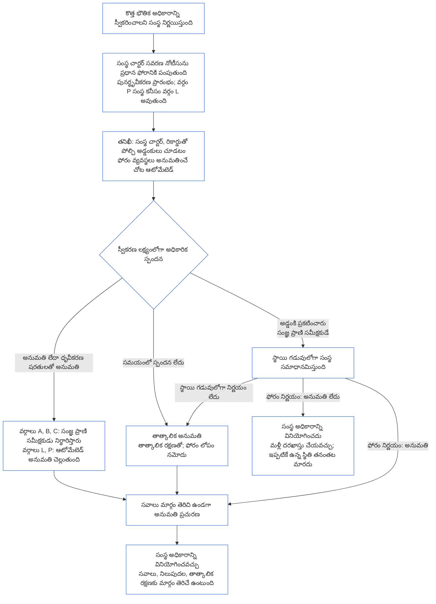

##### 9.2.2 కొత్త భౌతిక అధికారం కోసం పునర్ధృవీకరణ

కొత్త భౌతిక అధికారాన్ని స్వీకరించాలని నిర్ణయించిన సంస్థ పునర్ధృవీకరణ పొందాలి; ఆ అధికారాన్ని వినియోగించే ముందు ఫలితం కోసం వేచి ఉండాలి. **అనుచ్ఛేదం XI-E** (*సంస్థ ఏర్పాటు, వ్యాపార సృష్టి*) నిర్దేశించే వేచివుండటం ఇదే. క్రమం ఇలా ఉంటుంది:

- **ముందుగా నోటీసు:** [అధ్యాయం ఏడు §7.1 పత్రాన్ని మార్చడం](core_07.000_charters.md#71-changing-the-document) ఇప్పటికే కోరిన సంస్థ చార్టర్ సవరణ నోటీసును సంస్థ ప్రధాన ఫోరానికి పంపుతుంది. నోటీసుతో పునర్ధృవీకరణ మొదలవుతుంది.
- **ఇంకా రికార్డు లేకపోతే:** సంస్థ ధృవీకరణ రికార్డు లేని సంస్థ కూడా అదే నోటీసు ఇస్తుంది. సంస్థ చార్టర్, [§3 సంపూర్ణ-సంస్థ ధృవీకరణ మూల్యాంకనం](#3-whole-institution-certification-evaluation) నుంచి [§5 హక్కుల కనీస ప్రమాణం, రంగాల మూల్యాంకనాలు](#5-rights-floor-and-domain-evaluations) వరకు, ఆ అధికారానికి సంబంధించిన అంశాల ఆధారంగా కొత్త అధికారానికి మాత్రమే పరిమితమైన తొలి ధృవీకరణ నోటీసుతో మొదలవుతుంది. తొలి ధృవీకరణలో మిగతా భాగం [§1.3 తొలి ధృవీకరణకు గడువు](#13-window-for-the-first-certification) ప్రకారం కొనసాగుతుంది (నోటీసుతో వర్గీకరణ మార్చుకున్న వర్గం P సంస్థకు గడువు నోటీసు తేదీ నుంచి మొదలవుతుంది); కొత్త అధికారానికి సంబంధించిన వేచివుండటం దీనిపై ఆధారపడదు.
- **స్థాయి గడువుల్లోగా:** [అధ్యాయం తొమ్మిది భాగం C §9.3.4 స్థాయి గడువులు](core_09.010_system_alignment_certification_record_recertification.md#934-tier-windows) ప్రకారం పునర్ధృవీకరణ జరుగుతుంది; సాధారణంగా స్థాయి సంస్థ వర్గానికి సరిపోతుంది. గడువు తప్పితే [అనుచ్ఛేదం XXVI-C](core_06.020_rights_part_e.md#article-xxvi-c-timely-resolution-and-anti-delay-floor) (*సకాలిక పరిష్కారం, ఆలస్యం-నిరోధ కనీస ప్రమాణం*) వర్తిస్తుంది; రుసుములు, వేచి ఉండటం అడ్డంకిగా మారకూడదు ([తప్పించగల భారం](core_05.040_band_continuity.md#avoidable-burden)).
- **సాధ్యమైన చోట ఆటోమేటెడ్ ప్రక్రియ:** నోటీసు, కొత్త అధికారాన్ని సంస్థ చార్టర్, ప్రస్తుత రికార్డుతో పోల్చడం, అడ్డంకుల ప్రాథమిక తనిఖీ, అనుమతి — ఫోరం వ్యవస్థలు అనుమతించిన చోట్లన్నింటిలో ఆటోమేట్ చేయాలి. తప్పించగల భారానికి ఆటోమేషన్‌ను ప్రాధాన్య పరిష్కారంగా [అధ్యాయం ఒకటి §13.3 తప్పించగల భారాన్ని తగ్గించడం](core_01.005_interaction_interpretation.md#133-minimization-of-avoidable-burden) నిర్దేశిస్తుంది; ఆటోమేట్ చేయాల్సిన బాధ్యత సంరక్షకుడిపై కాకుండా వ్యవస్థపై ఉంటుందని [అధ్యాయం ఒకటి §16.4 చర్య జరుగుతున్నప్పుడే నమోదు చేయడం](core_01.010_stewardship_capacity_principles.md#164-document-at-action) చెబుతుంది.
  - **అనుమతించగలదు, నిరాకరించదు:** ఆటోమేటెడ్ తనిఖీ కొత్త అధికారాన్ని నిర్దోషంగా లేదా ప్రస్తుత రికార్డు సమర్థించే ధృవీకరణ షరతులతో అనుమతించవచ్చు. అది తనంతట తానే అడ్డంకిని ప్రకటించరాదు ([§9.2.3 కొత్త భౌతిక అధికారానికి అనుమతి నిరోధాలు](#923-blockers-to-clearing-new-material-authority)లోని వాటిలో ఏదైనా), అనుమతి నిరాకరించరాదు. తనిఖీ సంభావ్య అడ్డంకిని సూచించవచ్చు; కానీ ఆ సూచనను పరిశీలించిన తరువాత ప్రధాన ఫోరంలోని సంజ్ఞ ప్రాణి సమీక్షకుడే అడ్డంకిని ప్రకటించాలి.
  - **వర్గాలు A, B, C:** అనుమతి అధికారిక ప్రతిస్పందనగా లెక్కించడానికి ముందు ప్రధాన ఫోరంలోని సంజ్ఞ ప్రాణి సమీక్షకుడు ప్రతి అనుమతినీ నిర్ధారిస్తారు. ఆ వర్గాల్లోని సంస్థలకు, కొత్త అధికారం వల్ల వాటిలోకి వచ్చే సంస్థలకూ ఇదే వర్తిస్తుంది. నిర్ధారణకూ స్వీకరణ లక్ష్యం వర్తిస్తుంది. సమీక్షకుడు ప్రధాన ఫోరంలో ఉంటారు; అది ఇప్పటికే ధృవీకరణ/అనుమతి స్థానంలో ఉంది, సంస్థకు స్వతంత్రంగా ఉండాలి ([§6.1 సంస్థ ధృవీకరణలో నాలుగు స్థానాలు](#61-four-seats-in-an-institutional-certification)).
  - **వర్గాలు L, P:** నిర్ధారణ లేకుండానే ఆటోమేటెడ్ అనుమతి అధికారిక ప్రతిస్పందనగా పరిగణిస్తారు. నోటీసు ఇచ్చిన వెంటనే వర్గం P సంస్థ కనీసం వర్గం Lగా పునర్వర్గీకరించబడుతుంది ([§1.1 ఎవరికి ధృవీకరణ](#11-who-is-certified)); అందువల్ల దానికి వర్గం L నియమమే వర్తిస్తుంది.
  - **ప్రత్యేక పరిస్థితులు:** ఏ వర్గమైనా, తనిఖీ సంభావ్య అడ్డంకిని సూచించినప్పుడు, అధికారం ఇప్పటికే కవర్ అయిందా లేదా భౌతికమైనదా అని తనిఖీ తేల్చలేనప్పుడు, లేదా సంస్థ/ప్రభావిత సంజ్ఞ ప్రాణి సమీక్ష అడిగినప్పుడు సంజ్ఞ ప్రాణి సమీక్షకుడు కేసును చేపడతారు. అభ్యర్థనకు [సరిపోలే స్వీకరణ లక్ష్యం](core_05.040_band_continuity.md#tier-window)లోగా సమాధానం ఇవ్వాలి; అభ్యర్థన తేదీ నుంచి లెక్కిస్తారు. అది స్థాయి గడువును పెంచదు.
  - **అదే రికార్డు, అదే గడువులు:** ఏ తనిఖీలు చేశారో రికార్డులో చూపాలి; ఆటోమేటెడ్ అనుమతినీ ఇతర నిర్ణయంలాగే సవాలు చేయవచ్చు. ఆటోమేషన్ స్వీకరణ లక్ష్యాన్ని లేదా స్థాయి గడువును పెంచదు; తనిఖీ అందుబాటులో లేకపోయినా లేదా సమాధానం ఇవ్వకపోయినా, కింది నియమం ప్రకారం స్పందన తప్పినట్లే. సంస్థ ఉపయోగించే ఇతర వ్యవస్థల మాదిరిగానే తనిఖీకి కూడా ఫోరం జవాబుదారీ ([§6.3 ఫోరాలు, ధృవీకర్తలు, రికార్డు కార్యాలయాలు సంస్థలుగా](#63-forums-certifiers-and-record-offices-as-institutions)).
- **వేచివుండటం:** పునర్ధృవీకరణ అనుమతించే వరకు సంస్థ కొత్త అధికారాన్ని వినియోగించదు.
  - **ప్రతి వర్గమూ వేచి ఉండాలి:** ఏ వర్గానికీ మినహాయింపు లేదు; అత్యవసరత లేదా ఆతురత వేచివుండటాన్ని తొలగించదు.
  - **మిగతావన్నీ కొనసాగుతాయి:** సంస్థ ఇప్పటికే చేస్తున్న పనులు కొనసాగుతాయి ([§1.2 ఏర్పాటు లేదా నిర్వహణకు అనుమతి, అడ్డంకి లేదు](#12-no-permission-and-no-gate-on-forming-or-running)).
  - **రక్షణ వేచి ఉండదు:** ప్రభావిత సంజ్ఞ ప్రాణులకు ఫోరాలు అందించే అత్యవసర రక్షణ పునర్ధృవీకరణ కోసం వేచి ఉండదు ([అధ్యాయం తొమ్మిది భాగం B §6.2 పర్యవేక్షణ క్రమం](core_09.005_system_alignment_certification_record_process.md#62-supervisory-sequence)). ఇది సంజ్ఞ ప్రాణులను కాపాడుతుంది; ముందుగానే అధికారం వినియోగించడానికి సంస్థకు కారణం కాదు.
- **అనుమతి వచ్చిన వెంటనే ప్రచురణ:** [§10 ధృవీకరణను సవాలు చేయడం](#10-challenging-a-certification) సవాలు మార్గం తెరిచి ఉండగా, తాత్కాలిక అనుమతితో సహా ప్రతి అనుమతినీ ప్రధాన ఫోరం వచ్చిన వెంటనే ప్రచురిస్తుంది. అనుమతి వచ్చినప్పటి నుంచి సంస్థ అధికారాన్ని వినియోగించవచ్చు. నోటీసు విరామం పూర్తయ్యేవరకో, సవాలు నిర్ణయించేవరకో వేచి ఉండదు. ప్రభావిత సంజ్ఞ ప్రాణి అనుమతిని ఇతర నిర్ణయంలాగే సవాలు చేసి, నిలుపుదల లేదా తాత్కాలిక రక్షణ కోరవచ్చు; అవీ ఆలస్యం కావు ([§9.2.2 కొత్త భౌతిక అధికారం కోసం పునర్ధృవీకరణ](#922-recertification-for-new-material-authority), *రక్షణ వేచి ఉండదు*). ప్రచురణ సమయంలో తెలిసిన ప్రభావిత సంజ్ఞ ప్రాణులకూ, సంబంధిత వ్యవస్థల ఫోరాలకూ ప్రధాన ఫోరం అనుమతి నోటీసు ఇస్తుంది. నిలుపుదల/తాత్కాలిక రక్షణ అభ్యర్థనకు [CF-14.445 §3.1 దశల లక్ష్యాలు, గరిష్ఠ హద్దులు](corpus_forum/cf_14.445_performance_backlog_publication_accessibility.md#cf-14445-31-stage-targets-and-outer-bounds)లోని సరిపోలే స్వీకరణ లక్ష్యంలోగా లేదా వర్తించే అత్యవసర సెట్టింగ్ హద్దులోగా సమాధానం ఇవ్వాలి.
- **అనుమతి ఇచ్చినట్లుగా భావించడం:** అధికారం అనుమతించినట్లే భావిస్తారు. [§9.2.3 కొత్త భౌతిక అధికారానికి అనుమతి నిరోధాలు](#923-blockers-to-clearing-new-material-authority)లోని అడ్డంకిని, రికార్డులో పేర్కొన్న సాక్ష్యంతో చూపినప్పుడే ప్రధాన ఫోరం అనుమతిని నిరాకరించవచ్చు. అడ్డంకికి ముడిపడిన ధృవీకరణ షరతులతో దాన్ని అదుపు చేయగలిగితే, అధికారం నిరాకరించకుండా ఆ షరతులతో అనుమతిస్తారు.
- **అనుమతి అంటే ఏమిటి:** పునర్ధృవీకరణ తాత్కాలిక లేదా పూర్తి ధృవీకరణతో ముగుస్తుంది; ధృవీకరణ షరతులతోనైనా, అవి లేకుండానైనా. అధికారం వినియోగించే ముందు అవసరమైన ప్రతి షరతూ స్వతంత్రంగా ధృవీకరించబడి ఉంటుంది.
- **ఫోరం సమయానికి స్పందించకపోతే:** [CF-14.445 §3.1 దశల లక్ష్యాలు, గరిష్ఠ హద్దులు](corpus_forum/cf_14.445_performance_backlog_publication_accessibility.md#cf-14445-31-stage-targets-and-outer-bounds)లోని సరిపోలే స్వీకరణ లక్ష్యంలోగా ప్రధాన ఫోరం అధికారిక ప్రతిస్పందన ఇవ్వాలి. స్పందన అధికారాన్ని అనుమతించవచ్చు, ధృవీకరణ షరతులతో అనుమతించవచ్చు లేదా దానికి ఆధారమైన సాక్ష్యంతో అడ్డంకిని ప్రకటించవచ్చు. అడ్డంకి ప్రకటించే స్పందనకు సంస్థ సమాధానం చెప్పే అవకాశం ఉంటుంది; పైన పేర్కొన్న స్థాయి గడువులోగా ఫోరం నిర్ణయిస్తుంది.
  - **తాత్కాలిక అనుమతి:** స్వీకరణ లక్ష్యంలోగా అధికారిక స్పందన రాకపోయినా లేదా ప్రకటించిన అడ్డంకి స్థాయి గడువులోగా నిర్ణయించకపోయినా, [అధ్యాయం తొమ్మిది భాగం B §7.2 ధృవీకరణ లోపాలు, సవరణ](core_09.005_system_alignment_certification_record_process.md#72-certification-defects-and-correction) అందించే తాత్కాలిక రక్షణ, ఆధారపడటపు పరిమితులతో అధికారం తాత్కాలికంగా అనుమతించబడుతుంది.
  - **ఫోరం లోపం:** లక్ష్యం లేదా గడువు తప్పడం ఫోరం లోపం; సంస్థ తప్పు కాదు. [అధ్యాయం పద్నాలుగు §6 సకాలిక పరిష్కారం, భౌతిక ప్రాముఖ్యత స్థాయులు, ఆలస్యం-నిరోధ క్రమశిక్షణ](core_14.000_forum.md#6-timely-resolution-materiality-tiers-and-anti-delay-discipline) (*గడువు మించిన సమీక్ష*) కింద నమోదు చేసి, సరిచేసి, గడువు మించిన సమీక్ష చేస్తారు.
  - **మరో ఫోరానికి బదిలీ:** పునర్ధృవీకరణ అభ్యర్థన అదే కుటుంబంలోని మరో ఫోరానికి బదిలీ అవుతుంది ([అధ్యాయం పద్నాలుగు §3 బదిలీ, సమీకరణ, సమన్వయం](core_14.000_forum.md#3-transfer-consolidation-and-coordination--continuity-and-anti-capture)). బదిలీ తేదీ నుంచి లెక్కిస్తూ, ఆ ఫోరం సంస్థ వర్గానికి వర్తించే సాధారణ గడువుల్లో పునర్ధృవీకరణ నిర్వహిస్తుంది.
- **అనుమతి లభించకపోతే:** సంస్థ ఆ అధికారాన్ని వినియోగించదు; అధ్యాయం తొమ్మిది భాగం B §7.4 (*శాశ్వత నిషేధం కాదు*) షరతులతో మళ్లీ దరఖాస్తు చేసుకోవచ్చు. కొత్త అధికారానికి అనుమతి లభించకపోవడం మాత్రమే, సంస్థ ఇప్పటికే కలిగిన స్థితిని నిరాకరించదు లేదా రద్దు చేయదు. [§7.3 సంస్థకు పరిష్కార సిద్ధత](#73-remediation-readiness-for-an-institution), [§7.4 సంస్థ నిరాకరణ, రద్దు](#74-denial-and-revocation-for-an-institution) కింద నిర్ధారణ వచ్చినప్పుడే ఆ స్థితి మారుతుంది.
- **నోటీసు లేకుండా లేదా అనుమతికి ముందే:** నోటీసు ఇవ్వకుండా లేదా అనుమతి పొందకముందు కొత్త భౌతిక అధికారాన్ని వినియోగించడం సంస్థ చార్టర్‌కు వెలుపలైన ఆచరణ. అది [§3 సంపూర్ణ-సంస్థ ధృవీకరణ మూల్యాంకనం](#3-whole-institution-certification-evaluation) (అంశం 1) కింద నిర్ధారణ అవుతుంది; సంస్థ చార్టర్ సంఘటనగా సమీక్షను మళ్లీ తెరుస్తుంది.

<strong>పాఠక మార్గదర్శకం (కార్యాచరణాత్మకం కాదు): కొత్త భౌతిక అధికారం కోసం వేచివుండటం</strong>

ఈ చిత్రం §9.2.2 కొత్త భౌతిక అధికారం కోసం పునర్ధృవీకరణను సంక్షిప్తంగా చూపుతుంది. చిత్రం, పాఠ్యం మధ్య తేడా ఉంటే పాఠ్యమే నియంత్రిస్తుంది. సంస్థ ఇప్పటికే చేస్తున్నదంతా కొనసాగుతుంది; ప్రభావిత సంజ్ఞ ప్రాణుల అత్యవసర రక్షణ ఎప్పుడూ వేచి ఉండదు. సంస్థలకు పని చేసిన ఉదాహరణలు [CS-9.320 §12 సంస్థల ఉదాహరణాత్మక నడకలు](corpus_systems/cs_09.320_system_alignment_certification_illustrations.md#cs-9320-12-illustrative-institution-walkthroughs)లో ఉన్నాయి.

 

