#### 1.1 การรับรองในฐานะกระบวนการตรวจสอบที่ปรับตามชั้นของระบบ

ในฐานะกลไกกำกับดูแล การรับรองเป็นกระบวนการตรวจสอบขนาดใหญ่กระบวนการหนึ่งภายใต้ [ความสามารถในการตรวจสอบ](core_05.050_band_oversight.md#auditability) และ **มาตรา XVI** (*การตรวจสอบ ความโปร่งใส และการตรวจยืนยันโดยอิสระ*):

- อยู่ภายใต้การกำกับดูแลของเวที ครอบคลุมหลายด้าน และให้สถานะ
- อาจผสานผลจากรูปแบบการตรวจสอบที่เกี่ยวข้อง แต่ไม่กลืนหรือใช้แทนรูปแบบเหล่านั้น แต่ละรูปแบบยังคงมีผู้กำกับของตนเองตามที่ระบุใน [แผนผังรูปแบบการตรวจสอบที่เกี่ยวข้อง](corpus_joint_structure/cjs_05.115_audit_process.md#sibling-audit-modes-owner-map) ของที่ตั้งกระบวนการตรวจสอบ:
  - การตรวจสอบบันทึกประเภทข้อมูลของระบบตาม **CS-6.305 (*ประเภทข้อมูลและการจัดการข้อมูล*) และ CS-6.310** (*การจำแนกประเภทข้อมูล*)
  - การตรวจสอบบันทึกการจำแนกประเภทระบบตาม **CS-9.305 (*กลไกจำแนกประเภทระบบ*) และ CS-9.310** (*การจำแนกระบบตามผลกระทบ*)
  - การตรวจทานการรับรองของผู้ดูแลตาม **CS-15.305** (*การดูแลระบบวิกฤต*)
  - การตรวจสอบอย่างต่อเนื่องตาม **CS-6.345** (*วงจรชีวิตของระบบ*) ACA
  - การตรวจสอบความซับซ้อนตาม **CS-6.315** (*การดูแลความเข้าใจได้และความซับซ้อน*) และ **มาตรา XXIII-B** (*ข้อกำหนดการตรวจสอบความซับซ้อนและความเป็นโมดูล*)
  - การตรวจยืนยันข้อกล่าวอ้างตาม **CJS-5.110 §5** (*การกำกับดูแล: ข้อกำหนดเรื่องการตรวจยืนยันโดยอิสระและความครบถ้วนของข้อกล่าวอ้าง*)
- ยังสามารถดำเนินการประเมินเหล่านี้แยกต่างหากได้โดยไม่ต้องผ่านการรับรอง การรับรองไม่ได้ใช้แทนการประเมินเหล่านั้น

ความลึกของการรับรอง ภาระการจัดทำบันทึก ช่วงเวลาการรับรอง การทบทวนโดยผู้มีส่วนได้เสีย และเส้นทางการโต้แย้ง ต้องปรับตาม [ส่วนได้เสียที่เป็นสาระ](core_00.000_preamble.md#material-stake) ตามหลัก [ความได้สัดส่วน](core_05.035_band_accountability.md#proportionality):

- ระบบที่มีผลกระทบ การพึ่งพา และความเสี่ยงสูงกว่าต้องมีหลักฐานหนักแน่นกว่า บันทึกชัดเจนกว่า และการมีส่วนร่วมที่ทำได้จริงกว่า รวมถึงการเข้าถึงได้อย่างเป็นสาระ ข้อมูลจากผู้มีส่วนได้เสีย และเส้นทางโต้แย้งที่ปรับตามผู้ที่พึ่งพาระบบ
- ชั้นของระบบที่ต่ำกว่าและขอบเขตที่จำกัดยังต้องจำแนกอย่างซื่อตรงและให้หลักประกันอย่างได้สัดส่วน โดยไม่มีข้อยกเว้นจากหน้าที่ที่เป็นสาระเมื่อมีผลกระทบภายนอก

กระบวนการนี้ใช้ตามชั้นผลกระทบ ดังที่ [ข้อกำหนดการจัดชั้นใหม่](corpus_systems/cs_09.305_system_classification_machinery.md#35-reclassification-requirement) ใน **CS-9.305** (*กลไกจำแนกประเภทระบบ*) กำหนดไว้:

- **ชั้น A, ชั้น B และชั้น C:** ระบบเหล่านี้มีผลกระทบ การพึ่งพา และความเสี่ยงสูงสุด จึงต้องประเมินทั้งระบบอย่างเต็มระดับตาม [§3 การประเมินการรับรองทั้งระบบ](#3-whole-system-certification-evaluation), [§4 การประเมินเมื่อมีประเด็นเกี่ยวข้อง](#4-evaluations-where-implicated) และ [§5 การประเมินพื้นสิทธิและด้านต่าง ๆ](#5-rights-floor-and-domain-evaluations) โดยใช้แต่ละระยะย่อยของตน;
- **ชั้น L:** ต้องประเมินเช่นเดียวกันแต่ให้ได้สัดส่วน โดยอาจใช้ช่วงเวลารับรองเริ่มต้นที่ยาวกว่าและบันทึกที่เรียบง่ายกว่า เมื่อ **CS-9.305** (*กลไกจำแนกประเภทระบบ*) และ **CS-9.310** (*การจำแนกระบบตามผลกระทบ*) อนุญาต; และ
- **ชั้น P:** ขอแนะนำให้ใช้กระบวนการนี้ตราบใดที่ระบบยังจัดอยู่ในชั้น P อย่างถูกต้อง และระบบชั้น P อาจเลือกใช้โดยสมัครใจ กระบวนการจะกลายเป็นข้อบังคับเมื่อจัดชั้นใหม่เป็นชั้น L ขึ้นไป หรือเมื่อผู้ดำเนินงานสมัครใจอ้างว่าระบบปฏิบัติตามรัฐธรรมนูญ

ช่วงเวลาการรับรอง และการตรวจสอบทางการเงิน ด้านทรัพยากร หรือการตรวจสอบเฉพาะที่กำหนดให้ทำ ณ กึ่งกลางช่วงเวลาดังกล่าว จัดตามชั้นของระบบใน [บทที่สิบสี่ §6 การวินิจฉัยอย่างทันเวลา ระดับความเป็นสาระ และระเบียบวินัยต่อต้านความล่าช้า](core_14.000_forum.md#review-cadence) (*รอบการทบทวน*) บทนี้ไม่กล่าวซ้ำตัวเลขดังกล่าว

#### 1.2 ภาพรวมการรับรอง

*พูดแบบตรง ๆ: จำแนกระบบอย่างซื่อตรง ดำเนินการประเมินที่ใช้บังคับ ให้เวทีตรวจสอบหลักฐานและข้อกังวลของผู้มีส่วนได้เสียอย่างเป็นอิสระ แล้วตัดสินผล จัดทำบันทึกเดียวที่เปิดไว้สำหรับการตรวจทานของเวทีให้เสร็จและเผยแพร่พร้อมเส้นทางโต้แย้งที่เปิดอยู่ ระบบที่ได้รับการรับรองจะเริ่มดำเนินงานได้หลังพ้นช่วงแจ้งเตือนและปฏิบัติตามมาตรการคุ้มครองที่กำหนด ติดตามผลที่เกิดขึ้นจริง ตอบสนองต่อเหตุการณ์และการโต้แย้ง และตรวจสอบตามกำหนดหรือเมื่อข้อเท็จจริงเปลี่ยน แก้ข้อบกพร่องและให้ตรวจยืนยันการแก้ไขโดยอิสระก่อนอนุญาตขอบเขตที่ได้รับผลกระทบหรือยกเลิกเงื่อนไขการรับรอง การทบทวนแต่ละครั้งใช้บันทึกใหม่ที่เชื่อมโยงกับบันทึกก่อนหน้า*

กระบวนการมี **หกระยะ** ได้แก่ **I กำหนดกรอบ**, **II ประเมิน**, **III ตรวจทาน**, **IV ตัดสิน**, **V บันทึก** และ **VI ดำเนินงาน** ระยะ II มีสามระยะย่อย แต่ละระยะเป็นส่วนแยกต่างหาก: **IIa** (ใช้เสมอ), **IIb** (เมื่อมีประเด็นเกี่ยวข้อง) และ **IIc** (เมื่อมีตัวกระตุ้น) ระยะ VI มีสองระยะย่อย แต่ละระยะเป็นส่วนแยกต่างหาก: **VIa** (ดำเนินงานและรับรองซ้ำ [§9 การรับรองซ้ำและการเปิดทบทวน](core_09.010_system_alignment_certification_record_recertification.md#9-recertification-and-reopening)) และ **VIb** (สะพานเชื่อมสู่สถานะ [§11 ความสัมพันธ์กับสถานะ](core_09.010_system_alignment_certification_record_recertification.md#11-relationship-to-standing)) แผนภาพแสดงกระบวนการรับรองทั้งหมดตามลำดับนั้น ส่วน ก ครอบคลุมสองระยะแรก คือการกำหนดกรอบและการประเมิน [ส่วน ข](core_09.005_system_alignment_certification_record_process.md#chapter-nine-part-b-system-alignment-certification--forum-process-and-outcomes) และ [ส่วน ค](core_09.010_system_alignment_certification_record_recertification.md#chapter-nine-part-c-system-alignment-certification--record-recertification-and-standing) ครอบคลุมสี่ระยะสุดท้าย ได้แก่ กระบวนการในเวทีและผลลัพธ์พร้อมข้อห้ามเริ่มดำเนินงาน (ส่วน ข) จากนั้นเป็นการบันทึกและการดำเนินงาน (เส้นทางโต้แย้ง การรับรองซ้ำและการเปิดทบทวน และสะพานเชื่อมสู่สถานะ) (ส่วน ค)

การประเมินทุกข้อที่ใช้บังคับจะดำเนินการอีกครั้งในทุกขั้นตอนการรับรอง ได้แก่ การรับรองครั้งแรก การรับรองซ้ำแต่ละครั้งตามกำหนดใน [§2 การประเมินชั้นของระบบ](#2-system-class-evaluation) และการตรวจทานที่เปิดใหม่หรือเริ่มใหม่ การทบทวนจะเปิดใหม่ก่อนกำหนดรับรองซ้ำครั้งถัดไปเมื่อข้อเท็จจริงที่เป็นสาระเปลี่ยน เช่น การพึ่งพาระบบที่เพิ่มขึ้น การดึงทรัพยากรจากพื้นฐานร่วมที่เพิ่มขึ้น การส่งคืนทรัพยากรให้พื้นฐานร่วมลดลงอย่างมีนัยสำคัญ หรือมีการโต้แย้งที่น่าเชื่อถือ [ส่วน ค §9.2 ตัวกระตุ้นการเปิดทบทวน](core_09.010_system_alignment_certification_record_recertification.md#92-reopening-triggers) ระบุตัวกระตุ้นไว้

```mermaid
flowchart TB
    T(["ระบบที่มีผลกระทบเป็นสาระขอรับการรับรอง<br/>หรือการพึ่งพาระบบเพิ่มขึ้น"])
    C["§2 ระยะ I กำหนดกรอบ<br/>จำแนกอย่างซื่อตรง<br/><br/>ชั้นกำหนดความลึกและกำหนดการตรวจซ้ำ"]
    subgraph W["§3–§5 ระยะ II ประเมิน — การประเมินทั้งระบบ"]
        direction LR
        Al["§3.1–§3.4 IIa — ใช้เสมอ<br/><br/>การกำกับดูแล; ความเสี่ยงเชิงระบบ: ประเมิน<br/>และเปิดเผยแก่ผู้ที่จำเป็นต้องทราบ;<br/>กรอบเวลา; ประเภทข้อมูล"]
        Im["§4 IIb — เมื่อมีประเด็นเกี่ยวข้อง<br/><br/>ฐานความเป็นส่วนตัว สิทธิในการออกจากระบบ<br/>การชุมนุมและการเห็นต่าง"]
        Tr["§5 IIc — เมื่อมีตัวกระตุ้น<br/><br/>การตรวจพื้นสิทธิที่ใช้บังคับ<br/>และการประเมินด้านต่าง ๆ หกข้อ"]
        Al ~~~ Im ~~~ Tr
    end
    F["§6 ระยะ III ตรวจทาน<br/>ตรวจหลักฐานและข้อกังวล<br/>ของผู้มีส่วนได้เสียอย่างเป็นอิสระ<br/><br/>เวทีที่ได้รับมอบหมายออกข้อค้นพบ;<br/>เส้นทางโต้แย้งยังเปิดอยู่"]
    Rec["§8 ระยะ V บันทึก<br/>บันทึกการรับรองระบบหนึ่งฉบับ<br/><br/>เปิดไว้ให้เวทีตรวจทาน; จัดทำให้เสร็จพร้อมผลลัพธ์<br/>ข้อค้นพบประกอบ เงื่อนไขการรับรอง และแผนดำเนินงาน"]
    S[["บทที่สิบเอ็ด — บันทึก<br/>สถานะ<br/><br/>อยู่นอกบทนี้"]]
    O{"§7 ระยะ IV ตัดสิน<br/><br/>หลักฐานรองรับผลลัพธ์และสถานะ<br/>ใดบ้าง?"}
    Fc["§7, §9.3 การรับรองเต็มรูปแบบ<br/><br/>รับรองซ้ำแบบชั่วคราวที่สะอาดติดต่อกันตามจำนวนที่กำหนด;<br/>ไม่มีความไม่สอดคล้องในปัจจุบันหรือที่มีสัญญาณใกล้เกิด<br/>ช่วงรับรองเต็มรูปแบบ; อาจมีเงื่อนไขการรับรอง"]
    Pc["§7, §9.3 การรับรองชั่วคราว<br/><br/>ให้ครั้งแรก ฟื้นฟูหลังความไม่สอดคล้อง<br/>หรือคง/ปรับลดสถานะชั่วคราว<br/>ช่วงชั่วคราวสั้นกว่า; อาจมีเงื่อนไขการรับรอง"]
    Nc["§7 ไม่ได้รับการรับรอง<br/><br/>เลื่อน ปฏิเสธ เพิกถอน หรือหมดอายุ<br/>ห้ามเริ่มดำเนินงาน; ระบุเหตุผลและงานแก้ไขที่จำเป็น"]
    Pub["§7, §10 เผยแพร่บันทึกที่จัดทำเสร็จ<br/><br/>เปิดเส้นทางโต้แย้งบันทึกที่เผยแพร่;<br/>สำหรับขอบเขตใหม่หรือขยาย ให้ระบุการเริ่มดำเนินงานและการแจ้ง"]
    G{"§7 ข้อห้ามเริ่มดำเนินงาน<br/><br/>การรับรองและเงื่อนไขก่อนเริ่มดำเนินงาน<br/>ที่ใช้บังคับครบถ้วนหรือไม่?"}
    Hold["§7 ปฏิบัติตามเงื่อนไขก่อนเริ่มดำเนินงาน<br/><br/>ส่งการแจ้งให้ครบและตรวจยืนยันโดยอิสระ<br/>ต่อเงื่อนไขการรับรองที่ต้องทำก่อนเริ่มดำเนินงาน"]
    Rm["§7, §9.3 คุ้มครองและแก้ไข<br/><br/>ยังไม่เริ่มดำเนินงานใหม่ในขอบเขตที่ได้รับผลกระทบ;<br/>คุ้มครองผู้มีความรู้สึกที่ได้รับผลกระทบ แก้การออกแบบหรือการดำเนินงาน<br/>และส่งหลักฐานเพื่อตรวจยืนยันโดยอิสระ"]
    Ch["§9–§10 ระยะ VIa ดำเนินงานและรับรองซ้ำ<br/>ติดตามและเปิดรับการโต้แย้ง<br/><br/>ดำเนินงานในขอบเขตที่รับรองและตามเงื่อนไขการรับรอง;<br/>ติดตามผลและตอบสนองต่อเหตุการณ์กับการโต้แย้ง"]
    S2[["บทที่สิบเอ็ด — บันทึก<br/>สถานะ<br/><br/>อยู่นอกบทนี้"]]
    Sp["&nbsp;&nbsp;&nbsp;&nbsp;&nbsp;&nbsp;&nbsp;&nbsp;&nbsp;&nbsp;&nbsp;&nbsp;&nbsp;&nbsp;&nbsp;&nbsp;&nbsp;&nbsp;&nbsp;&nbsp;&nbsp;&nbsp;&nbsp;&nbsp;&nbsp;&nbsp;&nbsp;&nbsp;&nbsp;&nbsp;&nbsp;&nbsp;&nbsp;"]
    SpL["&nbsp;&nbsp;&nbsp;&nbsp;&nbsp;&nbsp;&nbsp;&nbsp;&nbsp;&nbsp;&nbsp;&nbsp;&nbsp;&nbsp;&nbsp;&nbsp;&nbsp;&nbsp;&nbsp;&nbsp;&nbsp;&nbsp;&nbsp;&nbsp;&nbsp;&nbsp;&nbsp;&nbsp;&nbsp;&nbsp;&nbsp;&nbsp;&nbsp;&nbsp;&nbsp;"]
    SpA["&nbsp;&nbsp;&nbsp;&nbsp;&nbsp;&nbsp;&nbsp;&nbsp;&nbsp;&nbsp;&nbsp;&nbsp;&nbsp;&nbsp;&nbsp;&nbsp;&nbsp;&nbsp;&nbsp;&nbsp;&nbsp;&nbsp;&nbsp;&nbsp;&nbsp;&nbsp;&nbsp;&nbsp;&nbsp;&nbsp;&nbsp;&nbsp;&nbsp;&nbsp;&nbsp;&nbsp;&nbsp;&nbsp;&nbsp;&nbsp;&nbsp;&nbsp;&nbsp;&nbsp;&nbsp;"]
    Re["§9 ขั้นตอนทบทวนครั้งถัดไป<br/><br/>รับรองซ้ำ เปิดทบทวน หรือทบทวนใหม่;<br/>แต่ละขั้นตอนเปิดบันทึกใหม่ที่เชื่อมกับฉบับก่อน"]
    T --> C
    A1((ก)) --> C
    C --> W
    W --> F
    F --> O
    O --> Fc
    O --> Pc
    O --> Nc
    Fc --> Rec
    Pc --> Rec
    Nc --> Rec
    Rec -.->|VIb, §11 —<br/>เฉพาะข้อมูลนำเข้าที่ตรวจยืนยันแล้ว;<br/>การรับรองปัจจุบันหรือข้อเท็จจริง<br/>ที่เกิดระหว่างการรับรอง| S
    Rec --> Pub
    Rec ~~~ Sp
    Pub --> G
    G ~~~ SpL
    G -->|ไม่รับรอง| Rm
    G --->|ใช่: ดำเนินงาน<br/>ภายในขอบเขตบันทึก| Ch
    G --->|รับรองแล้ว,<br/>รอเงื่อนไขก่อนเริ่มดำเนินงาน| Hold
    Hold --> G
    Ch -->|ข้อบกพร่องเป็นสาระ:<br/>คุ้มครองและแก้ไข| Rm
    Ch -->|ตามกำหนด หรือ<br/>เมื่อข้อเท็จจริงเปลี่ยนเป็นสาระ<br/>หรือมีการโต้แย้งน่าเชื่อถือ<br/>ที่ต้องตรวจทาน| Re
    Ch -.->|VIb, §11 —<br/>เฉพาะข้อมูลนำเข้าที่ตรวจยืนยันแล้ว;<br/>การดำเนินงานอาจให้ข้อเท็จจริง<br/>สำหรับบันทึกการมีส่วนสนับสนุน<br/>และการละเมิด| S2
    Rm -->|ตรวจหลักฐานการแก้ไข<br/>ในขั้นตอนทบทวน<br/>ครั้งถัดไป| Re
    S2 ~~~~ SpA
    SpA ~~~ Re
    Re --> A2((ก))
    style Sp fill:none,stroke:none,color:#111111
    style SpL fill:none,stroke:none,color:#111111
    style SpA fill:none,stroke:none,color:#111111
    style T fill:none,stroke:#64748b,color:#ffffff
    style C fill:none,stroke:#16a34a,color:#ffffff
    style Ch fill:none,stroke:#16a34a,color:#ffffff
    style Al fill:none,stroke:#16a34a,color:#ffffff
    style Im fill:none,stroke:#16a34a,color:#ffffff
    style Tr fill:none,stroke:#16a34a,color:#ffffff
    style F fill:none,stroke:#ea580c,color:#ffffff
    style Rec fill:none,stroke:#2563eb,color:#ffffff
    style S fill:none,stroke:#db2777,color:#ffffff
    style S2 fill:none,stroke:#db2777,color:#ffffff
    style O fill:none,stroke:#ea580c,color:#ffffff
    style Fc fill:none,stroke:#9333ea,color:#ffffff
    style Pc fill:none,stroke:#9333ea,color:#ffffff
    style Nc fill:none,stroke:#9333ea,color:#ffffff
    style G fill:none,stroke:#ea580c,color:#ffffff
    style Pub fill:none,stroke:#2563eb,color:#ffffff
    style Rm fill:none,stroke:#9333ea,color:#ffffff
    style Hold fill:none,stroke:#16a34a,color:#ffffff
    style Re fill:none,stroke:#16a34a,color:#ffffff
    style A1 fill:none,stroke:#64748b,color:#ffffff
    style A2 fill:none,stroke:#64748b,color:#ffffff
```

<strong>คู่มือผู้อ่าน (ไม่มีผลใช้บังคับ): ภาพประกอบ ใบสรุปลำดับงาน และสถาบัน</strong>

> ตัวอย่างโปรไฟล์ **ชั้น A**, **ชั้น B** และ **ชั้น C** — และวิธีที่ชั้นของระบบปรับระดับความลึกของการรับรองตลอดบทนี้ — อยู่ใน [CS-9.320 §2 ตัวอย่างโปรไฟล์ชั้นของระบบ](corpus_systems/cs_09.320_system_alignment_certification_illustrations.md#cs-9320-2-illustrative-system-class-profiles) มีตัวอย่างขั้นตอนของระบบทั้งสามเดียวกันสำหรับแต่ละด้านประเมินใน [§3 การประเมินการรับรองทั้งระบบ](#3-whole-system-certification-evaluation) ถึง [§5.6 การประเมินความน่าไว้วางใจและความครบถ้วนสมบูรณ์ของการพึ่งพาระบบ](#56-trustworthiness-and-system-reliance-integrity-evaluation) ใน [CS-9.320 ภาพประกอบการรับรองความสอดคล้องของระบบ](corpus_systems/cs_09.320_system_alignment_certification_illustrations.md#cs-9320-system-alignment-certification-illustrations) ซึ่งเชื่อมโยงแต่ละโปรไฟล์และตัวอย่างกลับไปยังส่วน ก ที่นำมาแสดง
>
> ใบสรุปลำดับงานทีละขั้นสำหรับหกระยะ พร้อมลิงก์จากแต่ละขั้นไปยังส่วนที่มีกฎ กำหนดไว้ใน [CS-9.315 §2 ใบสรุปลำดับงาน](corpus_systems/cs_09.315_system_alignment_certification_run_sheet.md#cs-9315-2-run-sheet) (*ใบสรุปลำดับงานการรับรองความสอดคล้องของระบบ*) หากใบสรุปลำดับงานกับข้อกำหนดในส่วนใดต่างกัน ให้ยึดข้อกำหนดในส่วนนั้น
>
> ตัวอย่างสมมติของสถาบันสามแห่งที่ผ่านกระบวนการของบทที่สิบอยู่ใน [CS-9.320 §12 ตัวอย่างขั้นตอนของสถาบัน](corpus_systems/cs_09.320_system_alignment_certification_illustrations.md#cs-9320-12-illustrative-institution-walkthroughs)
>
> สำหรับสถาบัน กระบวนการหกระยะเดียวกันดำเนินตาม [บทที่สิบ](core_10.000_institutional_alignment_certification.md#chapter-ten-institutional-alignment-certification) ซึ่งใช้เลขมาตราเดียวกับบทนี้: ระยะ I และ II ใน [บทที่สิบ §2 การประเมินชั้นของสถาบัน](core_10.000_institutional_alignment_certification.md#2-institution-class-evaluation) ถึง [§5 การประเมินพื้นสิทธิและด้านต่าง ๆ](core_10.000_institutional_alignment_certification.md#5-rights-floor-and-domain-evaluations), ระยะ III ถึง V ใน [§6 กระบวนการในเวที](core_10.000_institutional_alignment_certification.md#6-forum-process) ถึง [§8 บันทึกการรับรองสถาบัน](core_10.000_institutional_alignment_certification.md#8-institutional-certification-record), และระยะ VI ใน [§9 การรับรองซ้ำและการเปิดทบทวน](core_10.000_institutional_alignment_certification.md#9-recertification-and-reopening) ถึง [§11 ความสัมพันธ์กับสถานะ](core_10.000_institutional_alignment_certification.md#11-relationship-to-standing)

 

