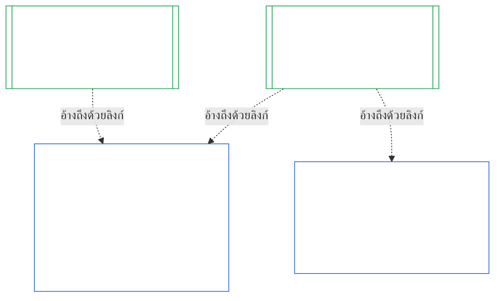

### 1. วัตถุประสงค์และบทบาท

<strong>ร่องรอย</strong>

- ต้นทาง:
  - [บทที่เจ็ด §1 กรณีที่ต้องมีกฎบัตรระบบและสถาบัน](core_07.000_charters.md#1-when-system-and-institutional-charters-are-required) (7.000 §1);
  - [บทที่เก้า ภาค A §1 วัตถุประสงค์และบทบาท](core_09.000_system_alignment_certification_evaluation.md#1-purpose-and-role) (9.000 §1);
  - [Article XI-E](core_06.005_rights_part_b.md#article-xi-e-institutional-formation-and-business-creation) (*การก่อตั้งสถาบันและการสร้างธุรกิจ*);
  - [Article XXVIII-A](core_06.020_rights_part_e.md#xxviii-a-existing-instantiations-adoption-transition-window) (*การรับไปใช้เป็นระยะและความต่อเนื่องของพื้นสิทธิ*).
- ปลายทาง: [§2](#2-institution-class-evaluation); [§6](#6-forum-process); [§7](#7-certification-outcomes); [§9](#9-recertification-and-reopening).
- อ่านร่วมกับ:
  - [สถาบัน](core_05.040_band_continuity.md#institution);
  - [กฎบัตรสถาบัน](core_05.040_band_continuity.md#institutional-charter);
  - [กฎบัตรระบบ](core_05.040_band_continuity.md#system-charter);
  - [การสร้างธุรกิจ](core_05.055_band_participation.md#business-creation).

 

*พูดแบบตรง ๆ: การรับรองระบบเป็นของระบบ การรับรองสถาบันอ้างถึงการรับรองเหล่านั้น และเพิ่มเฉพาะเรื่องที่สถาบันต้องรับผิดชอบเอง ระบบหนึ่งอาจอยู่ภายใต้หลายสถาบัน หรือไม่อยู่ภายใต้สถาบันใดเลย ไม่มีสิ่งใดในที่นี้ให้การรับรองขัดขวางการก่อตั้งสถาบัน*

การรับรองความสอดคล้องของสถาบันและการรับรองความสอดคล้องของระบบเป็นการรับรองสองรายการที่เชื่อมกันด้วยลิงก์ ความสัมพันธ์คือ **การประกอบกันด้วยลิงก์** ไม่ใช่การครอบอยู่ภายใน ในภาพ ลูกศรจากบันทึกการรับรองระบบชี้ไปยังบันทึกการรับรองสถาบันแต่ละรายการที่อ้างถึง ระบบที่ไม่อยู่ภายใต้สถาบันใดไม่มีลูกศรและไม่จำเป็นต้องมี และสถาบันที่ไม่ได้ดำเนินระบบมีบันทึกของตนเองเท่านั้น

การประกอบกันด้วยลิงก์มีสองด้าน เริ่มจากด้านของสถาบัน

ในด้านของสถาบัน:

- **บันทึกการรับรองสถาบันอ้างถึงบันทึกของระบบและไม่ประเมินซ้ำ:** อ้างถึงบันทึกการรับรองระบบด้วยลิงก์และระบุฉบับ บทนี้ไม่ประเมินระบบซ้ำ ไม่ตัดสินชั้นของระบบใหม่ และไม่เปลี่ยนผลลัพธ์ สถานะ หรือเงื่อนไขการรับรองของระบบ
- **การรับรองสถาบันยกระดับสถานะของระบบไม่ได้:** ระบบที่ไม่ได้รับการรับรองยังคงไม่ได้รับการรับรอง ไม่ว่าสถาบันจะมีสถานะใด ระบบที่ได้รับการรับรองก็ไม่ได้รับความคุ้มครองจากข้อค้นพบเกี่ยวกับสถาบัน
- **ค้นพบข้อเท็จจริงด้านสถาบันเพียงครั้งเดียว:** เมื่อ [บทที่เก้า ภาค A §3.1 ระเบียบด้านธรรมาภิบาล แรงจูงใจ และความสามารถในการโต้แย้ง](core_09.000_system_alignment_certification_evaluation.md#31-governance-incentive-and-contestability-discipline) ถามเรื่องธรรมาภิบาลและแรงจูงใจของผู้ดำเนินการ บันทึกการรับรองสถาบันที่ยังเป็นปัจจุบันของผู้ดำเนินการอาจให้ข้อเท็จจริงเหล่านั้นผ่านลิงก์ได้ เวทีของระบบยังคงตัดสินว่าข้อเท็จจริงนั้นเพียงพอสำหรับระบบนั้นหรือไม่ ห้ามค้นพบข้อเท็จจริงด้านสถาบันเรื่องเดียวกันต่างไปโดยไม่ระบุเหตุผลในบันทึกการรับรองระบบ

ในด้านของระบบ:

- **บันทึกการรับรองระบบเป็นของระบบ:** เป็นบันทึกของระบบเองภายใต้ [บทที่เก้า](core_09.000_system_alignment_certification_evaluation.md#chapter-nine-system-alignment-certification)
- **หลายสถาบันอ้างถึงบันทึกการรับรองระบบเดียวกันได้:** ระบบหนึ่งอาจมีสถาบันมากกว่าหนึ่งแห่งดำเนินงาน บริหารอย่างรับผิดชอบ หรือควบคุมในสาระสำคัญได้ ตาม [บทที่เจ็ด §1 กรณีที่ต้องมีกฎบัตรระบบและสถาบัน](core_07.000_charters.md#1-when-system-and-institutional-charters-are-required) แต่ละสถาบันอ้างถึงบันทึกเดียวกัน
- **ระบบไม่จำเป็นต้องอยู่ภายใต้สถาบันใด:** ผู้มีความรู้สึกหนึ่งรายไม่ใช่สถาบัน ระบบจึงอาจไม่มีสถาบันได้ ระบบที่ไม่มีสถาบันจะได้รับการรับรองภายใต้ [บทที่เก้า](core_09.000_system_alignment_certification_evaluation.md#chapter-nine-system-alignment-certification) เท่านั้น และไม่ต้องการสิ่งใดจากบทนี้ ระบบที่อยู่ภายใต้สถาบันก็ได้รับการรับรองในลักษณะเดียวกัน: บทนี้เพิ่มบันทึกแยกสำหรับสถาบัน ไม่ใช่ขั้นตอนหนึ่งของการรับรองระบบนั้นเอง

#### 1.1 ใครได้รับการรับรอง

สถาบันชั้น L หรือสูงกว่าอยู่ในขอบเขตของบทนี้ โดยชั้นกำหนดตาม [§2.1 ชั้นของสถาบัน](#21-institution-class) รวมถึงสถาบันที่ไม่ได้ดำเนินระบบเลยด้วย: ไม่มีบันทึกการรับรองระบบให้อ้างถึง และชั้นของสถาบันมาจากผลกระทบของตนเอง **กลุ่มระบบในความดูแล** ของสถาบันคือชุดระบบที่สถาบันดำเนินงาน บริหารอย่างรับผิดชอบ หรือควบคุมในสาระสำคัญ ([Portfolio](core_05.040_band_continuity.md#portfolio))

- **ชั้น A, B, C และ L:** ใช้กระบวนการนี้ โดยปรับตามชั้นตาม [§2.2 การปรับขนาดตามชั้น](#22-scaling-by-class)
- **ชั้น P:** สนับสนุนให้ใช้กระบวนการนี้ และจะใช้โดยสมัครใจก็ได้ กระบวนการจะเป็นข้อบังคับเมื่อจัดประเภทใหม่เป็นชั้น L หรือสูงกว่า หรือเมื่อสถาบันสมัครใจอ้างว่าปฏิบัติตามรัฐธรรมนูญ สถาบันชั้น P ที่ตัดสินใจรับอำนาจใหม่ที่มีสาระจะถูกจัดประเภทใหม่เป็นอย่างน้อยชั้น L เมื่อแจ้งตาม [§9.2.2 การรับรองซ้ำสำหรับอำนาจใหม่ที่มีสาระ](#922-recertification-for-new-material-authority) เพราะอำนาจนั้นเป็นสาระโดยนิยาม ([§9.2.1 อะไรนับเป็นอำนาจใหม่ที่มีสาระ](#921-what-counts-as-new-material-authority)) และสถาบันที่มีสาระในด้านใดด้านหนึ่งจะเป็นอย่างน้อยชั้น L ([§2.1 ชั้นของสถาบัน](#21-institution-class), ข้อ 2) การจัดประเภทใหม่นี้มีผลตั้งแต่การแจ้งจนกว่าจะถอนการแจ้งก่อนการอนุมัติ หรือจนกว่าอำนาจจะไม่ได้รับอนุมัติ หากยังไม่มีการใช้อำนาจนั้น จากนั้นสถาบันกลับไปเป็นชั้น P และการรับรองครั้งแรกแบบจำกัดจะสิ้นสุด การแจ้งใหม่เริ่มกระบวนการอีกครั้ง ส่วนการใช้อำนาจโดยไม่ผ่านการอนุมัติยังคงเป็นข้อค้นพบภายใต้ [§9.2.2 การรับรองซ้ำสำหรับอำนาจใหม่ที่มีสาระ](#922-recertification-for-new-material-authority) (*ไม่มีการแจ้งหรือก่อนอนุมัติ*) ซึ่งสอดคล้องกับ [บทที่เก้า ภาค A §1 วัตถุประสงค์และบทบาท](core_09.000_system_alignment_certification_evaluation.md#1-purpose-and-role)
- **ระบบเดียว:** สถาบันที่ดำเนินระบบเพียงระบบเดียวซึ่งต้องมีกฎบัตรระบบ จะมีรอบการรับรองหนึ่งรอบและบันทึกหนึ่งรายการ ซึ่งบทนี้เรียกว่า **การประเมินระบบเดียว** บันทึกการรับรองระบบมี *ส่วนบันทึกข้อค้นพบด้านสถาบัน* ซึ่งมีรายการใน [§8 บันทึกการรับรองสถาบัน](#8-institutional-certification-record) และทำหน้าที่เป็นบันทึกการรับรองสถาบัน เวที ที่นั่ง และกรอบเวลาจะเป็นไปตามรอบการรับรองของระบบนั้นเอง โดยเพิ่มรายการด้านสถาบัน ผลลัพธ์ของระบบเป็นไปตามเหตุแห่งการปฏิเสธและเพิกถอนของตน ดังที่ [§7.4 การปฏิเสธและเพิกถอนสำหรับสถาบัน](#74-denial-and-revocation-for-an-institution) ระบุ การส่งผลต่อเนื่องใน [§9.5 ผลต่อเนื่องจากการรับรองระบบ](#95-cascade-from-system-certifications) ไม่ใช้ในฐานะผลต่อเนื่อง เพราะระบบนั้นเป็นกลุ่มระบบในความดูแลทั้งหมด แต่กฎข้อ 1 และ 2 ของ [§7.4 การปฏิเสธและเพิกถอนสำหรับสถาบัน](#74-denial-and-revocation-for-an-institution) ยังใช้ (ตัวบ่งชี้และการทดสอบว่ามูลเหตุอยู่ที่ใด)
- **หลายระบบ:** มีบันทึกการรับรองสถาบันหนึ่งรายการซึ่งเชื่อมไปยังบันทึกการรับรองระบบของแต่ละระบบที่สถาบันดำเนินงาน ระบบแต่ละระบบมีรอบการรับรองและบันทึกของตนเอง
- **ไม่มีระบบ:** มีบันทึกการรับรองสถาบันแยกต่างหาก ไม่มีบันทึกการรับรองระบบให้เชื่อมไปถึง เพราะสถาบันไม่ได้ดำเนินระบบ

