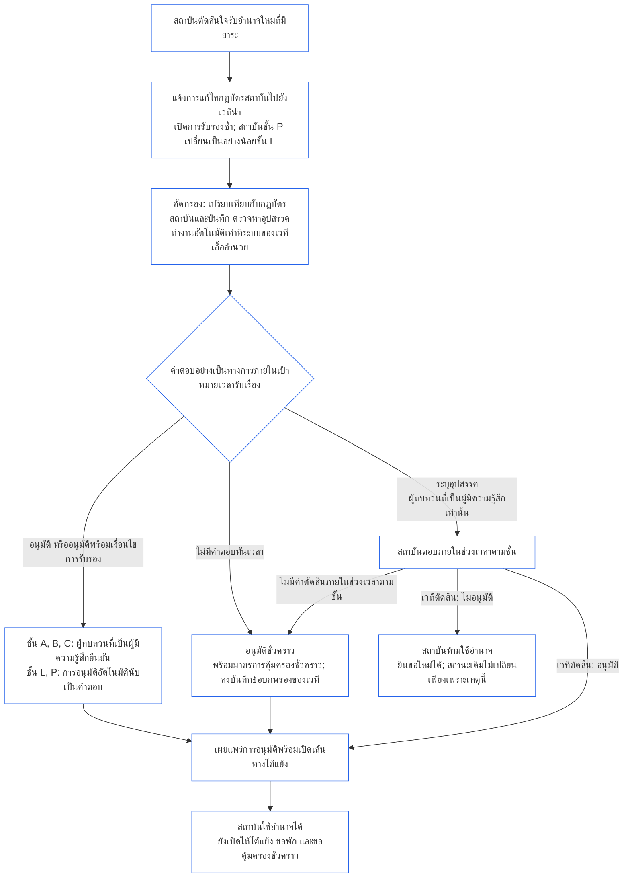

##### 9.2.2 การรับรองซ้ำสำหรับอำนาจใหม่ที่มีสาระ

สถาบันที่ตัดสินใจรับอำนาจใหม่ที่มีสาระต้องได้รับการรับรองซ้ำ และต้องรอผลก่อนใช้อำนาจนั้น นี่คือการรอที่ **Article XI-E** (*การก่อตั้งสถาบันและการสร้างธุรกิจ*) กำหนดไว้ โดยดำเนินการดังนี้:

- **แจ้งก่อน:** สถาบันแจ้งการแก้ไขกฎบัตรสถาบันตามที่ [บทที่เจ็ด §7.1 การเปลี่ยนแปลงเอกสาร](core_07.000_charters.md#71-changing-the-document) กำหนดไว้แล้ว และส่งแจ้งไปยังเวทีนำ การแจ้งนี้เป็นการเปิดการรับรองซ้ำ
- **ยังไม่มีบันทึก:** สถาบันที่ยังไม่มีบันทึกการรับรองสถาบันให้แจ้งแบบเดียวกัน การแจ้งเปิดการรับรองครั้งแรกที่จำกัดเฉพาะอำนาจใหม่ โดยประเมินเทียบกับกฎบัตรสถาบันและการประเมินใน [§3 การประเมินการรับรองทั้งสถาบัน](#3-whole-institution-certification-evaluation) ถึง [§5 การประเมินพื้นสิทธิและด้านต่าง ๆ](#5-rights-floor-and-domain-evaluations) เท่าที่เกี่ยวข้องกับอำนาจนั้น ส่วนที่เหลือของการรับรองครั้งแรกยังคงดำเนินตามช่วงเวลาใน [§1.3 ช่วงเวลาสำหรับการรับรองครั้งแรก](#13-window-for-the-first-certification) (สำหรับสถาบันชั้น P ที่จัดประเภทใหม่จากการแจ้ง ให้เริ่มนับช่วงเวลาจากวันที่แจ้ง) และการรอใช้อำนาจใหม่ไม่ขึ้นอยู่กับช่วงเวลานั้น
- **ภายในช่วงเวลาตามชั้น:** ดำเนินการรับรองซ้ำภายในช่วงเวลาตามชั้นใน [บทที่เก้า ภาค C §9.3.4 ช่วงเวลาตามชั้น](core_09.010_system_alignment_certification_record_recertification.md#934-tier-windows) โดยสันนิษฐานว่าชั้นนั้นตรงกับชั้นของสถาบัน การพลาดช่วงเวลาให้จัดการตาม [Article XXVI-C](core_06.020_rights_part_e.md#article-xxvi-c-timely-resolution-and-anti-delay-floor) (*พื้นฐานการวินิจฉัยอย่างทันเวลาและการต่อต้านความล่าช้า*) และค่าธรรมเนียมหรือการรอต้องไม่กลายเป็นอุปสรรค ([ภาระที่หลีกเลี่ยงได้](core_05.040_band_continuity.md#avoidable-burden))
- **ทำงานอัตโนมัติเท่าที่ทำได้:** ทำการแจ้ง การเปรียบเทียบอำนาจใหม่กับกฎบัตรสถาบันและบันทึกปัจจุบัน การคัดกรองอุปสรรค และการอนุมัติให้ใช้อำนาจโดยอัตโนมัติทุกครั้งที่ระบบของเวทีเอื้ออำนวย [บทที่หนึ่ง §13.3 การลดภาระที่หลีกเลี่ยงได้](core_01.005_interaction_interpretation.md#133-minimization-of-avoidable-burden) กำหนดให้ระบบอัตโนมัติเป็นวิธีแก้ที่ควรเลือกสำหรับภาระที่หลีกเลี่ยงได้ และ [บทที่หนึ่ง §16.4 บันทึก ณ เวลาที่ดำเนินการ](core_01.010_stewardship_capacity_principles.md#164-document-at-action) กำหนดให้ระบบเป็นผู้รับภาระการทำงานอัตโนมัติ ไม่ใช่ผู้ดูแล
  - **อนุมัติได้ แต่ปฏิเสธไม่ได้:** การคัดกรองอัตโนมัติอาจอนุมัติอำนาจใหม่โดยไม่มีเงื่อนไข หรือแนบเงื่อนไขการรับรองที่บันทึกปัจจุบันรองรับอยู่แล้ว แต่การคัดกรองเพียงอย่างเดียวห้ามระบุอุปสรรค (รายการใน [§9.2.3 อุปสรรคต่อการอนุมัติอำนาจใหม่ที่มีสาระ](#923-blockers-to-clearing-new-material-authority)) หรือปฏิเสธการอนุมัติ การคัดกรองแจ้งข้อสงสัยเรื่องอุปสรรคได้ แต่มีเพียงผู้ทบทวนที่เป็นผู้มีความรู้สึกในเวทีนำเท่านั้นที่ระบุอุปสรรคได้ หลังจากพิจารณาสิ่งที่การคัดกรองแจ้งแล้ว
  - **ชั้น A, B และ C:** ผู้ทบทวนที่เป็นผู้มีความรู้สึกในเวทีนำต้องยืนยันการอนุมัติทุกครั้งก่อนนับเป็นคำตอบอย่างเป็นทางการ ใช้กับสถาบันในชั้นดังกล่าวและสถาบันที่อำนาจใหม่จะทำให้เข้าสู่ชั้นดังกล่าว เป้าหมายเวลารับเรื่องยังใช้กับการยืนยัน ผู้ทบทวนอยู่ในเวทีนำซึ่งมีที่นั่งตรวจสอบหรืออนุญาตอยู่แล้ว และต้องเป็นอิสระจากสถาบัน ([§6.1 สี่ที่นั่งในการรับรองสถาบัน](#61-four-seats-in-an-institutional-certification))
  - **ชั้น L และ P:** การอนุมัติอัตโนมัติถือเป็นคำตอบอย่างเป็นทางการโดยไม่ต้องยืนยัน สถาบันชั้น P ถูกจัดประเภทใหม่ให้เป็นอย่างน้อยชั้น L เมื่อแจ้ง ([§1.1 ใครได้รับการรับรอง](#11-who-is-certified)) ดังนั้นกฎชั้น L จึงใช้กับสถาบันดังกล่าว
  - **สถานการณ์พิเศษ:** ผู้ทบทวนที่เป็นผู้มีความรู้สึกเข้ารับเรื่องแทน ไม่ว่าจะชั้นใด เมื่อระบบคัดกรองแจ้งข้อสงสัยเรื่องอุปสรรค ระบบคัดกรองไม่อาจตัดสินว่าอำนาจนั้นครอบคลุมอยู่แล้วหรือมีสาระหรือไม่ หรือสถาบันหรือผู้มีความรู้สึกที่ได้รับผลกระทบขอให้ทบทวน ต้องตอบคำขอทบทวนภายใน [เป้าหมายเวลารับเรื่องที่ตรงกัน](core_05.040_band_continuity.md#tier-window) โดยเริ่มนับจากวันที่ขอ และคำขอไม่ขยายช่วงเวลาตามชั้น
  - **บันทึกเดียวและกำหนดเวลาเดิม:** บันทึกแสดงรายการตรวจสอบที่ดำเนินการ เพื่อให้โต้แย้งการอนุมัติอัตโนมัติได้เช่นเดียวกับคำตัดสินอื่น ระบบอัตโนมัติไม่ขยายเป้าหมายเวลารับเรื่องหรือช่วงเวลาตามชั้น และการคัดกรองที่ระบบหยุดทำงานหรือไม่ตอบถือว่าพลาดกำหนดตอบตามข้อย่อยด้านล่าง เวทีรับผิดชอบต่อระบบคัดกรองเช่นเดียวกับระบบอื่นที่ตนใช้ ([§6.3 เวที ผู้รับรอง และสำนักงานบันทึกในฐานะสถาบัน](#63-forums-certifiers-and-record-offices-as-institutions))
- **การรอ:** สถาบันห้ามใช้อำนาจใหม่จนกว่าการรับรองซ้ำจะอนุมัติอำนาจนั้น
  - **ทุกชั้นต้องรอ:** ไม่มีชั้นใดได้รับการยกเว้น และเหตุฉุกเฉินหรือความเร่งด่วนไม่ยกเลิกการรอ
  - **กิจกรรมอื่นดำเนินต่อ:** กิจกรรมเดิมที่สถาบันทำอยู่ยังดำเนินต่อไป ([§1.2 ไม่มีใบอนุญาตและไม่มีประตูควบคุมการก่อตั้งหรือดำเนินงาน](#12-no-permission-and-no-gate-on-forming-or-running))
  - **การคุ้มครองไม่ต้องรอ:** เวทีไม่ต้องรอการรับรองซ้ำเพื่อคุ้มครองผู้มีความรู้สึกที่ได้รับผลกระทบอย่างเร่งด่วน ([บทที่เก้า ภาค B §6.2 ลำดับการกำกับดูแล](core_09.005_system_alignment_certification_record_process.md#62-supervisory-sequence)) การคุ้มครองนี้มีไว้เพื่อผู้มีความรู้สึกและไม่ใช่เหตุให้สถาบันใช้อำนาจก่อนเวลา
- **เผยแพร่เมื่ออนุมัติ:** เวทีนำเผยแพร่การอนุมัติแต่ละครั้งทันทีที่ให้ รวมถึงการอนุมัติชั่วคราว พร้อมเปิดเส้นทางโต้แย้งตาม [§10 การโต้แย้งการรับรอง](#10-challenging-a-certification) สถาบันใช้อำนาจได้ตั้งแต่ได้รับอนุมัติ ไม่ต้องรอช่วงเวลาแจ้งหรือรอให้ตัดสินคำโต้แย้ง ผู้มีความรู้สึกที่ได้รับผลกระทบโต้แย้งการอนุมัติได้เช่นเดียวกับคำตัดสินอื่น และขอพักหรือขอความคุ้มครองชั่วคราวได้โดยไม่ต้องรอ ([§9.2.2 การรับรองซ้ำสำหรับอำนาจใหม่ที่มีสาระ](#922-recertification-for-new-material-authority), *การคุ้มครองไม่ต้องรอ*) เมื่อเผยแพร่แล้ว เวทีนำแจ้งการอนุมัติแก่ผู้มีความรู้สึกที่ได้รับผลกระทบซึ่งเวทีทราบ และแก่เวทีของระบบที่เกี่ยวข้องด้วย ให้ตอบคำขอพักหรือการคุ้มครองชั่วคราวภายในเป้าหมายเวลารับเรื่องที่ตรงกัน ([CF-14.445 §3.1 เป้าหมายและขอบเขตเวลาสูงสุดของแต่ละขั้น](corpus_forum/cf_14.445_performance_backlog_publication_accessibility.md#cf-14445-31-stage-targets-and-outer-bounds)) หรือภายในขอบเขตเวลาของการตั้งค่าฉุกเฉิน หากการตั้งค่านั้นใช้บังคับ
- **ให้สันนิษฐานว่าอนุมัติแล้ว:** ให้สันนิษฐานว่าอำนาจได้รับการอนุมัติ เวทีนำปฏิเสธการอนุมัติได้เฉพาะเมื่อแสดงอุปสรรคที่ระบุไว้ใน [§9.2.3 อุปสรรคต่อการอนุมัติอำนาจใหม่ที่มีสาระ](#923-blockers-to-clearing-new-material-authority) โดยใช้หลักฐานที่ระบุในบันทึก หากเงื่อนไขการรับรองที่ผูกกับอุปสรรคสามารถควบคุมปัญหาได้ ให้อนุมัติอำนาจพร้อมเงื่อนไขการรับรองเหล่านั้น ไม่ใช่ปฏิเสธ
- **ความหมายของการอนุมัติ:** การรับรองซ้ำสิ้นสุดด้วยการรับรองชั่วคราวหรือเต็มรูปแบบ จะมีหรือไม่มีเงื่อนไขการรับรองก็ได้ และต้องตรวจสอบยืนยันเงื่อนไขการรับรองทุกข้อที่กำหนดก่อนใช้อำนาจอย่างเป็นอิสระแล้ว
- **หากเวทีไม่ตอบทันเวลา:** เวทีนำต้องให้คำตอบอย่างเป็นทางการภายในเป้าหมายเวลารับเรื่องที่ตรงกัน ([CF-14.445 §3.1 เป้าหมายและขอบเขตเวลาสูงสุดของแต่ละขั้น](corpus_forum/cf_14.445_performance_backlog_publication_accessibility.md#cf-14445-31-stage-targets-and-outer-bounds)) คำตอบต้องอนุมัติอำนาจ อนุมัติพร้อมเงื่อนไขการรับรอง หรือระบุอุปสรรคพร้อมหลักฐานที่รองรับ หากคำตอบระบุอุปสรรค ต้องเปิดโอกาสให้สถาบันตอบ และเวทีต้องตัดสินภายในช่วงเวลาตามชั้นข้างต้น
  - **อนุมัติชั่วคราว:** หากไม่มีคำตอบอย่างเป็นทางการภายในเป้าหมายเวลารับเรื่อง หรือไม่ได้ตัดสินอุปสรรคที่ระบุไว้ภายในช่วงเวลาตามชั้น ให้ถือว่าอำนาจได้รับการอนุมัติชั่วคราว พร้อมมาตรการคุ้มครองและข้อจำกัดการพึ่งพาตามที่ [บทที่เก้า ภาค B §7.2 ข้อบกพร่องในการรับรองและการแก้ไข](core_09.005_system_alignment_certification_record_process.md#72-certification-defects-and-correction) กำหนด
  - **ข้อบกพร่องของเวที:** การพลาดเป้าหมายหรือช่วงเวลาเป็นข้อบกพร่องของเวที ไม่ใช่ความผิดของสถาบัน ต้องลงบันทึก แก้ไข และทบทวนในฐานะกรณีเกินเวลาตาม [บทที่สิบสี่ §6 การวินิจฉัยอย่างทันเวลา ชั้นความมีสาระ และวินัยต้านความล่าช้า](core_14.000_forum.md#6-timely-resolution-materiality-tiers-and-anti-delay-discipline) (*การทบทวนกรณีเกินกำหนด*)
  - **โอนไปยังเวทีอื่น:** โอนคำขอรับรองซ้ำไปยังเวทีอื่นในครอบครัวเดียวกัน ([บทที่สิบสี่ §3 การโอน การรวม และการประสานงาน](core_14.000_forum.md#3-transfer-consolidation-and-coordination--continuity-and-anti-capture)) เวทีนั้นดำเนินการรับรองซ้ำตามช่วงเวลาปกติของชั้นสถาบัน โดยเริ่มนับจากวันที่โอน
- **หากไม่ได้รับอนุมัติ:** สถาบันห้ามใช้อำนาจนั้น และยื่นขอใหม่ได้ตามเงื่อนไขในบทที่เก้า ภาค B §7.4 (*ไม่ใช่การห้ามถาวร*) การไม่อนุมัติอำนาจใหม่เพียงอย่างเดียวไม่ใช่การปฏิเสธหรือเพิกถอนสถานะที่สถาบันถืออยู่สำหรับกิจกรรมเดิม สถานะดังกล่าวจะเปลี่ยนเฉพาะเมื่อมีข้อค้นพบตาม [§7.3 ความพร้อมของสถาบันในการแก้ไขเยียวยา](#73-remediation-readiness-for-an-institution) และ [§7.4 การปฏิเสธและเพิกถอนสำหรับสถาบัน](#74-denial-and-revocation-for-an-institution)
- **ไม่มีการแจ้งหรือใช้ก่อนอนุมัติ:** การใช้อำนาจใหม่ที่มีสาระโดยไม่แจ้ง หรือก่อนอนุมัติ เป็นการปฏิบัตินอกกฎบัตรสถาบัน ถือเป็นข้อค้นพบตาม [§3 การประเมินการรับรองทั้งสถาบัน](#3-whole-institution-certification-evaluation) (ข้อ 1) และเปิดการทบทวนใหม่ในฐานะเหตุเกี่ยวกับกฎบัตรสถาบัน

<strong>คู่มือสำหรับผู้อ่าน (ไม่มีผลใช้บังคับ): การรอใช้อำนาจใหม่ที่มีสาระ</strong>

ภาพนี้สรุป §9.2.2 การรับรองซ้ำสำหรับอำนาจใหม่ที่มีสาระ หากภาพแตกต่างจากข้อความ ให้ยึดข้อความ กิจกรรมทั้งหมดที่สถาบันทำอยู่แล้วดำเนินต่อไปตลอด และการคุ้มครองผู้มีความรู้สึกที่ได้รับผลกระทบอย่างเร่งด่วนไม่ต้องรอ ตัวอย่างประกอบเกี่ยวกับสถาบันอยู่ใน [CS-9.320 §12 ตัวอย่างแนะนำการทำความเข้าใจสถาบัน](corpus_systems/cs_09.320_system_alignment_certification_illustrations.md#cs-9320-12-illustrative-institution-walkthroughs)

 

