<!-- AI-assisted translation draft; unreviewed; English controls.
Source: core_09.000_system_alignment_certification_evaluation.md
Source snapshot: 247e2180509e5e029c1106878cf225067339e010
Source SHA-256: 3ff6a518d3c9d6779925a1daab6ad6c53abdbdabeeaad786ffafcdd1e6ac8b80 -->

# DOKUZUNCU BÖLÜM, A KISMI: SİSTEM UYUM SERTİFİKASYONU — DEĞERLENDİRME

<strong>Corpus konumu (işlemsel değil): dosya yapısı ve okuma kuralları</strong>

> Bu dosya **Algılayanlar Anayasasının bir parçasıdır** ve diğer numaralı `core_*` dosyalarıyla birlikte tek bir metin olarak okunduğunda **bağlayıcıdır**. **Dokuzuncu Bölümün A Kısmını** içerir: sertifikasyonun amacı, sürece genel bakış ve sürecin ilk iki aşaması — **Çerçeveleme** (sistem sınıfı) ve **Değerlendirme** (üç alt aşamalı bütün-sistem değerlendirmesi: her zaman uygulanan değerlendirmeler — veri türleri ve işleme dâhil — **§3**; konunun gündeme geldiği yerde uygulanan değerlendirmeler **§4**; tetikleyici koşul bulunduğu yerde uygulanan Hak Tabanı ve alan değerlendirmeleri **§5**) — **§1–§5**. Sistem ailesindeki [CS-9.320](corpus_systems/cs_09.320_system_alignment_certification_illustrations.md#cs-9320-system-alignment-certification-illustrations) (*Sistem uyum sertifikasyonu örnekleri*), bu dosyada değil, **A / B / C Sınıfı örneklerini** (sistem sınıfı profilleri ile §3.4, §5.1, §5.2, §5.3, §5.4, §5.5 ve §5.6 için uygulamalı örnekleri) içerir; her örnek, açıkladığı A Kısmı bölümünü belirtir. Bu paragrafların açıkladığı bağlayıcı sistem-sınıfı ölçekleme ve yükseltme kuralları bu dosyada kalır: katılım ve orantılılık dâhil sistem sınıfının ölçeklenmesi §2.2’de; veri işleme ölçeklemesi §3.4’te; **Sistem sınıfının ölçeklenmesi ve yükseltme** paragrafı §5.1–§5.6’nın her birindedir. Bütün bölümün dosyaları aşağıdaki tabloda listelenmiştir.
>
> **Dokuzuncu Bölüm dosyaları.** Dokuzuncu Bölüm, tek bir metin olarak okunan, bağlayıcı üç dosyaya bölünmüştür. Bu dosya A Kısmıdır ve bölümü açar; ayrı bir dizin dosyası yoktur. Uygulamalı örnekler bölümün parçası değildir; [CS-9.320](corpus_systems/cs_09.320_system_alignment_certification_illustrations.md#cs-9320-system-alignment-certification-illustrations) (*Sistem uyum sertifikasyonu örnekleri*) dosyasındadır.
>
> | Kısım | Dosya | Kapsamı |
> |------|------|------|
> | **A Kısmı — Değerlendirme** | [`core_09.000_system_alignment_certification_evaluation.md`](core_09.000_system_alignment_certification_evaluation.md) | §1–§5: amaç ve süreç özeti (altı aşamalı sertifikasyon sürecinin tamamını gösteren çizelgeyle), **I. Aşama Çerçeveleme** (sistem sınıfı, sistem sınıfının her değerlendirmeyi nasıl ölçeklediği ve pilot sertifikasyon) ve **II. Aşama Değerlendirme** (üç alt aşamalı bütün-sistem değerlendirmesi: §3’te her zaman uygulanan **IIa**; §4’te konunun gündeme geldiği yerde **IIb**; §5’te tetikleyici koşul bulunduğu yerde uygulanan Hak Tabanı ve alan değerlendirmeleri **IIc**) |
> | **B Kısmı — Forum süreci ve sonuçlar** | [`core_09.005_system_alignment_certification_record_process.md`](core_09.005_system_alignment_certification_record_process.md) | §6–§7: **III. Aşama İnceleme** (forum rolleri, gözetim sıralaması ve itiraz edilebilirlik zinciri) ve **IV. Aşama Karar** (başlatma kapısı dâhil sertifikasyon sonuçları) — A Kısmı §5’ten kesintisiz bölüm numaralandırması |
> | **C Kısmı — Kayıt, yeniden sertifikasyon ve güzergâh** | [`core_09.010_system_alignment_certification_record_recertification.md`](core_09.010_system_alignment_certification_record_recertification.md) | §8–§11: **V. Aşama Kayıt** (yöneten [Sistem Beyannamesi](core_05.040_band_continuity.md#system-charter) alanları dâhil Sistem Sertifikasyon Kaydı ve bütünlüğü) ve **VI. Aşama İşletim** (yeniden sertifikasyon ve yeniden açma; itiraz yolu; güzergâha bağlantı) — B Kısmı §7’den kesintisiz bölüm numaralandırması |
>
> **İki sertifikasyonun ilişkisi.** Sistem Uyum Sertifikasyonu (bu bölüm), bir Sistemin sertifikasyonudur. Kurumsal uyum sertifikasyonu ([Onuncu Bölüm](core_10.000_institutional_alignment_certification.md#chapter-ten-institutional-alignment-certification)), Sistem işletebilen veya hiç Sistem işletmeyebilen bir Kurumun sertifikasyonudur. Onuncu Bölüm her Sistemin Sistem Sertifikasyon Kaydını bağlantıyla alıntılar ve yeniden yapmaz; [Onuncu Bölüm §1](core_10.000_institutional_alignment_certification.md#1-purpose-and-role) ilişkiyi, [§1.2](core_10.000_institutional_alignment_certification.md#12-no-permission-and-no-gate-on-forming-or-running) ise bunun bir lisans olmadığını belirtir. Bölümlerin başlıkları paralel, numaraları bu bölümle aynıdır.
>
> Diğer dosyalardaki genel **Dokuzuncu Bölüm** bağlantıları, bölüm numarasına göre ilgili kısma yönlendirir.
>
> - **Anayasal sorumlu (B ve C Kısımlarıyla ortak):** Forum gözetimindeki **sistem uyum sertifikasyonu ve ilgili kayıtlar** — değerlendirme alanları (A Kısmı); forum süreci, gözetim sıralaması ve başlatma kapılı sertifikasyon sonuçları (B Kısmı); Sistem Sertifikasyon Kaydı görevleri, itiraz yolu, yeniden sertifikasyon ve yeniden açma ile On Birinci Bölüme doğrulanmış girdi bağlantısı (tamamı C Kısmında). **Gözetim** Dörtlü ayağı altında SAC, diğerlerinin yanında özellikle büyük ve yüksek riskli bir denetim sürecidir; denetim tabanları **Article XVI** (*Denetim, Şeffaflık ve Bağımsız Doğrulama*) ile Beşinci Bölümdeki [Denetlenebilirlik](core_05.050_band_oversight.md#auditability) maddesinde kalır.
> - **Doğrulama altyapısının sorumlusu:** [Dördüncü Bölüm — İspat Yükü, İzlenebilirlik ve Doğrulama](core_04.000_burden_traceability_verification.md#chapter-four-burden-of-proof-traceability-and-verification) (İkinci ila Dördüncü Bölümler içinde), ispat yükünün dağılımını, uyum kanıtını, tanımların izlenebilirliğini, gözlemlenebilirliği ve güvenlikle sınırlı doğrulamayı düzenler. Dokuzuncu Bölüm bu disiplini Sistem Sertifikasyon Kayıtlarına **uygular**; Dördüncü Bölümün **1–5** bölümlerini yeniden ifade **etmez**.
> - **Denetimin yeri (buraya taşınmamıştır):** **Article XVI** (*Denetim, Şeffaflık ve Bağımsız Doğrulama*), **Def.O1** (*Şeffaflık, Denetlenebilirlik ve Doğrulama*) ve **CJS-5.110 §3 ile CJS-5.115 §3** (*Denetim sürecinin yeri*)–**CJS-5.110 §5**, denetim tabanlarını ve işleyiş koşullarını düzenler. Dokuzuncu Bölüm, bu tabanları karşılaması gereken özellikle büyük bir SAC denetim süreci yürütür; bütün denetimlerin sahibi değildir.
> - **Uygulama sorumlusu:** Sistem sınıfına göre işleme, CS-6.345 (*Sistem yaşam döngüsü*) ve belirlenmiş uygulama dosyalarındaki forum süreci ayrıntıları, Dokuzuncu Bölümle tutarlı kalmalı; Corpusun zaten [En Geniş Koruyucu Etki](core_05.045_band_integrative.md#fullest-protective-effect) kuralı sağladığı yerlerde daha sıkı olabilir.
> - **Başka yere taşımama kuralı:** A Kısmı, Beşinci Bölümün kanonik tanımlarını, Üçüncü Bölümün kaçınma karşıtı disiplinini ([C Kısmı §9.4](core_09.010_system_alignment_certification_record_recertification.md#94-non-evasion) bölümüne bakın), On Birinci Bölümün katkı veya güzergâh ölçümünü ya da On İkinci Bölümün güzergâh etkilerini yeniden ifade etmez. Güzergâha bağlantıyı **[C Kısmı §11](core_09.010_system_alignment_certification_record_recertification.md#11-relationship-to-standing)** kurar.
>
> **Üst akış:** Beşinci Bölüm tanımları; kayıt, doğrulama, ispat yükü ve tanımların sonuçlara kadar izlenmesi bakımından İkinci ila Dördüncü Bölümler; ayrıca maddi açıdan bağlayıcı her sertifikasyon işlemini düzenleyen görev ayrılığı gerekliliğiyle [Sekizinci Bölüm](core_08.000_functional_independence_separation_of_duties.md#chapter-eight-functional-independence-and-separation-of-duties).
> **Alt akış:** [B Kısmı](core_09.005_system_alignment_certification_record_process.md#chapter-nine-part-b-system-alignment-certification--forum-process-and-outcomes) (*forum süreci ve sonuçlar*) ile [C Kısmı](core_09.010_system_alignment_certification_record_recertification.md#chapter-nine-part-c-system-alignment-certification--record-recertification-and-standing) (*kayıt, yeniden sertifikasyon ve güzergâh bağlantısı*); On Birinci Bölüm güzergâh kayıtları ve doğrulanmış girdiler; On İkinci Bölüm güzergâh etkileri; On Dördüncü Bölüm forum gözetimi ve sistem uyum sertifikasyon yolları.

 

Dokuzuncu Bölümün **A Kısmı**, **sistem uyum sertifikasyonu değerlendirmesinin** anayasal sorumlusudur.

- Forum gözetimi ve sertifikasyon sonuçları **[B Kısmındadır](core_09.005_system_alignment_certification_record_process.md#chapter-nine-part-b-system-alignment-certification--forum-process-and-outcomes)**.
- Kayıt, yeniden sertifikasyon ve yeniden açma ile güzergâh bağlantısı **[C Kısmındadır](core_09.010_system_alignment_certification_record_recertification.md#chapter-nine-part-c-system-alignment-certification--record-recertification-and-standing)**.
- Bu değerlendirme bölümlerinin uygulamalı örnekleri **[CS-9.320 Sistem uyum sertifikasyonu örnekleri](corpus_systems/cs_09.320_system_alignment_certification_illustrations.md#cs-9320-system-alignment-certification-illustrations)** dosyasındadır.
- Aynı bölüm numaralarına sahip kurumsal uyum sertifikasyonu **[Onuncu Bölümdedir](core_10.000_institutional_alignment_certification.md#chapter-ten-institutional-alignment-certification)**.

### 1. Amaç ve Rol

<strong>İz</strong>

- Üst akış:
  - [Önsöz — anayasal sorumlu sicili](core_00.000_preamble.md#4-principles-definitions-and-rights) ve
  - [Yetki Katmanı ve İç Hiyerarşi](core_05.045_band_integrative.md#authority-stack-and-internal-hierarchy)；
  - [Anayasal Dörtlü](core_00.000_preamble.md#constitutional-tetrad)；
  - [İki Anayasal Amaç](core_00.000_preamble.md#two-constitutional-aims)；
  - [maddi pay](core_00.000_preamble.md#material-stake)；
  - [Orantılılık](core_05.035_band_accountability.md#proportionality) ve
  - [Esasa İlişkin Adalet](core_05.055_band_participation.md#substantive-fairness) (Beşinci Bölüm); Katılım ölçüm ailesi (*ses, erişim ve itiraz yolları*)；
  - [Birinci Bölüm §16 Sorumlu Yönetimin Derinlemesine Ele Alınması](core_01.010_stewardship_capacity_principles.md#16-stewardship-in-depth) (1.010 §16)；
  - [Birinci Bölüm §12 Sistemik Değerlendirme Gerekliliği](core_01.000_values_principles.md#12-systemic-evaluation-requirement) (1.000 §12) (*ilke düzeyinde bütün-sistem değerlendirme merceği — tek bir köşe değil*); İkinci ila Dördüncü Bölümler；
  - [Beşinci Bölüm](core_05.000_definitions_home.md#chapter-five-foundational-definitions) (5.000) (*kanonik tanımlar*)；
  - [Sekizinci Bölüm §2 Dört Koltuklu Anayasal Gereklilik](core_08.000_functional_independence_separation_of_duties.md#2-four-seat-constitutional-requirement) (8.000 §2)；
  - [Sistem Uyum Sertifikasyonu](core_05.040_band_continuity.md#system-alignment-certification) (Beşinci Bölümdeki kanonik terim; bağlayıcı olmayan kısa biçimi **SAC**)；
  - [Sistem Sertifikasyon Kaydı](core_05.040_band_continuity.md#system-certification-record) (Beşinci Bölümdeki anlamı)。
- Alt akış:
  - [§2](#2-system-class-evaluation) (*sistem sınıfı değerlendirmesi*)；
  - [C Kısmı §10](core_09.010_system_alignment_certification_record_recertification.md#10-challenging-a-certification) (9.010 §10) (*sertifikasyona itiraz*) ve
  - [CS-9.320 §2](corpus_systems/cs_09.320_system_alignment_certification_illustrations.md#cs-9320-2-illustrative-system-class-profiles) (*Örnek sistem sınıfı profilleri*)；
  - [CS-9.320 §4](corpus_systems/cs_09.320_system_alignment_certification_illustrations.md#cs-9320-4-illustrative-whole-system-application-by-system-class) (*Sistem sınıfına göre örnek bütün-sistem uygulaması*)；
  - [CS-9.320 §5](corpus_systems/cs_09.320_system_alignment_certification_illustrations.md#cs-9320-5-illustrative-data-handling-application-by-system-class) (*Sistem sınıfına göre örnek veri işleme uygulaması*)；
  - [CS-9.320 §6](corpus_systems/cs_09.320_system_alignment_certification_illustrations.md#cs-9320-6-illustrative-ecological-footprint-application-by-system-class) (*Sistem sınıfına göre örnek ekolojik ayak izi uygulaması*)；
  - [CS-9.320 §7](corpus_systems/cs_09.320_system_alignment_certification_illustrations.md#cs-9320-7-illustrative-educational-capability-application-by-system-class) (*Sistem sınıfına göre örnek eğitim kapasitesi uygulaması*)；
  - [CS-9.320 §8](corpus_systems/cs_09.320_system_alignment_certification_illustrations.md#cs-9320-8-illustrative-cross-system-support-application-by-system-class) (*Sistem sınıfına göre örnek sistemler arası destek uygulaması*)；
  - [CS-9.320 §9](corpus_systems/cs_09.320_system_alignment_certification_illustrations.md#cs-9320-9-illustrative-nondiscrimination-application-by-system-class) (*Sistem sınıfına göre örnek ayrımcılık yasağı uygulaması*)；
  - [CS-9.320 §10](corpus_systems/cs_09.320_system_alignment_certification_illustrations.md#cs-9320-10-illustrative-accessibility-application-by-system-class) (*Sistem sınıfına göre örnek erişilebilirlik uygulaması*)；
  - [CS-9.320 §11](corpus_systems/cs_09.320_system_alignment_certification_illustrations.md#cs-9320-11-illustrative-trustworthiness-application-by-system-class) (*Sistem sınıfına göre örnek güvenilirlik uygulaması*)；
  - [§3](#3-whole-system-certification-evaluation) (*bütün-sistem sertifikasyon değerlendirmesi etkenleri*)；
  - [§3.4](#34-data-types-and-handling-evaluation) ile
  - [§5.6](#56-trustworthiness-and-system-reliance-integrity-evaluation) arası (*alan değerlendirmeleri*)；
  - [B Kısmı §6](core_09.005_system_alignment_certification_record_process.md#6-forum-process) (9.005 §6) (*gözetim sıralaması ve itiraz edilebilirlik zinciri*)；
  - [B Kısmı §6.1](core_09.005_system_alignment_certification_record_process.md#61-forum-supervision-and-component-roles) (9.005 §6.1) (*forum bileşenlerinin rolleri*)；
  - [C Kısmı §8](core_09.010_system_alignment_certification_record_recertification.md#8-system-certification-record) (9.010 §8) (*Sistem Sertifikasyon Kaydı içeriği*)；
  - [C Kısmı §8.2](core_09.010_system_alignment_certification_record_recertification.md#82-transparency-and-auditability-of-the-record) (9.010 §8.2) (*kayıt bütünlüğü gereklilikleri*)；
  - [B Kısmı §7](core_09.005_system_alignment_certification_record_process.md#7-certification-outcomes) (9.005 §7) (*sertifikasyon sonuçları*)；
  - [C Kısmı §11](core_09.010_system_alignment_certification_record_recertification.md#11-relationship-to-standing) (9.010 §11) (*güzergâh kaydına bağlantı*)；
  - [On Birinci Bölüm](core_11.000_standing_assessment.md#chapter-eleven-contribution-violation-and-standing-model--measurement) (11.000) (*güzergâh kayıtları ve doğrulanmış girdi kapısı*)；
  - [On İkinci Bölüm](core_12.000_standing_integration.md#chapter-twelve-standing-effects-and-integration) (12.000) (*güzergâh etkileri ve entegrasyon*)；
  - [On Dördüncü Bölüm](core_14.000_forum.md#chapter-fourteen-forums-and-jurisdiction) (14.000) (*forum gözetimi, sertifikasyon, uyum sertifikasyonu ve inceleme*)。
- Birlikte okunmalı:
  - **[CS-9.305](corpus_systems/cs_09.305_system_classification_machinery.md#cs-9305-part-a-system-classification-machinery) (*Sistem sınıflandırma mekanizması*) ve [CS-9.310 — Sistem etki sınıflandırmaları](corpus_systems/cs_09.310_system_impact_classifications.md#cs-9310-part-b-system-impact-classifications)**, **[CS-6.305](corpus_systems/cs_06.305_information_types_and_handling.md#cs-6305-part-a-information-types-and-handling) (*Bilgi türleri ve işleme*) ve [CS-6.310 — Veri sınıflandırmaları](corpus_systems/cs_06.310_data_classifications.md#cs-6310-part-b-data-classifications)** ve
  - **CS-6.345** (*Sistem yaşam döngüsü*)；
  - **CF-14.415** (*Yönlendirme işlemleri, devir, karar için sorular ve temsilci işlemleri*) ve
  - **CF-14.425** (*Bütünlük güvenceleri, ele geçirilme karşıtı işlemler ve kendi kendini yargılamayı önleme desteği*)；**Article XVI** (*Denetim, Şeffaflık ve Bağımsız Doğrulama*) ve
  - [Denetlenebilirlik](core_05.050_band_oversight.md#auditability) (*denetim tabanları — SAC, gözetim altındaki özellikle büyük denetim süreçlerinden biridir; denetimin tek yeri değildir*); **CJS-5.110 §3 (*Gözetim: denetlenebilirlik ve yeniden oluşturulabilirlik koşulları (ek)*) ile CJS-5.115 §3** (*Denetim sürecinin yeri*)–
  - **CJS-5.110 §5** (*Gözetim: bağımsız doğrulama ve iddia bütünlüğü koşulları*).

 

*Yalın dille: Bir sistem algılayanların yaşamında gerçekten önemliyse, sertifikasyon **orantılı** olmalıdır — herkese aynı kontrol listesi veya otomatik onay değil, sistemin gerçek etkisinin, bağımlılığının ve riskinin gerektirdiği kadar titiz olmalıdır. Aynı zamanda **katılımcı** olmalıdır — etkilenen algılayanlar ve topluluklar neyin incelendiğini görebilmeli, neye karar verildiğini anlayabilmeli ve yanlış bir şey olduğunda itiraz edebilmelidir. Forumlar kanıtları inceler, bunları Sistem Sertifikasyon Kaydına yazar ve sistemin riskine uygun bir takvimle yeniden sertifikasyon ister. A, B ve C Sınıfları tam süreci, L Sınıfı daha hafif bir süreci alır. P Sınıfının bu süreci kullanması teşvik edilir; ancak yeniden sınıflandırılarak L Sınıfına veya üstüne çıktığında (yani etkileri özel birimin ötesine ulaştığında) ya da işletmecisi anayasal uyum iddiasında bulunduğunda bu zorunlu olur.*

**Sistem uyum sertifikasyonu**, belirtilen kapsam ve inceleme takvimi için şu soruya yanıt vermek üzere vardır: Sistem; sertifikasyon, koşullu sertifikasyon, doğrulama, yeniden sertifikasyon, sürekli güven, devreye alma ya da sertifikasyon koşullarının esaslı biçimde yerine getirilmesi veya kaldırılması için anayasal uyumu yeterince gösterdi mi?

- Sertifikasyon popülerlik puanı, süresiz geçiş izni veya hakların incelenmesini atlama yolu değildir.
- Sistemin şu anki uyumu hakkında bilinenleri açıklayan, süreye bağlı ve itiraza açık bir beyandır.
- **Gözetim** Dörtlü ayağı uyarınca gözetim denetim gerektirir; sistem uyum sertifikasyonu, diğerlerinin yanında özellikle büyük ve yüksek riskli bir denetim sürecidir — denetimin tek yeri değildir (**Article XVI** (*Denetim, Şeffaflık ve Bağımsız Doğrulama*), [Denetlenebilirlik](core_05.050_band_oversight.md#auditability)).

Sertifikasyon, [İki Anayasal Amacı](core_00.000_preamble.md#two-constitutional-aims), [Anayasal Dörtlü](core_00.000_preamble.md#constitutional-tetrad) aracılığıyla uygular:

- **[Gelişim](core_00.000_preamble.md#flourishing)** — sertifikasyon veya süregelen güvenin Hak Tabanlarını sessizce boşa çıkarmayacağını ya da anayasal bakımdan ilgili yaşama adil katılımı engellemeyeceğini doğrular；
- **[Süreklilik](core_00.000_preamble.md#continuity)** — sağlıklı doğal sistemleri tüketmek yerine destekleyen kalıcı ve gerilemeyen arzı ([Ekolojik Bütünlük](core_05.040_band_continuity.md#ecological-integrity), [Ekolojik İyileşme Kapasitesi](core_05.040_band_continuity.md#ecological-recovery-capacity) dâhil) ve ortak sistemlerin sunumu engellediği veya sürdürdüğü durumlarda sistem sınıfına göre ölçeklenen yeniden sertifikasyonu doğrular；
- **Katılım** — etkilenen algılayanlar ve topluluklar, kendileri için önemli inceleme yollarını anlayabilir, bunlara itiraz edebilir ve katılabilir；
- **Gözetim** — kayıtlar, kanıtlar ve varsayımlar bağımsız kontrol için görünür ve yeterince denetlenebilir durumdadır; sertifikasyonun kendisi bu gözetim yükümlülüğü altındaki özellikle büyük denetim süreçlerinden biridir, tek süreç değildir；
- **Hesap verebilirlik** — kusurlar, yanlış sınıflandırma ve tabanı boşa çıkaran işlemler, olgular desteklediğinde çözüme, sertifikasyon koşullarına, geri çekmeye veya güzergâh girdisine yönlendirilir；
- **Zamanındalık** — inceleme ve itiraz süreleri, zarar hâlâ önlenebilir veya tersine çevrilebilirken sertifikasyonun güncelliğini yitirmesini engeller。

#### 1.1 Sistem Sınıfına Göre Ölçeklenen Bir Denetim Süreci Olarak Sertifikasyon

Bir gözetim mekanizması olarak sertifikasyon, [Denetlenebilirlik](core_05.050_band_oversight.md#auditability) ve **Article XVI** (*Denetim, Şeffaflık ve Bağımsız Doğrulama*) kapsamında özellikle büyük bir denetim sürecidir:

- Forum gözetimindedir, birçok alanı kapsar ve statü verir.
- Kardeş denetim biçimlerinin sonuçlarını bütünleştirebilir; ancak onları içine almaz veya onların yerine geçmez. Her birinin sahibi, denetim sürecinin ana yeri olan [kardeş denetim biçimleri haritasında](corpus_joint_structure/cjs_05.115_audit_process.md#sibling-audit-modes-owner-map) belirtilir:
  - **CS-6.305 (*Bilgi türleri ve işleme*) ve CS-6.310** (*Veri sınıflandırmaları*) kapsamındaki Sistem Veri Türleri Kaydı denetimleri
  - **CS-9.305 (*Sistem sınıflandırma mekanizması*) ve CS-9.310** (*Sistem etki sınıflandırmaları*) kapsamındaki Sistem Sınıflandırma Kaydı denetimleri
  - **CS-15.305** (*Kritik sistem sorumlu yönetimi*) kapsamındaki sorumlu yönetici güvence incelemeleri
  - **CS-6.345** (*Sistem yaşam döngüsü*) kapsamındaki sürekli denetim ACA
  - **CS-6.315** (*Anlaşılabilirlik ve karmaşıklık sorumlu yönetimi*) ile **Article XXIII-B** (*Karmaşıklık Denetimi ve Modülerlik Gereklilikleri*) kapsamındaki karmaşıklık denetimleri
  - **CJS-5.110 §5** (*Gözetim: bağımsız doğrulama ve iddia bütünlüğü koşulları*) kapsamındaki iddia doğrulaması
- Bu değerlendirmelerin her biri, sertifikasyondan bağımsız olarak yine yürütülebilir. Sertifikasyon onların yerine geçmez.

Sertifikasyonun derinliği, kayıt yükü, sertifikasyon aralığı, paydaş incelemesi ve itiraz yolları, [maddi paya](core_00.000_preamble.md#material-stake) göre [Orantılılık](core_05.035_band_accountability.md#proportionality) uyarınca ölçeklenmelidir:

- Daha yüksek etkili, daha bağımlılık yaratan ve daha yüksek riskli sistemler daha güçlü kanıt, daha açık kayıtlar ve uygulamada daha elverişli katılım gerektirir. Bu, sistemi kullanan kişilere göre ölçeklenen esaslı erişilebilirlik, paydaş girdisi ve itiraz yollarını içerir.
- Daha düşük sistem sınıfları ve sınırları belirli kapsamlar da dürüst sınıflandırma ve orantılı güvence gerektirir; dış etkilerin olduğu yerde maddi yükümlülüklerden muaf tutulmaz.

Süreç, **CS-9.305** (*Sistem sınıflandırma mekanizması*) içindeki [yeniden sınıflandırma gerekliliğinin](corpus_systems/cs_09.305_system_classification_machinery.md#35-reclassification-requirement) belirlediği etki sınıfına göre uygulanır:

- **A, B ve C Sınıfları:** Bu sistemler en yüksek etki, bağımlılık ve riski taşır. Her biri kendi alt aşaması kapsamında uygulandığı şekilde [§3 Bütün-Sistem Sertifikasyon Değerlendirmesi](#3-whole-system-certification-evaluation), [§4 Konunun Gündeme Geldiği Yerde Yapılan Değerlendirmeler](#4-evaluations-where-implicated) ve [§5 Hak Tabanı ve Alan Değerlendirmeleri](#5-rights-floor-and-domain-evaluations) uyarınca bütün-sistem değerlendirmesi tam derinlikte zorunludur.
- **L Sınıfı:** Aynı değerlendirme orantılı biçimde zorunludur. **CS-9.305** (*Sistem sınıflandırma mekanizması*) ve **CS-9.310** (*Sistem etki sınıflandırmaları*) izin verdiğinde varsayılan sertifikasyon aralığı daha uzun, kayıtlar daha basittir.
- **P Sınıfı:** Sistem geçerli biçimde P Sınıfında olduğu sürece sürecin kullanılması teşvik edilir ve P Sınıfı bir sistem süreci gönüllü olarak kullanabilir. Sistem L Sınıfına veya üstüne yeniden sınıflandırıldığında ya da işletmeci sistemin anayasal uyumlu olduğunu gönüllü olarak ileri sürdüğünde süreç zorunlu olur.

Sertifikasyon aralığı ile aralığın orta noktasında yapılacak mali, kaynaklara ilişkin veya özel denetim, [On Dördüncü Bölüm §6 Zamanında çözüm, maddilik katmanları ve gecikme karşıtı disiplin](core_14.000_forum.md#review-cadence) (*İnceleme sıklığı*) uyarınca sistem sınıfına göre belirlenir. Bu bölüm sayıları yeniden ifade etmez.

#### 1.2 Sertifikasyona genel bakış

*Yalın dille: Sistemi dürüstçe sınıflandırın, uygulanabilir değerlendirmeleri yapın, forumların kanıtları ve paydaşların kaygılarını bağımsız biçimde incelemesini sağlayın ve bir sonuca karar verin. Forum incelemesi için açılan tek kaydı tamamlayıp itiraz yolu açık olarak yayımlayın. Sertifikalı bir sistem ancak bildirim süresi geçip gerekli korumalar sağlandıktan sonra devreye girer. Gerçek sonuçları izleyin, olaylara ve itirazlara yanıt verin; takvime göre veya olgular değişince yeniden inceleyin. Kusurları düzeltin ve etkilenen kapsama izin vermeden ya da sertifikasyon koşullarını kaldırmadan önce düzeltmenin bağımsız olarak doğrulanmasını sağlayın. Her inceleme turu, bir öncekiyle bağlantılı yeni bir kayıt kullanır.*

Süreç **altı aşamada** yürütülür: **I Çerçeveleme**, **II Değerlendirme**, **III İnceleme**, **IV Karar**, **V Kayıt** ve **VI İşletim**. II. Aşama, her biri ayrı bir bölüm olan üç alt aşamadan oluşur: **IIa** (her zaman), **IIb** (konu gündeme geldiğinde) ve **IIc** (tetikleyici koşul bulunduğunda). VI. Aşama da her biri ayrı bir bölüm olan iki alt aşamadan oluşur: **VIa** (işletim ve yeniden sertifikasyon, [§9 Yeniden Sertifikasyon ve Yeniden Açma](core_09.010_system_alignment_certification_record_recertification.md#9-recertification-and-reopening)) ve **VIb** (güzergâh bağlantısı, [§11 Güzergâhla İlişki](core_09.010_system_alignment_certification_record_recertification.md#11-relationship-to-standing)). Şema bütün sertifikasyon sürecini bu sırayla gösterir. A Kısmı ilk iki aşamayı, çerçeveleme ve değerlendirmeyi kapsar; [B Kısmı](core_09.005_system_alignment_certification_record_process.md#chapter-nine-part-b-system-alignment-certification--forum-process-and-outcomes) ile [C Kısmı](core_09.010_system_alignment_certification_record_recertification.md#chapter-nine-part-c-system-alignment-certification--record-recertification-and-standing) son dört aşamayı kapsar: önce forum süreci ve başlatma kapılı sonuç (B Kısmı), ardından kayıt ve işletim (itiraz yolu, yeniden sertifikasyon ve yeniden açma ile güzergâh bağlantısı) (C Kısmı).

Uygulanan her değerlendirme, ilk sertifikasyonda, [§2 Sistem Sınıfı Değerlendirmesi](#2-system-class-evaluation) uyarınca belirlenen takvimdeki her yeniden sertifikasyonda ve yeniden açılan veya yeni başlatılan her incelemede tekrarlanır. Sisteme bağımlılığın artması, ortak temellerden kaynak çekiminin artması, sistemin bu temellere katkısının önemli ölçüde azalması veya güvenilir bir itiraz gibi maddi olgular değiştiğinde, bir sonraki planlı yeniden sertifikasyon beklenmeden inceleme yeniden açılır. Tetikleyiciler [C Kısmı §9.2 Yeniden açma tetikleyicileri](core_09.010_system_alignment_certification_record_recertification.md#92-reopening-triggers) bölümünde listelenmiştir.

```mermaid
flowchart TB
    T(["Maddi etkisi olan Sistem sertifikasyon ister<br/>veya Sisteme bağımlılık artar"])
    C["§2 I. Aşama, Çerçeveleme<br/>Dürüstçe sınıflandır<br/><br/>Sınıf, derinliği ve yeniden kontrol takvimini belirler"]
    subgraph W["§3–§5 II. Aşama, Değerlendirme — Bütün-sistem değerlendirmesi"]
        direction LR
        Al["§3.1–§3.4 IIa — Her zaman<br/><br/>Yönetişim; sistemik risk: değerlendirme<br/>ve ihtiyacı olanlara açıklama;<br/>zaman ufku; veri türleri"]
        Im["§4 IIb — Konu gündeme geldiğinde<br/><br/>Mahremiyet alanları, çıkış hakları,<br/>toplanma ve muhalefet"]
        Tr["§5 IIc — Tetikleyici koşul bulunduğunda<br/><br/>Uygulanabilir Hak Tabanı kontrolleri<br/>ve altı alan değerlendirmesi"]
        Al ~~~ Im ~~~ Tr
    end
    F["§6 III. Aşama, İnceleme<br/>Kanıtların ve paydaş kaygılarının<br/>bağımsız incelemesi<br/><br/>Atanmış forumlar bulgular verir;<br/>itiraz yolları açık kalır"]
    Rec["§8 V. Aşama, Kayıt<br/>Tek Sistem Sertifikasyon Kaydı<br/><br/>Forum incelemesi için açılır; sonuç,<br/>destekleyici bulgular, sertifikasyon koşulları<br/>ve işletim planıyla tamamlanır"]
    S[["On Birinci Bölüm — Güzergâh<br/>kayıtları<br/><br/>Bu bölümün dışında"]]
    O{"§7 IV. Aşama, Karar<br/><br/>Kanıt hangi sonucu ve<br/>statüyü destekliyor?"}
    Fc["§7, §9.3 Tam Sertifikasyon<br/><br/>Arka arkaya gereken sayıda sorunsuz<br/>geçici yeniden sertifikasyon; mevcut veya<br/>yaklaşan bir uyumsuzluk göstergesi yok<br/>Tam sertifikasyon aralığı; koşullar uygulanabilir"]
    Pc["§7, §9.3 Geçici Sertifikasyon<br/><br/>İlk onay, uyumsuzluktan sonra iyileşme<br/>veya geçici statünün sürmesi ya da düşürülmesi<br/>Daha kısa geçici aralık; koşullar uygulanabilir"]
    Nc["§7 Sertifikasız<br/><br/>Ertelenmiş, reddedilmiş, geri çekilmiş<br/>veya süresi dolmuş<br/>Devreye alma yok; gerekçeleri ve gereken<br/>düzeltme çalışmalarını belirt"]
    Pub["§7, §10 Tamamlanan kaydı yayımla<br/><br/>Yayımlanmış kayıt için itiraz yolunu aç;<br/>yeni veya genişletilen kapsam için devreye<br/>alınma ve bildirimi belirt"]
    G{"§7 Devreye alma kapısı<br/><br/>Sertifikasyon ve uygulanabilir devreye alma<br/>önkoşulları sağlandı mı?"}
    Hold["Devreye alma önkoşullarını yerine getir<br/><br/>Bildirimi tamamla ve devreye almadan önce<br/>gereken sertifikasyon koşullarını bağımsız doğrula"]
    Rm["§7 Koru ve düzelt<br/><br/>Etkilenen kapsamda yeni devreye alma yok;<br/>etkilenen algılayanları koru, tasarımı veya<br/>işletimi düzelt ve bağımsız doğrulama için<br/>kanıt sun"]
    Ch["§9–§10 VIa. Aşama, İşletim ve yeniden sertifikasyon<br/>İzle ve itirazları açık tut<br/><br/>Sertifikalı kapsam ve koşullar içinde işlet;<br/>sonuçları izle, olay ve itirazlara yanıt ver"]
    S2[["On Birinci Bölüm — Güzergâh<br/>kayıtları<br/><br/>Bu bölümün dışında"]]
    Sp["&nbsp;&nbsp;&nbsp;&nbsp;&nbsp;&nbsp;&nbsp;&nbsp;&nbsp;&nbsp;&nbsp;&nbsp;&nbsp;&nbsp;&nbsp;&nbsp;&nbsp;&nbsp;&nbsp;&nbsp;&nbsp;&nbsp;&nbsp;&nbsp;&nbsp;&nbsp;&nbsp;&nbsp;&nbsp;&nbsp;&nbsp;&nbsp;&nbsp;"]
    SpL["&nbsp;&nbsp;&nbsp;&nbsp;&nbsp;&nbsp;&nbsp;&nbsp;&nbsp;&nbsp;&nbsp;&nbsp;&nbsp;&nbsp;&nbsp;&nbsp;&nbsp;&nbsp;&nbsp;&nbsp;&nbsp;&nbsp;&nbsp;&nbsp;&nbsp;&nbsp;&nbsp;&nbsp;&nbsp;&nbsp;&nbsp;&nbsp;&nbsp;&nbsp;&nbsp;"]
    SpA["&nbsp;&nbsp;&nbsp;&nbsp;&nbsp;&nbsp;&nbsp;&nbsp;&nbsp;&nbsp;&nbsp;&nbsp;&nbsp;&nbsp;&nbsp;&nbsp;&nbsp;&nbsp;&nbsp;&nbsp;&nbsp;&nbsp;&nbsp;&nbsp;&nbsp;&nbsp;&nbsp;&nbsp;&nbsp;&nbsp;&nbsp;&nbsp;&nbsp;&nbsp;&nbsp;&nbsp;&nbsp;&nbsp;&nbsp;&nbsp;&nbsp;&nbsp;&nbsp;&nbsp;&nbsp;"]
    Re["§9 Sonraki inceleme turu<br/><br/>Yeniden sertifikasyon, yeniden açma veya<br/>yeni inceleme; her tur, öncekiyle bağlantılı<br/>yeni bir kayıt açar"]
    T --> C
    A1((A)) --> C
    C --> W
    W --> F
    F --> O
    O --> Fc
    O --> Pc
    O --> Nc
    Fc --> Rec
    Pc --> Rec
    Nc --> Rec
    Rec -.->|VIb, §11 —<br/>yalnızca doğrulanmış girdiler;<br/>mevcut sertifikasyon veya<br/>sertifikasyon sırasında doğan olgular| S
    Rec --> Pub
    Rec ~~~ Sp
    Pub --> G
    G ~~~ SpL
    G -->|Sertifikasız| Rm
    G --->|Evet: kayıt içindeki<br/>kapsamda işlet| Ch
    G --->|Sertifikalı,<br/>önkoşullar bekleniyor| Hold
    Hold --> G
    Ch -->|Maddi kusur:<br/>koru ve düzelt| Rm
    Ch -->|Takvime göre veya<br/>maddi değişiklik ya da<br/>güvenilir itiraz inceleme<br/>gerektirdiğinde| Re
    Ch -.->|VIb, §11 —<br/>yalnızca doğrulanmış girdiler;<br/>işletim, Katkı ve İhlal kayıtları<br/>için olgular sağlayabilir| S2
    Rm -->|Düzeltme kanıtı<br/>sonraki inceleme turunda<br/>kontrol edilir| Re
    S2 ~~~~ SpA
    SpA ~~~ Re
    Re --> A2((A))
    style Sp fill:none,stroke:none,color:#111111
    style SpL fill:none,stroke:none,color:#111111
    style SpA fill:none,stroke:none,color:#111111
    style T fill:none,stroke:#64748b,color:#ffffff
    style C fill:none,stroke:#16a34a,color:#ffffff
    style Ch fill:none,stroke:#16a34a,color:#ffffff
    style Al fill:none,stroke:#16a34a,color:#ffffff
    style Im fill:none,stroke:#16a34a,color:#ffffff
    style Tr fill:none,stroke:#16a34a,color:#ffffff
    style F fill:none,stroke:#ea580c,color:#ffffff
    style Rec fill:none,stroke:#2563eb,color:#ffffff
    style S fill:none,stroke:#db2777,color:#ffffff
    style S2 fill:none,stroke:#db2777,color:#ffffff
    style O fill:none,stroke:#ea580c,color:#ffffff
    style Fc fill:none,stroke:#9333ea,color:#ffffff
    style Pc fill:none,stroke:#9333ea,color:#ffffff
    style Nc fill:none,stroke:#9333ea,color:#ffffff
    style G fill:none,stroke:#ea580c,color:#ffffff
    style Pub fill:none,stroke:#2563eb,color:#ffffff
    style Rm fill:none,stroke:#9333ea,color:#ffffff
    style Hold fill:none,stroke:#16a34a,color:#ffffff
    style Re fill:none,stroke:#16a34a,color:#ffffff
    style A1 fill:none,stroke:#64748b,color:#ffffff
    style A2 fill:none,stroke:#64748b,color:#ffffff
```

<strong>Okur rehberi (işlemsel değil): örnekler, uygulama çizelgesi ve Kurumlar</strong>

> **A, B ve C Sınıfı** örnek profilleri ve sistem sınıfının bu bölümde sertifikasyonun derinliğini nasıl ölçeklediği [CS-9.320 §2 Örnek sistem sınıfı profilleri](corpus_systems/cs_09.320_system_alignment_certification_illustrations.md#cs-9320-2-illustrative-system-class-profiles) bölümündedir. [§3 Bütün-Sistem Sertifikasyon Değerlendirmesi](#3-whole-system-certification-evaluation) ile [§5.6 Güvenilirlik ve Sisteme Bağımlılığın Bütünlüğü Değerlendirmesi](#56-trustworthiness-and-system-reliance-integrity-evaluation) arasındaki her değerlendirme alanı için aynı üç sistemin uygulamalı incelemeleri, her profil ve uygulamalı incelemeyi açıkladığı A Kısmı bölümüne bağlayan [CS-9.320 Sistem uyum sertifikasyonu örnekleri](corpus_systems/cs_09.320_system_alignment_certification_illustrations.md#cs-9320-system-alignment-certification-illustrations) içindedir.
>
> Altı aşamaya ilişkin, her adımı ilgili kuralın bulunduğu bölüme bağlayan adım adım uygulama çizelgesi [CS-9.315 §2 Uygulama çizelgesi](corpus_systems/cs_09.315_system_alignment_certification_run_sheet.md#cs-9315-2-run-sheet) (*Sistem uyum sertifikasyonu uygulama çizelgesi*) bölümündedir. Çizelgeyle bir bölüm farklıysa bölüm geçerlidir.
>
> Onuncu Bölüm sürecinden geçirilen üç kurgusal Kurum [CS-9.320 §12 Örnek Kurum uygulamalı incelemeleri](corpus_systems/cs_09.320_system_alignment_certification_illustrations.md#cs-9320-12-illustrative-institution-walkthroughs) bölümündedir.
>
> Bir Kurum için aynı altı aşama, bölümleri bu bölümle aynı numaraları taşıyan [Onuncu Bölüm](core_10.000_institutional_alignment_certification.md#chapter-ten-institutional-alignment-certification) boyunca yürütülür: I ve II. Aşamalar [Onuncu Bölüm §2 Kurum Sınıfı Değerlendirmesi](core_10.000_institutional_alignment_certification.md#2-institution-class-evaluation) ile [§5 Hak Tabanı ve Alan Değerlendirmeleri](core_10.000_institutional_alignment_certification.md#5-rights-floor-and-domain-evaluations) arasında; III–V. Aşamalar [§6 Forum Süreci](core_10.000_institutional_alignment_certification.md#6-forum-process) ile [§8 Kurumsal Sertifikasyon Kaydı](core_10.000_institutional_alignment_certification.md#8-institutional-certification-record) arasında; VI. Aşama ise [§9 Yeniden Sertifikasyon ve Yeniden Açma](core_10.000_institutional_alignment_certification.md#9-recertification-and-reopening) ile [§11 Güzergâhla İlişki](core_10.000_institutional_alignment_certification.md#11-relationship-to-standing) arasındadır.

 

### 2. Sistem Sınıfı Değerlendirmesi

<strong>İz</strong>

- Üst akış:
  - [§1](#1-purpose-and-role) (*amaç ve rol*); Bütünleştirici Maddilik (
  - [Maddilik](core_05.050_band_oversight.md#materiality)) (*Maddilik*)；
  - [Anayasal Dörtlü](core_00.000_preamble.md#constitutional-tetrad)；
  - [İki Anayasal Amaç](core_00.000_preamble.md#two-constitutional-aims)；
  - [Maddi Etki](core_05.050_band_oversight.md#material-impact),
  - [Bağımlılık](core_05.040_band_continuity.md#dependency),
  - [Risk](core_05.040_band_continuity.md#risk),
  - [Sistem Sınırları](core_05.040_band_continuity.md#system-boundaries) ve
  - [Sistem Beyannamesi](core_05.040_band_continuity.md#system-charter) (Beşinci Bölüm)；
  - [Birinci Bölüm §12 Sistemik Değerlendirme Gerekliliği](core_01.000_values_principles.md#12-systemic-evaluation-requirement) (1.000 §12); **Article III-A** (*Hayatta Kalma*) ve **Article IV-A** (*Sınıflandırmanın erişimi koşula bağladığı yerde Hak Tabanı sunumu*); **Article V-A** (*Bağımlılık Haritalaması ve Kaynak Akışı Şeffaflığı*) ve **Article V-B** (*sertifikasyonun ortak altyapıya bağımlılığı koşula bağladığı yerde kaynak tahsisi ve bağımlılık sorumlu yönetimi*)。
- Alt akış:
  - [§2.1](#21-certification-recertification-and-defects) (*sertifikasyon statüsü, yeniden sertifikasyon ve kusurlar*)；
  - [§2.2](#22-how-system-class-scales-every-evaluation) (*sistem sınıfına göre ölçeklenen katılım ve orantılılık*)；
  - [§2.3](#23-pilot-certification) (*pilot sertifikasyon*)；
  - [CS-9.320 §2](corpus_systems/cs_09.320_system_alignment_certification_illustrations.md#cs-9320-2-illustrative-system-class-profiles) (*Örnek sistem sınıfı profilleri*) ve [CS-9.320 §3](corpus_systems/cs_09.320_system_alignment_certification_illustrations.md#cs-9320-3-reclassification) (*Yeniden sınıflandırma*)；
  - [CS-9.320 §4](corpus_systems/cs_09.320_system_alignment_certification_illustrations.md#cs-9320-4-illustrative-whole-system-application-by-system-class) (*Sistem sınıfına göre örnek bütün-sistem uygulaması*)；
  - [CS-9.320 §5](corpus_systems/cs_09.320_system_alignment_certification_illustrations.md#cs-9320-5-illustrative-data-handling-application-by-system-class) (*Sistem sınıfına göre örnek veri işleme uygulaması*)；
  - [CS-9.320 §6](corpus_systems/cs_09.320_system_alignment_certification_illustrations.md#cs-9320-6-illustrative-ecological-footprint-application-by-system-class) (*Sistem sınıfına göre örnek ekolojik ayak izi uygulaması*)；
  - [CS-9.320 §7](corpus_systems/cs_09.320_system_alignment_certification_illustrations.md#cs-9320-7-illustrative-educational-capability-application-by-system-class) (*Sistem sınıfına göre örnek eğitim kapasitesi uygulaması*)；
  - [CS-9.320 §8](corpus_systems/cs_09.320_system_alignment_certification_illustrations.md#cs-9320-8-illustrative-cross-system-support-application-by-system-class) (*Sistem sınıfına göre örnek sistemler arası destek uygulaması*)；
  - [CS-9.320 §9](corpus_systems/cs_09.320_system_alignment_certification_illustrations.md#cs-9320-9-illustrative-nondiscrimination-application-by-system-class) (*Sistem sınıfına göre örnek ayrımcılık yasağı uygulaması*)；
  - [CS-9.320 §10](corpus_systems/cs_09.320_system_alignment_certification_illustrations.md#cs-9320-10-illustrative-accessibility-application-by-system-class) (*Sistem sınıfına göre örnek erişilebilirlik uygulaması*)；
  - [CS-9.320 §11](corpus_systems/cs_09.320_system_alignment_certification_illustrations.md#cs-9320-11-illustrative-trustworthiness-application-by-system-class) (*Sistem sınıfına göre örnek güvenilirlik uygulaması*)；
  - [§3.4](#34-data-types-and-handling-evaluation) (*ortak veri işleme değerlendirmesi*)；
  - [§5.1](#51-ecological-footprint-evaluation) (*ekolojik ayak izi değerlendirmesi*)；
  - [§5.3](#53-proportionate-cross-system-support-evaluation) (*sistemler arası destek değerlendirmesi*)；
  - [C Kısmı §8.2](core_09.010_system_alignment_certification_record_recertification.md#82-transparency-and-auditability-of-the-record) (9.010 §8.2) (*kayıt bütünlüğü*)；
  - [C Kısmı §11.3](core_09.010_system_alignment_certification_record_recertification.md#113-verified-input-gate) (9.010 §11.3) (*doğrulanmış girdi kapısı*)；
  - [B Kısmı §7](core_09.005_system_alignment_certification_record_process.md#7-certification-outcomes) (9.005 §7) (*sınıflandırma kayması ve yeniden sınıflandırma tetikleyicileri*)。
- Birlikte okunmalı:
  - [Sistem Sınıflandırma Kaydı](core_05.040_band_continuity.md#system-classification-record)；
  - **[CS-9.305](corpus_systems/cs_09.305_system_classification_machinery.md#cs-9305-part-a-system-classification-machinery) (*Sistem sınıflandırma mekanizması*) ve [CS-9.310 — Sistem etki sınıflandırmaları](corpus_systems/cs_09.310_system_impact_classifications.md#cs-9310-part-b-system-impact-classifications)**; bunlara ek olarak **
  - [CS-9.305 §3.5 yeniden sınıflandırma gerekliliği](corpus_systems/cs_09.305_system_classification_machinery.md#35-reclassification-requirement)** (*Yeniden sınıflandırma gerekliliği — tetikleyiciler, sistem sınıfına göre ölçeklenen değerlendirme derinliği ve SAC doğrulama bağlantısı*) ve **
  - [CS-9.305 §7](corpus_systems/cs_09.305_system_classification_machinery.md#cs-9305-7-classification-governance-disclosure-and-challenge)** (*Sınıflandırma yönetişimi, açıklama ve itiraz*) — Sistem Sınıflandırma Kaydı yönetişim görevleri ve SAC bağlantısı；
  - [CS-6.345 — Sistem yaşam döngüsü](corpus_systems/cs_06.345_design_testing_verification_deployment.md#cs-6345-system-lifecycle)；
  - [CJS-5.130 §21 — Hasmane dayanıklılık ve kötüye kullanıma direnç koşulları](corpus_joint_structure/cjs_05.130_continuity_operations.md#cjs-5130-20-continuity-reversibility-and-containment-terms) (*gerileme ve sağlamlaştırma döngüsü yükümlülükleri*)；
  - **CF-14.425 §2** (*Anayasal uyum sertifikasyonu ve incelemesi*).

 

*Yalın dille: Sertifikasyon, sistemin dürüstçe sınıflandırılıp sınıflandırılmadığını kontrol etmelidir — işletmecinin ona ne dediğine göre değil, gerçekte ne yaptığına, kimin ona bağımlı olduğuna ve neyin ters gidebileceğine göre. Daha yüksek sistem sınıfları daha sıkı kanıt, daha kısa yeniden sertifikasyon aralıkları ve daha güçlü dayanıklılık beklentileri demektir. Her sistem sınıfından birer örnek ile değerlendirmelerin bunlara nasıl uygulandığı için [CS-9.320 Sistem uyum sertifikasyonu örnekleri](corpus_systems/cs_09.320_system_alignment_certification_illustrations.md#cs-9320-system-alignment-certification-illustrations) bölümüne bakın.*

Maddi etkisi olan bir sisteme ait her Sistem Sertifikasyon Kaydı, sistemin **sistem sınıfına** ilişkin bir değerlendirme içermelidir.

Ayrıntılı kurallar [CS-9.305 — Sistem sınıflandırma mekanizması](corpus_systems/cs_09.305_system_classification_machinery.md#cs-9305-part-a-system-classification-machinery) ve [CS-6.345 — Sistem yaşam döngüsü](corpus_systems/cs_06.345_design_testing_verification_deployment.md#cs-6345-system-lifecycle) dosyalarındadır. Bu kurallar şunları kapsar:

- sistem sınıflarının ne olduğunu, sistem sınıfının nasıl atandığını ve sistem sınıfı profillerini；
- sınıflandırmanın nasıl yönetildiğini；
- her sistem sınıfının ne düzeyde güvence gerektirdiğini；
- altyapının ne kadar sağlam olması gerektiğini；
- hangi kontroller ve kayıtların, sistem sınıfına göre ölçeklenen hangi takvimle yeniden sertifikasyona tabi olduğunu ve geçici ile tam sertifikasyonun bu takvimi nasıl değiştirdiğini。

Bu bölüm sertifikasyonun neyi doğrulaması gerektiğini belirtir:

- **Değerlendirme gerekliliği:**
  - atanan sistem sınıfının, **CS-9.305** (*Sistem sınıflandırma mekanizması*) ve **CS-9.310** (*Sistem etki sınıflandırmaları*) uyarınca gözlemlenen ve makul biçimde öngörülebilen **etkiyi**, **bağımlılığı** ve **riski** yansıtıp yansıtmadığı. Şunlar dâhildir:
    - toplam etkiler；
    - etkileşim etkileri；
    - hasmane etkiler；
    - eşik etkileri；
  - sınıflandırmanın aşağıdakilere değil, sistemin fiilî davranış ve etkilerine dayanarak belirlendiği:
    - beyan edilen amaç；
    - görünürdeki kapsam；
    - tek başına [Sistem Beyannamesi](core_05.040_band_continuity.md#system-charter) metni；veya
    - tek başına öz tanımlama；
  - önemli bir değişiklik gerektirdiğinde sistem sınıfının **[CS-9.305 §3.5 yeniden sınıflandırma gerekliliği](corpus_systems/cs_09.305_system_classification_machinery.md#35-reclassification-requirement)** uyarınca yeniden kontrol edilip edilmediği；ve
  - [Sistem Sınıflandırma Kaydının](core_05.040_band_continuity.md#system-classification-record) mevcut koşullar altında geçerli olan **en yüksek sistem sınıfını** gösterip göstermediği。
- **Güvence ve gerileme testleri:**
  - sistem sınıfına göre ölçeklenen güvence, altyapı sağlamlığı ve gerileme testi kapsamının, aşağıdakiler uyarınca atanan sistem sınıfıyla uyuşup uyuşmadığı:
    - **CS-9.305** (*Sistem sınıflandırma mekanizması*) ve **CS-9.310** (*Sistem etki sınıflandırmaları*); ve
    - maddi olarak uygulanabildiği yerlerde aşağıdaki ortak işletim koşullarıyla birlikte okunan **CS-6.345** (*Sistem yaşam döngüsü*):
      - [**CJS-5.130 §19**](corpus_joint_structure/cjs_05.130_continuity_operations.md#right-to-exit-pathway-integrity-c) (*Süreklilik: zarif bozulma ve arıza modu bütünlüğü koşulları*)；
      - [**CJS-5.130 §20**](corpus_joint_structure/cjs_05.130_continuity_operations.md#transparency-disclosures-and-stakeholder-legibility-c) (*Süreklilik: geri döndürülebilirlik ve sınırlama koşulları*)；
      - [**CJS-5.130 §21**](corpus_joint_structure/cjs_05.130_continuity_operations.md#signaling-integrity-and-anti-silent-failure-controls-c) (*Süreklilik: hasmane dayanıklılık ve kötüye kullanıma direnç koşulları*)；
      - [**CJS-5.135 §22**](corpus_joint_structure/cjs_05.135_integrative_operations.md#cjs-5135-22-integrative-constrained-secrecy-and-protected-investigation-terms) (*Bütünleştirici: sınırlı gizlilik ve korunan soruşturma koşulları*), sistemin sınıfı veya işlevi nedeniyle maddi biçimde uygulanabildiği yerlerde；ve
      - [**CJS-5.135 §23**](corpus_joint_structure/cjs_05.135_integrative_operations.md#cjs-5135-23-integrative-intervention-and-override-integrity-terms) (*Bütünleştirici: müdahale ve geçersiz kılma bütünlüğü koşulları*), sistemin sınıfı veya işlevi nedeniyle maddi biçimde uygulanabildiği yerlerde；ve
  - **CS-6.345** (*Sistem yaşam döngüsü*) gereğince her yeniden sertifikasyonda gerileme testlerinin yapılıp yapılmadığı ve sonuçlarının [§8.1 Kayıt için asgari içerik](core_09.010_system_alignment_certification_record_recertification.md#81-minimum-record-contents) uyarınca kayda geçirilip geçirilmediği。

#### 2.1 Sertifikasyon, yeniden sertifikasyon ve kusurlar

Bu alt bölüm, sertifikasyon statüsü, yeniden sertifikasyon ve kusurlar hakkında sertifikasyonun neyi doğrulaması gerektiğini belirtir:

- **Sertifikasyon ve yeniden sertifikasyon:**
  - **CS-6.345** (*Sistem yaşam döngüsü*) *Forum sertifikasyonu ve yaşam döngüsü incelemesi* uyarınca sertifikasyon döngüsü için bir sertifikasyon ve inceleme kanıt paketi bulunması；
  - kayıttaki sertifikasyon statüsünün [C Kısmı §9.3 Geçici ve tam sertifikasyon](core_09.010_system_alignment_certification_record_recertification.md#93-provisional-and-full-certification) uyarınca desteklenmesi:
    - tam sertifikasyon yalnızca yeniden kontrol sırasında zaten geçici sertifikasyona sahip olan ve şu üç koşulun tamamını karşılayan bir sisteme verilir:
      - art arda yeterli sayıda sorunsuz geçici yeniden sertifikasyonu tamamlamıştır (en az bir; yüksek sistem sınıflarında daha fazla)；
      - mevcut bir uyumsuzluğu yoktur；ve
      - izlenen hiçbir unsur yaklaşan bir uyumsuzluğa işaret etmez；
    - geçici sertifikasyon, yeni devreye alınmış bir sistem dâhil ilk kez sertifikalandırılan sisteme ve başarısız bir yeniden sertifikasyonun ardından ya da uyumsuzluk bulan yeniden açılmış bir incelemeden sonra tekrar sertifikalandırılan sisteme uygulanır；ve
  - temel Hak Tabanı korumalarını sağlayan veya bunlara bağımlı olan sistemlerde:
    - temel ihtiyaçların zaman içinde algılayanlara ulaşmaya devam etmesi için sistemin [İki Anayasal Amaç](core_00.000_preamble.md#two-constitutional-aims) içindeki **Süreklilik** amacına hizmet edecek kadar sık yeniden kontrol edilmesi ve yeterince derin yeniden test edilmesi；ve
    - süresi geçmiş veya erken verilmiş bir sertifikasyonun, algılayanların bugün yiyecek, su, barınma, eğitim veya güvenlik hizmeti aldığının kanıtı sayılmaması。
- **Yanlış sınıflandırma ve kusurlar:**
  - **CS-9.305** (*Sistem sınıflandırma mekanizması*) ve **CS-9.310** (*Sistem etki sınıflandırmaları*) ile [B Kısmı §7](core_09.005_system_alignment_certification_record_process.md#7-certification-outcomes) kapsamındaki sertifikasyon kusurları, küçük evrak hataları değildir; şunları içerir:
    - sisteme uygun olandan daha düşük bir risk sınıfı iddia etmek；
    - daha sıkı kurallardan kaçınmak için sistemi parçalara ayırmak；veya
    - **[CS-9.305 §3.5 yeniden sınıflandırma gerekliliği](corpus_systems/cs_09.305_system_classification_machinery.md#35-reclassification-requirement)** uyarınca yeniden değerlendirme yapılmaması dâhil, koşullar değiştikten sonra eski sistem sınıfı etiketini korumak；
  - **CS-6.345** (*Sistem yaşam döngüsü*) kapsamındaki sertifikasyon kusurları şunları içerir:
    - gerileme testlerini atlamak；
    - güncelliğini yitirmiş sonuçlara dayanmak；
    - bilinen arızaları düzeltmeden bırakmak；veya
    - yeniden test mümkün olduğu hâlde önemli düzeltmeleri yeniden test etmeden kabul etmek；ve
  - sistemin sertifikalı olduğu ve olguların desteklediği durumlarda, aynı sınıflandırma sorunları [On Birinci Bölüm](core_11.000_standing_assessment.md#chapter-eleven-contribution-violation-and-standing-model--measurement) kapsamındaki olumsuz güzergâh bulgularına da katkıda bulunabilir。

Bu kusurların sonuçları [§7 Sertifikasyon Sonuçları](core_09.005_system_alignment_certification_record_process.md#7-certification-outcomes) bölümünde belirlenir。

#### 2.2 Sistem Sınıfının Her Değerlendirmeyi Nasıl Ölçeklediği

Sistem sınıfı, bu bölümdeki her değerlendirmenin ne derinlikte yapılacağını — [§3 Bütün-Sistem Sertifikasyon Değerlendirmesi](#3-whole-system-certification-evaluation) içindeki bütün-sistem etkenlerini, [§3.4 Veri Türleri ve İşleme Değerlendirmesi](#34-data-types-and-handling-evaluation) içindeki veri işlemeyi ve [§5 Hak Tabanı ve Alan Değerlendirmeleri](#5-rights-floor-and-domain-evaluations) içindeki her Hak Tabanı ve alan değerlendirmesini — ve ne sıklıkla tekrarlanacağını belirler:

- Daha yüksek sınıflı sistemler, uygulanabilir her değerlendirmenin yalnızca ileri sürülmediğini, gerçekten yapıldığını gösteren orantılı biçimde daha güçlü kanıt gerektirir. Hiçbir sistem sınıfı, yalnızca kâğıt üzerinde var olan kimlik bilgileri, etiketler veya düzenlemelerle ya da içine kimsenin bakamadığı inceleme ve kararlarla yetinemez.
- Daha düşük sistem sınıfları da tetikleyici koşulun bulunduğu her yerde dürüst ve orantılı değerlendirme gerektirir.
- Sistem sınıfı, gerekli bir değerlendirmenin atlanmasına hiçbir zaman izin vermez. Gerçek rolü sistem sınıfını aşan bir sistem yeniden sınıflandırılmalı ve daha yüksek derinlikte yeniden değerlendirilmelidir. Ölçek, erişim veya benimsenmedeki büyüme ve güçlenen, yayılan ya da ikamesi zorlaşan bağımlılık, **[CS-9.305 §3](corpus_systems/cs_09.305_system_classification_machinery.md#35-reclassification-requirement)** (*Yeniden sınıflandırma gerekliliği*) uyarınca yeniden değerlendirme tetikleyicileridir; ayrıca [§9.2 Yeniden açma tetikleyicileri](core_09.010_system_alignment_certification_record_recertification.md#92-reopening-triggers) kapsamında incelemeyi yeniden açar. Bir evlat edinenin [Birinci Bölüm §11.4 Kaynak ve Bağımlılık Yoğunlaşması](core_01.000_values_principles.md#114-resource-and-dependency-concentration-adopter-tunable) uyarınca belirlediği eşiğin aşılması, bu büyümenin ek kanıtıdır. Yeniden değerlendirme eşik aşılana kadar beklemez; hiç belirlenmemiş veya fazla yüksek belirlenmiş bir eşik de yeniden değerlendirmeyi geciktirmez.

Katılım ve orantılılık gereklilikleri de aynı şekilde ölçeklenir:

- **A Sınıfı** sistemler, hata giderim mümkün olmadan önce hayatta kalma temel ihtiyaçlarını engelleyebileceğinden, uygulamada mümkün olan en güçlü katılım yollarını gerektirir. Bunlar şunları içerir:
  - erişilebilir itiraz；
  - paydaş incelemesi；ve
  - etkilenen payın atandığı forum ailesinden bulgular; [B Kısmı §6.1 Forum gözetimi ve bileşen rolleri](core_09.005_system_alignment_certification_record_process.md#61-forum-supervision-and-component-roles) uyarınca gereken Kurum veya Algılayan Forumlar dâhil。
- **B Sınıfı** sistemler aşağıdakilere erişimi koşula bağladığında sağlam katılım yolları gerektirir:
  - sağlık hizmeti；
  - eğitim；
  - yardımlar；
  - çalışma；veya
  - karşılaştırılabilir gündelik yaşam alanları。
- **C Sınıfı** sistemler de itiraz edilebilir kayıtlar ve orantılı açıklama gerektirir; özellikle koordinasyon etkileri:
  - korunan gruplara daha ağır yük bindirdiğinde；
  - çok sayıda algılayanın aynı sisteme bağımlı kalmasına yol açtığında；veya
  - sistemin yakında B veya A Sınıfına geçebileceğine işaret ettiğinde。

#### 2.3 Pilot sertifikasyon

Bir **[pilot](core_05.040_band_continuity.md#pilot)** bir [devreye almadır](core_05.040_band_continuity.md#go-live); bu nedenle [B Kısmı §7.1 Devreye Alma Kapısı](core_09.005_system_alignment_certification_record_process.md#71-go-live-gate) içindeki devreye alma kuralı uyarınca başlamadan önce kendine ait sertifikasyonu gerektirir.

- Herhangi bir sistem sınıfındaki sistemin tam devreye almadan önce pilot yürütmesi beklenir; yürütmeyen sistem bunun nedenini kaydeder.
- Bir pilotta da dürüst sınıflandırma ve tetikleyici koşulu karşılanan her değerlendirme gerekir; kapsamı, nüfusu ve süresi kaydında belirtilir.
- Pilot kendi kaydı üzerinden, sistem sınıfına ve sistemin ikame edilebilirliğine göre ölçeklenen derinlikte değerlendirilir: etkileyeceği veya ona bağımlı olacak algılayanlar için uygulanabilir bir alternatif bulunup bulunmadığı; varsa bunun ne kadar maliyet, gecikme ve işlev kaybı getirdiği incelenir ([Bağımlılık](core_05.040_band_continuity.md#dependency) bölümüne bakın).
  - Sistem ne kadar kolay ikame edilebiliyorsa ve sistem sınıfı ne kadar düşükse pilotun değerlendirmesi o kadar hafif olabilir.
  - Kolayca ikame edilemeyen bir sistemin pilotu, tam devreye alma için sistem sınıfının gerektirdiği derinlikte değerlendirilir。

### 3. Bütün-Sistem Sertifikasyon Değerlendirmesi

<strong>İz</strong>

- Üst akış:
  - [Birinci Bölüm §12 Sistemik Değerlendirme Gerekliliği](core_01.000_values_principles.md#12-systemic-evaluation-requirement) (1.000 §12); Gelişim ölçüm ailesi (*İyi oluş, güvenlik, zarar ve hayatta kalma tabanına erişim*); Anayasal Performans ölçüm ailesi (*Anayasal Verimlilik, Önlenebilir Yük ve Üretken Kapasite*)；
  - [Anayasal Dörtlü](core_00.000_preamble.md#constitutional-tetrad)；
  - [İki Anayasal Amaç](core_00.000_preamble.md#two-constitutional-aims)；
  - [maddi pay](core_00.000_preamble.md#material-stake)；
  - [§1 Amaç ve Rol](#1-purpose-and-role)。
- Alt akış:
  - [CS-9.320 §4](corpus_systems/cs_09.320_system_alignment_certification_illustrations.md#cs-9320-4-illustrative-whole-system-application-by-system-class) (*Sistem sınıfına göre örnek bütün-sistem uygulaması*)；
  - [§3.4](#34-data-types-and-handling-evaluation) ile
  - [§5.6](#56-trustworthiness-and-system-reliance-integrity-evaluation) arası (*alan değerlendirmeleri*)；
  - [CS-9.320 §2](corpus_systems/cs_09.320_system_alignment_certification_illustrations.md#cs-9320-2-illustrative-system-class-profiles) (*Örnek sistem sınıfı profilleri*)；
  - [C Kısmı §8](core_09.010_system_alignment_certification_record_recertification.md#8-system-certification-record) (9.010 §8) (*kayıt içeriği*)；
  - [C Kısmı §8.2](core_09.010_system_alignment_certification_record_recertification.md#82-transparency-and-auditability-of-the-record) (9.010 §8.2) (*kayıt bütünlüğü*)；
  - [B Kısmı §6](core_09.005_system_alignment_certification_record_process.md#6-forum-process) (9.005 §6) (*itiraz edilebilirlik zinciri*)；
  - [B Kısmı §7](core_09.005_system_alignment_certification_record_process.md#7-certification-outcomes) (9.005 §7) (*sertifikasyon sonuçları*)。
- Birlikte okunmalı:
  - [Birinci Bölüm §16](core_01.010_stewardship_capacity_principles.md#16-stewardship-in-depth) (1.010 §16),
  - [§18](core_01.010_stewardship_capacity_principles.md#18-governance-under-stewardship-discipline) ve
  - [§19](core_01.010_stewardship_capacity_principles.md#19-incentive-alignment-and-system-capture)；
  - [Birinci Bölüm §7.4 Gönüllü Bırakma, Önemli Öz-Değişiklik ve Çıkış Hakları](core_01.000_values_principles.md#74-voluntary-discontinuation-and-exit-rights) (1.000 §7.4)；
  - [Birinci Bölüm §7.2 Toplanma, Kolektif Örgütlenme ve Kurumsal Oluşum](core_01.000_values_principles.md#72-assembly-collective-organization-and-institutional-formation) (1.000 §7.2); denetim, şeffaflık veya bağımsız doğrulamaya ilişkin Hak Tabanları maddi biçimde söz konusu olduğunda **Article XVI** (*Denetim, Şeffaflık ve Bağımsız Doğrulama*); Süreklilik ölçüm ailesi (
  - [§3.2](#32-systemic-scope-and-risk-factors) — dayanıklılık, geri döndürülebilirlik ve sistemik risk)；
  - [Risk Değerlendirmesi](core_05.040_band_continuity.md#risk-evaluation)；
  - [Risk Açıklaması](core_05.050_band_oversight.md#risk-disclosure)；
  - [Kamusal Gözetim Tabanı Açıklaması](core_05.050_band_oversight.md#public-oversight-baseline-disclosure); Katılım ölçüm ailesi (
  - [§4.1](#41-privacy-informational-joint-invocation) — mahremiyet ve veri sorumlu yönetimi); Hesap Verebilirlik ölçüm ailesi (
  - [§3.1](#31-governance-incentive-and-contestability-discipline) — teşvik uyumu ve pazarda itiraz edilebilirlik)；
  - [Sistem Sınırları](core_05.040_band_continuity.md#system-boundaries)；
  - [Sistem Beyannamesi](core_05.040_band_continuity.md#system-charter)。
- Alt bölümler:
  - [§3.1](#31-governance-incentive-and-contestability-discipline) ile
  - [§3.4](#34-data-types-and-handling-evaluation) arası (*her zaman: yönetişim, sistemik etkenler, zaman ufku, veri türleri ve işleme*). II. Aşama [§4 Konunun Gündeme Geldiği Yerde Yapılan Değerlendirmeler](#4-evaluations-where-implicated) (*konu gündeme geldiğinde: mahremiyet alanları, çıkış hakları, toplanma ve muhalefet*) ve [§5 Hak Tabanı ve Alan Değerlendirmeleri](#5-rights-floor-and-domain-evaluations) (*tetikleyici koşul bulunduğunda*) bölümlerinde sürer。

 

*Yalın dille: Sistemin tek bir parçasına onay verip geri kalanını görmezden gelemezsiniz. İncelemeyi yapanların bütün resmi görmesi gerekir — sistemin neye bağımlı olduğu, üst akışta bir şey bozulursa neyin bozulacağı, daha sonra ortaya çıkan veya zaman içinde biriken zararlar, algılayanların sistemi gerçekten kullanıp kullanamadığı (yalnızca kâğıt üzerinde değil), özel bilgilerin uygun biçimde ayrılıp ayrılmadığı, algılayanların tuzağa düşmeden ayrılıp ayrılamadığı, grupların sistem tarafından bölünmeden örgütlenip örgütlenemediği, kısa vadeli kazanımların uzun vadeli zararı gizleyip gizlemediği ve büyük çıkarlar söz konusu olduğunda gerçek gözetim ile hesap verebilirliğin işlemeye devam edip etmeyeceği.*

*Uygulamalı örnekler: [CS-9.320 §4 Sistem sınıfına göre örnek bütün-sistem uygulaması](corpus_systems/cs_09.320_system_alignment_certification_illustrations.md#cs-9320-4-illustrative-whole-system-application-by-system-class), bu bölümün uygulamada nasıl işlediğini gösterir. Her sistem sınıfından birer örnek sistem seçip yukarıdaki değerlendirmelerden geçirir.*

Bir sertifikasyon değerlendirmesi, [Anayasal Dörtlünün](core_00.000_preamble.md#constitutional-tetrad) (Katılım, Gözetim, Hesap Verebilirlik ve Zamanındalık), incelenen sistemin [maddi payını](core_00.000_preamble.md#material-stake) karşılayacak kadar güçlü olacağını doğrulamalıdır.

Sistem Sertifikasyon Kayıtları, bu bölümdeki, [§4 Konunun Gündeme Geldiği Yerde Yapılan Değerlendirmeler](#4-evaluations-where-implicated) ve [§5 Hak Tabanı ve Alan Değerlendirmeleri](#5-rights-floor-and-domain-evaluations) içindeki her etkenin, aşağıdakilerden herhangi biri bakımından maddi olduğu yerlerde değerlendirildiğini göstermelidir:

- sertifikasyon；
- doğrulama；
- yeniden sertifikasyon；
- süregelen güven；
- devreye alma；veya
- sertifikasyon koşulunun kaldırılması。

Yalnızca sistemin hemen ortaya çıkan veya yerel etkilerini değerlendirmek yeterli değildir. II. Aşama olan bütün-sistem değerlendirmesi bu boşluğu aşağıdaki tabloda listelenen üç parçayla doldurur. Bu bölüm **IIa** parçasını kapsar. [§4 Konunun Gündeme Geldiği Yerde Yapılan Değerlendirmeler](#4-evaluations-where-implicated) **IIb**’yi, [§5 Hak Tabanı ve Alan Değerlendirmeleri](#5-rights-floor-and-domain-evaluations) ise **IIc**’yi kapsar. Tablo yalnızca rehber niteliğindedir; hiçbir bölümün gerekliliklerini değiştirmez.

| Ne zaman | Alt aşama | Bölümler | Uygulanma alanı |
|------|-----------|----------|---------|
| **Her zaman** | IIa | [§3.1 Yönetişim, Teşvik ve İtiraz Edilebilirlik Disiplini](#31-governance-incentive-and-contestability-discipline); [§3.2 Sistemik Kapsam ve Risk Etkenleri](#32-systemic-scope-and-risk-factors); [§3.3 Zaman Tutarlılığı Kısıtı](#33-time-consistency-constraint); [§3.4 Veri Türleri ve İşleme Değerlendirmesi](#34-data-types-and-handling-evaluation) | maddi etkisi olan her Sistem Sertifikasyon Kaydı |
| **Konu gündeme geldiğinde** | IIb | [§4.1 Mahremiyetin (Bilgisel) Birlikte Uygulanması](#41-privacy-informational-joint-invocation); [§4.2 Gönüllü Bırakma, Önemli Öz-Değişiklik ve Çıkış Hakları](#42-voluntary-discontinuation-major-self-modification-and-exit-rights); [§4.3 Toplanma, Kolektif Örgütlenme ve Kurumsal Oluşum](#43-assembly-collective-organization-and-institutional-formation), [§4.3.1](#431-dissent-and-peaceful-protest) dâhil | sertifikasyon konusu, alt bölümün belirttiği alan veya ilkeyi maddi biçimde ilgilendirdiğinde |
| **Tetikleyici koşul bulunduğunda** | IIc | [§5 Hak Tabanı ve Alan Değerlendirmeleri](#5-rights-floor-and-domain-evaluations) | §5 tablosundaki bir tetikleyici koşul karşılandığında |

#### 3.1 Yönetişim, Teşvik ve İtiraz Edilebilirlik Disiplini

*Yalın dille: İnceleme, değerlendiriciler [Dörtlünün](core_00.000_preamble.md#constitutional-tetrad) dört ayağının söz konusu risk düzeyinde ayakta kalıp kalmayacağını sormadıkça tamamlanmış sayılmaz: katılım (algılayanlar gerçekten katılabilir mi), gözetim (çalışma izlenip denetlenebilir mi), hesap verebilirlik (yanlış davranışın hesabı sorulabilir mi) ve zamanındalık (önemli olduğunda kararlar yeterince hızlı ilerler mi). Değerlendiriciler ayrıca maddi yetkiyi fiilen kimin elinde tuttuğunu ve kimin neyden sorumlu olduğunu bilmelidir — belirsiz bir «ekip» ya da suçu başkasına atan bir paravan değil. Geçerli bir sertifikasyon için bu sorular yanıtlanmalıdır.*

Sertifikasyon değerlendirmesi, incelenen sistem bakımından aşağıdakilerin her birinin [maddi pay](core_00.000_preamble.md#material-stake) ölçeklendirmesini karşılayıp karşılamadığını değerlendirmezse eksik kalır:

- **gözetim**；
- **hesap verebilirlik**；
- **katılım**；ve
- **zamanındalık**。

Değerlendirme ayrıca, algılayanların kimin sorumlu olduğunu anlayıp kararlara gerçekten itiraz edebilmesi için aşağıdaki maddi rol türlerinin her birinin **resmen atanmış, belgelenmiş ve izlenebilir** olduğunu da kontrol etmelidir:

- sorumlu yönetim rolleri；
- yönetişim rolleri；ve
- hesap verebilirlik rolleri。

Bu ölçeklendirme, **[CS-9.305](corpus_systems/cs_09.305_system_classification_machinery.md#cs-9305-part-a-system-classification-machinery) (*Sistem sınıflandırma mekanizması*) ve [CS-9.310 — Sistem etki sınıflandırmaları](corpus_systems/cs_09.310_system_impact_classifications.md#cs-9310-part-b-system-impact-classifications)** uyarınca sistem sınıfına ve maddi etkiye göre yapılır. Sistem sınıfı yeniden kontrol takvimini de belirler ([§2 Sistem Sınıfı Değerlendirmesi](#2-system-class-evaluation)).

Yönetişim, teşvikler ve itiraz edilebilirliği değerlendirmek için sertifikasyon şunları uygulamalıdır:

- **[Birinci Bölüm §16 Sorumlu Yönetimin Derinlemesine Ele Alınması](core_01.010_stewardship_capacity_principles.md#16-stewardship-in-depth)** — dağıtılmış anlayış, şeffaflık, denetlenebilirlik ve itiraz edilebilir gözlemlenebilirlik；
- **[Birinci Bölüm §18 Sorumlu Yönetim Disiplini Altında Yönetişim](core_01.010_stewardship_capacity_principles.md#18-governance-under-stewardship-discipline)** — yetkilendirilmiş yönetişim ve hesap verme；
- **[Birinci Bölüm §19 Teşvik Uyumu ve Sistemin Ele Geçirilmesi](core_01.010_stewardship_capacity_principles.md#19-incentive-alignment-and-system-capture)** — vekil gösterge bütünlüğü, kısa vadeli kusurların düzeltilmesi ve ele geçirilme durumuna yanıt; şunlar dâhil:
  - **[Birinci Bölüm §19.1.4 Rol Derinliği ve Maddi Sorumluluk Yolları](core_01.010_stewardship_capacity_principles.md#1914-role-depth-and-material-responsibility-pathways)** — gerçek sonuç doğuran roller ve sembolik katılıma karşı güvenceler；
- **[On Beşinci Bölüm §5 Yetkilendirilmiş Roller, Yetkinlik Geliştirme ve Katkı](core_15.000_governance.md#5-authorized-roles-competency-development-and-contribution)** ile **[CS-15.305 — Kritik sistem sorumlu yönetimi](corpus_systems/cs_15.305_critical_system_stewardship.md#cs-15305-critical-system-stewardship)** — maddi olduğu yerlerde işlevsel rol tanımı, yetkinlik ve izlenebilirlik gereklilikleri；
- denetim, şeffaflık veya bağımsız doğrulamaya ilişkin Hak Tabanlarının maddi biçimde söz konusu olduğu yerlerde **[Article XVI: Denetim, Şeffaflık ve Bağımsız Doğrulama](core_06.010_rights_part_c.md#article-xvi-audit-transparency-and-independent-verification)**。

**Kurumsal olgular.** Bu bölüm, sistemin işletmecisinin veya sorumlu yöneticisinin yönetişim ve teşviklerini sorgular. İşletmeci ya da sorumlu yönetici bir [Kurum](core_05.040_band_continuity.md#institution) ise, bu olgular işlettiği her sistem için yeniden değil, Kurumsal Sertifikasyon Kaydında bir kez saptanır. Kuruma ilişkin şu olgular [Onuncu Bölüm §3 Bütün-Kurum Sertifikasyon Değerlendirmesi](core_10.000_institutional_alignment_certification.md#3-whole-institution-certification-evaluation) uyarınca güncel kaydından bağlantıyla alınabilir:

- kendi yönetişimi；
- hesap verebilirlik taşıyan makamları；ve
- ödül yapıları。

Onuncu Bölüm bu olguları Kurumun beyanına dayanarak kabul etmez. Kanıt ve gözlemlenen işleyişle karşılaştırarak sınar; her bulgu dayanağını belirtir. Güncel Kurumsal Sertifikasyon Kaydı yoksa bu olgular doğrudan bu bölüm kapsamında değerlendirilir.

Bu olgular bakımından sistemin forumları:

- olguların bu sistem için yeterli olup olmadığına yine karar verir；ve
- gerekçeyi Sistem Sertifikasyon Kaydında belirtmeden aynı kurumsal olgu hakkında farklı bir bulguya varamaz。

Bir sistemin kendi yönetişimi, teşvikleri ve itiraz edilebilirliği burada yine değerlendirilir. [Onuncu Bölüm §1 Amaç ve Rol](core_10.000_institutional_alignment_certification.md#1-purpose-and-role) bölümüne bakın.

**Type O olarak yayımlama.** Bu bölümün ortaya koyduğu şey sertifikasyon verisidir; sertifikasyon verisi, [CS-6.310 Part B §9.3 Type O](corpus_systems/cs_06.310_data_classifications.md#93-type-o-open-public-oversight-baseline-disclosure-data) uyarınca her sistem sınıfı için **Type O**’dur. Özel bir bulgu değildir. Şunları kapsar:

- gözetim, hesap verebilirlik, katılım ve zamanındalık değerlendirmesi；
- atanmış sorumlu yönetim, yönetişim ve hesap verebilirlik rolleri; maddi yetkiyi kimin elinde tuttuğu ve kimin neyden sorumlu olduğu；ve
- yönetişim, hesap verebilirlik taşıyan makamlar ve ödül yapıları dâhil dayanılan kurumsal olgular。

Bu bilgiler, [Sistem Sertifikasyon Kaydı](core_05.040_band_continuity.md#system-certification-record) üzerinden kamuya açık temel düzeyde, **[CS-6.305 §7 Type O temel düzeyi](corpus_systems/cs_06.305_information_types_and_handling.md#cs-6305-7-type-o-baseline-for-class-abc-systems)** kapsamındaki ikame ve saklı tutma kurallarına göre yayımlanır. **A, B ve C Sınıfı** sistemler için ayrıca [Kamusal Gözetim Tabanı Açıklamasının](core_05.050_band_oversight.md#public-oversight-baseline-disclosure) bir parçasıdır; [§3.4.1 Type O Taban Açıklaması](#341-type-o-baseline-disclosure), gerçekten yayımlandığını doğrular.

**L ve P Sınıfı** sistemler için Kamusal Gözetim Tabanı Açıklamasının tamamı uygulanmaz; ancak bu sertifikasyon verisi yine **Type O**’dur. Taşıdığı ayrıntı miktarı, [CS-9.310 §8.6 Ölçeklenmiş görev yoğunluğu](corpus_systems/cs_09.310_system_impact_classifications.md#86-scaled-duties-intensity) uyarınca sistem sınıfının şeffaflık görevine bağlıdır. L veya P Sınıfı bir sistem C Sınıfına ya da üstüne yeniden sınıflandırılırsa tam taban, yeniden sınıflandırma tarihinden itibaren uygulanır.

#### 3.2 Sistemik Kapsam ve Risk Etkenleri

Sertifikasyon değerlendirmeleri şunları dikkate almalıdır:

- **En büyük ölçeklerdeki zararlar:**
  - **ekolojik iyileşme kapasitesi** — sistemin herhangi bir doğal ekosistemin [Ekolojik İyileşme Kapasitesine](core_05.040_band_continuity.md#ecological-recovery-capacity), herhangi bir ölçekte, zarar sonrasında artık kendini yenileyemeyeceği biçimde zarar verip veremeyeceği；
  - **varoluşsal riskler** — uygarlık ölçeğinde algılayanların hayatta kalmasını tehdit edebilecek sonuçlar；
- **Etkilerin nasıl yayıldığı ve biriktiği:**
  - **bağımlılık ilişkileri ve zincirleme etkiler** — üst akışta bir şey bozulduğunda alt akışta neyin arızalandığı；
  - **toplulaşma ve ölçek etkileri** — çok sayıda küçük eylem birleştiğinde nelerin değiştiği；
  - **gecikmeli, birikimli ve olasılıksal etkiler** — daha sonra ortaya çıkan, biriken veya şansa bağlı zararlar；
- **Sistemin nasıl kötüye kullanılabileceği veya yanlış kapsamlandırılabileceği:**
  - **hasmane koşullar ve kötüye kullanım olasılığı** — kötü niyetli aktörlerin veya öngörülebilir suistimallerin sistemi nasıl istismar edebileceği；
  - **beyan edilmiş kapsam ile işlevsel sınırlar** — mevcut veya gerekli olduğu yerde, yöneten [Sistem Beyannamesinin](core_05.040_band_continuity.md#system-charter) gözlemlenen [Sistem Sınırlarıyla](core_05.040_band_continuity.md#system-boundaries) uyuşup uyuşmadığı ve belirtilen kapsamın maddi etkiyi ya da bağımlılığı olduğundan az gösterip göstermediği。

##### 3.2.1 Risk Değerlendirmesi ve Açıklama Bağlantısı

Yukarıdaki etkenler uyarınca sistemik [Risk](core_05.040_band_continuity.md#risk) kapsam içindeyse sertifikasyon, Beşinci Bölümdeki eşleşmenin her iki tarafını da doğrulamalıdır; ayrı adlandırılmış yeni bir risk açıklaması kayıt türü yaratmamalıdır:

- **[Risk Değerlendirmesi](core_05.040_band_continuity.md#risk-evaluation)** — sistemik riskin gerçekten değerlendirilip değerlendirilmediği:
  - önemli koşullar (bağımlılık, zaman ufukları ve [Hasmane, Ölçeklenmiş ve İstismar Edilen Koşullar](core_05.050_band_oversight.md#adversarial-scaled-and-exploited-conditions)) altında；ve
  - sistem sınıfı ile [maddi paya](core_00.000_preamble.md#material-stake) uygun düzeyde。
- **[Risk Açıklaması](core_05.050_band_oversight.md#risk-disclosure)** — değerlendirilmiş riskin:
  - buna ihtiyaç duyan algılayanlara ulaşıp ulaşmadığı；ve
  - anlamaları, itiraz etmeleri ve harekete geçmeleri için zamanında ulaşıp ulaşmadığı。

##### 3.2.2 Kusurlar ve Uyumsuzluk

Yukarıdaki iki unsurdan yalnızca birini yapmak başarısız sayılır:

- değerlendirilmiş ancak hiç paylaşılmamış risk kabul edilmez；ve
- paylaşılmış ancak gerektiği gibi değerlendirilmemiş risk kabul edilmez。

Dâhili bir not, eklerin arasına gömülmüş bir bölüm, kontrol listesi veya olaydan sonra verilen açıklama, risk değerlendirmesi ya da risk açıklaması sayılmaz.

Aşağıdakilerin her biri sertifikasyon kusuru sayılmalıdır:

- [Şeffaflık](core_05.050_band_oversight.md#transparency) veya [Güvenlik (Anayasal Kısıt)](core_05.040_band_continuity.md#safety-constitutional-constraint) gerektirdiği hâlde değerlendirilmiş sistemik riski buna ihtiyaç duyanlara açıklamamak；veya
- bilinen riskler belgelenmeden, açıklanmadan ve giderilmeden sistemin kullanılmaya devam edilmesini onaylamak。

Bu kusurların sonuçları [§7 Sertifikasyon Sonuçları](core_09.005_system_alignment_certification_record_process.md#7-certification-outcomes) bölümünde belirlenir。

#### 3.3 Zaman Tutarlılığı Kısıtı

Öngörülebilir orta veya uzun vadeli ihlaller ele alınmamışsa sertifikasyon aşağıdakilerden herhangi birini yeterli sayamaz:

- yakın vadeli göstergeler；
- yerel uyum；veya
- kısa vadeli verimlilik。

Kısa vadeli sonuçların peşinden gitmek, zarar yavaşça birikse, geç ortaya çıksa veya farklı sistemlere yayılsa bile, ileride aşağıdakilerden herhangi birini bozması makul biçimde beklenebiliyorsa kabul edilemez:

- **Güvenlik**；
- **Gerçek**；veya
- **iyi oluş**。

#### 3.4 Veri Türleri ve İşleme Değerlendirmesi

<strong>İz</strong>

- Üst akış:
  - [§3](#3-whole-system-certification-evaluation) (*bütün-sistem değerlendirmesi etkenleri*)；
  - [CS-9.320 §4](corpus_systems/cs_09.320_system_alignment_certification_illustrations.md#cs-9320-4-illustrative-whole-system-application-by-system-class) (*Sistem sınıfına göre örnek bütün-sistem uygulaması*)；
  - [C Kısmı §8](core_09.010_system_alignment_certification_record_recertification.md#8-system-certification-record) (9.010 §8) (*kayıt içeriği*)；
  - [§2](#2-system-class-evaluation) (*sistem sınıfı değerlendirmesi*); Gözetim ölçüm ailesi (*anayasal bir ölçüm olarak Gerçek ve epistemik bütünlük*)；
  - [Article XV: Bilgi Alanı Bütünlüğü](core_06.010_rights_part_c.md#article-xv-info-sphere-integrity)；
  - [Article XVI: Denetim, Şeffaflık ve Bağımsız Doğrulama](core_06.010_rights_part_c.md#article-xvi-audit-transparency-and-independent-verification)；
  - [Article VII: Öz-Sahiplik](core_06.005_rights_part_b.md#article-vii-self-ownership)。
- Alt akış:
  - [CS-9.320 §5](corpus_systems/cs_09.320_system_alignment_certification_illustrations.md#cs-9320-5-illustrative-data-handling-application-by-system-class) (*Sistem sınıfına göre örnek veri işleme uygulaması*)；
  - [§5.1](#51-ecological-footprint-evaluation) ve
  - [CS-9.320 §6](corpus_systems/cs_09.320_system_alignment_certification_illustrations.md#cs-9320-6-illustrative-ecological-footprint-application-by-system-class) (*Sistem sınıfına göre örnek ekolojik ayak izi uygulaması*)；
  - [C Kısmı §8.2](core_09.010_system_alignment_certification_record_recertification.md#82-transparency-and-auditability-of-the-record) (9.010 §8.2) (*kayıt bütünlüğü*)；
  - [C Kısmı §11.3](core_09.010_system_alignment_certification_record_recertification.md#113-verified-input-gate) (9.010 §11.3) (*doğrulanmış girdi kapısı*)；
  - [B Kısmı §7](core_09.005_system_alignment_certification_record_process.md#7-certification-outcomes) (9.005 §7) (*yeniden sınıflandırma ve işleme uyumsuzluğu*)。
- Birlikte okunmalı:
  - **[CS-6.305](corpus_systems/cs_06.305_information_types_and_handling.md#cs-6305-part-a-information-types-and-handling) (*Bilgi türleri ve işleme*) ve [CS-6.310 — Veri sınıflandırmaları](corpus_systems/cs_06.310_data_classifications.md#cs-6310-part-b-data-classifications)** (şunlar dâhil: **
  - [CS-6.305 §5.2](corpus_systems/cs_06.305_information_types_and_handling.md#52-reclassification-and-lifecycle-governance)** (*Yeniden sınıflandırma ve yaşam döngüsü yönetişimi*) ile **
  - [CS-6.305 §8](corpus_systems/cs_06.305_information_types_and_handling.md#cs-6305-8-system-data-types-record-governance)** (*Sistem Veri Türleri Kaydı yönetişimi*));
  - [Sistem Veri Türleri Kaydı](core_05.040_band_continuity.md#system-data-types-record)；
  - [Kamusal Gözetim Tabanı Açıklaması](core_05.050_band_oversight.md#public-oversight-baseline-disclosure)；
  - maddi olarak uygulanabildiği yerlerde **CJS-5.130 §18** (*veri saklama ve yaşam döngüsü bütünlüğü koşulları*),
  - **CJS-5.130 §21** (*hasmane dayanıklılık ve kötüye kullanıma direnç koşulları*) ve
  - **CJS-5.130 §17** (*birlikte çalışabilirlik, taşınabilirlik ve çıkış bütünlüğü koşulları*)；
  - bir mahremiyet alanı söz konusu olduğunda [§4.1 Mahremiyetin (Bilgisel) Birlikte Uygulanması](#41-privacy-informational-joint-invocation)。
- Alt bölümler:
  - [§3.4.1](#341-type-o-baseline-disclosure) (*Type O taban açıklaması*)；
  - [§3.4.2](#342-privacy-discipline) (*mahremiyet disiplini*)；
  - [§3.4.3](#343-protective-storage-and-key-custody) (*koruyucu depolama ve anahtarların muhafazası*)；
  - [§3.4.4](#344-scheduled-data-type-re-evaluation) (*planlı veri türü yeniden değerlendirmesi*)；
  - [§3.4.5](#345-system-class-scaled-infrastructure-assurance) (*sistem sınıfına göre ölçeklenen altyapı güvencesi*)；
  - [§3.4.6](#346-infrastructure-robustness-for-data) (*veri için altyapı sağlamlığı*)；
  - [§3.4.7](#347-defects-and-misalignment) (*kusurlar ve uyumsuzluk*)；
  - [CS-9.320 §5](corpus_systems/cs_09.320_system_alignment_certification_illustrations.md#cs-9320-5-illustrative-data-handling-application-by-system-class) (*Sistem sınıfına göre örnek veri işleme uygulaması*)。

 

*Yalın dille: Sertifikasyon, sistemin hangi tür verilere dokunduğunu ve bunları uygun biçimde işleyip işlemediğini de incelemelidir — türlerin mevcut inceleme döngüsünde hâlâ doğru olup olmadığı ve temel altyapının bu sistem sınıfındaki veriler için yeterince güçlü olup olmadığı dâhil. Tür kuralları ve Sistem Veri Türleri Kaydı sistemler corpusunda yer alır; sertifikasyon, kuralların gerçekten uygulanıp uygulanmadığını ve kaydın dürüst olup olmadığını kontrol eder.*

Sistem uyum sertifikasyonu, maddi etkisi olan her Sistem Sertifikasyon Kaydının parçası olarak **veri türlerini ve işlemeyi** değerlendirmelidir. Bu bölüm sertifikasyonun neyi doğrulaması gerektiğini belirtir. Tür sınıflandırması ve işleme mekanikleri, aşağıdakilerle birlikte **[CS-6.305](corpus_systems/cs_06.305_information_types_and_handling.md#cs-6305-part-a-information-types-and-handling) (*Bilgi türleri ve işleme*) ve [CS-6.310 — Veri sınıflandırmaları](corpus_systems/cs_06.310_data_classifications.md#cs-6310-part-b-data-classifications)** içinde yer alır:

- kanonik bilgi türü tanımları；
- işleme kuralları ve ayırma gereklilikleri；
- yaşam döngüsü ayrıntıları；ve
- kalıcı [Sistem Veri Türleri Kaydı](core_05.040_band_continuity.md#system-data-types-record)。

**Değerlendirme gerekliliği.** Sertifikasyon süreci sistemin:

- maddi kapsama giren veri türlerini belirleyip belirlemediğini；ve
- bunları, dönüştürme, toplulaştırma, yetki devri, depolama, saklama ve alanlar arası bağlantı dâhil, **uygulanabilir en kısıtlayıcı** sınıflandırmaya göre işleyip işlemediğini

belirlemelidir.

Değerlendirme, yalnızca etiketi, biçimi veya işlem hattındaki aşamayı değil, işlevsel etkiyi yansıtmalıdır.

##### 3.4.1 Type O Taban Açıklaması

**[CS-6.305 §7 Type O tabanı](corpus_systems/cs_06.305_information_types_and_handling.md#cs-6305-7-type-o-baseline-for-class-abc-systems)** uygulandığında sertifikasyon, yayımlanmış [Kamusal Gözetim Tabanı Açıklamasının](core_05.050_band_oversight.md#public-oversight-baseline-disclosure) (**Type O**) aşağıdakilerden eşleştirilen **sertifikalı kapsamı** içerdiğini de doğrulamalıdır:

- yönetici [Sistem Beyannamesi](core_05.040_band_continuity.md#system-charter)；
- atanmış sistem sınıfı；ve
- gözlemlenen [Sistem Sınırları](core_05.040_band_continuity.md#system-boundaries)。

Bu kapsam, [§3.1 Yönetişim, Teşvik ve İtiraz Edilebilirlik Disiplini](#31-governance-incentive-and-contestability-discipline) uyarınca belirlenen yönetişim, teşvik ve itiraz edilebilirlik bulguları ile atanmış rolleri içermelidir.

Her sistem sınıfı için, L ve P Sınıfları dâhil, sertifikasyon Sistem Sertifikasyon Kaydının [CS-6.310 Part B §9.3 Type O](corpus_systems/cs_06.310_data_classifications.md#93-type-o-open-public-oversight-baseline-disclosure-data) uyarınca **Type O** sertifikasyon verisi olarak yayımlandığını da doğrulamalıdır. A, B ve C Sınıfları dışında yayımlamak, Kamusal Gözetim Tabanı Açıklamasının tamamını gerektirmez.

Sistemik risk söz konusu olduğunda değerlendirilmiş riskin paylaşılması da bu tabana katkıda bulunabilir. Kamunun taban hakkı sertifikasyondan daha geniştir; [Sistem Sınıflandırma Kaydı](core_05.040_band_continuity.md#system-classification-record) veya [Sistem Veri Türleri Kaydı](core_05.040_band_continuity.md#system-data-types-record) yanında ayrı bir kayıt tutulmasını gerektirmez.

Gerekçelendirilmiş her saklı tutma, makul biçimde mümkün olan en güçlü kamusal ikameyle birlikte sunulmalıdır (örnekler için [§3.4.5 Sistem Sınıfına Göre Ölçeklenen Altyapı Güvencesi](#345-system-class-scaled-infrastructure-assurance) bölümüne bakın). Terimi Beşinci Bölüm düzenler; taban içeriği ve yayımlama mekaniklerini **CS-6.305** (*Bilgi türleri ve işleme*) ile **CS-6.310** (*Veri sınıflandırmaları*) düzenler.

##### 3.4.2 Mahremiyet Disiplini

Sertifikasyon, veri işlemeyi aşağıdaki mahremiyet disiplinine tabi tutmalıdır:

- *H, I, N, S ve Y Türleri.* **H**, **I**, **N**, **S** ve **Y Türü** verilerde sertifikasyon, **CS-6.305 (*Bilgi türleri ve işleme*) ile CS-6.310** (*Veri sınıflandırmaları*) içinde her türün belirttiği [mahremiyet düzenlemelerine](corpus_systems/cs_06.310_data_classifications.md#privacy-link) uygun işleme yapıldığını doğrulamalıdır. Buna [Gereklilik](core_05.035_band_accountability.md#necessity), [Orantılılık](core_05.035_band_accountability.md#proportionality), veri minimizasyonu ve rıza ya da başka yeterli yetki dâhildir。
- *Birlikte uygulama.* Birden fazla mahremiyet alanı söz konusu olduğunda, [§4.1 Mahremiyetin (Bilgisel) Birlikte Uygulanması](#41-privacy-informational-joint-invocation) da geçerlidir。
- *Etiketler tek başına yetmez.* Doğru tür etiketi tek başına mahremiyet kurallarına uyulduğunu göstermez。
- *W, U ve T Türleri.* **W**, **U** ve **T Türü** eserlerde sertifikasyon, aşağıdakiler dâhil yaratıcının denetimine saygı gösterildiğini doğrulamalıdır:
  - [CS-6.310 Part B §9.9](corpus_systems/cs_06.310_data_classifications.md#99-type-w-works-published) (*W Türü: Yayımlanmış Eserler*) uyarınca kamusal yayımlamanın geri çekilmesi；
  - [CS-6.310 Part B §9.13](corpus_systems/cs_06.310_data_classifications.md#913-commercial-grants) (*Ticari izinler*) uyarınca kayıtlı her iznin sınırları；ve
  - yaratıcının [saklı tuttuğu haklar](corpus_systems/cs_06.310_data_classifications.md#9133-reserved-rights)。
- *Zımni rıza yoktur.* Bir izin yalnızca belirttiği kullanımları, kapsamı, süreyi, bölgeyi ve ortamı içinde kapsar. Belirtmediği her şey yaratıcının denetiminde kalır. Sertifikasyon; varsayılan bir ayarı, paketlenmiş koşulları, sessizliği veya daha geniş bir izni, izinde belirtilmeyen bir kullanıma rıza olarak değerlendirmemelidir. Örneğin, bir eseri yayımlamak veya satmak için verilen genel lisans, eseri eğitim verisi olarak kullanmaya rıza sayılmaz; bunun için yaratıcının kendi özel rızası gerekir ([saklı tutulan haklar](corpus_systems/cs_06.310_data_classifications.md#9133-reserved-rights) bölümüne bakın)。

##### 3.4.3 Koruyucu Depolama ve Anahtarların Muhafazası

Varsayılan olarak erişimi kısıtlı ve erişilemez katmanlardaki veriler için sertifikasyon, sistemin [CS-6.305 Part A §5.0 Erişim duruşu katmanları](corpus_systems/cs_06.305_information_types_and_handling.md#50-access-posture-bands) içindeki koruyucu depolama ve anahtar muhafazası asgari koşulunu karşıladığını doğrulamalıdır. Kayıt şunları göstermelidir:

- yedekler, önbellekler, günlükler ve takas alanları dâhil, kısıtlı verilerin ve anahtarlarının fiilen nerede bulunduğunu；
- açık metnin yalnızca buna ihtiyaç duyan süreçlerle sınırlı olduğunu；ve
- denetim, dışa aktarma ve hukuka uygun geçersiz kılma yollarının hâlâ çalıştığını。

Bu kanıt olmadan yalnızca şifreleme iddiasında bulunmak gerekliliği karşılamaz。

##### 3.4.4 Planlı Veri Türü Yeniden Değerlendirmesi

Maddi etkisi olan bir sistem her sertifikalandırıldığında veya yeniden sertifikalandırıldığında inceleme, önemli veri kümelerinin:

- **[CS-6.305 §5.2](corpus_systems/cs_06.305_information_types_and_handling.md#52-reclassification-and-lifecycle-governance)** (*Yeniden sınıflandırma ve yaşam döngüsü yönetişimi*) ile **CJS-5.130 §18** (*veri saklama ve yaşam döngüsü bütünlüğü koşulları*) uyarınca uygun sınıflandırma bakımından **yeniden değerlendirilip değerlendirilmediğini**；ve
- inceleme gerektirmişse **yeniden sınıflandırılıp sınıflandırılmadığını**

kontrol etmelidir。

**CS-6.305** (*Bilgi türleri ve işleme*) ile **CS-6.310** (*Veri sınıflandırmaları*) kapsamındaki olay tetiklemeli yeniden türlendirme, bu planlı sertifikasyon kontrolünün yerini almaz。

##### 3.4.5 Sistem Sınıfına Göre Ölçeklenen Altyapı Güvencesi

[§2.2 Sistem sınıfının her değerlendirmeyi nasıl ölçeklediği](#22-how-system-class-scales-every-evaluation) ile **CS-9.305** (*Sistem sınıflandırma mekanizması*) ve **CS-9.310** (*Sistem etki sınıflandırmaları*) uyarınca daha yüksek sınıflı sistemler, aşağıdaki unsurların baskı altında korunabileceğini gösteren orantılı biçimde daha güçlü kanıt gerektirir: işleme, depolama, veri işleme, iletim, yedekleme, kurtarma ve izleme altyapısı:

- sınıflandırma bütünlüğü；
- isnat edilebilirlik；ve
- itiraz edilebilirlik。

**CS-6.305** (*Bilgi türleri ve işleme*) ile **CS-6.310** (*Veri sınıflandırmaları*) kapsamındaki kamusal yarar görünürlüğü varsayılanları uygulandığında, sertifikasyon kısıtlamaların:

- dar kapsamlı；
- belgelenmiş ve denetlenebilir；ve
- makul biçimde mümkün olan en güçlü kamusal ikameyle desteklenmiş olduğunu

doğrulamalıdır. Böylece saklanan bilgi basitçe gizlenmek yerine açıklanır. İkameye özet, toplam değer, kimliksizleştirilmiş sürüm, gecikmeli yayımlama veya koşullu denetim erişimi örnek verilebilir。

##### 3.4.6 Veri İçin Altyapı Sağlamlığı

Sertifikasyon, veri işleme altyapısının söz konusu veri türleri ve sistem sınıfı için uygun olup olmadığını değerlendirmelidir. Bu altyapı şunları içerir:

- kalıcılık katmanları ve işlem hatları；
- erişim kontrolleri；
- şifreleme veya yalıtım sınırları；
- yedekleme ve geri yükleme yolları；ve
- işletmeci veya tedarikçi yetki devri zincirleri。

Yaşam döngüsü bütünlüğü, hasmane dayanıklılık, taşınabilirlik veya kurtarılabilirlik bakımından maddi açıklar kayda geçirilmeli ve sertifikasyon sonucuna, sertifikasyon koşullarına ya da güven sınırlarına yansıtılmalıdır。

##### 3.4.7 Kusurlar ve Uyumsuzluk

Aşağıdakilerin her biri sertifikasyon kusuru sayılmalıdır:

- verilerin yanlış sınıflandırılması；
- kaçınmaya yönelik yeniden yapılandırma；
- güvenli olmayan alanlar arası bağlantı；
- doğru tür etiketini taşıdığı hâlde o türün gerektirdiği mahremiyet korumalarını bozan işleme；
- veriye kimin eriştiği, veriyi kimin işlediği veya değiştirdiğine ilişkin kayıt bulunmaması ve bu nedenle önemli bir zararın soruşturulamaması；
- **planlı veri türü yeniden değerlendirmesinin gecikmesi veya atlanması**；
- kısıtlı verilerin depolamada veya yetkili işleme sınırının ötesinde açık metin olarak tutulması ya da anahtarlara bunlara ihtiyaç duymayan süreçlerin erişebilmesi；ve
- **CS-6.305** (*Bilgi türleri ve işleme*) ile **CS-6.310** (*Veri sınıflandırmaları*) korumalarını öngörülebilir biçimde boşa çıkaran altyapı kırılganlığı。

Bu kusurların sonuçları [§7 Sertifikasyon Sonuçları](core_09.005_system_alignment_certification_record_process.md#7-certification-outcomes) bölümünde belirlenir。

### 4. İlgili Olduğu Durumlarda Değerlendirmeler

<strong>İz</strong>

- Üst kaynaklar: [§3](#3-whole-system-certification-evaluation) (*her zaman uygulanabilir alt aşama dâhil, tüm sistem değerlendirmesi*); [§2](#2-system-class-evaluation) (*sistem sınıfı değerlendirmesi*); [Birinci Bölüm §12 Sistemik Değerlendirme Gerekliliği](core_01.000_values_principles.md#12-systemic-evaluation-requirement) (1.000 §12).
- Alt kaynaklar:
  - [§4.1](#41-privacy-informational-joint-invocation) (*mahremiyet odakları*);
  - [§4.2](#42-voluntary-discontinuation-major-self-modification-and-exit-rights) (*çıkış hakları*);
  - [§4.3](#43-assembly-collective-organization-and-institutional-formation) (*toplanma ve muhalefet*);
  - [Kısım C §8](core_09.010_system_alignment_certification_record_recertification.md#8-system-certification-record) (9.010 §8) (*kayıt içeriği*).
- Birlikte okuyun: [§5 Hak Tabanı ve Alan Değerlendirmeleri](#5-rights-floor-and-domain-evaluations) (*tetiklendiğinde uygulanan alt aşama*).

 

*Yalın dille: üç denetim yalnızca sistem gerçekten bu konulara dokunduğunda uygulanır: özel bilgilerin uygun biçimde korunup korunmadığı, algılayanların kapana kısılmadan ayrılıp ayrılamadığı ve grupların hâlâ örgütlenip muhalefet edebilip edemediği. Sistem bunlardan birine dokunuyorsa sertifikasyon bunu incelemelidir.*

Bu bölüm, II. Aşamanın (Değerlendir) IIb alt aşamasıdır. Yalnızca bir alt bölümün kendi tetikleyicisi karşılandığında uygulanan tüm sistem değerlendirmelerini bir araya getirir.

#### 4.1 Mahremiyetin (Bilgisel) Birlikte Uygulanması

<strong>İz</strong>

- Birlikte okuyun: Beşinci Bölüm [**Tan.C3** (*Mahremiyet (Bilgisel)* — eş düzeyli küme başı)](core_05.040_band_continuity.md#defc3-privacy-informational--peer-level-cluster-head) ve anlamın sahibi olan küme başının ana kaynağı [Mahremiyet (Bilgisel)](core_05.040_band_continuity.md#privacy-informational).

 

*Yalın dille: Altıncı Bölüm mahremiyet korumalarını tek bir düzenli köşede değil, çeşitli maddelere yayar. Bir sertifikasyon incelemesi bu korumalardan birden fazlasına dokunuyorsa incelemeyi yapanlar gerçekten uygulanabilir olanların her birini denetlemelidir. En kolay kutucuğu işaretleyip işi bitmiş saymak yeterli değildir.*

Bir sertifikasyon konusu Altıncı Bölümdeki birden fazla mahremiyet odağını esaslı biçimde ilgilendiriyorsa sertifikasyon bu odakların her birini ele almalıdır. Konuyu yalnızca tek bir odak kapsamında kapatmak yeterli değildir.

**Uygulanacak ilkeler.** Bunlar, odakların birlikte nasıl okunacağını belirler:

- *Birlikte değerlendirme.* Konu, başka bir odaktan kaçınılmasına olanak verecek biçimde tek bir odağa yönlendirilemez ([§15.1.1 Bölümlere Ayırmayı Önleme İlkesi](core_01.005_interaction_interpretation.md#1511-anti-segmentation-principle)).
- *Başka kaynaktan okuyarak gevşetme yok.* Her küme üyesinin yerel olarak belirtilen standardı kendi kapsamı içinde belirleyicidir; başka bir üyeden daha gevşek bir standart aktararak gevşetilemez ([§15.1.1 Bölümlere Ayırmayı Önleme İlkesi](core_01.005_interaction_interpretation.md#1511-anti-segmentation-principle)).
- *Tür asgarileri korunur.* Bu etken, kapsam içindeki verilere uygulanan hiçbir **[CS-6.305](corpus_systems/cs_06.305_information_types_and_handling.md#cs-6305-part-a-information-types-and-handling) (*Bilgi türleri ve işlenmesi*) ve [CS-6.310](corpus_systems/cs_06.310_data_classifications.md#cs-6310-part-b-data-classifications)** (*Veri sınıflandırmaları*) türünün işlenmesini daraltmaz. Uygulanabilir her türün erişim düzeni ve [CS-6.310 Kısım B §9](corpus_systems/cs_06.310_data_classifications.md#cs-6310-9-data-classifications) (*Veri sınıflandırmaları*) kapsamındaki işleme yükümlülükleri, o türün adlandırdığı [mahremiyet ana kaynakları](corpus_systems/cs_06.310_data_classifications.md#privacy-link) ile birlikte bütünüyle uygulanır.
- *En koruyucu tür belirleyicidir.* Aynı veriye birden fazla tür uyduğunda [CS-6.305 Kısım A §2](corpus_systems/cs_06.305_information_types_and_handling.md#cs-6305-2-determination-of-classification) (*Sınıflandırmanın belirlenmesi*) uyarınca uygulanabilir en koruyucu işleme yöntemi belirleyicidir; bir türün işleme gereklerini karşılamak diğer türün gereklerini yerine getirmez.

**Küme odakları.** Dağıtık mahremiyet kapsamı, eriştiği veri türleriyle birlikte aşağıdakilerde yer alır:

- **Madde VII-A** (*Bedenin Öz Sahipliği*) — sağlık, biyometrik ve taşıyıcıya bağlı kayıtlar için [**Tür I**](corpus_systems/cs_06.310_data_classifications.md#95-type-i-identity-and-attribution-data);
- **Madde VII-B** (*Zihnin Öz Sahipliği*) — yeniden yapılandırılmaları veya çıkarım yoluyla belirlenmeleri dâhil iç durumlar için [**Tür N**](corpus_systems/cs_06.310_data_classifications.md#96-type-n-neurocognitive-and-internal-data);
- **Madde IX** (*Benzerlik, Deneyimsel Veri ve Yayın Hakları*):
  - [Madde IX-A](core_06.005_rights_part_b.md#article-ix-a-self-ownership-of-likeness-and-reputation) (*Benzerlik ve İtibarın Öz Sahipliği*) kapsamındaki benzerlik ve ses için **Tür I**;
  - [**Tür H**](corpus_systems/cs_06.310_data_classifications.md#94-type-h-historical-relational-transactional-and-participation-data), [Madde IX-B](core_06.005_rights_part_b.md#article-ix-b-experiential-and-derived-data-rights) (*Deneyimsel ve Türetilmiş Veri Hakları*) kapsamındaki deneyimsel ve etkileşimden türetilen veriler için; ve
  - [**Tür Y**](corpus_systems/cs_06.310_data_classifications.md#98-type-y-yours), [Madde IX-D](core_06.005_rights_part_b.md#article-ix-d-creative-work-training-data-use-and-anti-displacement) (*Yaratıcı Eser, Eğitim Verisi Kullanımı ve Yerinden Etmeyi Önleme*) kapsamındaki yaratıcıya ait eserler içindir; bu maddenin korumaları [**Tür W**](corpus_systems/cs_06.310_data_classifications.md#99-type-w-works-published), [**Tür U**](corpus_systems/cs_06.310_data_classifications.md#911-type-u-use-licensed) ve [**Tür T**](corpus_systems/cs_06.310_data_classifications.md#912-type-t-transferred) için de geçerliliğini korur ve yaratıcının [saklı hakları](corpus_systems/cs_06.310_data_classifications.md#9133-reserved-rights) ile birlikte uygulanır;
- **Madde X-A** (*Eyleme Geçme Yetisi ve Manipülasyondan Özgürlük*) — yeniden yapılandırılmaları veya çıkarım yoluyla belirlenmeleri dâhil iç durumlar için [**Tür N**](corpus_systems/cs_06.310_data_classifications.md#96-type-n-neurocognitive-and-internal-data); ve
- **Madde XIV-A** (*Güvenlik, İstihbarat ve Gizli Gücün Sınırları*) — kısıtlı güvenlik ve soruşturma malzemeleri için [**Tür S**](corpus_systems/cs_06.310_data_classifications.md#97-type-s-safety-security-and-restricted-investigation-data); kısıtlama sona erdiğinde bu türün **H**, **I** veya **N** bileşenleri korumasını sürdürür.

**Sertifikasyonun göstermesi gerekenler:**

- *Katılıma olanak sağlama.* [Mahremiyet (Bilgisel)](core_05.040_band_continuity.md#privacy-informational), esaslı [Katılıma](core_05.025_apex_participation_leg.md#participation-constitutional) olanak sağlar. Sertifikasyon; söz hakkını, müzakereyi, örgütlenmeyi ve itirazı destekleyen mahremiyet korumalarının bölümlere ayırma, başka kaynaktan okuma veya ifşa baskısı yoluyla etkisiz kılınmadığını doğrulamalıdır.
- *Açık ve denetime erişilebilir türler.* Asgari güvenceler her iki yönde de geçerlidir:
  - **Tür E**, **Tür G** veya **Tür O** kapsamındaki malzemede bulunan kişisel, ilişkisel ya da iç durumlara ilişkin içerik, **H**, **I** veya **N** işleme gereklerini korur;
  - bir mahremiyet odağı tek başına, **Tür O** veya **Tür E** verisinin kendi kurallarının izin verdiği dar kapsamlı alıkoymaların ötesinde saklanmasını haklı çıkarmaz; ve
  - bir kişinin mahremiyetini korumak ile kamuoyunun hakkı olan bilgiyi yayımlamak gerçekten çatıştığında hiçbir taraf kendiliğinden üstün gelmez: çatışma, [CS-6.305 §7](corpus_systems/cs_06.305_information_types_and_handling.md#cs-6305-7-type-o-baseline-for-class-abc-systems) (*A/B/C Sınıfı sistemler için Tür O taban çizgisi*) uyarınca açıkça ve kayıt üzerinde karara bağlanır.
- *Veri türlerine ilişkin kanıt.* Sertifikasyon, ulaştığı her mahremiyet odağı için [Sistem Veri Türleri Kaydını](core_05.040_band_continuity.md#system-data-types-record), [§3.4 Veri Türleri ve İşleme Değerlendirmesi](#34-data-types-and-handling-evaluation) uyarınca doğrulanmış biçimde, kanıt olarak kullanmalıdır: kapsam içindeki türler ile bunların amacı, alıcıları, dayanağı ve türetilmiş verileri. Bir mahremiyet odağı, bu kaydın göstermediği bir işleme dayanarak kapatılamaz.

#### 4.2 Gönüllü Olarak Sonlandırma, Esaslı Öz Değişiklik ve Çıkış Hakları

[Birinci Bölüm §7.4 Gönüllü Olarak Sonlandırma, Esaslı Öz Değişiklik ve Çıkış Hakları](core_01.000_values_principles.md#74-voluntary-discontinuation-and-exit-rights) bir sertifikasyon konusu bakımından uygulanıyorsa sertifikasyon iddiası geçerlilik kazanmadan önce gönüllülüğü, rızayı, zorlamayı önlemeyi, bağımlılık baskısını, bilgilendirmeyi ve geri döndürülebilirliği sınamalıdır. Yalnızca biçimsel onay yeterli değildir.

#### 4.3 Toplanma, Kolektif Örgütlenme ve Kurumsal Oluşum

[Birinci Bölüm §7.2 Toplanma, Kolektif Örgütlenme ve Kurumsal Oluşum](core_01.000_values_principles.md#72-assembly-collective-organization-and-institutional-formation) bir sertifikasyon konusu bakımından uygulanıyorsa sertifikasyon, konuyu [Bölümlere Ayırmayı Önleme İlkesi](core_01.005_interaction_interpretation.md#1511-anti-segmentation-principle) uyarınca birlikte sınamalıdır. Konuyu yalnızca tek bir çerçeve üzerinden yönlendirerek toplanma veya kolektif örgütlenme korumasını etkisiz kılıyorsa değerlendirme tamamlanmış değildir.

##### 4.3.1 Muhalefet ve Barışçıl Protesto

*Yalın dille: bir sistem, kendisiyle aynı fikirde olmayan algılayanları sessizce cezalandırıyorsa uyumlu olarak sertifikalandırılamaz. İncelemeyi yapanlar, algılayanların gerçekten itiraz edip protesto edebilip edemediğini ve muhalefetin sistemin mantığının herhangi bir yerinde aleyhlerine sayılıp sayılmadığını — muhalif sistemin kendisi olduğunda bile — denetlemelidir.*

[Birinci Bölüm §7.3 Muhalefet ve Barışçıl Protesto](core_01.000_values_principles.md#73-dissent-and-peaceful-protest) bir sertifikasyon konusu bakımından uygulanıyorsa sertifikasyon şunları sınamalıdır:
- etkilenen algılayanların, bakış açısına dayalı engelleme olmaksızın, sistemin ve işletmecilerinin kontrol ettiği kanallar üzerinden sisteme ve işletmecilerine karşı gerçekten muhalefet edip protesto edebilmesi ve örgütlenebilmesi;
- kayıtların, puanların, sıralamaların, moderasyonun, erişim kontrollerinin, uygunluk mantığının veya benzer mekanizmaların muhalefeti, barışçıl protestoyu ya da [korunan şiddet içermeyen sivil itaatsizliği](core_06.005_rights_part_b.md#xi-d-nonviolent-civil-disobedience) doğrudan veya dolaylı göstergeler yoluyla olumsuz bir girdi olarak kullanıp kullanmadığı;
- muhalefeti izleyen olumsuz eylemlerin, [**Madde XI-D** (*Toplanma, Muhalefet ve Barışçıl Protesto*) yükünün](core_06.005_rights_part_b.md#xi-d-dissent-burden-and-pretext) gerektirdiği üzere, kayıt üzerinde bağımsız ve doğrulanmış gerekçelere dayanıp dayanmadığı; ve
- sistemin sentetik bir algılayıcı olduğu veya böyle bir algılayıcıyı barındırdığı durumlarda, bu algılayıcının itiraz etmek için işleyen bir kanalı bulunup bulunmadığı ve itirazının bir kusur sayılıp sayılmadığı ya da misilleme olarak değerleri, belleği veya iç durumları değiştirilerek yanıtlanıp yanıtlanmadığı.

Bir sistemin mevcut kanalları kullanarak işletmecisine karşı dile getirdiği kendi anlaşmazlığı, sertifikasyon amacıyla uyumsuzluk kanıtı değildir. Korunan muhalefeti cezalandıran bir sistemde sertifikasyon kusuru vardır. Muhalefeti bir risk işareti saymak veya olumsuz etki sürerken biçimsel bir tarafsızlık beyanıyla konuyu kapatmak yeterli değildir.

### 5. Hak Tabanı ve Alan Değerlendirmeleri

<strong>İz</strong>

- Üst kaynaklar: [§1](#1-purpose-and-role) (*amaç ve rol*); [§2.2](#22-how-system-class-scales-every-evaluation) (*sistem sınıfının ölçeklendirmesi*); Altıncı Bölüm Hak Tabanları — **Madde I-B** (*Ekolojik Ayak İzi ve Şeffaflık*), **Madde III-A** (*Hayatta Kalma*), **Madde IV** (*Algılayan Merkezli Eğitim Hakkı*), **Madde IV-A** (*Eğitime Eşit Erişim*), **Madde V** (*Kaynak Tahsisi, Bağımlılıklar ve Ekosistem Finansmanı*), **Madde VI-C** (*Ayrımcılık Yapmama*), **Madde VI-D** (*Erişilebilirlik*), **Madde XIII** (*Güvenilir ve İtimat Edilebilir Sistem Hakkı*) ve **Madde XIII-A** (*Güvenilirlik ve İtimat Edilebilirlik Taban Çizgisi*).
- Alt kaynaklar:
  - [Kısım C §8.1](core_09.010_system_alignment_certification_record_recertification.md#81-minimum-record-contents) (9.010 §8.1) (*kayıt içeriği*);
  - [Kısım B §6.1](core_09.005_system_alignment_certification_record_process.md#61-forum-supervision-and-component-roles) (9.005 §6.1) (*forum bileşenlerinin rolleri*);
  - [Kısım B §7](core_09.005_system_alignment_certification_record_process.md#7-certification-outcomes) (9.005 §7) (*sertifikasyon sonuçları*);
  - [Kısım C §11.3](core_09.010_system_alignment_certification_record_recertification.md#113-verified-input-gate) (9.010 §11.3) (*doğrulanmış girdi kapısı*).
- Alt bölümler:
  - [§5.1](#51-ecological-footprint-evaluation) (*ekolojik ayak izi*);
  - [§5.2](#52-educational-capability-and-learning-system-integrity-evaluation) (*eğitim kapasitesi*);
  - [§5.3](#53-proportionate-cross-system-support-evaluation) (*sistemler arası destek*);
  - [§5.4](#54-nondiscrimination-evaluation) (*ayrımcılık yapmama*);
  - [§5.5](#55-accessibility-evaluation) (*erişilebilirlik*);
  - [§5.6](#56-trustworthiness-and-system-reliance-integrity-evaluation) (*güvenilirlik*).

 

*Yalın dille: bazı sistemler, algılayanların temel korumalarına erişip erişememesi üzerinde büyük etki yaratır: çevresel yüklerin dürüstçe hesaplanması, gıda ve su, eğitim, adil muamele, gerçek erişim, güvenilebilecek sistemler ve ortak altyapı maliyetlerinden adil pay. Bir sistem böyle bir etki yaratıyorsa sertifikasyon, onu onaylamanın bu korumaları sessizce zayıflatmayacağını denetlemelidir; değerlendirme gerçek olmalı, işletmecinin işaretlediği bir kutudan ibaret kalmamalıdır. Tabloda her değerlendirmenin hangi korumayı kapsadığı, ne zaman uygulandığı ve nerede değerlendirildiği gösterilir.*

Bu bölüm, II. Aşamanın (Değerlendir) IIc alt aşamasıdır; [§3 Tüm Sistem Sertifikasyonu Değerlendirmesi](#3-whole-system-certification-evaluation) (**IIa**) ve [§4 İlgili Olduğu Durumlarda Değerlendirmeler](#4-evaluations-where-implicated) (**IIb**) sonrasında gelir.

Esaslı etki yaratan bir sistem aşağıdaki tablodaki bir tetikleyiciyi karşılıyorsa sertifikasyon, ilgili korumayı Altıncı Bölümün bağlantılı hükümleriyle birlikte değerlendirmelidir. Değerlendirme, sertifikasyonun veya sisteme güvenmeye devam etmenin bu korumayı ortadan kaldırıp kaldırmayacağını ya da esaslı biçimde zayıflatıp zayıflatmayacağını sorgulamalıdır. İşletmecinin iddiası, öz beyanı veya kâğıt üzerindeki uyum bu değerlendirmenin yerini tutmaz.

| Koruma | Sistem şu işi yapıyorsa uygulanır… | Değerlendirildiği bölüm |
|------------|--------------------------|-----------------|
| **Madde I-B** (*Ekolojik Ayak İzi ve Şeffaflık*) | kendisine atfedilebilir, esaslı çevresel yükler taşıyorsa | [§5.1](#51-ecological-footprint-evaluation) |
| **Madde III-A** (*Hayatta Kalma*) — gıda, su, barınma, çalışma ortamı ve taşıyıcıdan bağımsız benzer girdiler | hayatta kalma için temel gereksinimlere erişim sağlıyor, tahsis ediyor, fiyatlandırıyor, barındırıyor veya sona erdiriyorsa | [§2](#2-system-class-evaluation) ve [§3](#3-whole-system-certification-evaluation) |
| **Madde IV** (*Algılayan Merkezli Eğitim Hakkı*) | eğitim veya öğretim ortamlarında algılayanları sıralıyor, değerlendiriyor, yönlendiriyor, yerleştiriyor ya da kimlik bilgisi edinmelerine erişim koşulu koyuyorsa veya yeniden eğitim ve yaşam boyu öğrenme yollarına erişimi koşullandırıyorsa | [§5.2](#52-educational-capability-and-learning-system-integrity-evaluation) |
| **Madde IV-A** (*Eğitime Eşit Erişim*) | eğitime erişim sağlıyor, tahsis ediyor, fiyatlandırıyor, barındırıyor veya sona erdiriyorsa | [§2](#2-system-class-evaluation) ve [§3](#3-whole-system-certification-evaluation); tetikleyicileri geçerliyse [§5.2](#52-educational-capability-and-learning-system-integrity-evaluation) ve [§5.5](#55-accessibility-evaluation) |
| **Madde V** (*Kaynak Tahsisi, Bağımlılıklar ve Ekosistem Finansmanı*); **Madde V-A** (*Bağımlılık Haritalama ve Kaynak Akışı Şeffaflığı*) ile **Madde V-B** (*Sistemler Arası Adalet ve Sürdürülebilirlik*) kapsamındaki [Orantılı Sistemler Arası Destek](core_05.040_band_continuity.md#proportionate-cross-system-support) dâhil | başka sistemlerin veya algılayanların bağlı olduğu ortak altyapıya ya da temel bağımlılıklara kaynak tahsis ediyor, bunları yönlendiriyor, finanse ediyor veya bunlardan kaynak çekiyorsa | [§5.3](#53-proportionate-cross-system-support-evaluation) |
| **Madde III-F** (*Güvenli Ürünler ve Sağlık Bilgileri*) | beden, sağlık veya güvenliği etkileyebilecek ürün veya hizmetleri sağlıyor, listeliyor, öneriyor ya da bunlar hakkında tavsiye veriyorsa veya bunlara ilişkin bilgileri taşıyorsa | [§2](#2-system-class-evaluation) ve [§3](#3-whole-system-certification-evaluation); tetikleyicisi geçerliyse [§5.6](#56-trustworthiness-and-system-reliance-integrity-evaluation) |
| **Madde VI-C** (*Ayrımcılık Yapmama*) | algılayanlar arasında sınıflandırma, sıralama, fiyatlandırma, erişim koşulu koyma, dışlama yapıyor veya yük ve yararları tahsis ediyorsa | [§5.4](#54-nondiscrimination-evaluation) |
| **Madde VI-D** (*Erişilebilirlik*) | anayasal açıdan ilgili alanlarda esaslı katılımın önüne erişim koşulları koyuyorsa | [§5.5](#55-accessibility-evaluation) |
| **Madde XIII** (*Güvenilir ve İtimat Edilebilir Sistem Hakkı*) | algılayanların, temsil edilen davranışa, sınırlara, risklere, itiraz yollarına veya telafiye güvenmesini şekillendiriyorsa | [§5.6](#56-trustworthiness-and-system-reliance-integrity-evaluation) |
| **Madde XIII-A** (*Güvenilirlik ve İtimat Edilebilirlik Taban Çizgisi*) ve [**Güvenli Koşullar**](core_05.040_band_continuity.md#safe-conditions) | üretken faaliyeti sağlıyor veya erişime bağlıyorsa ya da Güvenli Koşullara erişim sağlıyor, tahsis ediyor, fiyatlandırıyor, barındırıyor veya sona erdiriyorsa | [§2](#2-system-class-evaluation) ve [§3](#3-whole-system-certification-evaluation); tetikleyicisi geçerliyse [§5.6](#56-trustworthiness-and-system-reliance-integrity-evaluation) |

[§5.1 Ekolojik Ayak İzi Değerlendirmesi](#51-ecological-footprint-evaluation) ile [§5.6 Güvenilirlik ve Sisteme Güvenme Bütünlüğü Değerlendirmesi](#56-trustworthiness-and-system-reliance-integrity-evaluation) arasındaki her alan değerlendirmesi:

- yalnızca kendine ait esaslılık tetikleyicisi karşılandığında uygulanır; bu nedenle Sistem Sertifikasyon Kaydı, sistemin tetiklediği alan değerlendirmelerini içerir ve her kayıt altı alanın tümünde denetim gerektirmez;
- [§2.2 Sistem sınıfı her değerlendirmeyi nasıl ölçeklendirir](#22-how-system-class-scales-every-evaluation) uyarınca sistem sınıfına göre ölçeklendirilir;
- bulgularını [Kısım C §8.1](core_09.010_system_alignment_certification_record_recertification.md#81-minimum-record-contents) uyarınca Sistem Sertifikasyon Kaydına işler; ve
- adlandırdığı kusurları, [Kısım B §7](core_09.005_system_alignment_certification_record_process.md#7-certification-outcomes) kapsamındaki sonuçları olan sertifikasyon kusurları sayar.

Her alan değerlendirmesi:

- sertifikasyonun neyi doğrulaması gerektiğini ve yalnızca bunu belirtir;
- kanonik anlamını, değerlendirme etkenlerini ve uyumsuzluk disiplinini Beşinci Bölümden ve adını verdiği Maddeden alır; ve
- uygulanabilir durumlarda hesaplama yöntemlerini, katalogları, ölçütleri, açıklama biçimlerini, sayısal hedefleri ve diğer işleyiş yöntemlerini, bunların dâhil edildiği belgelere bırakır.

**Uygulanacak ilkeler.** Her alan değerlendirmesinde, önemli yüklerin ve kusurların gizlenmemesi için incelemeyi yapanlar aşağıdakilerin yerine getirilip getirilmediğini denetlemelidir:

- [Birinci Bölüm §15.1 Anayasal Dolanmayı Önleme İlkesi](core_01.005_interaction_interpretation.md#151-constitutional-no-bypass-principle) ve [§15.1.1 Bölümlere Ayırmayı Önleme İlkesi](core_01.005_interaction_interpretation.md#1511-anti-segmentation-principle) — bir gereklilik etikete, malike veya çerçevelemeye değil eyleme bağlıdır ve denetlenebilir kanıtla değerlendirilir;
- [Sistem Sınırı Bütünlüğü](core_05.040_band_continuity.md#system-boundary-integrity) — sınırlar, esaslı etkileri dışarıda bırakacak biçimde çizilmez;
- [Birinci Bölüm §5 Gerçek](core_01.000_values_principles.md#5-truth-epistemic-integrity-constraint) — seçici raporlamanın yapılmaması dâhil; ve
- [Birinci Bölüm §6 Güven ve Güvenilirlik](core_01.000_values_principles.md#6-trust-and-trustworthiness-coordination-integrity) — belgelenmiş sorunlar uyumu tehdit ederken veya uyumsuzluğa yol açarken güven desteklenmez ya da sürdürülmez.

**Uygulanacak kusurlar.** Her alan değerlendirmesinde aşağıdakilerin her biri sertifikasyon kusuru sayılır:

- yukarıdaki ilkelerden herhangi birinin ihlal edilmesi; ve
- alan değerlendirmesinin adını verdiği Maddenin sisteme açıklama yükümlülüğü getirdiği bilgilerin gizlenmesi, yanlış aktarılması, bölümlere ayrılması veya başka yere devredilmesi.

#### 5.1 Ekolojik Ayak İzi Değerlendirmesi

<strong>İz</strong>

- Üst kaynaklar:
  - [Kısım C §8](core_09.010_system_alignment_certification_record_recertification.md#8-system-certification-record) (9.010 §8) (*kayıt içeriği*);
  - [§2](#2-system-class-evaluation) (*sistem sınıfı değerlendirmesi*); Süreklilik ölçüm ailesi (*anayasal ölçüm olarak Ekolojik Ayak İzi*); **Madde I-B** (*Ekolojik Ayak İzi ve Şeffaflık*);
  - [Ekolojik Ayak İzi](core_05.040_band_continuity.md#ecological-footprint),
  - [Esaslı Etki](core_05.050_band_oversight.md#material-impact),
  - [Bağımlılık](core_05.040_band_continuity.md#dependency),
  - [Şeffaflık](core_05.050_band_oversight.md#transparency) ve
  - [Epistemik Bütünlük](core_05.050_band_oversight.md#epistemic-integrity) (Beşinci Bölüm);
  - esaslı biçimde ilgili olduğu durumlarda [Çevresel Ön Koşullar](core_05.040_band_continuity.md#environmental-preconditions) ve
  - [Ekolojik Bütünlük](core_05.040_band_continuity.md#ecological-integrity).
- Üst kaynaklar: İlkeler: Birinci Bölüm
  - [§5 Gerçek](core_01.000_values_principles.md#5-truth-epistemic-integrity-constraint) (*kısmi sayımlar seçici raporlamadır*),
  - [§9.1.1 Koru, Genişlet ve Sayılmayanlar](core_01.000_values_principles.md#911-preserve-expand-and-what-does-not-count) ve
  - [§11.4 Kaynak ve Bağımlılık Yoğunlaşması](core_01.000_values_principles.md#114-resource-and-dependency-concentration-adopter-tunable) (*darboğaz noktaları; §5.1.3'teki artış*).
- Alt kaynaklar:
  - [CS-9.320 §6](corpus_systems/cs_09.320_system_alignment_certification_illustrations.md#cs-9320-6-illustrative-ecological-footprint-application-by-system-class) (*Sistem sınıfına göre ekolojik ayak izinin örnek uygulaması*);
  - [§5.3](#53-proportionate-cross-system-support-evaluation) ve
  - [CS-9.320 §8](corpus_systems/cs_09.320_system_alignment_certification_illustrations.md#cs-9320-8-illustrative-cross-system-support-application-by-system-class) (*Sistem sınıfına göre sistemler arası desteğin örnek uygulaması*);
  - [Kısım C §8.2](core_09.010_system_alignment_certification_record_recertification.md#82-transparency-and-auditability-of-the-record) (9.010 §8.2) (*kayıt bütünlüğü*);
  - [Kısım C §11.3](core_09.010_system_alignment_certification_record_recertification.md#113-verified-input-gate) (9.010 §11.3) (*doğrulanmış girdi kapısı*);
  - [Kısım B §7](core_09.005_system_alignment_certification_record_process.md#7-certification-outcomes) (9.005 §7) (*ayak izinin yanlış beyanı ve uyumsuzluk*).
- Şunlarla birlikte okuyun: uyarlanabilir tahsis veya ekosistemler arası bağımlılık esaslı olarak kapsama giriyorsa [CS-6.325 — Uyarlanabilir sürdürülebilirlik ve ekosistem dayanıklılığı](corpus_systems/cs_06.325_adaptive_sustainability_ecosystem_resilience.md#cs-6325-adaptive-sustainability-and-ecosystem-resilience).
- Alt bölümler:
  - [§5.1.1](#511-scope-and-governing-rules) (*kapsam ve uygulanan kurallar*);
  - [§5.1.2](#512-evaluation-requirement) (*değerlendirme gerekliliği*);
  - [§5.1.3](#513-system-class-scaling-and-escalation) (*sistem sınıfına göre ölçeklendirme ve yükseltme*);
  - [§5.1.4](#514-defects-and-misalignment) (*kusurlar ve uyumsuzluk*);
  - [CS-9.320 §6](corpus_systems/cs_09.320_system_alignment_certification_illustrations.md#cs-9320-6-illustrative-ecological-footprint-application-by-system-class) (*Sistem sınıfına göre ekolojik ayak izinin örnek uygulaması*).

 

*Yalın dille: bir sistem çevreye gerçekten zarar veriyorsa sertifikasyon bu zararı dürüstçe incelemelidir; tedarikçileri üzerinden oluşan ve algılayanlar sistemi kullandıktan sonra ortaya çıkan zararlar da buna dahildir. İncelemeyi yapanlar, sistemin “yeşil” olduğu konusunda yalnızca işletmecinin sözüne güvenemez. Bu bölüm, ayak izinin nasıl ölçüleceğini veya ne kadar küçülmesi gerektiğini açıklamaz; bunları başka belgeler ele alır. Yalnızca zarar önemli olduğunda birinin bu zararın ne kadarının sisteme ait olduğunu gerçekten hesaplamasını, açıklamasını ve alternatiflerle karşılaştırmasını gerektirir. Örnekler: [CS-9.320 §6 Sistem sınıfına göre ekolojik ayak izinin örnek uygulaması](corpus_systems/cs_09.320_system_alignment_certification_illustrations.md#cs-9320-6-illustrative-ecological-footprint-application-by-system-class).* 

##### 5.1.1 Kapsam ve Uygulanan Kurallar

Sistem uyumu sertifikasyonu, atfedilebilir çevresel yüklerin [Ekolojik Ayak İzi](core_05.040_band_continuity.md#ecological-footprint) ve **Madde I-B** (*Ekolojik Ayak İzi ve Şeffaflık*) uyarınca esaslı olduğu her esaslı etki yaratan Sistem Sertifikasyon Kaydının parçası olarak **ekolojik ayak izini** değerlendirmelidir.

##### 5.1.2 Değerlendirme Gerekliliği

Sertifikasyon süreci, atfedilebilir çevresel akışların — enerji, malzeme, emisyon, hava kalitesi, su kalitesi, su kullanımı, arazi kullanımı ve ilgili yüklerin — aşağıdaki koşulları sağlayıp sağlamadığını belirlemelidir:

- sistemin esaslı açıdan ilgili yaşam döngüsü ve [Bağımlılık](core_05.040_band_continuity.md#dependency) ilişkileri boyunca belirlenmiş olması;
- [Esaslı Etki](core_05.050_band_oversight.md#material-impact) uyarınca değerlendirilmesi; ve
- [Şeffaflık](core_05.050_band_oversight.md#transparency), [Epistemik Bütünlük](core_05.050_band_oversight.md#epistemic-integrity) ve uygulanabilir şeffaflık yükümlülüklerinin izin verdiği ölçüde açıklanması veya açıklanmamasının gerekçelendirilmesi.

[§5 Hak Tabanı ve Alan Değerlendirmeleri](#5-rights-floor-and-domain-evaluations) ilkeleri, her alan değerlendirmesinde olduğu gibi bu değerlendirme için de geçerlidir: değerlendirme, yalnızca görünürdeki kapsamı, pazarlama etiketlerini veya yaşam döngüsünün kısmi çerçevelenmesini değil, işlevsel etkiyi ve sistem sınırlarını yansıtmalıdır. Uygulanabilir olduğunda incelemeyi yapanlar, sistemin önemli çevresel zararlarını gerçekçi alternatiflerle de karşılaştırmalıdır.

##### 5.1.3 Sistem Sınıfına Göre Ölçeklendirme ve Yükseltme

Bir sistemin sınıfı, çevresel zararının ne kadar derinlemesine izleneceğini ve ne ölçüde karşılaştırma gerekeceğini belirler. Bu sınıf, önemli zararı incelemekten kaçınma yolu değildir: [Birinci Bölüm §9.1.1 Koru, Genişlet ve Sayılmayanlar](core_01.000_values_principles.md#911-preserve-expand-and-what-does-not-count), zararı başkalarına veya gezegene aktaran kazanımlar için kredi vermez.

- Su çekimi, kirlilik deşarjı, enerji kullanımı veya benzer yükler hâlâ yalnızca kısmen sayılırken sistem daha düşük bir sistem sınıfına indirilmemelidir — özellikle bu yükler, algılayanların hayatta kalmak için ihtiyaç duyduğu güvenli su gibi bir şeyin sunumunu etkiliyorsa. Yükün yalnızca bir kısmını saymak, [Birinci Bölüm §5 Gerçek](core_01.000_values_principles.md#5-truth-epistemic-integrity-constraint) ilkesinin yasakladığı seçici raporlamadır.
- Sistem büyürse (yükün artması veya barındırmanın daha büyük bölümünün tek bir yerde yoğunlaşması) ve çevresel zararı önemli ölçüde yükselirse inceleme de buna uygun biçimde genişlemeli; bu büyüme, [§2.2 Sistem sınıfı her değerlendirmeyi nasıl ölçeklendirir](#22-how-system-class-scales-every-evaluation) uyarınca yeniden değerlendirme tetikleyicisi olmalıdır. Sistemin hayatta kalmak için vazgeçilmez şeyleri sunması ve kaynaklarının yarattığı yüklerin birlikte söz konusu olduğu durumlarda bu, **A Sınıfı** derinliğine kadar çıkabilir.
- Sistem, algılayanların hayatta kalmak için gerekli koordinasyonda bağımlı olduğu bir darboğaz noktasına dönüşürse, işletmecisi ona “kritik değil” dediği için göstermelik bir ayak izi dosyasıyla yetinemez. [Birinci Bölüm §11.4 Kaynak ve Bağımlılık Yoğunlaşması](core_01.000_values_principles.md#114-resource-and-dependency-concentration-adopter-tunable) bu bağımlılığı arar; [§2.2 Sistem sınıfı her değerlendirmeyi nasıl ölçeklendirir](#22-how-system-class-scales-every-evaluation) ise bir üst düzeye geçişi belirler.

##### 5.1.4 Kusurlar ve Uyumsuzluk

[§5](#5-rights-floor-and-domain-evaluations) (*Hak Tabanı ve Alan Değerlendirmeleri*) kapsamındaki ilkeler ve kusurlar, sistemin **Madde I-B** (*Ekolojik Ayak İzi ve Şeffaflık*) uyarınca açıklaması gereken ayak izi bilgileri dâhil, bu değerlendirme için de geçerlidir. Bu değerlendirme başka kusur eklemez.

#### 5.2 Eğitim Kapasitesi ve Öğrenme Sistemi Bütünlüğü Değerlendirmesi

<strong>İz</strong>

- Üst kaynaklar:
  - [Kısım C §8](core_09.010_system_alignment_certification_record_recertification.md#8-system-certification-record) (9.010 §8) (*kayıt içeriği*);
  - [§2](#2-system-class-evaluation) (*sistem sınıfı değerlendirmesi*); Katılım ölçüm ailesi (*anayasal ölçüm olarak Eğitim Eyleme Geçme Yetisi*); **Madde IV** (*Algılayan Merkezli Eğitim Hakkı*);
  - [Eğitim Eyleme Geçme Yetisi](core_05.055_band_participation.md#educational-agency),
  - [Anlamlı Eyleme Geçme Yetisi](core_05.055_band_participation.md#meaningful-agency),
  - [Sistemik Kilitlenme](core_05.040_band_continuity.md#systemic-lock-in),
  - [İtiraz Edilebilirlik](core_05.035_band_accountability.md#contestability),
  - [Şeffaflık](core_05.050_band_oversight.md#transparency),
  - [Denetlenebilirlik](core_05.050_band_oversight.md#auditability),
  - [Zorlama ve Manipülasyon](core_05.055_band_participation.md#coercion-and-manipulation),
  - [Esaslılık](core_05.050_band_oversight.md#materiality) ve
  - [Bağımlılık](core_05.040_band_continuity.md#dependency) (Beşinci Bölüm).
- Üst kaynaklar: İlkeler: Birinci Bölüm
  - [§3.1 Adalet](core_01.000_values_principles.md#31-fairness) (özellikle [§3.1.1 Erişim ve Fırsat](core_01.000_values_principles.md#311-access-and-opportunity)),
  - [§7 Özgürlük](core_01.000_values_principles.md#7-freedom-bounded-agency),
  - [§11.2 Rekabet Yanlısı Olma ve Tahakküm Karşıtlığı](core_01.000_values_principles.md#112-pro-competition-and-anti-domination) ve
  - [§11.4 Kaynak ve Bağımlılık Yoğunlaşması](core_01.000_values_principles.md#114-resource-and-dependency-concentration-adopter-tunable) (*yeterlilik belgesi kapı bekçiliği; §5.2.2'deki üst düzeye geçiş*).
- Alt kaynaklar:
  - [CS-9.320 §7](corpus_systems/cs_09.320_system_alignment_certification_illustrations.md#cs-9320-7-illustrative-educational-capability-application-by-system-class) (*Sistem sınıfına göre eğitim kapasitesinin örnek uygulaması*);
  - [Kısım C §8.2](core_09.010_system_alignment_certification_record_recertification.md#82-transparency-and-auditability-of-the-record) (9.010 §8.2) (*kayıt bütünlüğü*);
  - [Kısım C §11.3](core_09.010_system_alignment_certification_record_recertification.md#113-verified-input-gate) (9.010 §11.3) (*doğrulanmış girdi kapısı*);
  - [Kısım B §7](core_09.005_system_alignment_certification_record_process.md#7-certification-outcomes) (9.005 §7) (*değerlendirme kapalılığından kaynaklanan uyumsuzluk, yeterlilik belgesi kapı bekçiliği ve dayatılmış eskime uyumsuzluğu*).
- Şunlarla birlikte okuyun: eşit erişim veya eğitime erişilebilirlik ilgiliyse **Madde IV-A** (*Eğitime Eşit Erişim*) — eşit erişim ve eğitime erişilebilirlik yine orada ele alınır; korunan özelliklere yönelik yük doğuran sıralama veya yerleştirme örüntüleri söz konusuysa **Madde VI-C** (*Ayrımcılık Yapmama*) ve [§5.4](#54-nondiscrimination-evaluation); zorlayıcı veya manipülatif öğrenme tasarımı esaslı biçimde ilgiliyse **Madde X-A** (*Eyleme Geçme Yetisi ve Manipülasyondan Özgürlük*); [Birinci Bölüm §16 Derinlemesine Sorumlu Yönetim](core_01.010_stewardship_capacity_principles.md#16-stewardship-in-depth) (1.010 §16) (*dağıtık anlayış ve kapasite geliştirme ile birlikte okuma*).
- Alt bölümler:
  - [§5.2.1](#521-evaluation-requirement) (*değerlendirme gerekliliği*);
  - [§5.2.2](#522-system-class-scaling-and-escalation) (*sistem sınıfına göre ölçeklendirme ve yükseltme*);
  - [§5.2.3](#523-defects-and-misalignment) (*kusurlar ve uyumsuzluk*);
  - [CS-9.320 §7](corpus_systems/cs_09.320_system_alignment_certification_illustrations.md#cs-9320-7-illustrative-educational-capability-application-by-system-class) (*Sistem sınıfına göre eğitim kapasitesinin örnek uygulaması*).

 

*Yalın dille: bazı okullar, platformlar ve öğretim sistemleri notlar, sıralamalar, tavsiyeler, yerleştirmeler veya kapıları açıp kapatan yeterlilik belgeleri aracılığıyla bir algılayanın geleceğini şekillendirebilir. Böyle olduğunda sertifikasyon üç şeyi denetlemelidir: algılayanların orada gerçekten beceri kazanıp kazanamadığını, dünyanın ihtiyaç duyduğu beceriler değiştiğinde yeniden eğitim alıp alamadığını ve kendileri hakkındaki kararların nasıl verildiğini görüp bu kararları denetleyerek bunlara itiraz edip edemediğini. Bu bölüm ne öğretileceğini, nasıl not verileceğini veya bunun nasıl finanse edileceğini söylemez; başka belgeler bunları ele alır. Yalnızca bu bölüm uygulandığında beceri geliştirme ve öğrenme sisteminin adilliğinin gerçekten incelendiğini denetler. Örnekler: [CS-9.320 §7 Sistem sınıfına göre eğitim kapasitesinin örnek uygulaması](corpus_systems/cs_09.320_system_alignment_certification_illustrations.md#cs-9320-7-illustrative-educational-capability-application-by-system-class).*

Bu bölüm, algılayanların yaşamı üzerinde büyük etki yaratan bir sistem eğitim veya öğretim alanında aşağıdakilerden birini yaptığında uygulanır:

- algılayanları önemli ölçüde sıralar, değerlendirir, onlara tavsiyede bulunur, yerleştirir veya onlar için yeterlilik belgesi kapı bekçisi işlevi görür — örneğin not verme, yerleştirme, kabul, ruhsatlandırma, ders önerileri, uyarlanabilir öğrenme yönlendirmesi veya benzer kararlar aracılığıyla; ya da
- sistemdeki değişikliklerin algılayanların ihtiyaç duyduğu becerileri önemli ölçüde değiştirdiği durumlarda, sürekli eğitime, yeniden eğitime veya geçiş desteğine erişimi önemli ölçüde kontrol eder.

Eğitime eşit erişim ve erişilebilirlik **Madde IV-A** (*Eğitime Eşit Erişim*) kapsamında kalır; buradaki hiçbir şey bunları daraltmaz.

Esaslılık tetikleyicisi geçerliyse sertifikasyon, **eğitim kapasitesini ve öğrenme sistemi bütünlüğünü** — yani sistemin gerçekten kapasite geliştirip geliştirmediğini ve algılayanlara adil davranıp davranmadığını — aşağıdakiler uyarınca değerlendirmelidir:

- **Madde IV** (*Algılayan Merkezli Eğitim Hakkı*);
- **Madde IV-C** (*Yaşam Boyu ve Uyarlanabilir Öğrenme ve İtiraz Edilebilirlik*); ve
- [Eğitim Eyleme Geçme Yetisi](core_05.055_band_participation.md#educational-agency).

Bu bölüm, eğitimin nasıl yürütüleceğine ilişkin kuralları belirlemez. Ne öğretileceği, hangi yeterlilik belgelerinin bulunacağı, çalışmaların nasıl değerlendirileceği ve okulların nasıl finanse edileceği gibi kararlar, dâhil edilebilecek başka belgelerde verilir; sertifikasyon bir müfredat, yeterlilik belgesi biçimi veya not verme yöntemi seçmez.

##### 5.2.1 Değerlendirme Gerekliliği

Sertifikasyon, algılayanların gerçekten dayandığı öğrenim ve yeterlilik yollarının onlara beceri geliştirmek için gerçek bir yol sunup sunmadığını — yalnızca kâğıt üzerinde iyi görünen bir sertifika değil — ve ihtiyaç duydukları beceriler önemli ölçüde değiştiğinde yeniden eğitim alabilmek, öğrenmeyi sürdürebilmek ve geçişleri tamamlayabilmek için hâlâ işleyen yolları olup olmadığını denetlemelidir.

İncelemeyi yapanlar ayrıca **Madde IV-C** (*Yaşam Boyu ve Uyarlanabilir Öğrenme ve İtiraz Edilebilirlik*) uyarınca sistemin sıralama, not verme, öneri ve yerleştirme kararlarının görülebilir, denetlenebilir ve itiraz edilebilir olup olmadığını sınamalıdır. Bu sınamanın ne kadar kapsamlı olacağı, neyin tehlikede olduğuna ([Esaslılık](core_05.050_band_oversight.md#materiality)) ve algılayanların sisteme ne ölçüde bağımlı olduğuna ([Bağımlılık](core_05.040_band_continuity.md#dependency)) bağlıdır.

İncelemeyi yapanlar şunlara dikkat etmelidir:

- kimsenin inceleyemediği gizli ikame ölçütlere (dolaylı göstergelere) dayalı puanlar veya sıralamalar;
- algılayanların gerçek beceriler geliştirmesini engelleyen yeterlilik belgesi kapı bekçiliği;
- algılayanların kendi öğrenim yolları üzerindeki gerçek tercihlerini ellerinden alan dayatılmış eskime veya kilitlenme — örneğin becerilerini, yeniden eğitim için işleyen bir yol sunmadan geçersiz kılmak ya da ayrılamayacakları bir programa veya sağlayıcıya hapsetmek;
- zorlayıcı veya manipülatif öğrenim tasarımı; ve
- **Madde IV** (*Algılayan Merkezli Eğitim Hakkı*) da uygulanıyorken algılayanları, kararlara itiraz etme veya uyum sağlamayı sürdürme yetilerini ellerinden alacak biçimde programlara ayırmak.

İncelemeyi yapanlar, [Birinci Bölüm §15.1 Anayasal Dolanmayı Önleme İlkesi](core_01.005_interaction_interpretation.md#151-constitutional-no-bypass-principle) ve [Üçüncü Bölüm §2 Gözlemlenebilir Sistem Davranışından Kaynaklanan Uyumsuzluk](core_03.000_definition_integrity.md#2-non-compliance-from-observable-system-behavior) uyarınca etiketlere, açıklanan niyete veya evrak işlerine değil sistemin gerçekte ne yaptığına bakarak karar verir.

##### 5.2.2 Sistem Sınıfına Göre Ölçeklendirme ve Yükseltme

İncelemenin derinliği sistemin sınıfına bağlıdır. Esaslılık tetikleyicisi karşılandığında:

- Sistem, algılayanların hayatta kalmak için ihtiyaç duyduğu altyapının işletmecilerini sınava tabi tutuyor veya ruhsatlandırıyor ve kararları bu altyapının güvenli çalışmasını engelleyebiliyorsa kayıt, sistemin gerçek beceriler kazandırdığına, yeniden eğitim sunduğuna ve kararlara itiraz edilebildiğine ilişkin en güçlü kanıtı göstermelidir. Genel bir eğitim politikası yeterli değildir. Yeniden eğitim, [Birinci Bölüm §3.1.1 Erişim ve Fırsat](core_01.000_values_principles.md#311-access-and-opportunity) ilkesinin koruduğu erişim ve fırsatın bir parçasıdır; itiraz yolu ise [Birinci Bölüm §7 Özgürlük](core_01.000_values_principles.md#7-freedom-bounded-agency) ilkesinin açık tuttuğu yoldur.
- Sistemin ayrıcalıkları, yerleştirmeleri veya sürekli eğitim kuralları, hataların başkalarına önemli zarar verebileceği rollerde (örneğin klinik görevlerde) kimin çalışabileceğini belirliyorsa kayıt, değerlendirmelerinin nasıl incelenebileceğini ve algılayanların nasıl yeniden eğitim alabileceğini göstermelidir. İş ne kadar kritikse o kadar fazla ayrıntı gerekir.
- Sistemin eğitim kontenjanı, öneri veya yeterlilik belgesi yönlendirme mantığı katılımcıları önemli ölçüde sıralıyor veya dışlıyorsa kayıt, bu mantığın nasıl işlediğini ve algılayanların buna nasıl itiraz edebileceğini göstermelidir. Sunulan eğitim hakkında kısa ve genel bir açıklama yeterli değildir. Kimsenin göremediği veya itiraz edemediği bir mantıkla sıralama, [Birinci Bölüm §3.1 Adalet](core_01.000_values_principles.md#31-fairness) ilkesinin yasakladığı açıklanmamış kuraldır.
- Sistem, algılayanların çalışmak veya ruhsat almak için geçmek zorunda olduğu bir aşamaya dönüşürse sertifikasyon onu daha yakından incelemeli ve [§2.2 Sistem sınıfı her değerlendirmeyi nasıl ölçeklendirir](#22-how-system-class-scales-every-evaluation) uyarınca sistem sınıfını yeniden değerlendirmelidir. Hayatta kalmak için vazgeçilmez kadrolara ilişkin yeterlilik belgeleri bir erişim koşuluna bağlandığında sistemin **A Sınıfı** düzeyine yükseltilmesi de buna dâhildir. Algılayanların onsuz yapamayacağı bir yeterlilik belgesi, [Birinci Bölüm §11.2 Rekabet Yanlısı Olma ve Tahakküm Karşıtlığı](core_01.000_values_principles.md#112-pro-competition-and-anti-domination) ile [Birinci Bölüm §11.4 Kaynak ve Bağımlılık Yoğunlaşması](core_01.000_values_principles.md#114-resource-and-dependency-concentration-adopter-tunable) ilkelerinin ele aldığı kilitlenmedir.

##### 5.2.3 Kusurlar ve Uyumsuzluk

[§5](#5-rights-floor-and-domain-evaluations) (*Hak Tabanı ve Alan Değerlendirmeleri*) kapsamındaki kusurlar bu değerlendirme için de geçerlidir. Buna, **Madde IV-C** (*Yaşam Boyu ve Uyarlanabilir Öğrenme ve İtiraz Edilebilirlik*) uyarınca incelemeye açık olması gereken önemli sıralamaların, değerlendirmelerin, önerilerin veya yerleştirmelerin ardındaki mantığa ilişkin bilgiler de dahildir. Ayrıca aşağıdakilerin her biri sertifikasyon kusuru sayılır:

- algılayanların gerçekten beceri geliştirip geliştirmediğini denetlemeden, algılayanların öğrendiğinin kanıtı olarak yeterlilik belgelerini, genel tamamlama oranlarını veya işletmecinin sözünü kabul etmek; ve
- sistem, **Madde IV** (*Algılayan Merkezli Eğitim Hakkı*) kapsamındaki beceri geliştirme gereklerini ve **Madde IV-C** (*Yaşam Boyu ve Uyarlanabilir Öğrenme ve İtiraz Edilebilirlik*) kapsamındaki şeffaflık gereklerini karşılamamışken verimliliği, kişiselleştirmeyi veya ölçeği yeniden eğitimi ya da kararlara itiraz etme yetisini reddetmek için mazeret olarak kullanmak.

[Birinci Bölüm §6 Güven ve Güvenilirlik](core_01.000_values_principles.md#6-trust-and-trustworthiness-coordination-integrity) uyarınca sayılan belgelenmiş sorunlar arasında kapalı değerlendirmeler, yeterlilik belgesi kapı bekçiliği, dayatılmış eskime ve manipülatif öğrenim tasarımı yer alır.

#### 5.3 Orantılı Sistemler Arası Destek Değerlendirmesi

<strong>İz</strong>

- Üst kaynaklar:
  - [Kısım C §8](core_09.010_system_alignment_certification_record_recertification.md#8-system-certification-record) (9.010 §8) (*kayıt içeriği*);
  - [§2](#2-system-class-evaluation) (*sistem sınıfı değerlendirmesi*); Süreklilik ölçüm ailesi (*anayasal ölçüm olarak Orantılı Sistemler Arası Destek*); **Madde V-A** (*Bağımlılık Haritalama ve Kaynak Akışı Şeffaflığı*) ve **Madde V-B** (*Sistemler Arası Adalet ve Sürdürülebilirlik*);
  - [Sistemler Arası Kaynak Çekme](core_05.040_band_continuity.md#cross-system-extraction),
  - [Orantılı Sistemler Arası Destek](core_05.040_band_continuity.md#proportionate-cross-system-support),
  - [Bağımlılık](core_05.040_band_continuity.md#dependency),
  - [Özlü Adalet](core_05.055_band_participation.md#substantive-fairness),
  - [Orantılılık](core_05.035_band_accountability.md#proportionality),
  - [Ekolojik Ayak İzi](core_05.040_band_continuity.md#ecological-footprint) ve
  - [Sürdürülebilirlik](core_05.040_band_continuity.md#sustainability) (Beşinci Bölüm).
- Üst kaynaklar: İlkeler: Birinci Bölüm
  - [§9 Paylaşılan Sistem Kapasitesi](core_01.000_values_principles.md#9-shared-system-capacity),
  - [§11.4 Kaynak ve Bağımlılık Yoğunlaşması](core_01.000_values_principles.md#114-resource-and-dependency-concentration-adopter-tunable) (*sistemi benimseyenlerin belirlediği yoğunlaşma düzeyleri ve §5.3.5'teki üst düzeye geçiş*),
  - [§15.1.1 Bölümlere Ayırmayı Önleme İlkesi](core_01.005_interaction_interpretation.md#1511-anti-segmentation-principle) ve
  - [§18.5 Modüler Mimari ve Bağımlılık Disiplini](core_01.010_stewardship_capacity_principles.md#185-modular-architecture-and-dependency-discipline).
- Alt kaynaklar:
  - [CS-9.320 §8](corpus_systems/cs_09.320_system_alignment_certification_illustrations.md#cs-9320-8-illustrative-cross-system-support-application-by-system-class) (*Sistem sınıfına göre sistemler arası desteğin örnek uygulaması*);
  - [Kısım C §8.2](core_09.010_system_alignment_certification_record_recertification.md#82-transparency-and-auditability-of-the-record) (9.010 §8.2) (*kayıt bütünlüğü*);
  - [Kısım C §11.3](core_09.010_system_alignment_certification_record_recertification.md#113-verified-input-gate) (9.010 §11.3) (*doğrulanmış girdi kapısı*);
  - [Kısım B §7](core_09.005_system_alignment_certification_record_process.md#7-certification-outcomes) (9.005 §7) (*kaynak akışının yanlış beyanı, kaynak çekme uyumsuzluğu ve yetersiz destek*).
- Şunlarla birlikte okuyun:
  - **[CS-6.335](corpus_systems/cs_06.335_resource_allocation_funding_stewardship.md#cs-6335-resource-allocation-and-funding-stewardship)** (*Kaynak tahsisi ve finansman sorumlu yönetimi*) ve
  - **[CS-6.325](corpus_systems/cs_06.325_adaptive_sustainability_ecosystem_resilience.md#cs-6325-adaptive-sustainability-and-ecosystem-resilience)** (*Uyarlanabilir sürdürülebilirlik ve ekosistem dayanıklılığı*);
  - yoğunlaşma, bağımlılık veya teşvik yönlendirmesi **Madde V-B** (*Sistemler Arası Adalet ve Sürdürülebilirlik*) ile kesiştiğinde [*Yönetişim Mimarisi, Gözetim, Bağımlılık, Yerinden Yönetim, Yoğunlaşma, Piyasa Yapısı ve Çıkış Yolu Bütünlüğü*](core_05.035_band_accountability.md#governance-architecture-decentralization-and-concentration).
- Alt bölümler:
  - [§5.3.1](#531-meaning-of-extraction) (*kaynak çekmenin anlamı*);
  - [§5.3.2](#532-governing-rules) (*uygulanan kurallar*);
  - [§5.3.3](#533-evaluation-requirement) (*değerlendirme gerekliliği*);
  - [§5.3.4](#534-map-and-record-integrity) (*harita ve kayıt bütünlüğü*);
  - [§5.3.5](#535-system-class-scaling-and-escalation) (*sistem sınıfına göre ölçeklendirme ve yükseltme*);
  - [§5.3.6](#536-defects-and-misalignment) (*kusurlar ve uyumsuzluk*);
  - [CS-9.320 §8](corpus_systems/cs_09.320_system_alignment_certification_illustrations.md#cs-9320-8-illustrative-cross-system-support-application-by-system-class) (*Sistem sınıfına göre sistemler arası desteğin örnek uygulaması*).

 

*Yalın dille: bazı sistemler ortak temellere — başka birçok sistemin ve algılayanın dayandığı altyapı, hizmet ve kaynaklara — bağımlıdır. Bir sistem bu temellerden yoğun biçimde yararlandığında sertifikasyon, aldığı şeyleri — kaynakları, malları, hizmetleri, emeği, bilgiyi veya parayı — ve bunları sürdürmek için yeterince katkı sağlayıp sağlamadığını, ayrıca kayıtların herkesin izleyebilmesine yetecek açıklıkta olup olmadığını denetlemelidir. İşletmecinin “hesaplar tutuyor” demesi yeterli değildir. Bu bölüm tahsis formülleri veya sayısal hedefler belirlemez; bunları başka belgeler yapar. Yalnızca bu bölüm uygulandığında sistemin bağımlılıklarının, aldıklarının, geri verdiklerinin ve düzenlemenin başkalarına adil olup olmadığının gerçekten değerlendirildiğini denetler. Örnekler: [CS-9.320 §8 Sistem sınıfına göre sistemler arası desteğin örnek uygulaması](corpus_systems/cs_09.320_system_alignment_certification_illustrations.md#cs-9320-8-illustrative-cross-system-support-application-by-system-class).*

Bu bölüm; algılayanların yaşamı üzerinde esaslı etkisi olan bir sistem, ortak altyapı veya temellerle — diğer sistemlerin ve algılayanların bağımlı olduğu şeylerle — ve bunlara giren, bunlardan çıkan veya bunların içinden akan **kaynaklar, mallar, hizmetler, emek, bilgi veya parayla** aşağıdakilerden herhangi birini yaptığında uygulanır:

- bunları kimin alacağına karar verir (tahsis eder);
- nereye akacaklarını belirler (yönlendirir);
- bedelini öder (finanse eder); veya
- bunlardan alır (kaynak çeker).

Tipik akışlar arasında ücretler ve kamu finansmanı, paylaşılan malzeme ve hizmetler, bakım ve idame emeği, hesaplama ve bağlantı, paylaşılan kapasite ve diğer sistemlerin sürdürdüğü ve dayandığı ortak kayıtlar bulunur.

##### 5.3.1 Kaynak Çekmenin Anlamı

Bu bölümde **kaynak çekme**, [Sistemler Arası Kaynak Çekme](core_05.040_band_continuity.md#cross-system-extraction) kavramına, [Madde V-B](core_06.000_rights_part_a.md#article-v-b-cross-system-fairness-and-sustainability) (*Sistemler Arası Adalet ve Sürdürülebilirlik*) kapsamında, verilen kavramına verilen anlamı taşır.

- Soru, **ortak arka uçlardan kimin yararlandığı ve bunları çalışır durumda tutmanın bedelini kimin ödediğidir** — bir sistemin algılayanların verileriyle ne yaptığı değil.
- **Bilgi**, burada ancak başkalarının dayandığı ortak bir temel olduğunda — örneğin ortak bir sicil, dizin veya referans veri kümesi — akış sayılır; o zaman soru bunu kimin sürdürdüğü ve bedelini kimin ödediğidir.
- Satış, reklam ve profilleme dâhil bir sistemin verileri nasıl işlediği aşağıdaki bölümlerde denetlenir:
  - [§3.4 Veri Türleri ve İşleme Değerlendirmesi](#34-data-types-and-handling-evaluation) (özellikle [§3.4.2 Mahremiyet Disiplini](#342-privacy-discipline)); ve
  - [§4.1 Mahremiyetin (Bilgisel) Birlikte Uygulanması](#41-privacy-informational-joint-invocation).
- Bu incelemelerin hiçbiri diğerinin yerine geçemez.

##### 5.3.2 Uygulanan Kurallar

Esaslılık tetikleyicisi uygulandığında sertifikasyon **orantılı sistemler arası desteği** değerlendirmelidir. Basitçe: bir sistem ortak temellerden yararlanıyorsa bunları sürdürmek için yeterince katkı sağlıyor mu? Bunu yöneten kurallar şunlardır:

- [Orantılı Sistemler Arası Destek](core_05.040_band_continuity.md#proportionate-cross-system-support);
- **Madde V-A** (*Bağımlılık Haritalama ve Kaynak Akışı Şeffaflığı*); ve
- **Madde V-B** (*Sistemler Arası Adalet ve Sürdürülebilirlik*).

Ayrıntılar başka yerlerde tutulur:

- *Beşinci Bölüm*, terimleri, sayılan destek türlerini ve desteğin yeterli olup olmadığının sınamasını tanımlar:
  - **Terimler:**
    - [Sistemler Arası Kaynak Çekme](core_05.040_band_continuity.md#cross-system-extraction) — ortak temellerden almanın ne sayıldığı;
    - [Bağımlılık](core_05.040_band_continuity.md#dependency) — dayanmanın ne ölçüde tek taraflı olduğu; ve
    - [Orantılı Sistemler Arası Destek](core_05.040_band_continuity.md#proportionate-cross-system-support) — neyin geri verilmesi gerektiği.
  - **Sayılan destek türleri**, tümü [Orantılı Sistemler Arası Destek](core_05.040_band_continuity.md#proportionate-cross-system-support) kapsamında:
    - operasyonların sürekliliği;
    - telafi ve dayanıklılık kapasitesi;
    - ekosisteme yeniden yatırım; ve
    - ekolojik yükün dengelenmesi veya onarılması.
  - **Yeterlilik sınaması:** [Orantılı Sistemler Arası Destek](core_05.040_band_continuity.md#proportionate-cross-system-support), etiketleri veya tek seferlik aktarımları değil, özlü yeterliliği arar. Bu yeterlilik şu ilkeler uyarınca değerlendirilir:
    - [Özlü Adalet](core_05.055_band_participation.md#substantive-fairness) ve
    - [Orantılılık](core_05.035_band_accountability.md#proportionality),
    ve şu ölçütlere göre ölçeklendirilir:
    - [Ekolojik Ayak İzi](core_05.040_band_continuity.md#ecological-footprint) ve
    - [Sürdürülebilirlik](core_05.040_band_continuity.md#sustainability).
- **Madde V-B** (*Sistemler Arası Adalet ve Sürdürülebilirlik*), adil tahsis etkenlerini ve asgari taban düzeyini belirler.
- Uygulandığı yerde sistemlerin uygulanmasına ilişkin metin bu ayrıntıları belirler:
  - [CS-6.335](corpus_systems/cs_06.335_resource_allocation_funding_stewardship.md#cs-6335-resource-allocation-and-funding-stewardship) (*Kaynak tahsisi ve finansman sorumlu yönetimi*) şunları belirler:
    - zorunlu tahsis kategorilerini ([§7 Zorunlu tahsis kategorileri](corpus_systems/cs_06.335_resource_allocation_funding_stewardship.md#cs-6335-7-required-allocation-categories));
    - finansman modellerinin nasıl yenileneceğini ([§10 Finansman modellerinin evrimi](corpus_systems/cs_06.335_resource_allocation_funding_stewardship.md#cs-6335-10-evolution-of-funding-models)); ve
    - kimseyi bağlamayan örnek tahsis aralıklarını ([§12 Başvuru niteliğinde tahsis kılavuzu](corpus_systems/cs_06.335_resource_allocation_funding_stewardship.md#cs-6335-12-reference-allocation-guidance)).
  - [CS-6.325](corpus_systems/cs_06.325_adaptive_sustainability_ecosystem_resilience.md#cs-6325-adaptive-sustainability-and-ecosystem-resilience) (*Uyarlanabilir sürdürülebilirlik ve ekosistem dayanıklılığı*), tahsisin ölçülen baskıya nasıl uyarlanacağını belirler:
    - [§3 Uyarlanabilir tahsis gerekliliği](corpus_systems/cs_06.325_adaptive_sustainability_ecosystem_resilience.md#cs-6325-3-adaptive-allocation-requirement); ve
    - [§5 Ekosistem riskine yanıt](corpus_systems/cs_06.325_adaptive_sustainability_ecosystem_resilience.md#cs-6325-5-ecosystem-risk-response).

Bunlar eşit paylaşım, sabit yüzdeler veya tek bir finansman modeli gerektirmez.

##### 5.3.3 Değerlendirme Gerekliliği

Sertifikasyon iki soruyu yanıtlamalıdır:

- **Sistem ne alıyor?** **Madde V-A** (*Bağımlılık Haritalama ve Kaynak Akışı Şeffaflığı*) uyarınca gerekli olan bağımlı sistem haritaları ve denetlenebilir kaynak akışı kayıtları, sistemin bağımlı olduğu ortak altyapı veya temellerden aldığı kaynakları, malları, hizmetleri, emeği, bilgiyi veya parayı gösteriyor mu?
- **Sistem neyi geri veriyor?** Kaynak, mal, hizmet, emek, bilgi veya para biçimindeki geri akışları, [Orantılı Sistemler Arası Destek](core_05.040_band_continuity.md#proportionate-cross-system-support) kapsamında yeterli destek oluşturuyor mu?

Sertifikasyon her ikisini [Özlü Adalet](core_05.055_band_participation.md#substantive-fairness) ve [Orantılılık](core_05.035_band_accountability.md#proportionality) uyarınca adillik ve orantılılık bakımından değerlendirmeli; aşağıdakileri hesaba katmalıdır:

- ortak altyapının ne kadar kritik olduğu (sınıfı belirlenmişse [§2 Sistem Sınıfı Değerlendirmesi](#2-system-class-evaluation) uyarınca sistem sınıfı);
- bağımlılığın ne ölçüde tek taraflı olduğu;
- sistemin ne kadar kolay ikame edilebileceği ve alternatiflerin bulunup bulunmadığı;
- önemli olduğu durumlarda sistemin [Ekolojik Ayak İzi](core_05.040_band_continuity.md#ecological-footprint); ve
- uzun vadeli [Sürdürülebilirlik](core_05.040_band_continuity.md#sustainability).

İncelemeyi yapanlar etiketlere, tek seferlik aktarımlara veya haritada gösterilmeyen iddialara değil, gerçekte olana ve belgelenene dayanmalıdır. Harita ve kayıtları değerlendirme anındaki durumlarıyla karşılaştırırlar. Tahsis formülünün veya sayısal hedefin bulunmaması değerlendirmeyi erteleme gerekçesi değildir.

Değerlendirme şunları kapsamalıdır:

- **Yeterli geri katkı:** belgelenmiş geri akışların, önemli olduğu durumlarda [Orantılı Sistemler Arası Destek](core_05.040_band_continuity.md#proportionate-cross-system-support) kapsamındaki destek kategorilerini karşılayıp karşılamadığı:
  - operasyonların sürdürülmesi;
  - sorunları giderme ve toparlanma kapasitesi;
  - çevredeki ekosisteme yeniden yatırım; ve
  - ekolojik zararın dengelenmesi veya onarılması.
- **Adil tahsis:** finansman ve tahsis kararlarında **Madde V-B** (*Sistemler Arası Adalet ve Sürdürülebilirlik*) kapsamındaki adil tahsis etkenlerinin hesaba katılıp katılmadığı; buna daha küçük veya daha bağımlı katılımcıların orantısız maliyet yüklenip yüklenmediği de dahildir.
- **Destek bütünlüğü:** desteğin büyük ölçüde ele geçirmeyi veya yoğunlaşmayı (denetimin birkaç elde toplanmasını) pekiştirip pekiştirmediği ya da **Madde V-A** (*Bağımlılık Haritalama ve Kaynak Akışı Şeffaflığı*) uyarınca gerekli şeffaflığı boşa çıkaracak biçimde düzenlenip düzenlenmediği.

##### 5.3.4 Harita ve Kayıt Bütünlüğü

Bağımlılık haritalarına ve kaynak akışı kayıtlarına dayanmadan önce sertifikasyon, bunların **Madde V-A** (*Bağımlılık Haritalama ve Kaynak Akışı Şeffaflığı*) gereklerini karşılayıp karşılamadığını denetlemelidir. Bunlar:

- **Eksiksiz:** önemli oldukları yerlerde, önemli üst ve alt kaynak bağımlılıklarını, kaynak akışlarını ve gizli ya da dengesiz ilişkileri kapsamalıdır.
- **Güncel:** değişimin hızına ve sistemin kritikliğine, [§2 Sistem Sınıfı Değerlendirmesi](#2-system-class-evaluation) kapsamındaki sistem sınıfı dâhil, uygun sıklıkta güncellenmelidir. Sistemin son sertifikasyonda nasıl çalıştığını değil, şimdi nasıl çalıştığını göstermelidir.
- **Denetlenebilir:** **Madde XVI-A** (*Denetlenebilirlik ve Gözlemlenebilir Kanıt*) uyarınca denetime açık olmalıdır.

Bu sınamalardan herhangi birini geçemeyen bir harita veya kayıt, sistemin yeterince geri katkı sağladığı sonucunu destekleyemez. Eksiklik yazılı olarak kaydedilmeli ve aşağıdaki *Kusurlar ve uyumsuzluk* bölümü uyarınca ele alınmalıdır.

##### 5.3.5 Sistem Sınıfına Göre Ölçeklendirme ve Yükseltme

Sistemin sınıfı, incelemenin derinliğini ve yeterliliğin ne kadar yakından değerlendirileceğini belirler. Ortak kaynaklardan çekilen bir katkıyı önemsiz kılmaz; farklı kuruluşlara, kayıtlara veya dönemlere bölünmüş kaynak çekme, [Birinci Bölüm §15.1.1 Bölümlere Ayırmayı Önleme İlkesi](core_01.005_interaction_interpretation.md#1511-anti-segmentation-principle) uyarınca tek bir bütün olarak değerlendirilir. Esaslılık tetikleyicisi karşılandığında:

- Algılayanların hayatta kalmak için ihtiyaç duyduğu ortak bir temelden — örneğin ortak bir havzadan veya bölgesel elektrik şebekesinin ana omurgasından — yararlanan bir sistem, bağımlılık haritası ve geri akışlara ilişkin en güçlü kanıtı kayda koymalıdır. Bunlar, [Birinci Bölüm §9 Paylaşılan Sistem Kapasitesi](core_01.000_values_principles.md#9-shared-system-capacity) ilkesinin kalıcı kapasitesini koruduğu ortak sistemlerdir; kanıtın burada en güçlü olmasının nedeni **Madde III-A** (*Hayatta Kalma*) ilkesidir.
- Ortak kimlik doğrulama, sağlık bilişimi veya benzer altyapıya dayanan bir sistem, aldığı şeyleri ve desteğinin yeterli olup olmadığını, operasyonlarının kritikliğine uygun derinlikte belgelemelidir. “Birlikte işlerlik” konulu belirsiz sloganlar sayılmaz: [Birinci Bölüm §18.5 Modüler Mimari ve Bağımlılık Disiplini](core_01.010_stewardship_capacity_principles.md#185-modular-architecture-and-dependency-discipline) uyarınca bağımlılık haritalarda ve kayıtlarda görünür olmalıdır.
- Bir sistem, gerçekçi biçimde başka bir seçeneğe geçemeyen kurumlar için ödeme, kimlik veya personel darboğazına sessizce dönüşürken sistemler arası incelemeden kaçmamalıdır.
  - **Kim geçiş yapamaz:** [§5.3.3 Değerlendirme Gerekliliği](#533-evaluation-requirement) kapsamındaki ikame edilebilirlik etkenlerine göre değerlendirilir.
  - **Neden önemli:** bu, [Birinci Bölüm §11.4 Kaynak ve Bağımlılık Yoğunlaşması](core_01.000_values_principles.md#114-resource-and-dependency-concentration-adopter-tunable) ilkesinin tarif ettiği türden bir yoğunlaşmadır. Bu ilke, benimseyenlere; gerçek bir alternatifi olmadan kaç algılayanın veya sistemin tek bir sağlayıcıya bağımlı olduğu ya da ortak altyapının arayüz ve erişim noktalarını kimin kontrol ettiği gibi düzeyler belirlemelerini söyler. Sertifikasyon, incelemesini yükseltmeden önce benimseyenin belirlediği düzeyin aşılmasını beklemez (aşağıya bakın).
  - **Sertifikasyon ne yapar:** incelemeyi yükseltir ve [§2.2 Sistem sınıfı her değerlendirmeyi nasıl ölçeklendirir](#22-how-system-class-scales-every-evaluation) uyarınca sistemin sınıfını, sistemin hayatta kalmak için vazgeçilmez koordinasyona erişimi kontrol ettiği durumlarda **A Sınıfı** düzeyine kadar yeniden değerlendirir.

Üst düzeye geçiş, [Birinci Bölüm §11.4 Kaynak ve Bağımlılık Yoğunlaşması](core_01.000_values_principles.md#114-resource-and-dependency-concentration-adopter-tunable) uyarınca belirlenen bir yoğunlaşma eşiğini beklemez. Benimseyenin belirlediği ve sistemin aştığı eşik, ek kanıttır. Belirlenmemiş veya çok yüksek belirlenmiş bir eşik, üst düzeye geçişi geciktirmez; bir eşiğin aşılması da kendi başına uygunsuzluk tespiti değildir.

##### 5.3.6 Kusurlar ve Uyumsuzluk

[§5](#5-rights-floor-and-domain-evaluations) (*Hak Tabanı ve Alan Değerlendirmeleri*) kapsamındaki kusurlar, sistemin **Madde V-A** (*Bağımlılık Haritalama ve Kaynak Akışı Şeffaflığı*) uyarınca açıklaması gereken bağımlılık veya kaynak akışı bilgileri dâhil, bu değerlendirme için de geçerlidir. Ayrıca aşağıdakilerin her biri sertifikasyon kusuru sayılır:

- aşağıdakilerden herhangi birini [Orantılı Sistemler Arası Destek](core_05.040_band_continuity.md#proportionate-cross-system-support) gereklerini karşılamaya yeterli saymak:
  - simgesel, kapalı, harita dışında kalan veya tek seferlik aktarımlar;
  - sistemin **Madde III-A** (*Hayatta Kalma*) kapsamındaki hayatta kalma tabanını karşıladığı gerçeği; veya
  - sistemin [Birinci Bölüm §11 Piyasa Yapısı](core_01.000_values_principles.md#11-market-structure) kapsamındaki piyasa yoğunlaşması sınırları içinde kaldığı gerçeği;
- esaslılık tetikleyicisinin geçerli olduğu durumlarda, orantılı biçimde geri katkı sağlamadan ortak temellerden tekrar tekrar kaynak çekmek;
- esas olarak ele geçirmeyi veya yoğunlaşmayı pekiştiren destek; ve
- **Madde V-A** (*Bağımlılık Haritalama ve Kaynak Akışı Şeffaflığı*) uyarınca gereken şeffaflığı boşa çıkaran koşullara bağlanmış destek.

Destekteki belgelenmiş eksiklikler [Birinci Bölüm §6 Güven ve Güvenilirlik](core_01.000_values_principles.md#6-trust-and-trustworthiness-coordination-integrity) uyarınca sayılır.

#### 5.4 Ayrımcılık Yapmama Değerlendirmesi

<strong>İz</strong>

- Üst kaynaklar:
  - [Kısım C §8](core_09.010_system_alignment_certification_record_recertification.md#8-system-certification-record) (9.010 §8) (*kayıt içeriği*);
  - [§2](#2-system-class-evaluation) (*sistem sınıfı değerlendirmesi*); Katılım ölçüm ailesi (*anayasal ölçüm olarak Özlü Adalet ve Korunan Özelliklerin Dolaylı Göstergelerle Kullanımı ve Farklı Etki*); **Madde VI-C** (*Ayrımcılık Yapmama*);
  - [Özlü Adalet](core_05.055_band_participation.md#substantive-fairness),
  - [Korunan Özellikler](core_05.055_band_participation.md#protected-characteristics),
  - [Korunan Özelliklerin Dolaylı Göstergelerle Kullanımı ve Farklı Etki](core_05.055_band_participation.md#protected-characteristic-proxying-and-disparate-impact),
  - [Dil, Kültür ve Miras](core_05.040_band_continuity.md#language-culture-and-heritage),
  - [Gereklilik](core_05.035_band_accountability.md#necessity) ve
  - [Orantılılık](core_05.035_band_accountability.md#proportionality) (Beşinci Bölüm).
- Üst kaynaklar: İlkeler: Birinci Bölüm
  - [§3.1 Adalet](core_01.000_values_principles.md#31-fairness) (özellikle [§3.1.2 Yararlar ve Yükler](core_01.000_values_principles.md#312-benefits-and-burdens)) ve
  - [§11.4 Kaynak ve Bağımlılık Yoğunlaşması](core_01.000_values_principles.md#114-resource-and-dependency-concentration-adopter-tunable) (*kapı bekçiliği; §5.4.2'deki üst düzeye geçiş*).
- Alt kaynaklar:
  - [CS-9.320 §9](corpus_systems/cs_09.320_system_alignment_certification_illustrations.md#cs-9320-9-illustrative-nondiscrimination-application-by-system-class) (*Sistem sınıfına göre ayrımcılık yapmamanın örnek uygulaması*);
  - [Kısım C §8.2](core_09.010_system_alignment_certification_record_recertification.md#82-transparency-and-auditability-of-the-record) (9.010 §8.2) (*kayıt bütünlüğü*);
  - [Kısım C §11.3](core_09.010_system_alignment_certification_record_recertification.md#113-verified-input-gate) (9.010 §11.3) (*doğrulanmış girdi kapısı*);
  - [Kısım B §7](core_09.005_system_alignment_certification_record_process.md#7-certification-outcomes) (9.005 §7) (*ayrımcılık örüntüsünden kaynaklanan uyumsuzluk ve dolaylı göstergelerle kaçınma*).
- Şunlarla birlikte okuyun: sertifikasyon forum, idari veya yaptırım erişimine koşul koyduğunda **Madde VI-C** (*Ayrımcılık Yapmama*) kapsamındaki hükme bağlama ve işleyiş yükümlülüğü; [*Ayrımcılık Yapmama, Korunan Özellikler, Haysiyet, Mahrem Sinyallere Dayalı Erişim Koşulları ve **Madde VII-E** (*Yetişkinlerin rızaya dayalı ticari cinsel hizmetleri ve cinsel sömürü*) Durumu*](core_05.055_band_participation.md#fairness-protected-characteristics-and-nondiscrimination).
- Alt bölümler:
  - [§5.4.1](#541-evaluation-requirement) (*değerlendirme gerekliliği*);
  - [§5.4.2](#542-system-class-scaling-and-escalation) (*sistem sınıfına göre ölçeklendirme ve yükseltme*);
  - [§5.4.3](#543-defects-and-misalignment) (*kusurlar ve uyumsuzluk*);
  - [CS-9.320 §9](corpus_systems/cs_09.320_system_alignment_certification_illustrations.md#cs-9320-9-illustrative-nondiscrimination-application-by-system-class) (*Sistem sınıfına göre ayrımcılık yapmamanın örnek uygulaması*).

 

*Yalın dille: bazı sistemler kimin içeri alınacağına karar verir. Bazıları kimin daha fazla ödeyeceğine. Bazıları kimin daha alt sıraya konacağına veya daha ağır yük taşıyacağına. Bir sistem bu tür kararları önemli sonuçlar doğuracak biçimde verdiğinde sertifikasyon tek bir soru sorar: zarar çoğunlukla korunan özelliklere sahip algılayanlara mı, yoksa onların yerine kullanılan özelliklere mi düşüyor? İşletmecinin kurallarının tarafsız olduğunu söylemesi bu soruyu yanıtlamaz. Örnekler: [CS-9.320 §9 Sistem sınıfına göre ayrımcılık yapmamanın örnek uygulaması](corpus_systems/cs_09.320_system_alignment_certification_illustrations.md#cs-9320-9-illustrative-nondiscrimination-application-by-system-class).*

Bu bölüm, esaslı etki yaratan bir sistemin uygunluk kuralları, model özellikleri, sıralama mantığı, platform politikası veya benzer karar yolları aracılığıyla algılayanları esaslı biçimde sınıflandırdığı, sıraladığı, fiyatlandırdığı, erişime koşul koyduğu, dışladığı veya aralarında yük ve yarar tahsis ettiği durumlarda uygulanır.

Esaslılık tetikleyicisi geçerliyse sistem uyumu sertifikasyonu, **Madde VI-C** (*Ayrımcılık Yapmama*), [Özlü Adalet](core_05.055_band_participation.md#substantive-fairness) ve [Korunan Özelliklerin Dolaylı Göstergelerle Kullanımı ve Farklı Etki](core_05.055_band_participation.md#protected-characteristic-proxying-and-disparate-impact) uyarınca **ayrımcılık yapmamayı** değerlendirmelidir.

##### 5.4.1 Değerlendirme Gerekliliği

*Yalın dille: bu bölüm kapsayıcılık kotaları belirlemez. Bir adalet formülü seçmez. Başka belgeler bunları ele alabilir; corpus'a daha sonra eklenecek metinler veya benimseyenin yazdığı belgeler de. Sertifikasyon yalnızca birinin yararları kimin elde ettiğine, yükleri kimin taşıdığına ve korunan özelliklerin yerine kullanılan ikame özelliklerin etkili olup olmadığına gerçekten bakıp bakmadığını denetler. Tetikleyicinin geçerli olduğu her yerde bu değerlendirme uygulanır.*

Sertifikasyon süreci, sistemin esaslı biçimde dayandığı karar yollarının aşağıdakilerden herhangi birine dayanarak algılayanlara esaslı yükler, dışlama veya zarar getirip getirmediğini belirlemelidir:

- [Korunan Özellikler](core_05.055_band_participation.md#protected-characteristics);
- bunların ikame özellikleri; veya
- [Dil, Kültür ve Miras](core_05.040_band_continuity.md#language-culture-and-heritage) kapsamında uzmanlaşmalar dâhil, işlevsel ikame olarak kullanılan keyfî gruplamalar.

Değerlendirme, [maddi pay](core_00.000_preamble.md#material-stake) ölçüsünde ölçeklendirilerek şunları yapmalıdır:

- [Özlü Adalet](core_05.055_band_participation.md#substantive-fairness) uyarınca yük ve yarar örüntülerini sınamak; ve
- [Korunan Özelliklerin Dolaylı Göstergelerle Kullanımı ve Farklı Etki](core_05.055_band_participation.md#protected-characteristic-proxying-and-disparate-impact) uyarınca ikame özellik veya farklı etki riskini sınamak.

Farklı muameleye yalnızca belgelenmiş [Gereklilik](core_05.035_band_accountability.md#necessity), [Orantılılık](core_05.035_band_accountability.md#proportionality) ve özlü adalet gerekçe oluşturduğunda izin verilir. Değerlendirme, görünürdeki tarafsızlığı, açıklanan niyeti veya etiketi tek başına değil işlevsel etkiyi yansıtmalıdır.

##### 5.4.2 Sistem Sınıfına Göre Ölçeklendirme ve Yükseltme

Sistem sınıfı, sistemin ne derinlikte değerlendirileceğini belirler. Sıralamayı veya yük aktarmayı önemsiz saymaya izin vermez. Esaslılık tetikleyicisinin geçerli olduğu her yerde aşağıdakiler uygulanır:

- **Kapatma, bildirim veya benzer kuralları hayatta kalmak için temel gereksinimleri ortadan kaldırabilecek sistemler:**
  - kayıt genel bir iyi uygulama beyanını değil, yük ve yararlarla ikame özelliklere ilişkin en güçlü çözümlemeyi içermelidir; ve
  - gizli maliyet aktarma, [Birinci Bölüm §3.1.2 Yararlar ve Yükler](core_01.000_values_principles.md#312-benefits-and-burdens) gereklerini karşılamaz.
- **Eşleştirme veya yönlendirme mantığı acil sağlık hizmetlerini, yardımları veya yeterlilik belgesi erişimini etkileyen sistemler:**
  - kayıt, operasyonel kritiklik düzeyinde farklı etki ve özlü adalet bulgularını belgelemelidir; ve
  - bunun nedeni, [Birinci Bölüm §3.1 Adalet](core_01.000_values_principles.md#31-fairness) uyarınca adaletin, algılayanlara açıklanmamış kurallarla davranılmaması veya başkalarının kaçındığı maliyetleri onların üstlenmek zorunda bırakılmaması anlamına gelmesidir.
- **Vardiya, tedarikçi veya rezervasyon mantığı katılımcıları esaslı biçimde sıralayan ya da dışlayan sistemler:**
  - sistem, gerçek bir çözümleme yerine göstermelik bir adalet paragrafı koymamalıdır;
  - koordinasyon hayatta kalmak için vazgeçilmez hâle geldiğinde sertifikasyon, [§2.2 Sistem sınıfı her değerlendirmeyi nasıl ölçeklendirir](#22-how-system-class-scales-every-evaluation) uyarınca incelemeyi ve yeniden sınıflandırmayı yükseltmelidir; buna sistemin personel alımına veya acil durum yönlendirmesine erişimi koşullandırdığı durumlarda **A Sınıfına** yeniden sınıflandırma da dahildir; ve
  - bu tür kapı bekçiliği, gerçek bir alternatif olmaksızın çok sayıda algılayanın veya sistemin tek bir sağlayıcıya bağımlı olması nedeniyle [Birinci Bölüm §11.4 Kaynak ve Bağımlılık Yoğunlaşması](core_01.000_values_principles.md#114-resource-and-dependency-concentration-adopter-tunable) uyarınca bir yoğunlaşma göstergesidir; sertifikasyonun burada incelemeyi yükseltmesinin nedeni de budur.

##### 5.4.3 Kusurlar ve Uyumsuzluk

Bu değerlendirmeye iki kusur kümesi uygulanır:

- **Bölüm genelindeki kusurlar:**
  - [§5](#5-rights-floor-and-domain-evaluations) (*Hak Tabanı ve Alan Değerlendirmeleri*) kapsamındaki kusurlar bu değerlendirme için de geçerlidir; ve
  - **Madde VI-C** (*Ayrımcılık Yapmama*) inceleme gerektirdiğinde esaslı sınıflandırma, sıralama veya yük tahsis mantığı için de geçerlidir.
- **Ayrımcılık yapmama kusurları:** aşağıdakilerin her biri ayrıca sertifikasyon kusuru sayılmalıdır:
  - değerlendirilebilir bir yük ve yarar çözümlemesi olmaksızın görünürdeki tarafsızlığı, toplulaştırılmış kolaylık ölçütlerini veya işletmecinin öz bildirimini yeterli saymak; ve
  - **Madde VI-C** (*Ayrımcılık Yapmama*) kapsamındaki **Gereklilik** ve **Orantılılık** sınamalarını karşılamadan dil, kültür veya miras korumalarını boşa çıkarmak için tekbiçimlilik, birlikte işlerlik veya verimlilik çerçevelerini kullanmak.

Belgelenmiş ikame özellikler yoluyla ayrımcılık veya özlü adaletsizlik [Birinci Bölüm §6 Güven ve Güvenilirlik](core_01.000_values_principles.md#6-trust-and-trustworthiness-coordination-integrity) uyarınca sayılır.

#### 5.5 Erişilebilirlik Değerlendirmesi

<strong>İz</strong>

- Üst kaynaklar:
  - [Kısım C §8](core_09.010_system_alignment_certification_record_recertification.md#8-system-certification-record) (9.010 §8) (*kayıt içeriği*);
  - [§2](#2-system-class-evaluation) (*sistem sınıfı değerlendirmesi*); Katılım ölçüm ailesi (*anayasal ölçüm olarak Erişilebilirlik*); **Madde VI-D** (*Erişilebilirlik*);
  - [Erişilebilirlik](core_05.055_band_participation.md#accessibility),
  - [Esaslılık](core_05.050_band_oversight.md#materiality),
  - [Bağımlılık](core_05.040_band_continuity.md#dependency),
  - [Anlamlı Eyleme Geçme Yetisi](core_05.055_band_participation.md#meaningful-agency),
  - [Korunan Özellikler](core_05.055_band_participation.md#protected-characteristics),
  - [Korunan Özelliklerin Dolaylı Göstergelerle Kullanımı ve Farklı Etki](core_05.055_band_participation.md#protected-characteristic-proxying-and-disparate-impact),
  - [Özlü Adalet](core_05.055_band_participation.md#substantive-fairness),
  - [Gereklilik](core_05.035_band_accountability.md#necessity) ve
  - [Orantılılık](core_05.035_band_accountability.md#proportionality) (Beşinci Bölüm).
- Üst kaynaklar: İlkeler: Birinci Bölüm
  - [§3.1.5 Mevcut Kapasite ve Önleyici Yardım](core_01.000_values_principles.md#315-present-capability-and-proactive-help) (*§5.5.2'de değişen ihtiyaçlar; §5.5.3'te yanıtsızlığa ilişkin güvenceler*),
  - [§7.1 Sınırlama Disiplini](core_01.000_values_principles.md#71-limitation-discipline),
  - [§5.2 Sade Dil Erişilebilirliği](core_01.000_values_principles.md#52-plain-language-accessibility-participation-and-stewardship-duty) ve
  - [§11.4 Kaynak ve Bağımlılık Yoğunlaşması](core_01.000_values_principles.md#114-resource-and-dependency-concentration-adopter-tunable) (*kapı bekçiliği; §5.5.3'teki üst düzeye geçiş*).
- Alt kaynaklar:
  - [CS-9.320 §10](corpus_systems/cs_09.320_system_alignment_certification_illustrations.md#cs-9320-10-illustrative-accessibility-application-by-system-class) (*Sistem sınıfına göre erişilebilirliğin örnek uygulaması*);
  - [Kısım C §8.2](core_09.010_system_alignment_certification_record_recertification.md#82-transparency-and-auditability-of-the-record) (9.010 §8.2) (*kayıt bütünlüğü*);
  - [Kısım C §11.3](core_09.010_system_alignment_certification_record_recertification.md#113-verified-input-gate) (9.010 §11.3) (*doğrulanmış girdi kapısı*);
  - [Kısım B §7](core_09.005_system_alignment_certification_record_process.md#7-certification-outcomes) (9.005 §7) (*erişilebilirlik uyumsuzluğu ve yalnızca kâğıt üzerinde kalan düzenleme*).
- Şunlarla birlikte okuyun: eğitim erişilebilirliği ilgili olduğunda **Madde IV-A** (*Eğitime Eşit Erişim*) — eğitime özgü erişilebilirlik yine orada ele alınır; faturalandırma, tahsilat veya kesinti adımlarının hayatta kalmak için temel gereksinimlere erişimi sona erdirebileceği durumlarda **Madde III-A** (*Hayatta Kalma*) — [§5.5.3](#553-system-class-scaling-and-escalation) kapsamındaki yanıtsızlık güvencelerinin temelindeki anlamlı bildirim gereği; sertifikasyonun forum, idari, paydaş veya yaptırım süreçlerine katılıma koşul koyduğu durumlarda **Madde VI-C** (*Ayrımcılık Yapmama*) (hükme bağlama ve işleyiş) ve **Madde XII** (*Paydaşların Sistem Katılımı, Temsil ve Usul Güvencesi*); [Dokuzuncu Bölüm §5.5](#55-accessibility-evaluation) (*alanlar arası erişilebilirlik değerlendirme etkeni bağlantısı*).
- Alt bölümler:
  - [§5.5.1](#551-evaluation-requirement) (*değerlendirme gerekliliği*);
  - [§5.5.2](#552-profiles-in-scope) (*kapsam içindeki profiller*);
  - [§5.5.3](#553-system-class-scaling-and-escalation) (*sistem sınıfına göre ölçeklendirme ve yükseltme*);
  - [§5.5.4](#554-defects-and-misalignment) (*kusurlar ve uyumsuzluk*);
  - [CS-9.320 §10](corpus_systems/cs_09.320_system_alignment_certification_illustrations.md#cs-9320-10-illustrative-accessibility-application-by-system-class) (*Sistem sınıfına göre erişilebilirliğin örnek uygulaması*).

 

*Yalın dille: bir sistem algılayanların gerçekten katılıp katılamayacağını — kapının yalnızca “açık” diye etiketlenip etiketlenmediğini değil — esaslı biçimde kontrol ettiğinde sertifikasyon, katılımın duyusal, bilişsel, hareketlilik, iletişim, taşıyıcı-arayüzü ve benzer ihtiyaçlar bakımından gerçekten mümkün olup olmadığını denetlemelidir. Düzenleme katalogları ve arayüz standartları başka belgelerde, corpus'a daha sonra eklenecek metinlerde veya benimseme belgelerinde yer alabilir; sertifikasyon, tetikleyici geçerli olduğunda esaslı katılımın gerçekten değerlendirilip değerlendirilmediğini denetler. Örnekler: [CS-9.320 §10 Sistem sınıfına göre erişilebilirliğin örnek uygulaması](corpus_systems/cs_09.320_system_alignment_certification_illustrations.md#cs-9320-10-illustrative-accessibility-application-by-system-class).*

Bu bölüm, algılayanların yaşamı üzerinde büyük etkisi olan bir sistemin, Anayasanın koruduğu bir şeye gerçekten katılıp katılamayacaklarını kontrol ettiği durumlarda uygulanır. Örneğin:

- yönetişim, paydaş katılımı, hükme bağlama ve işleyiş;
- hayatta kalmak için temel gereksinimler ve sağlık hizmetleri;
- ifade, toplanma ve basın; veya
- benzer alanlar.

Bu kontrol aşağıdakiler yoluyla sağlanabilir:

- arayüzler, mekânlar veya zamanlama;
- yeterlilik belgeleri veya hesaplama erişimi;
- düzenlemelerin nasıl tasarlandığı; veya
- benzer yollar.

Eğitimde erişilebilirlik **Madde IV-A** (*Eğitime Eşit Erişim*) kapsamındadır ve buradaki hiçbir şey bunu daraltmaz.

Bu durumlarda sertifikasyon, **Madde VI-D** (*Erişilebilirlik*) ve [Erişilebilirlik](core_05.055_band_participation.md#accessibility) uyarınca **erişilebilirliği** değerlendirmelidir. Bu bölüm şunları belirlemez:

- düzenlemelerin listelerini;
- arayüz standartlarını;
- evrensel tasarım özelliklerini; veya
- günlük düzenleme usullerini.

Bunlar, dâhil edilebilecek başka belgelerde yer alır.

##### 5.5.1 Değerlendirme Gerekliliği

Sertifikasyon, biçimsel özelliklerin, varsayılan arayüzlerin veya kâğıt üzerindeki düzenlemelerin var olup olmadığını değil, algılayanların sistemin kontrol ettiği alanlara gerçekten katılıp katılamadığını denetlemelidir. [Erişilebilirlik](core_05.055_band_participation.md#accessibility) uyarınca, [Esaslılık](core_05.050_band_oversight.md#materiality) ve [Bağımlılık](core_05.040_band_continuity.md#dependency) ölçüsünde ölçeklendirerek katılım üzerindeki gerçek etkiyi sınamalıdır.

İncelemeyi yapanlar şunlara dikkat etmelidir:

- yalnızca kâğıt üzerinde var olan düzenlemeler;
- hiç kimseye katılmak için gerçek kapasite sağlamayan varsayılan özelliklere dayanan “genel erişim” iddiaları;
- sağlamakla yükümlü olduğu düzenlemeleri azaltmak için kullanılan, sistemin yalnızca kısmen esaslı olduğu savları;
- [Algılayan Olmayanı Dışlamama](core_05.055_band_participation.md#sentience-non-exclusion) ilkesiyle çelişen dışlama; ve
- zamanlama, mekân seçimi, yeterlilik belgelendirme, hesaplama erişimi veya benzer yöntemler aracılığıyla algılayanları dolaylı olarak dışlayan tasarım (ikame yoluyla ret).

Sertifikasyon, düzenlemelerin nasıl tasarlandığına [Korunan Özellikler](core_05.055_band_participation.md#protected-characteristics) ile [Korunan Özelliklerin Dolaylı Göstergelerle Kullanımı ve Farklı Etki](core_05.055_band_participation.md#protected-characteristic-proxying-and-disparate-impact) ilkelerini de uygulamalıdır. Düzenlemelere getirilen her sınır belgelenmeli ve [Gereklilik](core_05.035_band_accountability.md#necessity), [Orantılılık](core_05.035_band_accountability.md#proportionality) ve [Özlü Adalet](core_05.055_band_participation.md#substantive-fairness) koşullarını karşılamalıdır.

##### 5.5.2 Kapsam İçindeki Profiller

Değerlendirme, [Erişilebilirlik](core_05.055_band_participation.md#accessibility) uyarınca kapsam içindeki her algılayan biçimi ve yeti profili için kâğıt üzerindeki uyumu değil gerçek katılımı sınamalıdır:

- **Sayılan profiller:** duyusal, bilişsel, hareketlilik ve iletişim profilleri; algılayanın taşıyıcısı (**taşıyıcı-arayüzü**) veya hesaplama (**hesaplama-arayüzü**) yoluyla nasıl bağlandığına ilişkin profiller ve benzer profiller.
- **İhtiyaçların zaman içinde değişmesi:** profiller **sabit** (aynı kalır), **dönemsel** (gelip gider) veya **gelişimsel** (algılayan geliştikçe değişir) olabilir. Üçü de aynı biçimde kapsanır ve her biri, [Birinci Bölüm §3.1.5 Mevcut Kapasite ve Önleyici Yardım](core_01.000_values_principles.md#315-present-capability-and-proactive-help) uyarınca, algılayanın daha önce neler yapabildiğine veya bir etikete göre değil şimdi neler yapabildiğine bakılarak değerlendirilir.
- **Bu bölümü karşılamayanlar:**
  - genel görünümde geniş erişim varmış gibi görünürken etkilenen algılayanlardan belirli bir grubu gerçek erişimden yoksun bırakan **genel erişim** iddiası; ve
  - sağlamakla yükümlü olduğu düzenlemeleri azaltmak ve algılayanları **Madde VI-D** (*Erişilebilirlik*) tarafından korunan katılım düzeyinin altına düşürmek amacıyla sistemin yalnızca kısmen esaslı olduğu savunulan **seçici esaslılık ölçeklendirmesi**.

##### 5.5.3 Sistem Sınıfına Göre Ölçeklendirme ve Yükseltme

Sistem sınıfı, değerlendirmenin derinliğini değiştirir. Kâğıt üzerindeki düzenlemelerin veya varsayılan arayüzlerin yeterli sayılmasına asla izin vermez. Esaslılık tetikleyicisinin geçerli olduğu her yerde:

- Bir sistemin faturalandırma veya kesinti yolları algılayanları hayatta kalmak için temel gereksinimlerden mahrum bırakabiliyorsa kayıt, algılayanların gerçekten katılabildiğine ilişkin en güçlü kanıtı göstermelidir. Genel bir erişilebilirlik beyanı yeterli değildir. Algılayanları dışlayan bir engel, [Birinci Bölüm §7.1 Sınırlama Disiplini](core_01.000_values_principles.md#71-limitation-discipline) uyarınca gerekçelendirilmelidir; fatura ve kesinti bildirimleri, algılayanların okuyup işlem yapabilmesi için [Birinci Bölüm §5.2 Sade Dil Erişilebilirliği](core_01.000_values_principles.md#52-plain-language-accessibility-participation-and-stewardship-duty) uyarınca yazılmalıdır.
- Bir sistemin faturalandırma, tahsilat veya kesinti süreci, algılayanlar ödeme yapmayı bıraktığında veya yanıt vermediğinde onları hayatta kalmak için temel gereksinimlerden mahrum bırakabiliyorsa kayıt, nedeni ne olursa olsun, ağır depresyon gibi bilişsel veya ruhsal sağlık durumu dâhil yanıt veremeyen algılayanları nasıl koruduğunu göstermelidir. Sistemin algılayanın neden sessiz kaldığını bilmesi gerekmemelidir. Bu, [Birinci Bölüm §3.1.5 Mevcut Kapasite ve Önleyici Yardım](core_01.000_values_principles.md#315-present-capability-and-proactive-help) ilkesini faturalandırma, tahsilat ve kesintiye uygular. Sessizlik rıza değildir; hizmetten vazgeçme tercihi de değildir. Algılayanın işlem yapamayacağı bir bildirim, vazgeçilmez bir ilişki sona erdirilmeden önce [**Madde III-A** (*Hayatta Kalma*)](core_06.000_rights_part_a.md#article-iii-a-survival) uyarınca gereken anlamlı bildirim değildir. Kayıt şunları göstermelidir:
  - algılayana ulaşmak için birden fazla yol ve daha önce yanıtsız kalmış bir kanala bağlı olmayan takip;
  - herhangi bir kesintiden önce kendisiyle iletişime geçilmesi için algılayanın önceden güvenilir bir algılayıcı veya savunucuyu seçebileceği ve yalnızca yanıt alınması için gereken bilgilerin paylaşılacağı bir yol;
  - herhangi bir kesintiden önce etkin iletişim kurma çabası; sistemin algılayanın kendiliğinden başvurmasını beklemek yerine onu yardımla (örneğin bir destek veya bakım hizmetiyle ya da seçtiği kişiyle) buluşturmaya çalışması;
  - yanıt verilmediği için hayatta kalmak açısından temel gereksinimler kesilmeden önce yalnızca otomatik süreçle değil bir algılayan incelemeci tarafından gözden geçirme; bu inceleme algılayanın sağlığı veya ruh hâli hakkında tahmine değil, sistemin gözlemleyebildiklerine (yanıtsız kalan iletişim girişimlerine ve tehlikede olanlara) dayanmalıdır; ve
  - hizmetin yeniden sağlanması ve ödeme düzenlemesi için hızlı, düşük engelli bir geri dönüş yolu; böylece tek bir sessizlik dönemi kalıcı kayba dönüşmez.
- Bir sistemin portalları sağlık hizmetlerine erişimi kontrol ediyorsa kayıt, düzenlemelere ve ikame yoluyla redde ilişkin bulgularını belgelemelidir. Operasyonlar ne kadar kritikse o kadar fazla ayrıntı gerekir.
- Vardiya, rezervasyon veya tedarikçi arayüzleri katılımcıları esaslı biçimde dışlarken bir sistem, erişilebilirliğe ilişkin göstermelik bir paragrafla yetinemez. Sistemin koordinasyonu hayatta kalmak için vazgeçilmez hâle geldiğinde sertifikasyon incelemeyi daha yakından yapmalı ve [§2.2 Sistem sınıfı her değerlendirmeyi nasıl ölçeklendirir](#22-how-system-class-scales-every-evaluation) uyarınca sistem sınıfını yeniden değerlendirmelidir. Personel alımına veya acil durum yönlendirmesine erişimin koşullandırıldığı durumlarda **A Sınıfına** yükseltme de buna dahildir. Algılayanların gerçekçi biçimde kaçınamayacağı arayüzler, [Birinci Bölüm §11.4 Kaynak ve Bağımlılık Yoğunlaşması](core_01.000_values_principles.md#114-resource-and-dependency-concentration-adopter-tunable) ilkesinin adlandırdığı kapı bekçiliğidir.

##### 5.5.4 Kusurlar ve Uyumsuzluk

[§5](#5-rights-floor-and-domain-evaluations) (*Hak Tabanı ve Alan Değerlendirmeleri*) kapsamındaki kusurlar bu değerlendirmeye uygulanır. Ayrıca aşağıdakilerin her biri sertifikasyon kusuru sayılmalıdır:

- değerlendirilebilir bir esaslı katılım çözümlemesi olmaksızın biçimsel olanakları, varsayılan arayüzleri veya kâğıt üzerindeki düzenlemeleri yeterli saymak;
- **Madde VI-D** (*Erişilebilirlik*) kapsamındaki **Gereklilik** ve **Orantılılık** sınamalarını karşılamadan katılım tabanını boşa çıkarmak için maliyet, tasarım seçimi, taşıyıcı sınıfı veya operasyonel ölçek çerçevelerini kullanmak;
- daha az yük getiren uygulanabilir bir seçenek varken etkisi erişilebilirliği boşa çıkarmak olan operasyonel tasarım; ve
- [§5.5.3 Sistem Sınıfına Göre Ölçeklendirme ve Yükseltme](#553-system-class-scaling-and-escalation) uyarınca kaydın göstermesi gereken güvenceler olmaksızın bir algılayanın sessizliğini veya ödeme yapmamasını rıza, ret ya da hizmetten vazgeçme tercihi sayıp hayatta kalmak için temel gereksinimlere erişimini kesmek.

Katılım engellerinin belgelenmesi [Birinci Bölüm §6 Güven ve Güvenilirlik](core_01.000_values_principles.md#6-trust-and-trustworthiness-coordination-integrity) uyarınca sayılır.

#### 5.6 Güvenilirlik ve Sisteme Güvenme Bütünlüğü Değerlendirmesi

<strong>İz</strong>

- Üst kaynaklar:
  - [Kısım C §8](core_09.010_system_alignment_certification_record_recertification.md#8-system-certification-record) (9.010 §8) (*kayıt içeriği*);
  - [§2](#2-system-class-evaluation) (*sistem sınıfı değerlendirmesi*); Gözetim ölçüm ailesi (*Gerçek ve epistemik bütünlük; anayasal ölçüm olarak Güvenilirlik ve Güven Aşınması ve Yanıltıcı Güven*); **Madde XIII** (*Güvenilir ve İtimat Edilebilir Sistem Hakkı*);
  - [Güvenilirlik](core_05.040_band_continuity.md#trustworthiness),
  - [Güven](core_05.040_band_continuity.md#trust),
  - [Güven Aşınması ve Yanıltıcı Güven](core_05.040_band_continuity.md#trust-degradation-and-misleading-reliance),
  - [İtiraz Edilebilirlik](core_05.035_band_accountability.md#contestability),
  - [Telafi ve Giderim](core_05.035_band_accountability.md#redress-and-remediation),
  - [Teşvik Uyumu](core_05.045_band_integrative.md#incentive-alignment),
  - [Geri Döndürülebilirlik](core_05.040_band_continuity.md#reversibility),
  - [Esaslılık](core_05.050_band_oversight.md#materiality),
  - [Bağımlılık](core_05.040_band_continuity.md#dependency) ve
  - [Risk](core_05.040_band_continuity.md#risk) (Beşinci Bölüm).
- Üst kaynaklar: İlkeler: Birinci Bölüm
  - [§3.1.5 Mevcut Kapasite ve Önleyici Yardım](core_01.000_values_principles.md#315-present-capability-and-proactive-help) (*algılayanların mevcut durumuna uygun işleyen itiraz ve inceleme yolları; yanıltıcı güvenin, sisteme güvenen algılayanlara göre değerlendirilmesi; yanıt vermeyen kişilere ulaşan hayatta kalma açısından kritik uyarılar*),
  - [§4 Güvenlik](core_01.000_values_principles.md#4-safety-harm-constraint),
  - [§6 Güven](core_01.000_values_principles.md#6-trust-and-trustworthiness-coordination-integrity),
  - [§10 Dayanıklılık ve Kendi Kendini Onaran Tasarım](core_01.000_values_principles.md#10-resilience-and-self-healing-design) ve
  - [§11.4 Kaynak ve Bağımlılık Yoğunlaşması](core_01.000_values_principles.md#114-resource-and-dependency-concentration-adopter-tunable) (*kaçınılamayan güven; §5.6.2'deki üst düzeye geçiş*).
- Alt kaynaklar:
  - [CS-9.320 §11](corpus_systems/cs_09.320_system_alignment_certification_illustrations.md#cs-9320-11-illustrative-trustworthiness-application-by-system-class) (*Sistem sınıfına göre güvenilirliğin örnek uygulaması*);
  - [Kısım C §8.2](core_09.010_system_alignment_certification_record_recertification.md#82-transparency-and-auditability-of-the-record) (9.010 §8.2) (*kayıt bütünlüğü*);
  - [Kısım C §11.3](core_09.010_system_alignment_certification_record_recertification.md#113-verified-input-gate) (9.010 §11.3) (*doğrulanmış girdi kapısı*);
  - [Kısım B §7](core_09.005_system_alignment_certification_record_process.md#7-certification-outcomes) (9.005 §7) (*yanlış güven uyumsuzluğu, ters teşvik uyumsuzluğu ve kurtarma bütünlüğü uyumsuzluğu*).
- Şunlarla birlikte okuyun: **Madde XIII-A** (*Güvenilirlik ve İtimat Edilebilirlik Taban Çizgisi*), **Madde XIII-B** (*Telafi ve Giderim Hakkı*) ve **Madde XVI** (*Denetim, Şeffaflık ve Bağımsız Doğrulama*) — itiraz ve denetim hakları yine orada ele alınır; yüksek özerkliğe sahip sistemlerin yönetişim veya doğrulama yollarına esaslı biçimde aracılık ettiği durumlarda **Madde XIII-E** (*Yüksek Özerkliğe Sahip Sistemler ve Araç Aracılı Süreç Bütünlüğü*); sisteme güvenmeye devam edilmesinin hayatta kalmak için temel gereksinimlere erişimi etkileyeceği durumlarda **Madde III-A** (*Hayatta Kalma*); sistem beden, sağlık veya güvenliği etkileyebilecek ürün veya hizmetler sağladığında, listelediğinde, önerdiğinde ya da bunlar hakkında tavsiyede bulunduğunda **Madde III-F** (*Güvenli Ürünler ve Sağlık Bilgileri*); sağlık ve güvenlik bilgilerinin ona dayanan her algılayan tarafından kullanılabilir olması gerektiğinde **Madde VI-D** (*Erişilebilirlik*); [Birinci Bölüm §6 Güven](core_01.000_values_principles.md#6-trust-and-trustworthiness-coordination-integrity) (1.000 §6) ve [Birinci Bölüm §5 Gerçek](core_01.000_values_principles.md#5-truth-epistemic-integrity-constraint) (1.000 §5).
- İşleyiş terimleri: ürün ve hizmetlerin sağlık ve güvenlik bilgileri, puanlamalar, sıralamalar ve ücretli tanıtım için [CJS-5.120 §10](corpus_joint_structure/cjs_05.120_participation_operations.md#product-and-service-health-and-safety-information) (*Katılım: açıklama yeterliliği ve gözlemlenebilirlik terimleri*); zarar raporları ve düzeltici bildirimler için [CJS-5.125 §15](corpus_joint_structure/cjs_05.125_accountability_operations.md#harm-reports-and-corrective-notices) (*Hesap verebilirlik: yapısal inceleme, düzeltme aciliyeti ve açıklama terimleri*).
- Alt bölümler:
  - [§5.6.1](#561-evaluation-requirement) (*değerlendirme gerekliliği*);
  - [§5.6.2](#562-system-class-scaling-and-escalation) (*sistem sınıfına göre ölçeklendirme ve yükseltme*);
  - [§5.6.3](#563-defects-and-misalignment) (*kusurlar ve uyumsuzluk*);
  - [CS-9.320 §11](corpus_systems/cs_09.320_system_alignment_certification_illustrations.md#cs-9320-11-illustrative-trustworthiness-application-by-system-class) (*Sistem sınıfına göre güvenilirliğin örnek uygulaması*).

 

*Yalın dille: bir sistem algılayanların onun söylediklerine ve yaptıklarına güvenip güvenemeyeceğini — bu güven boşa çıktığında itiraz edip edemeyeceklerini de — esaslı biçimde etkilediğinde sertifikasyon, sisteme güvenmenin gerçekten gerekçeli, dürüstçe açıklanmış ve onarılabilir olup olmadığını denetlemelidir. Güvenilirlik ölçütleri ve sınama dizisi tasarımları başka belgelerde yer alır; sertifikasyon, tetikleyici geçerli olduğunda güvenilirliğin, yanlış güven riskinin ve itiraz yollarının gerçekten değerlendirilip değerlendirilmediğini denetler. Örnekler: [CS-9.320 §11 Sistem sınıfına göre güvenilirliğin örnek uygulaması](corpus_systems/cs_09.320_system_alignment_certification_illustrations.md#cs-9320-11-illustrative-trustworthiness-application-by-system-class).*

Bu bölüm, önemli bir sistemin algılayanların ondan ne beklediğini şekillendirdiği durumlarda uygulanır: sistemin ne yaptığı, sınırlarının nerede olduğu, neyin ters gidebileceği, sisteme nasıl itiraz edileceği ve sorunların nasıl giderileceği. Bu etki aşağıdakiler yoluyla ortaya çıkabilir:

- sistemin ne kadar güvenilir olduğuna ilişkin iddialar;
- neyi açıklayıp neyi açıklamadığı;
- gerçekte nasıl çalıştığı;
- içine yerleştirilmiş teşvikler;
- arızalardan nasıl kurtulduğu; veya
- algılayanların ona bağımlı hâle geldiği benzer yollar.

Esaslılık tetikleyicisi geçerliyse sistem uyumu sertifikasyonu, **güvenilirliği ve sisteme güvenme bütünlüğünü** aşağıdakiler uyarınca değerlendirmelidir:

- **Madde XIII** (*Güvenilir ve İtimat Edilebilir Sistem Hakkı*);
- [Güvenilirlik](core_05.040_band_continuity.md#trustworthiness); ve
- [Güven Aşınması ve Yanıltıcı Güven](core_05.040_band_continuity.md#trust-degradation-and-misleading-reliance).

##### 5.6.1 Değerlendirme Gerekliliği

Sertifikasyon süreci, algılayanların **Madde XIII-A** (*Güvenilirlik ve İtimat Edilebilirlik Taban Çizgisi*) uyarınca sisteme [güvenmek](core_05.040_band_continuity.md#trust) için iyi bir nedeni olup olmadığını ve sisteme doğru biçimde dayanıp dayanamayacağını denetlemelidir.

Değerlendirme ayrıca şunları sınamalıdır:

- algılayanların sisteme gerçekten itiraz edip edemediği, bir kararı inceletebilip inceletemediği ve bir sorunu çözdürebilip çözdüremediği — yalnızca kâğıt üzerinde değil. Bunun, kolayca yanıt veremeyen veya uzun bir süreci tamamlayamayanlar dâhil, algılayanların mevcut durumuna uygun biçimde işlemesi gerekir ([Birinci Bölüm §3.1.5 Mevcut Kapasite ve Önleyici Yardım](core_01.000_values_principles.md#315-present-capability-and-proactive-help); **Madde XIII-A** (*Güvenilirlik ve İtimat Edilebilirlik Taban Çizgisi*) ve **Madde XIII-B** (*Telafi ve Giderim Hakkı*));
- hak ettiğinden daha fazla güvene veya dayanmaya algılayanların yanıltılıp yanıltılamayacağı; bu, sistemin kazanmadığı bir güven yoluyla ya da açıklamadığı sınırlar yoluyla olabilir. Bu, ortalama bir algılayana göre değil sistemi gerçekten kullanan algılayanlara göre değerlendirilir (**Madde XIII-C** (*Yanlış Güven ve Yanıltıcı Güven Yasağı*));
- sistemin sağlık veya güvenliği etkileyebilecek ürün ve hizmetler hakkında verdiği bilgilerin doğru, işlem yapmaya yetecek ölçüde eksiksiz ve ona ihtiyaç duyan algılayanın bulup anlayabilmesi için kolay olup olmadığı. Buna güvenlik uyarıları, sağlık iddiaları, besin değerleri, içerikler ve alerjen bilgileri dahildir. “Güvenli” diye okunabilecek bir boşluk bırakmak yerine bilinmeyen veya sınanmamış durumların açıkça belirtilmesi de buna dahildir (**Madde III-F** (*Güvenli Ürünler ve Sağlık Bilgileri*); sistem katmanındaki bağlantılar olarak **Madde XIII-A** (*Güvenilirlik ve İtimat Edilebilirlik Taban Çizgisi*) ile **Madde XIII-C** (*Yanlış Güven ve Yanıltıcı Güven Yasağı*));
- güvenlik ve sağlık bilgilerinin farklı duyusal, bilişsel ve dil ihtiyaçları olan algılayanlarca kullanılabilmesi ve karar verdikleri sırada onlara ulaşması; küçük yazılara gömülmemesi veya yalnızca tek biçimde sunulmaması (**Madde III-F** (*Güvenli Ürünler ve Sağlık Bilgileri*); **Madde VI-D** (*Erişilebilirlik*); [Birinci Bölüm §3.1.5 Mevcut Kapasite ve Önleyici Yardım](core_01.000_values_principles.md#315-present-capability-and-proactive-help));
- bu bilgi yanlış çıktığında veya ürünün güvenli olmadığı anlaşıldığında ona dayanmış olan herkese zararın aciliyetine uygun bildirim penceresi içinde (NU-1 ile NU-3) haber verilmesi ve bulundukları yerde onlara ulaşılması; güvensiz ürünün veya yanlış bilginin de bu aciliyete ilişkin sınırlama ve düzeltme pencereleri içinde (CU-1 ile CU-4) bulunduğu her yerde sınırlandırılıp düzeltilmesi ([Birinci Bölüm §3.1.5 Mevcut Kapasite ve Önleyici Yardım](core_01.000_values_principles.md#315-present-capability-and-proactive-help); **Madde XIII-B** (*Telafi ve Giderim Hakkı*));
- sistemin içine yerleştirilmiş ödüllerin aldatmayı veya kestirmeden gitmeyi destekleyip desteklemediği (**Madde XIII-D** (*Teşvik Uyumu Kısıtı*)); ve
- önemli olduğu yerlerde sistemin arızaları gizlemeden veya kimsenin haklarını sessizce elinden almadan dürüstçe toparlanıp toparlanamadığı (**Madde XIII-F** (*Dayanıklılık ve Kendi Kendini Onarma Taban Çizgisi*)).

Sınama [Esaslılık](core_05.050_band_oversight.md#materiality), [Bağımlılık](core_05.040_band_continuity.md#dependency) ve [Risk](core_05.040_band_continuity.md#risk) ölçütlerine göre ölçeklendirilir.

Değerlendirme, zaman, ölçek ve bağımlılık boyunca işlevsel etkiyi yansıtmalıdır; aşağıdakileri değil:

- itibar, büyüklük veya pazarlama;
- görünürdeki güvence etiketleri;
- güvenilirlik rozetlerinin veya sağlayıcı puanlarının kimin görevlendirileceğini ya da ne satın alınacağını gerçekten belirlediği durumlarda, güvenilirlik hakkında göstermelik bir paragraf;
- açıklanan niyet; veya
- yalnızca geçmiş performans.

##### 5.6.2 Sistem Sınıfına Göre Ölçeklendirme ve Yükseltme

İncelemenin derinliği sistemin sınıfına bağlıdır. Esaslılık tetikleyicisi geçerli olduğunda:

- Bir sistemin ölçümleri, uyarıları veya kurtarma iddiaları haneleri ya da işletmecileri hayatta kalmak için temel gereksinimler (algılayanların yaşamak için ihtiyaç duyduğu şeyler) konusunda yanıltabiliyorsa kayıt, sistemin güvenilir olduğuna ilişkin bir iddiayı değil, güçlü kanıtları göstermelidir; çünkü bağımlılık, sistemin gerçekte nasıl davrandığıyla kazanılmalıdır ([Birinci Bölüm §6 Güven](core_01.000_values_principles.md#6-trust-and-trustworthiness-coordination-integrity)). Kanıt şunları göstermelidir:
  - algılayanların sisteme güvenebildiğini;
  - algılayanlara yanlış bir güvence verilmeyeceğini;
  - [Birinci Bölüm §3.1.5 Mevcut Kapasite ve Önleyici Yardım](core_01.000_values_principles.md#315-present-capability-and-proactive-help) uyarınca hayatta kalma açısından kritik uyarı ve tavsiyelerin, yanıt vermediklerinde takip yapılması dâhil, bunları kabul ettiğini bildirmeyen algılayanlara ulaştığını; ve
  - [Birinci Bölüm §10 Dayanıklılık ve Kendi Kendini Onaran Tasarım](core_01.000_values_principles.md#10-resilience-and-self-healing-design) uyarınca sistemin arızalardan dürüstçe kurtulduğunu.
- Bir sistemin çalışma süresi, eşleştirme veya acil durum geçersiz kılma (“acil erişim”) iddiaları, algılayanların klinik bakım veya acil hizmet alıp alamayacağını kontrol ediyorsa ( [Birinci Bölüm §4 Güvenlik](core_01.000_values_principles.md#4-safety-harm-constraint) kapsamındaki bir risk), kayıt sistemin kritikliğine uygun ayrıntıyla şunları göstermelidir:
  - algılayanların bu iddialara nasıl itiraz edebileceğini; ve
  - algılayanların bu iddialara güvenerek yanıltılıp yanıltılamayacağını.
- Koordinasyon hayatta kalmak için vazgeçilmez olduğunda sertifikasyon incelemeyi yükseltmeli ve [§2.2 Sistem sınıfı her değerlendirmeyi nasıl ölçeklendirir](#22-how-system-class-scales-every-evaluation) uyarınca sistemin sınıfını yeniden değerlendirmelidir. Yanıltıcı güven, algılayanların hayatta kalmak için ihtiyaç duyduğu koordinasyonu kesintiye uğratabilecekse sistemin **A Sınıfına** yükseltilmesi gerekebilir. Algılayanların gerçekçi biçimde onsuz yapamayacağı güven, [Birinci Bölüm §11.4 Kaynak ve Bağımlılık Yoğunlaşması](core_01.000_values_principles.md#114-resource-and-dependency-concentration-adopter-tunable) ilkesinin adlandırdığı bağımlılıktır.

##### 5.6.3 Kusurlar ve Uyumsuzluk

[§5](#5-rights-floor-and-domain-evaluations) (*Hak Tabanı ve Alan Değerlendirmeleri*) kapsamındaki kusurlar, **Madde XIII** (*Güvenilir ve İtimat Edilebilir Sistem Hakkı*) uyarınca incelenmesi gereken esaslı sınırlar, riskler veya arıza geçmişi dâhil, bu değerlendirme için de geçerlidir. Ayrıca aşağıdakilerin her biri sertifikasyon kusuru sayılmalıdır:

- değerlendirilebilir bir [Güvenilirlik](core_05.040_band_continuity.md#trustworthiness) çözümlemesi olmaksızın itibarı, onayı, ölçeği veya işletmecinin öz bildirimini yeterli saymak;
- **Madde III-F** (*Güvenli Ürünler ve Sağlık Bilgileri*) uyarınca bilinmeyen veya sınanmamış olduğunu açıkça belirtmek yerine uyarının olmamasını ya da boş bir alanı ürün veya hizmetin güvenli olduğunu gösteriyor saymak; ve
- **Madde XIII** (*Güvenilir ve İtimat Edilebilir Sistem Hakkı*) kapsamındaki güvenilirlik ve **Madde XIII-A** (*Güvenilirlik ve İtimat Edilebilirlik Taban Çizgisi*) kapsamındaki itiraz disiplinlerini karşılamadan açıklamayı, itiraz edilebilirliği veya telafiyi boşa çıkarmak için verimlilik, yenilik veya güvenlik çerçevelerini kullanmak.

Belgelenmiş yanlış güven, ters teşvikler, erişilemeyen itiraz yolları ve arızayı gizleyen kurtarma uygulamaları [Birinci Bölüm §6 Güven ve Güvenilirlik](core_01.000_values_principles.md#6-trust-and-trustworthiness-coordination-integrity) uyarınca sayılır.

 

*Forum süreci ve sonuçlarına devam edin:* [Dokuzuncu Bölüm, Kısım B — Forum Süreci ve Sonuçları](core_09.005_system_alignment_certification_record_process.md#chapter-nine-part-b-system-alignment-certification--forum-process-and-outcomes) ([§6 Forum Süreci](core_09.005_system_alignment_certification_record_process.md#6-forum-process) ve [§7 Sertifikasyon Sonuçları](core_09.005_system_alignment_certification_record_process.md#7-certification-outcomes)). *Ardından kayda, yeniden sertifikasyona ve ehliyet bağlantısına geçin:* [Dokuzuncu Bölüm, Kısım C — Kayıt, Yeniden Sertifikasyon ve Ehliyet](core_09.010_system_alignment_certification_record_recertification.md#chapter-nine-part-c-system-alignment-certification--record-recertification-and-standing) ([§8 Sistem Sertifikasyon Kaydı](core_09.010_system_alignment_certification_record_recertification.md#8-system-certification-record) ile [§11 Ehliyetle İlişki](core_09.010_system_alignment_certification_record_recertification.md#11-relationship-to-standing) arası).

*Her değerlendirme alanına ilişkin örnekler:* [CS-9.320 Sistem uyumu sertifikasyonu örnekleri](corpus_systems/cs_09.320_system_alignment_certification_illustrations.md#cs-9320-system-alignment-certification-illustrations).
