#### 1.1 Sistem Sınıfına Göre Ölçeklenen Bir Denetim Süreci Olarak Sertifikasyon

Bir gözetim mekanizması olarak sertifikasyon, [Denetlenebilirlik](core_05.050_band_oversight.md#auditability) ve **Article XVI** (*Denetim, Şeffaflık ve Bağımsız Doğrulama*) kapsamında özellikle büyük bir denetim sürecidir:

- Forum gözetimindedir, birçok alanı kapsar ve statü verir.
- Kardeş denetim biçimlerinin sonuçlarını bütünleştirebilir; ancak onları içine almaz veya onların yerine geçmez. Her birinin sahibi, denetim sürecinin ana yeri olan [kardeş denetim biçimleri haritasında](corpus_joint_structure/cjs_05.115_audit_process.md#sibling-audit-modes-owner-map) belirtilir:
  - **CS-6.305 (*Bilgi türleri ve işleme*) ve CS-6.310** (*Veri sınıflandırmaları*) kapsamındaki Sistem Veri Türleri Kaydı denetimleri
  - **CS-9.305 (*Sistem sınıflandırma mekanizması*) ve CS-9.310** (*Sistem etki sınıflandırmaları*) kapsamındaki Sistem Sınıflandırma Kaydı denetimleri
  - **CS-15.305** (*Kritik sistem sorumlu yönetimi*) kapsamındaki sorumlu yönetici güvence incelemeleri
  - **CS-6.345** (*Sistem yaşam döngüsü*) kapsamındaki sürekli denetim ACA
  - **CS-6.315** (*Anlaşılabilirlik ve karmaşıklık sorumlu yönetimi*) ile **Article XXIII-B** (*Karmaşıklık Denetimi ve Modülerlik Gereklilikleri*) kapsamındaki karmaşıklık denetimleri
  - **CJS-5.110 §5** (*Gözetim: bağımsız doğrulama ve iddia bütünlüğü koşulları*) kapsamındaki iddia doğrulaması
- Bu değerlendirmelerin her biri, sertifikasyondan bağımsız olarak yine yürütülebilir. Sertifikasyon onların yerine geçmez.

Sertifikasyonun derinliği, kayıt yükü, sertifikasyon aralığı, paydaş incelemesi ve itiraz yolları, [maddi paya](core_00.000_preamble.md#material-stake) göre [Orantılılık](core_05.035_band_accountability.md#proportionality) uyarınca ölçeklenmelidir:

- Daha yüksek etkili, daha bağımlılık yaratan ve daha yüksek riskli sistemler daha güçlü kanıt, daha açık kayıtlar ve uygulamada daha elverişli katılım gerektirir. Bu, sistemi kullanan kişilere göre ölçeklenen esaslı erişilebilirlik, paydaş girdisi ve itiraz yollarını içerir.
- Daha düşük sistem sınıfları ve sınırları belirli kapsamlar da dürüst sınıflandırma ve orantılı güvence gerektirir; dış etkilerin olduğu yerde maddi yükümlülüklerden muaf tutulmaz.

Süreç, **CS-9.305** (*Sistem sınıflandırma mekanizması*) içindeki [yeniden sınıflandırma gerekliliğinin](corpus_systems/cs_09.305_system_classification_machinery.md#35-reclassification-requirement) belirlediği etki sınıfına göre uygulanır:

- **A, B ve C Sınıfları:** Bu sistemler en yüksek etki, bağımlılık ve riski taşır. Her biri kendi alt aşaması kapsamında uygulandığı şekilde [§3 Bütün-Sistem Sertifikasyon Değerlendirmesi](#3-whole-system-certification-evaluation), [§4 Konunun Gündeme Geldiği Yerde Yapılan Değerlendirmeler](#4-evaluations-where-implicated) ve [§5 Hak Tabanı ve Alan Değerlendirmeleri](#5-rights-floor-and-domain-evaluations) uyarınca bütün-sistem değerlendirmesi tam derinlikte zorunludur.
- **L Sınıfı:** Aynı değerlendirme orantılı biçimde zorunludur. **CS-9.305** (*Sistem sınıflandırma mekanizması*) ve **CS-9.310** (*Sistem etki sınıflandırmaları*) izin verdiğinde varsayılan sertifikasyon aralığı daha uzun, kayıtlar daha basittir.
- **P Sınıfı:** Sistem geçerli biçimde P Sınıfında olduğu sürece sürecin kullanılması teşvik edilir ve P Sınıfı bir sistem süreci gönüllü olarak kullanabilir. Sistem L Sınıfına veya üstüne yeniden sınıflandırıldığında ya da işletmeci sistemin anayasal uyumlu olduğunu gönüllü olarak ileri sürdüğünde süreç zorunlu olur.

Sertifikasyon aralığı ile aralığın orta noktasında yapılacak mali, kaynaklara ilişkin veya özel denetim, [On Dördüncü Bölüm §6 Zamanında çözüm, maddilik katmanları ve gecikme karşıtı disiplin](core_14.000_forum.md#review-cadence) (*İnceleme sıklığı*) uyarınca sistem sınıfına göre belirlenir. Bu bölüm sayıları yeniden ifade etmez.

#### 1.2 Sertifikasyona genel bakış

*Yalın dille: Sistemi dürüstçe sınıflandırın, uygulanabilir değerlendirmeleri yapın, forumların kanıtları ve paydaşların kaygılarını bağımsız biçimde incelemesini sağlayın ve bir sonuca karar verin. Forum incelemesi için açılan tek kaydı tamamlayıp itiraz yolu açık olarak yayımlayın. Sertifikalı bir sistem ancak bildirim süresi geçip gerekli korumalar sağlandıktan sonra devreye girer. Gerçek sonuçları izleyin, olaylara ve itirazlara yanıt verin; takvime göre veya olgular değişince yeniden inceleyin. Kusurları düzeltin ve etkilenen kapsama izin vermeden ya da sertifikasyon koşullarını kaldırmadan önce düzeltmenin bağımsız olarak doğrulanmasını sağlayın. Her inceleme turu, bir öncekiyle bağlantılı yeni bir kayıt kullanır.*

Süreç **altı aşamada** yürütülür: **I Çerçeveleme**, **II Değerlendirme**, **III İnceleme**, **IV Karar**, **V Kayıt** ve **VI İşletim**. II. Aşama, her biri ayrı bir bölüm olan üç alt aşamadan oluşur: **IIa** (her zaman), **IIb** (konu gündeme geldiğinde) ve **IIc** (tetikleyici koşul bulunduğunda). VI. Aşama da her biri ayrı bir bölüm olan iki alt aşamadan oluşur: **VIa** (işletim ve yeniden sertifikasyon, [§9 Yeniden Sertifikasyon ve Yeniden Açma](core_09.010_system_alignment_certification_record_recertification.md#9-recertification-and-reopening)) ve **VIb** (güzergâh bağlantısı, [§11 Güzergâhla İlişki](core_09.010_system_alignment_certification_record_recertification.md#11-relationship-to-standing)). Şema bütün sertifikasyon sürecini bu sırayla gösterir. A Kısmı ilk iki aşamayı, çerçeveleme ve değerlendirmeyi kapsar; [B Kısmı](core_09.005_system_alignment_certification_record_process.md#chapter-nine-part-b-system-alignment-certification--forum-process-and-outcomes) ile [C Kısmı](core_09.010_system_alignment_certification_record_recertification.md#chapter-nine-part-c-system-alignment-certification--record-recertification-and-standing) son dört aşamayı kapsar: önce forum süreci ve başlatma kapılı sonuç (B Kısmı), ardından kayıt ve işletim (itiraz yolu, yeniden sertifikasyon ve yeniden açma ile güzergâh bağlantısı) (C Kısmı).

Uygulanan her değerlendirme, ilk sertifikasyonda, [§2 Sistem Sınıfı Değerlendirmesi](#2-system-class-evaluation) uyarınca belirlenen takvimdeki her yeniden sertifikasyonda ve yeniden açılan veya yeni başlatılan her incelemede tekrarlanır. Sisteme bağımlılığın artması, ortak temellerden kaynak çekiminin artması, sistemin bu temellere katkısının önemli ölçüde azalması veya güvenilir bir itiraz gibi maddi olgular değiştiğinde, bir sonraki planlı yeniden sertifikasyon beklenmeden inceleme yeniden açılır. Tetikleyiciler [C Kısmı §9.2 Yeniden açma tetikleyicileri](core_09.010_system_alignment_certification_record_recertification.md#92-reopening-triggers) bölümünde listelenmiştir.

```mermaid
flowchart TB
    T(["Maddi etkisi olan Sistem sertifikasyon ister<br/>veya Sisteme bağımlılık artar"])
    C["§2 I. Aşama, Çerçeveleme<br/>Dürüstçe sınıflandır<br/><br/>Sınıf, derinliği ve yeniden kontrol takvimini belirler"]
    subgraph W["§3–§5 II. Aşama, Değerlendirme — Bütün-sistem değerlendirmesi"]
        direction LR
        Al["§3.1–§3.4 IIa — Her zaman<br/><br/>Yönetişim; sistemik risk: değerlendirme<br/>ve ihtiyacı olanlara açıklama;<br/>zaman ufku; veri türleri"]
        Im["§4 IIb — Konu gündeme geldiğinde<br/><br/>Mahremiyet alanları, çıkış hakları,<br/>toplanma ve muhalefet"]
        Tr["§5 IIc — Tetikleyici koşul bulunduğunda<br/><br/>Uygulanabilir Hak Tabanı kontrolleri<br/>ve altı alan değerlendirmesi"]
        Al ~~~ Im ~~~ Tr
    end
    F["§6 III. Aşama, İnceleme<br/>Kanıtların ve paydaş kaygılarının<br/>bağımsız incelemesi<br/><br/>Atanmış forumlar bulgular verir;<br/>itiraz yolları açık kalır"]
    Rec["§8 V. Aşama, Kayıt<br/>Tek Sistem Sertifikasyon Kaydı<br/><br/>Forum incelemesi için açılır; sonuç,<br/>destekleyici bulgular, sertifikasyon koşulları<br/>ve işletim planıyla tamamlanır"]
    S[["On Birinci Bölüm — Güzergâh<br/>kayıtları<br/><br/>Bu bölümün dışında"]]
    O{"§7 IV. Aşama, Karar<br/><br/>Kanıt hangi sonucu ve<br/>statüyü destekliyor?"}
    Fc["§7, §9.3 Tam Sertifikasyon<br/><br/>Arka arkaya gereken sayıda sorunsuz<br/>geçici yeniden sertifikasyon; mevcut veya<br/>yaklaşan bir uyumsuzluk göstergesi yok<br/>Tam sertifikasyon aralığı; koşullar uygulanabilir"]
    Pc["§7, §9.3 Geçici Sertifikasyon<br/><br/>İlk onay, uyumsuzluktan sonra iyileşme<br/>veya geçici statünün sürmesi ya da düşürülmesi<br/>Daha kısa geçici aralık; koşullar uygulanabilir"]
    Nc["§7 Sertifikasız<br/><br/>Ertelenmiş, reddedilmiş, geri çekilmiş<br/>veya süresi dolmuş<br/>Devreye alma yok; gerekçeleri ve gereken<br/>düzeltme çalışmalarını belirt"]
    Pub["§7, §10 Tamamlanan kaydı yayımla<br/><br/>Yayımlanmış kayıt için itiraz yolunu aç;<br/>yeni veya genişletilen kapsam için devreye<br/>alınma ve bildirimi belirt"]
    G{"§7 Devreye alma kapısı<br/><br/>Sertifikasyon ve uygulanabilir devreye alma<br/>önkoşulları sağlandı mı?"}
    Hold["Devreye alma önkoşullarını yerine getir<br/><br/>Bildirimi tamamla ve devreye almadan önce<br/>gereken sertifikasyon koşullarını bağımsız doğrula"]
    Rm["§7 Koru ve düzelt<br/><br/>Etkilenen kapsamda yeni devreye alma yok;<br/>etkilenen algılayanları koru, tasarımı veya<br/>işletimi düzelt ve bağımsız doğrulama için<br/>kanıt sun"]
    Ch["§9–§10 VIa. Aşama, İşletim ve yeniden sertifikasyon<br/>İzle ve itirazları açık tut<br/><br/>Sertifikalı kapsam ve koşullar içinde işlet;<br/>sonuçları izle, olay ve itirazlara yanıt ver"]
    S2[["On Birinci Bölüm — Güzergâh<br/>kayıtları<br/><br/>Bu bölümün dışında"]]
    Sp["&nbsp;&nbsp;&nbsp;&nbsp;&nbsp;&nbsp;&nbsp;&nbsp;&nbsp;&nbsp;&nbsp;&nbsp;&nbsp;&nbsp;&nbsp;&nbsp;&nbsp;&nbsp;&nbsp;&nbsp;&nbsp;&nbsp;&nbsp;&nbsp;&nbsp;&nbsp;&nbsp;&nbsp;&nbsp;&nbsp;&nbsp;&nbsp;&nbsp;"]
    SpL["&nbsp;&nbsp;&nbsp;&nbsp;&nbsp;&nbsp;&nbsp;&nbsp;&nbsp;&nbsp;&nbsp;&nbsp;&nbsp;&nbsp;&nbsp;&nbsp;&nbsp;&nbsp;&nbsp;&nbsp;&nbsp;&nbsp;&nbsp;&nbsp;&nbsp;&nbsp;&nbsp;&nbsp;&nbsp;&nbsp;&nbsp;&nbsp;&nbsp;&nbsp;&nbsp;"]
    SpA["&nbsp;&nbsp;&nbsp;&nbsp;&nbsp;&nbsp;&nbsp;&nbsp;&nbsp;&nbsp;&nbsp;&nbsp;&nbsp;&nbsp;&nbsp;&nbsp;&nbsp;&nbsp;&nbsp;&nbsp;&nbsp;&nbsp;&nbsp;&nbsp;&nbsp;&nbsp;&nbsp;&nbsp;&nbsp;&nbsp;&nbsp;&nbsp;&nbsp;&nbsp;&nbsp;&nbsp;&nbsp;&nbsp;&nbsp;&nbsp;&nbsp;&nbsp;&nbsp;&nbsp;&nbsp;"]
    Re["§9 Sonraki inceleme turu<br/><br/>Yeniden sertifikasyon, yeniden açma veya<br/>yeni inceleme; her tur, öncekiyle bağlantılı<br/>yeni bir kayıt açar"]
    T --> C
    A1((A)) --> C
    C --> W
    W --> F
    F --> O
    O --> Fc
    O --> Pc
    O --> Nc
    Fc --> Rec
    Pc --> Rec
    Nc --> Rec
    Rec -.->|VIb, §11 —<br/>yalnızca doğrulanmış girdiler;<br/>mevcut sertifikasyon veya<br/>sertifikasyon sırasında doğan olgular| S
    Rec --> Pub
    Rec ~~~ Sp
    Pub --> G
    G ~~~ SpL
    G -->|Sertifikasız| Rm
    G --->|Evet: kayıt içindeki<br/>kapsamda işlet| Ch
    G --->|Sertifikalı,<br/>önkoşullar bekleniyor| Hold
    Hold --> G
    Ch -->|Maddi kusur:<br/>koru ve düzelt| Rm
    Ch -->|Takvime göre veya<br/>maddi değişiklik ya da<br/>güvenilir itiraz inceleme<br/>gerektirdiğinde| Re
    Ch -.->|VIb, §11 —<br/>yalnızca doğrulanmış girdiler;<br/>işletim, Katkı ve İhlal kayıtları<br/>için olgular sağlayabilir| S2
    Rm -->|Düzeltme kanıtı<br/>sonraki inceleme turunda<br/>kontrol edilir| Re
    S2 ~~~~ SpA
    SpA ~~~ Re
    Re --> A2((A))
    style Sp fill:none,stroke:none,color:#111111
    style SpL fill:none,stroke:none,color:#111111
    style SpA fill:none,stroke:none,color:#111111
    style T fill:none,stroke:#64748b,color:#ffffff
    style C fill:none,stroke:#16a34a,color:#ffffff
    style Ch fill:none,stroke:#16a34a,color:#ffffff
    style Al fill:none,stroke:#16a34a,color:#ffffff
    style Im fill:none,stroke:#16a34a,color:#ffffff
    style Tr fill:none,stroke:#16a34a,color:#ffffff
    style F fill:none,stroke:#ea580c,color:#ffffff
    style Rec fill:none,stroke:#2563eb,color:#ffffff
    style S fill:none,stroke:#db2777,color:#ffffff
    style S2 fill:none,stroke:#db2777,color:#ffffff
    style O fill:none,stroke:#ea580c,color:#ffffff
    style Fc fill:none,stroke:#9333ea,color:#ffffff
    style Pc fill:none,stroke:#9333ea,color:#ffffff
    style Nc fill:none,stroke:#9333ea,color:#ffffff
    style G fill:none,stroke:#ea580c,color:#ffffff
    style Pub fill:none,stroke:#2563eb,color:#ffffff
    style Rm fill:none,stroke:#9333ea,color:#ffffff
    style Hold fill:none,stroke:#16a34a,color:#ffffff
    style Re fill:none,stroke:#16a34a,color:#ffffff
    style A1 fill:none,stroke:#64748b,color:#ffffff
    style A2 fill:none,stroke:#64748b,color:#ffffff
```

<strong>Okur rehberi (işlemsel değil): örnekler, uygulama çizelgesi ve Kurumlar</strong>

> **A, B ve C Sınıfı** örnek profilleri ve sistem sınıfının bu bölümde sertifikasyonun derinliğini nasıl ölçeklediği [CS-9.320 §2 Örnek sistem sınıfı profilleri](corpus_systems/cs_09.320_system_alignment_certification_illustrations.md#cs-9320-2-illustrative-system-class-profiles) bölümündedir. [§3 Bütün-Sistem Sertifikasyon Değerlendirmesi](#3-whole-system-certification-evaluation) ile [§5.6 Güvenilirlik ve Sisteme Bağımlılığın Bütünlüğü Değerlendirmesi](#56-trustworthiness-and-system-reliance-integrity-evaluation) arasındaki her değerlendirme alanı için aynı üç sistemin uygulamalı incelemeleri, her profil ve uygulamalı incelemeyi açıkladığı A Kısmı bölümüne bağlayan [CS-9.320 Sistem uyum sertifikasyonu örnekleri](corpus_systems/cs_09.320_system_alignment_certification_illustrations.md#cs-9320-system-alignment-certification-illustrations) içindedir.
>
> Altı aşamaya ilişkin, her adımı ilgili kuralın bulunduğu bölüme bağlayan adım adım uygulama çizelgesi [CS-9.315 §2 Uygulama çizelgesi](corpus_systems/cs_09.315_system_alignment_certification_run_sheet.md#cs-9315-2-run-sheet) (*Sistem uyum sertifikasyonu uygulama çizelgesi*) bölümündedir. Çizelgeyle bir bölüm farklıysa bölüm geçerlidir.
>
> Onuncu Bölüm sürecinden geçirilen üç kurgusal Kurum [CS-9.320 §12 Örnek Kurum uygulamalı incelemeleri](corpus_systems/cs_09.320_system_alignment_certification_illustrations.md#cs-9320-12-illustrative-institution-walkthroughs) bölümündedir.
>
> Bir Kurum için aynı altı aşama, bölümleri bu bölümle aynı numaraları taşıyan [Onuncu Bölüm](core_10.000_institutional_alignment_certification.md#chapter-ten-institutional-alignment-certification) boyunca yürütülür: I ve II. Aşamalar [Onuncu Bölüm §2 Kurum Sınıfı Değerlendirmesi](core_10.000_institutional_alignment_certification.md#2-institution-class-evaluation) ile [§5 Hak Tabanı ve Alan Değerlendirmeleri](core_10.000_institutional_alignment_certification.md#5-rights-floor-and-domain-evaluations) arasında; III–V. Aşamalar [§6 Forum Süreci](core_10.000_institutional_alignment_certification.md#6-forum-process) ile [§8 Kurumsal Sertifikasyon Kaydı](core_10.000_institutional_alignment_certification.md#8-institutional-certification-record) arasında; VI. Aşama ise [§9 Yeniden Sertifikasyon ve Yeniden Açma](core_10.000_institutional_alignment_certification.md#9-recertification-and-reopening) ile [§11 Güzergâhla İlişki](core_10.000_institutional_alignment_certification.md#11-relationship-to-standing) arasındadır.

 

