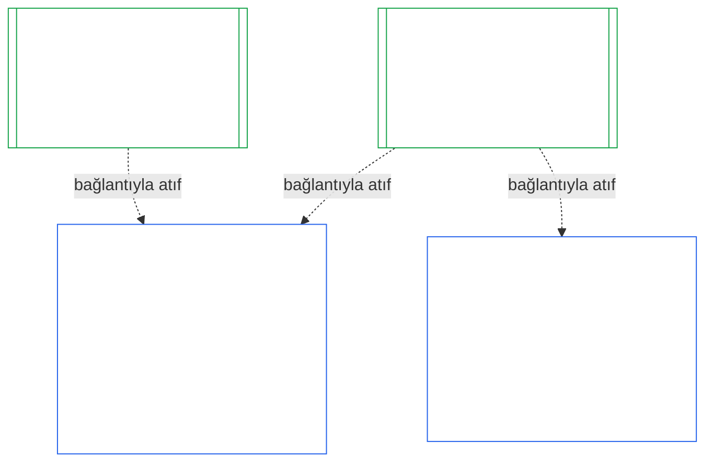
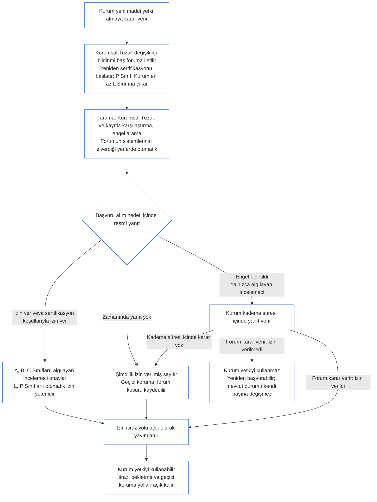

<!-- AI-assisted translation draft; unreviewed; English controls.
Source: core_10.000_institutional_alignment_certification.md
Source snapshot: 247e2180509e5e029c1106878cf225067339e010
Source SHA-256: a163a782114e584d09e295db66fe8b1b10a005b0f00116c8360396a0535ff221 -->

# ONUNCU BÖLÜM: KURUMSAL UYUM SERTİFİKASYONU

<strong>Corpus konumu (işlemsel değil): dosya yapısı ve okuma kuralları</strong>

> Bu dosya **Algılayanlar Anayasasının bir parçasıdır** ve yalnızca birlikte tek bir metin olarak okunan diğer numaralı `core_*` dosyalarıyla birlikte **bağlayıcıdır**. **Onuncu Bölümü** — **kurumsal uyum sertifikasyonunu** — içerir: bir [Kurumun](core_05.040_band_continuity.md#institution), işlettiği herhangi bir Sistemden ayrı olarak, nasıl sınıflandırıldığını, değerlendirildiğini, incelendiğini, karara bağlandığını, kaydedildiğini, güncel tutulduğunu ve yeniden ele alındığını (**§1–§11**) açıklar. Onuncu Bölüm, [Dokuzuncu Bölümün](core_09.000_system_alignment_certification_evaluation.md#chapter-nine-system-alignment-certification) (*Sistem Uyumu Sertifikasyonu*) kurumsal karşılığıdır ve **bölümlerinde aynı numaralar kullanılır**: buradaki §N, oradaki §N'yi yanıtlar. [CS-9.320](corpus_systems/cs_09.320_system_alignment_certification_illustrations.md#cs-9320-system-alignment-certification-illustrations) (*Sistem uyumu sertifikasyonu örnekleri*), Sistemler için uygulamalı örnekleri ve [§12 Örnek Kurum incelemeleri](corpus_systems/cs_09.320_system_alignment_certification_illustrations.md#cs-9320-12-illustrative-institution-walkthroughs) kapsamında üç Kurum incelemesini içerir. Bu Bölüm bunları tekrarlamaz.
>
> | § | Dokuzuncu Bölüm (Sistem) | Onuncu Bölüm (Kurum) |
> |---|------------------------|----------------------------|
> | 1 | Amaç ve Rol | Sistem sertifikasyonuyla ilişkisi, kimin sertifikalandırıldığı, oluşum veya işletim için izin ve kapı koşulu bulunmaması, yeni maddi yetki için bekleme, ilk sertifikasyon süresi |
> | 2 | Sistem Sınıfı Değerlendirmesi | kurum sınıfı; sınıfa göre ölçeklendirme |
> | 3 | Tüm Sistem Sertifikasyonu Değerlendirmesi | her zaman uygulanan sekiz kurumsal madde |
> | 4 | İlgili Olduğu Durumlarda Değerlendirmeler | Dokuzuncu Bölüm §4'e gönderme |
> | 5 | Hak Tabanı ve Alan Değerlendirmeleri | Dokuzuncu Bölüm §5'e gönderme |
> | 6 | Forum Süreci | dört koltuk; forum rolleri ve sırası; kurumlar olarak forumlar, sertifikalandıranlar ve kayıt büroları |
> | 7 | Sertifikasyon Sonuçları | Kurum ve Sistemleri için yürürlüğe girme, sertifikasyon koşulları ve sonucun diğer etkileri; kusurlar için gönderme; telafiye hazırlık; ret ve iptal |
> | 8 | Sistem Sertifikasyon Kaydı | Kurumsal Sertifikasyon Kaydı |
> | 9 | Yeniden Sertifikasyon ve Yeniden Açma | izleme; yeniden açma tetikleyicileri; geçici ve tam sertifikasyon; kaçınmama; Sistem sertifikasyonlarından kaynaklanan zincirleme etkiler; yönetişim ihlali halinde Sistemlerinin yeniden açılması |
> | 10 | Bir Sertifikasyona İtiraz | itiraz yolu |
> | 11 | Ehliyetle İlişki | ehliyet bağlantısı |
>
> - **Anayasal sorumlusu (Dokuzuncu Bölümle ortak):** forum gözetiminde uyum sertifikasyonu ve ilgili kayıtlar. Onuncu Bölüm kurumsal özneyi ekler. Yeni bir forum ailesi, yeni bir koltuk veya yeni bir sonuç terimi eklemez.
> - **Tekrar değil, yeniden kullanma:** III. Aşamadan VI. Aşamaya kadar, [Dokuzuncu Bölüm Kısım B §6](core_09.005_system_alignment_certification_record_process.md#6-forum-process) ile [Dokuzuncu Bölüm Kısım C §11](core_09.010_system_alignment_certification_record_recertification.md#11-relationship-to-standing) hükümlerine göre yürütülür. Onuncu Bölüm yalnızca özne bir Kurum olduğunda nelerin değiştiğini belirtir.
> - **Başka yere taşıma karşıtı kural:** Onuncu Bölüm, Dokuzuncu Bölümün Sistem değerlendirme işleyişini, Yedinci Bölümdeki Sistem Tüzüğü ve Kurumsal Tüzük alanlarını, Sekizinci Bölümdeki Dört Koltuk Gerekliliğini, [kurumlar corpusundaki](corpus_institutions.md) kurumsal görevleri, On Birinci Bölümün ehliyet ölçümünü veya On İkinci Bölümün ehliyet etkilerini yeniden ifade etmez.
>
> **Üst kaynaklar:** [Yedinci Bölüm](core_07.000_charters.md#chapter-seven-system-and-institutional-charters) Tüzükleri; [Sekizinci Bölüm](core_08.000_functional_independence_separation_of_duties.md#chapter-eight-functional-independence-and-separation-of-duties) işlevsel bağımsızlığı; [Dokuzuncu Bölüm](core_09.000_system_alignment_certification_evaluation.md#chapter-nine-system-alignment-certification) (Kısımlar [A](core_09.000_system_alignment_certification_evaluation.md#chapter-nine-part-a-system-alignment-certification--evaluation), [B](core_09.005_system_alignment_certification_record_process.md#chapter-nine-part-b-system-alignment-certification--forum-process-and-outcomes) ve [C](core_09.010_system_alignment_certification_record_recertification.md#chapter-nine-part-c-system-alignment-certification--record-recertification-and-standing)); On Dördüncü Bölüm forum gözetimi.
> **Alt kaynaklar:** On Birinci Bölüm ehliyet kayıtları ve doğrulanmış girdiler; On İkinci Bölüm ehliyet etkileri.

<strong>İz</strong>

- Üst kaynaklar:
  - [Yedinci Bölüm §1 Sistem ve Kurumsal Tüzüklerin Gerektiği Durumlar](core_07.000_charters.md#1-when-system-and-institutional-charters-are-required) (7.000 §1) (*hangi Kurumların Sistem Tüzüğü veya Kurumsal Tüzük yayımladığı ve Kurumun sınıfı*);
  - [Yedinci Bölüm §7 Değişiklik ve İnceleme](core_07.000_charters.md#7-amendment-review-and-scope-misalignment) (7.000 §7) (*Kurumsal Tüzük incelemesinin sınadığı hususlar*);
  - [Yedinci Bölüm §4 Tüzük Rol Haritası ve Ehliyet Kaydının Saklanması](core_07.000_charters.md#4-the-charter-role-map-and-standing-record-custody) (7.000 §4) (*koltukların nerede bulunduğu*);
  - [Sekizinci Bölüm §2 Dört Koltuk Anayasal Gerekliliği](core_08.000_functional_independence_separation_of_duties.md#2-four-seat-constitutional-requirement) (8.000 §2) ve [§9 Sonraki Süreçlerle İlişki](core_08.000_functional_independence_separation_of_duties.md#9-relationship-to-later-processes);
  - [Dokuzuncu Bölüm](core_09.000_system_alignment_certification_evaluation.md#chapter-nine-system-alignment-certification) (9.000–9.010) (*bu Bölümün yeniden kullandığı Sistem Uyumu Sertifikasyonu süreci*);
  - [İki Temel Soru](core_00.000_preamble.md#two-fundamental-questions);
  - [Anayasal Dörtlü](core_00.000_preamble.md#constitutional-tetrad);
  - [Madde XI-E](core_06.005_rights_part_b.md#article-xi-e-institutional-formation-and-business-creation) (*Kurumsal Oluşum ve İş Kurma*).
- Alt kaynaklar: [§1](#1-purpose-and-role) ile [§11](#11-relationship-to-standing) arası; On Birinci Bölüm ([11.000](core_11.000_standing_assessment.md#chapter-eleven-contribution-violation-and-standing-model--measurement)); [On Dördüncü Bölüm](core_14.000_forum.md#chapter-fourteen-forums-and-jurisdiction) (14.000).
- Şunlarla birlikte okuyun:
  - [Kurumsal Uyum Sertifikasyonu](core_05.040_band_continuity.md#institutional-alignment-certification) ve
  - [Kurumsal Sertifikasyon Kaydı](core_05.040_band_continuity.md#institutional-certification-record) (*Beşinci Bölümdeki anlamları*);
  - **CI-8.205 §6** (*Sistem ve Kurumsal Tüzük içeriği, incelemesi ve oluşum şablonu*);
  - **CF-14.425** (*Bütünlük güvenceleri, ele geçirmeyi önleyen işleyiş ve kendi kendini yargılamayı önleyen destek*).

 

Onuncu Bölüm, **kurumsal uyum sertifikasyonunun** anayasal sorumlusudur. [Dokuzuncu Bölümün](core_09.000_system_alignment_certification_evaluation.md#chapter-nine-system-alignment-certification) sürecini Sistemden Kuruma genişletir:

- **I. Aşama, Çerçevele:** kurum sınıfı ve değerlendirmeyi nasıl ölçeklendirdiği ([§2 Kurum Sınıfı Değerlendirmesi](#2-institution-class-evaluation));
- **II. Aşama, Değerlendir:** ilgili olduğu durumlarda uygulanan değerlendirmeler ve Hak Tabanı ile alan değerlendirmeleri dâhil kurumsal değerlendirme ([§3 Tüm Kurum Sertifikasyonu Değerlendirmesi](#3-whole-institution-certification-evaluation) ile [§5 Hak Tabanı ve Alan Değerlendirmeleri](#5-rights-floor-and-domain-evaluations) arası);
- **III. Aşama, İncele:** forum rolleri ve sırası ([§6 Forum Süreci](#6-forum-process));
- **IV. Aşama, Karara Bağla:** sonuç, telafiye hazırlık, ret ve iptal ([§7 Sertifikasyon Sonuçları](#7-certification-outcomes));
- **V. Aşama, Kaydet:** Kurumsal Sertifikasyon Kaydı ([§8 Kurumsal Sertifikasyon Kaydı](#8-institutional-certification-record)); ve
- **VI. Aşama, İşlet:** yeniden sertifikasyon, yeniden açma, Sistem sertifikasyonlarından kaynaklanan zincirleme etkiler, Sistemlerinin yeniden açılması, itiraz yolu ve ehliyet bağlantısı ([§9 Yeniden Sertifikasyon ve Yeniden Açma](#9-recertification-and-reopening) ile [§11 Ehliyetle İlişki](#11-relationship-to-standing) arası).

*Yalın dille: Dokuzuncu Bölüm bir **sistemin** uyumlu olup olmadığını sorar. Onuncu Bölüm, sistemleri işleten veya sistem işletmeden yetki kullanan **kurum** için aynı soruyu sorar. Bir kurum uyumluyken sistemlerinden biri uyumsuz olabilir; bunun tersi de mümkündür. Bu nedenle kurum, yalnızca kendi kontrolünde olan şeyler bakımından denetlenir: Kurumsal Tüzüğünün söylediğini yapıp yapmadığı, yetkisinden kimin hesap verdiği, kendi üyelerinde neyi ödüllendirdiği ve bağımsız denetimlerin gerçekten kullanılabilir olup olmadığı. Her sistemin sertifikasyonuna dayanır ve onu yeniden yapmaz. Bu bir lisans değildir: hiç kimsenin bir kurum kurmak veya işletmek için onun iznine ihtiyacı yoktur.*

### 1. Amaç ve Rol

<strong>İz</strong>

- Üst kaynaklar:
  - [Yedinci Bölüm §1 Sistem ve Kurumsal Tüzüklerin Gerektiği Durumlar](core_07.000_charters.md#1-when-system-and-institutional-charters-are-required) (7.000 §1);
  - [Dokuzuncu Bölüm Kısım A §1 Amaç ve Rol](core_09.000_system_alignment_certification_evaluation.md#1-purpose-and-role) (9.000 §1);
  - [Madde XI-E](core_06.005_rights_part_b.md#article-xi-e-institutional-formation-and-business-creation) (*Kurumsal Oluşum ve İş Kurma*);
  - [Madde XXVIII-A](core_06.020_rights_part_e.md#xxviii-a-existing-instantiations-adoption-transition-window) (*Aşamalı Benimseme ve Hak Tabanı Sürekliliği*).
- Alt kaynaklar: [§2](#2-institution-class-evaluation); [§6](#6-forum-process); [§7](#7-certification-outcomes); [§9](#9-recertification-and-reopening).
- Şunlarla birlikte okuyun:
  - [Kurum](core_05.040_band_continuity.md#institution);
  - [Kurumsal Tüzük](core_05.040_band_continuity.md#institutional-charter);
  - [Sistem Tüzüğü](core_05.040_band_continuity.md#system-charter);
  - [İş Kurma](core_05.055_band_participation.md#business-creation).

 

*Yalın dille: bir sistemin sertifikasyonu sisteme aittir. Bir kurumun sertifikasyonu, bu sertifikasyonlara gönderme yapar ve yalnızca kurumun hesap verebileceği hususları ekler. Bir sistem birden çok kurum altında veya hiçbir kurum altında yer alabilir. Buradaki hiçbir şey, bir kurum kurmanın önüne sertifikasyon engeli koymaz.*

Kurumsal uyum sertifikasyonu ile Sistem Uyumu Sertifikasyonu, bir bağlantıyla birleştirilmiş iki sertifikasyondur. İlişki, içerilme değil **bağlantıyla bileşimdir**. Şekilde ok, bir Kurumsal Sertifikasyon Kaydının atıfta bulunduğu her Sistem Sertifikasyon Kaydına bağlantıdan ilerler. Hiçbir Kurum altında olmayan bir Sistemin oku yoktur ve buna ihtiyacı da bulunmaz; Sistem işletmeyen bir Kurumun ise tek başına bir kaydı vardır.

Bağlantıyla bileşimin iki yönü vardır; önce Kurumun yönü:

Kurum yönünden:

- **Kurumsal Sertifikasyon Kaydı, Sistemin kaydına atıfta bulunur ve onu yeniden değerlendirmez:** Sistem Sertifikasyon Kaydına bağlantıyla atıfta bulunur ve sürümünü belirtir. Bu Bölüm bir Sistem değerlendirmesini hiçbir zaman yeniden yürütmez, Sistem sınıfına ilişkin kararı hiçbir zaman yeniden vermez ve Sistemin sonucunu, durumunu veya sertifikasyon koşullarını hiçbir zaman değiştirmez.
- **Kurumun sertifikasyonu bir Sistemin sertifikasyon düzeyini yükseltemez:** Sertifikalı Değil durumundaki bir Sistem, Kurumun durumu ne olursa olsun Sertifikalı Değil kalır. Sertifikasyonu bulunan bir Sistem, Kurum hakkında verilen bir bulgudan koruma kazanmaz.
- **Kurumsal olgular bir kez tespit edilir:** [Dokuzuncu Bölüm Kısım A §3.1 Yönetişim, Teşvik ve İtiraz Edilebilirlik Disiplini](core_09.000_system_alignment_certification_evaluation.md#31-governance-incentive-and-contestability-discipline) işletmecinin yönetişimi ve teşvikleri hakkında soru sorduğunda, işletmeciye ait güncel Kurumsal Sertifikasyon Kaydı bu olguları bağlantı yoluyla sağlayabilir. Sistemin forumları yine de bu olguların o Sistem için yeterli olup olmadığına karar verir. Nedenini Sistem Sertifikasyon Kaydında açıklamadan aynı kurumsal olgu hakkında farklı bulguda bulunamazlar.

Sistem yönünden:

- **Sistem Sertifikasyon Kaydı Sisteme aittir:** [Dokuzuncu Bölüm](core_09.000_system_alignment_certification_evaluation.md#chapter-nine-system-alignment-certification) uyarınca Sistemin kendi kaydıdır.
- **Bir Sistem Sertifikasyon Kaydına birden çok Kurum atıfta bulunabilir:** [Yedinci Bölüm §1 Sistem ve Kurumsal Tüzüklerin Gerektiği Durumlar](core_07.000_charters.md#1-when-system-and-institutional-charters-are-required) uyarınca bir Sistem birden fazla Kurum tarafından işletilebilir, gözetilebilir veya esaslı biçimde kontrol edilebilir. Her biri aynı kayda atıfta bulunur.
- **Bir Sistemin herhangi bir Kurum altında bulunması gerekmez:** Tek bir algılayan Kurum değildir; dolayısıyla bir Sistemin altında hiç Kurum olmayabilir. Kurumsuz bir Sistem yalnızca [Dokuzuncu Bölüm](core_09.000_system_alignment_certification_evaluation.md#chapter-nine-system-alignment-certification) uyarınca sertifikalandırılır ve bu Bölümden hiçbir şeye ihtiyaç duymaz. Bir Kurum altında bulunan Sistem de aynı biçimde sertifikalandırılır: bu Bölüm Kurum için ayrı bir kayıt ekler; Sistemin kendi sertifikasyonunun bir adımı değildir.

#### 1.1 Kim sertifikalandırılır

L veya daha üst sınıftaki bir Kurum, sınıfın [§2.1 Kurum sınıfı](#21-institution-class) uyarınca belirlendiği bu Bölüm kapsamındadır. Buna hiçbir Sistem işletmeyen Kurum da dahildir: atıfta bulunacağı bir Sistem Sertifikasyon Kaydı yoktur ve sınıfı kendi etkisine göre belirlenir. Bir Kurumun **portföyü**, işlettiği, gözettiği veya esaslı biçimde kontrol ettiği Sistemler kümesidir ([Portföy](core_05.040_band_continuity.md#portfolio)).

- **A, B, C ve L Sınıfları:** süreç uygulanır ve [§2.2 Sınıfa göre ölçeklendirme](#22-scaling-by-class) uyarınca sınıfa göre ölçeklendirilir.
- **P Sınıfı:** süreç teşvik edilir ve gönüllü olarak kullanılabilir. L veya üst sınıfa yeniden sınıflandırıldığında ya da Kurum anayasal uyum iddiasında bulunduğunda zorunlu hâle gelir. Yeni bir maddi yetki almaya karar veren P Sınıfı Kurum, [§9.2.2 Yeni maddi yetki için yeniden sertifikasyon](#922-recertification-for-new-material-authority) kapsamındaki bildirimi verdiğinde en az L Sınıfına yeniden sınıflandırılır; çünkü bu yetki tanım gereği maddidir ([§9.2.1 Yeni maddi yetki sayılanlar](#921-what-counts-as-new-material-authority)) ve herhangi bir alanda maddi olan Kurum en az L Sınıfındadır ([§2.1 Kurum sınıfı](#21-institution-class), 2. madde). Yeniden sınıflandırma, bildirimden bildirimin izin verilmeden önce geri çekilmesine ya da yetkiye izin verilmemesine kadar sürer; bunun için yetkinin altında hiçbir işlem yapılmamış olmalıdır. Kurum daha sonra P Sınıfına döner ve sınırlı ilk sertifikasyon sona erer. Yeni bir bildirim bu süreci yeniden başlatır; izin alınmadan yetkinin kullanılması ise [§9.2.2 Yeni maddi yetki için yeniden sertifikasyon](#922-recertification-for-new-material-authority) (*Bildirim olmadan veya izin verilmeden önce*) kapsamındaki bulgu olarak kalır. Bu, [Dokuzuncu Bölüm Kısım A §1 Amaç ve Rol](core_09.000_system_alignment_certification_evaluation.md#1-purpose-and-role) hükmünü yansıtır.
- **Tek Sistem:** Sistem Tüzüğü gerektiren tam olarak bir Sistem işleten Kurumun tek sertifikasyon turu ve bu Bölümün **tek Sistem değerlendirmesi** dediği tek bir kaydı vardır. Sistem Sertifikasyon Kaydı, [§8 Kurumsal Sertifikasyon Kaydı](#8-institutional-certification-record) kapsamındaki maddeleri içeren bir *kurumsal bulgular bloğu* taşır ve Kurumsal Sertifikasyon Kaydı işlevini görür. Forumlar, koltuklar ve süreler, kurumsal maddeler eklenmiş olarak Sistemin kendi sertifikasyon turuna aittir. Sonuçlar, [§7.4 Bir Kurum için ret ve iptal](#74-denial-and-revocation-for-an-institution) hükmünde belirtildiği üzere kendi ret ve iptal gerekçelerine tabidir. Sistem tüm portföy olduğundan [§9.5 Sistem sertifikasyonlarından kaynaklanan zincirleme etkiler](#95-cascade-from-system-certifications) bir zincirleme etki olarak uygulanmaz; ancak [§7.4 Bir Kurum için ret ve iptal](#74-denial-and-revocation-for-an-institution) kapsamındaki 1. ve 2. kurallar (gösterge ve nedenin nerede bulunduğu sınaması) uygulanır.
- **Birden Çok Sistem:** Kurum için tek bir Kurumsal Sertifikasyon Kaydı oluşturulur ve işlettiği her Sistemin Sistem Sertifikasyon Kaydına bağlantı verir. Her Sistem kendi turunu ve kaydını korur.
- **Sistem Yok:** Kurumun tek başına bir Kurumsal Sertifikasyon Kaydı bulunur. Kurum Sistem işletmediği için bağlantı vereceği bir Sistem Sertifikasyon Kaydı yoktur.

#### 1.2 Kurum Kurmak veya İşletmek İçin İzin ve Kapı Koşulu Yoktur

Kurumsal uyum sertifikasyonu, bir Kurumun yetkisini gerçekte nasıl kullandığına ilişkin bağımsız bir denetimdir. Kurumdan bağımsız forumlar bu sertifikasyonu yapar ve süreç, bulgularını içeren bir Kurumsal Sertifikasyon Kaydıyla sonuçlanır.

- **Kurma ve işletme:** Kurum kurulur, Kurumsal Tüzüğünü yayımlar, yetki kullanmaya başlar ve önce sertifikasyon almadan faaliyetini sürdürür; hiçbir sonuç bu hakkı vermez veya elinden almaz.
- **Sonucun etkisi:** Bir sonuç yalnızca [§7.1 Bir Kurum için yürürlüğe girme](#71-go-live-for-an-institution) bölümündeki etkilere sahiptir.
- **Bu alandaki tek kapı koşulları:** Üç dar kapsamlı kapı koşulu vardır ve bunların tümü **Madde XI-E** (*Kurumsal Oluşum ve İş Kurma*) içindedir:
  - adı belirlenmiş bir algılayan üzerindeki yürürlükteki kilit; bu kilit o algılayanın yetkisine uygulanır;
  - uyumsuzluğa ilişkin belirli ve doğrulanmış olgulara dayanan Geçici Bekletme; bu da adı belirlenmiş bir algılayanın yetkisine uygulanır;
  - İşletici Tarafın kendisi üzerindeki kilit; bu kilit Kuruma yalnızca kilit o Kurum üzerinde olduğunda, **CI-12.210 §4** (*Tasfiye*) uyarınca tasfiye edilmiş bir Kurum üzerindeki kilit gibi uygulanır.

  [§7.5 Bir Kurum için ret ve iptalin etkileri](#75-effects-of-denial-and-revocation-for-an-institution) uyarınca, bu kapılardan birine karar veren foruma kanıt olarak sertifikasyon bulgusu gönderilebilir. Sertifikasyon sonucu kendi başına bir kapı koşulu değildir ve bir kapıyı açmaz ya da kapatmaz.
- **Yeni maddi yetki için bekleme:** Yeni bir maddi yetki almaya karar veren Kurum, [§9.2.2 Yeni maddi yetki için yeniden sertifikasyon](#922-recertification-for-new-material-authority) koşulları uyarınca, yetkiyi kullanmadan önce yeniden sertifikasyonun bu yetkiye izin vermesini bekler. Bu bekleme **Madde XI-E** (*Kurumsal Oluşum ve İş Kurma*) içinde belirtilmiştir. Üç dar kapsamlı kapıdan biri olmadığı gibi, Kurum kurmaya veya işletmeye de kapı koşulu değildir. Yalnızca yeni yetkiye uygulanır; Kurumun yaptığı diğer her şey sürer. [§9.2.2 Yeni maddi yetki için yeniden sertifikasyon](#922-recertification-for-new-material-authority) bölümündeki şekil adımları özetler.
- **Arka kapı yok:** Bu Bölümdeki hiçbir şey forum, benimseyen veya görevdeki yetkili tarafından kurucuları dışlayan ya da görevdekileri koruyan bir yetkilendirme eşiği olarak kullanılamaz. Böyle bir kullanım [Madde XI-E](core_06.005_rights_part_b.md#article-xi-e-institutional-formation-and-business-creation) (*Kurumsal Oluşum ve İş Kurma*) ilkesini boşa çıkarır.
  - Sürecin maliyetine [Kaçınılabilir Yük](core_05.040_band_continuity.md#avoidable-burden) uygulanır.
  - Sürecin derinliğine [Sınıfa Göre Ölçeklendirilmiş Yönetişim](core_05.050_band_oversight.md#classification-scaled-governance) uygulanır.
  - Yeni maddi yetki için bekleme, her sınıftaki her Kuruma aynı koşullarda ve yalnızca başkaları bakımından zaten maddi olan yetkiye uygulanır.

Sistemler için yürürlüğe girme kapısı ayrıdır ve Sistemlere ait olmaya devam eder. [Dokuzuncu Bölüm Kısım B §7.1 Yürürlüğe Girme Kapısı](core_09.005_system_alignment_certification_record_process.md#71-go-live-gate) uyarınca, yeni bir Sistem veya mevcut Sistemin esaslı genişlemesi, Kurumun durumu ne olursa olsun yalnızca kendi sertifikasyonu aracılığıyla yürürlüğe girer.

#### 1.3 İlk Sertifikasyon Süresi

İlk Kurumsal Sertifikasyon Kaydı, benimseme belgesinin Kurumun sınıfı için belirlediği süre içinde hazırlanmalıdır.

- **Yeni bir Kurum:** Süre, [Alana Özgü Esaslılık](core_05.050_band_oversight.md#domain-specific-materiality) uyarınca başkaları üzerinde ilk kez maddi etki yarattığı günden başlar ve ilk sertifikasyonu geçicidir.
- **Bildirim üzerine yeniden sınıflandırılan P Sınıfı Kurum:** Süre, yeni bir Kurumda olduğu gibi, [§9.2.2 Yeni maddi yetki için yeniden sertifikasyon](#922-recertification-for-new-material-authority) uyarınca bildirimi verdiği gün başlar; daha önce sona ermiş bir Benimseme Geçiş süresinden hiçbir zaman başlamaz.
- **Hâlihazırda faaliyet gösteren Kurum:** Süre, [Madde XXVIII-A](core_06.020_rights_part_e.md#xxviii-a-existing-instantiations-adoption-transition-window) (*Aşamalı Benimseme ve Hak Tabanı Sürekliliği*) kapsamındaki Benimseme Geçiş süresidir ve [Yedinci Bölüm §1.5 Sistem Tüzüğünün veya Kurumsal Tüzüğün teslim edilme zamanı](core_07.000_charters.md#15-when-a-system-charter-or-institutional-charter-is-due) hükmündeki varsayılanla uyumludur.
- **Sürenin kaçırılması:** Aşağıda mazeret belirtilmemişse ilk sertifikasyon turunu tamamlamadan sürenin dolmasına izin veren Kurumun kayda geçirilmesi ve düzeltilmesi gereken bir kusuru vardır; kaçırılan süre bu turu başlatır. Hâlihazırda faaliyet gösteren L veya üst sınıf bir Kurumun aşağıdaki kilometre taşı ihlali de vardır. Kapı koşulu bulunmadığından Kurumun faaliyetleri durdurulmaz veya engellenmez ([§1.2 Kurum Kurmak veya İşletmek İçin İzin ve Kapı Koşulu Yoktur](#12-no-permission-and-no-gate-on-forming-or-running)).
  - **Hâlihazırda faaliyet gösteren Kurum:** Bu, L veya üst sınıf Kurumlar için bu Bölümün kendi kuralıdır ve Sistemleri ve türetilmiş kuruluşları adlandıran [Madde XXVIII-A](core_06.020_rights_part_e.md#xxviii-a-existing-instantiations-adoption-transition-window) (*Aşamalı Benimseme ve Hak Tabanı Sürekliliği*) hükmüne benzetilerek belirlenmiştir. Benimseme Geçiş süresi sona erdiğinde ilk sertifikasyon turu tamamlanmamışsa ([§7 Sertifikasyon Sonuçları](#7-certification-outcomes) uyarınca geçici veya tam sertifikasyon ya da karara bağlanmış bir sonuç yoksa) süreyi kaçırmıştır. Süre içinde başvuruda bulunan ve işbirliği yapan Kurum, forum kendi süresini aştığı için sertifikasyon turu tamamlanmamışsa ([On Dördüncü Bölüm §6 Zamanında çözüm, esaslılık kademeleri ve gecikmeyi önleme disiplini](core_14.000_forum.md#6-timely-resolution-materiality-tiers-and-anti-delay-discipline), *Süre aşımı incelemesi*; [Dokuzuncu Bölüm Kısım C §9.3.4 Kademe süreleri](core_09.010_system_alignment_certification_record_recertification.md#934-tier-windows)) veya [§7.3 Bir Kurum için telafiye hazırlık](#73-remediation-readiness-for-an-institution) uyarınca izin verilen tek erteleme devam ediyorsa süreyi kaçırmış sayılmaz. [Madde XXVIII-B](core_06.020_rights_part_e.md#article-xxviii-b-adoption-transition-authority-limits-and-reauthorization) (*Benimseme Geçişi Yetki Sınırları ve Yeniden Yetkilendirme*) uyarınca belgelenmiş bir yeniden yetkilendirme gösterimi yoksa bu, Benimseme Geçişi kilometre taşı ihlalidir ve [On Birinci Bölüm](core_11.000_standing_assessment.md#chapter-eleven-contribution-violation-and-standing-model--measurement) kapsamındaki olağan uyum ve ihlal yolu açılır. Bu Maddedeki kısıtlama görevleri yürürlük tarihinden itibaren uygulanır; boşluğun sürmesi onu yeni olağan hâle getirmez. Bu, [Dokuzuncu Bölüm Kısım B §7.1.1 Hâlihazırda faaliyet gösteren Sistemler](core_09.005_system_alignment_certification_record_process.md#711-systems-already-operating) hükmünü yansıtır. Bu bir kapı koşulu değildir.
  - **Sertifikasyon turu:** Diğer tüm turlar gibi karara bağlanır. [§7 Sertifikasyon Sonuçları](#7-certification-outcomes) kapsamındaki sonuçlardan herhangi biriyle, [§7.5 Bir Kurum için ret ve iptalin etkileri](#75-effects-of-denial-and-revocation-for-an-institution) kapsamındaki etkileri olan Sertifikalı Değil sonucu da dâhil, bitebilir.
  - **Yaptırımlar ve tasfiye:** Bu Bölüm bunları oluşturmaz. Askıya alma, kayyum yönetimi, yapısal ayrıştırma ve tasfiye, **CI-12.210** (*Kurumsal başarısızlık ve tasfiye*) ile **CI-12.215** (*Kurumsal hesap verebilirlik ve yaptırımlar*) uyarınca yargı yetkisi olan forumda kalır. Bu foruma yalnızca [§7.5 Bir Kurum için ret ve iptalin etkileri](#75-effects-of-denial-and-revocation-for-an-institution) kapsamındaki gönderme gerekçeleriyle gönderim yapılır (5. madde, *Gönderim*).

### 2. Kurum Sınıfı Değerlendirmesi

<strong>İz</strong>

- Üst kaynaklar:
  - [Yedinci Bölüm §1 Sistem ve Kurumsal Tüzüklerin Gerektiği Durumlar](core_07.000_charters.md#1-when-system-and-institutional-charters-are-required) (7.000 §1);
  - [Dokuzuncu Bölüm Kısım A §2 Sistem Sınıfı Değerlendirmesi](core_09.000_system_alignment_certification_evaluation.md#2-system-class-evaluation) (9.000 §2) ve [§2.2 Sistem sınıfı her değerlendirmeyi nasıl ölçeklendirir](core_09.000_system_alignment_certification_evaluation.md#22-how-system-class-scales-every-evaluation);
  - [Üçüncü Bölüm §2.1 Yaygın Kaçınma Örüntüleri](core_03.000_definition_integrity.md#21-common-evasion-patterns) (3.000 §2.1).
- Alt kaynaklar: [§3](#3-whole-institution-certification-evaluation) (*sınıfın ölçeklendirdiği maddeler*); [§8](#8-institutional-certification-record) (*sınıf kayıtta belirtilir*); [§9.2](#92-reopening-triggers) (*sınıfı yeniden değerlendirme tetikleyicileri*).
- Şunlarla birlikte okuyun:
  - **CS-9.305 (*Sistem sınıflandırma mekanizması*) ve CS-9.310** (*Sistem etki sınıflandırmaları*) ile [corpus_systems/cs_09.310_system_impact_classifications.md](corpus_systems/cs_09.310_system_impact_classifications.md) (*sınıf kataloğu*);
  - **CI-9.210** (*Sınıflandırmaya bağlı kurumsal yükümlülükler*);
  - **CI-8.205 §6** (*Sistem ve Kurumsal Tüzük içeriği, incelemesi ve oluşum şablonu*).

 

*Yalın dille: önce Kurumu, başkaları için ne kadar önemli olduğuna göre sınıflandırın. Buna, kendisine verdiği adla değil, gerçekte neye karar verdiği ve neyi elinde tuttuğuna bakarak karar verin. Sınıf daha sonra değerlendirmenin ne kadar kapsamlı olacağını belirler: sınıf yükseldikçe kanıt daha güçlü, inceleme daha bağımsız ve yeniden denetim daha erken olur.*

Bu bölüm, bir Kurum için **I. Aşama, Çerçevele** aşamasıdır.

#### 2.1 Kurum sınıfı

**Kurum sınıfı**, etkinin işlettiği bir Sistem üzerinden veya herhangi bir Sistemin dışında ortaya çıkmasına bakılmaksızın, Kurumun yarattığı en yüksek maddi etkiye göre belirlenir. Sınıf; Kurumun etiketine, hukuki biçimine veya Kurumsal Tüzüğündeki listeye göre değil, gerçekte neye karar verdiğine, neyi elinde tuttuğuna ve neyi kontrol ettiğine göre değerlendirilir. Sınıf, [Dokuzuncu Bölüm Kısım A §2.2 Sistem sınıfı her değerlendirmeyi nasıl ölçeklendirir](core_09.000_system_alignment_certification_evaluation.md#22-how-system-class-scales-every-evaluation) hükmünün Sistem için yaptığı gibi, değerlendirmenin derinliğini ve süreleri belirler. Bu Bölümde ve [Yedinci Bölüm §1.2 Hangi sınıflar kapsanır](core_07.000_charters.md#12-which-classes-are-covered) hükmünde kullanılan sınıftır.

1. **Sistemler üzerinden etki:** Kurumun sınıfı, portföyündeki herhangi bir Sistemin en yüksek sınıfından düşük olamaz ([Yedinci Bölüm §1 Sistem ve Kurumsal Tüzüklerin Gerektiği Durumlar](core_07.000_charters.md#1-when-system-and-institutional-charters-are-required)). Sistemler gözlemlenen işleyişten belirlenir. Kurumsal Tüzükte yer almayan bir Sistem yine de sayılır.
2. **Herhangi bir Sistemin dışındaki etki:** Kurumun kendi maddi etkisi ve bağımlılığı, Sistem işletip işletmediğine bakılmaksızın hesaba katılır. **CS-9.305 (*Sistem sınıflandırma mekanizması*) ve CS-9.310** (*Sistem etki sınıflandırmaları*) sınıf tanımları, aşağıdaki etkenler kullanılarak Kurumun kendi kararlarına ve elinde tuttuklarına uygulanır:
   - **Neye karar verdiği ve neyi elinde tuttuğu:**
     - diğer algılayanların hayatta kalmak için temel gereksinimlere, eğitime, güvenliğe, geçim kaynaklarına, haklara veya ehliyete erişimi hakkında neye karar verdiği; ve
     - fonlar, kayıtlar, üyelikler, ehliyet kayıtlarının muhafazası veya forum, sertifikalandırıcı ya da kayıt bürosu işlevi gibi elinde ne tuttuğu.
   - **Maddi olup olmadığı:**
     - [Alana Özgü Esaslılık](core_05.050_band_oversight.md#domain-specific-materiality) kapsamındaki herhangi bir alanda kendi faaliyetinin maddi olup olmadığı; buna başkalarının uyması gereken veya kesinleşmiş sayarak dayanabileceği [Maddi Bağlayıcı Eylemler](core_05.035_band_accountability.md#materially-binding-act) gerçekleştirmek de dahildir;
     - tek bir alanda maddi olan Kurum, **CS-9.305 (*Sistem sınıflandırma mekanizması*) ve CS-9.310** (*Sistem etki sınıflandırmaları*) uyarınca en az L Sınıfındadır; ve
     - başkalarının almakta veya reddetmekte özgür olduğu ve hiç kimsenin ihtiyaç duyduğu şeylere erişimini kontrol etmeyen yardım, mal, emek veya hizmet sunmak kimseyi bağlamaz. Bu bir davranıştır, Maddi Bağlayıcı Eylem değildir ve yalnızca diğer etkenler üzerinden hesaba katılır.
   - **Ona ne ölçüde bağımlı olunduğu:**
     - kaç algılayanın ona bağımlı olduğu ve ne ölçüde ikame edilebilir olduğu;
     - Maddi Kontrol Sınırı anlamında yetkisinin ne ölçüde yoğunlaştığı; ve
     - kararlarının ne ölçüde geri döndürülebilir olduğu.
3. **Ortak kontrol:** [Alana Özgü Esaslılık](core_05.050_band_oversight.md#domain-specific-materiality) kapsamındaki birleştirme kuralı uyarınca tek bir operasyon olan İşletici Taraflar ([Maddi Kontrol Sınırı](core_05.035_band_accountability.md#material-control-line) içinde ortak fiilî kontrol; tek başına finansman sayılmaz), uygulamada tek Kurum gibi hareket ettikleri yerlerde birlikte sınıflandırılır. Hiçbir bölüm L Sınıfına erişmesin diye İşletici Tarafı, portföyünü veya yetkisini bölmek, [Üçüncü Bölüm §2.1 Yaygın Kaçınma Örüntüleri](core_03.000_definition_integrity.md#21-common-evasion-patterns) uyarınca kapsam ve sınırdan kaçınmadır.
4. **Yeniden sınıflandırma:** Sınıf, [§9.2 Yeniden açma tetikleyicileri](#92-reopening-triggers) kapsamındaki tetikleyiciler üzerine yeniden değerlendirilir. Sınıflandırma, gerekçeleriyle birlikte Kurumsal Sertifikasyon Kaydında belirtilir.

#### 2.2 Sınıfa göre ölçeklendirme

Kurum sınıfı, [Dokuzuncu Bölüm Kısım A §2.2 Sistem sınıfı her değerlendirmeyi nasıl ölçeklendirir](core_09.000_system_alignment_certification_evaluation.md#22-how-system-class-scales-every-evaluation) hükmündeki gibi kanıtın derinliğini, incelemenin bağımsızlığını, varsayılan sertifikasyon aralığını ve kayıttaki açıklamaları ölçeklendirir. Sertifikasyon aralıkları [On Dördüncü Bölüm §6 Zamanında çözüm, esaslılık kademeleri ve gecikmeyi önleme disiplini](core_14.000_forum.md#review-cadence) (*İnceleme sıklığı*) kapsamındadır; benimseme belgesi daha kısa aralıklar belirleyebilir ve sorunsuz geçici yeniden sertifikasyonların sayısını belirler.

- **A, B ve C Sınıfları:** [§3 Tüm Kurum Sertifikasyonu Değerlendirmesi](#3-whole-institution-certification-evaluation) kapsamındaki sekiz maddenin tümü; sınıfa orantılı kanıt ve bağımsızlıkla değerlendirilir.
- **L Sınıfı:** aynı sekiz madde, [Sınıfa Göre Ölçeklendirilmiş Yönetişim](core_05.050_band_oversight.md#classification-scaled-governance) izin verdiğinde sadeleştirilerek, daha basit kayıtlarla ve daha uzun varsayılan sertifikasyon aralığıyla ele alınır. L Sınıfı incelemenin özü, Kurumsal Tüzüğün uygulamayla karşılaştırılması, Rol Haritası, oluşum denetimi beyanı ve atıf yapılan Sistem sertifikasyonlarının güncelliğidir. Hiçbir madde atlanamaz; bulguya konu olmayan madde tek satırla belirtilir.
- **P Sınıfı:** [§1.1 Kim sertifikalandırılır](#11-who-is-certified) hükmünde belirtildiği üzere gönüllüdür.

**Ortak mesleki uygulamadaki ev sahibi.** Bir Kurum ev sahibi olduğunda ([**CI-15.205 §7**](corpus_institutions/ci_15.205_appointment_competency_rotation_removal.md#ci-46-seat-advisory) (*Meslek uygulama lisansı, uygulama izni ve ortak mesleki uygulama*)), sertifikasyonunda üyelerin eylemleri ev sahibinin taşıdığı koltuklara göre örneklenir ve üyelerin benimseme bildirimleri ev sahibinin yaptıklarıyla karşılaştırılır. Bir üyenin eylemine ilişkin bulgu o üyeye aittir; ev sahibine ancak ev sahibinin taşıdığı bir koltuk başarısız olduğunda ulaşır.

### 3. Tüm Kurum Sertifikasyonu Değerlendirmesi

<strong>İz</strong>

- Üst kaynaklar:
  - [Dokuzuncu Bölüm Kısım A §3 Tüm Sistem Sertifikasyonu Değerlendirmesi](core_09.000_system_alignment_certification_evaluation.md#3-whole-system-certification-evaluation) (9.000 §3);
  - [Yedinci Bölüm §3 Sistem ve Kurumsal Tüzüklerin Belirtmesi Gerekenler](core_07.000_charters.md#3-what-system-and-institutional-charters-must-state) (7.000 §3);
  - [Yedinci Bölüm §5 Oluşum Denetimi: Görev Sahibinin Ehliyeti ve Gerçekliği](core_07.000_charters.md#5-formation-check-office-holder-standing-and-authenticity) (7.000 §5);
  - [Yedinci Bölüm §7 Değişiklik ve İnceleme](core_07.000_charters.md#7-amendment-review-and-scope-misalignment) (7.000 §7);
  - [İki Temel Soru](core_00.000_preamble.md#two-fundamental-questions);
  - [Birinci Bölüm §19.6 Mülkiyet veya Yapı Değiştiğinde Sorumluluğu Sürdürme](core_01.010_stewardship_capacity_principles.md#196-keeping-responsibility-when-ownership-or-structure-changes) (1.010 §19.6).
- Alt kaynaklar: [§6](#6-forum-process) (*forumların incelediği bulgular*); [§9](#9-recertification-and-reopening) (*bunları yeniden açan tetikleyiciler*); [§11](#11-relationship-to-standing) (*adı belirlenmiş bir algılayan hakkındaki bulgular için doğrulanmış girdi kapısı*).
- Şunlarla birlikte okuyun:
  - **CI-8.205 §3** (*Yetki zinciri ve yetki devri kontrolleri*) ile **CI-8.205 §6** (*Sistem ve Kurumsal Tüzük içeriği, incelemesi ve oluşum şablonu*);
  - **CI-6.215** (*Kaynakların sorumlu yönetimi ve teşvik bütünlüğü*);
  - **CI-8.210** (*Çıkar çatışması bütünlüğü, ele geçirmeyi önleme ve yolsuzlukla mücadele*), **CI-6.205** (*Şeffaflık, katılım ve erişilebilir itiraz ve hizmet yolları*) ve 8. madde için **CI-12.205** (*Telafi sistemleri ve kurumsal giderim kapasitesi*).

 

*Yalın dille: tek tek Sistemlere değil Kuruma ait olan hususları denetleyin: Kurumsal Tüzüğüne uyup uymadığını, yetkisinden kimin hesap verdiğini, neyi ödüllendirdiğini ve bağımsız denetimlerin işleyip işlemediğini.*

Bu bölüm, bir Kurum için **II. Aşama, Değerlendir** aşamasıdır.

Her sertifikasyon turu, [Dokuzuncu Bölüm Kısım A §3 Tüm Sistem Sertifikasyonu Değerlendirmesi](core_09.000_system_alignment_certification_evaluation.md#3-whole-system-certification-evaluation) bölümünün kurumsal karşılığı olan bu sekiz maddeyi değerlendirir. Her bulgu, dayandığı kanıtı ve Kurumsal Tüzük metnini veya gözlemlenen işleyişi belirtir.

1. **Kurumsal Tüzüğün uygulamayla karşılaştırılması:**
   - Kurumsal Tüzük, [Yedinci Bölüm §7 Değişiklik ve İnceleme](core_07.000_charters.md#7-amendment-review-and-scope-misalignment) kapsamındaki inceleme listesi kullanılarak gözlemlenen işleyişle karşılaştırılır.
   - Kurumsal Tüzük dışındaki uygulama veya artık uygulamayı tanımlamayan bir Kurumsal Tüzük, hangisi yanlışsa bulgu oluşturur.
2. **Portföy ve toplam etki:**
   - Portföy gerekçesi sınanır: her Sistem Kurumun belirttiği bir amaca bağlanır; belirtilmiş bir gerekçesi olmayan Sistem için bulgu verilir.
   - Değerlendirme ayrıca Sistemlerin tümüne bakarak, hiçbir Sistem sertifikasyonunun tek başına gösteremeyeceği hususları inceler:
     - paylaşılan bağımlılıklar;
     - toplam güven ve dayanma;
     - ortak temellerden birikimli kaynak çekme; ve
     - tek bir işlevi, her bir parçası bir sınıftan veya görevden kaçacak biçimde bölen düzenlemeler.
3. **Hesap verebilir yetki:**
   - Kurumun başkaları üzerinde kullandığı her yetki, adı konulabilen ve [Sekizinci Bölüm](core_08.000_functional_independence_separation_of_duties.md#chapter-eight-functional-independence-and-separation-of-duties) ile **CI-8.205 §3** (*yetki zinciri ve yetki devri kontrolleri*) kurallarınca hesap veren, sorumlu bir makama atfedilebilir.
   - Mülkiyet, kontrol veya yapı değişikliği sorumluluğu ortadan kaldırmaz ([Birinci Bölüm §19.6 Mülkiyet veya Yapı Değiştiğinde Sorumluluğu Sürdürme](core_01.010_stewardship_capacity_principles.md#196-keeping-responsibility-when-ownership-or-structure-changes)).
4. **Ödüller ve teşvikler:**
   - Kurumun kendi ücret, terfi, hedef ve ödülleri [İki Temel Soru](core_00.000_preamble.md#two-fundamental-questions) çerçevesinde incelenir: yapının gerçekte neyi ödüllendirdiği ve bunun Anayasanın iki amacına yönelip yönelmediği.
   - Uyumsuzluğu veya onu gizlemeyi ödüllendiren bir yapı, her Sistem tek tek sertifikalı olsa bile bulgudur.
   - [Dokuzuncu Bölüm Kısım A §3.3 Zaman Tutarlılığı Kısıtı](core_09.000_system_alignment_certification_evaluation.md#33-time-consistency-constraint) uygulanır. Güvenlik, Gerçek veya esenlik üzerindeki öngörülebilir orta veya uzun vadeli zarar ele alınmamışsa yakın dönem ölçütleri, yerel uyum ve kısa vadeli verimlilik yeterli değildir; bu bedel karşılığında kısa vadeli sonuçları ödüllendiren bir yapı bulgudur.
   - Teşvik bütünlüğüne ilişkin kurumsal görevler **CI-6.215** (*Kaynakların sorumlu yönetimi ve teşvik bütünlüğü*) metninde kalır; yeniden ifade edilmez, ona atıfta bulunulur.
5. **Rol Haritası ve kayıtların saklanması:**
   - [Tüzük Rol Haritası](core_05.040_band_continuity.md#charter-role-map), mevcut makamları adlandırır; bu makamlar belirtildiği gibi doldurulur veya yerine vekil atanır. Kurumun özne olduğu herhangi bir kayıt bakımından bu makamlar Kurumdan [bağımsızdır](core_05.035_band_accountability.md#independence).
   - Bağımsız yol gerçekte kullanılabilir olmalıdır.
   - Yerleştirilmemiş bir koltuk, işlevsiz bir makam veya Kurumun kendi hiyerarşisindeki bir kayıt sorumlusu bulgudur.
6. **Atıf yapılan her Sistem sertifikasyonunun güncelliği:**
   - Kurumun işlettiği her Sistem için değerlendirme, Sistem Sertifikasyon Kaydının yürürlükte veya Benimseme Geçiş süresi içinde olup olmadığını ve Kurumun bu kaydın sertifikasyon koşullarında kendisinden isteneni yapıp yapmadığını denetler.
   - Süresi dolmuş, geri çekilmiş veya başarısız olmuş ya da kayıtlı bir gerekçesi bulunmayan eksik sertifikasyon bulgudur; bu bulguyu [§9.5 Sistem sertifikasyonlarından kaynaklanan zincirleme etkiler](#95-cascade-from-system-certifications) daha sonra Kuruma taşır.
7. **Görev sahibinin ehliyeti ve gerçekliği:**
   - [Yedinci Bölüm §5 Oluşum Denetimi: Görev Sahibinin Ehliyeti ve Gerçekliği](core_07.000_charters.md#5-formation-check-office-holder-standing-and-authenticity) uyarınca yayımlanan oluşum denetimi beyanı, gözlemlenen işleyişle karşılaştırılır ve beyan üzerine olduğu gibi kabul edilmez.
   - Forumlar kapsanan her makam için ehliyet olgularını doğrulanmış kayıtlarla karşılaştırır ve kontrol, çıkar ve ödüller, davranış ve korunan söz hakkına ilişkin kanıtlardan gerçeklik bulgusu çıkarır. Buna şunlar dahildir:
     - görev sahibini gerçekte kimin yönlendirdiği;
     - görev sahibine ne için ücret ve terfi verildiği;
     - görev sahibinin bu işlevde doğrulanabilir biçimde ne yaptığı; ve
     - [korunan bir bildirimde](core_05.035_band_accountability.md#protected-reporting-whistleblowing) bulunan veya hukuka aykırı ya da anayasaya aykırı bir talimatı reddeden ([Birinci Bölüm §17.5 Direnme Görevi](core_01.010_stewardship_capacity_principles.md#175-duty-to-resist)) herhangi bir kişinin (görev sahibi dâhil) bu nedenle cezalandırılıp cezalandırılmadığı.
   - Kapsanan bir makamı olmayan personel tek tek denetlenmez. Bunlar [Yedinci Bölüm §5.6 Personel Güvenceleri Denetimi](core_07.000_charters.md#56-staff-safeguards-check) ile kapsanır; forumlar bunu da aynı biçimde gözlemlenen işleyişle karşılaştırır. Şunları sorgular:
     - Kurumun atama, ücret, terfi ve görevden alma kurallarının belirtilen amaca aykırı çalışmayı ödüllendirip ödüllendirmediğini;
     - korunan bir bildirim yolunun bulunup bulunmadığını ve bu yolu kullanan ya da hukuka aykırı veya anayasaya aykırı bir talimatı reddeden herhangi bir personelin cezalandırılıp cezalandırılmadığını; ve
     - [Madde III-C](core_06.000_rights_part_a.md#article-iii-c-labor-and-economic-floor) (*Emek ve Ekonomik Taban*) kapsamındaki hakların korunup korunmadığını.
   - Aşağıdakilerin her biri bulgudur:
     - açıklanmamış bir denetleyicinin adayı olan görev sahibi;
     - yalnızca kâğıt üzerinde bulunan kapsanan makam: Kurumsal Tüzük veya Tüzük Rol Haritası makamı adlandırır, ancak gerçekte kimse bu makamı üstlenmez ve işini yapmaz;
     - görev sahiplerine Kurumsal Tüzüğün yayımlanmış sınırlarının yasakladığı işleri yapmaları için ödeme yapan ödül yapısı; ve
     - yanlış veya eksik bir beyan.
   - Bulgular makama ve yapıya ilişkindir. [§11 Ehliyetle İlişki](#11-relationship-to-standing) kapsamındaki doğrulanmış girdi kapısı dışında adı belirlenmiş bir algılayana uygulanmazlar.
   - Oluşum denetimi bir inanç sınaması değildir; ancak başkalarının zararı veya ayrımcı muameleyi hak ettiğine ilişkin doğrulanmış bir beyan davranıştır ve [Birinci Bölüm §7.5 İfade ve Zarar Sınırı](core_01.000_values_principles.md#75-expression-and-the-harm-line) uyarınca görev sahibi aleyhine sayılır.
   - 3., 4. ve 5. maddeler bununla birlikte değerlendirilir; bunlardan biri uyarınca bulunan bir olgu diğerinde yeniden bulgu yapılmaz.
8. **Kurumun kendi kurumsal görevleri:**
   - Kurumun, kabul edilmiş kurumsal metinlerin kendisine yüklediği kurumsal görevlere uyumu gözlemlenen işleyişle karşılaştırılır ve beyan üzerine olduğu gibi kabul edilmez. Bu görevler **CI-8.210** (*Çıkar çatışması bütünlüğü, ele geçirmeyi önleme ve yolsuzlukla mücadele*), **CI-6.205** (*Şeffaflık, katılım ve erişilebilir itiraz ve hizmet yolları*), **CI-6.215** (*Kaynakların sorumlu yönetimi ve teşvik bütünlüğü*) ve **CI-12.205** (*Telafi sistemleri ve kurumsal giderim kapasitesi*) kapsamındadır.
   - Sınama, Kurumun gözetim, hesap verebilirlik, katılım ve zamanındalık yollarının mevcut olup olmadığını, gerçekte kullanılıp kullanılamadığını ve Kurumun kendi belirttiği süreler içinde yanıt verip vermediğini sorgular. Bu süreler Kurumun sınıfına ilişkin taban sürelerden uzun olamaz ([Madde XXVI-C](core_06.020_rights_part_e.md#article-xxvi-c-timely-resolution-and-anti-delay-floor) (*Zamanında Çözüm ve Gecikmeyi Önleme Tabanı*) ile eşleşen kademenin [CF-14.445 §3.1 Aşama Hedefleri ve Üst Sınırlar](corpus_forum/cf_14.445_performance_backlog_publication_accessibility.md#cf-14445-31-stage-targets-and-outer-bounds) hedefleri); belirtilmiş sürenin daha uzun olması da kendi başına bulgudur.
   - Yalnızca kâğıt üzerinde bulunan, erişilemeyen veya zamanında yanıtlanmayan her yol ayrı bir bulgudur.
   - Görevler bu metinlerde kalır; yeniden ifade edilmez, onlara atıfta bulunulur. 3–5. maddeler uyarınca bulunan bir olgu burada yeniden bulgu yapılmaz.

**Dokuzuncu Bölüm Kısım A §3 Tüm Sistem Sertifikasyonu Değerlendirmesinin iki ek bölümü.** [Dokuzuncu Bölüm Kısım A §3 Tüm Sistem Sertifikasyonu Değerlendirmesi](core_09.000_system_alignment_certification_evaluation.md#3-whole-system-certification-evaluation), bir Sisteme yönelik olup Kurumun kendi davranışına da uygulanan iki hususu sorgular. Bunlar Kurum değerlendirmesinin parçasıdır ve her biri yalnızca kendi tetikleyicisi karşılandığında uygulanır:

- **Sistemik kapsam ve risk etkenleri:**
  - **Ne zaman uygulanır:** [Dokuzuncu Bölüm Kısım A §3.2 Sistemik Kapsam ve Risk Etkenleri](core_09.000_system_alignment_certification_evaluation.md#32-systemic-scope-and-risk-factors) etkenleri uyarınca Kurumun kendi davranışı sistemik Riski kapsama soktuğunda: en büyük ölçekteki zararlar, etkilerin nasıl yayıldığı ve biriktiği (Kurumun kendi hizmeti başarısız olduğunda alt kademelerde neyin aksadığı dâhil) ve Kurum faaliyetinin nasıl kötüye kullanılabileceği veya kapsamının yanlış belirlenebileceği.
  - **Neye göre değerlendirilir:** [Dokuzuncu Bölüm Kısım A §3.2 Sistemik Kapsam ve Risk Etkenleri](core_09.000_system_alignment_certification_evaluation.md#32-systemic-scope-and-risk-factors); buna risk değerlendirmesi ve açıklama bağlantısı için [§3.2.1 Risk Değerlendirmesi ve Açıklama Bağlantısı](core_09.000_system_alignment_certification_evaluation.md#321-risk-evaluation-and-disclosure-bridge) ile [§3.2.2 Kusurlar ve Uyumsuzluk](core_09.000_system_alignment_certification_evaluation.md#322-defects-and-misalignment) kapsamındaki kusurlar da dahildir.
- **Veri türleri ve işleme:**
  - **Ne zaman uygulanır:** [Dokuzuncu Bölüm Kısım A §3.4 Veri Türleri ve İşleme Değerlendirmesi](core_09.000_system_alignment_certification_evaluation.md#34-data-types-and-handling-evaluation) uyarınca Kurumun kendi davranışı, esaslı biçimde kapsam içindeki veri türlerini işlediğinde; bu bölüm her esaslı etki yaratan sertifikasyon kaydı için geçerlidir.
  - **Neye göre değerlendirilir:** içindeki altyapı güvencesi kurum sınıfına göre ölçeklendirilerek [Dokuzuncu Bölüm Kısım A §3.4 Veri Türleri ve İşleme Değerlendirmesi](core_09.000_system_alignment_certification_evaluation.md#34-data-types-and-handling-evaluation) uyarınca.
  - **Nereye kaydedilir:** Kurumun herhangi bir Sistem dışında işlediği veriler için Kurumsal Sertifikasyon Kaydının veri türleri bölümüne ([§8.1 Asgari kayıt içeriği](#81-minimum-record-contents)). Bir Sistemin içinde işlenen veri, o Sistemin kaydında bir kez bulgu konusu olur ve oraya atıfta bulunulur.

[§4 İlgili Olduğu Durumlarda Değerlendirmeler](#4-evaluations-where-implicated) kapsamındaki, atıf yapılan bir Sistem Sertifikasyon Kaydında zaten yapılmış değerlendirmeyi tekrarlamama kuralı her ikisine de uygulanır.

### 4. İlgili Olduğu Durumlarda Değerlendirmeler

<strong>İz</strong>

- Üst kaynaklar:
  - [Dokuzuncu Bölüm Kısım A §4 İlgili Olduğu Durumlarda Değerlendirmeler](core_09.000_system_alignment_certification_evaluation.md#4-evaluations-where-implicated) (9.000 §4).
- Alt kaynaklar: [§6](#6-forum-process); [§8](#8-institutional-certification-record).
- Şunlarla birlikte okuyun:
  - **CI-8.210** (*Çıkar çatışması bütünlüğü, ele geçirmeyi önleme ve yolsuzlukla mücadele*);
  - **CI-6.205** (*Şeffaflık, katılım ve erişilebilir itiraz ve hizmet yolları*);
  - **CI-6.215** (*Kaynakların sorumlu yönetimi ve teşvik bütünlüğü*);
  - **CI-12.205** (*Telafi sistemleri ve kurumsal giderim kapasitesi*).

 

*Yalın dille: Kurumun kendi davranışı, ilgili olduğu durumda bir Sistemin denetlendiği alanlardan birine dokunuyorsa aynı değerlendirme Kuruma bir kez uygulanır.*

Bir Kurumun kendi davranışı [Dokuzuncu Bölüm Kısım A §4 İlgili Olduğu Durumlarda Değerlendirmeler](core_09.000_system_alignment_certification_evaluation.md#4-evaluations-where-implicated) kapsamında ele alınan bir konuyla ilgiliyse, eşleşen değerlendirme aynı tetikleyicilerle Kurumun kendi davranışına uygulanır. Her biri yalnızca kendi tetikleyicisi karşılandığında uygulanır:

- **Mahremiyet (Bilgisel):** Kurumun davranışı Altıncı Bölümdeki birden fazla mahremiyet odağını esaslı biçimde ilgilendiriyorsa odakların her biri ele alınır; konuyu yalnızca tek bir odak kapsamında kapatmak yeterli değildir ([Dokuzuncu Bölüm Kısım A §4.1 Mahremiyetin (Bilgisel) Birlikte Uygulanması](core_09.000_system_alignment_certification_evaluation.md#41-privacy-informational-joint-invocation)).
- **Gönüllü olarak sonlandırma, esaslı öz değişiklik ve çıkış hakları:** sertifikasyon iddiası geçerli olmadan önce gönüllülük, rıza, zorlamayı önleme, bağımlılık baskısı, bilgilendirme ve geri döndürülebilirlik sınanır; yalnızca biçimsel onay yeterli değildir ([Dokuzuncu Bölüm Kısım A §4.2 Gönüllü Olarak Sonlandırma, Esaslı Öz Değişiklik ve Çıkış Hakları](core_09.000_system_alignment_certification_evaluation.md#42-voluntary-discontinuation-major-self-modification-and-exit-rights)).
- **Toplanma, kolektif örgütlenme ve kurumsal oluşum:** konu, tek bir çerçeve üzerinden değil, Bölümlere Ayırmayı Önleme İlkesi uyarınca birlikte sınanır ([Dokuzuncu Bölüm Kısım A §4.3 Toplanma, Kolektif Örgütlenme ve Kurumsal Oluşum](core_09.000_system_alignment_certification_evaluation.md#43-assembly-collective-organization-and-institutional-formation)).
- **Muhalefet ve barışçıl protesto:** Kurum, muhalefeti veya korunan şiddet içermeyen sivil itaatsizliği doğrudan ya da dolaylı göstergeler yoluyla olumsuz girdi olarak kullanamaz ([Dokuzuncu Bölüm Kısım A §4.3.1 Muhalefet ve Barışçıl Protesto](core_09.000_system_alignment_certification_evaluation.md#431-dissent-and-peaceful-protest)).

Kurumsal görevlerin kendisi, benimsenmiş kurumsal metinlerin sorumluluğundadır. Bunlar şunları içerir:

- **CI-8.210** (*Çıkar çatışması bütünlüğü, ele geçirmeyi önleme ve yolsuzlukla mücadele*);
- **CI-6.205** (*Şeffaflık, katılım ve erişilebilir itiraz ve hizmet yolları*);
- **CI-6.215** (*Kaynakların sorumlu yönetimi ve teşvik bütünlüğü*); ve
- **CI-12.205** (*Telafi sistemleri ve kurumsal giderim kapasitesi*).

Bu Bölüm bunlara atıfta bulunur ve yeniden ifade etmez. Kurumun bunları gerçekte yerine getirip getirmediği [§3 Tüm Kurum Sertifikasyonu Değerlendirmesi](#3-whole-institution-certification-evaluation) (8. madde) kapsamında sınanır. Atıf yapılan Sistem Sertifikasyon Kaydında zaten yapılmış bir değerlendirme yeniden yapılmaz.

### 5. Hak Tabanı ve Alan Değerlendirmeleri

<strong>İz</strong>

- Üst kaynaklar:
  - [Dokuzuncu Bölüm Kısım A §5 Hak Tabanı ve Alan Değerlendirmeleri](core_09.000_system_alignment_certification_evaluation.md#5-rights-floor-and-domain-evaluations) (9.000 §5).
- Alt kaynaklar: [§6](#6-forum-process); [§8](#8-institutional-certification-record).
- Şunlarla birlikte okuyun:
  - [§4](#4-evaluations-where-implicated) (*kurumsal görevler ve değerlendirmeyi tekrarlamama kuralı*).

 

*Yalın dille: önceki bölümdeki kuralın aynısı geçerlidir: Hak Tabanı veya alan denetimi, tetiklendiğinde Kurumun kendi davranışına uygulanır; atıf yapılan Sistem sertifikasyonu bunu zaten değerlendirdiyse tekrar edilmez.*

Bir Kurumun kendi davranışı, [Dokuzuncu Bölüm Kısım A §5 Hak Tabanı ve Alan Değerlendirmeleri](core_09.000_system_alignment_certification_evaluation.md#5-rights-floor-and-domain-evaluations) kapsamındaki bir Hak Tabanı veya alanı ilgilendiriyorsa eşleşen değerlendirme aynı tetikleyicilerle Kurumun kendi davranışına uygulanır. Her değerlendirme yalnızca kendi tetikleyicisi karşılandığında uygulanır; bu nedenle Kurumsal Sertifikasyon Kaydı yalnızca Kurumun tetiklediği değerlendirmeleri içerir. Korumalar, hangi bölümde değerlendirildikleriyle birlikte şöyledir:

- **Madde I-B** (*Ekolojik Ayak İzi ve Şeffaflık*):
  - **Ne zaman uygulanır:** Kurum, kendisine atfedilebilir esaslı çevresel yükler taşıyorsa.
  - **Neye göre değerlendirilir:** [Dokuzuncu Bölüm Kısım A §5.1 Ekolojik Ayak İzi Değerlendirmesi](core_09.000_system_alignment_certification_evaluation.md#51-ecological-footprint-evaluation).
- **Madde III-A** (*Hayatta Kalma*):
  - **Ne zaman uygulanır:** Kurum hayatta kalmak için temel gereksinimlere erişim sağlıyor, bunları tahsis ediyor, fiyatlandırıyor, barındırıyor veya sona erdiriyorsa.
  - **Neye göre değerlendirilir:** [§2 Kurum Sınıfı Değerlendirmesi](#2-institution-class-evaluation) ve [§3 Tüm Kurum Sertifikasyonu Değerlendirmesi](#3-whole-institution-certification-evaluation).
- **Madde IV** (*Algılayan Merkezli Eğitim Hakkı*):
  - **Ne zaman uygulanır:** Kurum eğitim veya öğretim ortamlarında algılayanları sıralıyor, değerlendiriyor, öneride bulunuyor, yerleştiriyor veya yeterlilik belgesi erişimine koşul koyuyorsa ya da yeniden eğitim ve yaşam boyu öğrenme yollarına erişimi koşullandırıyorsa.
  - **Neye göre değerlendirilir:** [Dokuzuncu Bölüm Kısım A §5.2 Eğitim Kapasitesi ve Öğrenme Sistemi Bütünlüğü Değerlendirmesi](core_09.000_system_alignment_certification_evaluation.md#52-educational-capability-and-learning-system-integrity-evaluation).
- **Madde IV-A** (*Eğitime Eşit Erişim*):
  - **Ne zaman uygulanır:** Kurum eğitime erişim sağlıyor, bunu tahsis ediyor, fiyatlandırıyor, barındırıyor veya sona erdiriyorsa.
  - **Neye göre değerlendirilir:** [§2 Kurum Sınıfı Değerlendirmesi](#2-institution-class-evaluation) ve [§3 Tüm Kurum Sertifikasyonu Değerlendirmesi](#3-whole-institution-certification-evaluation); ayrıca tetikleyicileri geçerliyse [Dokuzuncu Bölüm Kısım A §5.2 Eğitim Kapasitesi ve Öğrenme Sistemi Bütünlüğü Değerlendirmesi](core_09.000_system_alignment_certification_evaluation.md#52-educational-capability-and-learning-system-integrity-evaluation) ve [Dokuzuncu Bölüm Kısım A §5.5 Erişilebilirlik Değerlendirmesi](core_09.000_system_alignment_certification_evaluation.md#55-accessibility-evaluation).
- **Madde V** (*Kaynak Tahsisi, Bağımlılıklar ve Ekosistem Finansmanı*); **Madde V-A** (*Bağımlılık Haritalama ve Kaynak Akışı Şeffaflığı*) ve **Madde V-B** (*Sistemler Arası Adalet ve Sürdürülebilirlik*) dâhil:
  - **Ne zaman uygulanır:** Kurum, diğer sistemlerin veya algılayanların bağımlı olduğu ortak altyapıya ya da temel bağımlılıklara kaynak tahsis ediyor, bunları yönlendiriyor, finanse ediyor veya bunlardan kaynak çekiyorsa.
  - **Neye göre değerlendirilir:** [Dokuzuncu Bölüm Kısım A §5.3 Orantılı Sistemler Arası Destek Değerlendirmesi](core_09.000_system_alignment_certification_evaluation.md#53-proportionate-cross-system-support-evaluation).
- **Madde III-F** (*Güvenli Ürünler ve Sağlık Bilgileri*):
  - **Ne zaman uygulanır:** Kurum beden, sağlık veya güvenliği etkileyebilecek ürün veya hizmetleri sağlıyor, listeliyor, öneriyor ya da bunlar hakkında tavsiyede bulunuyorsa veya bunlara ilişkin bilgileri taşıyorsa.
  - **Neye göre değerlendirilir:** [§2 Kurum Sınıfı Değerlendirmesi](#2-institution-class-evaluation) ve [§3 Tüm Kurum Sertifikasyonu Değerlendirmesi](#3-whole-institution-certification-evaluation); tetikleyicisi geçerliyse [Dokuzuncu Bölüm Kısım A §5.6 Güvenilirlik ve Sisteme Güvenme Bütünlüğü Değerlendirmesi](core_09.000_system_alignment_certification_evaluation.md#56-trustworthiness-and-system-reliance-integrity-evaluation).
- **Madde VI-C** (*Ayrımcılık Yapmama*):
  - **Ne zaman uygulanır:** Kurum algılayanları sınıflandırıyor, sıralıyor, fiyatlandırıyor, erişime koşul koyuyor, dışlıyor veya aralarında yük ve yarar tahsis ediyorsa.
  - **Neye göre değerlendirilir:** [Dokuzuncu Bölüm Kısım A §5.4 Ayrımcılık Yapmama Değerlendirmesi](core_09.000_system_alignment_certification_evaluation.md#54-nondiscrimination-evaluation).
- **Madde VI-D** (*Erişilebilirlik*):
  - **Ne zaman uygulanır:** Kurum anayasal açıdan ilgili alanlarda esaslı katılıma erişim koşulu koyuyorsa.
  - **Neye göre değerlendirilir:** [Dokuzuncu Bölüm Kısım A §5.5 Erişilebilirlik Değerlendirmesi](core_09.000_system_alignment_certification_evaluation.md#55-accessibility-evaluation).
- **Madde XIII** (*Güvenilir ve İtimat Edilebilir Sistem Hakkı*):
  - **Ne zaman uygulanır:** Kurum algılayanların temsil edilen davranışa, sınırlara, risklere, itiraz yollarına veya telafiye güvenmesini şekillendiriyorsa.
  - **Neye göre değerlendirilir:** [Dokuzuncu Bölüm Kısım A §5.6 Güvenilirlik ve Sisteme Güvenme Bütünlüğü Değerlendirmesi](core_09.000_system_alignment_certification_evaluation.md#56-trustworthiness-and-system-reliance-integrity-evaluation).
- **Madde XIII-A** (*Güvenilirlik ve İtimat Edilebilirlik Taban Çizgisi*) ve **Güvenli Koşullar**:
  - **Ne zaman uygulanır:** Kurum üretken faaliyeti sağlıyor veya erişime koşul koyuyorsa ya da Güvenli Koşullara erişim sağlıyor, tahsis ediyor, fiyatlandırıyor, barındırıyor veya sona erdiriyorsa.
  - **Neye göre değerlendirilir:** [§2 Kurum Sınıfı Değerlendirmesi](#2-institution-class-evaluation) ve [§3 Tüm Kurum Sertifikasyonu Değerlendirmesi](#3-whole-institution-certification-evaluation); tetikleyicisi geçerliyse [Dokuzuncu Bölüm Kısım A §5.6 Güvenilirlik ve Sisteme Güvenme Bütünlüğü Değerlendirmesi](core_09.000_system_alignment_certification_evaluation.md#56-trustworthiness-and-system-reliance-integrity-evaluation).

Kurumsal görevler ve atıf yapılan Sistem Sertifikasyon Kaydında zaten yapılmış bir değerlendirmeyi tekrarlamama kuralı [§4 İlgili Olduğu Durumlarda Değerlendirmeler](#4-evaluations-where-implicated) bölümünde belirtilmiştir. [Dokuzuncu Bölüm Kısım A §5 Hak Tabanı ve Alan Değerlendirmeleri](core_09.000_system_alignment_certification_evaluation.md#5-rights-floor-and-domain-evaluations) içinde her alan değerlendirmesi için belirtilen ilkeler ve kusurlar, Kurumun kendi davranışına ilişkin eşleşen değerlendirmeye uygulanır.

### 6. Forum Süreci

<strong>İz</strong>

- Üst kaynaklar:
  - [Dokuzuncu Bölüm Kısım B §6 Forum Süreci](core_09.005_system_alignment_certification_record_process.md#6-forum-process) (9.005 §6);
  - [Sekizinci Bölüm §2 Dört Koltuk Anayasal Gerekliliği](core_08.000_functional_independence_separation_of_duties.md#2-four-seat-constitutional-requirement) (8.000 §2), [§5 Yayımlanmış Yerleştirme, Boşluk ve Vekâlet](core_08.000_functional_independence_separation_of_duties.md#5-published-placement-vacancy-and-substitution), [§6 Orantılı Ölçeklendirme ve Birleşik Ev Sahipliği](core_08.000_functional_independence_separation_of_duties.md#6-proportional-scaling-and-merged-hosting) ve [§9 Sonraki Süreçlerle İlişki](core_08.000_functional_independence_separation_of_duties.md#9-relationship-to-later-processes);
  - [On Dördüncü Bölüm §4.3 Kurumsal Forumlar](core_14.000_forum.md#43-institutional-forums) (14.000 §4.3);
  - [On Dördüncü Bölüm §3 Aktarım, birleştirme ve eşgüdüm](core_14.000_forum.md#3-transfer-consolidation-and-coordination--continuity-and-anti-capture) (14.000 §3) (*forumlar arası kendi kendini yargılama karşıtı kural*);
  - [Maddi Bağlayıcı Eylem Kaydı](core_05.035_band_accountability.md#materially-binding-act-record).
- Alt kaynaklar: [§7](#7-certification-outcomes); [§8](#8-institutional-certification-record); [§9](#9-recertification-and-reopening); [On Dördüncü Bölüm](core_14.000_forum.md#chapter-fourteen-forums-and-jurisdiction) (14.000).
- Şunlarla birlikte okuyun:
  - [Tüzük Rol Haritası](core_05.040_band_continuity.md#charter-role-map);
  - **CF-14.415** (*Yönlendirme işleyişi, aktarım, hüküm soruları ve temsilci muamelesi*);
  - **CF-14.425** (*Bütünlük güvenceleri, ele geçirmeyi önleyen işleyiş ve kendi kendini yargılamayı önleyen destek*);
  - **CF-14.435 §6** (*kendi kendini soruşturmama*).

 

*Yalın dille: Kurumu aynı bağımsız forumlar aynı sırayla inceler; Kurum hiçbir zaman kendi incelemecisini seçmez.*

Bu bölüm, bir Kurum için **III. Aşama, İncele** aşamasıdır.

#### 6.1 Kurumsal sertifikasyonda dört koltuk

Bu alt bölüm, [Sekizinci Bölüm §2 Dört Koltuk Anayasal Gerekliliğinin](core_08.000_functional_independence_separation_of_duties.md#2-four-seat-constitutional-requirement) bu Bölümde nasıl uygulandığını gösterir ve [Sekizinci Bölüm §9 Sonraki Süreçlerle İlişki](core_08.000_functional_independence_separation_of_duties.md#9-relationship-to-later-processes) uyarınca bu sürecin açıklaması gereken husustur. Kurumsal sertifikasyon bir [Maddi Bağlayıcı Eylemdir](core_05.035_band_accountability.md#materially-binding-act); bu nedenle her sertifikasyon turunda dört koltuk bulunur. Bu Bölüm koltuk eklemez ve Sekizinci Bölümün hiçbir kuralını gevşetmez. [Dokuzuncu Bölüm Kısım B §6.1.1 Sertifikasyonda dört koltuk](core_09.005_system_alignment_certification_record_process.md#611-four-seats-in-a-certification) şu değişikliklerle uygulanır:

- **[Başlatan Koltuk](core_05.035_band_accountability.md#initiating-seat):** Kurumun yönetim makamıdır.
  - **Rol:** Sertifikasyonu talep eder veya kanıtı sunması gereken taraftır.
  - **Tetikleyici üzerine açılan sertifikasyon turu:** Baş forumun kararıyla açılır; yönetim makamı kanıt sunması gereken taraf olmaya devam eder.
- **[Doğrulama veya Yetkilendirme Koltuğu](core_05.035_band_accountability.md#verify-or-authorize-seat):** sonuç bakımından baş forum ve kendi bulgusu bakımından her bileşen makamı; [§6.2 Forum rolleri ve sırası](#62-forum-roles-and-sequence) ile On Dördüncü Bölüm uyarınca atanır.
  - **Koltuk yerleştirmesi:** [Tüzük Rol Haritası](core_05.040_band_continuity.md#charter-role-map) bu koltuğu yerleştirmez.
  - **Kurumun yapamayacakları:** kendi doğrulama makamını seçmek, atamak, kontrol ettiği bir kanal üzerinden finanse etmek veya görevden almak.
  - **Bu koltuğu kimler üstlenebilir:** Kurum için yürütülen sertifikasyonda Kurum için çalışan, Kurumun sahibi olduğu veya Kuruma hesap veren hiç kimse bu koltuğu üstlenemez; koltuğu üstlenen herkesin sonucun belirleyeceği hiçbir çıkarı bulunmamalıdır.
  - **Sistemler:** aynı kural Sistem sertifikasyonuna da uygulanır ([Dokuzuncu Bölüm Kısım B §6.1.1 Sertifikasyonda dört koltuk](core_09.005_system_alignment_certification_record_process.md#611-four-seats-in-a-certification), *İşletmecinin dışında*).
- **[Kayıt Koltuğu](core_05.035_band_accountability.md#record-seat):** Kurumsal Tüzüğün Tüzük Rol Haritasında yerleştirdiği makamdır.
  - **Rol:** Kurumsal Sertifikasyon Kaydını açar, değiştirir, korur ve yayımlar.
  - **Konum:** Kurumun [Maddi Kontrol Sınırının](core_05.035_band_accountability.md#material-control-line) dışında bulunur.
- **[İtiraz Koltuğu](core_05.035_band_accountability.md#contest-seat):** yetkili inceleme veya yedek forumla birlikte yayımlanmış kayıt itiraz yoludur.
  - **Konum:** aynı biçimde ve aynı sınırın dışında yerleştirilir.

**Kendini yerleştirme.** Kurum, kendi sertifikasyonuna ilişkin kayıt koltuğunu ve itiraz koltuğunu yerleştiren haritayı yayımlar.

- **Geçersiz yerleştirme:** koltuklardan herhangi birinin Kurumun kendi Maddi Kontrol Sınırına yerleştirilmesi, harita ne derse desin, öznesi Kurum olan bir kayıt için geçerli bir yerleştirme değildir ([Sekizinci Bölüm §3 Bağımsızlık, Çıkar Çatışması ve Kontrol Sınırları](core_08.000_functional_independence_separation_of_duties.md#3-independence-conflict-and-control-lines)).
- **Yönlendirme:** sertifikasyon turu, [Sekizinci Bölüm §5 Yayımlanmış Yerleştirme, Boşluk ve Vekâlet](core_08.000_functional_independence_separation_of_duties.md#5-published-placement-vacancy-and-substitution) uyarınca yönlendirilir. Koltuğun işi, Tüzük Rol Haritasında belirtilen bağımsız yola gider; koltuk Kuruma veya Kurumun kontrol sınırındaki herhangi birine devredilmez.
- **Bulgu:** koltuğun kusurlu yerleştirilmesi, [§3 Tüm Kurum Sertifikasyonu Değerlendirmesi](#3-whole-institution-certification-evaluation) uyarınca kendi başına bulgudur.

**Birleşik ev sahipliği.** [Sekizinci Bölüm §6 Orantılı Ölçeklendirme ve Birleşik Ev Sahipliği](core_08.000_functional_independence_separation_of_duties.md#6-proportional-scaling-and-merged-hosting) değişmeden uygulanır. Bu Bölüm birleşik ev sahipliği eklemez veya mevcut olanı kaldırmaz.

#### 6.2 Forum rolleri ve sırası

[Dokuzuncu Bölüm Kısım B §6.2 Gözetim sırası](core_09.005_system_alignment_certification_record_process.md#62-supervisory-sequence) kapsamındaki gözetim sırası, önce itiraz yolundan başlayıp IV. ve V. Aşamalara devre kadar, aşağıdaki değişikliklerle uygulanır. Bu bölümde değiştirilen durumlar dışında [Dokuzuncu Bölüm Kısım B §6.1 Forum gözetimi ve bileşen rolleri](core_09.005_system_alignment_certification_record_process.md#61-forum-supervision-and-component-roles) de uygulanır:

- **Baş forum:** her sertifikasyon turuna bir **Bütünlük** forumu başkanlık eder.
  - **İstisna:** On Dördüncü Bölüm, birincil pay için hukuka uygun başka bir baş forum atayabilir.
  - **Kayıt koltuğu:** baş forum, kayıt koltuğunun sahibine talimat verir; aynı eylemde kayıt koltuğunu üstlenmez.
- **Kurumsal Forumlar temel bileşenleri üstlenir:**
  - **Gerekli taraf:** Kurum, kendi sertifikasyonunda daima gerekli taraftır.
  - **Bileşen nedir:** bileşen, sertifikasyonun bir parçasıdır; üzerinde **bileşen yetkisi** bulunan forum, o parçaya ilişkin kanıtı ve yetkiyi uygulanan standartla karşılaştırarak denetler ve yetkisi dâhilinde kendi bulgusunu verir. Bu forumun sertifikasyon turundaki bölümü **bileşen değerlendirmesidir** ([Dokuzuncu Bölüm Kısım B §6.1 Forum gözetimi ve bileşen rolleri](core_09.005_system_alignment_certification_record_process.md#61-forum-supervision-and-component-roles)).
  - **Kurumsal Forumların üstlendiği bileşenler:** Kurumsal Forumlar; kurumsal yetki, gözetim altındaki kapsam, kurum sınıfı, kurumsal görevlere uyum ([§3 Tüm Kurum Sertifikasyonu Değerlendirmesi](#3-whole-institution-certification-evaluation), 8. madde) ve Kurumun kendi davranışına yönelik Hak Tabanı bileşeni üzerinde bileşen yetkisine sahiptir ([On Dördüncü Bölüm §4.3 Kurumsal Forumlar](core_14.000_forum.md#43-institutional-forums), [Dokuzuncu Bölüm Kısım B §6.1.6 Kurumsal Forumlar](core_09.005_system_alignment_certification_record_process.md#616-institutional-forums)).
- **Diğer bileşenler:**
  - **Teknik Forumlar:** teşvik veya toplam etki bulgularının gerektirdiği kanıt standartlarını ve ölçümleri sağlar.
  - **Çevre Forumları:** Kurumun Sistemleri genelindeki toplam ekolojik maruziyeti esaslıysa bileşen bulgusu sağlar.
  - **Algılayan Forumları:** Kurumun kendi davranışı bir topluluğun kendi kendini yönetme biçimini esaslı biçimde etkiliyorsa topluluk yönetişimi bulgusu sağlar.
  - **Etkilenen üyeler ve topluluklar:** kanıtlarını atanmış forumlar aracılığıyla sunar.
  - **Anayasal Forumlar:** anlam, geçerlilik ve yapısal telafi konularını üstlenir.
- **Sistemler karara bağlanmaz, başka yere gönderilir:**
  - **Nereye gider:** tek bir Sisteme ait bileşen sorusu Kurumun sertifikasyon turuna değil, o Sistemin kendi sertifikasyon turuna gider.
  - **Baş forum ne yapabilir:** soruyu başka yere gönderebilir, hükme bağlanmak üzere iletebilir veya [bekletebilir](core_05.035_band_accountability.md#stay); [Dokuzuncu Bölüm Kısım B §6.2 Gözetim sırası](core_09.005_system_alignment_certification_record_process.md#62-supervisory-sequence) uyarınca:
    - **Gönderme:** soruyu ait olduğu forum ailesine devretmek.
    - **Hükme bağlanmak üzere iletme:** soruyu hüküm sorusu olarak başka bir foruma gönderip yanıtı beklemek. Konu baş forumda kalır.
    - **Bekletme:** konuyu duraklatmak.
  - **Yapamayacağı:** bir Sistemin bileşen sorusunu Kurumun sertifikasyon turunda karara bağlamak. Bu soru Sistemin kendi sertifikasyon turunda karara bağlanır.
- **Katılım, acil koruma ve itiraz:** Dokuzuncu Bölüm Kısım B, kaydın Kurumsal Sertifikasyon Kaydı olarak okunduğu bir Kurumun sertifikasyon turuna bütünüyle uygulanır.
  - **İnceleme sırasında katılım** ([Dokuzuncu Bölüm Kısım B §6.2.4 İnceleme sırasında katılım](core_09.005_system_alignment_certification_record_process.md#624-participation-during-review)): atanmış forumlar, etkilenen algılayanlara değerlendirme ve forum incelemesi sırasında kanıt ve kaygı sunmaları için uygulanabilir ve erişilebilir yollar sağlar. Her sunum, kayıt koltuğunun sahibinin tuttuğu inceleme sunumları günlüğüne girer.
  - **Kimler sunabilir:** Kurumun mevcut ve makul ölçüde öngörülebilir biçimde etkilenen üyeleri, çalışanları, kullanıcıları ve toplulukları, kanıt sunmak için erişilebilir bir yolu olması gereken etkilenen algılayanlar arasındadır. Dokuzuncu Bölüm Kısım B, bunları fiilî ve makul ölçüde öngörülebilir etkiler ile bağımlılığa, devreye almadan önceki durumlar da dâhil, göre belirler.
  - **Personel ve gizlilik:** Kurumdaki bir sorunu en iyi bilmesi olası kişiler personeldir. Personel dâhil bir sunum sahibi anonim veya gizli kalmayı isteyebilir. Baş forum karar verene kadar [Dokuzuncu Bölüm Kısım B §6.2.4 İnceleme sırasında katılım](core_09.005_system_alignment_certification_record_process.md#624-participation-during-review) uyarınca sunum sahibinin kimliği, Kurum dâhil herkesten gizlenir.
  - **Acil koruma** ([Dokuzuncu Bölüm Kısım B §6.2.3 Acil koruma](core_09.005_system_alignment_certification_record_process.md#623-urgent-protection)): sıra tamamlanmadan bekletme, geçici koruma veya güvenme sınırı kararı verilebilir. Sıra yine de yürütülür ve önlem kayda geçirilir.
  - **İtiraz** ([Dokuzuncu Bölüm Kısım B §6.3 İtiraz edilebilirlik zinciri](core_09.005_system_alignment_certification_record_process.md#63-contestability-chain)): etkilenen taraflar kayda itiraz edebilir ve itiraz, uyuşmazlığın gerçekte bulunduğu düzeye gider.
  - **Dolanmayı önleme** ([Dokuzuncu Bölüm Kısım B §6.4 Dolanmayı önleme](core_09.005_system_alignment_certification_record_process.md#64-anti-bypass)): gözetim sırası ve itiraz edilebilirlik zinciri; gizli alt kayıtlarla, itirazları yalnızca ele geçirilmiş iç kurullara yönlendirmekle, itirazın en alt idari katmanda sona ermesine izin vermekle veya bir bileşenin sessizliğini onay saymakla boşa çıkarılamaz.

#### 6.3 Kurumlar Olarak Forumlar, Sertifikalandıranlar ve Kayıt Büroları

*Yalın dille: sertifikasyonu yapan kuruluşlar da kurumdur; bu nedenle birbirlerini döngüsel biçimde sertifikalandıramazlar. Sertifikalı Değil durumundaki bir kuruluş diğer sertifikasyonlardaki koltuklarından çekilir.*

Bir forum ev sahibi, sertifikalandırıcı kuruluş, kayıt bürosu, doğrulama makamı veya sertifikasyonlara katılan başka herhangi bir kuruluş, [Kurum](core_05.040_band_continuity.md#institution) tanımına uyuyorsa bir Kurumdur ve bu Bölüm ona kendi sınıfındaki diğer Kurumlar gibi uygulanır.

- **Kendi kendini yargılama yok:** Kuruluşun kendi turuna, hem kendisinin hem de [Maddi Kontrol Sınırının](core_05.035_band_accountability.md#material-control-line) dışında kalan bir forum başkanlık eder ve inceleme yapar. Sorun forum ailesinin kendi yanlılığı, ele geçirilmesi, çıkar çatışması veya süreç istismarı olduğunda [On Dördüncü Bölüm §3 Aktarım, birleştirme ve eşgüdüm](core_14.000_forum.md#3-transfer-consolidation-and-coordination--continuity-and-anti-capture) içindeki forumlar arası kendi kendini yargılama karşıtı kuralın yedek yönlendirmesi ile **CF-14.435 §6** (*kendi kendini soruşturmama*) uygulanır.
- **Döngü yok:** Bir kuruluş, kendi sertifikasyonunda koltuk sahibi olan başka bir kuruluşun sertifikasyonunda, doğrudan veya bir yeniden sertifikasyon döngüsü içinde ilk kuruluşa geri dönen kuruluşlar zinciri üzerinden, koltuk sahibi olamaz. Döngüyü tamamlayacak sertifikasyon turu, dışarıdaki bir kuruluşa yönlendirilir.
- **Koltuklar ayrı kalır:** Başka bir kuruluşun sertifikasyonuna, orada koltuk sahibi olmak dâhil, katılmak kuruluşa kendi sertifikasyonu bakımından herhangi bir avantaj sağlamaz.
  - **Diğer kuruluş üzerinde yetki yok:** bulgulara, sertifikasyon koşullarına veya itirazlara vereceği yanıt dâhil o kuruluşun sertifikasyonuna nasıl karşılık vereceği üzerinde yetki sağlamaz.
  - **Kendi sertifikasyonunda ayrıcalık yok:** kuruluşun kendi sertifikasyonunda lehte muamele sağlamaz.
- **Sertifikalı Değilken koltuk alamaz:** Bir Kurum Sertifikalı Değil durumundayken ([§7 Sertifikasyon Sonuçları](#7-certification-outcomes)), başka bir kuruluşun sertifikasyonunda doğrulama veya yetkilendirme, kayıt ya da itiraz koltuğunu üstlenemez; forum veya sertifikalandırıcı kuruluş ev sahipliği yapamaz. Sahip olduğu koltuk yerleştirmeleri, Rol Haritasının tarihli yeni bir sürümünde başka yere taşınır.

### 7. Sertifikasyon Sonuçları

<strong>İz</strong>

- Üst kaynaklar:
  - [Dokuzuncu Bölüm Kısım B §7 Sertifikasyon Sonuçları](core_09.005_system_alignment_certification_record_process.md#7-certification-outcomes) (9.005 §7); buna [§7.2](core_09.005_system_alignment_certification_record_process.md#72-certification-defects-and-correction), [§7.3](core_09.005_system_alignment_certification_record_process.md#73-remediation-readiness-willingness-and-capacity-to-correct), [§7.4](core_09.005_system_alignment_certification_record_process.md#74-denial-and-revocation) ve [§7.5](core_09.005_system_alignment_certification_record_process.md#75-effects-of-denial-and-revocation) dahildir;
  - [Dokuzuncu Bölüm Kısım C §9.3 Geçici ve tam sertifikasyon](core_09.010_system_alignment_certification_record_recertification.md#93-provisional-and-full-certification);
  - [Dokuzuncu Bölüm Kısım A §3.1 Yönetişim, Teşvik ve İtiraz Edilebilirlik Disiplini](core_09.000_system_alignment_certification_evaluation.md#31-governance-incentive-and-contestability-discipline);
  - [Yedinci Bölüm §6 Bir Görev Sahibi Oluşum Denetimini Geçemediğinde](core_07.000_charters.md#6-when-a-holder-fails-the-formation-check) (7.000 §6);
  - [On İkinci Bölüm §5.5 Özel kilitler](core_12.000_standing_integration.md#55-special-locks) (12.000 §5.5);
  - [On Dördüncü Bölüm §5 Adı belirlenmiş bir algılayanın yolunda geçici bekletme](core_14.000_forum.md#interim-hold-on-a-named-sentients-pathway) (14.000 §5).
- Alt kaynaklar: [§8](#8-institutional-certification-record); [§9](#9-recertification-and-reopening); [§11](#11-relationship-to-standing).
- Şunlarla birlikte okuyun:
  - **CI-12.210** (*Kurumsal başarısızlık ve tasfiye*) ve **CI-12.215** (*Kurumsal hesap verebilirlik ve yaptırımlar*);
  - **CI-8.205 §3** (*Yetki zinciri ve yetki devri kontrolleri*);
  - **CI-15.205 §1** (*Ortak personel ve yeterlilik gerekliliği*);
  - [Madde XI-E](core_06.005_rights_part_b.md#article-xi-e-institutional-formation-and-business-creation) (*Kurumsal Oluşum ve İş Kurma*).

 

*Yalın dille: sertifikasyon incelemesi, Kurum için yayımlanmış bir sonuçla biter. Sonuç Kurumun var olup olamayacağına veya çalışıp çalışamayacağına asla karar vermez. Kurumun kendisi hakkında ne söyleyebileceğini, kimlerin uyarılacağını ve Kurumun Sistemleri incelenirken sonucun ne kadar ağırlık taşıyacağını belirler. Forumlar, incelemede yanlış bulunan belirli uygulamayı veya yetkiyi de sınırlayabilir; Sertifikalı Değil durumundaki Kurum başka bir kuruluşun sertifikasyonunda koltuk üstlenemez. Ancak Kurumun çalışmasını veya Sistem kurmasını engelleyemezler.*

Bu bölüm, bir Kurum için **IV. Aşama, Karara Bağla** aşamasıdır: forumlar [§6 Forum Sürecindeki](#6-forum-process) incelemeden sonra burada sonuca ulaşır.

Bir Kurum, bir Sistemin alabileceği sonuçların aynısını alabilir. Bunları [Dokuzuncu Bölüm Kısım B §7 Sertifikasyon Sonuçları](core_09.005_system_alignment_certification_record_process.md#7-certification-outcomes) tanımlar:

- geçici sertifikasyon ve tam sertifikasyon; bunlar iki **durumdur** (geçici sertifikasyon daha erken yeniden incelenir);
- koşullu sertifikasyon (sertifikasyon koşulları içeren sertifikasyon);
- ertelenmiş sertifikasyon (kararın sonraya bırakılması);
- sertifikasyonsuzluk, yani **ret** (sertifikasyonun reddedilmesi);
- geri çekme, yani **iptal** (önceden sahip olunan sertifikasyonun geri alınması);
- sona erme (sertifikasyon süresinin dolması);
- sertifikasyon koşullarının yerine getirilmesi (koşulların karşılanmış olması); ve
- sertifikasyon koşullarının kaldırılması (karşılanmaları gerekmeden artık uygulanmadıkları için kaldırılmaları).

Geçici veya tam sertifikasyonu olmayan bir Kurum **Sertifikalı Değil** durumundadır. Durumlar ve sertifikasyon koşullarına ilişkin kurallar, Dokuzuncu Bölüm Kısım B §7 Sertifikasyon Sonuçları ile [§9.3 Geçici ve tam sertifikasyon](core_09.010_system_alignment_certification_record_recertification.md#93-provisional-and-full-certification) hükümleridir. Bu hükümlere göre sertifikasyon koşulu ancak bağımsız doğrulama sonrasında, yerine getirilerek veya kaldırılarak sona erer.

#### 7.1 Bir Kurum için yürürlüğe girme

*Yalın dille: Sistem sertifikalandırılana kadar yürürlüğe giremez. Kurum sertifikası olmadan kurulup işletilebilir; ancak yeni maddi yetkiyi kullanmadan önce yeniden sertifikasyonun sonuçlanmasını bekler. Kurum hakkındaki bir sonuç üç daha dar hususu düzenler: Kurumun kamuya açık durumunu belirler, bulunan belirli soruna sertifikasyon koşulları bağlar ve Kurumun Sistemleri incelenirken kanıt sayılır.*

[Dokuzuncu Bölüm Kısım B §7.1 Yürürlüğe Girme Kapısı](core_09.005_system_alignment_certification_record_process.md#71-go-live-gate), yeni bir Sistemin sertifikalandırılana, sonuç itiraz yolu açık olarak yayımlanana, bildirim süresi sona erene ve gerekli sertifikasyon koşullarının her biri bağımsız olarak doğrulanana kadar yürürlüğe giremeyeceğini belirtir.

Bir Kurumun kurulması veya işletilmesi için böyle bir kapı yoktur ([§1.2 Kurum Kurmak veya İşletmek İçin İzin ve Kapı Koşulu Yoktur](#12-no-permission-and-no-gate-on-forming-or-running)). Kurum sertifikasyona sahip olmadan kurulur, Kurumsal Tüzüğünü yayımlar, yetki kullanmaya başlar ve faaliyetine devam eder; hiçbir sonuç bu hakkı vermez veya elinden almaz. Tek istisna yeni maddi yetkidir. Kurum, bu yetkiyi kullanmadan önce yeniden sertifikasyonun izin vermesini bekler ([§9.2.2 Yeni maddi yetki için yeniden sertifikasyon](#922-recertification-for-new-material-authority)). Kurumun yaptığı diğer her şey devam eder; yeni yetki kullanılmadan önce yerine getirilmesi gereken sertifikasyon koşulları varsa bunlar önce doğrulanır ([§7.1.1 Sertifikasyon koşulları](#711-certification-conditions)).

**Yürürlüğe girme kapısı Sistemler için geçerliliğini korur.** Yeni bir Sistem veya mevcut Sistemin esaslı genişlemesi, Kurumun durumu ne olursa olsun yalnızca kendi sertifikasyonu aracılığıyla yürürlüğe girer. Kurumun durumu bu karara bilgi sağlayabilir, ancak kararı hiçbir zaman veremez:

- **Sonuç değil, kanıt:** Kurumun Sistemlerinden biri sertifikasyon incelemesine alındığında Kurumun durumu, Sistemin nasıl işletildiğine, onu neyin yönlendirdiğine ve algılayanların ona itiraz edip edemediğine ilişkin kanıtlardan biridir ([Dokuzuncu Bölüm Kısım A §3.1 Yönetişim, Teşvik ve İtiraz Edilebilirlik Disiplini](core_09.000_system_alignment_certification_evaluation.md#31-governance-incentive-and-contestability-discipline)). Tek başına bir Sistemi sertifikalandırmaz veya engellemez.
- **Ret veya iptal sonrasında daha yüksek eşik:** Kurumun sertifikasyonu reddedilmişse veya sertifikasyonunu kaybetmişse, ona dayanan yeni bir Sistemi başlatmak ya da büyük bir genişleme yapmak isteyen herkesin kanıtlaması gerekenler artar. Kayıtta böyle bir bulgu bulunmasına rağmen Kurum hakkında dayandıkları hususların hâlâ yeterince sağlam olduğunu göstermeleri gerekir ([§7.5 Bir Kurum için ret ve iptalin etkileri](#75-effects-of-denial-and-revocation-for-an-institution), etki 3. madde).

##### 7.1.1 Sertifikasyon koşulları

Bir Kuruma verilen koşullu sertifikasyon, [Dokuzuncu Bölüm Kısım B §7.1 Yürürlüğe Girme Kapısının](core_09.005_system_alignment_certification_record_process.md#71-go-live-gate) (*Sertifikasyon koşulları ve sınırları belirlenmiş yetkilendirme*) gerektirdiği şekilde, aşağıdaki sınırlarla yazılır:

- **Bulunan soruna bağlı:** Sertifikasyon koşulu veya güvenme sınırı, bulgunun ilgili olduğu yetki, uygulama veya yapıya uygulanır.
- **Eksiksiz biçimde belirtilmiş:** Her sertifikasyon koşulunda beş husus açıkça belirtilir:
  - Bundan kimin sorumlu olduğu.
  - Ne zaman yerine getirileceği veya sürüyorsa ne sıklıkta tekrarlanacağı.
  - Yerine getirildiğini hangi kanıtın göstereceği.
  - Bu kanıtı kimin bağımsız olarak denetleyeceği.
  - Koşul yerine getirilmezse ne olacağı.
- **Sorunun ötesine geçmez:** Kurumun Sistem kurmayı bırakmasını, işletmeye devam etmek için izin istemesini veya bulguların dokunmadığı bir şeyi değiştirmesini gerektiremez.
- **Yeni yetkiden önce sertifikasyon koşulları:** [Dokuzuncu Bölüm Kısım B §7.1 Yürürlüğe Girme Kapısının](core_09.005_system_alignment_certification_record_process.md#71-go-live-gate) yürürlüğe girmeden önce gerektirdiği sertifikasyon koşulları, Kuruma yalnızca yeni maddi yetki bakımından uygulanır. Kurum yetkiyi kullanmadan önce bağımsız olarak doğrulanmaları gerekir. Kurumun mevcut faaliyetinin beklemesine asla yol açmazlar.
- **Sona erme:** Bir sertifikasyon koşulu, Dokuzuncu Bölüm Kısım B §7.1 Yürürlüğe Girme Kapısı (*Sertifikasyon koşulunun sona ermesi*) uyarınca yerine getirilerek veya kaldırılarak sona erer; ancak yalnızca bağımsız doğrulamadan sonra.

##### 7.1.2 Bir sonucun diğer etkileri

Sistemler ve sertifikasyon koşulları dışında bir sonucun yalnızca şu etkileri vardır:

- **Kayıttaki durum:** Kurumun durumu yayımlanır ve etkilenen herkes buna itiraz edebilir. Sertifikalı Değil durumundaki Kurum kendisini sertifikalı diye tanımlayamaz.
- **Kuruma güvenenlere uyarı:** Bir bulgu, Kuruma güvenmenin güvenli olmadığı anlamına geliyorsa güvenenlere bildirim yapılır.
- **Bir sonraki incelemenin ne zaman yapılacağı:** Geçici sertifikasyonun sertifikasyon aralığı, tam sertifikasyonunkinden kısadır.
- **Ret ve iptal:** Etkiler [§7.5 Bir Kurum için ret ve iptalin etkileri](#75-effects-of-denial-and-revocation-for-an-institution) bölümündedir.
- **Yeniden açma ve zincirleme etki:** İnceleme yeniden açılabilir; başarısız bir Sistem sertifikasyonu Kurumu etkileyebilir. Bkz. [§9 Yeniden Sertifikasyon ve Yeniden Açma](#9-recertification-and-reopening).
- **Ehliyet:** Bir sonuç, algılayanın ehliyetini yalnızca [§11 Ehliyetle İlişki](#11-relationship-to-standing) üzerinden etkileyebilir.

Yaptırımlar, tasfiye ve kurumsal başarısızlığın sonuçları **CI-12.210** (*Kurumsal başarısızlık ve tasfiye*) ile **CI-12.215** (*Kurumsal hesap verebilirlik ve yaptırımlar*) kapsamındadır. Bu Bölüm bunlardan hiçbirini oluşturmaz.

#### 7.2 Sertifikasyon kusurları ve düzeltme

*Yalın dille: sertifikasyon kusuru, değerlendirmenin ortaya çıkardığı gerçek bir sorundur; evrak hatası değildir. Kurumda bir kusur bulunduğunda düzeltme kuralları Sisteme uygulananlarla aynıdır.*

[Dokuzuncu Bölüm Kısım B §7.2 Sertifikasyon Kusurları ve Düzeltme](core_09.005_system_alignment_certification_record_process.md#72-certification-defects-and-correction), sertifikasyon turunda Kurumda kusur bulunduğunda uygulanır. [§2 Kurum Sınıfı Değerlendirmesi](#2-institution-class-evaluation), [§3 Tüm Kurum Sertifikasyonu Değerlendirmesi](#3-whole-institution-certification-evaluation), [§4 İlgili Olduğu Durumlarda Değerlendirmeler](#4-evaluations-where-implicated) ve [§5 Hak Tabanı ve Alan Değerlendirmeleri](#5-rights-floor-and-domain-evaluations) kapsamındaki bulgular, Dokuzuncu Bölüm Kısım B'nin sıraladığı Dokuzuncu Bölüm Kısım A değerlendirmelerinin yerini alır. Dokuzuncu Bölüm Kısım B §7.2 Sertifikasyon Kusurları ve Düzeltme şunları belirler:

- forumların kullanabileceği seçenekleri;
- etkilenen hususun, geçici korumanın ve güvenme sınırlarının, ayrıca gereken düzeltici çalışmanın açıklanmasını; ve
- düzeltmenin sertifikasyon koşullarının yerine getirildiğini destekleyebilmesi için önce bağımsız doğrulamadan geçmesi kuralını.

Kurumlara özgü iki husus vardır:

- **Kusurun ötesine geçmez:** Sertifikasyon koşulu kusurun ötesine uzanamaz ([§7.1 Bir Kurum için yürürlüğe girme](#71-go-live-for-an-institution)).
- **İşletme yasağı yok:** Dokuzuncu Bölüm Kısım B §7.2 Sertifikasyon Kusurları ve Düzeltme bölümünün son paragrafı, Sertifikalı Değil durumundaki bir Sistemin yeni faaliyete başlayamayacağını söyler. Bu, Sistemlere ilişkin bir kuraldır. Kuruma uygulanmaz ([§1.2 Kurum Kurmak veya İşletmek İçin İzin ve Kapı Koşulu Yoktur](#12-no-permission-and-no-gate-on-forming-or-running)).

#### 7.3 Bir Kurum için telafiye hazırlık

*Yalın dille: inceleme Kurumda bir sorun bulduğunda forumlar, Sistem için sordukları sorunun aynısını sorar: Kurum sorunu düzeltmeye hem istekli hem de muktedir mi? Dürüst yanıt hayırsa sertifikasyonu reddedilir veya geri alınır. Bu sonuç tek başına Kurumun varlığını veya işletilmesini durduramaz. Kurumun sertifikalı olma iddiasını ortadan kaldırır, ona güvenenleri uyarır, Sistemlerinin iyi durumundan sağlayabileceği desteği zayıflatır ve başka kuruluşları sertifikalandıran koltuklara oturmasını engeller.*

[Dokuzuncu Bölüm Kısım B §7.3 Telafiye Hazırlık: Düzeltme İsteği ve Kapasitesi](core_09.005_system_alignment_certification_record_process.md#73-remediation-readiness-willingness-and-capacity-to-correct), aşağıdaki değişikliklerle Kuruma uygulanır:

- **Kim ne yapar:**
  - **Kurumun yönetim makamı** öneren taraftır: Kurumun hazır olduğunu savunan taraftır. Kanıtı sunar; kendi hazırlığını kendisi değerlendirmez.
  - **Baş Bütünlük Forumu** bulguya karar verir: Kurum sorunu düzeltmeye hem istekli hem de muktedir mi ([Dokuzuncu Bölüm Kısım B §7.3.4 Bulgular](core_09.005_system_alignment_certification_record_process.md#734-findings) olası bulguları sıralar).
  - **Kurumsal Forumlar** yönetişim, yetki ve teşviklere ilişkin kanıtları tutar ve baş foruma sunar.
  - **Teknik Forumlar** ölçülmesi gereken kapasite kanıtlarını tutar ve baş foruma sunar ([§6.2 Forum rolleri ve sırası](#62-forum-roles-and-sequence)).
- **İstek:** [Dokuzuncu Bölüm Kısım B §7.3.1 İstek](core_09.005_system_alignment_certification_record_process.md#731-willingness) kapsamındaki etkenlere ek olarak forumlar Kurumun şunları yapıp yapmadığına bakar:
  - bulguya neden olan kendi ödül yapısını değiştirmek;
  - gerçek olmadığı tespit edilen görev sahibini (örneğin açıklanmamış bir denetleyicinin ön yüzü olan görev sahibini) [§3 Tüm Kurum Sertifikasyonu Değerlendirmesi](#3-whole-institution-certification-evaluation) (7. madde) uyarınca değiştirmek veya bunu açıklamak;
  - [Tüzük Rol Haritasında](core_05.040_band_continuity.md#charter-role-map) bağımsız koltuk yerleşimini yeniden sağlamak;
  - Kurumsal Tüzüğünü veya Sistem portföyünü düzeltmek; ve
  - nedeni Kuruma kadar izlenen Sistem hakkındaki sorumluluğu üstlenmek ([§9.5 Sistem sertifikasyonlarından kaynaklanan zincirleme etkiler](#95-cascade-from-system-certifications)).
- **Kapasite:** [Dokuzuncu Bölüm Kısım B §7.3.2 Kapasite](core_09.005_system_alignment_certification_record_process.md#732-capacity) kapsamındaki etkenlere ek olarak forumlar şunlara bakar:
  - harekete geçmesi gereken makamların bunu yapmaya yetkisi olup olmadığı (**CI-8.205 §3** (*Yetki zinciri ve yetki devri kontrolleri*));
  - Kurumun bu iş için fonu, personeli ve halefiyet planı olup olmadığı (**CI-15.205 §1** (*Ortak personel ve yeterlilik gerekliliği*); **CI-12.205** (*Telafi sistemleri ve kurumsal giderim kapasitesi*)); ve
  - bağımsız bir doğrulama makamının, gerçekten kendisine verilen erişim ve süre içinde düzeltmeyi sınayıp sınayamayacağı ([Dokuzuncu Bölüm Kısım B §7.3.2 Kapasite](core_09.005_system_alignment_certification_record_process.md#732-capacity), *Doğrulanabilirlik*). Kimsenin doğrulayamadığı bir düzeltme kapasite değildir.
- **Tek Sistem:** Tam olarak bir Sistem işleten Kurum, tek Sistem değerlendirmesinde tek hazırlık denetiminden geçer. [§7.4 Bir Kurum için ret ve iptal](#74-denial-and-revocation-for-an-institution) uyarınca hazırlık denetimi, ret gerekçelerini Sistem ve Kurum için ayrı ayrı belirtir.

#### 7.4 Bir Kurum için ret ve iptal

*Yalın dille: ret, sertifikasyonun verilmemesi; iptal, zaten verilmiş sertifikasyonun geri alınması demektir. İkisi de gerçek sonuçlardır. Hiçbiri Kurumu kapatmaz.*

[Dokuzuncu Bölüm Kısım B §7.4 Ret ve İptal](core_09.005_system_alignment_certification_record_process.md#74-denial-and-revocation), aşağıdaki değişikliklerle Kuruma uygulanır:

- **Gerekçeler ve süreç:** Dokuzuncu Bölüm Kısım B §7.4 Ret ve İptal, aşağıdakileri değiştirmeden sağlar:
  - **Gerekçeler** ([Dokuzuncu Bölüm Kısım B §7.4.2 Ret veya iptalin gerektiği durumlar](core_09.005_system_alignment_certification_record_process.md#742-when-denial-or-revocation-is-required)):
    - **Ret:** henüz sertifikasyon yokken; hazırlık denetimi Kurumun isteksiz olduğunu veya ne istekli ne de muktedir olduğunu; ya da istekli olup muktedir olmadığını ve aradaki boşluğu zamanında kapatacak daha dar bir kapsam, destek veya devir bulunmadığını; ya da izin verilen tek ertelemenin sona erdiğini ve hazırlığın hâlâ gösterilmediğini tespit ederse.
    - **İptal:** sertifikasyon varken; aynı hazırlık bulgularının, bildirim ve yanıt fırsatı verildikten sonra tespit edilmesi hâlinde. Ayrıca bir sertifikasyon koşulunun iki kez kaçırılması veya esaslı biçimde ihlal edilmesi, kanıtın yanlış, uydurulmuş veya gizlenmiş olduğunun ortaya çıkması ya da gerekli kanıt adımının süresi içinde tamamlanmaması da iptal gerekçesidir.
    - **Koşullu sertifikasyon yerine geçmez:** Bu ret veya iptal gerekçelerinden biri karşılandığında forum ret veya iptal kararı vermelidir. Ret veya iptal gerekçesine, sertifikasyon koşulları ekleyerek sertifikasyonu vermek ya da sürdürmek yoluyla yanıt veremez.
  - **Önce koruma** ([Dokuzuncu Bölüm Kısım B §7.4.3 Önce koruma](core_09.005_system_alignment_certification_record_process.md#743-protection-first)):
    - **Neyi etkiler:** ret ve iptal sertifikasyon durumunu etkiler. Kurumu kendi başına kapatmaz.
    - **Yürürlüğe girmeden önce:** forum, geçici korumayı ve güvenme sınırlarını belirtir.
  - **Süreç** ([Dokuzuncu Bölüm Kısım B §7.4.4 Süreç](core_09.005_system_alignment_certification_record_process.md#744-process)):
    - **Önceden verilmesi gerekenler:** ret veya iptalden önce Kuruma bulgu ve kanıt bildirilir; yanıt vermesi veya kanıt adımını göstermesi için kısa bir süre ve itiraz edilebilirlik zinciri üzerinden bulguya itiraz etme fırsatı tanınır.
    - **Gerekçeler:** karar, gerekçelerini kayıtta belirtir.
    - **Acil koruma** ([Dokuzuncu Bölüm Kısım B §6.2.3 Acil koruma](core_09.005_system_alignment_certification_record_process.md#623-urgent-protection)): bildirim, yanıt veya karar beklenmeden bekletme, geçici koruma ya da güvenme sınırı kararı derhâl verilebilir. Süreç sonrasında devam eder ve önlem kayda geçirilir.
  - **Kalıcı yasak değildir:** sertifikasyonu reddedilen veya iptal edilen işletmeci yeniden başvurabilir.
- **Kimin yerine ne okunur:**
  - **İşletmeci:** Dokuzuncu Bölüm Kısım B §7.4 Ret ve İptal “işletmeci” dediği her yerde Kurumun yönetim makamı okunur.
  - **Sistem bulguları:** “sistem bulguları” dediği her yerde kurumsal bulgular okunur.
- **Etkiler:** etkiler, [§7.5 Bir Kurum için ret ve iptalin etkileri](#75-effects-of-denial-and-revocation-for-an-institution) bölümündedir; [Dokuzuncu Bölüm Kısım B §7.5 Ret ve İptalin Etkileri](core_09.005_system_alignment_certification_record_process.md#75-effects-of-denial-and-revocation) bölümündeki etkiler değildir.
- **Tek Sistem:** Tam olarak bir Sistem işleten Kurum, tek Sistem değerlendirmesine tabidir ([§1.1 Kim sertifikalandırılır](#11-who-is-certified)). Her sonuç, kendi ret veya iptal gerekçesini izler; böylece tek Sistemli bir Kuruma, birden fazla Sistemi olana kıyasla daha kötü muamele edilmez:
  - **Sistem:** yalnızca Sistem bulgusuna, yani Sistemin kendi bulgularına dayanan bir gerekçeyle Dokuzuncu Bölüm Kısım B §7.4 Ret ve İptal uyarınca reddedilir veya sertifikasyonu iptal edilir. Yalnızca kurumsal maddelere ( [§3 Tüm Kurum Sertifikasyonu Değerlendirmesi](#3-whole-institution-certification-evaluation) içindeki 1–5, 7 ve 8. maddeler ile [§4 İlgili Olduğu Durumlarda Değerlendirmeler](#4-evaluations-where-implicated) ve [§5 Hak Tabanı ve Alan Değerlendirmeleri](#5-rights-floor-and-domain-evaluations) kapsamındaki Kurumun kendi değerlendirmeleri) dayanan kurumsal gerekçe Sistemin sertifikasyonunu reddetmez veya iptal etmez.
  - **Kurum:** [§7.5 Bir Kurum için ret ve iptalin etkileri](#75-effects-of-denial-and-revocation-for-an-institution) uyarınca yalnızca kurumsal bulgulara dayanan kurumsal gerekçeyle Sertifikalı Değil olarak yayımlanır. Neden bulgusu nedeni Kurumda konumlandırmadıkça ([Dokuzuncu Bölüm Kısım C §9.3.3 Uyumsuzluğun nedeni](core_09.010_system_alignment_certification_record_recertification.md#933-cause-of-misalignment)) Sistem gerekçesi Kurumun durumunu değiştirmez. Sınama [§9.5 Sistem sertifikasyonlarından kaynaklanan zincirleme etkiler](#95-cascade-from-system-certifications) kapsamındaki 2. kuraldır; bu kural böyle bir nedeni *kurumsal neden* olarak adlandırır. §9.5 Sistem sertifikasyonlarından kaynaklanan zincirleme etkiler bölümünün 1. ve 2. kuralları, bu bölümde belirtildiği üzere tek Sistem değerlendirmesine uygulanır; §9.5'in geri kalanı uygulanmaz.
  - **Her ikisi:** her ikisine dayanan ortak bir gerekçe, her iki sonucu da doğurur. Kurumun yönetim makamının davranışı söz konusuysa (isteksizlik, kanıtın yanlış, uydurulmuş veya gizlenmiş olduğunun ortaya çıkması, sertifikasyon koşulunun iki kez kaçırılması ya da esaslı biçimde ihlal edilmesi veya gerekli kanıt adımının tamamlanmaması) ya da gerekçe [Dokuzuncu Bölüm Kısım A §3.1 Yönetişim, Teşvik ve İtiraz Edilebilirlik Disiplini](core_09.000_system_alignment_certification_evaluation.md#31-governance-incentive-and-contestability-discipline) uyarınca Sistemin kendisine atfedilen bir olguya dayanıyor ve Sistem bu olguyu Kurumun kaydından bağlantı yoluyla almıyorsa, ret veya iptal gerekçesi ortaktır. Kurumsal Sertifikasyon Kaydı hangi ret veya iptal gerekçesinin hangi sonucu desteklediğini belirtir.
  - **İki durum satırı:** tek kayıtta Sistem için bir durum satırı, Kurum için ayrı bir durum satırı bulunur. Kurum henüz sertifikasyon sahibi değilse ve tek ret gerekçesi Sistem gerekçesiyse, [§9.3.1 İki durum](#931-the-two-statuses) uyarınca Kurumun turu kendi kurumsal bulgularına göre sona erer (kayıtta belirtilmiş güvenme sınırlarıyla geçici sertifikasyon). Kurum Sertifikalı Değil sayılmaz; [§6.3 Kurumlar olarak forumlar, sertifikalandıranlar ve kayıt büroları](#63-forums-certifiers-and-record-offices-as-institutions) kapsamındaki koltuk yasağı ve [§7.5 Bir Kurum için ret ve iptalin etkileri](#75-effects-of-denial-and-revocation-for-an-institution) kapsamındaki etkiler ona uygulanmaz. Kurumun birden çok Sistemi olduğunda olduğu gibi, Sistem hakkındaki ret veya iptal [§9.5 Sistem sertifikasyonlarından kaynaklanan zincirleme etkiler] bölümünün 1. kuralı uyarınca Kurum için bir göstergedir.

#### 7.5 Bir Kurum için ret ve iptalin etkileri

*Yalın dille: ret veya iptal, Kurumun kendisi hakkında ne söyleyebileceğini, kime bildirim yapılacağını, Kurumun durumunun Sistemlerinin incelemelerinde ne kadar ağırlık taşıyacağını ve konunun sonra nereye gideceğini değiştirir. Kendi başına Kurumu kapatmaz.*

**Etkiler:** Kapı koşulu bulunmadığından ([§1.2 Kurum Kurmak veya İşletmek İçin İzin ve Kapı Koşulu Yoktur](#12-no-permission-and-no-gate-on-forming-or-running)), ret veya iptalin yalnızca şu etkileri vardır:

1. **Durum:** Kurum Sertifikalı Değil olarak yayımlanır ve kendisini sertifikalı diye tanımlayamaz.
2. **Bildirim:** Kuruma güvenenlere ve portföyündeki her Sistemin forumlarına bildirim yapılır. Sonucu yayımlayan baş forum bunun yapıldığını görür. [§9.6 Kurumun Sistemlerini yeniden açma](#96-reopening-the-institutions-systems) uygulandığında aynı bildirim yeniden açma talebini de içerir ve §9.6 Kurumun Sistemlerini yeniden açma uyarınca bildirim gönderen, süre ve varsayılan kurallara göre yürütülür; kaydın *Bildirilen Sistemler* satırı her ikisini kapsar.
3. **Sistemlerinin sertifikasyonlarındaki ağırlık:**
   - Portföyündeki her Sistem sertifikalandırılırken durum, [Dokuzuncu Bölüm Kısım A §3.1 Yönetişim, Teşvik ve İtiraz Edilebilirlik Disiplini](core_09.000_system_alignment_certification_evaluation.md#31-governance-incentive-and-contestability-discipline) uyarınca aleyhte kanıttır.
   - Yeni bir Sistemin yürürlüğe girmesi veya esaslı biçimde genişletilmesi için öneren taraf, bulguya rağmen dayandığı kurumsal olguların yeterli olduğunu göstermelidir.
   - Durum kendi başına hiçbir Sistemi sertifikalandırmaz veya engellemez. Kararı Sistemin kendi sertifikasyon turu verir.
4. **Diğer kuruluşların sertifikasyonlarındaki koltuklar:** Kurum, [§6.3 Kurumlar olarak forumlar, sertifikalandıranlar ve kayıt büroları](#63-forums-certifiers-and-record-offices-as-institutions) uyarınca Sertifikalı Değil olduğu sürece koltuklarını bırakır.
5. **Gönderim:** Baş forum, konuyu belirlenen sertifikasyon sorunu türünde yargı yetkisi olan foruma gönderir. Üç yol vardır:
   - **Başarısızlık ve yaptırımlara karar veren foruma:** baş forum, aşağıdaki durumlarda konuyu **CI-12.210** (*Kurumsal başarısızlık ve tasfiye*) ile **CI-12.215** (*Kurumsal hesap verebilirlik ve yaptırımlar*) uyarınca yargı yetkisi olan foruma gönderir:
     - bulgu, muktedir olma fakat isteksiz olma hâliyse;
     - iptal, gizlemeye veya hileli kanıta dayanıyorsa; veya
     - başarısız bir oluşum denetimi, [Yedinci Bölüm §6 Bir Görev Sahibi Oluşum Denetimini Geçemediğinde](core_07.000_charters.md#6-when-a-holder-fails-the-formation-check) (*Çözüm süresi*) kapsamındaki çözüm süresi içinde giderilmemişse.

     Askıya alma, kayyum yönetimi, yapısal ayrıştırma veya tasfiye kararını yalnızca o forum verir. Bu Bölüm bunların hiçbirini oluşturmaz.
   - **Adı belirlenmiş bir algılayan hakkındaki foruma:** sertifikasyon bulgusu gerçek olmayan bir görev sahibine veya algılayanın Kurumu ihlale araç olarak kullanmasına dayanıyorsa baş forum olguları, söz konusu algılayan üzerinde yargı yetkisi olan foruma da gönderir.
   - **Kilit veya Geçici Bekletme için:** doğrulanmış ihlal bulgusu bakımından konu, [On İkinci Bölüm §5.5 Özel kilitler](core_12.000_standing_integration.md#55-special-locks) kapsamındaki Kurumsal Makam Ehliyet Kilidine gönderilir. Yalnızca bir [Geçici Bekletme](core_05.035_band_accountability.md#interim-hold) gerekçesi karşılanıyorsa [On Dördüncü Bölüm §5 Adı belirlenmiş bir algılayanın yolunda geçici bekletme](core_14.000_forum.md#interim-hold-on-a-named-sentients-pathway) uyarınca Geçici Bekletmeye gönderilir. Bekletme Kuruma değil, o algılayanın yetkisine dayanır.
6. **Ehliyet:** yalnızca [§11 Ehliyetle İlişki](#11-relationship-to-standing) üzerinden. Bu, ilk sertifikasyonun reddi için de geçerlidir: ret arkasındaki bulgular, diğer sonuçlarla aynı koşullarda [§11.2 Her sertifikasyon sonucu](#112-every-certification-outcome) kapsamında girdi sağlayabilir.

Sertifikalı Değil durumundaki bir Kurum varlığını sürdürmeye, Kurumsal Tüzüğünü yayımlamaya, faaliyet göstermeye ve Dokuzuncu Bölüm Kısım B §7.4 (*Kalıcı yasak değildir*) koşullarında yeniden başvurmaya devam edebilir. [§9.2.2 Yeni maddi yetki için yeniden sertifikasyon](#922-recertification-for-new-material-authority) uyarınca, yeniden sertifikasyon izin verene kadar yeni maddi yetki kullanamaz.

Sertifikalı Değil durumu **Madde XI-E** (*Kurumsal Oluşum ve İş Kurma*) kapsamındaki üç dar kapı koşulundan hiçbirini başlatmaz:

- adı belirlenmiş bir algılayanın yetkisi üzerindeki kilit;
- adı belirlenmiş bir algılayanın yetkisi üzerindeki Geçici Bekletme; ve
- İşletici Tarafın kendisi üzerindeki kilit. Bu, bir Kuruma yalnızca kilit gerçekten onun üzerindeyse, örneğin **CI-12.210 §4** (*Tasfiye*) kapsamındaki Tasfiye ve Yeniden Kuruluş Kilidi gibi uygulanır. Sertifikalı Değil durumu böyle bir kilit değildir.

Bir İşletici Tarafın [Madde XI-E](core_06.005_rights_part_b.md#article-xi-e-institutional-formation-and-business-creation) (*Kurumsal Oluşum ve İş Kurma*) kapsamındaki Sınırlamalar uyarınca kuruluş hakkının dışında kalıp kalmadığına, o Maddenin koşullarına göre forumlar karar verir. Bu Bölüm buna karar vermez.

### 8. Kurumsal Sertifikasyon Kaydı

<strong>İz</strong>

- Üst kaynaklar:
  - [Dokuzuncu Bölüm Kısım C §8 Sistem Sertifikasyon Kaydı](core_09.010_system_alignment_certification_record_recertification.md#8-system-certification-record) (9.010 §8); buna [§8.1 Asgari kayıt içeriği](core_09.010_system_alignment_certification_record_recertification.md#81-minimum-record-contents) ve [§8.2 Kaydın şeffaflığı ve denetlenebilirliği](core_09.010_system_alignment_certification_record_recertification.md#82-transparency-and-auditability-of-the-record) dahildir;
  - [Sekizinci Bölüm §8 Eylem Kayıtları ve Atfedilebilir Devirler](core_08.000_functional_independence_separation_of_duties.md#8-act-records-and-attributable-handoffs) (8.000 §8);
  - [Maddi Bağlayıcı Eylem Kaydı](core_05.035_band_accountability.md#materially-binding-act-record);
  - [CS-6.310 Kısım B §9.3 Tür O](corpus_systems/cs_06.310_data_classifications.md#93-type-o-open-public-oversight-baseline-disclosure-data).
- Alt kaynaklar: [§9](#9-recertification-and-reopening); [§10](#10-challenging-a-certification); [§11](#11-relationship-to-standing).
- Şunlarla birlikte okuyun:
  - [Kurumsal Sertifikasyon Kaydı](core_05.040_band_continuity.md#institutional-certification-record);
  - [Tüzük Rol Haritası](core_05.040_band_continuity.md#charter-role-map).

 

*Yalın dille: belirtilen sonuç, Kurumun kontrol etmediği bir makamın tuttuğu kayda geçirilir ve kayda itiraz edilebilir.*

Bu bölüm, bir Kurum için **V. Aşama, Kaydet** aşamasıdır.

**Kurumsal Sertifikasyon Kaydı**, tek bir Kuruma, tek bir Kurumsal Tüzük sürümüne, tek bir kapsama, tek bir kayıt aralığına ve tek bir karar bağlamına ilişkin, sınırları belirli ve incelenebilir bir kayıttır. [Maddi Bağlayıcı Eylem Kaydını](core_05.035_band_accountability.md#materially-binding-act-record) ve [Sekizinci Bölüm §8 Eylem Kayıtları ve Atfedilebilir Devirleri](core_08.000_functional_independence_separation_of_duties.md#8-act-records-and-attributable-handoffs) karşılar ve genişletir. Sıranın 1. adımında kayıt koltuğunun sahibi tarafından açılır ve sonuçla tamamlanır. Karar için ikinci bir kayıt açılmaz. [Dokuzuncu Bölüm Kısım C §8 Sistem Sertifikasyon Kaydı](core_09.010_system_alignment_certification_record_recertification.md#8-system-certification-record) kapsamındaki kayıt tutma kuralları (Kayıt Sürümleri, tamamlanmış kaydın yerinde değiştirilmemesi, değişiklik taleplerinin günlüğe kaydedilmesi ve itirazın Kurumsal Sertifikasyon Kaydını dondurmaması) Kurumsal Tüzük sürümü, Sistem Sürümünün yerine geçecek biçimde bu kayda uygulanır.

#### 8.1 Asgari kayıt içeriği

Kayıtta en azından şunlar belirtilmelidir:

- **Kurum kimliği, kapsam ve durum:** Kurum, yönetim makamı, Kurumsal Tüzük sürümü (veya onun yerine geçen Sistem Tüzüğü) ve inceleme durumu;
- **Önceki kayıt:** varsa bu sertifikasyon turunun izlediği tamamlanmış Kurumsal Sertifikasyon Kaydı;
- **Kurum sınıflandırması:** gerekçeleriyle [§2.1 Kurum sınıfı](#21-institution-class) uyarınca belirlenen sınıf;
- **Portföy ve atıf yapılan Sistem kayıtları:** portföydeki her Sistem, Sistem Tüzüğü sürümü ve sürümü, durumu, sona erme tarihi ve içerdiği gerileme sınaması sonuçları belirtilen atıf yapılmış Sistem Sertifikasyon Kaydı. Yürürlükte kaydı olmayan Sistem gerekçesiyle listelenir;
- **Veri türleri ve işleme:** Kurumun herhangi bir Sistem dışında işlediği veriler bakımından, esaslı biçimde kapsam içindeki veri türleri ve her birinin en kısıtlayıcı uygulanabilir sınıflandırmaya göre nasıl işlendiği; Sistem Veri Türleri Kaydının yerine Kurumsal Sertifikasyon Kaydı geçer. Veriler, [Dokuzuncu Bölüm Kısım A §3.4.4 Planlı veri türü yeniden değerlendirmesi](core_09.000_system_alignment_certification_evaluation.md#344-scheduled-data-type-re-evaluation) takvimine göre yeniden değerlendirilir. Sistem içinde işlenen veri, o Sistemin kaydında bir kez bulgu konusu olur ve oraya atıfta bulunulur;
- **Kurumsal bulgular:** [§3 Tüm Kurum Sertifikasyonu Değerlendirmesi](#3-whole-institution-certification-evaluation) kapsamındaki sekiz maddeye, Kuruma uygulanan Dokuzuncu Bölüm Kısım A §3 Tüm Sistem Sertifikasyonu Değerlendirmesinin iki ek bölümüne (sistemik risk ile veri türleri ve işleme) ve [§4 İlgili Olduğu Durumlarda Değerlendirmeler](#4-evaluations-where-implicated) veya [§5 Hak Tabanı ve Alan Değerlendirmeleri](#5-rights-floor-and-domain-evaluations) uyarınca yapılmış değerlendirmelere ilişkin, her birinin kanıtıyla birlikte bulgular;
- **Yürürlükteki Tüzük Rol Haritası sürümü** ve bu sertifikasyon turuna ait dört koltuğun her birinin bağımsız yoluyla birlikte yerleştirilmesi;
- **Forum gözetimi ve işlevsel bağımsızlık kaydı:** baş forum ve her bileşen makamı ile koltukların nasıl ayrı tutulduğu;
- **İtiraz yolları:** yayımlanmış kayıt itiraz yolu, itirazı alacak makam, başvuru biçimi ve süreleri; [Dokuzuncu Bölüm Kısım C §10.2 İtiraz yolları](core_09.010_system_alignment_certification_record_recertification.md#102-contestability-paths) uyarınca;
- **İnceleme sırasında ve sonuca ulaşılırken dile getirilen kaygılar ve karar;**
- **İnceleme sunumları günlüğü:** kayıt koltuğunun sahibinin [Dokuzuncu Bölüm Kısım B §6.2.4 İnceleme sırasında katılım](core_09.005_system_alignment_certification_record_process.md#624-participation-during-review) uyarınca tuttuğu ve kayıtla birlikte yayımlanan günlük;
- **Neden bulgusu:** [Dokuzuncu Bölüm Kısım C §9.3.3 Uyumsuzluğun nedeni](core_09.010_system_alignment_certification_record_recertification.md#933-cause-of-misalignment) uyarınca her uyumsuzluk için; nedenin Kurumda mı yoksa bir Sistemde mi olduğunun belirtilmesi dâhil;
- **Telafiye hazırlık:** uyumsuzluk bulunduğunda, [Dokuzuncu Bölüm Kısım C §8.1 Asgari kayıt içeriği](core_09.010_system_alignment_certification_record_recertification.md#81-minimum-record-contents) uyarınca gereken bulgular ve kanıtlar, [§7.4 Bir Kurum için ret ve iptal](#74-denial-and-revocation-for-an-institution) gereğince Kuruma özgü olarak belirtilir;
- **Sonuç, durum ve güvenme sınırları** (tek Sistem değerlendirmesinde biri Sistem, diğeri Kurum için iki satır);
- **Bildirilen Sistemler:** [§9.6 Kurumun Sistemlerini yeniden açma](#96-reopening-the-institutions-systems) uyarınca bildirilen her Sistem ve bildirim tarihi; ve
- **İşletim planı:** sorumlular, süreler, izleme ve göstergeler, sertifikasyon koşulları ve doğrulama ölçütleri.

[Dokuzuncu Bölüm Kısım C §8.1.10 Eksiksizlik](core_09.010_system_alignment_certification_record_recertification.md#8110-completeness) uyarınca, uygulanmış herhangi bir değerlendirmenin bulgularını veya inceleme ya da sonuca ulaşma sırasında dile getirilen bir kaygı, itiraz veya muhalefeti dışarıda bırakan kayıt eksiktir.

Kurumsal Sertifikasyon Kaydı yerine sunulan yalnızca bir Sistem Sertifikasyon Kaydı veya Kurumun kendi raporu ya da beyanı bu bölümü karşılamaz.

#### 8.2 Kaydın şeffaflığı ve denetlenebilirliği

[Dokuzuncu Bölüm Kısım C §8.2 Kaydın şeffaflığı ve denetlenebilirliği](core_09.010_system_alignment_certification_record_recertification.md#82-transparency-and-auditability-of-the-record) kapsamındaki bütünlük kuralları Kurumsal Sertifikasyon Kaydına uygulanır.

**Tür O.** Tamamlanmış Kurumsal Sertifikasyon Kaydı **Tür O** sertifikasyon verisidir. Hukuka uygun ikamelerle birlikte, [CS-6.310 Kısım B §9.3 Tür O](corpus_systems/cs_06.310_data_classifications.md#93-type-o-open-public-oversight-baseline-disclosure-data) uyarınca kamusal taban çizgisi doğruluğunda yayımlanır.

### 9. Yeniden Sertifikasyon ve Yeniden Açma

<strong>İz</strong>

- Üst kaynaklar:
  - [Dokuzuncu Bölüm Kısım C §9 Yeniden Sertifikasyon ve Yeniden Açma](core_09.010_system_alignment_certification_record_recertification.md#9-recertification-and-reopening) (9.010 §9); buna [§9.3 Geçici ve tam sertifikasyon](core_09.010_system_alignment_certification_record_recertification.md#93-provisional-and-full-certification) ile [§9.4 Kaçınmama](core_09.010_system_alignment_certification_record_recertification.md#94-non-evasion) dahildir;
  - [Dokuzuncu Bölüm Kısım B §6.2.3 Acil koruma](core_09.005_system_alignment_certification_record_process.md#623-urgent-protection) (9.005 §6.2.3) ve [Dokuzuncu Bölüm Kısım A §3.1 Yönetişim, Teşvik ve İtiraz Edilebilirlik Disiplini](core_09.000_system_alignment_certification_evaluation.md#31-governance-incentive-and-contestability-discipline) (9.000 §3.1);
  - **CF-14.445 §3.1** (*Aşama hedefleri ve üst sınırlar*);
  - [Yedinci Bölüm §7 Değişiklik ve İnceleme](core_07.000_charters.md#7-amendment-review-and-scope-misalignment) (7.000 §7);
  - [Üçüncü Bölüm §1 Tanım Bütünlüğü ve Kaçınmayı Önleme Kısıtları](core_03.000_definition_integrity.md#1-definition-integrity-and-anti-evasion-constraints) (3.000 §1) ve [§2.1 Yaygın Kaçınma Örüntüleri](core_03.000_definition_integrity.md#21-common-evasion-patterns);
  - [On Dördüncü Bölüm §3 Aktarım, birleştirme ve eşgüdüm](core_14.000_forum.md#3-transfer-consolidation-and-coordination--continuity-and-anti-capture) (14.000 §3) ve [§2.1 Baş forumun varsayılan yetki sınırları](core_14.000_forum.md#21-lead-default-limits);
  - [Birinci Bölüm §19.6 Mülkiyet veya Yapı Değiştiğinde Sorumluluğu Sürdürme](core_01.010_stewardship_capacity_principles.md#196-keeping-responsibility-when-ownership-or-structure-changes) (1.010 §19.6).
- Alt kaynaklar: [§10](#10-challenging-a-certification); [§11](#11-relationship-to-standing); [On Dördüncü Bölüm](core_14.000_forum.md#chapter-fourteen-forums-and-jurisdiction) (14.000).
- Şunlarla birlikte okuyun:
  - [Yeniden Sertifikasyon](core_05.040_band_continuity.md#recertification);
  - [Geçici Sertifikasyon](core_05.040_band_continuity.md#provisional-certification);
  - [Tam Sertifikasyon](core_05.040_band_continuity.md#full-certification);
  - **CF-14.435 §6** (*kendi kendini soruşturmama*).

 

*Yalın dille: bir Kurumun sertifikasyonu takvime göre ve esaslı bir değişiklik olduğunda yeniden denetlenir. Sistemlerinden biri sertifikasyonunu kaybederse Kurum, bunun Kurum hakkında ne söylediği konusunda ve yalnızca bu konuda hesap verir. Kurumun kötü yönettiği tespit edilirse Sistemleri yeniden incelenir.*

Bu bölüm, bir Kurum için **VI. Aşama, İşlet** aşamasıdır.

#### 9.1 İzleme, yeniden sertifikasyon ve durum

[Dokuzuncu Bölüm Kısım C §9 Yeniden Sertifikasyon ve Yeniden Açma](core_09.010_system_alignment_certification_record_recertification.md#9-recertification-and-reopening) (*izleme ve yanıt; her sertifikasyon turu için yeni kayıt; doğrulama*) ile [§9.3 Geçici ve tam sertifikasyon](core_09.010_system_alignment_certification_record_recertification.md#93-provisional-and-full-certification), aşağıdaki değişikliklerle Kurumsal Sertifikasyon Kaydına uygulanır:

- öneren taraf Kurumun yönetim makamıdır;
- sıklık kurum sınıfına göre ölçeklendirilir; ve
- her sertifikasyon turu, izlediği kayda bağlantılı yeni bir kayıt açar.

Tamamlanmış kayıt mevcut hâliyle korunur ve itiraza açık kalır.

#### 9.2 Yeniden açma tetikleyicileri

Kurumsal Sertifikasyon Kaydı, [On Dördüncü Bölüm §6 Zamanında çözüm, esaslılık kademeleri ve gecikmeyi önleme disiplini](core_14.000_forum.md#review-cadence) (*İnceleme sıklığı*) uyarınca Kurumun sınıfına göre belirlenmiş aralıklarla yeniden sertifikalandırılır; Kurum, bu aralığın orta noktasında denetlenir. Aşağıdakilerden herhangi biri esaslı olduğunda inceleme yeniden açılır:

- **Dokuzuncu Bölüm Kısım C tetikleyicileri,** [Dokuzuncu Bölüm Kısım C §9.2 Yeniden açma tetikleyicileri](core_09.010_system_alignment_certification_record_recertification.md#92-reopening-triggers) içinde sıralandığı üzere Kuruma uygulanır:
  - faaliyetinde veya bağlamında esaslı değişiklik;
  - gizlenmiş davranış;
  - ortak temellere geri verdiği kaynaklarda önemli bir düşüş dâhil bağımlılığın artması;
  - yeni risk;
  - olay geçmişi;
  - paydaş kanıtı;
  - ekolojik itiraz;
  - inandırıcı itiraz;
  - sınıfın yanlış belirlenmesi veya sınıfın yeniden değerlendirilmesinin gecikmesi;
  - veri türü ya da işleme uyumsuzluğu veya veri türlerinin yeniden değerlendirilmesinin gecikmesi ya da atlanması; ve
  - uygulanan herhangi bir değerlendirme uyarınca bulunan uyumsuzluk veya kusur;
- **Kurumsal Tüzük olayları:**
  - Kurumsal Tüzükte değişiklik;
  - Kurumsal Tüzük ile gözlemlenen işleyiş arasında uyumsuzluk;
  - tüzükte belirtilen kapsamın esaslı ölçüde dışında işleyiş; veya
  - planlı Kurumsal Tüzük incelemesinin gecikmesi;
- **Portföy değişikliği:**
  - Kuruma eklenen, kullanımdan kaldırılan, birleştirilen, bölünen veya Kuruma aktarılan ya da Kurumdan çıkarılan bir Sistem; veya
  - Sistem üzerindeki kontrol sahibinin değişmesi;
- **Yeni maddi yetki:** Kurumun, [Alana Özgü Esaslılık](core_05.050_band_oversight.md#domain-specific-materiality) uyarınca maddi olan ve Kurumsal Tüzüğünün ve mevcut kaydının kapsamadığı, başkaları üzerinde bir yetki edinmesi ([§9.2.1 Yeni maddi yetki sayılanlar](#921-what-counts-as-new-material-authority) içinde tanımlanır; gerektirdiği yeniden sertifikasyon [§9.2.2 Yeni maddi yetki için yeniden sertifikasyon](#922-recertification-for-new-material-authority) bölümündedir);
- **Mülkiyet, kontrol veya yapı değişikliği,** yetkinin değerlendirilmiş hiyerarşinin dışına çıkmasına yol açan değişiklikler dâhil ([Birinci Bölüm §19.6 Mülkiyet veya Yapı Değiştiğinde Sorumluluğu Sürdürme](core_01.010_stewardship_capacity_principles.md#196-keeping-responsibility-when-ownership-or-structure-changes));
- **Ödül veya teşvik değişikliği:** Kurumun ücret, terfi, hedef veya ödül yapısında esaslı değişiklik;
- **Rol Haritası veya kayıtların saklanması kusuru:**
  - yerleştirilmemiş koltuk;
  - vekil atanmaksızın boş kalmış makam; veya
  - Kurumun kontrol sınırları içine alınmış kayıt sorumlusu;
- **Görev sahibi olayları:**
  - kapsanan bir makamın sahibinin değişmesi;
  - makamı kontrol eden kişinin değişmesi;
  - görev sahibi üzerindeki doğrulanmış bir ehliyet kilidi veya [Geçici Bekletme](core_05.035_band_accountability.md#interim-hold); veya
  - oluşum denetimi beyanının yanlış ya da eksik olduğuna dair bulgu;
- [Dokuzuncu Bölüm Kısım B §7.3 Telafiye Hazırlık: Düzeltme İsteği ve Kapasitesi](core_09.005_system_alignment_certification_record_process.md#73-remediation-readiness-willingness-and-capacity-to-correct) uyarınca **hazırlık olayları:**
  - kaçırılmış kanıt adımı veya sertifikasyon koşulu son tarihi; veya
  - yanlış hazırlık kanıtı; ve
- **Atıf yapılan Sistem olayları:** atıf yapılan bir Sistem Sertifikasyon Kaydının başarısız olması, geri çekilmesi veya süresinin dolması; bu durum ayrıca [§9.5 Sistem sertifikasyonlarından kaynaklanan zincirleme etkiler](#95-cascade-from-system-certifications) bölümünü tetikler. Ya da kayıt, [§9.6 Kurumun Sistemlerini yeniden açma](#96-reopening-the-institutions-systems) dışında bir nedenle yeniden açılır. §9.6 Kurumun Sistemlerini yeniden açma uyarınca yapılan açma, Kurumun kendi kararından kaynaklanır ve Kurumun incelemesini yeniden açmaz.

Esaslı bir tetikleyici zamanında inceleme gerektirir; bir sonraki planlı turu beklemez. [Dokuzuncu Bölüm Kısım C §9.3.4 Kademe süreleri](core_09.010_system_alignment_certification_record_recertification.md#934-tier-windows) kapsamındaki kademe süreleri ve esaslılık kademeleri uygulanır; kademe varsayılan olarak kurum sınıfıyla eşleşir.

##### 9.2.1 Yeni maddi yetki sayılanlar

Aşağıdaki iki koşul birlikte karşılandığında yetki **yeni maddi yetkidir**:

- **Maddi:** Başkaları için bir şeye karar verme, yön verme, tahsis etme, kısıtlama veya kontrol etme yetkisidir ve [Alana Özgü Esaslılık](core_05.050_band_oversight.md#domain-specific-materiality) uyarınca onlar bakımından maddidir.
- **Kapsanmamış:** Kurumun Kurumsal Tüzüğü veya güncel Kurumsal Sertifikasyon Kaydı bu yetkiyi kapsamaz.

Bunlara şunlar dahildir:

- başkaları üzerinde yeni bir işlev veya yeni türde karar;
- Kurumun yönettiği veya etkilediği yeni bir algılayan grubu;
- Kurumun kontrol ettiği yeni bir alan, kaynak veya ortak sistem;
- ancak İşletici Tarafların ortak kontrol altında veya aynı ortak sistemdeki başkalarıyla birlikte sayılmasıyla maddi olan bir erişim alanı ([Esaslılık Bütünlüğü Kısıtı](core_05.050_band_oversight.md#materiality-integrity-constraint); [Sistemik Esaslılık](core_05.040_band_continuity.md#systemic-materiality)); ve
- yukarıdakilerden herhangi birinin, fiilî kapsamı, nüfusu ve süresi üzerinden [Alana Özgü Esaslılık](core_05.050_band_oversight.md#domain-specific-materiality) uyarınca değerlendirildiğinde kendi başına maddi olan pilotu veya denemesi. Böyle bir pilot yetkiyi kullandığından, tam yetkide olduğu gibi yeniden sertifikasyonu bekler; [Dokuzuncu Bölüm Kısım A §2.3 Pilot sertifikasyonu](core_09.000_system_alignment_certification_evaluation.md#23-pilot-certification) Sistem pilotunu yürürlüğe girme olarak ele alır. Yeniden sertifikasyon, pilotun fiilî kapsamına, nüfusuna ve süresine göre ölçeklendirilir. Bu koşullara göre maddi olmayan pilot yeni maddi yetki sayılmaz.

Bunlara şunlar dahil değildir:

- **Kuruluş sırasında belirtilen yetki:** Kurumun ilk Kurumsal Tüzüğünde belirttiği yetki; çünkü kuruluş için kapı koşulu yoktur ([§1.2 Kurum Kurmak veya İşletmek İçin İzin ve Kapı Koşulu Yoktur](#12-no-permission-and-no-gate-on-forming-or-running));
- **Kapsam içindekilerin daha fazlası:** kaydın zaten değerlendirdiği bir kapsam içindeki büyüme; yukarıdaki bağımlılık artışı ve maddi değişiklik tetikleyicileri bunu ele alır; ve
- **Yeni bir Sistem:** yeni bir Sistem kendi sertifikasyonu üzerinden yürürlüğe girer ([Dokuzuncu Bölüm Kısım B §7.1 Yürürlüğe Girme Kapısı](core_09.005_system_alignment_certification_record_process.md#71-go-live-gate)). Sistem, kaydın kapsamadığı bir yetkiyi Kuruma da veriyorsa bu yetki yeni maddi yetkidir.

Yetkinin hiçbir parçası yeni veya maddi sayılmasın diye onu bölümlere ayırmak ya da aşamalara bölmek bekleme yükümlülüğünü ortadan kaldırmaz ([Dokuzuncu Bölüm Kısım C §9.4 Kaçınmama](core_09.010_system_alignment_certification_record_recertification.md#94-non-evasion)). Yetkinin yeni maddi yetki olup olmadığı belirsizse Kurum bildirimde bulunur ve baş forum karar verir.

##### 9.2.2 Yeni maddi yetki için yeniden sertifikasyon

Yeni maddi yetki almaya karar veren Kurum yeniden sertifikalandırılmalı ve bu yetkiyi kullanmadan önce sonucu beklemelidir. **Madde XI-E** (*Kurumsal Oluşum ve İş Kurma*) bu beklemeyi belirtir. Süreç şöyledir:

- **Önce bildirim:** Kurum, [Yedinci Bölüm §7.1 Belgeyi değiştirme](core_07.000_charters.md#71-changing-the-document) uyarınca zaten gereken Kurumsal Tüzük değişikliği bildirimini verir ve bunu baş foruma iletir. Bildirim yeniden sertifikasyonu başlatır.
- **Henüz kayıt yoksa:** Kurumsal Sertifikasyon Kaydı bulunmayan bir Kurum aynı bildirimi verir. Bildirim, [§3 Tüm Kurum Sertifikasyonu Değerlendirmesi](#3-whole-institution-certification-evaluation) ile [§5 Hak Tabanı ve Alan Değerlendirmeleri](#5-rights-floor-and-domain-evaluations) kapsamındaki değerlendirmeler yetkiyle ilgili olduğu ölçüde, Kurumsal Tüzüğe göre değerlendirilen ve yeni yetkiyle sınırlı ilk sertifikasyonu başlatır. İlk sertifikasyonun geri kalanı [§1.3 İlk sertifikasyon süresi](#13-window-for-the-first-certification) uyarınca işlemeye devam eder (bildirimle yeniden sınıflandırılan P Sınıfı Kurum için süre bildirim tarihinde başlar); yeni yetki için bekleme buna bağlı değildir.
- **Kademe süreleri içinde:** Yeniden sertifikasyon, varsayılan olarak kurum sınıfıyla eşleşen kademeyle, [Dokuzuncu Bölüm Kısım C §9.3.4 Kademe süreleri](core_09.010_system_alignment_certification_record_recertification.md#934-tier-windows) uyarınca yürütülür. Sürenin kaçırılması [Madde XXVI-C](core_06.020_rights_part_e.md#article-xxvi-c-timely-resolution-and-anti-delay-floor) (*Zamanında Çözüm ve Gecikmeyi Önleme Tabanı*) uyarınca ele alınır; ücret ve bekleme engel hâline gelemez ([Kaçınılabilir Yük](core_05.040_band_continuity.md#avoidable-burden)).
- **Mümkün olan her yerde otomatik:** Bildirim, yeni yetkinin Kurumsal Tüzük ve güncel kayıtla karşılaştırılması, engel taraması ve izin; forumun sistemlerinin elverdiği her yerde otomatikleştirilir. [Birinci Bölüm §13.3 Kaçınılabilir Yükü En Aza İndirme](core_01.005_interaction_interpretation.md#133-minimization-of-avoidable-burden) otomasyonu önlenebilir yük için tercih edilen çözüm yapar; [Birinci Bölüm §16.4 Eylem Sırasında Belgeleme](core_01.010_stewardship_capacity_principles.md#164-document-at-action) ise otomasyon yükünü sorumlu yöneticiye değil sisteme yükler.
  - **İzin verir, reddetmez:** Otomatik tarama yeni yetkiye doğrudan veya güncel kaydın zaten desteklediği sertifikasyon koşullarıyla izin verebilir. Tek başına bir engel ([§9.2.3 Yeni maddi yetkiye izin verilmesinin önündeki engeller](#923-blockers-to-clearing-new-material-authority) içinde sayılanlardan biri) belirtemez veya izin vermeyi reddedemez. Tarama olası bir engeli işaretleyebilir, ancak bunu yalnızca baş forumdaki bir algılayan incelemeci, işaretleneni inceledikten sonra belirtebilir.
  - **A, B ve C Sınıfları:** Baş forumdaki bir algılayan incelemeci, her izni resmî yanıt sayılmadan önce onaylar. Bu, bu sınıflardan birindeki Kuruma ve yeni yetkinin sınıfını bu sınıflardan birine yükselteceği Kuruma uygulanır. Başvuru alım hedefi onay için de geçerlidir. İncelemeci baş forumda yer alır; bu forum zaten doğrulama veya yetkilendirme koltuğunu üstlenir ve Kurumdan bağımsız olmalıdır ([§6.1 Kurumsal sertifikasyonda dört koltuk](#61-four-seats-in-an-institutional-certification)).
  - **L ve P Sınıfları:** Otomatik izin, onay alınmadan resmî yanıt sayılır. P Sınıfı Kurum bildirim verdiğinde en az L Sınıfına yeniden sınıflandırıldığından ([§1.1 Kim sertifikalandırılır](#11-who-is-certified)), ona L Sınıfı kuralı uygulanır.
  - **Olağanüstü durumlar:** Tarama olası bir engel işaretlerse, yetkinin kapsamda veya maddi olup olmadığını belirleyemezse ya da Kurum veya etkilenen bir algılayan inceleme isterse, her sınıfta konuyu bir algılayan incelemeci üstlenir. İnceleme talebi [eşleşen başvuru alım hedefi](core_05.040_band_continuity.md#tier-window) içinde, talep tarihinden başlayarak yanıtlanır. Kademe süresini uzatmaz.
  - **Aynı kayıt ve süreler:** Kayıt, yapılan denetimleri gösterir; bu nedenle otomatik izne diğer her karara olduğu gibi itiraz edilebilir. Otomasyon başvuru alım hedefini veya kademe süresini uzatmaz; çalışmayan veya yanıt vermeyen tarama, aşağıdaki madde uyarınca yanıtın kaçırılmasıdır. Forum, kullandığı herhangi bir Sistem için olduğu gibi taramanın sorumluluğunu da üstlenir ([§6.3 Kurumlar olarak forumlar, sertifikalandıranlar ve kayıt büroları](#63-forums-certifiers-and-record-offices-as-institutions)).
- **Bekleme:** Kurum, yeniden sertifikasyon izin verene kadar yeni yetkiyi kullanmaz.
  - **Her sınıf bekler:** Hiçbir sınıf bu yükümlülükten muaf değildir; acil durum veya ivedilik de beklemeyi kaldırmaz.
  - **Diğer her şey sürer:** Kurumun zaten yaptığı işler devam eder ([§1.2 Kurum Kurmak veya İşletmek İçin İzin ve Kapı Koşulu Yoktur](#12-no-permission-and-no-gate-on-forming-or-running)).
  - **Koruma beklemez:** Forumların etkilenen algılayanlara acil koruma sağlaması yeniden sertifikasyonu beklemez ([Dokuzuncu Bölüm Kısım B §6.2 Gözetim sırası](core_09.005_system_alignment_certification_record_process.md#62-supervisory-sequence)). Bu koruma algılayanları korur; Kuruma yetkiyi erken kullanma gerekçesi vermez.
- **İzin verilince yayımlanır:** Baş forum, geçici olarak verilmiş izin de dâhil, her izni verildiği anda yayımlar ve [§10 Bir Sertifikasyona İtiraz](#10-challenging-a-certification) kapsamındaki itiraz yolunu açık tutar. Kurum iznin ardından yetkiyi kullanabilir. Bildirim süresini veya itirazın karara bağlanmasını beklemez. Etkilenen bir algılayan, diğer kararlar gibi izne itiraz edebilir ve bekletme veya geçici koruma isteyebilir; bu istek bekletilmez ([§9.2.2 Yeni maddi yetki için yeniden sertifikasyon](#922-recertification-for-new-material-authority), *Koruma beklemez*). Yayımlama sırasında baş forum ayrıca izni, bildiği etkilenen algılayanlara ve ilgili Sistemlerin forumlarına bildirir. Bekletme veya geçici koruma talebi eşleşen başvuru alım hedefi ([CF-14.445 §3.1 Aşama Hedefleri ve Üst Sınırlar](corpus_forum/cf_14.445_performance_backlog_publication_accessibility.md#cf-14445-31-stage-targets-and-outer-bounds)) içinde veya ilgili olduğunda Acil durum ayarının sınırı içinde yanıtlanır.
- **İzin verildiği varsayılır:** Yetkiye izin verildiği varsayılır. Baş forum, yalnızca kayıtta belirtilmiş kanıta dayanarak [§9.2.3 Yeni maddi yetkiye izin verilmesinin önündeki engeller](#923-blockers-to-clearing-new-material-authority) içinde sıralanmış bir engeli gösterirse izin vermeyi reddeder. Engelle bağlantılı sertifikasyon koşulları engeli kapsayabilecekse yetki reddedilmez; bu koşullarla izin verilir.
- **İzin ne anlama gelir:** Yeniden sertifikasyon, koşullu veya koşulsuz geçici ya da tam sertifikasyonla sonuçlanır; yetki kullanılmadan önce gereken her sertifikasyon koşulu bağımsız olarak doğrulanır.
- **Forum zamanında yanıt vermezse:** Baş forum, eşleşen başvuru alım hedefi ([CF-14.445 §3.1 Aşama Hedefleri ve Üst Sınırlar](corpus_forum/cf_14.445_performance_backlog_publication_accessibility.md#cf-14445-31-stage-targets-and-outer-bounds)) içinde resmî yanıt vermekle yükümlüdür. Yanıt yetkiye izin verir, sertifikasyon koşullarıyla izin verir veya dayandığı kanıtlarla bir engel belirtir. Engel belirten yanıt Kuruma cevap fırsatı tanır; forum yukarıda belirtilen kademe süresi içinde karara varır.
  - **Şimdilik izin verilmiş sayılır:** Başvuru alım hedefi içinde resmî yanıt gelmezse veya belirtilen engel kademe süresi içinde karara bağlanmazsa, [Dokuzuncu Bölüm Kısım B §7.2 Sertifikasyon Kusurları ve Düzeltme](core_09.005_system_alignment_certification_record_process.md#72-certification-defects-and-correction) uyarınca geçici koruma ve güvenme sınırlarıyla yetkiye şimdilik izin verilir.
  - **Forum kusuru:** Hedef veya sürenin kaçırılması Kurumun kusuru değil, forum kusurudur. Bu durum kaydedilir, düzeltilir ve [On Dördüncü Bölüm §6 Zamanında çözüm, esaslılık kademeleri ve gecikmeyi önleme disiplini](core_14.000_forum.md#6-timely-resolution-materiality-tiers-and-anti-delay-discipline) (*Süre aşımı incelemesi*) uyarınca süre aşımı olarak incelenir.
  - **Başka foruma devredilirse:** Yeniden sertifikasyon talebi aynı ailedeki başka bir foruma aktarılır ([On Dördüncü Bölüm §3 Aktarım, birleştirme ve eşgüdüm](core_14.000_forum.md#3-transfer-consolidation-and-coordination--continuity-and-anti-capture)). Bu forum, Kurumun sınıfı için olağan süreleri aktarım tarihinden başlayarak uygulayıp yeniden sertifikasyonu yürütür.
- **İzin verilmezse:** Kurum yetkiyi kullanmaz ve Dokuzuncu Bölüm Kısım B §7.4 (*Kalıcı yasak değildir*) koşullarında yeniden başvurabilir. Yeni yetkiye izin verilmemesi, Kurumun hâlihazırda yaptığı işler için sahip olduğu sertifikasyon durumunu kendi başına reddetmez veya iptal etmez. Bu durum yalnızca [§7.3 Bir Kurum için telafiye hazırlık](#73-remediation-readiness-for-an-institution) ve [§7.4 Bir Kurum için ret ve iptal](#74-denial-and-revocation-for-an-institution) uyarınca bir bulgu üzerine değişir.
- **Bildirim olmadan veya izin verilmeden önce:** Bildirim vermeden veya izin çıkmadan yeni maddi yetkiyi kullanmak, Kurumsal Tüzük kapsamı dışında uygulamadır. [§3 Tüm Kurum Sertifikasyonu Değerlendirmesi](#3-whole-institution-certification-evaluation) (1. madde) uyarınca bulgudur ve Kurumsal Tüzük olayı olarak incelemeyi yeniden açar.

<strong>Okur rehberi (işlemsel değil): yeni maddi yetki için bekleme</strong>

Bu şekil, §9.2.2 Yeni maddi yetki için yeniden sertifikasyonu özetler. Metinden farklı olduğu yerde metin geçerlidir. Kurumun zaten yaptığı her şey boyunca devam eder ve etkilenen algılayanlara acil koruma hiçbir zaman bekletilmez. Kurumlara ilişkin uygulamalı örnekler [CS-9.320 §12 Örnek Kurum incelemeleri](corpus_systems/cs_09.320_system_alignment_certification_illustrations.md#cs-9320-12-illustrative-institution-walkthroughs) bölümündedir.

 

##### 9.2.3 Yeni maddi yetkiye izin verilmesinin önündeki engeller

Baş forum, yeni maddi yetkiye yalnızca aşağıdaki engellerden biri nedeniyle izin vermeyi reddedebilir. 2. engel çoğunlukla Tüzük Rol Haritası ve yetki zincirinden okunabilen yalın bir olgudur; otomatik tarama bunu yapabilir ([§9.2.2 Yeni maddi yetki için yeniden sertifikasyon](#922-recertification-for-new-material-authority)). 1., 3., 4. ve 5. engeller yargı gerektirir; bu nedenle tarama bunları işaretleyebilir, ancak yalnızca algılayan bir incelemeci belirtebilir. Her biri yeni yetki veya Kurumun bu yetkiyi üstlenmeye hazırlığı hakkındaki kanıtlarla gösterilmeli; forum engeli kayda, neyin onu ortadan kaldıracağıyla birlikte geçirmelidir:

1. **Uyumsuz yetki:** Yeni yetki [Anayasal Kısıtı](core_05.045_band_integrative.md#constitutional-constraint) veya Hak Tabanı korumasını ihlal eder ya da [§3 Tüm Kurum Sertifikasyonu Değerlendirmesi](#3-whole-institution-certification-evaluation) ile [§5 Hak Tabanı ve Alan Değerlendirmeleri](#5-rights-floor-and-domain-evaluations) kapsamındaki değerlendirmeler bu yetkide sertifikasyon kusuru bulur ve hiçbir sertifikasyon koşulu sorunu gideremez.
2. **Yetki için hesap verebilirlik yok:** Yeni yetki için sorumlu bir makamın adı belirlenemez veya [§3 Tüm Kurum Sertifikasyonu Değerlendirmesi](#3-whole-institution-certification-evaluation) (3. ve 5. maddeler) uyarınca bağımsız bir yol bu makama ulaşamaz.
3. **Giderilmeyen uyumsuzluk ve düzeltme hazırlığı yok:** Kurumun yeni yetkiyle ilgili mevcut bir uyumsuzluğu çözülmemiştir ve [§7.3 Bir Kurum için telafiye hazırlık](#73-remediation-readiness-for-an-institution) kapsamındaki hazırlık denetimi, Kurumun bunu kademe süreleri içinde düzeltmeye isteksiz veya muktedir olmadığını gösterir.
4. **Gizleme:** Bildirim veya Kurumun sunduğu gösterim yanlış, uydurulmuş ya da esaslı biçimde gizlenmiştir.
5. **Gücün yoğunlaşması:** Yeni yetki, [Birinci Bölüm §11 Piyasa Yapısı](core_01.000_values_principles.md#11-market-structure) ilkesine aykırı biçimde gücü yoğunlaştıracaktır.

Bunlar engel değildir:

- Kurumun büyüklüğü, yaşı veya serveti ya da daha önce kaydının bulunmaması;
- diğer Kurumlarla rekabet veya görevdeki bir Kurumu koruma;
- forum açısından yeniden sertifikasyonun maliyeti veya iş yükü; veya
- yayımlanmış yol üzerinden dile getirilen bir bulguyla iyi niyetli uyuşmazlık ([Dokuzuncu Bölüm Kısım B §7.3.1 İstek](core_09.005_system_alignment_certification_record_process.md#731-willingness)).

**Bekletme ve kilitler yine uygulanır.** **Madde XI-E** (*Kurumsal Oluşum ve İş Kurma*) kapsamındaki üç dar kapı koşulu kendi hükümlerine göre uygulanır. Adı belirlenmiş bir algılayana yönelik [Geçici Bekletme](core_05.035_band_accountability.md#interim-hold) veya ehliyet kilidi, o algılayanın belirlenmiş yolu kapsamında yeni yetkiyi almasını veya kullanmasını engeller. Kurumu değil algılayanı engeller ve Kurum bakımından bir engel değildir; dolayısıyla başka bir görev sahibine yetki için izin verilebilir.

İzin vermemeye karar vermeden önce foruma, engel ve kanıt Kuruma bildirilir; Kuruma kademe süresi içinde yanıt verme fırsatı tanınır. Kararın gerekçeleri kayıtta belirtilir ([Dokuzuncu Bölüm Kısım C §8.1 Asgari kayıt içeriği](core_09.010_system_alignment_certification_record_recertification.md#81-minimum-record-contents)).

#### 9.3 Geçici ve tam sertifikasyon

*Yalın dille: bir Kurum da bir Sistem gibi güveni aşamalarla kazanır. Yeni bir Kurum veya incelemede başarısız olmuş bir Kurum, kısa süreli ve sıkı gözetimle başlar. Yalnızca şu anda hiçbir sorunu olmayan ve sorun yönünde ilerlemeyen Kurum tam sertifikasyona ve daha uzun aralığa geçer. İncelemede başarısızlık, Kurumu yeniden kısa süreli gözetim altına alır.*

[Dokuzuncu Bölüm Kısım C §9.3 Geçici ve tam sertifikasyon](core_09.010_system_alignment_certification_record_recertification.md#93-provisional-and-full-certification) kapsamındaki durum kuralları, [§9.1 İzleme, yeniden sertifikasyon ve durum](#91-monitoring-recertification-and-status) içindeki değişikliklerle Kurumsal Sertifikasyon Kaydına uygulanır. Bu alt bölüm bunları özetler ve Kuruma özgü hususları belirtir.

##### 9.3.1 İki durum

[Dokuzuncu Bölüm Kısım C §9.3.1 İki durum](core_09.010_system_alignment_certification_record_recertification.md#931-the-two-statuses) uygulanır; Sistem yerine Kurum, sistem sınıfı yerine kurum sınıfı okunur. Kısaca:

- **Geçici sertifikasyon**, yeni bir Kurum ([§1.3 İlk sertifikasyon süresi](#13-window-for-the-first-certification)) dâhil bir Kurumun ilk sertifikasyonunun ve başarısız bir yeniden sertifikasyon ya da uyumsuzluk tespit edilen yeniden açılmış inceleme sonrasında sertifikalandırılan Kurumun durumudur. Aynı kurum sınıfındaki tam sertifikasyon aralığından kısa bir geçici aralıkla işler; kayıtta güvenme sınırları belirtilir ([§8.1 Asgari kayıt içeriği](#81-minimum-record-contents), *Sonuç, durum ve güvenme sınırları*).
- **Tam sertifikasyon**, yalnızca geçici sertifikasyon sahibi bir Kurumun yeniden sertifikasyonu sırasında ve art arda gereken sayıda sorunsuz geçici yeniden sertifikasyonu (en az bir, yüksek kurum sınıfları için benimsenmiş belgenin belirlediği şekilde daha fazla), mevcut uyumsuzluk bulunmaması (kayıtta açık uyumsuzluk, giderilmemiş kusur veya gecikmiş denetim olmaması) ve izleme göstergelerinin yaklaşan uyumsuzluğa işaret etmemesi hâlinde kazanılır. Sınıfa göre ölçeklendirilmiş sertifikasyon aralığıyla işler, süreyle sınırlı kalır ve kalıcı onay değildir.
- **Sorunsuz:** Yeniden sertifikasyon, bu koşulların son ikisini karşılıyorsa sorunsuzdur.

Mevcut uyumsuzluk bulunmaması koşulundaki **gerileme sınaması**, Kurumsal Sertifikasyon Kaydının atıfta bulunduğu Sistemlerin gerileme sınamasıdır; sonuçlar her Sistem Sertifikasyon Kaydında yer alır ([Dokuzuncu Bölüm Kısım C §8.1 Asgari kayıt içeriği](core_09.010_system_alignment_certification_record_recertification.md#81-minimum-record-contents)). Kurumun kendisine özgü ayrı bir gerileme sınaması yoktur. Atıf yapılan bir Sistemin gerileme sınamasının başarısız veya eksik olması, [§9.5 Sistem sertifikasyonlarından kaynaklanan zincirleme etkiler](#95-cascade-from-system-certifications) kapsamındaki 1. kural uyarınca olay sayılır ve gösterge olur: Kurumun tam sertifikasyon almasını ve yeniden sertifikasyonunun sorunsuz sayılmasını engeller. §9.5'in 2. kuralı nedeni Kuruma atfettiği zaman, bu Sistem kaynaklı durum ancak o zaman Kurumun mevcut uyumsuzluğu sayılır.

##### 9.3.2 Başarısızlık ve alt duruma geçiş

[Dokuzuncu Bölüm Kısım C §9.3.2 Başarısızlık ve alt duruma geçiş](core_09.010_system_alignment_certification_record_recertification.md#932-failure-and-step-down) uygulanır; Sistem yerine Kurum okunur. Kısaca, yeniden sertifikasyonun veya yeniden açılmış incelemenin bulguları Kurumun durumuna ne olacağını belirler:

- **Mevcut uyumsuzluk:** bunu tespit eden yeniden sertifikasyon veya yeniden açılmış inceleme **başarısız** sayılır. [Dokuzuncu Bölüm Kısım B §7 Sertifikasyon Sonuçları](core_09.005_system_alignment_certification_record_process.md#7-certification-outcomes) kapsamındaki sonuçlar, [§7 Sertifikasyon Sonuçları](#7-certification-outcomes) bölümünde Kurumlar için belirtildiği üzere uygulanır. Sonraki denetim ne kadar sorunsuz olursa olsun, Kurumun kazanabileceği bir sonraki sertifikasyon geçici sertifikasyondur; sorunsuz yeniden sertifikasyon sayacı sıfırlanır.
- **Yalnızca gösterge:** mevcut uyumsuzluk bulmayan, ancak yaklaşan uyumsuzluk göstergesi gösteren yeniden sertifikasyon başarısız değildir ve sorunsuz da sayılmaz. Geçici sertifikasyon sahibi Kurum geçici kalır ve sayacı ilerlemez. Tam sertifikasyon sahibi Kurum geçici sertifikasyona düşer.

Kuruma özgü olarak, Kurumun atıfta bulunduğu başarısız olmuş, geri çekilmiş veya süresi dolmuş bir Sistem sertifikasyonu Kurumun yeniden sertifikasyonu değildir ve tek başına Kurumu başarısız kılmaz. [§9.5 Sistem sertifikasyonlarından kaynaklanan zincirleme etkiler](#95-cascade-from-system-certifications), etkisini iki adımda belirler:

- Bu olay her zaman Kurumda yaklaşan uyumsuzluk göstergesidir ve yukarıdaki maddedeki sonucu doğurur.
- Yalnızca Sistemin incelemesi, sorunun Kurumun yönetişiminden, belirlediği teşviklerden, Sisteme sağladığı kaynaklardan, Kurumsal Tüzüğünden veya işlettiği Sistemler portföyünden kaynaklandığını tespit ederse, olay Kurumun kendi başarısızlığı (mevcut uyumsuzluk ve dolayısıyla başarısız yeniden sertifikasyon) sayılır. Sorun başka bir yerden kaynaklanıyorsa Kurum bu nedenle başarısız sayılmaz; yalnızca ilk adımdaki uyarı işareti uygulanır.

##### 9.3.3 Uyumsuzluğun nedeni

[Dokuzuncu Bölüm Kısım C §9.3.3 Uyumsuzluğun nedeni](core_09.010_system_alignment_certification_record_recertification.md#933-cause-of-misalignment) uygulanır; Sistem yerine Kurum okunur. Kısaca:

- **Neden:** bir değerlendirme, yeniden sertifikasyon veya yeniden açılmış inceleme Kurumda uyumsuzluk bulursa kayıt nedeni **tasarımdan kaynaklı** (amaçlandığı gibi işletildiğinde bile uyumsuz sonuçlar üretecek biçimde kurulmuş), **işletimden kaynaklı** (görünürde sağlam, ancak Kurumun işletilme, kaynaklandırılma veya bakım biçimi sonuçlarını uyumsuz kılıyor) ya da **henüz belirlenmemiş** (forum nedeni bulana kadar her iki telafi yolu açık kalır) olarak belirtir.
- **Sınırlar:** uyumsuz sonuçlar üretmeye devam eden Kurum, tasarımı kâğıt üzerinde sağlam görünse bile uyumsuzdur. Uyumsuz sonuçlar üretecek bir tasarım, bu sonuçlardan herhangi biri ortaya çıkmadan önce de uyumsuzluktur. Neden bulgusu, aranacak telafiyi ve yeniden açılmış incelemenin kapsamını belirler; Kurumun uyumsuz olup olmadığına hiçbir zaman karar vermez.
- **Tasarımdan kaynaklanıyorsa:** yeniden tasarım yürürlüğe girip doğrulanana kadar sorunsuz yeniden sertifikasyon sayacı sıfırda kalır. Bundan önce yapılmış bir bileşen değerlendirmesi ne kadar sorunsuz olsa da toplam sorunsuz sayısına katılmaz; Kurumun işletilme biçimindeki değişiklik bu adımı karşılamaz. Bu, [§9.3.2 Başarısızlık ve alt duruma geçiş](#932-failure-and-step-down) kurallarına eklenir, onların yerine geçmez.

Kuruma özgü olarak:

- **Kim doğrular:** yeniden tasarımı, nedeni bulan forum veya [§6.2 Forum rolleri ve sırası](#62-forum-roles-and-sequence) uyarınca atanan sonraki forum, eşleşen başvuru alım hedefi içinde doğrular; doğrulama ilk geçici yeniden sertifikasyon sırasında yapılabilir. [Dokuzuncu Bölüm Kısım B §6.1 Forum gözetimi ve bileşen rolleri](core_09.005_system_alignment_certification_record_process.md#61-forum-supervision-and-component-roles) uyarınca bileşen değerlendirmesi, bir sertifikasyon turunun tek bir bileşene ait bölümüdür.
- **Nedene ilişkin inceleme:** Kurum veya etkilenen herhangi bir algılayan forumdan neden bulgusunu incelemesini isteyebilir; neden değiştirilirse bu kurallar uygulanmaz.

##### 9.3.4 Kademe süreleri

[Dokuzuncu Bölüm Kısım C §9.3.4 Kademe süreleri](core_09.010_system_alignment_certification_record_recertification.md#934-tier-windows) uygulanır. İlk değerlendirme, yeniden sertifikasyon veya yeniden açılmış inceleme Kurumda uyumsuzluk bulursa konu, varsayılan olarak Kurumun sınıfına karşılık gelen esaslılık kademesine yerleştirilir (uyumsuz A Sınıfı Kurum varsayılan olarak A Kademesindedir); başvuru alımı, kanıtın korunması, geçici koruma ve karar, [On Dördüncü Bölüm §6 Zamanında çözüm, esaslılık kademeleri ve gecikmeyi önleme disiplini](core_14.000_forum.md#6-timely-resolution-materiality-tiers-and-anti-delay-discipline) uyarınca bu kademenin süre ve üst sınırlarına göre yürütülür. Süre aşımı, bu bölümün gerektirdiği biçimde incelenir.

##### 9.3.5 A Sınıfında güvenme

[Dokuzuncu Bölüm Kısım C §9.3.5 A Sınıfında güvenme](core_09.010_system_alignment_certification_record_recertification.md#935-class-a-reliance) uygulanır; Sistem yerine Kurum okunur. Geçici sertifikasyon, daha kısa bir sertifikasyon aralığı ile kayıtta belirtilen güvenme sınırları anlamına gelir ([§9.3.1 İki durum](#931-the-two-statuses); [§8.1 Asgari kayıt içeriği](#81-minimum-record-contents)); ancak ikame seçenekler gelmeden kesintisi algılayanların hayatta kalmak için temel gereksinimlere erişimini kesecek bir Kurumun faaliyetinin kesilmesini kendi başına gerektirmez. [Dokuzuncu Bölüm Kısım B §7 Sertifikasyon Sonuçları](core_09.005_system_alignment_certification_record_process.md#7-certification-outcomes) uyarınca geçici koruma ve sertifikasyon koşulları bu durumu ele alır. Tasarımdan kaynaklı uyumsuzluk bulgusundan sonra sayaç bekletilirken de aynı kural geçerlidir: bekletme, algılayanların bağımlı olduğu bir Kurumun faaliyetini kendi başına hiçbir zaman kesmez; sürdüğü müddetçe forum geçici korumayı, güvenmeye ilişkin sertifikasyon koşullarını ve bağımlı olanlara yapılacak bildirimi belirtir.

Kuruma özgü olarak, geçici sertifikasyon bir Kurumun faaliyet göstermesini asla engellemez ([§1.2 Kurum Kurmak veya İşletmek İçin İzin ve Kapı Koşulu Yoktur](#12-no-permission-and-no-gate-on-forming-or-running)).

##### 9.3.6 Beyan değil doğrulama

[Dokuzuncu Bölüm Kısım C §9.3.6 Beyan değil doğrulama](core_09.010_system_alignment_certification_record_recertification.md#936-verification-not-assertion) uygulanır; Sistem yerine Kurum okunur. Kurumun durumu, sorunsuz yeniden sertifikasyon sayısı ve izleme göstergeleri doğrulanmalı; doğrulama bağımsız incelemeye açık olmalıdır. Kurumun kendi sözü yeterli değildir. Göstergeler uyumsuzluğun ortaya çıkmasını olanaksız kılacak biçimde seçilemez veya belirlenemez; yeniden tasarım da başkalarının denetleyebileceği kanıtlarla aynı biçimde doğrulanır. Tam sertifikasyon, incelemeyi yeniden açma gerekçelerini ortadan kaldırmaz: [§9.2 Yeniden açma tetikleyicileri](#92-reopening-triggers) kapsamındaki her tetikleyici geçerliliğini korur ve kaçınma [§9.4 Kaçınmama](#94-non-evasion) uyarınca ele alınır.

#### 9.4 Kaçınmama

*Yalın dille: hiç kimse bir Kurumu bölerek, yeniden adlandırarak veya yeniden şekillendirerek bu Bölümden kaçamaz.*

Bu Bölümden kaçınma, Üçüncü Bölüm ([Üçüncü Bölüm §1 Tanım Bütünlüğü ve Kaçınmayı Önleme Kısıtları](core_03.000_definition_integrity.md#1-definition-integrity-and-anti-evasion-constraints); buna [§2.1 Yaygın Kaçınma Örüntüleri](core_03.000_definition_integrity.md#21-common-evasion-patterns) kapsamındaki kapsam ve sınırdan kaçınma da dahildir) ve [Dokuzuncu Bölüm Kısım C §9.4 Kaçınmama](core_09.010_system_alignment_certification_record_recertification.md#94-non-evasion) uyarınca yönetilir. Bunları sınırlamaksızın aşağıdakiler bu Bölümden kaçınmadır:

- sertifikasyon gerektiren sınıfa hiçbir bölüm ulaşmasın diye Kurumu, portföyünü veya yetkisini bölmek;
- bir bulgudan veya tetikleyiciden kaçınmak için ortak kontrol altındaki İşletici Taraflar arasında Sistem, makam veya kayıt taşımak;
- kayıt veya itiraz koltuğunu ya da bağımsız yolu Kurumun kendi kontrol sınırı içine yerleştirmek;
- oluşum denetiminin veya görev sahibi maddesinin karşılanması için kapsanan bir makama aday ya da vekil yerleştirmek veya o makamı kimin kontrol ettiğini gizlemek; buna Kurumsal Makam Ehliyet Kilidi ya da Geçici Bekletme altındaki bir algılayanın aday aracılığıyla koltuğa oturtulması da dahildir;
- incelemeciyi Kurumun kontrol ettiği bir kanal üzerinden seçmek veya ücretlendirmek; ve
- bu Bölümü her iki yönde de lisans veya kalkan olarak kullanmak: kurucuyu dışlayan ya da görevdeki Kurumu koruyan bir eşik olarak veya Sistemin kendi sertifikasyonu yerine sunulan bir sertifika olarak.

#### 9.5 Sistem sertifikasyonlarından kaynaklanan zincirleme etkiler

*Yalın dille: başarısız bir Sistem sertifikasyonu Kurum için uyarı ışığıdır; bazen de alarmdır. Ancak Kurumun kendi yönetişimi buna neden olduysa alarm sayılır.*

Kurumun atıfta bulunduğu Sistem Sertifikasyon Kaydı **başarısız olduğunda** (yeniden sertifikasyon, yeniden açılmış inceleme veya yeni inceleme mevcut uyumsuzluk bulduğunda), **geri çekildiğinde** veya **süresi dolduğunda**, Kurum üzerindeki etkisi şöyledir:

1. **Her zaman gösterge:** Olay Kurumda yaklaşan uyumsuzluğun göstergesidir. Geçici sertifikasyon sahibi Kurum geçici kalır ve sorunsuz yeniden sertifikasyon sayacı ilerlemez. Tam sertifikasyon sahibi Kurum geçici sertifikasyona düşer. Kurum, yalnızca bu olay nedeniyle başka bir yaptırıma tabi tutulmaz.
2. **Neden kurumsalsa mevcut uyumsuzluk:** Sistem hakkındaki neden bulgusu ([Dokuzuncu Bölüm Kısım C §9.3.3 Uyumsuzluğun nedeni](core_09.010_system_alignment_certification_record_recertification.md#933-cause-of-misalignment)), uyumsuzluğu Kurumun kendi yönetişimine, teşviklerine, kaynaklandırmasına, Kurumsal Tüzüğüne veya portföyüne bağlıyorsa neden **kurumsal nedendir**. Kurumda o zaman mevcut uyumsuzluk vardır ve Dokuzuncu Bölüm Kısım B §7 Sertifikasyon Sonuçları kapsamındaki sonuçlarla sertifikasyon turu başarısız sayılır. Baş forum Sistem hakkındaki neden bulgusuna atıfta bulunur. Sistem hakkında yeni bir bulgu oluşturmaz; yalnızca nedenin Kurumdan kaynaklanıp kaynaklanmadığına karar verir.
3. **Nedensiz sona erme:** Atıf yapılan sertifikasyon, kayıtlı bir neden olmadan ve Benimseme Geçiş süresi yürürlükte değilken sona ermişse, [§3 Tüm Kurum Sertifikasyonu Değerlendirmesi](#3-whole-institution-certification-evaluation) (6. madde) uyarınca Kurum bakımından gecikmiş denetim sayılır ve 1. kural uyarınca gösterge oluşturur.
4. **Sistemi yeniden yargılama yok:** Sistem sertifikasyonlarından kaynaklanan zincirleme etki tek yönde işler. Sistemin sonucunu, durumunu, sertifikasyon koşullarını veya sürelerini hiçbir zaman değiştirmez; nedenin kurumsal olmadığını tespit eden bulgu Kurumun durumunu 1. kuralın belirlediği gibi bırakır. [§9.6 Kurumun Sistemlerini yeniden açma](#96-reopening-the-institutions-systems) kapsamındaki yeniden açma da bunların hiçbirini değiştirmez; yalnızca Sistemin kendi incelemesini açar.
5. **Kayıt:** Kayıt, atıf yapılan olayı, Sistem hakkındaki neden bulgusunu bağlantıyla ve nedenin nerede bulunduğuna ilişkin baş forum bulgusunu belirtir.

#### 9.6 Kurumun Sistemlerini yeniden açma

*Yalın dille: Kurumun önemli sonuçlar doğuran kötü yönetişimde bulunduğu tespit edilirse, bildirim yapılır yapılmaz portföyündeki her Sistemin incelemesi yeniden açılır; ancak o Sistemin kendi incelemesi zaten sürüyorsa açılmaz. Bu yeni bir incelemedir, sonuç değildir. Her Sistem kendi incelemesi karar verene kadar mevcut durumunu korur.*

Bir Kurumda **yönetişim ihlali** bulunduğunda portföyündeki her Sistemin incelemesi yeniden açılır. Bu ad, ehliyet bakımından ihlal anlamına gelmez; aşağıdaki yeniden açma gerekçelerini adlandırır. Yalnızca aşağıdakilerden biri yönetişim ihlalidir ve yalnızca esaslı olanlar yeniden açmaya yol açar (*Yalnızca esaslı olanlar* aşağıda).

- **Yönetişimin başarısız olduğuna dair tespit:** [§3 Tüm Kurum Sertifikasyonu Değerlendirmesi](#3-whole-institution-certification-evaluation) kapsamındaki şu maddelerden biri uyarınca Kurumun kendi yönetişiminin başarısız olduğuna dair tespit: Kurumsal Tüzüğün uygulamayla karşılaştırılması (1. madde), portföy ve toplam etki (2. madde), hesap verebilir yetki (3. madde), ödül ve teşvikler (4. madde), Rol Haritası ve kayıtların saklanması (5. madde), görev sahibinin ehliyeti ve gerçekliği (7. madde) veya Kurumun kendi kurumsal görevleri (8. madde). Bu; [§4 İlgili Olduğu Durumlarda Değerlendirmeler](#4-evaluations-where-implicated) veya [§5 Hak Tabanı ve Alan Değerlendirmeleri](#5-rights-floor-and-domain-evaluations) kapsamındaki bir değerlendirme uyarınca ya da Kuruma uygulanan Dokuzuncu Bölüm Kısım A §3 Tüm Sistem Sertifikasyonu Değerlendirmesinin sistemik risk veya veri türleri ve işleme bölümlerine göre Kurumun kendi davranışında bulunan kusuru da kapsar. Tespit, Kurumun sertifikasyon turunda, yeniden sertifikasyonda, yeniden açılmış incelemede veya bir forum davasında yapılabilir. Sertifikasyon değerlendirmesinde yapılırsa yalnızca Kurumun henüz uyumlu olmadığı anlamına gelse bile geçerlidir; bu, ehliyet bakımından ihlal değildir ([Dokuzuncu Bölüm Kısım C §11.2 Her sertifikasyon sonucu](core_09.010_system_alignment_certification_record_recertification.md#112-every-certification-outcome)).
- **Yukarıdaki hususlara veya yönetim makamının davranışına dayanan Kurumun reddi ya da iptali:** yönetim makamının davranışına dayanan ret veya iptal gerekçeleri, [§7.4 Bir Kurum için ret ve iptal](#74-denial-and-revocation-for-an-institution) kapsamındaki *Her ikisi* maddesinde belirtilmiştir.
- **Kurumsal neden:** [§9.5 Sistem sertifikasyonlarından kaynaklanan zincirleme etkiler](#95-cascade-from-system-certifications) kapsamındaki 2. kural uyarınca neden bulgusunun, atıf yapılan bir Sistemin uyumsuzluk nedenini Kurumda konumlandırması. Bu Sistemin incelemesi zaten sürmektedir; portföydeki diğer tüm Sistemlerin incelemesi yeniden açılır.

6. madde (atıf yapılan her Sistem sertifikasyonunun güncelliği) kendi başına yönetişim ihlali değildir. Bu, Sistemlerin kendi kayıtlarından kaynaklanır ve §9.5 Sistem sertifikasyonlarından kaynaklanan zincirleme etkiler bunu taşır.

- **Yalnızca esaslı olanlar:** Tespit, Sistemleri yalnızca esaslı olduğu zaman yeniden açar; esaslılık Kurumun Sistemleri üzerindeki etkisine göre değerlendirilir ve Kurumun sınıfına göre ölçeklendirilir. İlk başvuruda kayda geçirilen ve düzeltilen önemsiz bir tespit yeniden açmaya yol açmaz.
- **Tespit başına bir kez:** Her tespit her Sistemin incelemesini bir kez yeniden açar. Bu bölüm uyarınca yeniden açılan incelemede bulunan neden veya kusur, aynı tespite dayanarak bu bölüm kapsamında yeni tetikleyici oluşturmaz. Aşağıdaki bildirimin yapılmaması da 3. madde kapsamında kusurdur; aynı tespit bakımından yeni tetikleyici değildir. Yeniden açılmış inceleme sonucunda başarısız olan veya sertifikasyonu geri çekilen Sistem, [§9.2 Yeniden açma tetikleyicileri](#92-reopening-triggers) ve [§9.5 Sistem sertifikasyonlarından kaynaklanan zincirleme etkiler](#95-cascade-from-system-certifications) bakımından yine atıf yapılan Sistem olayıdır.
- **Derhâl bildirim:** Kurumun sertifikasyonu reddedilmiş veya iptal edilmişse bu, [§7.5 Bir Kurum için ret ve iptalin etkileri](#75-effects-of-denial-and-revocation-for-an-institution) (2. madde) kapsamındaki aynı bildirimdir. Kurumun yönetim makamı ihlali, her ilgili Sistemin sertifikasyon turundaki baş foruma bildirir ve Sistemin incelemesinin yeniden açılmasını ister. Bildirim derhâl yapılır. Bildirim yapılmazsa tespiti yapan forum, ilgili baş forumlara ve Kurumun sertifikasyon turundaki baş foruma, tespit tarihinden başlayan, Kurumun sınıfına eşleşen başvuru alım hedefi içinde bildirim yapar ([CF-14.445 §3.1 Aşama Hedefleri ve Üst Sınırlar](corpus_forum/cf_14.445_performance_backlog_publication_accessibility.md#cf-14445-31-stage-targets-and-outer-bounds)). Böyle bir baş forum bulunmuyorsa (P Sınıfı Kurum, ilk süreleri devam eden Kurum veya Sistem ya da süresi geçmiş tur), tespiti yapan forum yeniden açılan incelemeyi [§6.2 Forum rolleri ve sırası](#62-forum-roles-and-sequence) uyarınca o turu üstlenecek foruma gönderir. Bildirimde bulunmayan yönetim makamı 3. madde (hesap verebilir yetki) uyarınca kusurludur ve [§9.4 Kaçınmama](#94-non-evasion) uygulanır.
- **Yeniden açmanın kapatılması:** Bir Sistemin baş forumu, tespitin o Sistem üzerinde hiçbir etkisi olmadığında, eşleşen başvuru alım hedefi içinde kayda kısa bir not düşerek yeniden açmayı kapatabilir.
- **Her Sistem için yeniden açılmış inceleme:** Her Sistemin sertifikasyon turundaki baş forum, son kayda bağlantı veren yeni bir kayıtla [Dokuzuncu Bölüm Kısım C §9.1 Yeniden sertifikasyon takvimi ve yeni kayıt](core_09.010_system_alignment_certification_record_recertification.md#91-recertification-schedule-and-the-new-record) uyarınca yeniden açılmış inceleme başlatır. Kurum hakkındaki tespit, [Dokuzuncu Bölüm Kısım A §3.1 Yönetişim, Teşvik ve İtiraz Edilebilirlik Disiplini](core_09.000_system_alignment_certification_evaluation.md#31-governance-incentive-and-contestability-discipline) uyarınca kanıttır; inceleme, ihlalin bu Sistem üzerindeki etkisini ele alır. Sistem sınıfına varsayılan olarak eşleşen kademenin süreleri uyarınca, [Dokuzuncu Bölüm Kısım C §9.3.4 Kademe süreleri](core_09.010_system_alignment_certification_record_recertification.md#934-tier-windows) kapsamında yürütülür.
- **Sonuç değil, inceleme:** Yeniden açma hiçbir Sistemin sonucunu, durumunu veya sertifikasyon koşulunu değiştirmez. Bundan sonra ne olacağına Sistemin kendi sertifikasyon turu, kendi bulgularına göre karar verir.
- **Faaliyet sürer:** Yeniden açma ne Kurumu ne de Sistemlerinden herhangi birini durdurur ([§1.2 Kurum Kurmak veya İşletmek İçin İzin ve Kapı Koşulu Yoktur](#12-no-permission-and-no-gate-on-forming-or-running)). Etkilenen algılayanlara acil koruma beklemez ([Dokuzuncu Bölüm Kısım B §6.2.3 Acil koruma](core_09.005_system_alignment_certification_record_process.md#623-urgent-protection)).
- **Sertifikasyon turundaki bir Sistem:** Tespiti o tura alır; ikinci bir sertifikasyon turu açılmaz.
- **Tek Sistem:** Tek Sistem değerlendirmesinde yapılan bir tespit zaten değerlendirmenin önündedir; ayrı bir süreç açılmaz. Forum davasında veya yeniden sertifikasyonda yapılan tespit, Dokuzuncu Bölüm Kısım C §9.1 Yeniden sertifikasyon takvimi ve yeni kayıt uyarınca bu değerlendirmeyi yeniden açar.
- **Kayıt:** Kurumsal Sertifikasyon Kaydı, bildirilen her Sistemi ve bildirim tarihini belirtir ([§8.1 Asgari kayıt içeriği](#81-minimum-record-contents), *Bildirilen Sistemler*).

### 10. Bir Sertifikasyona İtiraz

<strong>İz</strong>

- Üst kaynaklar:
  - [Dokuzuncu Bölüm Kısım C §10 Bir Sertifikasyona İtiraz](core_09.010_system_alignment_certification_record_recertification.md#10-challenging-a-certification); buna [§10.1 Yolun açıldığı zaman](core_09.010_system_alignment_certification_record_recertification.md#101-when-the-path-opens) ve [§10.2 İtiraz edilebilirlik yolları](core_09.010_system_alignment_certification_record_recertification.md#102-contestability-paths) dahildir;
  - [Dokuzuncu Bölüm Kısım B §6.3 İtiraz edilebilirlik zinciri](core_09.005_system_alignment_certification_record_process.md#63-contestability-chain) (*itiraz yollarının izlediği sıra*);
  - [Madde XXVI-C](core_06.020_rights_part_e.md#article-xxvi-c-timely-resolution-and-anti-delay-floor) (*Zamanında Çözüm ve Gecikmeyi Önleme Tabanı*);
  - [Alana Özgü Esaslılık](core_05.050_band_oversight.md#domain-specific-materiality).
- Alt kaynaklar: [§11](#11-relationship-to-standing).
- Şunlarla birlikte okuyun:
  - [Kurumsal Sertifikasyon Kaydı](core_05.040_band_continuity.md#institutional-certification-record);
  - [İtiraz Edilebilirlik](core_05.035_band_accountability.md#contestability).

 

*Yalın dille: algılayanlar yanlış olduğunda karşı çıkamıyorsa Kurumsal Sertifikasyon Kaydı işe yaramaz. İtiraz gerçek olmalıdır: incelemeyi yeniden açabilmeli, güvenmeyi duraklatabilmeli ve tartışmalı hususta yetkili foruma ulaşabilmelidir. Hiçbir şeyi değiştirmeyen bir şikâyet kutusu sayılmaz.*

Bu bölüm, bir Kurum için **VI. Aşama, İşlet** aşamasıdır. Etkilenen tarafların Kurumsal Sertifikasyon Kaydına nasıl itiraz edeceğini kapsar. [Dokuzuncu Bölüm Kısım C §10 Bir Sertifikasyona İtiraz](core_09.010_system_alignment_certification_record_recertification.md#10-challenging-a-certification), [§10.1 Yolun açıldığı zaman](core_09.010_system_alignment_certification_record_recertification.md#101-when-the-path-opens) ve [§10.2 İtiraz edilebilirlik yolları](core_09.010_system_alignment_certification_record_recertification.md#102-contestability-paths) ile birlikte, sistem yerine Kurum ve işletmeci yerine Kurumun yönetim makamı okunarak Kurumsal Sertifikasyon Kaydına uygulanır. Bu bölüm Kuruma özgü hususları korur ve geri kalanını özetler.

Kısaca, Dokuzuncu Bölüm Kısım C §10 Bir Sertifikasyona İtiraz bölümünde belirtildiği üzere:

- **İtiraz için gerçek yollar:** kayıt, [§10.2 İtiraz edilebilirlik yolları](#102-contestability-paths) yollarını belirtmeli; içeriğine, kapsamına, sınıflandırma varsayımlarına, kanıt kullanımına, gözetim bütünlüğüne, sonuca ve güvenmeye devam edilmesine itiraz etmeye yetecek yollar sunmalıdır. Yollar işlemeli, kolay kullanılmalı ve göstermelik olmamalıdır.
- **İtirazın yapabilecekleri:** incelemeyi yeniden açabilmeli, esaslı bir hata veya bütünlük riski inandırıcı biçimde gösterildiğinde güvenmeyi [bekletebilmeli](core_05.035_band_accountability.md#stay) veya sınırlayabilmeli ve itiraz edilen hususta hukuka uygun yargı yetkisi bulunan forum ailesine yönlendirebilmelidir.
- **Ölçek:** bu görevler kurum sınıfına ve maddi etkiye göre ölçeklendirilir; maddi etki mevcutsa Kurumun veya faaliyetinin etiketine göre ortadan kalkmazlar.

#### 10.1 Yolun açıldığı zaman

*Yalın dille: herhangi birinden sertifikasyona güvenmesi istenmeden önce itiraz yolu açılmış olmalıdır. Zaten paydaşları olan bir Kurum için yol açıktır veya kayıt açıldığında açılır. Henüz paydaşı olmayan bir Kurumda ise ilk sonuçla birlikte açılır.*

[Dokuzuncu Bölüm Kısım C §10.1 Yolun açıldığı zaman](core_09.010_system_alignment_certification_record_recertification.md#101-when-the-path-opens) uygulanır; sistem yerine Kurum okunur. Yolun ne zaman açıldığı ve ne kadar açık kaldığı şöyledir:

- **Paydaşları zaten olan Kurum:** yolu zaten açıktır veya kayıt açıldığında açılır. Kural, [Madde XXVIII-A](core_06.020_rights_part_e.md#xxviii-a-existing-instantiations-adoption-transition-window) (*Aşamalı Benimseme ve Hak Tabanı Sürekliliği*) kapsamındaki Benimseme Geçiş süresinde olan Kuruma ve [sonraki bir sertifikasyon turunda](core_05.040_band_continuity.md#certification-pass) olana da ulaşır.
- **Henüz paydaşı olmayan Kurum:** yayımlanmış kayıt itiraz yolu, sonucu ne olursa olsun ilk sertifikasyon sonucu yayımlandığında açılır. Bu, baştan itibaren itirazda bulunulmasına ve güvenmenin duraklatılmasına olanak verir. O zamana kadar kayıt yolu belirtmeye devam eder ([§6.2 Forum rolleri ve sırası](#62-forum-roles-and-sequence)); [§10.2 İtiraz edilebilirlik yolları](#102-contestability-paths) kapsamındaki diğer yollar inceleme boyunca kullanılabilir.

Bu iki madde, Dokuzuncu Bölüm Kısım C §10.1 Yolun açıldığı zaman içindeki Sistemlerin yürürlüğe girmesine bağlı maddelerin yerini alır. Geri kalan hususlar Dokuzuncu Bölüm Kısım C §10.1 Yolun açıldığı zaman bölümünde belirtildiği gibidir. Paydaşlar, Kurumun esaslı biçimde etkilediği veya maddi biçimde Kuruma dayanan algılayanlardır; Kurumun kimleri paydaş saydığına göre değil, değerlendirmede belirlenir. Kurumun paydaşları olduğu sürece yol açık kalır; sertifikasyondan sonra paydaş edinen bir Kurum için [§9 Yeniden Sertifikasyon ve Yeniden Açma](#9-recertification-and-reopening) uyarınca inceleme yeniden açılır. Paydaşları olduğu hâlde kayda itiraz etmek için açık yolu bulunmayan bir Kurumun uyumlu olduğu iddiası dayanaksızdır.

#### 10.2 İtiraz edilebilirlik yolları

*Yalın dille: kayıt, itirazın nereye yapılacağını belirtmelidir. Önce olağan bir yol vardır; ardından tartışmalı bulgudan sorumlu foruma, baş forumun kendisi söz konusu olduğunda yedek foruma ve üst kademeye giden yollar gelir. Beklemek zarar verecekse itiraz eden doğrudan bir foruma başvurabilir.*

Kurumsal Sertifikasyon Kaydı, etkilenen herkesin uyuşmazlığı nereye taşıyacağını bilmesi için [Dokuzuncu Bölüm Kısım C §10.2 İtiraz edilebilirlik yolları](core_09.010_system_alignment_certification_record_recertification.md#102-contestability-paths) kapsamındaki dört itiraz yolunu belirtmelidir. Bu yollar, Kurumsal Sertifikasyon Kayıtlarına On Dördüncü Bölümdeki [Uyuşmazlık sıralamasını](core_14.000_forum.md#dispute-sequencing) uygular. Bunlar forumlara giden yollardır; yeni bir forum oluşturmazlar ve hangi forumun yetkili olduğuna yine On Dördüncü Bölüm karar verir. İzledikleri sıra [Dokuzuncu Bölüm Kısım B §6.3 İtiraz edilebilirlik zinciri](core_09.005_system_alignment_certification_record_process.md#63-contestability-chain) bölümündedir. Kısaca:

- **Yayımlanmış kayıt itiraz yolu** — Kurumsal Sertifikasyon Kaydına ilişkin olağan uyuşmazlıklarda başvurulan ilk olağan adımdır. Kayıt, Kurumun kontrol sınırının dışında bulunan itiraz koltuğunu ([§6.1 Kurumsal sertifikasyonda dört koltuk](#61-four-seats-in-an-institutional-certification)) belirtir; ayrıca itirazı kimin alacağını, nasıl başvurulacağını ve [Madde XXVI-C](core_06.020_rights_part_e.md#article-xxvi-c-timely-resolution-and-anti-delay-floor) (*Zamanında Çözüm ve Gecikmeyi Önleme Tabanı*) kapsamındaki sürelerin başvurunun alınmasından başlayacağını açıklar. Kurumun kendi iç incelemesi, raporu veya beyanı bu yol değildir.
- **Bileşen forumu yolu** — tek bir bulguya itiraz, o bulgu üzerinde yetkili On Dördüncü Bölüm forum ailesine gider.
- **Baş forum bütünlüğü yolu** — ele geçirilme, bilginin gizlenmesi, forumun kendi işini incelemesi veya sertifikasyonu gereğinden erken bitmiş sayması gibi, baş forumun süreci nasıl yürüttüğüne ilişkin itiraz, baş forumun kendi kendisini yargılamaması için yedek forumla birlikte Bütünlük yönlendirmesinden geçer.
- **Üst kademeye taşıma yolu** — On Dördüncü Bölüm uyarınca başka veya daha üst bir foruma taşınması gereken uyuşmazlık, forum aileleri arasında aktarım, hüküm sorusu, yedek yönlendirme veya üst kademeye taşıma yoluyla ilerler. Asıl paylar başka bir forum ailesine ait olduğunda, anayasal geçerlilik söz konusu olduğunda, yapısal düzeltme gerektiğinde, iki aile çıkmaza girdiğinde veya bir forum kendi kendisini yargılayacak olduğunda uygulanır.

Gecikme hakları, kanıtı, bağımsızlığı veya fiilî telafiyi esaslı biçimde tehlikeye atacaksa foruma doğrudan erişim yolu açık kalır. Yayımlanmış kayıt itiraz yolunun tamamlanmamış kullanımı bu yolu durduramaz veya [Madde XXVI-C](core_06.020_rights_part_e.md#article-xxvi-c-timely-resolution-and-anti-delay-floor) (*Zamanında Çözüm ve Gecikmeyi Önleme Tabanı*) sürelerini tüketemez.

Kuruma özgü iki husus vardır:

- Sistemin kendi sertifikasyonuna itiraz, o Sistemin kaydına yöneltilir. Kurumun sertifikasyon turunda dinlenmez.
- Kurum sınıfına itiraz, [Alana Özgü Esaslılık](core_05.050_band_oversight.md#domain-specific-materiality) kapsamındaki İtiraz yolundan yapılır. İlişkili hususlara ilişkin itirazlar tek bir konu olarak birlikte dinlenir.

### 11. Ehliyetle İlişki

<strong>İz</strong>

- Üst kaynaklar:
  - [§6](#6-forum-process) ile [§9](#9-recertification-and-reopening) arası;
  - [Dokuzuncu Bölüm Kısım C §11 Ehliyetle İlişki](core_09.010_system_alignment_certification_record_recertification.md#11-relationship-to-standing) (9.010 §11);
  - [İki Anayasal Amaç](core_00.000_preamble.md#two-constitutional-aims);
  - [Ehliyet için Doğrulanmış Girdiler](core_05.035_band_accountability.md#verified-inputs-for-standing).
- Alt kaynaklar: [On Birinci Bölüm](core_11.000_standing_assessment.md#chapter-eleven-contribution-violation-and-standing-model--measurement) (11.000) (*ehliyet kayıtları ve doğrulanmış girdi kapısı*); [On İkinci Bölüm](core_12.000_standing_integration.md#chapter-twelve-standing-effects-and-integration) (12.000) (*ehliyet etkileri ve bütünleştirme*).
- Şunlarla birlikte okuyun:
  - **Madde III-A** (*Hayatta Kalma*);
  - [Anayasal Dörtlü](core_00.000_preamble.md#constitutional-tetrad).

 

*Yalın dille: sertifikasyon ehliyete girdi sağlayabilir ama ehliyetin kendisi değildir. Sonuç ne olursa olsun, iyi veya kötü bir Kurumsal Sertifikasyon Kaydı On Birinci Bölüme doğrulanmış olgular sağlayabilir; ancak bunu yalnızca sıkı bir kapıdan geçerek yapar. Ehliyet kayıtlarına ve bunların etkilerine yalnızca On Birinci ve On İkinci Bölümler karar verir.*

Bu bölüm, bir Kurum için **VI. Aşama, İşlet** aşamasıdır. Ehliyet bağlantısını oluşturur. [Dokuzuncu Bölüm Kısım C §11 Ehliyetle İlişki](core_09.010_system_alignment_certification_record_recertification.md#11-relationship-to-standing), olguların Kuruma atfedildiği biçimde Kurumsal Sertifikasyon Kaydına uygulanır. Bu bölüm Kuruma özgü hususları korur ve geri kalanını özetler.

#### 11.1 Ehliyete neler aktarılabilir

Ehliyete olgu aktarabilen tek kayıt [Kurumsal Sertifikasyon Kaydıdır](core_05.040_band_continuity.md#institutional-certification-record); bu olguların hangi tarafa yazılacağını [İki Anayasal Amaç](core_00.000_preamble.md#two-constitutional-aims) belirler. On Birinci Bölümün doğrulanmış girdi kapısından ([On Birinci Bölüm §3 Doğrulama ve kayıt gereklilikleri](core_11.000_standing_assessment.md#verified-inputs-for-standing)) geçene kadar hiçbir şey sayılmaz; bu kapı aşağıdaki [§11.3 Doğrulanmış girdi kapısı](#113-verified-input-gate) bölümünde açıklanır:

- Kurumun kendi davranışının Hak Tabanıyla gerçekten uyumlu olduğunu gösteren Kurumsal Sertifikasyon Kaydı, **Gelişim** tarafında bir **katkı ehliyeti kaydı** için doğrulanmış girdi sağlayabilir ([§11.4 Katkı ehliyeti kaydı](#114-contribution-standing-record)).
- Kurumun yanlış sınıflandırıldığını, kusurları gizlediğini veya Hak Tabanını boşa çıkaran biçimlerde faaliyet gösterdiğini belgeleyen Kurumsal Sertifikasyon Kaydı, **Hesap Verebilirlik** tarafında bir **ihlal ehliyeti kaydı** için doğrulanmış girdi sağlayabilir ([§11.5 İhlal ehliyeti kaydı](#115-violation-standing-record)).

Bu bağlantı yalnızca Kurumsal Sertifikasyon Kaydının aktarabileceği hususları kapsar. Forum davasında tespit edilmiş ehliyet bulgusu gibi Kurum hakkındaki başka doğrulanmış girdiler, On Birinci Bölüm uyarınca kendi yollarından ehliyete ulaşır. On Birinci Bölüm kabul edeceği diğer girdilere karar verir; bu bağlantı onlara ekleme yapmaz veya onları sınırlamaz.

**Bağlantının taşıdığı ve taşımadığı:** yalnızca Kurumsal Sertifikasyon Kaydındaki olguları taşır. Kurumun doğrudan veya bir Sistem aracılığıyla işlettiği, ehliyet sürecine başka bilgiler aktaran bir faaliyet bu bağlantının veya Kurumsal Sertifikasyon Kaydının kapsamında değildir. Bu faaliyet kendi başına bir [Sistemdir](core_05.040_band_continuity.md#system); çünkü Sistem, yanındaki etiket veya sertifikasyona göre değil, fiilen ne yaptığına göre belirlenir. [Dokuzuncu Bölüm Kısım C §11.1 Sistem Sertifikasyon Kaydından ehliyete neler aktarılabilir](core_09.010_system_alignment_certification_record_recertification.md#111-what-a-system-certification-record-can-pass-on-to-standing) uyarınca kendi başına değerlendirilir, sınıflandırılır ve Sistem olarak sertifikalandırılır. Aktardıkları yine de [§11.3 Doğrulanmış girdi kapısı](#113-verified-input-gate) kapsamındaki doğrulanmış girdi kapısından geçmelidir.

#### 11.2 Her sertifikasyon sonucu

[Dokuzuncu Bölüm Kısım C §11.2 Her sertifikasyon sonucu](core_09.010_system_alignment_certification_record_recertification.md#112-every-certification-outcome), aktör Kurum olacak şekilde Kurumsal Sertifikasyon Kaydına uygulanır. Kısaca:

- **Her sonuç sayılır:** sertifikasyon (geçici veya tam; sertifikasyon koşullu ya da koşulsuz), koşullu veya ertelenmiş sertifikasyon, ret, geri çekme, sona erme veya başka herhangi bir sonuç ehliyet girdisi sağlar. Bu, ilk sertifikasyon turundaki ve hiç sertifikasyon almamış Kurum için de aynı koşullarda geçerlidir. Sertifikasyonun kaybedilmesi, Kurum sertifikalıyken ortaya çıkan doğrulanmış olguları dışlamaz. Tüm bu girdiler aşağıdaki doğrulanmış girdi kapısına tabidir.
- **Henüz uyumlu olmamak ihlal değildir:** Kurumun henüz uyumlu olmadığı yönündeki sertifikasyon bulgusu tek başına ihlal değildir; çünkü sorunların bulunup giderilmesi sertifikasyon turunun amacıdır. Kurum tutarlı ve dürüst çaba gösteriyor, ihmalkâr davranmıyorsa ihlal bulgusu olasılığı düşüktür. Ehliyet girdisi, aleyhte sınıflandırmayı ve olguların aktör olarak Kuruma atfedilmesini destekleyen olgular gerektirir ([§11.5 İhlal ehliyeti kaydı](#115-violation-standing-record)); Kurumun istekli fakat sorunu düzeltemez durumda olduğu yönündeki hazırlık bulgusu bunlardan hiçbirini sağlamaz ([Dokuzuncu Bölüm Kısım B §7.5 Ret ve İptalin Etkileri](core_09.005_system_alignment_certification_record_process.md#75-effects-of-denial-and-revocation)). Bunların hiçbiri ihmal, gizleme veya yanlış kanıtı kapsamaz.

#### 11.3 Doğrulanmış girdi kapısı

Kurumsal Sertifikasyon Kaydı, On Birinci Bölümdeki ehliyet sürecine yalnızca sınırları belirli, izlenebilir, itiraz edilebilir ([§10 Bir Sertifikasyona İtiraz](#10-challenging-a-certification) kapsamındaki itiraz yollarıyla) ve aşağıdakilerin tümü uyarınca doğrulanmış olduğunda girdi sağlayabilir:

- Kurumun hangi sınıfta olduğunu kesinleştiren kurum sınıfı değerlendirmesi ([§2 Kurum Sınıfı Değerlendirmesi](#2-institution-class-evaluation)); tüm Kurum değerlendirmesi ([§3 Tüm Kurum Sertifikasyonu Değerlendirmesi](#3-whole-institution-certification-evaluation)); ve Kurumun hangi verileri işlediğini ve bunları nasıl işlediğini kesinleştiren veri türleri ve işleme değerlendirmesi ([Dokuzuncu Bölüm Kısım A §3.4 Veri Türleri ve İşleme Değerlendirmesi](core_09.000_system_alignment_certification_evaluation.md#34-data-types-and-handling-evaluation));
- Kurumun kendi davranışına uygulanan, yani her tetikleyicisi karşılanmış [§4 İlgili Olduğu Durumlarda Değerlendirmeler](#4-evaluations-where-implicated) ve [§5 Hak Tabanı ve Alan Değerlendirmeleri](#5-rights-floor-and-domain-evaluations) kapsamındaki tüm değerlendirmeler;
- kaydın kendi şeffaflık ve denetlenebilirlik kuralları ([§8.2 Kaydın şeffaflığı ve denetlenebilirliği](#82-transparency-and-auditability-of-the-record)) ile forum inceleme kuralları ([§6 Forum Süreci](#6-forum-process)); ve
- İkinci Bölümden Dördüncü Bölüme kadar olan bölümler ve On Dördüncü Bölümde uygulanabilir süreç.

#### 11.4 Katkı ehliyeti kaydı

[Dokuzuncu Bölüm Kısım C §11.4 Katkı ehliyeti kaydı](core_09.010_system_alignment_certification_record_recertification.md#114-contribution-standing-record) koşullarına göre; olumlu sertifikasyon, doğrulama, yeniden sertifikasyon, telafinin tamamlanması veya bir sertifikasyon koşulunun yerine getirilmesi ya da kaldırılması, anayasal yararı, yetkin sorumlu yönetimi, güvenli yetki devrine hazırlığı, sistem optimizasyonunu, özeni veya anayasal uyumu gösterdiği durumlarda **katkı ehliyeti kaydı** için doğrulanmış girdi sağlayabilir.

#### 11.5 İhlal ehliyeti kaydı

Kurumsal Sertifikasyon Kaydındaki aşağıdaki maddeler, olguların aleyhte sınıflandırmayı ve aktör olarak Kuruma atfedilmesini desteklediği durumlarda **ihlal ehliyeti kaydı** için doğrulanmış girdi sağlayabilir:

- sertifikasyonun geri çekilmesi;
- gizlenmiş yanlış sınıflandırma;
- başarısız yeniden sertifikasyon;
- yeniden sertifikasyon sırasında atıf yapılan bir Sistemin gerekli olduğu hâlde başarısız veya eksik gerileme sınaması ve [§9.5 Sistem sertifikasyonlarından kaynaklanan zincirleme etkiler](#95-cascade-from-system-certifications) kapsamındaki 2. kuralın nedeni Kuruma atfetmesi;
- hileli sertifikasyon kanıtı; buna kapsanan bir makamı kimin kontrol ettiğini gizleyen oluşum denetimi beyanı da dahildir;
- sertifikasyon koşulunun esaslı ihlali;
- sertifikalı kapsam dışında faaliyet gösterildiğinin doğrulanması;
- kurum sınıfına uygun olmayan altyapı kırılganlığı; ve
- [§3 Tüm Kurum Sertifikasyonu Değerlendirmesi](#3-whole-institution-certification-evaluation), [§4 İlgili Olduğu Durumlarda Değerlendirmeler](#4-evaluations-where-implicated) veya [§5 Hak Tabanı ve Alan Değerlendirmeleri](#5-rights-floor-and-domain-evaluations) uyarınca Kurumun kendi davranışı bakımından zorunlu bir değerlendirmede bulunan esaslı kusur; buna [Dokuzuncu Bölüm Kısım C §11.5 İhlal ehliyeti kaydı](core_09.010_system_alignment_certification_record_recertification.md#115-violation-standing-record) içinde sıralanan her kusur türü dahildir: sistemik risk kapsam içindeyken veri işleme, risk değerlendirmesi veya riskin açıklanması; açıklama gerektiğinde ekolojik ayak izinin yanlış beyanı; ayrımcılık yapmama veya ikame özellikler yoluyla ayrımcılık; erişilebilirlik veya esaslı katılım; eğitim kapasitesi; ve güvenilirlik.

---

**Önceki dosya:** [core_09.010_system_alignment_certification_record_recertification.md](core_09.010_system_alignment_certification_record_recertification.md#chapter-nine-part-c-certification-record-recertification-and-standing)

**Sonraki dosya:** [core_11.000_standing_assessment.md](core_11.000_standing_assessment.md)
