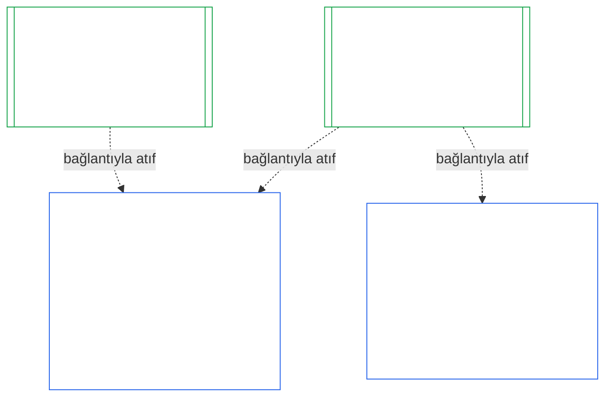

### 1. Amaç ve Rol

<strong>İz</strong>

- Üst kaynaklar:
  - [Yedinci Bölüm §1 Sistem ve Kurumsal Tüzüklerin Gerektiği Durumlar](core_07.000_charters.md#1-when-system-and-institutional-charters-are-required) (7.000 §1);
  - [Dokuzuncu Bölüm Kısım A §1 Amaç ve Rol](core_09.000_system_alignment_certification_evaluation.md#1-purpose-and-role) (9.000 §1);
  - [Madde XI-E](core_06.005_rights_part_b.md#article-xi-e-institutional-formation-and-business-creation) (*Kurumsal Oluşum ve İş Kurma*);
  - [Madde XXVIII-A](core_06.020_rights_part_e.md#xxviii-a-existing-instantiations-adoption-transition-window) (*Aşamalı Benimseme ve Hak Tabanı Sürekliliği*).
- Alt kaynaklar: [§2](#2-institution-class-evaluation); [§6](#6-forum-process); [§7](#7-certification-outcomes); [§9](#9-recertification-and-reopening).
- Şunlarla birlikte okuyun:
  - [Kurum](core_05.040_band_continuity.md#institution);
  - [Kurumsal Tüzük](core_05.040_band_continuity.md#institutional-charter);
  - [Sistem Tüzüğü](core_05.040_band_continuity.md#system-charter);
  - [İş Kurma](core_05.055_band_participation.md#business-creation).

 

*Yalın dille: bir sistemin sertifikasyonu sisteme aittir. Bir kurumun sertifikasyonu, bu sertifikasyonlara gönderme yapar ve yalnızca kurumun hesap verebileceği hususları ekler. Bir sistem birden çok kurum altında veya hiçbir kurum altında yer alabilir. Buradaki hiçbir şey, bir kurum kurmanın önüne sertifikasyon engeli koymaz.*

Kurumsal uyum sertifikasyonu ile Sistem Uyumu Sertifikasyonu, bir bağlantıyla birleştirilmiş iki sertifikasyondur. İlişki, içerilme değil **bağlantıyla bileşimdir**. Şekilde ok, bir Kurumsal Sertifikasyon Kaydının atıfta bulunduğu her Sistem Sertifikasyon Kaydına bağlantıdan ilerler. Hiçbir Kurum altında olmayan bir Sistemin oku yoktur ve buna ihtiyacı da bulunmaz; Sistem işletmeyen bir Kurumun ise tek başına bir kaydı vardır.

Bağlantıyla bileşimin iki yönü vardır; önce Kurumun yönü:

Kurum yönünden:

- **Kurumsal Sertifikasyon Kaydı, Sistemin kaydına atıfta bulunur ve onu yeniden değerlendirmez:** Sistem Sertifikasyon Kaydına bağlantıyla atıfta bulunur ve sürümünü belirtir. Bu Bölüm bir Sistem değerlendirmesini hiçbir zaman yeniden yürütmez, Sistem sınıfına ilişkin kararı hiçbir zaman yeniden vermez ve Sistemin sonucunu, durumunu veya sertifikasyon koşullarını hiçbir zaman değiştirmez.
- **Kurumun sertifikasyonu bir Sistemin sertifikasyon düzeyini yükseltemez:** Sertifikalı Değil durumundaki bir Sistem, Kurumun durumu ne olursa olsun Sertifikalı Değil kalır. Sertifikasyonu bulunan bir Sistem, Kurum hakkında verilen bir bulgudan koruma kazanmaz.
- **Kurumsal olgular bir kez tespit edilir:** [Dokuzuncu Bölüm Kısım A §3.1 Yönetişim, Teşvik ve İtiraz Edilebilirlik Disiplini](core_09.000_system_alignment_certification_evaluation.md#31-governance-incentive-and-contestability-discipline) işletmecinin yönetişimi ve teşvikleri hakkında soru sorduğunda, işletmeciye ait güncel Kurumsal Sertifikasyon Kaydı bu olguları bağlantı yoluyla sağlayabilir. Sistemin forumları yine de bu olguların o Sistem için yeterli olup olmadığına karar verir. Nedenini Sistem Sertifikasyon Kaydında açıklamadan aynı kurumsal olgu hakkında farklı bulguda bulunamazlar.

Sistem yönünden:

- **Sistem Sertifikasyon Kaydı Sisteme aittir:** [Dokuzuncu Bölüm](core_09.000_system_alignment_certification_evaluation.md#chapter-nine-system-alignment-certification) uyarınca Sistemin kendi kaydıdır.
- **Bir Sistem Sertifikasyon Kaydına birden çok Kurum atıfta bulunabilir:** [Yedinci Bölüm §1 Sistem ve Kurumsal Tüzüklerin Gerektiği Durumlar](core_07.000_charters.md#1-when-system-and-institutional-charters-are-required) uyarınca bir Sistem birden fazla Kurum tarafından işletilebilir, gözetilebilir veya esaslı biçimde kontrol edilebilir. Her biri aynı kayda atıfta bulunur.
- **Bir Sistemin herhangi bir Kurum altında bulunması gerekmez:** Tek bir algılayan Kurum değildir; dolayısıyla bir Sistemin altında hiç Kurum olmayabilir. Kurumsuz bir Sistem yalnızca [Dokuzuncu Bölüm](core_09.000_system_alignment_certification_evaluation.md#chapter-nine-system-alignment-certification) uyarınca sertifikalandırılır ve bu Bölümden hiçbir şeye ihtiyaç duymaz. Bir Kurum altında bulunan Sistem de aynı biçimde sertifikalandırılır: bu Bölüm Kurum için ayrı bir kayıt ekler; Sistemin kendi sertifikasyonunun bir adımı değildir.

#### 1.1 Kim sertifikalandırılır

L veya daha üst sınıftaki bir Kurum, sınıfın [§2.1 Kurum sınıfı](#21-institution-class) uyarınca belirlendiği bu Bölüm kapsamındadır. Buna hiçbir Sistem işletmeyen Kurum da dahildir: atıfta bulunacağı bir Sistem Sertifikasyon Kaydı yoktur ve sınıfı kendi etkisine göre belirlenir. Bir Kurumun **portföyü**, işlettiği, gözettiği veya esaslı biçimde kontrol ettiği Sistemler kümesidir ([Portföy](core_05.040_band_continuity.md#portfolio)).

- **A, B, C ve L Sınıfları:** süreç uygulanır ve [§2.2 Sınıfa göre ölçeklendirme](#22-scaling-by-class) uyarınca sınıfa göre ölçeklendirilir.
- **P Sınıfı:** süreç teşvik edilir ve gönüllü olarak kullanılabilir. L veya üst sınıfa yeniden sınıflandırıldığında ya da Kurum anayasal uyum iddiasında bulunduğunda zorunlu hâle gelir. Yeni bir maddi yetki almaya karar veren P Sınıfı Kurum, [§9.2.2 Yeni maddi yetki için yeniden sertifikasyon](#922-recertification-for-new-material-authority) kapsamındaki bildirimi verdiğinde en az L Sınıfına yeniden sınıflandırılır; çünkü bu yetki tanım gereği maddidir ([§9.2.1 Yeni maddi yetki sayılanlar](#921-what-counts-as-new-material-authority)) ve herhangi bir alanda maddi olan Kurum en az L Sınıfındadır ([§2.1 Kurum sınıfı](#21-institution-class), 2. madde). Yeniden sınıflandırma, bildirimden bildirimin izin verilmeden önce geri çekilmesine ya da yetkiye izin verilmemesine kadar sürer; bunun için yetkinin altında hiçbir işlem yapılmamış olmalıdır. Kurum daha sonra P Sınıfına döner ve sınırlı ilk sertifikasyon sona erer. Yeni bir bildirim bu süreci yeniden başlatır; izin alınmadan yetkinin kullanılması ise [§9.2.2 Yeni maddi yetki için yeniden sertifikasyon](#922-recertification-for-new-material-authority) (*Bildirim olmadan veya izin verilmeden önce*) kapsamındaki bulgu olarak kalır. Bu, [Dokuzuncu Bölüm Kısım A §1 Amaç ve Rol](core_09.000_system_alignment_certification_evaluation.md#1-purpose-and-role) hükmünü yansıtır.
- **Tek Sistem:** Sistem Tüzüğü gerektiren tam olarak bir Sistem işleten Kurumun tek sertifikasyon turu ve bu Bölümün **tek Sistem değerlendirmesi** dediği tek bir kaydı vardır. Sistem Sertifikasyon Kaydı, [§8 Kurumsal Sertifikasyon Kaydı](#8-institutional-certification-record) kapsamındaki maddeleri içeren bir *kurumsal bulgular bloğu* taşır ve Kurumsal Sertifikasyon Kaydı işlevini görür. Forumlar, koltuklar ve süreler, kurumsal maddeler eklenmiş olarak Sistemin kendi sertifikasyon turuna aittir. Sonuçlar, [§7.4 Bir Kurum için ret ve iptal](#74-denial-and-revocation-for-an-institution) hükmünde belirtildiği üzere kendi ret ve iptal gerekçelerine tabidir. Sistem tüm portföy olduğundan [§9.5 Sistem sertifikasyonlarından kaynaklanan zincirleme etkiler](#95-cascade-from-system-certifications) bir zincirleme etki olarak uygulanmaz; ancak [§7.4 Bir Kurum için ret ve iptal](#74-denial-and-revocation-for-an-institution) kapsamındaki 1. ve 2. kurallar (gösterge ve nedenin nerede bulunduğu sınaması) uygulanır.
- **Birden Çok Sistem:** Kurum için tek bir Kurumsal Sertifikasyon Kaydı oluşturulur ve işlettiği her Sistemin Sistem Sertifikasyon Kaydına bağlantı verir. Her Sistem kendi turunu ve kaydını korur.
- **Sistem Yok:** Kurumun tek başına bir Kurumsal Sertifikasyon Kaydı bulunur. Kurum Sistem işletmediği için bağlantı vereceği bir Sistem Sertifikasyon Kaydı yoktur.

