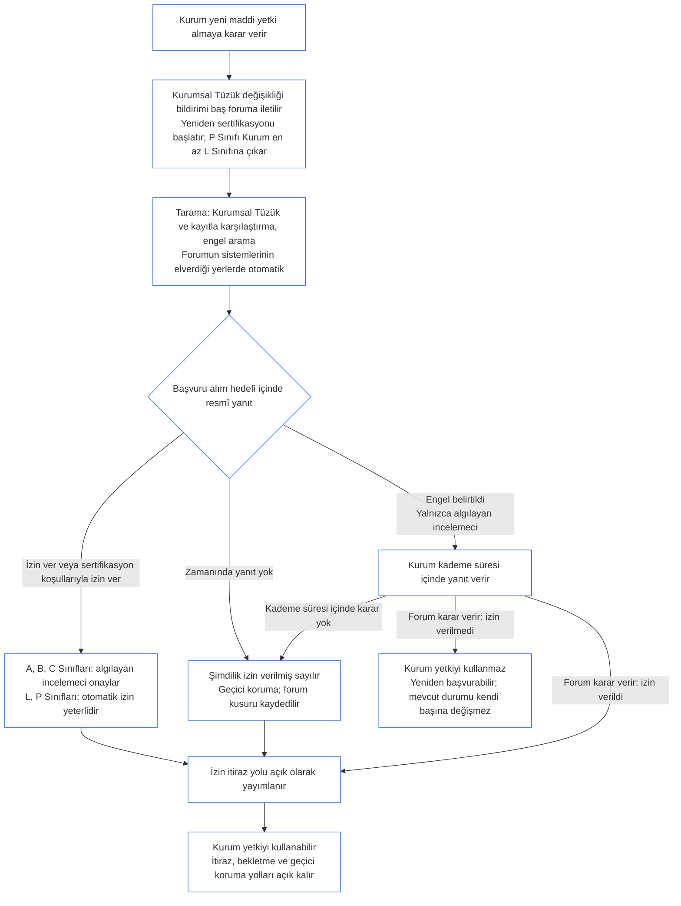

##### 9.2.2 Yeni maddi yetki için yeniden sertifikasyon

Yeni maddi yetki almaya karar veren Kurum yeniden sertifikalandırılmalı ve bu yetkiyi kullanmadan önce sonucu beklemelidir. **Madde XI-E** (*Kurumsal Oluşum ve İş Kurma*) bu beklemeyi belirtir. Süreç şöyledir:

- **Önce bildirim:** Kurum, [Yedinci Bölüm §7.1 Belgeyi değiştirme](core_07.000_charters.md#71-changing-the-document) uyarınca zaten gereken Kurumsal Tüzük değişikliği bildirimini verir ve bunu baş foruma iletir. Bildirim yeniden sertifikasyonu başlatır.
- **Henüz kayıt yoksa:** Kurumsal Sertifikasyon Kaydı bulunmayan bir Kurum aynı bildirimi verir. Bildirim, [§3 Tüm Kurum Sertifikasyonu Değerlendirmesi](#3-whole-institution-certification-evaluation) ile [§5 Hak Tabanı ve Alan Değerlendirmeleri](#5-rights-floor-and-domain-evaluations) kapsamındaki değerlendirmeler yetkiyle ilgili olduğu ölçüde, Kurumsal Tüzüğe göre değerlendirilen ve yeni yetkiyle sınırlı ilk sertifikasyonu başlatır. İlk sertifikasyonun geri kalanı [§1.3 İlk sertifikasyon süresi](#13-window-for-the-first-certification) uyarınca işlemeye devam eder (bildirimle yeniden sınıflandırılan P Sınıfı Kurum için süre bildirim tarihinde başlar); yeni yetki için bekleme buna bağlı değildir.
- **Kademe süreleri içinde:** Yeniden sertifikasyon, varsayılan olarak kurum sınıfıyla eşleşen kademeyle, [Dokuzuncu Bölüm Kısım C §9.3.4 Kademe süreleri](core_09.010_system_alignment_certification_record_recertification.md#934-tier-windows) uyarınca yürütülür. Sürenin kaçırılması [Madde XXVI-C](core_06.020_rights_part_e.md#article-xxvi-c-timely-resolution-and-anti-delay-floor) (*Zamanında Çözüm ve Gecikmeyi Önleme Tabanı*) uyarınca ele alınır; ücret ve bekleme engel hâline gelemez ([Kaçınılabilir Yük](core_05.040_band_continuity.md#avoidable-burden)).
- **Mümkün olan her yerde otomatik:** Bildirim, yeni yetkinin Kurumsal Tüzük ve güncel kayıtla karşılaştırılması, engel taraması ve izin; forumun sistemlerinin elverdiği her yerde otomatikleştirilir. [Birinci Bölüm §13.3 Kaçınılabilir Yükü En Aza İndirme](core_01.005_interaction_interpretation.md#133-minimization-of-avoidable-burden) otomasyonu önlenebilir yük için tercih edilen çözüm yapar; [Birinci Bölüm §16.4 Eylem Sırasında Belgeleme](core_01.010_stewardship_capacity_principles.md#164-document-at-action) ise otomasyon yükünü sorumlu yöneticiye değil sisteme yükler.
  - **İzin verir, reddetmez:** Otomatik tarama yeni yetkiye doğrudan veya güncel kaydın zaten desteklediği sertifikasyon koşullarıyla izin verebilir. Tek başına bir engel ([§9.2.3 Yeni maddi yetkiye izin verilmesinin önündeki engeller](#923-blockers-to-clearing-new-material-authority) içinde sayılanlardan biri) belirtemez veya izin vermeyi reddedemez. Tarama olası bir engeli işaretleyebilir, ancak bunu yalnızca baş forumdaki bir algılayan incelemeci, işaretleneni inceledikten sonra belirtebilir.
  - **A, B ve C Sınıfları:** Baş forumdaki bir algılayan incelemeci, her izni resmî yanıt sayılmadan önce onaylar. Bu, bu sınıflardan birindeki Kuruma ve yeni yetkinin sınıfını bu sınıflardan birine yükselteceği Kuruma uygulanır. Başvuru alım hedefi onay için de geçerlidir. İncelemeci baş forumda yer alır; bu forum zaten doğrulama veya yetkilendirme koltuğunu üstlenir ve Kurumdan bağımsız olmalıdır ([§6.1 Kurumsal sertifikasyonda dört koltuk](#61-four-seats-in-an-institutional-certification)).
  - **L ve P Sınıfları:** Otomatik izin, onay alınmadan resmî yanıt sayılır. P Sınıfı Kurum bildirim verdiğinde en az L Sınıfına yeniden sınıflandırıldığından ([§1.1 Kim sertifikalandırılır](#11-who-is-certified)), ona L Sınıfı kuralı uygulanır.
  - **Olağanüstü durumlar:** Tarama olası bir engel işaretlerse, yetkinin kapsamda veya maddi olup olmadığını belirleyemezse ya da Kurum veya etkilenen bir algılayan inceleme isterse, her sınıfta konuyu bir algılayan incelemeci üstlenir. İnceleme talebi [eşleşen başvuru alım hedefi](core_05.040_band_continuity.md#tier-window) içinde, talep tarihinden başlayarak yanıtlanır. Kademe süresini uzatmaz.
  - **Aynı kayıt ve süreler:** Kayıt, yapılan denetimleri gösterir; bu nedenle otomatik izne diğer her karara olduğu gibi itiraz edilebilir. Otomasyon başvuru alım hedefini veya kademe süresini uzatmaz; çalışmayan veya yanıt vermeyen tarama, aşağıdaki madde uyarınca yanıtın kaçırılmasıdır. Forum, kullandığı herhangi bir Sistem için olduğu gibi taramanın sorumluluğunu da üstlenir ([§6.3 Kurumlar olarak forumlar, sertifikalandıranlar ve kayıt büroları](#63-forums-certifiers-and-record-offices-as-institutions)).
- **Bekleme:** Kurum, yeniden sertifikasyon izin verene kadar yeni yetkiyi kullanmaz.
  - **Her sınıf bekler:** Hiçbir sınıf bu yükümlülükten muaf değildir; acil durum veya ivedilik de beklemeyi kaldırmaz.
  - **Diğer her şey sürer:** Kurumun zaten yaptığı işler devam eder ([§1.2 Kurum Kurmak veya İşletmek İçin İzin ve Kapı Koşulu Yoktur](#12-no-permission-and-no-gate-on-forming-or-running)).
  - **Koruma beklemez:** Forumların etkilenen algılayanlara acil koruma sağlaması yeniden sertifikasyonu beklemez ([Dokuzuncu Bölüm Kısım B §6.2 Gözetim sırası](core_09.005_system_alignment_certification_record_process.md#62-supervisory-sequence)). Bu koruma algılayanları korur; Kuruma yetkiyi erken kullanma gerekçesi vermez.
- **İzin verilince yayımlanır:** Baş forum, geçici olarak verilmiş izin de dâhil, her izni verildiği anda yayımlar ve [§10 Bir Sertifikasyona İtiraz](#10-challenging-a-certification) kapsamındaki itiraz yolunu açık tutar. Kurum iznin ardından yetkiyi kullanabilir. Bildirim süresini veya itirazın karara bağlanmasını beklemez. Etkilenen bir algılayan, diğer kararlar gibi izne itiraz edebilir ve bekletme veya geçici koruma isteyebilir; bu istek bekletilmez ([§9.2.2 Yeni maddi yetki için yeniden sertifikasyon](#922-recertification-for-new-material-authority), *Koruma beklemez*). Yayımlama sırasında baş forum ayrıca izni, bildiği etkilenen algılayanlara ve ilgili Sistemlerin forumlarına bildirir. Bekletme veya geçici koruma talebi eşleşen başvuru alım hedefi ([CF-14.445 §3.1 Aşama Hedefleri ve Üst Sınırlar](corpus_forum/cf_14.445_performance_backlog_publication_accessibility.md#cf-14445-31-stage-targets-and-outer-bounds)) içinde veya ilgili olduğunda Acil durum ayarının sınırı içinde yanıtlanır.
- **İzin verildiği varsayılır:** Yetkiye izin verildiği varsayılır. Baş forum, yalnızca kayıtta belirtilmiş kanıta dayanarak [§9.2.3 Yeni maddi yetkiye izin verilmesinin önündeki engeller](#923-blockers-to-clearing-new-material-authority) içinde sıralanmış bir engeli gösterirse izin vermeyi reddeder. Engelle bağlantılı sertifikasyon koşulları engeli kapsayabilecekse yetki reddedilmez; bu koşullarla izin verilir.
- **İzin ne anlama gelir:** Yeniden sertifikasyon, koşullu veya koşulsuz geçici ya da tam sertifikasyonla sonuçlanır; yetki kullanılmadan önce gereken her sertifikasyon koşulu bağımsız olarak doğrulanır.
- **Forum zamanında yanıt vermezse:** Baş forum, eşleşen başvuru alım hedefi ([CF-14.445 §3.1 Aşama Hedefleri ve Üst Sınırlar](corpus_forum/cf_14.445_performance_backlog_publication_accessibility.md#cf-14445-31-stage-targets-and-outer-bounds)) içinde resmî yanıt vermekle yükümlüdür. Yanıt yetkiye izin verir, sertifikasyon koşullarıyla izin verir veya dayandığı kanıtlarla bir engel belirtir. Engel belirten yanıt Kuruma cevap fırsatı tanır; forum yukarıda belirtilen kademe süresi içinde karara varır.
  - **Şimdilik izin verilmiş sayılır:** Başvuru alım hedefi içinde resmî yanıt gelmezse veya belirtilen engel kademe süresi içinde karara bağlanmazsa, [Dokuzuncu Bölüm Kısım B §7.2 Sertifikasyon Kusurları ve Düzeltme](core_09.005_system_alignment_certification_record_process.md#72-certification-defects-and-correction) uyarınca geçici koruma ve güvenme sınırlarıyla yetkiye şimdilik izin verilir.
  - **Forum kusuru:** Hedef veya sürenin kaçırılması Kurumun kusuru değil, forum kusurudur. Bu durum kaydedilir, düzeltilir ve [On Dördüncü Bölüm §6 Zamanında çözüm, esaslılık kademeleri ve gecikmeyi önleme disiplini](core_14.000_forum.md#6-timely-resolution-materiality-tiers-and-anti-delay-discipline) (*Süre aşımı incelemesi*) uyarınca süre aşımı olarak incelenir.
  - **Başka foruma devredilirse:** Yeniden sertifikasyon talebi aynı ailedeki başka bir foruma aktarılır ([On Dördüncü Bölüm §3 Aktarım, birleştirme ve eşgüdüm](core_14.000_forum.md#3-transfer-consolidation-and-coordination--continuity-and-anti-capture)). Bu forum, Kurumun sınıfı için olağan süreleri aktarım tarihinden başlayarak uygulayıp yeniden sertifikasyonu yürütür.
- **İzin verilmezse:** Kurum yetkiyi kullanmaz ve Dokuzuncu Bölüm Kısım B §7.4 (*Kalıcı yasak değildir*) koşullarında yeniden başvurabilir. Yeni yetkiye izin verilmemesi, Kurumun hâlihazırda yaptığı işler için sahip olduğu sertifikasyon durumunu kendi başına reddetmez veya iptal etmez. Bu durum yalnızca [§7.3 Bir Kurum için telafiye hazırlık](#73-remediation-readiness-for-an-institution) ve [§7.4 Bir Kurum için ret ve iptal](#74-denial-and-revocation-for-an-institution) uyarınca bir bulgu üzerine değişir.
- **Bildirim olmadan veya izin verilmeden önce:** Bildirim vermeden veya izin çıkmadan yeni maddi yetkiyi kullanmak, Kurumsal Tüzük kapsamı dışında uygulamadır. [§3 Tüm Kurum Sertifikasyonu Değerlendirmesi](#3-whole-institution-certification-evaluation) (1. madde) uyarınca bulgudur ve Kurumsal Tüzük olayı olarak incelemeyi yeniden açar.

<strong>Okur rehberi (işlemsel değil): yeni maddi yetki için bekleme</strong>

Bu şekil, §9.2.2 Yeni maddi yetki için yeniden sertifikasyonu özetler. Metinden farklı olduğu yerde metin geçerlidir. Kurumun zaten yaptığı her şey boyunca devam eder ve etkilenen algılayanlara acil koruma hiçbir zaman bekletilmez. Kurumlara ilişkin uygulamalı örnekler [CS-9.320 §12 Örnek Kurum incelemeleri](corpus_systems/cs_09.320_system_alignment_certification_illustrations.md#cs-9320-12-illustrative-institution-walkthroughs) bölümündedir.

 

